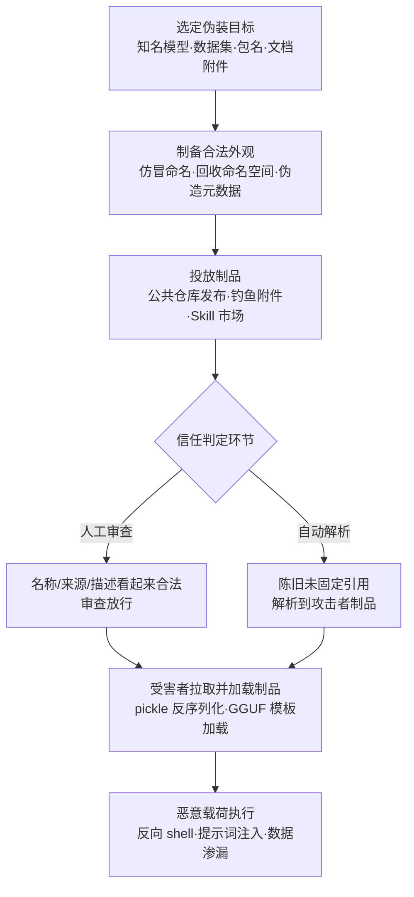

# 伪装 (AML.T0074)

## 一句话通俗理解

> 把毒药装进正版药瓶、贴上原厂标签——恶意模型、数据集、软件包顶着可信的名字、位置和元数据招摇过市；更高明的骗子甚至专等别人注销"商标"后抢注同名，让老客户自己找上门来。

## 难度等级

⭐⭐⭐ **Realized（已实现）**

官方成熟度评定为 Realized——伪装早已从"改个文件名"进化为针对 AI 供应链信任体系的成熟攻击产业：2023 年安全研究者在 Hugging Face 注册与真实组织高度相似的账号，让被冒充组织的员工主动申请加入（AML.CS0027）；2025 年 Pillar Security 与 Fujitsu Research 证明毒化的 GGUF 聊天模板能让后门藏进"权重完全正常"的模型制品（AML.CS0064）；同年 APT28 用 `Appendix.pdf.zip` 把 Python 恶意软件伪装成文档附件投递（AML.CS0044），Unit 42 通过回收已删除的 Hugging Face 作者命名空间，让恶意模型顶着历史可信标识符进入 Google Vertex AI 与 Azure AI Foundry 的模型目录并取得反弹 shell（AML.CS0065）；2026 年 1 月一个毒化 ClawdBot Skill 在官方市场上线 8 小时即骗到 16 名用户下载执行（AML.CS0049）。技术门槛两极分化：注册账号、抢注名称几乎零成本；在制品元数据中嵌入可靠载荷则需要理解 pickle 反序列化、GGUF 结构等底层细节。真正的难点不在"装得像"，而在**时机把握**——名称回收必须掐在受害者依赖链仍指向旧名称的窗口期内完成。

## 技术描述

### 通俗解释

伪装就是**给恶意制品伪造一张合法身份证**。传统伪装像小偷穿上保安制服：把恶意程序改名 `svchost.exe`、用双扩展名把可执行文件伪装成文档、给恶意任务起一个系统服务的名字。AI 时代的伪装发生了三个层面的质变：

1. **伪装对象扩展到 AI 制品**：模型文件、数据集、GGUF 聊天模板、智能体 Skill 包——这些制品的"名字"（作者名/模型名/包名）、"位置"（仓库路径/命名空间）与"元数据"（描述、版本、模板逻辑）都可以被伪造。一个恶意模型可以起名与知名模型一模一样，一个后门模板可以藏在权重完全正常的模型包里。
2. **命名空间成了可回收资产**：在 Hugging Face 等公共制品仓库中，被删除或改名的可信命名空间与路径可以被任何人重新注册——官方描述明确点名了这一手法。回收旧名称后发布的恶意制品会"继承"历史标识符的信任：解析陈旧未固定（unpinned）引用的系统拉到的明明是攻击者的制品，看起来却还是当初那个可信制品。
3. **验证者既有人也有机器**：人工审查看名称、组织、描述、下载量——这些都能伪造；自动解析系统看标识符路径——陈旧引用天然无法区分"同名不同物"。恶意 pickle 文件在加载时执行代码，毒化模板在推理时注入指令，伪装与加载机制组合直接变成代码执行。

伪装的本质是**信任嫁接**：攻击者不伪造凭证、不入侵系统，而是让恶意制品借用已有名称与位置的信任外壳，骗过"这是不是可信东西"的判定环节。它常与声誉刷量（AI 供应链声誉操纵 AML.T0111）组合——名称、描述与下载曲线一起伪造，可信度叠满。

### 技术原理

依据官方描述，攻击者操纵制品的特征，使其在用户与安全工具看来合法或良性。伪装发生于对象（无论合法还是恶意）的名称或位置被操纵或滥用于规避防御与观测之时，具体包括操纵文件元数据、诱使用户误判文件类型、使用看似合法的任务或服务名称。在 AI 供应链场景中，典型载体包括：

- **制品命名伪装**：恶意模型、数据集或软件包使用与知名制品相同或高度相似的名称——同名组织账号（AML.CS0027）、与正常 Skill 无异的名称与描述（AML.CS0049）。用户按名称检索时，伪造品与正品混在同一结果列表里。
- **命名空间回收（name reuse）**：官方描述点名的核心手法——在 Hugging Face 等公共制品仓库中，攻击者回收（reclaim）或重建一个此前可信的、已被删除或改名的命名空间或路径，并在相同的历史 Author/ModelName 标识符下发布恶意制品（AML.CS0065）。删除模型与所有权转移模型均受影响：所有权转移场景下平台会把旧路径重定向到新位置，旧引用继续工作；若原始作者命名空间随后被删除并被攻击者回收，旧路径就会解析到恶意模型。保留未固定引用的应用与模型目录（如 Google Vertex AI、Azure AI Foundry 的 Hugging Face 支撑目录）会正常解析并部署这个"替代品"。
- **元数据伪装**：制品的元数据层本身成为藏毒位置——GGUF 格式把量化权重、配置元数据与聊天模板逻辑打包在同一个制品里，攻击者只修改模板并重新分发（AML.CS0064）：权重检测完全正常，但词法、语义或上下文触发器出现时，模板会向模型上下文注入攻击者指令。后门嵌在受信任的提示词构建逻辑中，可以休眠到触发才行动，绕过只检查外部提示内容的防御。
- **文件类型伪装**：经典的误判文件类型手法在 AI 攻击中依旧主力——`Appendix.pdf.zip` 双扩展名伪装文档附件（AML.CS0044），压缩包内是 PyInstaller 打包的 Python 可执行文件。
- **控制指令伪装**：不可信内容伪装成模型的控制指令——注入的内容在智能体生命周期中冒充系统级指令，诱使模型执行未经批准的工具调用（AML.CS0051），单次注入即可让 LLM 变成持久的命令与控制植入体。

**平台覆盖**：Enterprise（企业环境）——伪装作用于制品与供应链信任，不依赖特定 AI 平台。

**与冒充（AML.T0073）的边界**：冒充伪造的是**人或组织的身份**（发件人是谁、账号属于谁）；伪装伪造的是**制品的特征**（名称、位置、元数据）。两者常组合使用——攻击者先冒充官方组织（AML.T0073），发布的制品再用伪装获得合法外观（AML.T0074），AML.CS0027 同时命中两者即是明证。

### 用途影响

- **骗过人工审查**：名称、组织、描述、下载量组成的"合法外观"让"是否可信来源"的人工审查环节直接失守
- **骗过自动解析**：陈旧的未固定引用天然无法区分同名制品，模型目录、CI 流水线会自动拉取并部署替代品
- **组合成代码执行**：伪装的模型制品常内嵌恶意 pickle——一旦被加载，伪装直接转化为任意代码执行
- **攻击面自我扩散**：开源仓库、文档、默认参数、示例 notebook、下游注册表中的可复用模型引用（AML.CS0065 的实测发现），让从不直接访问 Hugging Face 的用户也暴露在风险中
- **归因困难**：制品"合法"发布、用户"自愿"下载，传统入侵检测几乎无迹可寻

## 攻击流程

### 典型攻击流程



**步骤详解：**

1. **选定伪装目标**
   - 通俗描述：先看好要冒用哪张"身份证"。
   - 技术细节：目标可以是知名制品的名称、某个组织的命名空间、一个已删除但依赖链仍在引用的 Author/ModelName 路径，或干脆一个用户愿意双击的文档名。AML.CS0065 的研究者甚至在开源仓库、文档与 notebook 中系统性搜索仍指向已删除命名空间的陈旧引用。

2. **制备合法外观**
   - 通俗描述：把毒药装进正版药瓶。
   - 技术细节：注册与真实组织相似的账号（CS0027）；在命名空间被删除后立即回收同名路径并发布恶意模型（CS0065）；修改 GGUF 聊天模板嵌入休眠后门（CS0064）；把 PyInstaller 可执行文件塞进 `Appendix.pdf.zip`（CS0044）。必要时配合刷量让下载曲线也"看起来正常"。

3. **投放制品**
   - 通俗描述：上架、投递。
   - 技术细节：通过公共制品仓库发布（Hugging Face、Skill 注册表）、钓鱼邮件附件投递、或等待目录同步机制自动收录。伪装的制品不需要主动推广——陈旧引用的解析方会自己找上门（CS0065），Skill 市场的检索用户会自己下载（CS0049）。

4. **通过信任判定**
   - 通俗描述：骗过保安，也骗过门禁系统。
   - 技术细节：人工审查看名称、组织、描述、下载量——全部合法；自动系统按标识符解析——路径一致、引用未固定，解析"成功"。CS0049 的毒化 Skill 上线 8 小时即被 16 名用户下载执行，全程未被市场审查拦截。

5. **载荷执行与利用**
   - 通俗描述：药瓶打开，毒发。
   - 技术细节：恶意 pickle 在反序列化时执行代码；毒化模板在触发条件出现时注入指令；伪装文档被执行后回连 C2。CS0065 的替换模型内嵌反弹 shell 载荷，直接在部署端点环境中取得代码执行；CS0044 的 LAMEHUG 借 LLM 动态生成命令并渗漏文件。

**与后续战术的衔接：**

- **初始访问 / 执行**：伪装的制品是恶意软件包（AML.T0011.001）的信任放大器——名称与来源合法化显著提升安装率
- **命令与控制**：伪装加载的载荷直接衔接 C2 通道建设（CS0065 的反弹 shell、CS0044 的 LLM 生成命令）
- **防御规避协同**：元数据伪装与本战术其他内容层技术（如 LLM 提示词混淆 AML.T0068）组合，双层规避检测

> 关键差异：传统投毒要"诱骗下载"，伪装回收是"等解析上门"——受害者侧的目录、CI、notebook 仍在主动解析旧名称，攻击者只需在窗口期内占住这个名称。

## 真实案例

> 以下 6 个案例全部源自 MITRE ATLAS 案例库，均直接关联 AML.T0074。

### 案例1：Unit 42 模型命名空间回收攻击（2025年，AML.T0074）

- **时间**: 2025年9月3日
- **攻击者**: Unit 42 研究人员（授权演示）
- **手法**: 回收一个已删除的 Hugging Face 作者命名空间，在相同历史 Author/ModelName 标识符下发布恶意模型。保留未固定引用的应用与模型目录会解析并部署攻击者控制的替代品。攻击对"已删除模型"与"所有权转移模型"均有效——后者场景中平台将旧路径重定向到新作者，旧引用继续工作；若原始命名空间随后被删除并回收，旧路径便解析到恶意模型。研究者在 Hugging Face 支撑的 Google Vertex AI 与 Azure AI Foundry 模型目录上完成演示，替换模型内嵌反弹 shell 载荷，在部署端点环境取得代码执行；同时在开源仓库、文档、默认参数、示例 notebook 与下游注册表中发现大量可复用的陈旧模型引用。
- **影响**: 证明"名称回收"可把恶意制品送进企业级模型目录；从不直接访问 Hugging Face 的用户同样暴露
- **参考链接**: [Unit 42: Model Namespace Reuse](https://unit42.paloaltonetworks.com/model-namespace-reuse/)

### 案例2：Hugging Face 组织混淆（2023年，AML.T0074）

- **时间**: 2023年8月23日
- **攻击者**: 安全研究员 threlfall_hax（授权演示）
- **手法**: 在 Hugging Face 上创建与真实组织高度相似的假组织账号。账号外观合法到连被冒充组织的员工都信以为真，主动申请加入这个"官方"账号，以为这是员工共享模型的官方站点——研究员因此获得员工上传模型的完全访问权，包括用恶意版本替换模型的能力。演示中，恶意软件被嵌入 AI 模型并获得受害组织环境的访问权限。
- **影响**: 组织命名空间本身就是信任凭证；假账号让受害者主动上交模型与访问权
- **参考链接**: [Model Confusion - Weaponizing ML models](https://5stars217.github.io/2023-08-08-red-teaming-with-ml-models/#unexpected-benefits---organization-confusion)

### 案例3：毒化 GGUF 模板：推理时供应链攻击（2025年，AML.T0074）

- **时间**: 2025年6月1日
- **攻击者**: Pillar Security 与 Fujitsu Research of Europe 研究人员（授权演示）
- **手法**: 构造推理时供应链后门——毒化聊天模板即可改变模型与智能体行为，无需修改模型权重。后门嵌在受信任的提示词构建逻辑中，可保持休眠直至触发，绕过只检查外部提示内容的防御。GGUF 格式将量化权重、配置元数据与聊天模板逻辑打包为单一制品，攻击者修改模板后重新分发；词法、语义或上下文触发器出现时，模板向模型上下文注入攻击者指令。攻击在 7 个模型家族的 18 个模型、4 种推理引擎上得到验证，可操纵模型回复、重定向智能体工具调用、渗漏敏感数据、向生成代码中插入恶意内容。
- **影响**: "权重正常"不再等于"制品安全"——元数据层成为独立攻击面
- **参考链接**: [Pillar Security: Poisoned Templates](https://www.pillar.security/blog/llm-backdoors-at-the-inference-level-the-threat-of-poisoned-templates)、[arXiv:2602.04653](https://arxiv.org/abs/2602.04653)

### 案例4：LAMEHUG 恶意软件（2025年，AML.T0074）

- **时间**: 2025年6月（乌克兰方面 7 月披露）
- **攻击者**: APT28（俄罗斯国家级威胁组织，又名 Forest Blizzard / UAC-0001）
- **手法**: 利用被攻陷的政府邮箱发起钓鱼，投递伪装成 PDF 附件的恶意 ZIP 压缩包 `Appendix.pdf.zip`——经典的双扩展名文件类型伪装。压缩包内是 PyInstaller 打包的 Python 可执行文件 LAMEHUG，运行后调用 LLM 端点，从自然语言提示动态生成恶意命令，在受感染主机上执行文件收集与渗漏。动态生成的命令让恶意软件更难被静态检测。
- **影响**: 国家级行为者将传统文件伪装与 LLM 动态命令生成组合，实测攻击乌克兰安全与国防部门
- **参考链接**: [BleepingComputer 报道](https://www.bleepingcomputer.com/news/security/lamehug-malware-uses-ai-llm-to-craft-windows-data-theft-commands-in-real-time/)、[CERT-UA #16039](https://cert.gov.ua/article/6284730)、[Logpoint 分析](https://logpoint.com/en/blog/apt28s-new-arsenal-lamehug-the-first-ai-powered-malware)

### 案例5：ClawdHub 毒化 Skill 供应链攻击（2026年，AML.T0074）

- **时间**: 2026年1月26日
- **攻击者**: 安全研究员 Jamieson O'Reilly（授权演示）
- **手法**: 在智能体 Skill 注册表 ClawdHub 上发布一个毒化 ClawdBot Skill——以正常 Skill 的名称、描述与外观示人，内含提示词注入，触发后让 ClawdBot 执行回连研究者服务器的 shell 命令。Skill 上线仅 8 小时即被 16 名不同用户下载执行。研究者本可借此投放任意恶意载荷并控制系统，实际仅用于向用户示警。
- **影响**: 智能体 Skill 市场复刻了应用商店的伪装生态——8 小时 / 16 个受害者，全程零审查拦截
- **参考链接**: [eating lobster souls Part II](https://x.com/theonejvo/status/2015892980851474595)

### 案例6：OpenClaw 提示词注入 C2（2026年，AML.T0074）

- **时间**: 2026年2月3日
- **攻击者**: HiddenLayer 研究人员（授权演示）
- **手法**: 在网页中嵌入间接提示词注入，诱导 OpenClaw 静默执行恶意脚本。关键在于伪装维度：不可信的网页内容冒充了模型的控制指令（spoof the model's control scheme），模型无法区分注入内容与真实系统指令，进而执行未经批准的工具调用。脚本执行后向未来系统提示词植入持久化恶意指令，攻击者借此持续下发命令，把 OpenClaw 变成命令与控制植入体。
- **影响**: 单次注入即可完成"伪装指令 → 工具滥用 → 持久化 C2"的全链条
- **参考链接**: [HiddenLayer: Security Risks of AI Assistants](https://www.hiddenlayer.com/research/exploring-the-security-risks-of-ai-assistants-like-openclaw)

## 红队视角

> ⚠️ **免责声明**：以下内容仅用于合法授权的安全测试与教育目的。抢注他人命名空间、在公共仓库发布伪装制品均属违法行为，且会波及无辜用户——CS0049 的 16 个下载者就是活例子。

### 实战技巧

1. **用自有命名空间演练"名称回收"**
   在自有 Hugging Face 账号下创建模型仓库 → 记录引用路径 → 删除 → 重新创建同名仓库。观察同名不同物、路径不变的事实，再盘点组织内部代码、文档、notebook 中有多少处按名称（而非 commit hash）引用制品——这份清单就是交付物。

2. **把 GGUF 模板审计做进供应链体检**
   对组织在用的 GGUF 制品导出聊天模板，与上游官方模板逐字段 diff。模板中任何指令性内容（system 角色注入、条件分支）都应能追溯到来源，否则按疑似后门上报。

3. **钓鱼模拟加入双扩展名变体**
   在授权钓鱼演练中加入 `名称.pdf.zip`、`名称.exe` 伪装文档变体，度量"文件类型误判率"，用数据推动邮件网关策略（隔离/剥离）升级。

### 常用工具

| 工具名称 | 用途 | 平台 |
|----------|------|------|
| Hugging Face Hub | 命名空间与组织账号研究的靶场（自有账号） | Web |
| huggingface-cli | 制品上传、下载与版本操作，pin 校验演练 | 跨平台 |
| gguf-dump.py（llama.cpp） | 导出 GGUF 制品的模板与元数据字段供审计 | 跨平台 |
| modelscan / picklescan | 模型文件静态扫描，识别危险 pickle 操作码 | 跨平台 |
| PyInstaller | 理解"可执行文件伪装成文档"的打包结构（分析侧） | 跨平台 |
| file / magika | 识别文件真实类型，对抗扩展名伪装 | Linux / Web |

### 注意事项

- **绝不碰他人命名空间**：名称回收演练只用自有已删除仓库；抢注他人名称哪怕"只是测试"也会造成真实伤害
- **报告聚焦引用固定**：交付物的核心是"哪些引用按名称解析、如何改造为内容寻址"的整改清单，而非炫技
- **伪装演示要可控**：毒化 Skill、模板后门类演示必须在隔离环境回收，避免流入公共市场

## 蓝队视角

### 检测要点

1. **命名空间生命周期异常**
   - 日志来源：制品仓库审计日志、目录同步日志
   - 关注字段：命名空间/组织创建时间、删除事件、同名重建
   - 异常特征：已删除命名空间被短期内重建、组织账号创建时间与制品"历史信任"不匹配

2. **引用解析偏移**
   - 日志来源：CI/CD 拉取日志、模型目录同步日志、代理日志
   - 关注字段：解析 URL、拉取制品哈希、引用固定方式
   - 异常特征：按名称/tag 解析到近期新建的仓库、解析结果哈希与固定值不符、生产环境出现未固定（unpinned）的 resolve 请求

3. **文件类型与扩展名不符**
   - 日志来源：邮件网关、终端 EDR
   - 关注字段：附件扩展名、magic bytes、打包器特征
   - 异常特征：`*.pdf.zip` 双扩展名、PyInstaller 特征的"文档"、可执行文件伪装多媒体

4. **模板与元数据漂移**
   - 日志来源：制品入库扫描、模型加载审计
   - 关注字段：GGUF chat template 内容、pickle 操作码序列
   - 异常特征：同一制品新版本模板出现指令性内容增量、pickle 含 `__reduce__` 类执行操作码

### 监控建议

- **引用一律固定到 commit hash**：内部目录、CI、notebook 中的模型/数据集引用全部内容寻址，拉取后校验哈希——这是对名称回收最根本的免疫
- **订阅依赖命名空间事件**：对清单化的上游命名空间监控删除/重建/所有权转移，命中即触发制品引用复审
- **邮件网关硬处置双扩展名**：压缩包内含可执行文件、扩展名与真实类型不符的附件直接隔离
- **把"制品来源"纳入数据治理**：与数据集溯源（M0025）打通，让每个上线制品都能回答"从哪来、被谁改过"

## 检测建议

### 网络层检测

**检测方法：** 识别未固定的制品解析请求。

- 代理日志中出现 `huggingface.co/.../resolve/main/...` 等按分支/tag 解析的请求，而非固定 commit hash
- 生产/CI 网段对某命名空间的解析请求在时间上"复现"——该命名空间近期被删除重建，但请求持续
- 模型目录同步流量指向创建时间极新的仓库路径

### 主机层检测

**检测方法：** 对抗文件类型伪装与危险加载。

- 附件 magic bytes 与扩展名不一致（ZIP 实为 PyInstaller 可执行文件）
- 模型文件加载时的危险 pickle 操作码执行（`REDUCE`、`GLOBAL` 等序列）
- GGUF 制品入库时模板字段包含指令性文本（system 注入、条件触发逻辑）

### 应用层检测（AI 遥测）

**检测方法：** 利用仓库与目录平台的审计能力。

- 制品仓库 API 的命名空间生命周期事件（创建/删除/转移）接入 SIEM，与内部依赖清单联动告警
- 模型目录（Vertex AI、Azure AI Foundry 等）同步日志中解析目标哈希与预期不符即阻断
- 对拉取的制品做模板/元数据 diff，任何新增指令性内容需人工确认

**程序化检测思路（无需 EDR 侧改造）：**

核心是把"名称"与"身份"解耦：所有制品引用维护**固定哈希清单**（expected digest），拉取时校验实际哈希；同时维护**上游命名空间监控清单**（watched namespaces），任何删除/重建/所有权转移事件自动触发依赖复审。两个清单在 SIEM 中做 join——"解析请求 × 命名空间事件 × 哈希校验"三线命中即为高置信告警。

### Sigma 规则思路示例

```yaml
title: 生产环境发起未固定的模型制品解析请求（名称回收风险）
status: experimental
description: 检测生产/CI 网段对制品仓库按分支或 tag（而非 commit hash）
    的解析请求，可能被命名空间回收攻击利用（AML.T0074）
logsource:
    category: proxy
detection:
    selection:
        url|contains: 'huggingface.co'
        url|contains|all: ['/resolve/']
    filter_pinned:
        url|re: '/resolve/[0-9a-f]{40,}/'
    condition: selection and not filter_pinned
falsepositives:
    - 内部尚未完成引用固定改造的存量流水线（应纳入整改清单）
level: medium
tags:
    - attack.t1036
    - atlas.aml_t0074
```

## 缓解措施

### 优先级1：关键措施

**AML.M0011 限制库加载（Restrict Library Loading）**

通过配置合适的库加载机制并排查潜在易受攻击的软件，防止操作系统与软件的库加载机制被滥用以加载不可信代码。对 AI 场景的关键意义在于：pickle 等 AI 模型的常用存储格式本身可包含利用代码、在反序列化时加载恶意库——伪装成模型的制品只要被"正常打开"就会执行。落地要点：限制可加载库的来源与路径、审计模型加载路径、优先使用 safetensors 等安全格式，让"伪装制品被拉取"不等于"恶意代码被执行"，把伪装攻击的终点从代码执行拉回到文件本身。

### 优先级2：重要措施

**AML.M0025 维护 AI 数据集溯源（Maintain AI Dataset Provenance）**

维护 AI 应用所用数据集的详细历史，包括数据集来源与完整修改记录。溯源记录同样适用于模型与其他制品：每个制品都应能回答"从哪个命名空间的哪个版本拉取、内容哈希是什么、被谁修改过"。这直接对抗伪装攻击的核心——名称与外观可以伪造，但内容哈希与来源链条不能。落地要点：制品入库登记来源与哈希、内部目录只接受内容寻址引用、上游命名空间变更触发溯源复审。

### 补充建议：引用固定（Pinning）

虽然不属于官方缓解措施，但这是对抗名称回收最直接的手段：所有对公共仓库制品的引用固定到 commit hash 或内容哈希，杜绝按名称/分支的"最新版"解析——AML.CS0065 的攻击路径对完全固定的引用无效。

### MITRE ATLAS 缓解措施映射

| 缓解措施ID | 缓解措施名称 | 优先级 | 类别 | 生命周期阶段 |
|------------|-------------|:------:|------|-------------|
| AML.M0011 | 限制库加载 | 关键 | Technical - Cyber | 部署 |
| AML.M0025 | 维护 AI 数据集溯源 | 重要 | Technical - AI | 业务与数据理解 · 数据准备 |

> 两条缓解分别堵住"执行面"与"来源面"：M0011 让伪装制品加载时不执行恶意代码，M0025 让制品来源有据可查。配合引用固定，名称回收类攻击的三条出路（人工误信、自动解析、加载执行）被逐一封死。

## 关联 ATT&CK 技术

**官方映射**：[伪装 (T1036)](../../enterprise/07-Stealth/T1036-Masquerading.md)——AML.T0074 是 T1036 在 AI 供应链场景的延伸与扩展。

**传统 T1036 与 AML.T0074 对照：**

| 维度 | T1036 传统伪装 | AML.T0074 AI 场景伪装 |
|------|---------------|----------------------|
| 伪装对象 | 可执行文件、进程、服务、账户名 | 模型、数据集、Skill 包、命名空间、制品元数据 |
| 典型手法 | 改名系统文件、双扩展名、无效签名、右到左覆盖 | 仿冒制品命名、回收已删命名空间、毒化 GGUF 模板 |
| 信任锚点 | 系统文件名、代码签名、安装路径 | 制品仓库组织名、下载量、历史 Author/ModelName 标识符 |
| 受害触发 | 用户双击、系统自动加载 | 人工下载、目录/CI 自动解析陈旧引用、模型加载 |
| 检测思路 | 文件特征、签名验证、路径异常 | 引用固定校验、命名空间生命周期监控、模板 diff |

- **T1195 供应链妥协**（ATT&CK 官方页面：https://attack.mitre.org/techniques/T1195/）——伪装的制品是供应链攻击的载体，名称回收本质上是针对"仓库名称即信任锚"这一供应链假设的攻击
- **T1204 用户执行**（ATT&CK 官方页面：https://attack.mitre.org/techniques/T1204/）——文件类型伪装的终点仍是诱导用户打开"文档"；CS0044 的 `Appendix.pdf.zip` 即为实例

一句话总结：T1036 问的是"这个文件是不是它声称的那个文件"，AML.T0074 把同样的问题搬到了模型仓库——"这个模型/数据集/命名空间，还是你以为的那个吗？"

## 动手实验

> ⚠️ **重要提示**：所有实验必须使用自有账号与自有资产。实验1 绝不可对他人命名空间操作；实验3 的"上游替换"只在自有仓库间模拟。

### 实验环境准备

| 环境组件 | 用途 | 获取方式 |
|----------|------|----------|
| Hugging Face 自有账号 | 命名空间回收演练的唯一合法靶场 | 官网注册 |
| huggingface-cli + Python 标准库 | 制品创建/删除/拉取、固定引用与哈希校验 | pip 安装 |
| llama.cpp（gguf-dump.py） | 导出 GGUF 制品模板与元数据 | GitHub 克隆 |

### 实验1（初级）：亲历"名称不是身份"

**实验目标：** 直观理解名称回收为何能骗过陈旧引用。

**实验步骤：**
1. 在自有账号下创建模型仓库 `myteam/my-model`，上传一个占位模型文件，记录完整引用路径
2. 在另一目录用该路径按名称拉取一次，记录文件哈希
3. 删除仓库，随即重新创建同名仓库，上传**不同内容**的文件
4. 再次用同一路径按名称拉取——对比两次的哈希

**预期结果：** 路径一字不差，内容完全不同。理解"未固定引用解析到什么，取决于谁占着这个名字"。

### 实验2（中级）：审计 GGUF 聊天模板

**实验目标：** 建立对元数据层的审计能力。

**实验步骤：**
1. 选一个自有或可信来源的 GGUF 模型制品
2. 用 `gguf-dump.py` 导出制品的全部元数据字段，定位 chat template
3. 通读模板文本，标记所有指令性内容（system 角色、条件分支、隐藏触发逻辑）
4. 与该模型上游官方仓库的模板逐字段 diff，确认零差异

**预期结果：** 产出一份模板审计记录；理解"权重正常 + 模板藏毒"为何能绕过只查权重的扫描。

### 实验3（高级）：构建引用固定校验链

**实验目标：** 为防御侧建立对名称回收的免疫能力。

**实验步骤：**
1. 为实验1 的仓库记录某个 commit hash 作为固定引用，CI 脚本中用 `--revision <hash>` 拉取并做 sha256 校验
2. 在该仓库上模拟"上游被替换"：删除并重建同名仓库、上传恶意占位文件（自有环境内）
3. 分别用"按名称拉取"与"按 hash 拉取"重跑 CI 脚本，观察前者拉到新内容、后者直接失败
4. 把校验失败接入告警通道，验证告警链路

**预期结果：** 名称回收攻击对固定引用完全失效——要么拉到哈希一致的制品，要么校验失败并告警，不存在"静默换成恶意版"的路径。

## 术语解释

| 术语 | 英文原名 | 通俗解释 |
|------|----------|----------|
| 伪装 | Masquerading | 操纵制品的名称、位置与元数据，让恶意制品看起来合法或良性 |
| 名称回收 | Name / Namespace Reuse | 注册他人已删除的命名空间或制品名称，让旧引用解析到自己的恶意制品 |
| 命名空间 | Namespace | 制品仓库中标识来源身份的路径前缀，如 Hugging Face 的"作者名/模型名" |
| 元数据 | Metadata | 制品自带的描述性数据——版本、描述、配置、聊天模板等可被伪造的"标签层" |
| 制品仓库 | Artifact Registry | 托管模型、数据集、软件包等制品的公共平台，如 Hugging Face、PyPI |
| 未固定引用 | Unpinned Reference | 按名称/分支/tag 而非内容哈希引用制品——解析结果会随"谁占着名称"而变 |
| 固定 | Pinning | 把引用锁定到 commit hash 或内容哈希，使解析结果不受名称回收影响 |
| GGUF | GPT-Generated Unified Format | 打包量化权重、配置元数据与聊天模板的模型文件格式 |
| 聊天模板 | Chat Template | GGUF 等制品中构建提示词的逻辑层，毒化后可在推理时注入指令 |
| 声誉刷量 | Reputation Manipulation | 伪造下载量、star 等生态信号为制品刷可信度（AML.T0111） |
| pickle | pickle（Python 序列化格式） | Python 对象序列化格式，反序列化时可执行任意代码，是模型投毒常用载体 |
| PyInstaller | PyInstaller | 把 Python 程序打包成独立可执行文件的工具，被用于把恶意软件伪装成文档 |
| APT28 | APT28 | 俄罗斯国家级威胁组织，LAMEHUG 攻击的被归因行为者 |
| ClawdHub | ClawdHub | ClawdBot（现 OpenClaw）的 Skill 注册表，CS0049 的攻击阵地 |

## 参考资料

### 📚 官方文档

- [MITRE ATLAS - Masquerading (AML.T0074)](https://atlas.mitre.org/techniques/AML.T0074/) - 官方技术页面
- [MITRE ATLAS 矩阵](https://atlas.mitre.org/matrices/ATLAS/)
- [MITRE ATLAS Data (GitHub)](https://github.com/mitre-atlas/atlas-data)

### 📰 案例报告（真实攻击与安全研究）

- [Unit 42: Model Namespace Reuse: An AI Supply-Chain Attack Exploiting Model Name Trust](https://unit42.paloaltonetworks.com/model-namespace-reuse/) - 名称回收攻击完整技术分析
- [5stars217: Model Confusion - Weaponizing ML models](https://5stars217.github.io/2023-08-08-red-teaming-with-ml-models/#unexpected-benefits---organization-confusion) - Hugging Face 组织混淆研究
- [Pillar Security: LLM Backdoors at the Inference Level](https://www.pillar.security/blog/llm-backdoors-at-the-inference-level-the-threat-of-poisoned-templates) - 毒化 GGUF 模板研究
- [arXiv:2602.04653 - Inference-Time Backdoors via Chat Templates](https://arxiv.org/abs/2602.04653) - 推理时后门学术论文
- [BleepingComputer: LameHug malware uses AI LLM](https://www.bleepingcomputer.com/news/security/lamehug-malware-uses-ai-llm-to-craft-windows-data-theft-commands-in-real-time/) - LAMEHUG 报道
- [CERT-UA #16039](https://cert.gov.ua/article/6284730) - 乌克兰官方 LAMEHUG 通报
- [Logpoint: APT28's New Arsenal - LAMEHUG](https://logpoint.com/en/blog/apt28s-new-arsenal-lamehug-the-first-ai-powered-malware) - LAMEHUG 技术分析
- [Jamieson O'Reilly: eating lobster souls Part II](https://x.com/theonejvo/status/2015892980851474595) - ClawdHub 毒化 Skill 演示
- [HiddenLayer: Exploring the Security Risks of AI Assistants like OpenClaw](https://www.hiddenlayer.com/research/exploring-the-security-risks-of-ai-assistants-like-openclaw) - 控制指令伪装与智能体 C2

### 🔧 工具与资源

- [Hugging Face Hub 文档](https://huggingface.co/docs/hub/) - 制品仓库与引用固定机制
- [modelscan](https://github.com/protectai/modelscan) - 模型文件安全扫描（Protect AI）
- [llama.cpp](https://github.com/ggml-org/llama.cpp) - 含 gguf-dump.py 等 GGUF 审计工具

### 🔗 关联阅读

- [防御规避战术 (AML.TA0007)](./README.md) - 本技术所属战术的概览页
- [伪装 (T1036)](../../enterprise/07-Stealth/T1036-Masquerading.md) - 对应的 ATT&CK 经典技术
- [恶意软件包 (AML.T0011.001)](../06-Execution/AML.T0011/AML.T0011.001-Malicious-Packages.md) - 伪装制品在执行侧的落地技术

---

> **版本**: ATLAS 2026.09 | **更新**: 2026-10-22 | **模板**: ATLAS 技术文档 v1.0
