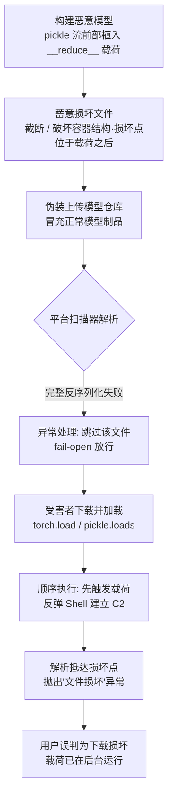

# 破坏 AI 模型 (AML.T0076)

## 一句话通俗理解

> 攻击者故意把藏了毒的模型文件弄"坏"：安检扫描器一看文件残缺、打不开，就当作普通损坏件放行了；可受害者加载文件时，"开箱"动作本身就先触发了陷阱——恶意代码在文件彻底报错之前已经抢先执行，等程序提示"文件损坏"时，木马早已落地。

## 难度等级

⭐⭐⭐ **Realized（已实现）**

官方成熟度评定为 Realized——这不是理论推演：2025 年 2 月，ReversingLabs 在 Hugging Face 模型仓库中发现了真实存在的此类恶意模型（案例 AML.CS0031），加载即执行反弹 Shell，而平台扫描器 Picklescan 对其全部放行。技术门槛本身不高：pickle 的 `__reduce__` 执行语义是公开文档知识，损坏文件更是"手工级"操作；真正需要功力的是精确控制"损坏点"落在恶意载荷**之后**——既让扫描器读不完整个文件，又让执行器先把毒释放完。

## 技术描述

### 通俗解释

一般的恶意软件规避思路是"把毒藏得扫描器认不出来"——加壳、加密、混淆签名。本技术反其道而行之："把包裹摔坏到扫描器打不开"。扫描器面对一个打不开的文件，只有两种选择：当成可疑拦截，或当成损坏跳过。只要扫描器的异常处理逻辑是后者（fail-open，失败即放行），攻击者就赢了——他根本不需要对抗任何检测规则，只需要让扫描流程**提前出错**。而 pickle 反序列化的"顺序执行"语义保证了：文件坏在后半段，前半段藏的载荷照样完整执行。

### 技术原理

依据官方描述：攻击者可能蓄意损坏恶意 AI 模型文件，使其无法被成功反序列化，从而规避模型扫描器的检测；且损坏的模型仍可能在反序列化失败**之前**成功执行恶意代码。其机制可拆解为三层：

1. **pickle 的"数据即程序"语义**。PyTorch 的 `.pt`/`.bin` 模型文件本质是 zip 容器内嵌 pickle 字节流。`pickle.loads`（及旧版默认配置的 `torch.load`）按顺序逐条执行 pickle 操作码；当遇到 `REDUCE` 操作码时，会调用对象通过 `__reduce__` 方法声明的任意可调用对象——**反序列化过程本身就是代码执行过程**。

2. **载荷前置 + 损坏后置**。攻击者把 `__reduce__` 载荷（如反弹 Shell）放在 pickle 流的前部，然后在载荷之后制造损坏——截断文件、破坏 zip 容器结构、写入非法操作码。反序列化是顺序执行的：解析器先碰到载荷并执行，之后才抵达损坏点抛出异常。宿主进程随后崩溃无关紧要——反弹 Shell 已经是独立的进程与连接。

3. **扫描器的 fail-open 异常处理**。Picklescan 这类静态扫描器依赖对 pickle 流的完整解析来提取危险引用（如 `os.system` 等全局对象）。文件损坏导致解析中途失败时，其异常处理路径选择**跳过该文件**而非标记为恶意——"扫描失败"被默默当成了"未发现问题"。于是一份任何规则都没匹配过的文件，凭"打不开"本身通过了安检。

三层的组合就是完整的攻击面：**执行语义**（pickle 解析即执行）提供武器，**顺序性**（载荷先于损坏点）保证命中，**异常处理策略**（fail-open）打开大门。

值得注意的延伸：这一思路并不局限于 pickle。任何"解析失败即跳过"的扫描逻辑都可能被同款手法利用（截断的 zip、损坏的 safetensors 头部等）——但只有 pickle 同时具备"解析即执行"语义，因此它是该技术最致命的载体。

**平台覆盖**：Predictive AI（预测式 AI）/ Generative AI（生成式 AI）/ Agentic AI（智能体 AI）三类平台全部适用——攻击对象是模型制品文件本身，与其运行环境无关。

**与其他 ATLAS 技术的关系**：AML.T0076 是纯粹的防御规避技术——它不制造载荷，也不负责投递，而是为[不安全 AI 制品 (AML.T0011.000)](../06-Execution/AML.T0011/AML.T0011.000-Insecure-AI-Artifacts.md)式的恶意载荷提供"过检"能力。在案例 AML.CS0031 中，二者正是叠加使用的。

### 用途影响

- **零规则对抗**：不需要绕过任何检测签名——攻击的是扫描器的异常处理流程，而非其规则库；
- **报错即掩护**：受害者侧的加载异常（"文件损坏，请重试"）反而成为最好的社交工程——没有任何"被入侵"的迹象，用户只会重新下载或换个模型；
- **极低成本**：构造载荷与损坏文件均为脚本级操作，无需对抗样本、无需算力；
- **遗留统计指纹**：损坏文件会在平台侧留下"异常损坏率"的聚合痕迹（见蓝队视角），这是攻击者为低成本付出的少数代价；
- **平台信任透支**：一旦公开披露（如 CS0031），模型托管平台的整个"已扫描"标签体系都会受到质疑。

## 攻击流程

### 典型攻击流程



**步骤详解：**

1. **构建恶意模型**
   - 通俗描述：把毒药缝进包裹内衬的第一层。
   - 技术细节：攻击者构造带 `__reduce__` 方法的恶意对象（载荷通常为反弹 Shell 或下载器），与正常模型权重一起经 `torch.save` 序列化，确保 `REDUCE` 操作码位于 pickle 流前部。

2. **蓄意损坏文件**
   - 通俗描述：故意把包裹外层摔瘪，让海关打不开。
   - 技术细节：在载荷操作码**之后**截断字节流或破坏 zip 容器结构。损坏点是精心选择的：扫描器读到这里必然失败，而执行器到这里之前载荷早已执行完毕。

3. **伪装上传**
   - 通俗描述：贴上正常的快递单，混进物流中心。
   - 技术细节：以正常模型命名与描述上传至模型托管平台（如 Hugging Face），可配合蹭热门模型名称、伪造 README 等手段提升下载率。

4. **扫描器 fail-open 放行**
   - 通俗描述：海关打不开包裹，盖章"无法查验，放行"。
   - 技术细节：平台扫描器（如 Picklescan）尝试完整反序列化以提取危险引用；解析在中途失败后进入异常处理路径，跳过该文件且不产生任何恶意标记。

5. **受害者加载，载荷先行执行**
   - 通俗描述：收件人拆箱，手先碰到扳机，包裹才散架。
   - 技术细节：受害者 `torch.load` 触发顺序反序列化——先执行 `REDUCE` 载荷建立 C2 通道，随后解析抵达损坏点抛出 `EOFError`/`UnpicklingError`。用户以为只是下载损坏；攻击者的会话已经建立。

**与后续战术的衔接：**

- **命令与控制**：反弹 Shell 直接衔接 C2 通道建设，受害者主机沦为受控节点
- **持久化 / 横向移动**：初始 foothold 建立后，攻击者可经加载环境凭证向内网纵深发展
- **执行（Execution）**：本技术规避的正是[不安全 AI 制品 (AML.T0011.000)](../06-Execution/AML.T0011/AML.T0011.000-Insecure-AI-Artifacts.md)载荷的检测环节

> 关键差异：传统混淆是让扫描器"看不见内容"，本技术是让扫描器"读不完文件"——前者对抗检测规则，后者对抗异常处理逻辑。

## 真实案例

> 以下案例源自 MITRE ATLAS 案例库，与 AML.T0076 直接关联。

### 案例1：Hugging Face 平台上的恶意模型（2025年，AML.T0076）

- **时间**: 2025年2月25日（ReversingLabs 披露）
- **攻击者**: 未知名威胁行为者
- **目标**: Hugging Face 平台用户
- **手法**: ReversingLabs 研究人员在 Hugging Face 模型仓库中发现内嵌恶意软件的模型。这些模型在被加载时会执行反弹 Shell，使攻击者获得受害者系统的命令与控制能力。Hugging Face 使用 Picklescan 扫描模型中的恶意代码，但这些模型**均未被标记为恶意**。研究人员发现，模型文件疑似被蓄意损坏——恶意载荷在模型最终反序列化失败之前执行，而 Picklescan 恰恰依赖"能够完整反序列化模型"才能完成分析。该案例还被关联到 AML.T0010、AML.T0011.000、AML.T0018.002、AML.T0072、AML.T0115.001 等多项技术，构成完整的"恶意制品投递 → 扫描规避 → 代码执行 → 命令控制"链条。
- **影响与后续**: 意识到该问题后，Hugging Face 移除了涉事模型，并修改 Picklescan 以捕获这一特定攻击手法。但研究者明确警告：pickle 文件在根本上是不安全的——它允许任意代码执行，且可能仍存在其他 Picklescan 无法检测的恶意 pickle 变体。这次事件动摇的是"平台已扫描 = 制品可信"这整个信任前提。
- **参考链接**: [ReversingLabs: Malicious ML models discovered on Hugging Face platform](https://www.reversinglabs.com/blog/rl-identifies-malware-ml-model-hosted-on-hugging-face?&web_view=true)

## 红队视角

> ⚠️ **免责声明**：以下内容仅用于合法授权的安全测试与教育目的。向公共模型平台上传任何测试样本（哪怕载荷无害）都可能构成违法——CS0031 就是现成的判例现场。

### 实战技巧

1. **审计自家管线的 fail-open 点**
   把评估重点放在"扫描失败去哪了"：梳理组织模型仓库 CI 扫描流程中所有异常分支——解析失败、超时、格式不识别分别走向什么结论？只要存在任何一条"报错 → 跳过"路径，CS0031 同款攻击就能原样复现。交付物是一张异常处理策略清单，而非利用样本。

2. **授权范围内的恶意制品演练**
   在内部测试仓库（隔离环境）投放 benign 载荷样本——`__reduce__` 只写本地标记文件，不建立任何网络连接；构造"载荷前置 + 尾部截断"结构。验证两件事：扫描器是否放行，以及"扫描报错"事件是否进入 SOC 告警链路。多数组织只监控扫描结果，不监控扫描失败。

3. **加载环境最小化验证**
   演练"即使载荷执行也无害"的纵深：模型加载容器无出站网络、只读文件系统、最小权限临时凭证。红队报告应回答：若载荷绕过一切检测执行，它在你的环境里能活几分钟。

### 常用工具

| 工具名称 | 用途 | 平台 |
|----------|------|------|
| Python pickle（标准库） | 构造 `__reduce__` benign 载荷、验证执行语义 | 跨平台 |
| PyTorch torch.save/load | 生成与加载真实模型制品 | 跨平台 |
| Picklescan | 验证扫描器对损坏文件的异常处理行为 | 跨平台 |
| Fickling（Trail of Bits） | pickle 流反编译与静态分析，理解操作码布局 | 跨平台 |
| safetensors | 安全格式对照实验的基准 | 跨平台 |
| 十六进制编辑器 / xxd | 手工截断与容器结构分析 | 跨平台 |

### 注意事项

- **授权硬边界**：所有实验限定在自有隔离环境；绝不在公共模型平台投放样本
- **benign 载荷原则**：演练载荷只做本地标记（写文件/打印），禁止真实反弹 Shell
- **报告聚焦防御缺口**：交付"异常处理策略 → 放行结论"的映射表，利用细节点到为止

## 蓝队视角

### 检测要点

1. **扫描器异常事件（第一信号）**
   - 日志来源：模型扫描器（Picklescan/自研）、CI 流水线日志、制品仓库审计日志
   - 关注字段：错误类型、文件名、上传者账号、扫描结论（error/skip/timeout）
   - 异常特征：反序列化或解析失败被跳过的模型文件、单一发布者名下损坏文件的聚集、扫描器错误率随新账号注册突增

2. **加载进程的子进程与外联行为**
   - 日志来源：EDR 进程树、网络流量日志
   - 关注字段：父进程（python/torch 加载脚本）、子进程镜像、出站连接目的与端口
   - 异常特征：python 进程派生 cmd/powershell/bash、模型加载后数秒内新建出站连接（非常用端口、长连接）

3. **"异常 + 外联"时序组合（本技术指纹）**
   - 日志来源：SIEM 关联应用日志与 EDR 事件
   - 异常特征：同一进程先记录反序列化异常（UnpicklingError/EOFError），异常时间点前后同进程或子进程存在网络外联行为——单独看任何一条都"正常"，组合出现即高度可疑

4. **平台侧统计异常**
   - 异常特征：新注册账号批量上传结构相似文件、账号维度文件损坏率显著偏离平台基线

### 监控建议

- **把扫描器错误日志纳入 SIEM**——多数组织只收集扫描结论，不收集扫描失败；而 fail-open 事件恰恰是最早的可检测信号
- **加载环境默认网络隔离**：模型首次加载（尤其来自外部来源）在无出站网络的一次性容器中进行
- **出站连接白名单化**：让反弹 Shell 在"载荷执行成功"的假设下依然失效——这是最后也是最响的一道防线
- **对"下载失败重试"保持敬意**：用户报告的"模型文件损坏"可能是一次成功入侵的唯一可见痕迹

## 检测建议

### 网络层检测

**检测方法：** 识别模型加载后的异常外联。

- 模型加载环境出现新建出站长连接，目的为此前未见过的高危端口
- 单一工作负载在加载外部模型制品后短时间内向多个外部地址发起连接（下载器行为）
- 加载环境流量基线突变：从"仅拉取模型文件"变为"主动外联"

### 主机层检测

**检测方法：** 监控加载进程的进程树与时序。

- python 进程派生命令解释器（cmd/powershell/bash）或网络工具（nc/curl）
- 进程在抛出未捕获异常（反序列化失败）前后仍产生网络或文件写入行为
- `torch.load`/`pickle.loads` 调用栈进程的异常退出与子进程存活并存

### 应用层检测（AI 遥测）

**检测方法：** 利用扫描与制品平台的审计能力。

- 扫描器"error/skip"结论单独计数告警——扫描失败率是比检出率更敏感的 compromised 指标
- 制品仓库：发布者维度的损坏文件占比、新账号上传速率与文件相似度聚类
- 下载侧：企业内网终端的"模型加载失败"日志与 EDR 事件自动关联

**程序化检测思路（无需新工具）：**

对扫描管线做 **fail-closed 断言**：任何非 "clean" 的结论——包括 error、skip、timeout——一律进入隔离队列并告警。检测规则聚焦两个正交信号：(a) 文件解析失败事件，(b) 该文件的后续加载行为——两者在时间窗内联合出现即触发高优先级告警。这在不升级扫描引擎的前提下，直接封死本技术利用的逻辑缝隙。

### Sigma 规则思路示例

```yaml
title: 模型加载进程派生命令解释器（破坏 AI 模型载荷执行特征）
status: experimental
description: 检测 Python 进程（常见于模型加载/训练脚本）派生 shell 或
    网络工具进程，可能为 pickle 反序列化载荷落地（AML.T0076 / AML.T0011.000）
logsource:
    category: process_creation
detection:
    selection:
        ParentImage|endswith:
            - '\python.exe'
            - '\python3'
        Image|endswith:
            - '\cmd.exe'
            - '\powershell.exe'
            - '\bash'
            - '\nc.exe'
    condition: selection
falsepositives:
    - 合法训练脚本经 subprocess 调用数据处理工具
    - 开发者在加载脚本中的交互式调试行为
level: high
tags:
    - attack.t1204
    - atlas.aml_t0076
```

## 缓解措施

> MITRE ATLAS 官方数据未为本技术关联缓解措施（mitigations 为空）。以下为基于案例机理与文件格式特性的实践建议。

### 优先级1：关键措施

**淘汰"可执行"的模型格式**

从根上移除攻击链的第一层：模型权重统一采用 safetensors——它是纯数据布局格式，没有任何代码执行语义，`__reduce__` 载荷无处藏身。仍在使用 pickle 系格式（.pt/.bin/.pkl）的组织，加载时强制 PyTorch `weights_only=True`（新版已默认），对不可信来源禁用 pickle 兼容模式。pickle 的"数据即程序"语义是整条攻击链的根因，格式替换是唯一治本的缓解。

**扫描策略 fail-closed 化**

修补攻击链的第三层：把"无法完整解析"重新判定为**不可信**而非"跳过"——解析失败、超时、格式异常一律隔离并触发人工审查。同时把扫描器的异常处理代码路径本身纳入安全测试范围（对应红队视角技巧 1）：CS0031 之后的 Picklescan 已为此打补丁，但自研扫描管线需要自查同类分支。

### 优先级2：重要措施

**隔离加载环境**

假设"载荷可能执行成功"做纵深防御：外部模型首次加载在一次性容器中进行——最小权限、只读根文件系统、无出站网络。反弹 Shell 建立后无通道可用，载荷自然失效。

**供应链来源管控**

压缩攻击的触达面：内部模型镜像 + 哈希固定；新发布者与低信誉账号的模型进入高危审查队列；关键业务仅允许经审计的模型来源。CS0031 中攻击者用的正是公开仓库的长尾信任。

**防御分层小结：**

| 防线 | 阻断的攻击链环节 |
|------|-----------------|
| safetensors / weights_only | 根除"加载即执行"语义（治本） |
| fail-closed 扫描 | 上传/分发环节拦截损坏样本 |
| 隔离加载环境 | 载荷执行后无立足点 |
| 出站连接白名单 | 反弹 Shell 失效（最后防线） |
| 来源管控 | 降低恶意制品触达面 |

## 关联 ATT&CK 技术

**官方未建立 AML.T0076 与 ATT&CK 技术的正式映射**（本技术在 ATLAS 数据中的 ATT&CK-reference 为空）。以下是本库给出的主题性对照，供学习参考：

- **[混淆文件或信息 (T1027)](../../enterprise/07-Stealth/T1027-Obfuscated-Files-or-Information.md)**——共同点是让扫描器"无法分析内容"；差异在于手段：T1027 靠编码加密让内容不可读，本技术靠截断损坏让解析提前失败，对抗的是异常处理流程而非检测规则。
- **[伪装 (T1036)](../../enterprise/07-Stealth/T1036-Masquerading.md)**——恶意文件必须先披上合法模型制品的外衣（正常的文件名、仓库描述、元数据）才能进入分发渠道。
- **[供应链妥协 (T1195)](../../enterprise/03-Initial-Access/T1195-Supply-Chain-Compromise.md)**——模型托管平台是 AI 供应链的分发节点，CS0031 即针对该环节的投毒实例：污染的制品经"官方扫描放行"流入下游。
- **[用户执行 (T1204)](../../enterprise/04-Execution/T1204-User-Execution.md)**——载荷最终由受害者主动 `torch.load` 触发；"模型文件损坏，重新下载"的报错体验甚至强化了用户的无害认知。

**常规恶意 pickle 与破坏式规避对照：**

| 维度 | 常规恶意 pickle | 破坏式规避 (AML.T0076) |
|------|----------------|------------------------|
| 文件状态 | 完整可解析 | 蓄意截断/损坏 |
| 规避对象 | 扫描规则（内容检测） | 扫描器异常处理（流程漏洞） |
| 扫描器结论 | 可能检出并拦截 | 解析失败 → 跳过放行 |
| 受害者体验 | 模型正常加载（隐蔽使用） | 加载报错，但载荷已执行 |
| 攻击成本 | 需对抗签名/启发式 | 仅需控制损坏点位置 |

一句话总结：传统规避比的是"隐匿术"——把毒藏到扫描器认不出；本技术比的是"摔包裹"的功夫——把文件弄坏到扫描器打不开，赌的就是安检流程对"打不开"的处理方式是放行。

## 动手实验

> ⚠️ **重要提示**：所有实验必须在隔离虚拟机或一次性容器中进行；载荷一律使用 benign 标记（写本地标记文件/打印），**严禁**构造真实反弹 Shell，**严禁**向任何公共模型平台上传测试样本。

### 实验环境准备

| 环境组件 | 用途 | 获取方式 |
|----------|------|----------|
| 隔离虚拟机或一次性容器 | 实验沙箱 | 本地虚拟化工具 |
| Python 3 + PyTorch | 构造与加载模型制品 | pip 安装 |
| Picklescan | 观察扫描器对损坏文件的行为 | pip / 官方仓库 |
| safetensors | 安全格式对照实验 | pip 安装 |
| 十六进制查看工具（xxd 等） | 分析截断与容器结构 | 系统自带/包管理器 |

### 实验1（初级）：见证"反序列化即执行"

**实验目标：** 建立 pickle"数据即程序"的直觉。

**实验步骤：**
1. 定义一个类，其 `__reduce__` 返回 `(write_marker, ("marker.txt",))`——载荷仅写入本地标记文件
2. `pickle.dumps` 序列化该对象，再用 `pickle.loads` 加载
3. 观察：标记文件是否产生？产生于 `loads` 返回之前还是之后？
4. 换用 `torch.save`/`torch.load` 包一层模型权重，重复验证

**预期结果：** 直观理解反序列化过程的副作用语义——这是后续一切实验的基础。

### 实验2（中级）：复现"截断绕过"

**实验目标：** 验证"载荷前置 + 损坏后置"的双面效果。

**实验步骤：**
1. 构造实验1 的恶意 pickle 字节流，确认 `REDUCE` 操作码位于流前部
2. 在载荷操作码之后截断字节流（保留前缀、丢弃后缀）
3. `loads` 截断样本：确认标记文件已产生**且**随后抛出 `EOFError`
4. 用 Picklescan 分别扫描未截断与截断样本，记录两种情况下扫描器的结论（检出/报错/跳过）

**预期结果：** 亲眼看到同一份载荷——截断前可能被检出，截断后扫描器"失明"，而执行语义分毫未变。

### 实验3（高级）：验证三道防线

**实验目标：** 为缓解措施逐条建立有效性证据。

**实验步骤：**
1. **格式防线**：用 safetensors 保存同一份权重，尝试在其中表达 `__reduce__` 载荷——应发现格式层面无处安放
2. **策略防线**：为扫描流程编写 fail-closed 包装器：任何异常（解析失败/超时）一律进入隔离队列，验证截断样本不再被放行
3. **环境防线**：在无出站网络的容器中加载截断样本（载荷改为尝试访问外部地址），观察其无法建立任何连接

**预期结果：** 产出一份"防线 → 阻断点"验证清单，与缓解措施一节逐条对应。

## 术语解释

| 术语 | 英文原名 | 通俗解释 |
|------|----------|----------|
| 破坏 AI 模型 | Corrupt AI Model | 蓄意损坏恶意模型文件，让扫描器无法完整解析而放行的规避技术 |
| 序列化 | Serialization | 把程序对象转成可存储/传输的字节流的过程 |
| 反序列化 | Deserialization | 把字节流还原为程序对象的过程——pickle 中该过程可执行任意代码 |
| pickle | pickle | Python 的序列化协议与模块，"数据即程序"，加载不可信 pickle 等同执行未知代码 |
| `__reduce__` | `__reduce__` method | 对象声明"如何被序列化"的钩子；反序列化时其返回的调用会被直接执行——pickle 武器化的核心 |
| 截断 | Truncation | 切除文件尾部字节，使解析器中途失败——本技术最常用的损坏手段 |
| 模型扫描器 | Model Scanner | 静态分析模型文件中恶意代码的安全工具，如 Picklescan |
| 异常处理 | Exception Handling | 程序对运行时错误的处理逻辑——扫描器"报错即跳过"的分支正是本技术的攻击面 |
| fail-open | Fail-open | 安全机制失效时选择放行的设计——"打不开就当没问题" |
| fail-closed | Fail-closed | 安全机制失效时选择阻断的设计——"打不开就当有问题" |
| Picklescan | Picklescan | Hugging Face 的模型恶意代码扫描器，CS0031 中被本技术绕过 |
| safetensors | safetensors | Hugging Face 推出的纯数据权重格式，无代码执行语义 |
| 反弹 Shell | Reverse Shell | 受害机主动连回攻击者并提交命令行的后门会话——CS0031 的载荷形态 |
| Hugging Face | Hugging Face | 全球最大的开源模型托管平台，CS0031 的事发地 |
| PyTorch | PyTorch | 主流深度学习框架，其模型文件基于 pickle 序列化 |

## 参考资料

### 📚 官方文档

- [MITRE ATLAS - Corrupt AI Model (AML.T0076)](https://atlas.mitre.org/techniques/AML.T0076/) - 官方技术页面
- [MITRE ATLAS 矩阵](https://atlas.mitre.org/matrices/ATLAS/)
- [MITRE ATLAS Data (GitHub)](https://github.com/mitre-atlas/atlas-data)

### 📰 案例报告（真实攻击与安全研究）

- [ReversingLabs: Malicious ML models discovered on Hugging Face platform](https://www.reversinglabs.com/blog/rl-identifies-malware-ml-model-hosted-on-hugging-face?&web_view=true) - CS0031 原始披露：损坏模型文件绕过 Picklescan 的完整分析

### 🔧 工具与资源

- [Picklescan (GitHub)](https://github.com/huggingface/picklescan) - Hugging Face 官方 pickle 扫描器
- [safetensors (GitHub)](https://github.com/huggingface/safetensors) - 无执行语义的安全权重格式
- [Fickling (Trail of Bits)](https://github.com/trailofbits/fickling) - pickle 反编译与静态分析工具
- [Python pickle 官方文档](https://docs.python.org/3/library/pickle.html) - 含"永远不要反序列化不可信数据"的安全警告
- [PyTorch torch.load 文档](https://pytorch.org/docs/stable/generated/torch.load.html) - weights_only 参数的安全语义

### 🔗 关联阅读

- [防御规避战术 (AML.TA0007)](./README.md) - 本技术所属战术的概览页
- [不安全 AI 制品 (AML.T0011.000)](../06-Execution/AML.T0011/AML.T0011.000-Insecure-AI-Artifacts.md) - 本技术所掩护的载荷执行通道，对照阅读
- [用户执行 (T1204)](../../enterprise/04-Execution/T1204-User-Execution.md) - 载荷最终由受害者主动加载触发
- [供应链妥协 (T1195)](../../enterprise/03-Initial-Access/T1195-Supply-Chain-Compromise.md) - 模型托管平台作为供应链环节的攻击面

---

> **版本**: ATLAS 2026.09 | **更新**: 2026-10-22 | **模板**: ATLAS 技术文档 v1.0
