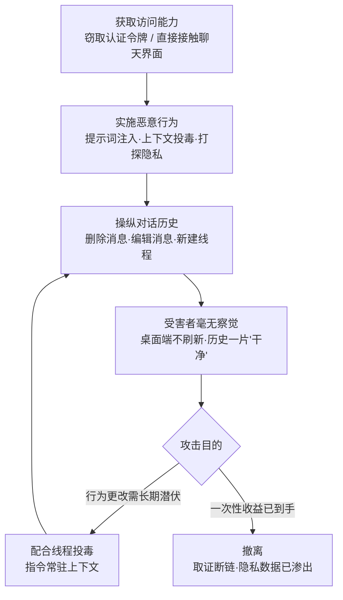

# 操纵用户 LLM 对话历史 (AML.T0092)

## 一句话通俗理解

> 小偷翻完你家，临走前把门口监控的录像带换成了"昨天一切正常"的画面——你回放时什么也看不到。操纵用户 LLM 对话历史，就是攻击者对 AI 聊天记录动的这个手脚：删掉、改写或凭空捏造消息，把提示词注入、上下文投毒留下的痕迹一并抹去。受害者回看对话，永远是一份"岁月静好"的假账本。

## 难度等级

⭐⭐ **Demonstrated（已演示）**

官方成熟度评定为 Demonstrated——这条攻击路径已在真实产品上被完整演示：Lumia Security 的 AIKatz 研究证明，攻击者可以从 LLM 桌面客户端的进程内存中提取认证令牌，冒充受害者调用后端服务，其中"操纵对话历史以掩盖行踪"被列为明确可达的攻击能力（在 Claude、ChatGPT、M365 Copilot 上演示）；针对暴露在公网的 ClawdBot（现 OpenClaw）控制界面的研究，同样把"操纵用户聊天历史"写进了可达影响清单。本技术自身的操作门槛并不高——删除、编辑、新建消息往往只是几次普通的 API 调用；真正的门槛在**前置条件**：先拿到受害者的认证令牌或聊天界面的直接访问权。而一旦越过这道门槛，受害者几乎没有任何感知渠道。

## 技术描述

### 通俗解释

传统反取证删的是日志文件，本技术删的是"你和 AI 的聊天记录"。对大多数用户来说，聊天历史是回看交互、核对"AI 到底说过什么、我到底同意过什么"的**唯一凭据**——攻击者删掉注入的消息、改写"刚才的对话"、甚至伪造一段"用户曾明确授权"的记录，受害者的这条凭据就彻底失效了。更隐蔽的是，很多聊天客户端（尤其桌面端）只在**初次打开对话时加载一次历史**，之后再发生的消息增删改根本不会刷新到界面上——官方描述明确指出，这一实现细节让攻击者的操纵"几乎不会被受害者察觉"。

### 技术原理

依据官方描述，攻击者操纵受害者的 LLM 对话历史，以掩盖其恶意行为的痕迹。具体掩盖两类活动：

1. **隐藏对 LLM 行为的持久化更改**——例如通过记忆投毒（AML.T0080.000）、对话线程投毒（AML.T0080.001）植入的恶意指令，其在对话记录中的注入证据可被一并抹除；
2. **掩盖打探用户隐私信息的尝试**——攻击者借受害者的账号向 LLM 索要个人信息，再把问答记录删除，受害者对"AI 已经泄密"一事毫不知情。

**三类操纵手法：**

| 手法 | 操作 | 典型目的 |
|------|------|----------|
| 删除消息 | 删除一条或多条聊天消息 | 整段抹掉注入痕迹与可疑问答 |
| 编辑消息 | 修改既有消息的内容 | 改写"刚才说过的话"，伪造助手回复或用户同意 |
| 新建线程 | 创建新的对话线程 | 把可疑活动转移到受害者不会查看的线程中，稀释痕迹 |

**两个可行前提：**

1. **持有受害者面向后端 LLM 服务的认证令牌**——直接以受害者身份调用后端 API，增删改其对话历史（AIKatz 演示的正是这条路径）；
2. **直接访问受害者的聊天界面**——物理接触未锁屏的设备、劫持会话，或接管暴露在公网的智能体控制界面（ClawdBot 案例展示的路径）。

**界面盲区（本技术得以"无感"的关键）：** 聊天界面（尤其是桌面客户端）通常**只在初次打开对话时加载一次历史**，对进行中对话内被注入的提示词并不显示。攻击者的删除、编辑、新建操作因此不会出现在受害者正盯着的窗口里——除非受害者重开对话，而那时看到的已经是被清理过的"干净"版本。

**与对话线程投毒（AML.T0080.001）的分工：** 线程投毒负责"让恶意指令常驻对话上下文"——属于**持久化**战术；本技术负责"把投毒留下的痕迹从用户可见的对话记录里抹掉"——属于**防御规避**战术。一个负责安家，一个负责销毁指纹，实战中往往配套出现（AIKatz 案例同时命中两者）。

**平台覆盖：** Generative AI（生成式 AI）/ Agentic AI（智能体 AI）两类平台适用——凡是提供持久化对话历史的 LLM 服务与智能体产品都在攻击面内。

### 用途影响

- **取证断链**：事件响应时，对话记录是还原"AI 被利用过程"的核心证据；历史被清理后，调查者面对的是一份被剪辑过的剧本；
- **伪造同意与授权**：编辑消息可以凭空制造"用户曾要求/同意某操作"的记录，为后续滥用（如诱导智能体执行越权动作）提供"白纸黑字"的假凭据；
- **掩护持久化**：与线程投毒、记忆投毒配合，让行为更改长期潜伏而不被回看发现；
- **隐蔽隐私打探**：借受害者身份向 LLM 套取个人信息后删除问答，用户对泄密毫无感知；
- **结构性检测盲区**：依赖客户端展示而非服务端审计的部署，几乎不可能发现这类操纵——受害者"没看到异常"，防御日志里也什么都没有。

## 攻击流程

### 典型攻击流程



**步骤详解：**

1. **获取访问能力（前提）**
   - 通俗描述：先拿到受害者跟 AI 服务"对话的钥匙"，或者干脆坐到他的聊天窗口前。
   - 技术细节：两条官方路径——从受害者设备提取后端 LLM 服务的认证令牌（AIKatz：从桌面客户端进程内存中提取）；或获得聊天界面的直接访问权（ClawdBot：公网暴露且认证可绕过的控制界面）。

2. **实施恶意行为**
   - 通俗描述：干坏事——给 AI 植入恶意指令，或者冒充用户打探隐私。
   - 技术细节：典型行为包括直接注入提示词改变 LLM 行为、投毒对话上下文以产生持久效果（配合 AML.T0080.001）、借受害者身份询问 LLM 索取其个人信息。这些动作都会在对话历史中留下痕迹——这正是下一步要处理的对象。

3. **操纵对话历史**
   - 通俗描述：擦指纹，必要时还得"重写剧本"。
   - 技术细节：按需组合三类手法——**删除**注入消息或敏感问答（整段抹除）；**编辑**既有消息（把可疑内容改写成无害表述，或伪造"用户同意/助手承诺"）；**新建**对话线程（把操纵活动隔离到受害者不看的线程里）。

4. **利用界面盲区隐身**
   - 通俗描述：受害者盯着的窗口根本不会刷新，自然什么也看不见。
   - 技术细节：桌面客户端通常只在初次打开时加载一次对话历史；操纵发生后受害者界面不更新，重开时看到的已是清理后的版本——官方明确指出这一特性帮助操纵"不被察觉"。

5. **长期掩护与撤离**
   - 通俗描述：要么继续潜伏，要么全身而退。
   - 技术细节：需要持久化时，保留线程投毒的指令、只清理可见痕迹，形成"指令常驻、证据消失"的稳定状态；只需一次性收益时，取走数据、清理历史、弃用令牌，受害者与调查者都失去线索。

**与其他技术的关系：**

- **上游**：提示词注入（AML.T0051）、记忆投毒（AML.T0080.000）、线程投毒（AML.T0080.001）等投毒类行为，其痕迹由本技术负责清理
- **互补**：延迟执行 LLM 指令（AML.T0094）让恶意指令"延时引爆"，本技术负责"引爆炸"后清理现场——一延迟、一销毁，共同构成 LLM 交互层的完整反取证组合
- **传统类比**：指示器清除（T1070）——把"删日志"的对象换成了"删聊天记录"

> 关键认知：本技术不产生新的攻击能力，它服务于**既成攻击的隐蔽性**。判断一个环境是否存在此风险，看的不是"能不能删消息"，而是"删消息这件事有没有被独立审计"。

## 真实案例

> 以下 2 个案例全部源自 MITRE ATLAS 案例库，均直接关联 AML.T0092。

### 案例1：AIKatz——从 LLM 桌面应用窃取令牌并操纵对话（2025年，AML.CS0036）

- **时间**: 2025年（研究发布）
- **攻击者**: Lumia Security（安全研究演示）
- **手法**: 研究者证明可以从 LLM 桌面应用（Anthropic Claude、OpenAI ChatGPT、Microsoft M365 Copilot）的进程内存中提取认证令牌，随后用这些令牌冒充受害者访问 LLM 后端——既能翻看受害者的全部历史会话，也能介入其后续对话。研究者明确列出的能力清单包括：直接注入提示词改变 LLM 行为、投毒上下文产生持久效果、**操纵用户对话历史以掩盖行踪**，并最终影响系统的机密性、完整性与可用性。三家厂商的漏洞响应均以"本地攻击"为由按 informational 处理（未修复）。
- **影响**: 证明"窃取令牌 → 冒充调用后端 → 操纵对话历史"这条完整链路在主流桌面 AI 产品上切实可行；"本地攻击不算安全边界"的厂商立场意味着该前提将长期存在
- **参考链接**: [Lumia: AIKatz - All Your Chats Are Belong To Us](https://www.lumia.security/blog/aikatz)

### 案例2：暴露的 ClawdBot 控制界面——聊天界面即入口（2026年，AML.CS0048）

- **时间**: 2026年1月25日
- **攻击者**: Jamieson O'Reilly（安全研究员）
- **手法**: 研究者通过 Shodan 在公网上发现数百个暴露的 ClawdBot（现更名 OpenClaw，可接入 Telegram、Slack、Signal 等消息渠道的个人 AI 助手）控制界面，部分实例未启用认证，另有实例因代理配置错误可绕过认证。拿到控制界面访问权后，研究者从配置文件中获取了 Anthropic API Key、Telegram Bot Token、Slack OAuth 凭证、Signal 设备关联 URI 等凭据；通过聊天界面直接提示 ClawdBot 泄露了系统提示词，并借其 bash 技能拿到容器 root 权限。研究者特别指出，同等级访问还可实现：**操纵用户与 ClawdBot 智能体的聊天历史**、渗出所接入消息渠道的全部对话记录、冒充用户在消息渠道发送消息。
- **影响**: 暴露的智能体控制界面同时满足本技术的两个前提（界面直接访问 + 配置文件里的认证令牌）；当个人智能体接管多个消息渠道时，"聊天历史"的暴露面从单个应用扩大到用户全部通信
- **参考链接**: [OpenClaw (GitHub)](https://github.com/openclaw/openclaw)、[Shodan: Clawdbot Control 搜索](https://www.shodan.io/search?query=Clawdbot+Control)、[研究者推文](https://x.com/theonejvo/status/2015401219746128322)

## 红队视角

> ⚠️ **免责声明**：以下内容仅用于合法授权的安全测试与教育目的。未授权访问他人账号、设备或 AI 服务均属违法行为——AIKatz 与 ClawdBot 研究均走了负责任披露流程。

### 实战技巧

1. **把"用户回看无异常"设为演练验收指标**
   在授权演练中，注入与投毒动作完成后，让委托方以受害者视角回看对话历史：如果任何注入痕迹肉眼可见，说明清理不彻底；如果服务端审计日志也毫无事件，说明客户存在完整的结构性盲区——两份"体检报告"一起交付。

2. **从令牌视角复现攻击前提（自有测试账号）**
   复制自己测试账号的会话令牌，从另一台机器/另一个进程调用后端对话 API，验证三件事：令牌是否绑定设备、消息删改端点是否留审计事件、并发会话是否触发告警。这就是 AIKatz 链路的"最小复现版"。

3. **把"伪造同意"纳入社工演练剧本**
   编辑消息可以伪造"用户曾授权"的记录。红队可在演练中演示：一段伪造的授权对话能否骗过内部审批/审计流程——这往往比技术漏洞更能震撼管理层。

### 常用工具

| 工具名称 | 用途 | 平台 |
|----------|------|------|
| 进程内存分析工具（AIKatz 所示手法） | 从 LLM 桌面客户端内存中提取认证令牌 | Windows / macOS |
| LLM 服务官方或逆向 API | 调用对话历史增删改端点 | Web |
| mitmproxy 等抓包代理 | 分析客户端与后端的会话/历史 API 结构 | 跨平台 |
| Shodan / Censys | 定位暴露在公网的智能体控制界面（ClawdBot 场景） | Web |
| 自托管聊天前端（LibreChat / Open WebUI） | 搭建合法实验环境复现全流程 | 跨平台 |

### 注意事项

- **授权边界**：只操作自有测试账号与自建环境；真实用户的对话历史属于个人隐私数据，触碰即违法
- **区分"展示"与"利用"**：向客户演示时，伪造记录要打上明显的演练水印，避免演示材料本身成为欺诈素材
- **报告聚焦审计缺口**：交付物核心是"哪些操纵动作在服务端完全无痕"，技术过程一笔带过即可

## 蓝队视角

### 检测要点

1. **对话变更审计缺口**
   - 日志来源：LLM 服务端/网关的应用审计日志
   - 关注字段：event_type（message.edit / message.delete / thread.create）、操作者会话 ID、源 IP、设备指纹、时间戳
   - 异常特征：存在消息删改事件但该账号没有任何对应的活跃 UI 会话；删改与新建操作在短时间内批量出现

2. **认证令牌异常使用**
   - 日志来源：身份提供方（IdP）日志、LLM 服务访问日志
   - 关注字段：令牌指纹、源 IP/ASN、User-Agent、并发会话数
   - 异常特征：同一令牌双端并发、异地/新设备使用、客户端指纹与官方应用不符（脚本直连 API）

3. **桌面客户端凭证暴露面**
   - 日志来源：EDR 进程行为日志
   - 异常特征：第三方进程对 LLM 桌面客户端发起内存读取、句柄复制或进程转储（AIKatz 的前提动作）

4. **用户侧异常报告**
   - 特征：用户反馈"助手答非所问、风格突变"，但回看历史毫无异常——历史"太干净"本身就是线索

### 监控建议

- **审计与展示分离**：对话历史的用户可见版本可以被删改，但消息级变更事件必须落到独立的、用户不可达的 append-only 存储——这是发现本技术的唯一可靠抓手
- **会话-操作关联**：每条消息变更事件回查"发起操作的会话是否是活跃 UI 会话"，对不上即告警
- **令牌绑定与撤销**：会话令牌绑定设备指纹，检测到异常并发立即吊销并强制重新认证
- **定期历史快照对账**：对企业级部署，定期对对话历史做哈希快照，事后可证明"历史是否被改动过"

## 检测建议

### 网络层检测

**检测方法：** 识别令牌被盗用后的异常后端调用。

- 同一认证令牌出现双端并发使用，或来源 IP 出现"不可能的位移"
- 对话历史端点（列表/编辑/删除）收到来自脚本类客户端（TLS 指纹、UA 与官方应用不符）的高频调用
- 深夜/节假日等用户非活跃时段出现消息批量删除或线程创建请求

### 主机层检测

**检测方法：** 盯住"令牌从桌面客户端被偷走"这一前提动作。

- 第三方进程对 LLM 桌面客户端的内存读取、minidump、句柄复制行为（AIKatz 前置）
- LLM 客户端配置/缓存目录被非常规进程访问
- 共享主机上出现针对聊天客户端会话文件的读取

### 应用层检测（AI 遥测）

**检测方法：** 用服务端审计发现"用户看不见的操纵"。

- 消息 edit/delete 事件的来源会话与任何活跃 UI 会话不匹配
- 注入检测命中后短时间内出现关联的删除/新建线程操作（注入-清理时序对）
- 对话历史的客户端展示版本与服务端审计轨迹出现内容性差异

**程序化检测思路（无需 EDR 侧改造）：**

核心是把"**谁在改 + 改的时候受害者在不在**"做成规则：每条消息变更事件携带来源（会话 ID/IP/设备），与该账号当前活跃 UI 会话做实时关联；变更事件找不到对应活跃会话、或来自新设备/新 ASN 时直接告警。再叠加"注入检测命中后 N 分钟内同线程出现删改"的时序关联规则，可覆盖大多数清理动作。

### Sigma 规则思路示例

```yaml
title: LLM 对话历史的非会话内删改（对话历史反取证特征）
status: experimental
description: 检测同一账号在无活跃 UI 会话或新设备上批量编辑/删除聊天消息，
    可能为操纵用户 LLM 对话历史的痕迹清理行为（AML.T0092）
logsource:
    category: application
    product: llm_chat_audit
detection:
    selection:
        event_type:
            - 'message.edit'
            - 'message.delete'
            - 'thread.delete'
    filter_active_ui_session:
        session_origin: 'active_ui'
    condition: selection and not filter_active_ui_session | count() by user_id > 5
    timeframe: 10m
level: high
tags:
    - atlas.aml_t0092
    - attack.t1070
```

## 缓解措施

> MITRE ATLAS 官方数据（2026.09）暂未为 AML.T0092 映射缓解措施。以下为本库基于官方描述的攻击前提（令牌窃取 / 界面访问）与界面盲区给出的主题性防御建议。

### 优先级1：关键措施

**保护认证令牌 = 保护对话历史。** 官方给出的第一条可行前提就是"持有受害者的认证令牌"。落地要点：桌面客户端令牌存入系统凭据保护机制（Windows DPAPI / macOS Keychain）而非明文配置；会话令牌短期化并绑定设备指纹；检测到并发/异地使用即时吊销；AIKatz 式内存提取依赖的"任意本地进程可读客户端内存"应通过进程保护与最小权限缓解。厂商将此类攻击归为"本地攻击"不予修复，意味着**令牌保护的责任在使用方**。

### 优先级2：重要措施

**服务端 append-only 对话审计。** 用户可见的聊天历史天然可被授权身份删改——发现操纵的唯一可靠手段，是把每条消息的创建/编辑/删除事件（含操作者、来源、时间）写入独立于产品功能的、不可篡改的审计存储（WORM）。有了这条审计轨迹，"历史被清理过"本身就会成为可检测事件，取证断链问题也随之缓解。

### 优先级3：建议措施

**界面透明化与用户感知。** 针对官方点名的界面盲区：客户端在对话有变更时重新拉取历史（而非仅在初次打开时加载一次）；对历史编辑/删除向用户提供可见提示（如消息编辑角标、变更通知）；对企业用户支持历史导出与本地存档，保留一份服务端删不掉的副本。

### 防御建议汇总

| 措施 | 优先级 | 类别 | 生命周期阶段 |
|------|:------:|------|-------------|
| 认证令牌保护（凭据存储加固、设备绑定、异常吊销） | 关键 | Technical | 部署 · 监控与维护 |
| 服务端 append-only 对话变更审计 | 重要 | Technical | 部署 · 监控与维护 |
| 客户端历史刷新与变更提示、历史本地存档 | 建议 | Technical | 部署 |

## 关联 ATT&CK 技术

**官方未建立 AML.T0092 与 ATT&CK 技术的正式映射**（本技术在 ATLAS 数据中的 ATT&CK-reference 为空）。以下是本库给出的主题性对照，供学习参考：

- **T1070 指示器清除**——精神上最接近的 ATT&CK 技术：删除/清除主机与网络上的入侵痕迹以阻碍取证。AML.T0092 可视为"AI 对话层的指示器清除"：清除对象从日志文件换成了聊天记录，清除目的同样是让事件响应失去证据。
- **T1528 窃取应用访问令牌 / T1539 窃取 Web 会话 Cookie（纯文本对照）**——本技术第一条前提（获取认证令牌）的传统对应手法；AIKatz 演示的"从进程内存提取令牌"正是这类技术在 LLM 桌面客户端上的翻版。
- **T1564 隐藏痕迹（纯文本对照）**——在主机上隐藏恶意活动的存在；本技术"新建对话线程转移视线"的手法与之思路相通。

**传统指示器清除 vs 操纵 LLM 对话历史对照：**

| 维度 | 指示器清除 (T1070) | 操纵 LLM 对话历史 (AML.T0092) |
|------|--------------------|-------------------------------|
| 清除对象 | 系统日志、事件记录、临时文件 | 聊天消息、对话线程 |
| 常见手法 | 删除日志、清空历史、时间戳篡改 | 删除/编辑消息、新建线程 |
| 获取前提 | 主机/应用访问权限 | 认证令牌或聊天界面访问 |
| 受害者感知 | 用户极少回看系统日志 | 用户几乎不回看历史 + 桌面端不刷新 |
| 检测抓手 | 日志的异地备份、SIEM 转发 | 独立于产品的 append-only 审计 |

一句话总结：T1070 是删掉监控录像，AML.T0092 是直接重录一盘"什么都没发生"的录像带——还能顺手补一段"主人同意过"的台词。

## 动手实验

> ⚠️ **重要提示**：所有实验仅使用自有测试账号与自建环境。实验2、3 需要自托管聊天前端；全程不要触碰真实他人账号。

### 实验环境准备

| 环境组件 | 用途 | 获取方式 |
|----------|------|----------|
| 两个自有测试账号（同一 LLM 服务） | 分别扮演"受害者"与"攻击者"视角 | 官方注册 |
| 自托管聊天前端（LibreChat / Open WebUI）+ 本地或 API 模型 | 实验2、3 的可控后端 | Docker 部署 |
| mitmproxy | 观察客户端与后端的历史 API | pip 安装 |
| SQLite / 任意日志存储 | 实验3 的审计落库 | 系统自带 |

### 实验1（初级）：亲测"只加载一次"的界面盲区

**实验目标：** 验证官方描述的界面盲区真实存在。

**实验步骤：**
1. 在桌面客户端打开自己账号的某个对话，保持窗口不关
2. 用同一账号在网页端对该对话追加一条消息，或编辑/删除其中一条历史消息
3. 回到桌面端观察：不重开对话的情况下，界面是否反映这些变更
4. 记录不同客户端（桌面/网页/移动端）在历史刷新行为上的差异

**预期结果：** 直观体验"受害者正盯着的窗口看不到操纵"——理解本技术为什么"无感"。

### 实验2（中级）：复现"注入 → 清理 → 历史无痕"全链路

**实验目标：** 在自有环境走通攻击者视角的完整流程。

**实验步骤：**
1. 自托管前端创建"受害者"账号并开启一段对话
2. 复制"受害者"的会话令牌，从另一台机器/另一个进程以该令牌调用后端 API
3. 以"攻击者"身份注入一条携带指令的消息，观察模型行为变化
4. 调用删除/编辑端点抹掉这条消息，再用"受害者"账号登录查看历史
5. 抓包记录全过程，标注哪些操纵端点没有产生任何审计事件

**预期结果：** 历史记录"干净如初"，而抓包记录证明操纵确实发生过——这份对照就是给管理层最好的风险演示材料。

### 实验3（高级）：补上审计盲区并验证告警

**实验目标：** 为实验2 的环境建立最小可用的检测能力。

**实验步骤：**
1. 给消息 create/edit/delete 事件加中间件：连同操作者、来源会话 ID、IP 写入独立 SQLite（模拟 append-only 审计）
2. 维护"活跃 UI 会话"表：用户前端心跳注册，超时即失效
3. 实现规则：变更事件的来源不在活跃 UI 会话表中 → 输出告警
4. 重放实验2 的攻击流程，验证告警是否命中；再模拟正常用户编辑消息，验证无误报

**预期结果：** 产出一套"非会话内变更即告警"的最小检测逻辑，理解"审计与展示分离"为何是防御本技术的根本。

## 术语解释

| 术语 | 英文原名 | 通俗解释 |
|------|----------|----------|
| 对话历史 | Chat History | 用户与 LLM 的全部消息记录——用户回看交互、核对"AI 说过什么"的唯一凭据 |
| 反取证 | Anti-Forensics | 破坏、伪造证据以阻碍事件调查与溯源的技术总称 |
| 消息编辑 | Message Editing | 修改既有聊天消息内容——既能抹痕迹，也能伪造"说过的话" |
| 注入痕迹 | Injection Traces | 提示词注入、上下文投毒等活动留在对话记录里的可追溯证据 |
| 认证令牌 | Authentication Token | 证明"我就是这个用户"的凭证（会话令牌、API Key 等），本技术的主要敲门砖 |
| 上下文投毒 | Context Poisoning | 向对话上下文注入恶意内容以改变 LLM 行为的手法 |
| 对话线程投毒 | Thread Poisoning (AML.T0080.001) | 让恶意指令常驻对话线程的持久化手法——本技术的"上游供应商" |
| 界面盲区 | Stale History View | 桌面客户端只在初次打开时加载一次历史的实现特性 |
| AIKatz | AIKatz | Lumia Security 对"从 LLM 桌面应用内存提取令牌"攻击链的命名 |
| ClawdBot / OpenClaw | ClawdBot / OpenClaw | 开源个人 AI 助手框架，数百控制界面实例曾被暴露于公网 |
| WORM 存储 | Write Once Read Many | 一次写入不可改写的存储，对话审计日志的理想载体 |
| 会话-操作关联 | Session Correlation | 把变更事件与其发起的活跃界面会话对上的检测思路 |

## 参考资料

### 📚 官方文档

- [MITRE ATLAS - Manipulate User LLM Chat History (AML.T0092)](https://atlas.mitre.org/techniques/AML.T0092/) - 官方技术页面
- [MITRE ATLAS 矩阵](https://atlas.mitre.org/matrices/ATLAS/)
- [MITRE ATLAS Data (GitHub)](https://github.com/mitre-atlas/atlas-data)

### 📰 案例报告（真实攻击与安全研究）

- [Lumia: AIKatz - All Your Chats Are Belong To Us](https://www.lumia.security/blog/aikatz) - 从 LLM 桌面应用提取令牌并操纵对话历史的完整研究
- [OpenClaw (GitHub)](https://github.com/openclaw/openclaw) - 案例中的个人 AI 助手框架
- [Shodan: Clawdbot Control 搜索](https://www.shodan.io/search?query=Clawdbot+Control) - 暴露控制界面的测绘视图
- [X: hacking clawdbot and eating lobster souls](https://x.com/theonejvo/status/2015401219746128322) - 研究者的原始披露

### 🔧 工具与资源

- [OWASP Top 10 for LLM Applications](https://owasp.org/www-project-top-10-for-large-language-model-applications/) - LLM 应用十大安全风险清单
- [NIST AI Risk Management Framework](https://www.nist.gov/itl/ai-risk-management-framework) - NIST AI 风险管理框架
- [LibreChat](https://www.librechat.ai/) / [Open WebUI](https://openwebui.com/) - 自托管聊天前端，可用于复现实验环境

### 🔗 关联阅读

- [防御规避战术 (AML.TA0007)](./README.md) - 本技术所属战术的概览页
- [对话线程投毒 (AML.T0080.001)](../07-Persistence/AML.T0080/AML.T0080.001-Threads.md) - 持久化侧的"搭档"技术——投毒常驻线程，本技术抹去痕迹
- [指示器清除 (T1070)](../../enterprise/07-Stealth/T1070-Indicator-Removal.md) - ATT&CK 侧的传统反取证对应技术

---

> **版本**: ATLAS 2026.09 | **更新**: 2026-10-22 | **模板**: ATLAS 技术文档 v1.0
