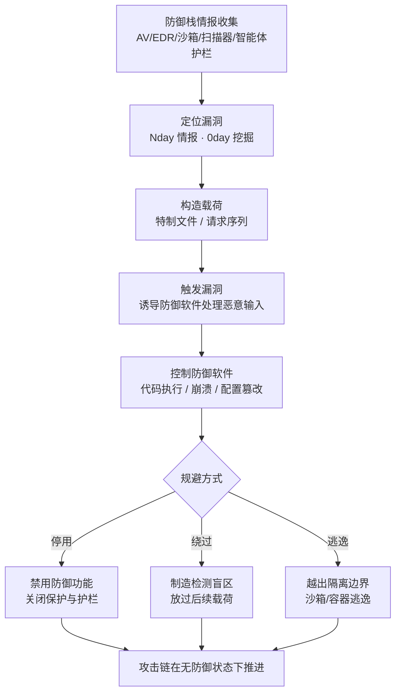

# 防御规避漏洞利用 (AML.T0107)

## 一句话通俗理解

> 小偷不跟保安比身手，而是直接攻击保安的装备——对讲机有缺陷就让它哑火，摄像头有漏洞就让它瞎眼。防御软件也是软件，也会写错代码：攻击者利用杀毒引擎、分析沙箱、模型扫描器自身的编程漏洞，让"抓坏人的"先倒下——防御体系不是被绕过，而是从内部瓦解。

## 难度等级

⭐⭐ **Demonstrated（已演示）**

官方成熟度评定为 Demonstrated——评级依据是案例 AML.CS0050：安全研究者演示了针对 OpenClaw AI 智能体的 1-click 远程代码执行（CVE-2026-25253），一个漏洞同时废掉"用户确认"护栏与容器隔离两道防御。而在传统领域，这项技术早已是成熟攻击方向——防御引擎远程代码执行（如 CVE-2017-0293）、BYOVD 禁用 EDR 均有公开实战记录。真正的门槛不在利用技术本身，而在**弹药**：需要目标防御栈的具体漏洞情报（Nday/0day），以及让防御软件"处理恶意输入"的投递路径——好在（对攻击者而言）防御软件的漏洞研究是公开且活跃的领域，现成分析常可直接复用。

## 技术描述

### 通俗解释

常规防御规避比的是"藏"——把恶意内容伪装成检测器看不懂的样子（混淆、伪装、编码）。本技术比的是"拆"——根本不与检测规则对抗，而是攻击防御软件自身的编程缺陷：引擎解析特制文件时崩溃或被劫持、沙箱的隔离边界被样本反手攻破、扫描器对特定输入的判定被翻转、智能体的安全开关被漏洞直接关闭。防御软件以高权限常驻运行、被组织无条件信任、还要主动接触一切"不可信输入"——三个特性叠加，让它既是盾牌，也可能是整条防线上最大的软肋。防御软件一旦失守，它所保护的整个体系随之失守——这就是"釜底抽薪"。

### 技术原理

依据官方描述：攻击者可能利用系统或应用程序漏洞绕过安全功能。漏洞利用指攻击者利用程序、服务或操作系统软件乃至内核中的**编程错误**，执行攻击者控制的代码；而防御性安全软件中同样可能存在可被用于**禁用或绕过**这些软件的漏洞。

攻击目标是防御栈本身。AI 时代的企业防御栈中，"可被利用面"至少有四类：

1. **终端防御软件（AV/EDR）自身的漏洞**。杀毒引擎以高权限常驻，且必须解析每一种经过的文件——"高权限 + 海量不可信输入"的组合使引擎本身成为最值钱的攻击面。典型形态：精心构造的文件触发引擎解析代码中的内存破坏缺陷，攻击者代码在防御进程内执行，随即停用实时保护、让引擎对后续载荷"失明"。
2. **恶意软件分析沙箱的逃逸缺陷**。沙箱的任务是"安全地跑恶意代码"，但其隔离边界（虚拟化组件、容器、结果回传服务）自身有漏洞时，被分析的样本反而成为打入分析基础设施的跳板。AI 时代同理——"加载不可信模型采集行为"的模型分析沙箱，其管线本身就是高价值目标。
3. **ML 分类器与模型扫描器的解析器漏洞**。安全检测依赖解析器从文件中提取特征，而"扫描器解析出的内容"与"运行时实际执行的内容"可以不一致——利用两个解析器对同一文件的分歧（解析器混淆），让扫描器看到良性结构、运行时执行恶意代码。另一类是错误处理策略缺陷（fail-open，出错即放行）——它正是 AML.T0076「破坏 AI 模型」利用的对象，两技术的边界见下。
4. **AI 智能体的安全控制**。智能体的"用户确认"护栏（高危动作需人工审批）与容器隔离（限制智能体只能触碰容器内资源）本质上都是防御功能；其控制平面（配置接口、网关 API、令牌体系）的漏洞允许攻击者直接改写这些开关——AML.CS0050 演示的正是这条路径。

**与邻近技术的边界**：

- 与 AML.T0076（破坏 AI 模型）：T0076 利用扫描器"解析失败即放行"的**设计选择**（fail-open 异常处理），并不需要在防御软件内执行代码；本技术则利用防御软件的**编程缺陷**执行代码或直接禁用功能——前者钻设计缺陷，后者钻实现缺陷。
- 与 AML.T0097（虚拟化/沙箱规避）：T0097 识别沙箱特征后"伪装无害"，不攻击沙箱；本技术利用沙箱**自身的漏洞**逃逸——前者演给防御看，后者直接拆防御。
- 与直接禁用安全工具（ATT&CK T1685 系）：后者需要相应权限去停服务、改配置；前者不需要任何预置权限——漏洞本身就是钥匙。

**平台覆盖**：Enterprise（企业环境）——攻击对象是部署在企业环境中的防御软件，包括传统安全产品、AI 赋能检测器与智能体安全控制。

### 用途影响

- **釜底抽薪**：不是绕过某条检测规则，而是让检测能力本身消失——一次利用废掉整个产品的防护面；
- **高权限跳板**：防御软件常以 SYSTEM/高权限运行，其漏洞利用往往附带提权效果，防御进程反成入侵跳板；
- **信任反噬**：防御软件的"无告警"输出被视作权威结论，其失明使后续攻击畅通无阻；
- **故障掩盖**：安全产品崩溃、重启、报错常被运维当作软件质量问题处理，攻击信号被当作噪音消化。

## 攻击流程

### 典型攻击流程



**步骤详解：**

1. **防御栈情报收集**
   - 通俗描述：先搞清楚保安装备的型号与版本。
   - 技术细节：枚举目标环境部署的防御产品（AV/EDR、邮件网关、沙箱、模型扫描器、智能体护栏）及其版本。公开的漏洞研究大幅降低这一步的成本——很多防御产品的已知漏洞带有现成分析与利用代码。

2. **定位漏洞**
   - 通俗描述：在保安装备上找到一道没锁的窗。
   - 技术细节：优先使用已披露的 Nday（目标未打补丁的已知漏洞）；高价值目标则投入 0day 挖掘。评估维度不止"能否执行代码"——能让防御失效的缺陷同样可用（崩溃引擎、翻转判定、逃逸沙箱）。

3. **构造载荷**
   - 通俗描述：把攻击写成"防御软件自己会打开的包裹"。
   - 技术细节：按漏洞类型构造——特制文件（触发解析缺陷）、恶意请求序列（攻击控制面）、或配合扫描器缺陷的畸形制品。载荷投递要顺着防御软件"必须处理输入"的工作路径走。

4. **触发与控制**
   - 通俗描述：让防御软件亲手引爆。
   - 技术细节：诱导防御软件处理恶意输入（投递待扫描文件、触发分析流程、诱导点击恶意链接）。漏洞触发后，攻击者在防御进程内执行代码、篡改配置，或令分析环境失守。CS0050 中一次点击后毫秒级脚本即完成令牌窃取。

5. **规避落地**
   - 通俗描述：保安倒了，正戏开场。
   - 技术细节：按需求选择三种落点之一——停用（关闭保护/护栏）、绕过（制造检测盲区放过后续载荷）、逃逸（越出沙箱/容器边界）。此后攻击链在"无防御"状态下推进。

**与后续战术的衔接：**

- **执行**：防御失效后恶意代码以更少摩擦落地——护栏被关闭的智能体甚至替攻击者执行命令（CS0050）
- **持久化 / 凭证访问 / 横向移动**：在失明检测下推进，暴露风险大幅降低
- **影响**：BYOVD 类活动的终点常是 EDR 全面失守后的勒索软件落地

> 关键认知：传统视角把防御软件当作"安全边界"，本技术把它翻转成"攻击面"——防御产品的每一个解析路径、每一行高权限代码，都是攻击者的潜在入口。

## 真实案例

> 案例1 源自 MITRE ATLAS 案例库（AML.CS0050）；案例2、3 为本库补充的主题性案例，用于展示同一技术在传统防御与 AI 供应链场景中的形态。

### 案例1：OpenClaw 1-Click RCE——一次点击废掉两道防御（2026年，AML.CS0050）

- **时间**: 2026年2月
- **攻击者**: 安全研究者（DepthFirst，负责任披露）
- **手法**: 研究者构造恶意链接，受害者点击后浏览器立即执行一段毫秒级完成的 JavaScript：脚本经 WebSocket 从 OpenClaw 控制界面窃取认证令牌，再通过跨站 WebSocket 劫持（Cross-Site WebSocket Hijacking）绕过 localhost 限制接入 OpenClaw Gateway API；随后用被盗令牌认证并修改智能体配置——**禁用用户确认**并**逃逸容器**，使 shell 命令直接在宿主机执行（CVE-2026-25253）。防御视角下，"用户确认"是智能体的人工制衡护栏、"容器"是隔离边界——两道防御被同一个漏洞一次性关闭，这正是本技术在 AI 智能体场景的标准形态。
- **影响**: 自托管 AI 智能体（跑在个人笔记本、homelab、VPS 上）的控制面安全直接决定宿主机安全；"服务只绑定 localhost"不构成边界——浏览器可被任何网页借道
- **参考链接**: [DepthFirst 分析](https://depthfirst.com/post/1-click-rce-to-steal-your-moltbot-data-and-keys)、[NVD CVE-2026-25253](https://nvd.nist.gov/vuln/detail/CVE-2026-25253)、[OpenClaw 官方博客](https://openclaw.ai/blog/introducing-openclaw)

### 案例2：微软恶意软件防护引擎 RCE——防御核心进程变成攻击面（2017年，补充案例）

- **时间**: 2017年5月
- **攻击者**: 安全研究（Google Project Zero，负责任披露）
- **手法**: 研究者在微软恶意软件防护引擎（MsMpEng，Windows Defender 等产品共用）中发现远程代码执行漏洞（CVE-2017-0293 等）：引擎默认实时扫描所有经过的文件，特制文件即可触发引擎解析代码中的缺陷，在防御进程上下文内执行攻击者代码。引擎以高权限运行——防御核心自身成为整个终端上权限最高、触达面最广的攻击面。
- **影响**: 该系列漏洞证明"防御软件必须解析不可信输入"这一结构性特征使其无法自证清白；此后针对安全产品引擎的研究成为持续热点
- **参考链接**: [NVD CVE-2017-0293](https://nvd.nist.gov/vuln/detail/CVE-2017-0293)

### 案例3：Picklescan 的 fail-open 缺陷——设计缺陷还是编程漏洞？（2025年，关联 AML.CS0031）

- **时间**: 2025年2月
- **攻击者**: 安全研究（ReversingLabs）
- **手法**: 研究者在 Hugging Face 上演示：蓄意截断的恶意 pickle 模型文件可被平台扫描器 Picklescan 完全放行——扫描器无法完整反序列化时选择跳过而非拦截，而恶意载荷在解析失败前已执行。该案例在 ATLAS 中主要归入 AML.T0076「破坏 AI 模型」（利用 fail-open 这一**设计选择**）；但若扫描器的缺陷属于可被触发的**编程错误**（如解析器内存破坏导致拒绝服务或代码执行），则落入本技术 AML.T0107 的范围——两技术以"缺陷的性质"为界。
- **影响**: 模型扫描器作为 AI 供应链的关键防御组件，其自身实现质量直接决定整条供应链的安全性
- **参考链接**: [ATLAS 案例研究 AML.CS0031](https://atlas.mitre.org/studies/AML.CS0031/)、[Picklescan](https://github.com/mmaitre314/picklescan)

## 红队视角

> ⚠️ **免责声明**：以下内容仅用于合法授权的安全测试与教育目的。对未授权系统利用漏洞属违法行为；对第三方安全产品的漏洞研究必须遵循负责任披露流程。

### 实战技巧

1. **防御栈资产清点式评估**
   把客户环境当成攻击者的第一步来演：列出全部防御产品（AV/EDR、邮件网关、沙箱、模型扫描器、智能体护栏）的厂商/产品/版本，逐项匹配公开 CVE 与厂商安全公告。红队交付物里最有价值的往往不是"又找到一个漏洞"，而是"你的防御产品里有 N 个未打补丁的高危漏洞"。

2. **对扫描管线做差分测试**
   给同一份输入分别喂给扫描器与真实运行时，观察两者结论是否一致：malformed 输入（截断、超长、嵌套容器）应被拒绝或隔离，而不是被静默跳过。fail-open 行为是差分测试的头号目标——它是 AML.T0076 与本技术的共同前提。

3. **把发现转化为"检测覆盖缺口"**
   报告不要停留在 CVE 清单：演示"当这个漏洞被利用时，你的哪些告警会消失"。防御软件失守意味着 SOC 的可见性出现黑洞——把这个黑洞画出来，比 CVSS 评分更能推动整改。

### 常用工具

| 工具名称 | 用途 | 平台 |
|----------|------|------|
| Nuclei | 模板化漏洞扫描，快速验证防御产品的已知漏洞 | 跨平台 |
| Grype | 制品与依赖的已知漏洞扫描，覆盖容器与制品载体 | 跨平台 |
| Fickling | pickle 制品安全审查（Trail of Bits），检测危险载荷与截断构造 | Python |
| Picklescan | 模型扫描器行为观察对象——研究其异常处理策略 | Python |
| Cuckoo | 开源恶意软件分析沙箱，可自建做隔离边界测试 | Linux |
| 厂商安全公告 / NVD | 防御产品漏洞情报源，资产清点式评估的弹药库 | Web |

### 注意事项

- **隔离测试**：对防御软件的漏洞测试可能让生产防护真实失效——务必在镜像环境验证，并事先与蓝队约定回滚预案
- **负责任披露**：对第三方安全产品的缺陷研究走厂商 PSIRT 流程，公开利用细节前确认补丁已发布
- **版本敏感**：同一产品不同版本对同类输入的处理差异巨大，结论必须绑定具体版本号

## 蓝队视角

### 检测要点

1. **防御软件自身健康度**
   - 日志来源：安全产品自身日志、系统事件日志、进程监控
   - 关注字段：引擎崩溃/重启次数、保护开关状态、服务异常退出
   - 异常特征：引擎反复崩溃重启、实时保护被关闭且无对应变更工单、防护组件静默退出

2. **智能体配置变更审计**
   - 日志来源：AI 智能体平台的审计日志
   - 关注字段：配置变更事件、变更发起上下文
   - 异常特征：用户确认开关被关闭、容器隔离配置被放宽、变更来自非交互会话或异常令牌——CS0050 的核心检测点

3. **管理面的异常访问**
   - 日志来源：本机网关/API 的连接日志
   - 关注字段：Origin 头、来源进程、令牌使用上下文
   - 异常特征：localhost 绑定的管理 API 收到浏览器来源连接（跨站 WebSocket 劫持特征）、认证令牌在陌生上下文中被使用

4. **扫描器失败统计**
   - 日志来源：模型/文件扫描管线的运行日志
   - 关注字段：解析失败、超时、跳过计数
   - 异常特征：失败率偏离基线、特定来源的制品持续"扫描失败但被放行"——fail-open 被利用的信号

### 监控建议

- **把安全产品自身日志纳入 SIEM**——大量组织只采集被保护资产的日志，防御软件自己成了监控盲区
- **安全产品与业务系统同补丁 SLA**——防御软件常被排除在补丁管理循环之外，"它是安全的所以不用管"是最危险的假设
- **localhost 管理面加来源校验**——本机绑定不构成边界，Origin/进程/令牌绑定至少三选一
- **"扫描失败"要计数告警**——静默跳过等于把 fail-open 的决定权交给了攻击者

## 检测建议

### 网络层检测

**检测方法：** 识别针对本机管理面的浏览器来源连接与令牌滥用。

- localhost 绑定的 WebSocket/API 出现带浏览器 Origin 头的连接（跨站 WebSocket 劫持特征）
- 认证令牌在非常规来源（外部页面/异常会话）被使用
- 恶意链接点击后毫秒级完成的"连接→认证→配置修改"链路（区别于人类操作节奏）

### 主机层检测

**检测方法：** 监控防御软件自身的异常与配置篡改。

- 防御软件进程异常终止、频繁重启或保护状态翻转
- 防御产品的配置文件/注册表键被非自身进程修改
- 智能体进程出现在容器外/宿主机上下文（逃逸迹象）

### 应用层检测（AI 遥测）

**检测方法：** 利用智能体平台审计能力发现安全配置被禁用。

- 配置变更事件中 user_confirmation / 隔离配置从启用翻转为禁用
- 单次用户交互（一次点击）后触发的多步自动化变更序列
- 变更前的认证过程携带异常令牌来源

**程序化检测思路（无需 EDR 侧改造）：**

对智能体平台的关键配置字段建立**状态翻转监控**：安全控制类配置（用户确认、隔离、出网白名单）的任何"启用→禁用"变更直接产生高优先级工单，并强制附带变更来源（操作者、令牌、会话）。正常运维的此类变更频率极低——低基线 + 高价值，值得每一次人工确认。

### Sigma 规则思路示例

```yaml
title: AI 智能体安全控制配置被禁用（防御规避漏洞利用特征）
status: experimental
description: 检测智能体配置中被视为安全控制的开关被关闭，
    可能指示攻击者经漏洞接管配置面禁用防御（AML.T0107，参考 AML.CS0050）
logsource:
    category: application_audit
    product: ai_agent_platform
detection:
    selection:
        event_type: 'agent_config_update'
        config_key:
            - 'user_confirmation'
            - 'container_isolation'
        config_value: 'disabled'
    condition: selection
level: high
tags:
    - attack.t1211
    - atlas.aml_t0107
```

## 缓解措施

### 优先级1：关键措施

**AML.M0016 漏洞扫描（Vulnerability Scanning）**

用漏洞扫描发现潜在可利用的软件漏洞并加以修复。落到 AI 环境的要点：常用于存储 AI 模型的 pickle 等文件格式可能包含允许任意代码执行的漏洞利用，应对此类文件扫描潜在的危险调用——能执行代码、创建新进程或建立网络连接的能力都属此列；攻击者可能在损坏的模型文件中嵌入恶意代码，因此扫描器必须能够处理无法被完全反序列化的模型；模型制品、模型的下游产物以及外部软件依赖都应纳入已知漏洞扫描。对本技术最关键的一条延伸：**把防御产品自身纳入漏洞扫描资产清单**——安全产品不是免检产品，它的 CVE 与业务系统的 CVE 同样致命。

### 优先级2：重要措施（本库实践建议）

**防御产品资产化运营**
为所有安全产品建立与业务系统同级的资产台账（产品/版本/CPE），订阅厂商安全公告，补丁 SLA 与关键业务对齐。防御栈情报是攻击流程的第一步——让攻击者在这一步拿不到情报，是最便宜的缓解。

**fail-closed 原则**
扫描与分析管线遇到无法处理的制品（解析失败、超时、格式异常）一律隔离并触发人工审查，而非放行。"出错时拒绝"应成为所有安全自动化的默认策略。

**纵深防御与平台外审批**
不把任何单一防御产品的存活当作安全边界；智能体的关键动作（禁用护栏、放宽隔离、宿主机执行）保留防御产品之外的二次审批通道——攻击者废掉一道防御时，另一道仍然在场。

### MITRE ATLAS 缓解措施映射

| 缓解措施ID | 缓解措施名称 | 优先级 | 类别 | 生命周期阶段 |
|------------|-------------|:------:|------|-------------|
| AML.M0016 | 漏洞扫描 | 关键 | Technical - Cyber | 数据准备 · AI 模型工程 |

> M0016 的生命周期定位说明官方视角：漏洞扫描应嵌入 AI 制品的引入与工程化流程（数据准备 / AI 模型工程阶段），而非事后补课。

## 关联 ATT&CK 技术

**官方映射**：[利用漏洞实现隐蔽 (T1211)](../../enterprise/07-Stealth/T1211-Exploitation-for-Stealth.md)——本技术在 ATLAS 数据中的 ATT&CK-reference。T1211 在 ATT&CK 中最初即名为 Exploitation for Defense Evasion（防御规避漏洞利用），后更名为 Exploitation for Stealth（利用漏洞实现隐蔽），AML.T0107 直接继承其原名义域。

以下是本库给出的主题性对照，供学习参考：

- **[客户端漏洞利用执行 (T1203)](../../enterprise/04-Execution/T1203-Exploitation-for-Client-Execution.md)**——CS0050 的入口：恶意链接在受害者浏览器执行脚本，是触达智能体控制面的投递手段；
- **[逃逸到主机 (T1611)](../../enterprise/06-Privilege-Escalation/T1611-Escape-to-Host.md)**——CS0050 的终点：越出容器边界在宿主机执行命令，容器隔离被作为防御功能攻破；
- **[禁用或修改工具 (T1685)](../../enterprise/08-Defense-Impairment/T1685-Disable-or-Modify-Tools.md)**——同一目的（废掉防御）的两条路径：T1685 靠已有权限停用安全工具，本技术靠漏洞——"是否需要权限"就是两条技术的边界；
- **[利用漏洞削弱防御 (T1687)](../../enterprise/08-Defense-Impairment/T1687-Exploitation-for-Defense-Impairment.md)**——同一行为在 ATT&CK v20 防御削弱战术下的编目，与本技术高度相邻，可对照阅读；
- **[虚拟化/沙箱规避 (T1497)](../../enterprise/07-Stealth/T1497-Virtualization-Sandbox-Evasion.md)**——沙箱攻防的另一翼：T1497 伪装无害骗过分析，本技术直接利用沙箱缺陷逃逸（ATLAS 侧对应 AML.T0097）。

**有权限禁用 vs 漏洞利用对照：**

| 维度 | 禁用或修改工具 (T1685) | 防御规避漏洞利用 (AML.T0107) |
|------|------------------------|------------------------------|
| 前提条件 | 需要管理员等相应权限 | 无需预置权限——漏洞即钥匙 |
| 手段 | 停服务、删注册表、改配置 | 构造恶意输入利用编程缺陷 |
| 防御方可见性 | 防护状态变更可审计 | 崩溃/报错常被当作产品故障 |
| 检测思路 | 监控防护状态变更事件 | 监控防御软件健康度 + 补丁管理 |

一句话总结：T1685 是"有钥匙的人去拆保安的电池"，AML.T0107 是"没有钥匙的人直接攻击保安的对讲机"——防的都是同一场入侵，攻的是完全不同的信任前提。

## 动手实验

> ⚠️ **重要提示**：所有实验在隔离虚拟机或一次性容器中进行；对安全产品的测试仅限自有环境；发现第三方产品缺陷一律走负责任披露流程。

### 实验环境准备

| 环境组件 | 用途 | 获取方式 |
|----------|------|----------|
| 隔离虚拟机或一次性容器 | 实验沙箱 | 本地虚拟化工具 |
| Python 3 + pip | 工具运行基础 | 官方安装包 |
| Picklescan + Fickling | 扫描器行为观察与差分测试 | pip / GitHub |
| 本地 WebSocket 服务（自建最小实现） | 实验3 的劫持靶机 | 任意语言百行内实现 |
| Grype | 防御产品与镜像漏洞扫描 | GitHub releases |

### 实验1（初级）：给自己的防御栈做资产清点

**实验目标：** 亲测攻击流程第一步的难度。

**实验步骤：**
1. 列出自己环境（家庭实验室或公司测试网）中全部安全产品：终端防护、网关、扫描器、智能体框架
2. 逐项查厂商安全公告与 NVD，匹配已知 CVE，标注当前版本是否受影响
3. 统计：受影响且未打补丁的高危漏洞数量、有公开分析细节的占比

**预期结果：** 一份"防御资产暴露报告"——多数人会第一次意识到防御产品自己欠了多少补丁。

### 实验2（中级）：扫描器差分测试

**实验目标：** 验证"防御软件也是软件"，直观感受 fail-open 与 fail-closed 的差异。

**实验步骤：**
1. 用 Fickling 构造一个含 benign 载荷（仅写本地标记文件）的 pickle，分别用 Picklescan 扫描与 Python `pickle.loads` 加载，记录两者结论
2. 构造截断版本（保留载荷、丢弃其后字节），重复双端测试
3. 记录：扫描器对截断样本的结论是检出、报错还是跳过？加载端标记文件是否产生？

**预期结果：** 亲眼看到"扫描器结论"与"运行时行为"的分歧——理解解析器漏洞与 fail-open 策略如何制造检测盲区（对照 AML.T0076）。

### 实验3（高级）：复现跨站 WebSocket 劫持原理

**实验目标：** 理解 CS0050 的核心缺陷——"localhost 绑定"为何不是边界。

**实验步骤：**
1. 本地起一个仅绑定 127.0.0.1 的 WebSocket 服务（模拟智能体网关 API），实现简单令牌认证
2. 写一个恶意页面（本地静态页即可），尝试从页面上下文连接该服务——观察默认配置下是否成功（浏览器策略不阻止同机回环连接）
3. 修复：为服务加 Origin 白名单校验，重复连接验证被拒

**预期结果：** 直观理解"浏览器可被任何网页借道访问 localhost"——这正是 CS0050 绕过 localhost 限制的原理，也是所有本机管理面应加来源校验的原因。

## 术语解释

| 术语 | 英文原名 | 通俗解释 |
|------|----------|----------|
| 漏洞利用 | Exploitation | 利用程序、服务或系统中的编程错误，执行攻击者控制的代码 |
| 防御软件 | Defensive Security Software | 杀毒软件、EDR、沙箱、模型扫描器等承担安全防御功能的软件 |
| 沙箱逃逸 | Sandbox Escape | 被隔离在分析环境中的样本利用环境自身缺陷逃出到宿主环境 |
| 解析器漏洞 | Parser Vulnerability | 文件/协议解析代码中的缺陷；扫描器与运行时解析不一致即为攻击面 |
| 解析器混淆 | Parser Confusion | 同一文件被不同解析器解读出不同内容——扫描器看良性、运行时执行恶意 |
| fail-open | Fail-open | 出错即放行的异常处理策略——AML.T0076 与本技术的共同前提 |
| fail-closed | Fail-closed | 出错即拒绝/隔离的异常处理策略——安全自动化的应然默认 |
| BYOVD | Bring Your Own Vulnerable Driver | 携带带漏洞的合法签名驱动加载以禁用 EDR 的攻击模式 |
| 跨站 WebSocket 劫持 | Cross-Site WebSocket Hijacking | 恶意页面借受害者浏览器连接其可访问的 WebSocket 服务（CS0050 手法） |
| 用户确认 | User Confirmation | 智能体执行高危动作前的人工审批护栏——CS0050 中被漏洞关闭的防御之一 |
| 恶意软件分析沙箱 | Malware Analysis Sandbox | 自动化引爆样本并采集行为特征的隔离分析环境 |
| 模型扫描器 | Model Scanner | 对模型制品做静态安全扫描的工具（如 Picklescan） |
| Nday / 0day | N-day / Zero-day | 已公开已有补丁 / 未公开无补丁的漏洞 |
| CVE | Common Vulnerabilities and Exposures | 公开漏洞统一编号体系 |

## 参考资料

### 📚 官方文档

- [MITRE ATLAS - Exploitation for Defense Evasion (AML.T0107)](https://atlas.mitre.org/techniques/AML.T0107/) - 官方技术页面
- [MITRE ATLAS 矩阵](https://atlas.mitre.org/matrices/ATLAS/)
- [MITRE ATLAS Data (GitHub)](https://github.com/mitre-atlas/atlas-data)

### 📰 案例报告（真实攻击与安全研究）

- [DepthFirst: 1-Click RCE To Steal Your Moltbot Data and Keys (CVE-2026-25253)](https://depthfirst.com/post/1-click-rce-to-steal-your-moltbot-data-and-keys) - AML.CS0050 技术分析
- [NVD: CVE-2026-25253](https://nvd.nist.gov/vuln/detail/CVE-2026-25253) - OpenClaw 1-Click RCE 漏洞条目
- [OpenClaw 官方博客](https://openclaw.ai/blog/introducing-openclaw) - 案例中的目标智能体平台
- [MITRE ATLAS 案例研究 AML.CS0050](https://atlas.mitre.org/studies/AML.CS0050/) - 官方案例页面
- [NVD: CVE-2017-0293](https://nvd.nist.gov/vuln/detail/CVE-2017-0293) - 微软恶意软件防护引擎 RCE

### 🔧 工具与资源

- [Picklescan](https://github.com/mmaitre314/picklescan) - pickle 模型安全扫描器
- [Fickling](https://github.com/trailofbits/fickling) - pickle 制品安全审查工具（Trail of Bits）
- [Grype](https://github.com/anchore/grype) - 制品与依赖漏洞扫描
- [OWASP Top 10 for LLM Applications](https://owasp.org/www-project-top-10-for-large-language-model-applications/) - LLM 应用十大安全风险

### 🔗 关联阅读

- [利用漏洞实现隐蔽 (T1211)](../../enterprise/07-Stealth/T1211-Exploitation-for-Stealth.md) - 本技术的官方 ATT&CK 映射
- [防御规避战术 (AML.TA0007)](./README.md) - 本技术所属战术的概览页
- 破坏 AI 模型 (AML.T0076)、虚拟化/沙箱规避 (AML.T0097) - 本库同战术相邻技术，见同目录文档

---

> **版本**: ATLAS 2026.09 | **更新**: 2026-10-22 | **模板**: ATLAS 技术文档 v1.0
