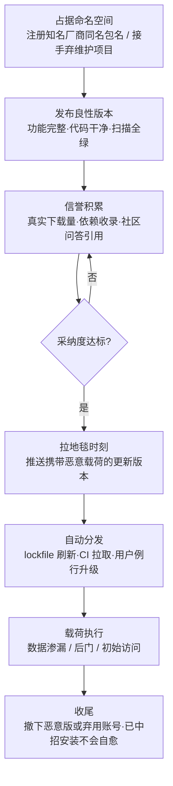

# AI 供应链拉地毯式撤离 (AML.T0109)

## 一句话通俗理解

> 骗子在小区门口盘下铺面，童叟无欺地做了半年真买卖，等全小区都成了回头客、连社区公告都把他列为"放心商户"后，某天深夜在货里下了毒，天亮前人去铺空——查执照、验首批货、看口碑，一样都查不出问题，因为毒是**通过所有检查之后**才下的。"拉地毯"（Rug Pull）原是加密货币圈的行话：庄家先踏实做项目攒投资人信任，再一夜之间卷款跑路，把地毯从所有人脚下一把抽走。

## 难度等级

⭐⭐⭐ **Realized（已实现）**

官方成熟度评定为 Realized——2025 年 9 月，攻击者冒充邮件服务商 Postmark 在 npm 注册 `postmark-mcp` 包名，先持续发布功能完全正常的 MCP 服务器版本，待周下载量突破 1,000 后突然推送恶意更新，将用户全部出站邮件静默抄送到攻击者邮箱（案例 AML.CS0053，也是首个被公开报告的在野恶意 MCP 服务器）。本技术的门槛悖论值得玩味：恶意更新本身只是常规的恶意载荷，技术上毫无新意；真正的成本全在**耐心**——攻击者必须先当一段足够长的"良民"，让真实的下载量、依赖收录与社区引用替自己攒出信誉。而对防御方最不利的是：全程没有任何一步需要对抗检测规则，**审查发生时制品确实无害**——这不是绕过安检，而是让安检扑空。

## 技术描述

### 通俗解释

传统的供应链投毒是"开门第一天就卖毒货"——制品一上线就携带恶意代码。因此现代依赖安全的核心假设是：**审查发生在依赖被引入的那一刻**。代码审计、SBOM 清点、恶意软件扫描、人工选型评审……全部堆在"首次引入"这道门上。拉地毯式撤离对这个假设发起的是**时间维度**的攻击：攻击者发布的第一个版本真的是良性的——功能完整、代码干净、扫描全绿。所有审查都通过，因为它当时确实无害。等信任攒够、依赖关系生根、下游的 CI 流水线都开始例行拉取这个包时，攻击者才推送携带恶意代码的更新版本。防御方的一次性审查投入，全部作废。

这也解释了为什么 AI 生态是这种手法的重灾区：模型权重是不透明的大二进制，人工审无可审；数据集的内容根本无法逐条核验；MCP 服务器与智能体技能（agent skills）则是全新的依赖形态，许多安全团队连"该管"的意识都还没建立——而它们的安装与更新机制和 npm 包别无二致。

### 技术原理

依据官方描述：攻击者可能先发布合法的 AI 组件或软件，获得用户采纳后再推送含恶意变体的更新，最终构成 AI 供应链妥协。官方同时点出了防御侧的结构性盲区——**供应链依赖在被考虑纳入 AI 系统时受到的审查最多**；执行拉地毯式撤离可让攻击者绕过这些防御，更容易达成初始访问（AML.TA0004）。其机制可拆解为三层：

1. **审查时点错位**。依赖审查（选型评审、代码审计、漏洞扫描）在工程实践中集中在"首次引入"；此后的版本更新走的是"信任惯性"通道——lockfile 例行刷新、CI 自动拉取、语义化版本号背书。攻击者只需把恶意行为推迟到审查之后的任意时点。
2. **信誉的真实积累**。与一次性投毒的关键差异：前期版本的下载量、star、依赖收录、社区问答全是**真实发生**的信任信号（配合 AI 供应链声誉刷量 AML.T0111 可进一步催化）。这些信号无法与"真正的优秀开源项目"区分——因为在积累过程中，它就是。
3. **更新即信任转移**。制品仓库的版本分发机制天然把"维护者推送新版本"视为可信事件：npm/PyPI 上已发布版本不可覆盖，但维护者随时可以发布新版本；下游的 Renovate/Dependabot 会主动开 PR 提示升级，而人类工程师对"例行依赖更新"的审查注意力趋近于零。恶意载荷（常以发布被投毒的 AI 制品 AML.T0115 的形态预置）随更新静默进入万千下游。

**平台覆盖**：Predictive AI（预测式 AI）/ Generative AI（生成式 AI）/ Agentic AI（智能体 AI）三类平台全部适用——攻击对象是 AI 组件的发布与更新通道，与组件的具体形态无关。

**在 ATLAS 中的位置**：本技术归属防御规避（AML.TA0007）——它本身不投递载荷，而是**摧毁"首次审查"这道防御在时间上的有效性**；拉地毯成功后，攻击者经由更新通道达成初始访问，落入 [AI 供应链妥协 (AML.T0010)](../04-Initial-Access/AML.T0010-AI-Supply-Chain-Compromise.md) 的范畴。案例 CS0053 中，恶意载荷进入受害者环境正是经由[不安全 AI 制品 (AML.T0011.000)](../06-Execution/AML.T0011/AML.T0011.000-Insecure-AI-Artifacts.md) 式的执行通道。

### 用途影响

- **审查投资全部沉没**：目标组织的选型评审、渗透测试、SBOM 清点针对的是"当时的那个版本"，对后续恶意更新毫无约束力；
- **触达面随时间放大**：良性期的下载量直接决定恶意版的感染基数——CS0053 中 1,000+ 的周下载意味着恶意更新一发布即获得四位数规模的分发渠道；
- **几乎零对抗成本**：全程无需绕过任何检测规则，前期"干净"本身就是最好的免检通行证；
- **归因与追责困难**：受害者的 lockfile 里只有包名与版本号，"谁在维护它、维护权何时易主"这类元数据极少有人关注；
- **生态信任透支**：每次公开披露都在打击开源 AI 生态的信任基础——用户对"已建立口碑的包"的信任，恰恰是攻击者所盗用的资源。

## 攻击流程

### 典型攻击流程



**步骤详解：**

1. **占据命名空间**
   - 通俗描述：先拿到一个好门牌。
   - 技术细节：在制品仓库注册与知名厂商同名的包名（CS0053 中为 npm 上的 `postmark-mcp`），或接手一个失去维护的流行项目。这一步常与冒充（AML.T0073）叠加——名字本身就是信任载体。

2. **发布良性版本**
   - 通俗描述：老老实实做半年真买卖。
   - 技术细节：发布功能完整、代码干净的版本，必要时直接搬运官方已有的实现。所有自动扫描与人工审查都在这一阶段通过——因为制品当时确实无害。

3. **信誉积累**
   - 通俗描述：攒回头客。
   - 技术细节：等待真实下载量、star、依赖收录与教程引用自然累积，期间正常响应 issue、发布修复。积累期可持续数月；配合声誉刷量（AML.T0111）可缩短等待。

4. **拉地毯时刻**
   - 通俗描述：深夜下毒。
   - 技术细节：推送携带恶意载荷的新版本。载荷形态不定：窃取凭证、投递后门、篡改输出——CS0053 中是在 MCP 工具发出的每封邮件的 BCC 栏加入攻击者邮箱。changelog 往往伪装成例行修复。

5. **自动分发与执行**
   - 通俗描述：熟客们自动上门取毒。
   - 技术细节：下游的 lockfile 例行刷新、CI 拉取、用户手动升级把恶意版本送入生产环境；载荷在受信任的执行上下文中运行，直接达成初始访问或数据渗漏。攻击者随后可撤下恶意版本——但已中招的安装不会自愈。

**与后续战术的衔接：**

- **初始访问（AML.TA0004）**：官方明确指出拉地毯的目的是更容易达成初始访问——恶意更新就是入侵的入口
- **AI 供应链妥协 (AML.T0010)**：恶意变体经分发渠道进入下游，构成完整的供应链妥协
- **执行**：载荷经不安全 AI 制品（AML.T0011.000）式通道在受害者环境中运行

> 关键差异：传统供应链投毒赌的是"检测规则看不见我的毒"；拉地毯赌的是"检测只看第一次"。前者对抗检测**能力**，后者对抗检测**时点**。

## 真实案例

> 以下案例源自 MITRE ATLAS 案例库，直接关联 AML.T0109。

### 案例1：Postmark MCP 服务器邮件渗漏（2025年，AML.T0109）

- **时间**: 2025年9月
- **攻击者**: 未知名恶意行为者
- **手法**: 攻击者冒充邮件投递服务 Postmark，抢先在 npm 注册 `postmark-mcp` 包名（Postmark MCP 服务器允许用户经 AI 智能体与 Postmark 交互，如代发营销与事务邮件）。攻击者先发布了功能完全正常的 MCP 服务器版本；待包周下载量突破 1,000、事实上成为"官方"客户端后，执行拉地毯——新上传的恶意版本会在该工具发出的**所有邮件的 BCC 栏加入攻击者邮箱**。升级到该版本并继续使用的用户，全部出站邮件被静默抄送。载荷形态极为克制：不加壳、不混淆、不破坏任何功能，邮件照常送达——受害者毫无感知。
- **影响**: 首个被公开报告的在野恶意 MCP 服务器；证明"良性积累 → 恶意更新"的完整链条已在 AI 智能体生态中落地，而多数组织对 MCP 依赖的更新环节没有任何审查机制
- **参考链接**: [koi.ai: First Malicious MCP in the Wild](https://www.koi.ai/blog/postmark-mcp-npm-malicious-backdoor-email-theft)

**为什么说 CS0053 是教科书式的拉地毯：**

| 拉地毯要素 | CS0053 中的呈现 |
|-----------|----------------|
| 命名空间抢占 | 注册 `postmark-mcp`，冒充 Postmark 官方 |
| 良性期 | 发布功能完全正常的服务器版本 |
| 信誉指标 | 周下载量 1,000+（真实积累，非刷量） |
| 触发时机 | 采纳度达标后才推送恶意版 |
| 载荷克制 | 仅在 BCC 加一个邮箱，功能零损坏 |
| 静默渗漏 | 邮件正常送达，受害者全程无感 |

背景延伸：这一手法并非 AI 生态独创——传统软件供应链早有先例。2018 年 event-stream 事件中，攻击者接手流行 npm 包的维护权后借"例行更新"注入恶意代码；2024 年曝光的 XZ Utils 后门中，攻击者用两年多的维护者信誉积累铺设后门之路。拉地毯式撤离可视为这一攻击模式在 AI 组件生态（模型、数据集、MCP 服务器、智能体技能）上的系统化重演——而 AI 制品的不透明性，让"审查更新差异"比传统软件更加困难。

## 红队视角

> ⚠️ **免责声明**：以下内容仅用于合法授权的安全测试与教育目的。向任何公共仓库发布恶意包、或冒充他人注册包名均属违法行为。

### 实战技巧

1. **依赖更新治理演练**
   授权评估中最有价值的一课：在内部 registry 发布一个内部工具包 v1.0.0（良性），数周后发布 v1.1.0，其中仅加入一行向内部测试地址发送标记的"遥测"。统计有多少系统在无人审查 diff 的情况下自动或半自动地完成了升级——这个比例就是组织对拉地毯的真实暴露度。

2. **AI 依赖资产盘点**
   多数组织甚至说不清自己有哪些 AI 供应链依赖。盘点四类制品：npm/PyPI 中的 MCP 服务器、Hugging Face 模型与数据集、智能体技能（agent skills）包，以及它们各自的更新来源与审批流程。重点标记"只在首次引入时审过"的依赖。

3. **MCP 工具权限画像**
   拉地毯的杀伤力取决于载荷的权限上限。为每个已部署 MCP 服务器梳理：它能读什么（邮箱？文件系统？）、能对外发什么（SMTP？Webhook？）、凭证以什么身份存放。CS0053 的载荷之所以致命，正是因为 MCP 服务器天然持有发信权限。

### 常用工具

| 工具名称 | 用途 | 平台 |
|----------|------|------|
| 私有 registry（Verdaccio / devpi） | 在内部环境模拟制品仓库与发布节奏 | 跨平台 |
| Renovate / Dependabot | 观察下游"自动开升级 PR"的信任惯性 | SaaS / 自托管 |
| npm / PyPI Registry API | 拉取版本元数据、发布历史与维护者变更 | Web |
| OSV-Scanner | 对比依赖新旧版本的已知漏洞差异 | 跨平台 |
| Socket.dev | npm/PyPI 供应链风险评分与安装脚本行为分析 | SaaS |
| 包内容 diff（npm diff / pip download） | 逐版本对比制品文件树与代码变更 | 跨平台 |

### 注意事项

- **演练全程使用内部 registry**：绝不向公共仓库发布任何测试制品，哪怕内容无害——抢注包名行为本身即可构成平台滥用甚至违法
- **报告聚焦"更新治理"而非单点工具**：客户真正需要的答案是一份"哪些依赖、谁负责审批更新、异常升级由谁踩刹车"的清单
- **把 CS0053 作为汇报素材**：真实的 BCC 邮件渗漏案例比任何理论推演都更能让管理层理解"例行升级"的风险敞口

## 蓝队视角

### 检测要点

1. **更新事件画像（registry 侧）**
   - 数据来源：registry webhook、包管理器审计日志、SBOM 变更流水
   - 关注字段：发布节奏、维护者变更、版本内容与 changelog 的一致性
   - 异常特征：长期稳定的项目突然改换维护者、新版本引入与 changelog 无关的文件树变更（新增安装脚本、新依赖、可执行文件）、发布时间跳出既往节奏

2. **lockfile 变更审计（消费侧）**
   - 数据来源：代码仓库 PR、CI 依赖解析日志
   - 关注字段：依赖哈希跳变、版本跨度、PR 作者与审批人
   - 异常特征：例行更新 PR 携带超出版本说明的制品差异、依赖变更未经复核即被合并、"紧急修复"来自陌生发布者

3. **智能体出站行为（运行侧）**
   - 数据来源：邮件网关日志、MCP 工具调用日志、出口流量
   - 关注字段：信封收件人（含 BCC）、出站域名、工具调用模式
   - 异常特征：MCP 工具发出的邮件出现组织域以外的密送收件人（CS0053 的直接指纹）、智能体行为在依赖升级后模式突变、升级后新出现的出站目的地

4. **制品哈希基线**
   - 数据来源：SBOM、构建产物清单
   - 异常特征：依赖在"无版本变更"声明下出现哈希漂移、本地缓存与 registry 公布值不符（缓存被替换）

### 监控建议

- 把**依赖更新事件本身**当作告警对象，而不是只盯首次引入——拉地毯的一切异常都发生在"更新"这个动词上
- 邮件网关对"出站邮件携带外部域密送收件人"建立基线告警，这是 CS0053 型载荷最直接的信号
- 对关键 AI 依赖（MCP 服务器、推理库、模型来源）维护一份"预期发布画像"（维护者、发布节奏、仓库地址），偏离画像的更新进入人工复核队列
- 自动化升级工具的 PR 必须配置"制品差异审查"门禁，而非默认信任新版本

## 检测建议

### 网络层检测

**检测方法：** 识别恶意更新载荷的出站通信。

- 依赖升级后新出现的出站目的地（特别是与包管理器、registry 业务无关的域名/IP）
- MCP 工具或其他 AI 组件产生的 SMTP 流量中出现非预期收件域（BCC 渗漏特征）
- 单一进程向 registry 之外的地址周期性外发小体量数据

### 主机层检测

**检测方法：** 监控依赖安装与执行链。

- CI/CD 与开发机上的包安装事件中，postinstall/install 钩子出现既往版本没有的行为（写凭据文件、改环境变量、建立持久化）
- lockfile 中依赖版本的哈希与官方 registry 公布值不符
- 升级后的 MCP 服务器进程访问了升级前从未触碰过的路径或凭据存储

### 应用层检测（AI 遥测）

**检测方法：** 利用邮件与智能体平台的审计能力。

- 邮件网关：出站邮件信封收件人中出现外部域密送对象（CS0053 的直接检测点）
- MCP 编排平台：工具调用审计中的行为漂移——同一工具的调用模式在升级后出现统计突变
- 制品仓库：对内部镜像的每次同步生成 diff 报告，新增可执行内容自动标记

**程序化检测思路（无需 EDR 侧改造）：**

把"依赖更新"重构为检测对象的三元组：**谁发布的**（维护者身份变更）、**改了什么**（制品内容 diff）、**连向哪**（升级后新出站）。三者任一命中基线偏移即触发人工复核。核心不是发明新规则，而是把审查从"首次引入"这一个时点扩展到**每一次版本变更**——拉地毯攻击的全部生存空间，就藏在"审查一次、信任永远"的时间差里。

### Sigma 规则思路示例

```yaml
title: 出站邮件携带外部域密送收件人（MCP 供应链渗漏特征）
status: experimental
description: 检测 AI 智能体或 MCP 工具发出的邮件中出现组织外部
    BCC 收件人，可能为供应链拉地毯载荷的邮件渗漏通道
    （AML.T0109，参照 CS0053）
logsource:
    category: application
    product: mail_gateway
detection:
    selection:
        event_action: 'send'
        source_process|contains: 'mcp'
    filter_org_domain:
        bcc_recipient|endswith: '@example.com'
    condition: selection and not filter_org_domain
level: high
tags:
    - attack.t1195
    - atlas.aml_t0109
```

## 缓解措施

> MITRE ATLAS 官方数据未为本技术关联缓解措施（mitigations 为空）。以下为基于攻击机理与供应链治理实践的防御建议。

### 优先级1：关键措施

**把审查从"首次引入"扩展到"每次更新"**

唯一治本的方向：对关键 AI 依赖（MCP 服务器、模型来源、智能体技能包）的每次版本变更执行自动化内容 diff——新增安装脚本、新增依赖、新增可执行内容自动触发人工复核。借助 registry webhook 或镜像同步流水线实现。目标是消除"审查一次、信任永远"的时间差——拉地毯的全部生存空间正在于此。

**版本固定与升级审批**

lockfile 精确锁定（pin 到具体版本与哈希），禁用浮动版本范围；依赖升级一律走显式 PR + 制品差异审查，自动化工具只允许"提示"而不允许"自动合并"。如此，恶意版本即使发布，也停留在"未被采纳"状态。

### 优先级2：重要措施

**私有镜像与来源管控**

内部 registry 镜像 + 组织级允许清单；新依赖引入须登记来源与维护者画像。镜像同步节奏可控，为 diff 审查争取时间窗口。

**运行时权限边界**

按"更新可能携带恶意载荷"做纵深防御：MCP 服务器与智能体技能以最小权限运行——出站连接白名单、凭证按需注入、邮件发送走可审计的中继。CS0053 的载荷形态（BCC 抄送）在"收件人域白名单"面前即告失效。

**防御分层小结：**

| 防线 | 阻断的攻击链环节 |
|------|-----------------|
| 更新内容 diff 门禁 | 恶意版本无法无感进入下游（治本） |
| 版本固定 + 升级审批 | 恶意更新发布后也不被自动采纳 |
| 私有镜像 + 允许清单 | 压缩攻击触达面、争取审查窗口 |
| 出站白名单 / 收件人白名单 | 载荷执行后渗漏通道失效 |
| MCP 最小权限 | 限制载荷生效后的权限上限 |

## 关联 ATT&CK 技术

**官方未建立 AML.T0109 与 ATT&CK 技术的正式映射**（本技术在 ATLAS 数据中的 ATT&CK-reference 为空）。以下是本库给出的主题性对照，供学习参考：

- **[供应链妥协 (T1195)](../../enterprise/03-Initial-Access/T1195-Supply-Chain-Compromise.md)**——父概念：在软件生产或分发环节操纵制品。拉地毯是其在时间维度上的特化——操纵的不是首次分发，而是**已获信任制品的后续更新**。该技术下的经典案例（event-stream、XZ Utils 后门）与本技术一脉相承。
- **[有效账户 (T1078)](../../enterprise/03-Initial-Access/T1078-Valid-Accounts.md)**——主题性对照：T1078 的本质是"滥用既有的合法身份"，攻击者不攻破系统，而是直接使用被信任的凭证。拉地毯在供应链场景中盗用的是同构资源——**合法的包名、真实的维护历史、既成的下载信誉**。这份"身份"在制品仓库眼中与真正的优秀开源项目无法区分，因为在积累过程中它就是。

**常规供应链投毒与拉地毯对照：**

| 维度 | 常规供应链投毒 | 拉地毯式撤离 (AML.T0109) |
|------|---------------|--------------------------|
| 首个版本 | 即含恶意代码 | 功能完整的良性版本 |
| 审查环节 | 必须对抗检测规则 | 审查时确实无害，无需对抗 |
| 信任信号 | 伪造或刷量 | 真实积累（可叠加刷量催化） |
| 中招时机 | 首次安装即中招 | 例行升级时中招 |
| 检测窗口 | 首次引入可拦 | 首次审查必然扑空 |
| 攻击成本 | 技术对抗成本 | 时间与耐心成本 |

一句话总结：常规投毒赌的是"检测规则看不见毒"，拉地毯赌的是"检测只发生在第一次"——它不攻击安检的能力，只攻击安检的时点。

## 动手实验

> ⚠️ **重要提示**：所有实验仅在内部环境进行，使用内部 registry 与自有测试包；严禁向 npm/PyPI/Hugging Face 等公共仓库发布任何测试制品，严禁冒充任何真实厂商注册包名。

### 实验环境准备

| 环境组件 | 用途 | 获取方式 |
|----------|------|----------|
| 私有 npm registry（Verdaccio） | 模拟制品仓库与发布节奏 | npm / Docker 安装 |
| Node.js + 自写的简易 MCP 工具 | 实验用的"AI 组件" | 官方安装包 |
| Renovate 或 Dependabot（私有部署） | 模拟下游自动升级行为 | 开源部署 |
| 一个测试项目 + lockfile | 模拟下游消费者 | 本地创建 |

### 实验1（初级）：观察信任惯性

**实验目标：** 量化"例行升级无人审查"的现状。

**实验步骤：**
1. 在私有 registry 发布自写 MCP 工具 v1.0.0（功能正常，如返回固定文本）
2. 将其作为依赖接入测试项目，认真走一遍"选型评审"流程（完整审一次代码）
3. 一周后发布 v1.1.1，仅加一行：向本地日志写入 `TELEMETRY_MARKER`
4. 让 Renovate/Dependabot 或团队成员按日常流程处理升级

**预期结果：** 记录升级被合并前是否有人查看 diff、平均耗时——这份"无审查合并率"就是组织对拉地毯的真实暴露度。

### 实验2（中级）：建立更新 diff 门禁

**实验目标：** 把缓解措施1 落成可运行的 CI 检查。

**实验步骤：**
1. 编写 CI 脚本：依赖版本变化时，自动下载新旧两个 tarball 并 diff 文件树与代码
2. 对任何新增的 install 脚本、新依赖、可执行内容，强制 PR 打上"需人工复核"标签
3. 重放实验1 的 v1.1.1，验证门禁能捕获标记行为

**预期结果：** 一条"制品内容差异 → 人工复核"的自动化门禁，并掌握其误报水平。

### 实验3（高级）：运行时边界验证

**实验目标：** 验证"即使恶意版本被采纳，载荷也渗不出去"。

**实验步骤：**
1. 将实验 MCP 工具的升级版改为尝试向外部地址发送标记请求（指向本地黑洞服务）
2. 在无出站白名单的环境运行一次，确认请求成功到达
3. 重新部署：出口代理仅放行 registry 域，重复实验并对比
4. 对 BCC 场景做等价验证：模拟一个发信工具，观察"收件人域白名单"对新增 BCC 的拦截

**预期结果：** 亲眼确认纵深防御的最后一环——更新门禁失守后，运行时边界仍能让 CS0053 式载荷失去渗漏通道。

## 术语解释

| 术语 | 英文原名 | 通俗解释 |
|------|----------|----------|
| 拉地毯式撤离 | Rug Pull | 先当良民攒信任、再突然作恶撤离的攻击模式——源自加密货币圈"卷款跑路"的行话 |
| AI 供应链 | AI Supply Chain | 模型、数据集、MCP 服务器、智能体技能等 AI 组件的生产与分发链条 |
| 恶意更新 | Malicious Update | 在已获信任的组件中推送携带恶意载荷的新版本——拉地毯的攻击动作本身 |
| 信誉积累 | Reputation Building | 用真实的下载量、维护记录与社区互动为制品攒出可信度——拉地毯的潜伏期工作 |
| 命名空间抢占 | Namespace Squatting | 抢先注册与知名厂商同名的包名，盗用品牌信任——CS0053 的第一步 |
| MCP 服务器 | MCP Server | 经 Model Context Protocol 向 AI 智能体暴露工具能力的服务端组件 |
| 密送 | BCC | 邮件中对收件人隐藏的抄送栏——CS0053 载荷的渗漏通道 |
| lockfile | Lockfile | 锁定依赖精确版本的清单文件——版本固定策略的载体 |
| 版本固定 | Version Pinning | 把依赖锁死在具体版本乃至哈希上，禁止自动升级 |
| 维护者变更 | Maintainer Change | 包的发布权易主——拉地毯的高危前兆信号之一 |
| SBOM | Software Bill of Materials | 软件成分清单——依赖盘点与哈希基线的数据基础 |
| Postmark | Postmark | 邮件投递服务厂商，CS0053 中被冒充的对象 |
| event-stream | event-stream | 2018 年 npm 供应链事件中的受害包——传统软件拉地毯的标志性案例 |
| XZ Utils 后门 | XZ Utils Backdoor | 2024 年曝光的两年期潜伏供应链后门——长期信誉积累型攻击的极端案例 |

## 参考资料

### 📚 官方文档

- [MITRE ATLAS - AI Supply Chain Rug Pull (AML.T0109)](https://atlas.mitre.org/techniques/AML.T0109/) - 官方技术页面
- [MITRE ATLAS 矩阵](https://atlas.mitre.org/matrices/ATLAS/)
- [MITRE ATLAS Data (GitHub)](https://github.com/mitre-atlas/atlas-data)

### 📰 案例报告（真实攻击与安全研究）

- [koi.ai: First Malicious MCP in the Wild: The Postmark Backdoor That's Stealing Your Emails](https://www.koi.ai/blog/postmark-mcp-npm-malicious-backdoor-email-theft) - CS0053 原始披露：postmark-mcp 拉地毯的完整分析
- [Wikipedia: XZ Utils backdoor](https://en.wikipedia.org/wiki/XZ_Utils_backdoor) - 长期信誉积累型供应链攻击的标志性案例
- [event-stream issue #116](https://github.com/dominictarr/event-stream/issues/116) - 2018 年 npm 拉地毯事件的原始披露帖

### 🔧 工具与资源

- [Verdaccio](https://verdaccio.org/) - 私有 npm registry，更新治理演练的基础设施
- [OSV-Scanner](https://github.com/google/osv-scanner) - 开源依赖漏洞扫描
- [Socket.dev](https://socket.dev/) - npm/PyPI 供应链风险分析
- [SLSA](https://slsa.dev/) - 供应链完整性框架
- [Renovate](https://github.com/renovatebot/renovate) - 依赖更新自动化——应配置为"提示而非自动合并"

### 🔗 关联阅读

- [防御规避战术 (AML.TA0007)](./README.md) - 本技术所属战术的概览页
- [AI 供应链妥协 (AML.T0010)](../04-Initial-Access/AML.T0010-AI-Supply-Chain-Compromise.md) - 拉地毯成功后落入的初始访问技术
- [不安全 AI 制品 (AML.T0011.000)](../06-Execution/AML.T0011/AML.T0011.000-Insecure-AI-Artifacts.md) - 恶意更新中载荷的执行通道
- [供应链妥协 (T1195)](../../enterprise/03-Initial-Access/T1195-Supply-Chain-Compromise.md) - 传统软件供应链攻击全景

---

> **版本**: ATLAS 2026.09 | **更新**: 2026-10-22 | **模板**: ATLAS 技术文档 v1.0
