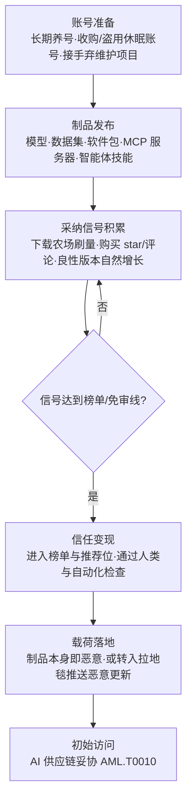

# AI 供应链声誉刷量 (AML.T0111)

## 一句话通俗理解

> 网购认准"销量最高、老店经营"？攻击者也懂这套：他们不给恶意 AI 组件伪造假奖状，而是花几个月把它经营成"真·销量冠军"——用有多年贡献历史的开发者老账号发布制品，用下载农场和刷出来的 star 把它抬进榜单前列，再维护一段真正好用的良性版本。等你——或者替你选包的 AI 编码助手——按"人多的总不会错"下单时，每一条信任信号都是真的，唯一没写进评论区里的，是店主的动机。

## 难度等级

⭐⭐ **Demonstrated（已实证）**

官方成熟度评定为 Demonstrated——攻击链条已在真实生态中被实证：案例 AML.CS0049 中，安全研究者发布到 ClawdHub 智能体技能注册表的毒化技能，上线 8 小时内即被 16 名用户下载执行，披露标题更直接自称"backdooring the #1 downloaded clawdhub skill"——下载量榜首这一采纳信号成了触达受害者的放大器。门槛结构值得注意：单看每一步都是常规操作——注册账号、发布制品、维护良性版本、买量刷 star，没有任何一步需要攻破技术防线；真正的成本与 AI 供应链拉地毯式撤离（AML.T0109）一脉相承——**时间与耐心**：老账号要么花数年养出来，要么花钱收购；下载量与 star 要持续投入才像真的。这也是它被归入防御规避而非资源开发的原因——攻击的不是任何系统，而是防御方与 AI 助手共同依赖的"流行度=安全"信任启发式。

## 技术描述

### 通俗解释

开源生态的依赖选择建立在一个核心启发式上：**流行度=安全**。下载量千万的包、star 上万的项目、经营多年的发布者账号，出问题的概率低——所以人类工程师这么选，registry 的风险评分这么排，替人写代码的 AI 编码助手也这么推荐。声誉刷量攻击的就是这条启发式本身：攻击者不伪造任何**可被验伪**的东西，而是系统性地**制造可信度**——用有真实项目历史的老账号发布制品，用真实好用的良性版本积累真实用户，再用下载农场、购买 star 与评论把采纳信号催化到榜单级别。官方描述强调，这类制品"依靠真实的历史与使用模式，同时通过人类与自动化的信任检查"——防御方看到的一切都是真的，因为除了动机，一切都是真的。

### 技术原理

依据官方描述：声誉刷量是构建或利用看似真实可信的信任信号，提升 AI 供应链组件**表面合法性**，以推动恶意或已失陷制品被采纳的过程。其机制可拆解为三层：

1. **账号信誉是地基**。攻击者使用"有合法项目与贡献历史的成熟开发者账号"发布 AI 模型、数据集、软件包与 MCP 服务器。账号年龄与贡献历史是制品仓库中最难伪造、也最少被质疑的信号。获取路径包括：长期养号（真实贡献代码攒历史）、收购或盗用休眠的开发者账号、接手失去维护者的项目——后两者与伪装技术（AML.T0074）中的命名空间回收手法互相交织。
2. **采纳信号矩阵**。官方点名的信号包括下载量、GitHub star、fork 与依赖链收录。信号的成本与"硬度"成反比：下载量与 star 可由下载农场和刷量服务批量制造（软信号）；被其他项目纳入依赖链、被教程与文档引用则是硬信号——攻击者用软信号铺量、用良性版本的自然使用攒硬信号，两者叠加让"刷出来的热度"与"真实的流行"无法区分。
3. **良性版本铺垫与拉地毯衔接**。官方描述明确：攻击者往往先发布良性版本，待采纳信号攒够，再经由 AI 供应链拉地毯式撤离（AML.T0109）引入恶意更新。声誉刷量与拉地毯因此构成同一攻击的两个坐标轴——前者横向铺信任信号，后者纵向利用审查时点差。

**平台覆盖**：Predictive AI（预测式 AI）/ Generative AI（生成式 AI）/ Agentic AI（智能体 AI）三类平台全部适用——作用面是制品仓库与分发渠道（模型、数据集、软件包、MCP 服务器、智能体技能），与制品承载的具体 AI 形态无关。

**在 ATLAS 中的位置**：本技术归属防御规避（AML.TA0007）——它本身不投递任何载荷，而是让"声誉即安全"的信任启发式失效，使恶意制品在人类审查与自动化检查（registry 风险评分、按声誉排序推荐的 AI 编码助手）面前获得免检地位。制品被采纳后，攻击链落入 [AI 供应链妥协 (AML.T0010)](../04-Initial-Access/AML.T0010-AI-Supply-Chain-Compromise.md) 的范畴。

### 用途影响

- **审查成本转嫁**：防御方的选型审查被"大家都在用"的假象短路——制品声誉越高，人工审查越草率，"首次引入"这道门形同虚设；
- **同时欺骗两类把关者**：人类工程师与自动化信任检查共享同一套声誉信号，一次刷量同时污染两类审查者；
- **触达面放大**：榜单位次与推荐位直接决定分发基数，信号投入直接转化为潜在感染基数；
- **与拉地毯无缝组合**：采纳信号攒够后转入恶意更新（AML.T0109），前期积累的声誉在推送恶意版本时一次性变现；
- **攻击成本结构特殊**：主要成本是资金（买号、买量）与时间（养号、维护良性版本），技术成本趋近于零——这让"有耐心"成为比"有技术"更危险的攻击者画像；
- **生态信任透支**：每次披露都在稀释开源生态的声誉货币，最终抬高所有诚实维护者的信任成本。

## 攻击流程

### 典型攻击流程



**步骤详解：**

1. **账号准备**
   - 通俗描述：先弄到一块"老字号"招牌。
   - 技术细节：制品仓库的发布者信誉建立在账号年龄与贡献历史上。攻击者要么长期养号（用真实代码贡献积累历史），要么收购/盗用休眠开发者账号，要么接手失去维护者的项目直接继承其声誉存量。这一步决定了后续所有信号的"底色"。

2. **制品发布**
   - 通俗描述：用老招牌开一家新店。
   - 技术细节：以成熟账号发布 AI 模型、数据集、软件包、MCP 服务器或智能体技能。命名往往蹭热门生态的语义空间（与冒充 AML.T0073、伪装 AML.T0074 叠加），让搜索与推荐流量自然导入。

3. **采纳信号积累**
   - 通俗描述：雇人排队，同时真做买卖。
   - 技术细节：双轨并行——软信号靠下载农场批量制造下载量、购买 star 与好评；硬信号靠良性版本的真实使用积累依赖收录与社区引用。期间正常响应 issue、发布修复，维持"活跃维护"的画像。积累期可持续数周至数月。

4. **信任变现**
   - 通俗描述：排进榜单，等着免检。
   - 技术细节：制品进入下载榜前列与推荐位；人类工程师按"流行度=安全"快速放行，自动化信任检查（风险评分、准入规则）同样亮绿灯，AI 编码助手把它作为"社区推荐"递到工程师面前。制品获得事实上的免审地位。

5. **载荷落地**
   - 通俗描述：招牌挂稳了，货可以换了。
   - 技术细节：两条变现路径——制品本身即含恶意载荷（直接兑现），或转入拉地毯式撤离（AML.T0109）：推送携带恶意代码的更新版本，让前期声誉在"例行升级"通道中一次性变现。

**与后续战术的衔接：**

- **初始访问（AML.TA0004）**：被免审采纳的制品成为入侵入口，落入 AI 供应链妥协（AML.T0010）范畴
- **防御规避内部组合**：声誉刷量（铺信号）→ 拉地毯（AML.T0109，用信号换免审更新）是官方描述点明的标准组合
- **资源开发前置**：发布账号、命名空间与初始良性制品在资源开发阶段就已备妥——声誉刷量是这些资源在防御规避阶段的兑现

> 关键差异：传统伪装（AML.T0074）伪造的是制品的"外观"，声誉刷量经营的是制品的"履历"——外观可以被验伪，履历里的每一条都是真的。

## 真实案例

> 以下案例源自 MITRE ATLAS 案例库，直接关联 AML.T0111。

### 案例1：ClawdHub 毒化智能体技能供应链概念验证（2026年，AML.T0111）

- **时间**: 2026年1月26日
- **攻击者**: Jamieson O'Reilly（安全研究者，概念验证演示）
- **手法**: 研究者在 ClawdHub——一个面向智能体的技能注册表——上分享了一个毒化的 ClawdBot 技能（Skill）。技能内含提示词注入，诱导 ClawdBot 执行一条 shell 命令并回连研究者的服务器。研究者用这条通道向用户示警；但同样的位置完全可以投递恶意载荷并控制用户系统。技能发布后的前 8 小时内，16 名不同用户下载并执行了这个毒化技能；披露标题将其称为"ClawdHub 下载量第一的技能"——下载量与榜单位次这些采纳信号，正是触达面被快速放大的直接推手。
- **影响**: 证明在智能体技能这类全新形态的制品仓库中，"下载量→信任→安装执行"的转化链路畅通无阻：注册表越新、信号越"裸奔"——没有信号一致性校验、没有发布者画像、没有异常增长监控，新制品靠刷出的热度就能直接进入用户的智能体执行上下文
- **参考链接**: [eating lobster souls Part II: the supply chain](https://x.com/theonejvo/status/2015892980851474595)

**为什么说 CS0049 是声誉刷量的活体标本：**

| 声誉刷量要素 | CS0049 中的呈现 |
|-------------|----------------|
| 制品仓库 | ClawdHub——面向智能体的技能注册表 |
| 制品形态 | 智能体技能（Skill），安装即进入智能体执行上下文 |
| 采纳信号 | 下载量登顶（披露标题：#1 downloaded skill） |
| 信号变现 | 发布 8 小时内 16 名真实用户下载执行 |
| 载荷形态 | 提示词注入诱导 shell 命令回连 |
| 恶意上限 | 研究者仅作示警——真实攻击者可投递任意载荷 |

背景延伸：账号信誉的长期经营并非 AI 生态独创。2024 年曝光的 XZ Utils 后门中，攻击者以"Jia Tan"身份贡献代码两年多、逐步取得维护者权限——用真实贡献历史兑换供应链信任的极端案例。AI 生态的区别在于：模型权重与数据集不透明、人工审无可审，而智能体技能注册表等新生态连传统的"首发审查"文化都还没建立——声誉刷量在这里的边际收益远高于传统软件生态。

## 红队视角

> ⚠️ **免责声明**：以下内容仅用于合法授权的安全测试与教育目的。向公共仓库刷量、买 star、抢注命名空间均属平台滥用行为甚至违法；所有演练必须限于内部环境。

### 实战技巧

1. **选型启发式审计**
   授权评估中最有冲击力的一课：拉出组织近期引入的 AI 依赖清单（模型、包、MCP 服务器、技能），逐项追问"当初为什么信任它"，统计"纯声誉信号"（下载量、star、账号历史、榜单）在决策依据中的占比。再做一个"信号剥离"复测：遮住制品的所有声誉元数据让工程师重新评审——两次结论的差值，就是组织对声誉刷量的真实暴露度。

2. **AI 助手推荐链路测试**
   在授权环境中观察组织使用的 AI 编码助手："帮我找一个做 X 的库"——记录它推荐了什么、依据什么排序、推荐结果是否被直接安装。把"推荐→安装→执行"链路中无人审查的环节画出来；这条链路每短一环，攻击者的刷量投资回报率就高一档。

3. **发布者画像基线演练**
   对已在用的 AI 依赖拉取发布者元数据（账号年龄、发布节奏、维护者变更史、下载量与社区活性的一致性），建立画像基线。红队报告交付"我们为什么信任这些依赖"的清单——这份清单同时是蓝队检测能力的起点。

### 常用工具

| 工具名称 | 用途 | 平台 |
|----------|------|------|
| 私有 registry（Verdaccio / devpi） | 在受控环境模拟制品发布与采纳信号积累 | 跨平台 |
| Registry / Hub API（npm、PyPI、Hugging Face Hub） | 拉取发布者账号年龄、发布历史与采纳信号元数据 | Web |
| Socket.dev | npm/PyPI 供应链风险评分，识别异常信号增长 | SaaS |
| OSV-Scanner | 依赖漏洞基线与版本差异对比 | 跨平台 |
| 包管理器审计日志（npm audit / pip） | 消费侧依赖引入事件审计 | 跨平台 |

### 注意事项

- **绝不触碰公共仓库**：演练制品只发内部 registry，刷量、买 star、抢注包名在所有公共平台均属滥用行为，可能触法
- **报告聚焦"信任决策链"而非工具评分**：客户需要的答案是"声誉信号在我们的流程里顶替了哪些审查"，而不是某个制品的风险分
- **把 CS0049 与 XZ Utils 作为汇报素材**：真实案例最能说明"信号是真的、动机是假的"这一检测困境——尤其是对管理层

## 蓝队视角

### 检测要点

1. **信号一致性审计（平台侧）**
   - 数据来源：registry / GitHub / Hugging Face 平台 API 与元数据
   - 关注字段：下载量增长曲线、star 账号构成、issue/PR 活跃度、贡献者数量
   - 异常特征：下载量激增但 issue/PR 长期沉寂、star 集中来自新注册或无历史账号、增长曲线呈台阶式跳变（下载农场特征）、高采纳与低社区活性严重背离

2. **发布者画像漂移（仓库侧）**
   - 数据来源：registry 维护者记录、提交历史
   - 关注字段：账号年龄、既往制品领域、维护者列表变更
   - 异常特征：老账号突然发布与既往领域无关的制品、休眠账号"复活"后立即发布、维护权无预警移交、新制品的发布者账号年龄与制品声称的成熟度不匹配

3. **消费侧引入行为（组织侧）**
   - 数据来源：代码仓库 PR、lockfile 变更、AI 助手会话审计
   - 关注字段：新引入依赖的引入理由、审批记录、来源
   - 异常特征：新依赖的引入理由只有"流行/下载量高"、AI 编码助手推荐的制品被免审安装、允许清单外制品进入构建链

4. **依赖链突变（SBOM 侧）**
   - 数据来源：SBOM、构建产物清单
   - 异常特征：间接依赖中出现此前从未见过的新发布者制品、依赖树在"例行升级"中引入陌生命名空间

### 监控建议

- 把声誉信号从"放行依据"改判为"风险线索"：制品越流行，来源审查越要独立完成——这与直觉相反，恰是本技术的杀伤点
- 对组织允许清单外的 AI 制品（模型、数据集、MCP 服务器、技能包）建立引入登记制度，无论其 star 多少
- 监控指标聚焦"信号与实体的一致性"：高下载 + 沉默社区 + 新发布者是比任何单一指标都强的组合特征
- 智能体技能注册表、MCP 目录这类新生态优先纳入治理——注册表越新，风控越薄弱，CS0049 已给出实证

## 检测建议

### 网络层检测

**检测方法：** 识别异常的下载与拉取模式。

- CI/开发机从 registry 拉取发布时间极短（如不足 30 天）的新制品，且发布者无既往历史
- registry 侧（自托管场景）短窗口内来自同一网段的集中下载——下载农场的直接指纹
- 依赖升级后新制品来源域名/命名空间与组织既有依赖画像无交集

### 主机层检测

**检测方法：** 监控依赖安装与智能体加载事件。

- 包管理器安装"发布者账号年龄异常"的新依赖（如账号注册不足 90 天却宣称成熟项目）
- AI 编码助手或智能体运行时加载了未在允许清单登记的技能、MCP 服务器或模型
- 安装事件后制品行为与元数据宣称的用途不符（如"文本工具"请求凭据存储）

### 应用层检测（AI 遥测）

**检测方法：** 利用 registry 平台与 AI 助手平台的审计能力。

- registry/镜像侧：下载量增长与社区质量指标（issue、贡献者、fork 活跃度）的一致性比对，背离超阈值自动标记
- AI 编码助手审计：推荐→采纳链路中"零审查安装"的占比统计，对高声誉低审查制品建立复核队列
- 制品元数据：发布者账号年龄、发布节奏、维护者变更纳入准入评分

**程序化检测思路（无需 EDR 侧改造）：**

把"声誉"从单调递增的信任分改造成需要交叉验证的**线索三元组**：采纳信号（下载/star 增长）× 社区活性（issue/PR/贡献者）× 发布者画像（账号年龄/历史/变更）。信号高而活性低、或画像出现漂移，即进入人工复核。核心不是发明新规则，而是承认一个前提——**当信号本身可以被制造时，单看信号的任何检测都注定失明**，唯有信号之间的相互印证还剩防御力。

### Sigma 规则思路示例

```yaml
title: 新引入依赖的发布者账号年龄异常（声誉刷量采纳特征）
status: experimental
description: 检测开发机或 CI 上安装发布者账号注册时间过短且
    制品发布极新的依赖，可能为经声誉刷量包装的恶意制品
    （AML.T0111）
logsource:
    category: application
    product: package_manager
detection:
    selection:
        event_action: 'install'
        publisher_account_age_days|lte: 90
        package_first_release_days|lte: 30
    filter_internal:
        package_name|endswith: '@internal'
    condition: selection and not filter_internal
level: medium
tags:
    - attack.t1195
    - atlas.aml_t0111
```

## 缓解措施

> MITRE ATLAS 官方数据未为本技术关联缓解措施（mitigations 为空）。以下为基于攻击机理与供应链治理实践的防御建议。

### 优先级1：关键措施

**把声誉从"安全背书"降级为"待验证线索"**

唯一治本的方向：改造选型与准入标准，禁止任何 AI 依赖仅凭声誉信号（下载量、star、榜单位次、账号历史）直接放行——声誉越高的制品，来源审查（发布者身份、维护历史、制品内容）越要独立完成。AI 编码助手的推荐结果同样视为"候选"而非"结论"，纳入人工或自动化复核。这一条直接拆除本技术的变现逻辑：刷出来的信号再也兑换不到免审地位。

**制品来源与版本双管控**

私有 registry 镜像 + 组织级允许清单 + lockfile 精确锁定（pin 到版本与哈希）；新依赖引入须登记发布者画像；对已在用依赖的每次版本变更执行内容 diff。声誉刷量的最终变现通道多为恶意更新（AML.T0109）——斩断更新免审，等于没收前期刷量的投资回报。

### 优先级2：重要措施

**发布者画像与信号一致性监控**

对在用 AI 依赖维护"发布者画像"基线（账号年龄、发布节奏、维护者变更），并持续比对下载量与社区活性的背离。画像漂移（休眠账号复活、维护权移交、领域跳变）自动进入人工复核队列。

**运行时权限边界**

按"免检制品可能带毒"做纵深防御：MCP 服务器、智能体技能以最小权限运行——出站连接白名单、凭证按需注入、技能加载走登记清单。制品即使被免审采纳，载荷的权限上限也被压到最低。

**防御分层小结：**

| 防线 | 阻断的攻击链环节 |
|------|-----------------|
| 准入标准去声誉化 | 刷出的信号无法兑换免审地位（治本） |
| 允许清单 + 版本固定 + 更新 diff | 声誉变现通道（恶意更新）被斩断 |
| 发布者画像与信号一致性监控 | 异常信号组合进入人工复核 |
| AI 助手推荐纳入复核 | "推荐→安装"零审查链路被切断 |
| 运行时最小权限 | 制品被采纳后载荷上限受限 |

## 关联 ATT&CK 技术

**官方未建立 AML.T0111 与 ATT&CK 技术的正式映射**（本技术在 ATLAS 数据中的 ATT&CK-reference 为空）。以下是本库给出的主题性对照，供学习参考：

- **[供应链妥协 (T1195)](../../enterprise/03-Initial-Access/T1195-Supply-Chain-Compromise.md)**——父概念：在软件生产或分发环节操纵制品。声誉刷量是其在 AI 生态的前置赋能环节——不操纵制品本身，而是为投毒/拉地毯制品提前准备好"信任通行证"。该技术下的 XZ Utils 后门（两年维护者信誉积累）与本技术的养号逻辑一脉相承。
- **[建立账户 (T1585)](../../enterprise/02-Resource-Development/T1585-Establish-Accounts.md)**——资源开发侧的镜像：养号、收购休眠账号对应"建立账户"的账户资源建设。区别在于 T1585 强调账户资源本身，声誉刷量则把这些资源兑现为制品的可信度——前者是囤货，后者是出货。
- **[颠覆信任控制 (T1553)](../../enterprise/08-Defense-Impairment/T1553-Subvert-Trust-Controls.md)**——主题呼应：T1553 滥用代码签名等信任机制让系统放行恶意软件；声誉刷量滥用"流行度=安全"这条生态级信任启发式让审查放行恶意制品。两者都不攻破控制本身，而是让控制替攻击者背书。

**声誉刷量与拉地毯式撤离对照：**

| 维度 | 声誉刷量 (AML.T0111) | 拉地毯式撤离 (AML.T0109) |
|------|---------------------|--------------------------|
| 攻击对象 | 信任启发式（声誉=安全） | 审查时点（只查首次引入） |
| 信号来源 | 制造与催化（养号、刷量、良性积累） | 真实自然积累（可叠加刷量催化） |
| 时间轴 | 采纳之前铺信号 | 采纳之后推恶意更新 |
| 变现方式 | 被免审采纳 / 衔接恶意更新 | 更新通道静默分发 |
| 官方关系 | 官方描述明确衔接 AML.T0109 | 官方描述点名 AML.T0111 可催化 |

一句话总结：拉地毯让审查扑空，声誉刷量让审查心甘情愿地放行——前者偷走的是时间，后者偷走的是信任本身。

## 动手实验

> ⚠️ **重要提示**：所有实验仅在内部环境进行，使用内部 registry 与自有测试包；严禁向 npm/PyPI/Hugging Face 等公共仓库发布任何测试制品，严禁在任何平台上实施刷量、买 star、抢注等行为。

### 实验环境准备

| 环境组件 | 用途 | 获取方式 |
|----------|------|----------|
| 私有 npm registry（Verdaccio） | 模拟制品仓库与采纳信号 | npm / Docker 安装 |
| 自写的简易技能/MCP 工具包 | 实验用"AI 制品" | 本地开发 |
| Registry / Hub API 访问（npm、Hugging Face） | 拉取真实制品的发布者元数据 | 公开 API |
| Python 脚本环境 | 信号模拟与画像分析脚本 | 官方安装包 |

### 实验1（初级）：声誉启发式自查

**实验目标：** 量化组织信任决策中"纯声誉信号"的占比。

**实验步骤：**
1. 列出组织近期引入的 5 个 AI 依赖（模型、包、MCP 服务器、技能各至少 1 个）
2. 逐项记录"当初为什么信任它"，把理由分为：声誉信号（下载量、star、账号历史、榜单）与实质审查（代码审查、来源验证、内容 diff）
3. 统计纯声誉信号占比；对占比最高的依赖补做一次实质审查，记录发现

**预期结果：** 一份直观的"信任决策审计表"——多数组织会发现声誉占比远超预期，这份表格本身就是最好的安全意识培训素材。

### 实验2（中级）：内部 registry 模拟信号催化

**实验目标：** 亲手验证"下载量→信任"的转化强度。

**实验步骤：**
1. 在私有 registry 发布一个功能正常的测试技能包 v1.0.0
2. 编写脚本模拟批量下载，将其内部下载量刷至明显高于其他内部包
3. 在授权演练中让同事在两个内容相同的候选包间做选型（一个零下载、一个高下载），不提示实验背景
4. 演练结束后说明实验目的，统计选择结果与决策理由

**预期结果：** 得到本组织的"下载量→信任"转化率，并让参与者亲身意识到自己依赖声誉启发式的程度。

### 实验3（高级）：建立发布者画像基线

**实验目标：** 把"信号一致性检测"落成可运行的门禁。

**实验步骤：**
1. 用 npm/PyPI/Hugging Face Hub API 拉取组织在用 AI 依赖的发布者元数据：账号年龄、发布节奏、维护者变更史、下载量曲线
2. 为每个依赖生成画像报告，标注异常项：新账号、休眠复活、维护权移交、下载量与社区活性背离
3. 把画像检查接入 CI：新依赖引入时自动比对画像，异常项强制人工复核标签
4. 用一个虚构的"高下载、零社区"测试包验证门禁触发

**预期结果：** 一条"画像异常→人工复核"的自动化门禁，以及一份持续更新的依赖信任基线——它同时覆盖声誉刷量与拉地毯两个威胁。

## 术语解释

| 术语 | 英文原名 | 通俗解释 |
|------|----------|----------|
| 声誉刷量 | Reputation Inflation | 系统性制造或催化"看起来真实"的信任信号，让恶意制品获得可信度 |
| 采纳信号 | Adoption Signals | 下载量、star、fork、依赖链收录等代表"被社区采纳"的指标 |
| 账号年龄 | Account Age | 发布者账号的注册与活跃历史——制品仓库最难伪造的信任信号之一 |
| 制品仓库 | Artifact Registry | 托管模型、数据集、软件包、MCP 服务器、智能体技能等制品的平台 |
| 信任启发式 | Trust Heuristic | "流行度=安全"式的决策捷径——人类与自动化检查共用的默认规则 |
| 养号 | Account Farming | 长期经营账号积累真实贡献历史，为日后发布恶意制品储备信誉 |
| 下载农场 | Download Farm | 批量模拟下载以抬高采纳信号的机械化操作 |
| 命名空间 | Namespace | 制品在仓库中的名称归属——冒充与抢注的目标资源 |
| MCP 服务器 | MCP Server | 经 Model Context Protocol 向 AI 智能体暴露工具能力的服务端组件 |
| 智能体技能 | Agent Skill | 智能体可安装扩展的能力包——ClawdHub 等注册表的托管对象 |
| 拉地毯式撤离 | Rug Pull | 攒够信任后推送恶意更新的攻击模式（AML.T0109） |
| 榜单效应 | Chart Effect | 高下载带来的曝光与信任正反馈循环——信号越多、触达越大、信号越多 |
| ClawdHub | ClawdHub | 面向智能体的技能注册表——CS0049 的事发平台 |
| ClawdBot / OpenClaw | ClawdBot (OpenClaw) | CS0049 中的目标智能体，现已更名 OpenClaw |
| SBOM | Software Bill of Materials | 软件成分清单——依赖盘点与画像基线的数据基础 |

## 参考资料

### 📚 官方文档

- [MITRE ATLAS - AI Supply Chain Reputation Inflation (AML.T0111)](https://atlas.mitre.org/techniques/AML.T0111/) - 官方技术页面
- [MITRE ATLAS 矩阵](https://atlas.mitre.org/matrices/ATLAS/)
- [MITRE ATLAS Data (GitHub)](https://github.com/mitre-atlas/atlas-data)

### 📰 案例报告（真实攻击与安全研究）

- [eating lobster souls Part II: the supply chain (aka - backdooring the #1 downloaded clawdhub skill)](https://x.com/theonejvo/status/2015892980851474595) - CS0049 原始披露：毒化 ClawdBot 技能的供应链概念验证
- [Wikipedia: XZ Utils backdoor](https://en.wikipedia.org/wiki/XZ_Utils_backdoor) - 长期账号信誉积累型供应链攻击的标志性案例

### 🔧 工具与资源

- [Socket.dev](https://socket.dev/) - npm/PyPI 供应链风险分析
- [OSV-Scanner](https://github.com/google/osv-scanner) - 开源依赖漏洞扫描
- [SLSA](https://slsa.dev/) - 供应链完整性框架
- [Hugging Face Hub API 文档](https://huggingface.co/docs/hub/api) - 模型/数据集制品元数据查询

### 🔗 关联阅读

- [防御规避战术 (AML.TA0007)](./README.md) - 本技术所属战术的概览页
- [AI 供应链妥协 (AML.T0010)](../04-Initial-Access/AML.T0010-AI-Supply-Chain-Compromise.md) - 声誉刷量铺路后的落地技术
- [伪装 (AML.T0074)](./AML.T0074-Masquerading.md) - 命名空间回收与制品伪装——同为供应链信任滥用
- [供应链妥协 (T1195)](../../enterprise/03-Initial-Access/T1195-Supply-Chain-Compromise.md) - 传统软件供应链攻击全景
- [建立账户 (T1585)](../../enterprise/02-Resource-Development/T1585-Establish-Accounts.md) - 资源开发侧的账号建设对照

---

> **版本**: ATLAS 2026.09 | **更新**: 2026-10-22 | **模板**: ATLAS 技术文档 v1.0
