# 防御规避 (AML.TA0007)

## 一句话理解

> **攻击者既要骗过机器——绕开 AI 赋能的安全检测，也要骗过人——操纵 AI 系统呈现的内容，让恶意行为在"算法 + 人眼"双重监视下隐身。**

## 战术概述

防御规避是 ATLAS 攻击链中**贯穿全程**的战术：攻击者使用各类技术在整个入侵过程中避免被检测。与传统 ATT&CK 防御规避不同，ATLAS 防御规避具有**双向规避**的鲜明特征——一方面要绕过防御方部署的 **AI 赋能安全软件**（如基于机器学习的恶意软件检测器），另一方面还要操纵 AI 系统自身的输出内容，让与其交互的**人类用户察觉不到异常**。

**通俗解释：**
传统防御规避像小偷躲避监控摄像头；ATLAS 防御规避则是"躲摄像头 + 演戏"双管齐下——攻击者一方面把恶意内容伪装成检测系统看不懂的样子（藏进图片里的低对比度文字、编码成 base64、混进 RAG 数据库），另一方面直接操纵 AI 系统呈现给人的内容（篡改 LLM 引用来源、伪造聊天记录、给恶意模型刷出好口碑），让"最后一道防线"——人类用户——也在不知不觉中放下警惕。

**在攻击中的作用：**
防御规避不是攻击链中一个独立的"阶段"，而是与几乎每个战术并行的**隐身涂层**：初始访问阶段的钓鱼邮件要骗过 AI 驱动的垃圾邮件检测，提示词注入要躲过 LLM 护栏，供应链投毒的恶意模型要通过模型扫描器，落地后的恶意代码要规避 AI 赋能的终端检测，收尾时还要篡改 LLM 聊天记录销毁痕迹。本战术包含 15 项技术，是 ATLAS 全矩阵中技术数量最多的战术。

**包含的技术类型：**
- **传统防御规避的 AI 延伸**：冒充、伪装、混淆文件或信息、虚拟化/沙箱规避、防御规避漏洞利用——继承自 ATT&CK 经典技术，并在 AI 供应链与 AI 检测器场景中演化出新的攻击面（AML.T0073、AML.T0074、AML.T0123、AML.T0097、AML.T0107）
- **LLM 内容层规避**：操纵 LLM 可信输出组件、LLM 提示词混淆、虚假 RAG 条目注入、操纵用户 LLM 对话历史、延迟执行 LLM 指令——专攻 LLM 的输入、输出与交互记录（AML.T0067、AML.T0068、AML.T0071、AML.T0092、AML.T0094）
- **AI 供应链伪装**：AI 供应链拉地毯式撤离（Rug Pull）、AI 供应链声誉刷量——滥用开源生态的信任信号（AML.T0109、AML.T0111）
- **检测盲区利用**：破坏 AI 模型、多模态输入中的触发器、AI 定向隐身（隐身遮蔽）——专钻安全工具不审查的通道（AML.T0076、AML.T0129、AML.T0134）

**值得警惕的典型场景：**
AI 供应链是本战术的重灾区：攻击者先用有真实贡献历史的开发者账号发布正常的模型、数据集与 MCP 服务器，靠下载量、GitHub star、依赖链收录等**真实采纳信号**攒出可信度（AML.T0111）；待制品被广泛依赖后，再推送携带恶意代码的更新（AML.T0109）——由于安全审查通常集中在"首次引入依赖"这一个时点，后续更新往往畅通无阻。另一侧，面对企业日益部署的 AI 恶意软件检测器，攻击者会故意损坏恶意模型文件（AML.T0076）：扫描器因"文件无法反序列化"而报错放行，殊不知恶意代码早已在反序列化失败**之前**执行完毕。

在 LLM 交互侧，规避则更加"润物细无声"：被注入的指令可以潜伏到用户下一次提问才触发（AML.T0094），留下的痕迹可以连同聊天记录一起被抹掉（AML.T0092），而 LLM 输出的引用与链接本身还可以被操纵得"有据可查"（AML.T0067）——受害者眼中的 AI 助手依旧专业可信，攻击却早已完成。

**与 ATT&CK 传统防御规避的差异：**

| 维度 | ATT&CK 隐蔽 (TA0005) | ATLAS 防御规避 (AML.TA0007) |
|------|---------------------|------------------------|
| 规避对象 | 杀毒软件、EDR、沙箱、日志审计 | AI 赋能安全软件、LLM 护栏，以及人类用户对 AI 输出的信任 |
| 典型手法 | 进程注入、混淆、伪装、清除痕迹、Rootkit | 提示词混淆、RAG 注入、聊天记录篡改、供应链拉地毯、多模态触发器 |
| 独有维度 | — | 直接操纵 AI 系统呈现给人的内容（引用、链接、推荐动作、对话历史） |
| 防御难点 | 恶意代码特征被绕过 | 恶意意图藏在内容与元数据中，特征库与哈希检测双双失效 |
| 检测思路 | 静态特征、行为特征、内存取证 | 数据源完整性校验、多模态全通道审查、内容一致性比对 |
| 时间窗口 | 入侵落地后持续对抗 | 从供应链发布到聊天记录清理，覆盖攻击前、中、后全程 |

## 战术在攻击链中的位置

### 攻击链全景图

```mermaid
graph LR
    A["01 侦察<br/>AML.TA0002"] --> B["02 资源开发"]
    B --> C["03 AI攻击适配"]
    C --> D["04 初始访问"]
    D --> E["05 AI模型访问"]
    E --> F["06 执行"]
    F --> G["07 持久化"]
    G --> H["08 权限提升"]
    H --> I["09 防御规避"]
    I --> J["10 凭证访问"]
    J --> K["11 发现"]
    K --> L["12 横向移动"]
    L --> M["13 收集"]
    M --> N["14 命令与控制"]
    N --> O["15 数据渗漏"]
    O --> P["16 影响"]

    style I fill:#ff6b6b,stroke:#333,stroke-width:2px
```

> 注：实际攻击中部分战术可并行或跳过，上图展示典型线性推进关系。

### 当前战术的角色

与隐蔽、持久化类似，防御规避是**贯穿性战术**：从初始访问阶段骗过邮件网关，到执行阶段躲过 LLM 护栏，再到收尾阶段清理 LLM 聊天记录痕迹，攻击者在攻击链的每个环节都可能调用本战术的技术。全景图中将其置于权限提升之后、凭证访问之前，代表攻击者站稳脚跟后、展开更大动作前的"隐身加固"窗口。

作为 ATLAS 全矩阵技术数量最多的战术（15 项），防御规避的攻击面横跨传统端点、LLM 内容层与 AI 供应链三个战场——这也意味着防御方无法依赖任何单点产品覆盖本战术，必须把"内容可信"与"制品可信"纳入与传统"代码可信"同等的防御体系。

### 前置战术

- **权限提升**：更高权限意味着更强的安全控制禁用与绕过能力（实际上防御规避可发生在攻击链任意阶段，常与初始访问、执行等战术紧密配合）
- **资源开发**：供应链拉地毯式撤离（AML.T0109）与声誉刷量（AML.T0111）所需的发布账号、命名空间与初始良性制品，都在资源开发阶段就已备妥
- **AI 攻击适配**：提示词混淆、多模态触发器等技术需要针对目标模型与护栏做适配，其调优过程往往与本战术的规避尝试交织进行

### 后续战术

- **凭证访问**：在隐身状态下窃取凭证，避免触发告警
- **发现**：隐蔽地摸清环境内的 AI 资产与权限布局
- **横向移动、收集、命令与控制、数据渗漏**：这些后续动作同样依赖本战术维持低可见度，一旦规避失效，攻击链后续环节会集中暴露

## 技术索引表

> 本战术的技术文档尚未编写，以下技术 ID 与名称暂为纯文本，待文档落地后转换为链接。

| 技术ID | 中文名称 | 难度 | 子技术数 | 一句话理解 | 关联ATT&CK | 文档状态 |
|--------|---------|:----:|:-------:|-----------|-----------|:-------:|
| [AML.T0067](AML.T0067-LLM-Trusted-Output-Components-Manipulation.md) | 操纵 LLM 可信输出组件 | ⭐⭐ | 1 | 用提示词操纵 LLM 回复里的语言、链接、引用等组件，给恶意输出披上可信外衣 | — | ✅ 已完成 |
| [AML.T0068](AML.T0068-LLM-Prompt-Obfuscation.md) | LLM 提示词混淆 | ⭐⭐⭐ | 0 | 把提示词注入藏进小字号文字、图片低对比度区域或 base64 编码，同时骗过人类与 LLM 护栏 | — | ✅ 已完成 |
| [AML.T0071](AML.T0071-False-RAG-Entry-Injection.md) | 虚假 RAG 条目注入 | ⭐⭐ | 0 | 把伪造文档混进 RAG 数据库的正常条目内部，绕过数据监控直接欺骗 LLM | — | ✅ 已完成 |
| [AML.T0073](AML.T0073-Impersonation.md) | 冒充 | ⭐⭐⭐ | 0 | 假冒高管、同事或可信厂商，骗目标替攻击者办事 | T1656 | ✅ 已完成 |
| [AML.T0074](AML.T0074-Masquerading.md) | 伪装 | ⭐⭐⭐ | 0 | 操纵文件名、位置与元数据让恶意制品显得合法，或在制品仓库回收已删除的可信命名空间 | [T1036](../../enterprise/07-Stealth/T1036-Masquerading.md) | ✅ 已完成 |
| [AML.T0076](AML.T0076-Corrupt-AI-Model.md) | 破坏 AI 模型 | ⭐⭐⭐ | 0 | 故意弄坏恶意模型文件让扫描器无法反序列化，而恶意代码在失败前已经执行 | — | ✅ 已完成 |
| [AML.T0092](AML.T0092-Manipulate-User-LLM-Chat-History.md) | 操纵用户 LLM 对话历史 | ⭐⭐ | 0 | 删除、编辑或新建聊天消息，抹掉注入痕迹让受害者毫无察觉 | — | ✅ 已完成 |
| [AML.T0094](AML.T0094-Delay-Execution-of-LLM-Instructions.md) | 延迟执行 LLM 指令 | ⭐⭐ | 0 | 把恶意指令设成"等下一个请求再执行"，绕过只检查当前对话轮次的安全控制 | — | ✅ 已完成 |
| [AML.T0097](AML.T0097-VirtualizationSandbox-Evasion.md) | 虚拟化/沙箱规避 | ⭐⭐⭐ | 0 | 探测虚拟机与沙箱环境特征，发现被分析就装无害或直接撤离 | [T1497](../../enterprise/07-Stealth/T1497-Virtualization-Sandbox-Evasion.md) | ✅ 已完成 |
| [AML.T0107](AML.T0107-Exploitation-for-Defense-Evasion.md) | 防御规避漏洞利用 | ⭐⭐ | 0 | 利用安全软件自身的编程漏洞绕过或禁用防御功能 | [T1211](../../enterprise/07-Stealth/T1211-Exploitation-for-Stealth.md) | ✅ 已完成 |
| [AML.T0109](AML.T0109-AI-Supply-Chain-Rug-Pull.md) | AI 供应链拉地毯式撤离 | ⭐⭐⭐ | 0 | 先发布正常 AI 组件攒口碑，等用户用上瘾再推送恶意更新 | — | ✅ 已完成 |
| [AML.T0111](AML.T0111-AI-Supply-Chain-Reputation-Inflation.md) | AI 供应链声誉刷量 | ⭐⭐ | 0 | 用真实账号历史和下载量、star 等采纳信号给恶意制品刷出可信度 | — | ✅ 已完成 |
| [AML.T0123](AML.T0123-Obfuscated-Files-or-Information.md) | 混淆文件或信息 | ⭐⭐⭐ | 0 | 加密、编码或混淆文件内容，让恶意软件分类器与内容过滤器集体失明 | — | ✅ 已完成 |
| [AML.T0129](AML.T0129-Triggers-in-Multimodal-Inputs.md) | 多模态输入中的触发器 | ⭐ | 0 | 把指令藏进图像、音频、视频或文件元数据等未被审查的模态通道 | — | ✅ 已完成 |
| [AML.T0134](AML.T0134-AI-Targeted-Cloaking.md) | AI 定向隐身 | ⭐ | 0 | 识别来访者身份，给 AI 智能体看恶意内容、给人类看无害页面 | — | ✅ 已完成 |

**平台覆盖说明**（依据官方数据）：

- AML.T0073（冒充）、AML.T0074（伪装）、AML.T0097（虚拟化/沙箱规避）、AML.T0107（防御规避漏洞利用）以 **Enterprise 平台**为主——与传统 ATT&CK 技术同源
- AML.T0076（破坏 AI 模型）、AML.T0109（供应链拉地毯式撤离）、AML.T0111（声誉刷量）覆盖 **Predictive AI / Generative AI / Agentic AI** 三类平台——作用于模型制品与供应链层面
- AML.T0067、AML.T0068、AML.T0071、AML.T0092、AML.T0094、AML.T0129 六项技术适用于 **Generative AI 与 Agentic AI**——以 LLM 的输入输出与交互记录为攻击面
- AML.T0134（AI 定向隐身）仅适用于 **Agentic AI**——只有智能体才会以客户端身份主动抓取并解析网页内容
- AML.T0123（混淆文件或信息）横跨 **Predictive AI 与 Enterprise**——混淆手法同时威胁模型侧检测器与传统终端防护

## 子技术索引

| 子技术ID | 中文名称 | 难度 | 一句话理解 | 文档状态 |
|---------|---------|:----:|-----------|:-------:|
| [AML.T0067.000](AML.T0067/AML.T0067.000-Citations.md) | 引用（Citations） | ⭐⭐ | 操纵 LLM 输出中引用的来源文献，让恶意建议看起来有据可查 | ✅ 已完成 |

> 注：子技术难度继承其父技术的官方 maturity 等级。

## 统计信息

- **技术总数**：15 个
- **子技术总数**：1 个
- **难度分布**：⭐⭐⭐（Realized）7 个 / ⭐⭐（Demonstrated）6 个 / ⭐（Feasible）2 个
- **平台覆盖**：Enterprise 4 项 / Generative+Agentic 6 项 / 三类 AI 平台 3 项 / Predictive+Enterprise 1 项 / 仅 Agentic 1 项
- **已完成文档**：16 个（15 主技术 + 1 子技术，全部完成 ✅）

## 推荐阅读顺序

### 入门阶段：从传统防御规避认识"躲检测"

> 适合刚接触 AI 安全的学习者，先掌握与社会工程和文件伪装相关的经典手法。

**前置知识：** 了解 ATT&CK 防御规避的基本概念

**推荐阅读：**

1. **AML.T0073 冒充** - 最古老也最有效的信任滥用手法，在 AI DevOps 场景（模型仓库、容器注册表）中依旧好用
2. **AML.T0074 伪装** - 理解文件伪装，以及 HuggingFace 等制品仓库中"回收已删可信命名空间"这类新玩法
3. **AML.T0123 混淆文件或信息** - 恶意内容如何让 AI 恶意软件分类器、内容过滤器与机密扫描器集体失明

**学习建议：**
- 对照本库 ATT&CK Enterprise 隐蔽战术（TA0005）阅读，体会技术向 AI 场景迁移的脉络
- 思考：你信任一个模型仓库制品的依据是什么？这些依据能否被伪造？
- 用 `strings`、反序列化工具亲手检查一个开源模型权重文件，理解"看起来的良性"与"实际的良性"之间的差距

### 进阶阶段：LLM 内容层的攻防

> 适合理解 LLM 与 RAG 工作原理的学习者，进入 AI 系统独有的规避维度。

**前置知识：** 了解提示词注入、RAG 检索增强生成的基本概念

**推荐阅读：**

1. **AML.T0068 LLM 提示词混淆** - 对抗 LLM 护栏与人工审查的基础手段（隐形文字、编码、多模态隐藏）
2. **AML.T0071 虚假 RAG 条目注入** - 理解 RAG 数据面如何成为绕过数据监控工具的暗道
3. **AML.T0067 操纵 LLM 可信输出组件** - 引用与链接如何被武器化，让恶意建议"有据可查"
4. **AML.T0092 操纵用户 LLM 对话历史** - 删除、编辑、新建消息三类痕迹清理手法及其检测盲区
5. **AML.T0094 延迟执行 LLM 指令** - "延时引爆"如何绕过只检查当前对话轮次的安全控制

**学习建议：**
- 在授权实验环境中复现 base64 编码绕过护栏、隐藏 HTML 注入等经典演示
- 关注聊天客户端"仅在打开时刷新一次历史"这类实现细节带来的检测盲区
- 思考"注入的指令"与"正常的指令"在护栏视角下是否真的可区分——这是内容层规避的根本难题

### 高级阶段：供应链与智能体时代的隐身术

> 适合深入研究 AI 供应链安全与多模态攻防的学习者。

**前置知识：** 了解开源 AI 生态（模型仓库、MCP 服务器）、多模态模型与智能体工作原理

**推荐阅读：**

1. **AML.T0111 AI 供应链声誉刷量** - 下载量、star、账号历史等信任信号如何被系统性伪造
2. **AML.T0109 AI 供应链拉地毯式撤离** - 为什么"首次引入才审查"的防御模式必然被绕过
3. **AML.T0076 破坏 AI 模型** - 利用"反序列化失败即放行"的扫描器逻辑盲区
4. **AML.T0129 多模态输入中的触发器** - 把指令藏进图像、音频或文件元数据等"检测器不看的通道"
5. **AML.T0134 AI 定向隐身** - 按来访者身份区别投喂内容，让 AI 客户端与人类用户看到两个世界
6. **AML.T0097 虚拟化/沙箱规避** 与 **AML.T0107 防御规避漏洞利用** - 传统强技在 AI 分析环境中的迁移

**学习建议：**
- 结合本库 ATLAS 案例研究（case-studies）中的真实事件理解供应链手法的实际运用
- 思考防御侧如何对"AI 客户端 vs 人类浏览器"做内容一致性校验
- 按"输入通道 → 数据源 → 供应链 → 痕迹"四条主线梳理检测能力，找出自己环境中的结构性盲区

## 参考资料

### 官方文档

- [MITRE ATLAS 防御规避战术 (AML.TA0007)](https://atlas.mitre.org/tactics/AML.TA0007/)
- [MITRE ATLAS 矩阵](https://atlas.mitre.org/matrices/ATLAS/)
- [MITRE ATLAS Data (GitHub)](https://github.com/mitre-atlas/atlas-data)

### 关联阅读

- [ATT&CK Enterprise 隐蔽战术 (TA0005)](../../enterprise/07-Stealth/README.md) - 传统防御规避战术的完整中文文档，与本战术对照阅读
- [T1036 伪装](../../enterprise/07-Stealth/T1036-Masquerading.md) - 与 AML.T0074 对应的 ATT&CK 经典技术
- [T1497 虚拟化/沙箱规避](../../enterprise/07-Stealth/T1497-Virtualization-Sandbox-Evasion.md) - 与 AML.T0097 对应的 ATT&CK 经典技术
- [T1211 利用漏洞实现隐蔽](../../enterprise/07-Stealth/T1211-Exploitation-for-Stealth.md) - 与 AML.T0107 对应的 ATT&CK 经典技术

### 学习资源

- [OWASP Top 10 for LLM Applications](https://owasp.org/www-project-top-10-for-large-language-model-applications/) - LLM 应用十大安全风险清单
- [NIST AI Risk Management Framework](https://www.nist.gov/itl/ai-risk-management-framework) - NIST AI 风险管理框架

## 速查卡

- **常用技术**：AML.T0068（提示词混淆）、AML.T0123（混淆文件）、AML.T0074（伪装）、AML.T0109（供应链拉地毯）——内容隐藏与供应链伪装是两大主力
- **关键检测信号**：RAG 数据源中来源不明的可疑条目、LLM 输出中异常的引用与链接、聊天记录出现非用户操作的删改、制品仓库的命名空间回收与"良性转恶意"更新、模型文件反序列化失败但已有代码执行痕迹
- **攻击者常用手法**：base64/rot13 编码、隐形文字与小字号注入、多模态触发器、延迟触发指令、真实账号养号刷声誉、损坏模型文件骗扫描器、按 User-Agent 区分返回内容
- **防御要点**：对 RAG 数据源做完整性与来源校验、多模态输入全通道审查、聊天历史变更审计、供应链制品固定版本（pin）并持续监控更新差异、扫描器对无法反序列化的模型先隔离再处理
- **蓝队关注点**：本战术大量手法利用"检测器不看的通道"（非文本模态、依赖更新流水线、文件元数据），告警应聚焦行为基线偏移而非单一特征匹配；供应链场景需将监控延伸到依赖更新事件本身
- **案例研究**：本库 [案例研究分节](../case-studies/README.md) 已收录全部 73 个真实 AI 安全事件与安全研究案例，可对照阅读

---

> **版本**: ATLAS 2026.09 | **更新**: 2026-10-22 | **模板**: ATLAS 战术README v1.0
