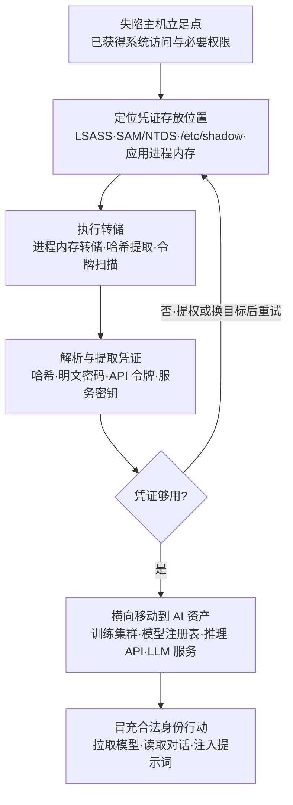

# 操作系统凭证转储 (AML.T0090)

## 一句话通俗理解

> 系统为了让你免于反复输密码，把"钥匙"缓存在进程内存与系统文件里；凭证转储就是趁失陷之机，把这些缓存整串"倒"出来——在 AI 时代，倒出来的不只是域账号哈希，还有直通训练集群、模型注册表与推理 API 的服务令牌。

## 难度等级

⭐⭐ **Demonstrated（已演示）**

经典形态几乎与 Windows 域同龄：Mimikatz 于 2007 年问世，LSASS 转储与哈希提取在真实入侵中被使用了近二十年，工具链完全成熟。AI 场景的演示由 Lumia Security 的 AIKatz 研究（AML.CS0036）完成——研究者从 Anthropic Claude、Microsoft 365 Copilot 与 OpenAI ChatGPT 三款主流 LLM 桌面客户端的进程内存中提取出认证令牌，并成功冒充受害者调用 LLM 后端。官方评定为 Demonstrated 而非 Realized：针对 AI 基础设施的实网攻击尚无公开编目（AIKatz 属授权研究演示），但"转储进程内存 → 提取令牌 → 冒充身份"这条链没有任何技术悬念——老手艺换个目标，就是 AI 攻击。

## 技术描述

### 通俗解释

操作系统要让你"登录一次、处处通行"，就必须把凭证放在触手可及的地方：Windows 把活动登录会话的密码哈希与 Kerberos 票据装进 LSASS 进程的内存，把本机账户哈希写进 SAM 数据库，把整个域的凭证库锁进域控制器的 NTDS.dit；Linux 把用户哈希留在 /etc/shadow，把运行中进程的环境与密钥暴露在 /proc。这些"钥匙柜"本是为系统自己准备的——但只要攻击者在一台主机上拿到足够权限，就能把柜子撬开、把钥匙串整串倒走。这就是凭证转储：不是偷你手里那把钥匙，而是直接翻印物业的整套备用钥匙。

AI 时代改变的不是撬柜子的手法（与 ATT&CK T1003 完全一致），而是柜子里的钥匙值多少钱。MLOps 工程师的工作站、GPU 集群节点、推理服务器的内存里，多了一串 AI 时代的"万能钥匙"：模型服务令牌、模型注册表的拉取凭证、训练平台的 API 密钥、LLM 桌面客户端的会话令牌。转储一次进程内存，训练集群、模型仓库、推理 API 的大门全部敞开——攻击者以合法身份走进去，日志里只剩下"正常登录"。

### 技术原理

依据官方描述，攻击者可能从失陷系统上的操作系统缓存、应用内存或其他来源中提取凭证。凭证通常以哈希或明文形式存在，可能包括用户名与密码、应用令牌或其他认证密钥。窃取的凭证可用于横向移动，访问 AI 智能体、LLM 或 AI 推理 API 等其他 AI 服务；也可能让攻击者触达 AI DevOps 生命周期中的其他软件工具与数据源——从训练管线到模型仓库，整条供应链都可能随之暴露。

**经典转储目标**（与 ATT&CK T1003 一一对应）：

| 凭证来源 | 存放内容 | 本库文档 |
|---------|---------|---------|
| LSASS 进程内存 | 活动会话的密码哈希、明文密码、Kerberos 票据 | [T1003.001](../../enterprise/09-Credential-Access/T1003/T1003.001-LSASS-Memory.md) |
| SAM 数据库 | 本机账户的 NTLM 哈希 | [T1003.002](../../enterprise/09-Credential-Access/T1003/T1003.002-Security-Account-Manager.md) |
| NTDS.dit | 整个域的账户哈希库 | [T1003.003](../../enterprise/09-Credential-Access/T1003/T1003.003-NTDS.md) |
| LSA Secrets | 服务账号明文密码等机密数据 | [T1003.004](../../enterprise/09-Credential-Access/T1003/T1003.004-LSA-Secrets.md) |
| 域缓存凭证 | 离线登录的缓存哈希 | [T1003.005](../../enterprise/09-Credential-Access/T1003/T1003.005-Cached-Domain-Credentials.md) |
| DCSync | 直接向域控"同步"拉取哈希 | [T1003.006](../../enterprise/09-Credential-Access/T1003/T1003.006-DCSync.md) |
| /proc 文件系统 | Linux 进程内存与环境的伪文件 | [T1003.007](../../enterprise/09-Credential-Access/T1003/T1003.007-proc-Filesystem.md) |
| /etc/passwd 与 /etc/shadow | Linux 用户账户哈希 | [T1003.008](../../enterprise/09-Credential-Access/T1003/T1003.008-etc-passwd-and-etc-shadow.md) |

**AI 场景的三类高价值主机**：

1. **MLOps 工作站**：数据科学家与 ML 工程师的日常座位——浏览器里的模型平台会话、CLI 配置里的 API 密钥、IDE 集成的训练与注册表凭证，全都驻留在进程内存与本地缓存中；
2. **GPU 集群节点**：训练任务以共享凭证访问对象存储、作业调度器与分布式文件系统——Kubernetes ServiceAccount 令牌、kubeconfig、云 IAM 会话凭证常驻节点内存，转储一个节点可能拿到整条训练管线的钥匙；
3. **推理服务器与 LLM 客户端**：模型服务进程持有推理服务的 API 密钥、模型注册表拉取凭证；AIKatz 研究证明，LLM 桌面客户端的进程内存里同样躺着可以冒充用户直连 LLM 后端的认证令牌。

**平台覆盖**：官方仅标注 Enterprise（企业环境）——转储动作发生在传统操作系统层面，但倒出来的钥匙专门用来打开 AI 资产的大门，这也是 AML.T0090 区别于 T1003 的全部意义。

### 用途影响

- **免漏洞横向**：拿到哈希即可直接传递哈希登录，无需破解明文密码，无需再利用任何漏洞；
- **一把钥匙开一串门**：AI 服务普遍信任长期有效的服务令牌——转储一次，训练集群、模型注册表、推理 API 连锁失守；
- **冒充即隐身**：合法凭证的每一次登录在日志里都"无害"，传统认证告警形同虚设；
- **AIKatz 式连锁影响**：冒充受害者直连 LLM 后端后，攻击者可读取全部对话历史、注入提示词改变模型行为、污染上下文产生持久影响、篡改历史记录掩盖痕迹——机密性、完整性、可用性三线全失。

## 攻击流程

### 典型攻击流程



**步骤详解：**

1. **获得立足点与权限**
   - 通俗描述：先混进楼，再想办法摸到钥匙柜所在的物业办公室。
   - 技术细节：凭证转储需要足够权限——Windows 上通常是管理员或 SYSTEM（读取 LSASS 需要 SeDebugPrivilege），Linux 上需要 root 或对目标进程的 ptrace 能力。攻击者通常先经初始访问与权限提升铺垫，权限不足时转储会被拒绝访问，转入提权后重试。

2. **定位凭证存放位置**
   - 通俗描述：确认钥匙柜在哪——物业办公室（LSASS）、档案室（SAM/NTDS）、还是员工自己兜里（应用进程内存）。
   - 技术细节：枚举系统角色（工作站/域控/推理服务器）、运行中的高价值进程（LSASS、LLM 客户端、模型服务进程）以及本地凭证文件（/etc/shadow、CLI 配置），按凭证密度排序目标。

3. **执行转储**
   - 通俗描述：把柜子整个搬走，或当场翻印所有钥匙。
   - 技术细节：经典手法包括 LSASS MiniDump（comsvcs.dll、ProcDump 等）、Mimikatz 内存抓取、impacket secretsdump 提取、/proc/<pid>/mem 读取，以及 AIKatz 式的进程内存扫描。转储可在失陷主机上现场解析，也可将转储文件外带离线处理以规避主机侧检测。

4. **解析与提取凭证**
   - 通俗描述：把翻印的钥匙逐把试出对应哪扇门。
   - 技术细节：解析 minidump 得到哈希与票据；哈希可离线破解，也可直接留作传递哈希之用；对应用内存做令牌特征扫描（sk-、Bearer、JWT 的 eyJ 前缀等）提取 API 密钥与会话令牌。

5. **横向移动到 AI 资产**
   - 通俗描述：拿着备用钥匙串，把金库（训练集群）、仓库（模型注册表）、柜台（推理 API）挨个打开。
   - 技术细节：用域哈希传递登录更多主机；用服务令牌直接调用推理 API、拉取模型注册表制品、访问训练平台；AIKatz 场景中则用提取的令牌冒充受害者与 LLM 后端建立会话，读取对话并介入后续交互。

**与后续战术的衔接：**

- **横向移动（Lateral Movement）**：转储产物是"使用备用认证材料"（AML.T0091 家族）的直接输入——哈希、票据、令牌即备用认证材料
- **发现（Discovery）**：登录后进一步枚举环境中的 AI 资产与数据源
- **收集 / 数据渗漏**：持合法令牌的模型拉取与数据外传混入正常流量，难以区分
- **防御规避（Defense Evasion）**：转储动作噪音大，攻击者通常结合防御规避（关闭审计、滥用签名工具）完成

> 关键认知：整条链路里没有一处需要"新式武器"——每一步都是二十年成熟手艺，唯一的新东西是最后打开的那扇门后面装着什么。

## 真实案例

> 以下案例源自 MITRE ATLAS 案例库。截至本库锚定的 2026.09 版本，直接关联 AML.T0090 的案例为 AML.CS0036。

### 案例1：AIKatz——从 LLM 桌面应用内存中"倒"出令牌（2025年，AML.CS0036）

- **时间**: 2025年（研究披露）
- **攻击者**: Lumia Security 安全研究人员（负责任的授权研究）
- **目标**: LLM 桌面应用（Anthropic Claude、Microsoft 365 Copilot、OpenAI ChatGPT）
- **手法**: 研究者证明可以从 LLM 桌面应用的进程内存中提取认证令牌。攻击者使用这些令牌即可冒充受害者身份访问 LLM 后端：读取受害者的全部对话历史，并介入未来的对话——直接注入提示词改变 LLM 的行为、污染 LLM 上下文以产生持久影响、篡改用户对话历史以掩盖痕迹，最终影响系统的机密性、完整性与可用性。这是经典"进程内存凭证转储"对 AI 客户端的完整重放：转储（LLM 客户端进程内存）→ 提取（令牌扫描）→ 冒充（令牌重放直连后端），全程不利用任何服务端漏洞。该案例还同时运用了有效账户、提示词注入、记忆污染等多项 ATLAS 技术。
- **厂商响应**: Anthropic（HackerOne）以"本地攻击"为由按信息性问题关闭；Microsoft MSRC 认为该攻击未绕过安全边界、不构成 CVE；OpenAI（BugCrowd）同样按信息性关闭，并指出该行为应由微软修复。
- **影响**: 证明"本地内存转储"这条最老的手艺在 AI 客户端上完全有效——"本地攻击不算安全边界"的认定让修复责任悬空，而令牌一旦倒出，攻击者面对的就是受害者的整条 LLM 会话链路。
- **参考链接**: [AIKatz - All Your Chats Are Belong To Us（Lumia Security）](https://www.lumia.security/blog/aikatz)

### 经典形态背景：二十年实战的老手艺

Mimikatz 由法国安全研究员 Benjamin Delpy 于 2007 年前后发布，本意是演示 Windows 认证机制的缺陷，此后逐渐成为真实入侵活动中出现频率最高的凭证转储工具之一；LSASS 内存转储与哈希提取出现在几乎所有涉及 Windows 域的入侵事件报告中，"先转储、再横移"几乎是固定动作序列。ATLAS 将 AML.T0090 收入矩阵并非收录一种新能力，而是确认一条事实：**AI 基础设施并没有带来新的操作系统**——经典 T1003 的整套攻防剧本对 AI 资产原样生效。防御者无需为"AI 场景的凭证转储"发明新检测，需要的是把告警视野扩展到 AI 服务端：令牌被倒出之后的每一次"合法"调用，都发生在传统主机监控看不见的地方。

## 红队视角

> ⚠️ **免责声明**：以下内容仅用于合法授权的安全测试与教育目的。对未授权系统执行凭证转储、使用窃取的凭证访问任何服务均属违法行为。

### 实战技巧

1. **内存优先、落盘最晚**
   转储文件落盘是最响的告警源。优先在内存中直接解析，必须落盘时用最小体积转储、即取即删、避免经网络外带——AIKatz 的研究路径同样是"进程内存中扫描提取"，而非整文件落地。

2. **优先打 MLOps 工作站与 GPU 节点**
   凭证密度决定收益。一台 ML 工程师工作站的内存里可能同时挂着模型平台会话、注册表 CLI 令牌、云凭证与 LLM 客户端令牌；GPU 节点上的 ServiceAccount 令牌则可能覆盖整条训练管线。红队报告应呈现"单机转储 → AI 资产可达性"映射表，让防御方直观看到钥匙串的爆炸半径。

3. **令牌重放验证要克制**
   验证转储出的令牌是否有效时，只做最小只读操作（如查询身份、列出模型版本），避免触发配额异常或数据外发记录——这同时是蓝队的检测面（见下文）。

### 常用工具

| 工具名称 | 用途 | 平台 |
|----------|------|------|
| Mimikatz | 经典凭证转储与解析：LSASS 内存抓取、哈希/票据提取、minidump 离线解析 | Windows |
| ProcDump / comsvcs.dll | 合法签名工具执行 LSASS 进程转储，进程链"体面" | Windows |
| impacket（secretsdump.py） | 提取 SAM、NTDS.dit、LSA Secrets | 跨平台 |
| AIKatz 式内存扫描 | 对 LLM/模型客户端进程内存做令牌特征扫描提取 | 跨平台 |
| /proc 工具链（gcore、strings） | Linux 侧进程内存转储与字符串级令牌提取 | Linux |

### 注意事项

- **授权边界**：转储必须限定在授权范围内的主机与账号；测试结束后应确认转储出的凭证已失效并销毁记录
- **OPSEC**：LSASS 访问与转储文件创建是 EDR 重点盯防的行为，签名工具的进程链同样有成熟检测规则——红队应预期"转储即告警"，将其作为检测覆盖率验证的一部分
- **报告聚焦凭证可达性**：重点是"哪些 AI 资产会被这串钥匙打开"，而非转储手法本身

## 蓝队视角

### 检测要点

1. **LSASS 异常访问**
   - 日志来源：Windows 对象访问审计（4656/4663）、Sysmon（Event ID 10 ProcessAccess）
   - 关注字段：目标进程 lsass.exe、请求的内存读取权限、源进程及其父进程链
   - 异常特征：非白名单进程请求读取 LSASS 内存；罕见父进程链下的 ProcDump/rundll32 comsvcs 调用

2. **转储文件创建**
   - 日志来源：文件审计、EDR 行为日志
   - 异常特征：lsass 相关命名的转储文件（如 lsass*.dmp）创建；调试类工具在非运维窗口落盘

3. **特权与调试能力滥用**
   - 日志来源：特权使用审计（4673/4674）、Linux audit
   - 异常特征：非常规进程使用 SeDebugPrivilege；对他人进程的 ptrace 调用；/proc/<pid>/mem 与 /etc/shadow 的异常读取

4. **AI 服务端会话异常（转储的下游回声）**
   - 日志来源：API 网关、LLM 平台审计日志、模型注册表访问日志
   - 异常特征：同一令牌的异地/并发会话；主机侧无对应登录记录的令牌使用；对话历史批量导出；与用户日常模式偏离的会话行为

### 监控建议

- **两端关联是关键**：主机侧的转储告警单独看只是一条"可疑行为"；与 AI 服务端随后出现的令牌活动关联起来，才是完整的攻击链叙事——把"进程转储告警"与"后续 24-72 小时内该主机关联账号的令牌活动"做成自动关联用例
- **令牌短生命周期**：转储出的哈希无法吊销，但令牌可以——短有效期加频繁轮换，把"倒钥匙"的收益压缩进有限时间窗口
- **蜜罐凭证**：在内存中放置假令牌（canary token），它的任何使用都是高置信度告警
- **别只盯 Windows**：GPU 集群与推理服务大量运行 Linux，/proc 转储路径同样需要 audit 规则覆盖

## 检测建议

### 网络层检测

**检测方法：** 识别转储之后的凭证利用流量。

- 离线破解迹象：失陷主机外联密码破解服务，或认证协议上的大量失败风暴
- 传递哈希的典型模式：主机 A 使用主机 B 用户的哈希完成认证（配合登录审计 4624 类型 3/9 交叉验证）
- 同一服务令牌从多个地理位置或设备指纹并发使用

### 主机层检测

**检测方法：** 监控凭证存储进程的访问与转储行为。

- Sysmon Event 10：进程对 lsass.exe 的内存读取访问（重点筛 0x1010/0x1410/0x143a 等访问掩码）
- SeDebugPrivilege 的非常规使用（4673/4674）
- Linux：/proc/<pid>/mem、/etc/shadow 的异常读取与 gcore/ptrace 调用
- 凭证类文件（kubeconfig、CLI 配置、.env）被非预期进程读取

### 应用层检测（AI 遥测）

**检测方法：** 利用 AI 平台审计能力发现令牌重放。

- 同一模型服务令牌的并发会话或新设备指纹
- 主机进程转储告警之后，关联账号在推理 API、模型注册表的异常调用序列（突发的批量拉取模型、导出对话历史）
- LLM 平台侧：同一账号"对话历史导出"或"上下文批量读取"行为与历史基线的偏离

### Sigma 规则思路示例

```yaml
title: 非白名单进程读取 LSASS 进程内存（凭证转储特征）
status: experimental
description: 检测进程请求读取 lsass.exe 内存的可疑访问，可能为凭证转储
    行为（Mimikatz / MiniDump 类，AML.T0090 / T1003.001）
logsource:
    category: process_access
    product: windows
detection:
    selection:
        TargetImage|endswith: '\lsass.exe'
        GrantedAccess|in:
            - '0x1010'
            - '0x1410'
            - '0x143a'
    filter_legitimate:
        SourceImage|endswith:
            - '\MsMpEng.exe'
            - '\audiodg.exe'
    condition: selection and not filter_legitimate
level: high
tags:
    - attack.t1003
    - attack.credential_access
    - atlas.aml_t0090
```

## 缓解措施

### 优先级1：关键措施

**AML.M0011 限制库加载（Restrict Library Loading）**

阻止操作系统与软件的库加载机制被滥用以加载不可信代码——通过配置适当的库加载机制，并排查潜在存在弱点的软件。官方特别指出：pickle 等常用于存储 AI 模型的文件格式，可能包含允许加载恶意库的漏洞利用代码。对本技术的意义在于**掐断转储代码的落地路径**：凭证转储几乎总是先要在失陷主机上运行攻击者代码（转储工具、注入的恶意库、pickle 反序列化携带的执行载荷），锁死库加载机制（Windows 的安全 DLL 搜索与签名策略、Linux 的加载器与 LD_PRELOAD 加固、组件加载白名单）意味着攻击者得先解决"如何把代码跑起来"，才谈得上"倒"凭证。生命周期阶段：部署（Deployment）。

### 优先级2：重要措施（本库补充）

以下措施未列入 ATLAS 官方对 AML.T0090 的映射，但属于经典 T1003 防御体系的成熟实践，对 AI 场景同样直接有效：

- **启用 LSASS 保护（RunAsPPL）与 Credential Guard**：让非受保护进程根本无法读取 LSASS 内存，直接堵死最常用的转储路径
- **让"倒出来"失效的凭证设计**：AI 服务令牌短有效期、频繁轮换、绑定调用来源；密钥统一交由 secret manager 注入，而非长驻进程内存与配置文件
- **最小权限拆分钥匙串**：GPU 节点、推理服务、MLOps 工具各持独立最小权限凭证，单点转储不等于全线失守
- **EDR 行为监控与两端关联告警**：主机侧转储行为 + 服务端令牌异常使用的自动关联（见蓝队视角）

### MITRE ATLAS 缓解措施映射

| 缓解措施ID | 缓解措施名称 | 优先级 | 类别 | 生命周期阶段 |
|------------|-------------|:------:|------|-------------|
| AML.M0011 | 限制库加载 | 关键 | Technical - Cyber | 部署 |

> 官方为本技术仅映射 AML.M0011 一条措施——它针对"攻击者如何让转储代码跑起来"这个入口；转储动作本身与凭证善后的防御，依赖经典 T1003 体系（LSASS 保护、审计、EDR、令牌轮换）与 AI 服务端的会话治理。

## 关联 ATT&CK 技术

**官方映射：[操作系统凭证转储 (T1003)](../../enterprise/09-Credential-Access/T1003-OS-Credential-Dumping.md)**——AML.T0090 的 ATT&CK-reference 直接指向 T1003，两者是同一手法在两个知识库中的镜像：转储机制、工具、检测手段完全一致，差异只在**目标与用途**——T1003 转储出的凭证通向域内资产与传统横向移动，AML.T0090 明确其用途指向 AI 智能体、LLM、推理 API 与 AI DevOps 工具链。

与 T1003 子技术的对应关系：

| T1003 子技术 | 本库文档 | AI 场景对应 |
|-------------|---------|------------|
| [T1003.001 LSASS 内存](../../enterprise/09-Credential-Access/T1003/T1003.001-LSASS-Memory.md) | ✅ | 经典主力路径；AIKatz 将同一思路应用于 LLM 客户端与模型服务进程内存 |
| [T1003.002 SAM](../../enterprise/09-Credential-Access/T1003/T1003.002-Security-Account-Manager.md) | ✅ | 失陷工作站/节点的本地账户哈希 |
| [T1003.003 NTDS.dit](../../enterprise/09-Credential-Access/T1003/T1003.003-NTDS.md) | ✅ | 域控沦陷后倒出全域凭证——AI 平台若以域账号体系管理模型仓库，一次转储全线失守 |
| [T1003.004 LSA Secrets](../../enterprise/09-Credential-Access/T1003/T1003.004-LSA-Secrets.md) | ✅ | 服务账号明文密码，常包括为 AI 平台注册的服务账号 |
| [T1003.005 域缓存凭证](../../enterprise/09-Credential-Access/T1003/T1003.005-Cached-Domain-Credentials.md) | ✅ | 离线破解域账号的另一条路径 |
| [T1003.006 DCSync](../../enterprise/09-Credential-Access/T1003/T1003.006-DCSync.md) | ✅ | 无需登录域控即"同步"全域哈希 |
| [T1003.007 /proc 文件系统](../../enterprise/09-Credential-Access/T1003/T1003.007-proc-Filesystem.md) | ✅ | Linux 侧转储 GPU 节点/推理容器进程内存的通道 |
| [T1003.008 /etc/passwd 与 /etc/shadow](../../enterprise/09-Credential-Access/T1003/T1003.008-etc-passwd-and-etc-shadow.md) | ✅ | Linux 侧账号哈希提取 |

相邻主题技术：

- **[窃取应用访问令牌 (T1528)](../../enterprise/09-Credential-Access/T1528-Steal-Application-Access-Token.md)**——从进程与文件中提取令牌的近亲；AIKatz 恰好横跨两者：动作是转储（T1003 系），战利品是应用令牌（T1528）
- **[使用备用认证材料 (T1550)](../../enterprise/11-Lateral-Movement/T1550-Use-Alternate-Authentication-Material.md)**（含传递哈希）——转储的"下半场"：拿到哈希/票据/令牌之后如何免密码认证

一句话总结：T1003 与 AML.T0090 是同一门老手艺——区别只在撬开的钥匙柜后面，通向的是域内文件服务器，还是 GPU 训练集群与模型注册表。

## 动手实验

> ⚠️ **重要提示**：所有实验必须在自有隔离环境（虚拟机快照、自有测试账号）中进行。对他人系统或账号执行凭证转储属违法行为。

### 实验环境准备

| 环境组件 | 用途 | 获取方式 |
|----------|------|----------|
| Windows 10/11 虚拟机（带快照） | 实验1/2 的靶机 | 自有虚拟化环境 |
| Mimikatz + ProcDump（Sysinternals） | 转储与解析 | 官方发布渠道 |
| 任意 LLM 桌面客户端 + 自有测试账号 | 实验2 的 AI 目标 | 官方安装包 |
| Sysmon（含进程访问日志） | 实验3 的检测数据源 | 官方发布渠道 |

### 实验1（初级）：LSASS 转储全流程（自有实验机）

**实验目标：** 亲历"转储 → 解析 → 拿到哈希"的经典链路。

**实验步骤：**
1. 快照后，在自有 VM 上以管理员权限运行 ProcDump 转储 LSASS 进程内存
2. 用 Mimikatz 的 minidump 模式离线解析转储文件，列出提取到的账户与哈希
3. 在 Sysmon 日志中回看这次转储留下的 ProcessAccess（Event 10）痕迹
4. 恢复快照，确认环境干净

**预期结果：** 理解为什么"一次管理员权限的内存转储 = 一串可用凭证"，以及主机侧能拿到什么检测信号。

### 实验2（中级）：AIKatz 式令牌提取（自有测试账号）

**实验目标：** 复现"LLM 客户端内存里躺着可重放令牌"的核心事实。

**实验步骤：**
1. 在实验 VM 安装任一 LLM 桌面客户端，登录自有测试账号并正常对话几轮
2. 转储该客户端进程内存（任务管理器"创建转储文件"即可）
3. 用 strings 配合令牌特征正则（sk-、Bearer、eyJ 开头的 JWT）扫描转储，定位认证令牌
4. （可选）用提取的令牌以 curl 调用一次 API，验证冒充是否成立——仅限自有账号
5. 恢复快照

**预期结果：** 直观看到 AML.CS0036 演示的事实——AI 客户端进程内存是新时代的"随身钥匙柜"。

### 实验3（高级）：检测与加固闭环

**实验目标：** 验证缓解措施对转储路径的实际压制效果。

**实验步骤：**
1. 启用 RunAsPPL 后重做实验1，观察转储被拒绝访问
2. 为实验2 的客户端账号把令牌改为短有效期，重复"提取 → 重放"，观察失效窗口
3. 用实验1/3 的 Sysmon 日志校准一条 ProcessAccess 告警规则（见检测建议的 Sigma 示例），再以正常运维操作验证误报水平

**预期结果：** 产出一条可用的转储检测规则，以及一份"缓解措施有效性"实证清单。

## 术语解释

| 术语 | 英文原名 | 通俗解释 |
|------|----------|----------|
| 凭证转储 | OS Credential Dumping | 从操作系统缓存与进程内存中成批"倒"出密码哈希、令牌等认证材料的行为 |
| LSASS | Local Security Authority Subsystem Service | Windows 本地安全机构子系统——活动登录会话的哈希与票据都装在它的进程内存里 |
| 哈希 | Hash | 密码的单向散列值——不能直接反推明文，但可被直接用于传递哈希认证 |
| 进程内存 | Process Memory | 运行中程序的工作内存——正在使用的令牌、密钥、明文凭证都可能驻留其中 |
| 横向移动 | Lateral Movement | 用已有凭证从一台失陷主机跳到更多系统与服务的行动 |
| 传递哈希 | Pass-the-Hash | 不破解哈希、直接拿哈希完成认证的攻击手法 |
| SAM / NTDS.dit | Security Account Manager / NTDS.dit | Windows 本机账户数据库 / 域控制器上的全域账户数据库 |
| LSA Secrets | LSA Secrets | 系统保存的服务账号密码等机密数据 |
| DCSync | DCSync | 冒充域控制器向真实域控"同步"拉取哈希的转储手法 |
| 服务令牌 | Service Token | 进程与服务间调用使用的认证凭据——模型服务与推理 API 的"门禁卡" |
| MLOps 工作站 | MLOps Workstation | 数据科学家与 ML 工程师的开发用机——凭证密度最高的"钥匙串" |
| 模型注册表 | Model Registry | 存放与管理模型版本制品的服务——转储出的凭证常可直通此处 |
| Mimikatz | Mimikatz | 2007 年问世的经典凭证转储工具，真实入侵中的"常客" |
| AIKatz | AIKatz | Lumia Security 的研究，演示从 LLM 桌面客户端内存提取认证令牌 |
| RunAsPPL | Run as Protected Process Light | 让 LSASS 以受保护进程运行、拒绝普通进程读取其内存的缓解机制 |

## 参考资料

### 📚 官方文档

- [MITRE ATLAS - OS Credential Dumping (AML.T0090)](https://atlas.mitre.org/techniques/AML.T0090/) - 官方技术页面
- [MITRE ATLAS 矩阵](https://atlas.mitre.org/matrices/ATLAS/)
- [MITRE ATLAS Data (GitHub)](https://github.com/mitre-atlas/atlas-data)
- [MITRE ATT&CK - OS Credential Dumping (T1003)](https://attack.mitre.org/techniques/T1003/) - ATT&CK 侧原版技术

### 📰 案例报告（真实攻击与安全研究）

- [AIKatz - All Your Chats Are Belong To Us（Lumia Security）](https://www.lumia.security/blog/aikatz) - AML.CS0036：从 LLM 桌面应用内存提取认证令牌并冒充受害者的完整演示
- [MITRE ATLAS 案例研究](https://atlas.mitre.org/studies/case-studies/) - 官方案例库入口

### 🔧 工具与资源

- [Mimikatz（gentilkiwi/mimikatz）](https://github.com/gentilkiwi/mimikatz) - 经典凭证转储研究工具
- [Sysinternals ProcDump](https://learn.microsoft.com/sysinternals/downloads/procdump) - 官方进程转储工具
- [Sysinternals Sysmon](https://learn.microsoft.com/sysinternals/downloads/sysmon) - 进程访问审计与检测实验数据源
- [OWASP Top 10 for LLM Applications](https://owasp.org/www-project-top-10-for-large-language-model-applications/) - LLM 应用十大安全风险清单
- [NIST AI Risk Management Framework](https://www.nist.gov/itl/ai-risk-management-framework) - NIST AI 风险管理框架

### 🔗 关联阅读

- [操作系统凭证转储 (T1003)](../../enterprise/09-Credential-Access/T1003-OS-Credential-Dumping.md) - 本技术在 ATT&CK 中的原版，转储机制全景
- [LSASS 内存 (T1003.001)](../../enterprise/09-Credential-Access/T1003/T1003.001-LSASS-Memory.md) - 最常用子技术的完整中文文档
- [窃取应用访问令牌 (T1528)](../../enterprise/09-Credential-Access/T1528-Steal-Application-Access-Token.md) - 令牌窃取的经典编目，AIKatz 的"战利品侧"近亲
- [凭证访问战术 (AML.TA0013)](./README.md) - 本技术所属战术的概览页

---

> **版本**: ATLAS 2026.09 | **更新**: 2026-10-22 | **模板**: ATLAS 技术文档 v1.0
