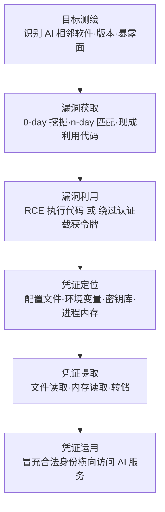

# 凭证访问漏洞利用 (AML.T0106)

## 一句话通俗理解

> 偷凭证的常规路数要么"翻"——搜刮随手乱放的密钥；要么"骗"——钓鱼套密码、诱导 RAG 吐凭证；凭证访问漏洞利用是直接"抢"：不翻抽屉、不演戏，利用软件自身的漏洞炸开存放钥匙的保险柜——哪怕你把每把钥匙都锁得规规矩矩，装钥匙的房子塌了，一切白搭。

## 难度等级

⭐⭐ **Demonstrated（已演示）**

官方成熟度评定为 Demonstrated——完整链路已在真实 AI 软件上被公开演示：CVE-2026-25253（OpenClaw 一键 RCE）中，安全研究者仅凭一条毫秒级执行的恶意链接，就完成了"漏洞利用 → 窃取认证令牌 → 劫持网关 API → 逃逸容器"的全过程（AML.CS0050）。本技术的门槛高于"翻找"类凭证窃取：攻击者需要先掌握可利用的漏洞——自行挖掘 0-day、跟踪并武器化 n-day，或直接获取公开利用代码；得手后还要能在陌生环境中定位并提取凭证。但 AI 生态正在把这道门槛持续拉低：模型服务器、推理网关、智能体平台大量复用开源组件、版本碎片化严重、默认配置宽松，n-day 指纹匹配即可命中；pickle 反序列化、管理接口未授权等漏洞类别在 ML 生态中反复出现，让"找一段可利用的 AI 软件"远比想象中容易。

## 技术描述

### 通俗解释

凭证窃取的绝大多数技术都建立在一个前提上：攻击者能"接触"到凭证——要么凭证本身放得不安全（明文配置、环境变量、bash history），要么凭证经过的路径可被截获（钓鱼、RAG 诱导）。防御方的对应假设是：只要把凭证存进规范的密钥库、管好流转路径，窃取就无从谈起。凭证访问漏洞利用击穿的正是这个假设——它攻击的不是凭证的"存放纪律"，而是**存放凭证的软件本身**：利用程序、服务或操作系统中的编程错误执行攻击者控制的代码，再直接从凭证存储中提取凭证。对攻击者而言，这是最"豪横"的一条路：不依赖任何人的疏忽，一个漏洞换一整串钥匙。

### 技术原理

依据官方描述，攻击者可能利用软件漏洞来收集凭证。漏洞利用发生在攻击者利用程序、服务或操作系统软件/内核自身中的编程错误、以执行攻击者控制的代码之时。

在 AI 环境中，本技术的高价值目标是一类 **AI 相邻软件**——它们不是凭证管理产品，却集中持有或中转大量凭证：

1. **模型服务器与推理服务**：TorchServe、vLLM、Triton 这类推理服务通常持有模型 API 密钥与云平台凭证，且常被部署在网络边界；
2. **模型加载链路与 ML 框架**：pickle 等被广泛用于存储 AI 模型的文件格式可内嵌实现任意代码执行的利用代码——官方缓解措施 M0016 对此专门点名；
3. **推理网关与 AI 控制接口**：认证令牌的中转枢纽，CS0050 中的 OpenClaw Gateway API 即为典型；
4. **智能体平台**：配置文件中集中存放智能体连接各外部工具所需的全部凭证。

攻击链路呈两条路径：

- **执行型（先破门、再取物）**：利用 RCE 类漏洞在目标上执行代码，再定位并提取凭证存储——读取配置文件与环境变量、访问密钥库，或直接对持有令牌的进程做**内存读取**。凭证存放是否规范只影响第三步的工作量，不影响破门这一步。
- **逻辑型（不破门、直接截钥匙）**：利用认证与协议逻辑缺陷直接截获凭证——CS0050 中的跨站 WebSocket 劫持（CSWSH）即属此类：恶意页面借受害者浏览器发起 WebSocket 连接，绕过 localhost 限制窃取认证令牌，全程未在目标系统落地任何代码。

**与其他凭证访问技术的分工**：不安全的凭证（AML.T0055）翻找的是"暴露在外的钥匙"；操作系统凭证转储（AML.T0090）从系统进程与缓存中"倒"凭证；本技术攻破的是防护本身——即使钥匙全锁在合规的保险柜里，保险柜所在的房子塌了也一样失窃。

**平台覆盖**：官方数据中本技术以 Enterprise 平台为主——攻击对象是运行在传统基础设施上的 AI 软件栈，而非 AI 模型的算法层。

### 用途影响

- **击穿"存好即安全"的防御假设**：凭证侧防护（MFA、轮换、密钥库）不防护承载凭证的软件自身的漏洞；
- **一次得手、全串沦陷**：智能体平台与推理网关集中持有多工具凭证——漏洞利用换来的往往不是一把钥匙，而是一整串；
- **绕过 AI 侧护栏**：智能体的提示词护栏、工具审批机制都运行在软件层；软件被攻破后，这些控制连同凭证一起落入攻击者之手（CS0050 中"禁用用户确认"）；
- **检测窗口极短**：漏洞利用是单次爆发事件，窃取凭证随后的使用又表现为"合法令牌的正常使用"——攻击恰好卡在防御规则的两段盲区之间。

## 攻击流程

### 典型攻击流程



**步骤详解：**

1. **目标测绘**
   - 通俗描述：先看清哪栋房子装着保险柜。
   - 技术细节：识别目标环境中的 AI 相邻软件——推理服务、网关、智能体平台及其版本与暴露面（互联网可达、管理接口未授权、版本落后存在已知 n-day）。可衔接主动扫描（AML.T0006）与公开漏洞研究检索。

2. **漏洞获取**
   - 通俗描述：搞到炸开保险柜的炸药。
   - 技术细节：三种来源——自行挖掘 0-day（成本最高、隐蔽性最好）、跟踪厂商通告与公开研究武器化 n-day、获取/购买现成利用代码。AI 软件漏洞研究热度高，n-day 常有现成分析与利用代码。

3. **漏洞利用**
   - 通俗描述：引爆。
   - 技术细节：执行型路径（RCE、反序列化）获得代码执行；逻辑型路径（CSWSH、认证绕过、SSRF）不落地代码，直接截获或滥用认证材料。这一步的产出决定下一步的形态。

4. **凭证定位与提取**
   - 通俗描述：进屋后先画一张钥匙地图。
   - 技术细节：定位凭证存储——智能体配置文件、.env、密钥库服务、持有令牌的进程内存；随后以文件读取、内存读取或转储手法提取。漏洞只是入口，取物的手法与 AML.T0055、AML.T0090 通用。

5. **凭证运用**
   - 通俗描述：拿抢来的钥匙开遍全小区。
   - 技术细节：用合法凭证冒充身份横向访问 AI 服务——模型 API、智能体平台、AI DevOps 工具链；日志中呈现为正常认证，衔接发现与横向移动。

**与后续战术的衔接：**

- **发现**：合法凭证登录后枚举环境中的 AI 资产与数据源
- **横向移动**：令牌与 API 密钥是横向访问智能体、LLM、推理 API 的直接通行证
- **持久化**：利用凭证权限创建更多账户，巩固长期控制
- **防御规避**：CS0050 同时关联防御规避漏洞利用（AML.T0107）——同一漏洞常被用于多重目的

> 关键差异：搜刮与钓鱼类技术依赖"钥匙被乱放或被交出"；本技术只依赖"房子有洞"。它把凭证窃取的成败，从受害者的存放纪律转移到了软件供应链的工程质量上。

## 真实案例

> 本技术当前在 MITRE ATLAS 案例库中仅关联 1 个案例，但其攻击链完整覆盖"漏洞利用 → 凭证窃取 → 全面沦陷"全过程。

### 案例1：OpenClaw 一键 RCE 窃取数据与密钥（2026年，AML.T0106）

- **时间**: 2026年2月1日
- **攻击者**: DepthFirst（安全研究者，负责任披露演示）
- **手法**: 研究者演示了针对 OpenClaw AI 智能体的一键远程代码执行（RCE）漏洞，后被编目为 CVE-2026-25253。受害者只需点击一条恶意链接，其浏览器中即执行一段仅耗时毫秒级的客户端 JavaScript 脚本；脚本经 WebSocket 连接从 OpenClaw 控制界面窃取认证令牌，再通过跨站 WebSocket 劫持（CSWSH）绕过 localhost 限制直达 OpenClaw Gateway API——OpenClaw 是一款运行在用户自有设备（笔记本、家庭实验室或 VPS）上的个人 AI 助手，标榜"你的基础设施、你的密钥、你的数据"，网关身后就是用户的全部数据与密钥。连接建立后，攻击者用窃取的令牌完成认证并修改智能体配置：禁用用户确认、逃逸容器，最终直接在宿主机上执行 shell 命令。
- **影响**: 证明面向智能体的"1-click"攻击链已完整可行——从点击到宿主机命令执行全程无感，认证令牌作为唯一"钥匙"被逻辑型漏洞直接截获；自托管模式让"你的密钥、你的数据"变成"你的漏洞、你的失陷"
- **参考链接**: [DepthFirst: 1-Click RCE To Steal Your Moltbot Data and Keys (CVE-2026-25253)](https://depthfirst.com/post/1-click-rce-to-steal-your-moltbot-data-and-keys)、[NVD: CVE-2026-25253](https://nvd.nist.gov/vuln/detail/CVE-2026-25253)、[OpenClaw 官方介绍](https://openclaw.ai/blog/introducing-openclaw)

**为什么说 CS0050 是凭证访问漏洞利用的活体标本：**

| 漏洞利用要素 | CS0050 中的呈现 |
|-------------|----------------|
| AI 相邻软件 | OpenClaw 智能体平台——自托管个人 AI 助手，网关身后集中存放用户数据与密钥 |
| 漏洞类型 | 逻辑型：跨站 WebSocket 劫持绕过 localhost 限制，全程不在目标系统落地代码 |
| 窃取的凭证 | OpenClaw 控制界面的认证令牌——直通 Gateway API 的"万能钥匙" |
| 凭证运用 | 用窃取的令牌认证网关、修改智能体配置（禁用用户确认） |
| 攻击上限 | 逃逸容器后在宿主机执行 shell 命令——数据与密钥全部暴露 |
| 触发成本 | 一次点击、毫秒级执行——"1-click"即完成凭证窃取 |

**案例复盘——令牌如何变成万能钥匙：**

1. **触发**（AML.T0011.003 恶意链接）：受害者点击恶意链接，浏览器执行毫秒级 JavaScript——攻击面是"人 + 浏览器"，而非 OpenClaw 服务本身；
2. **截钥**（AML.T0106 本体）：脚本经 WebSocket 从控制界面窃取认证令牌，再以 CSWSH 绕过 localhost 限制建立到 Gateway API 的连接——**漏洞利用的直接产出就是凭证**；
3. **变现**（AML.T0081 修改智能体配置）：用窃取的令牌认证网关，修改配置禁用用户确认——软件层的一切安全护栏随令牌一起失守；
4. **扩张**（AML.T0105 逃逸到主机）：逃逸容器、宿主机执行 shell 命令——"你的基础设施、你的密钥、你的数据"全部沦陷。

该案例在 ATLAS 中同时关联 AML.T0011.003、AML.T0012、AML.T0017、AML.T0050、AML.T0079、AML.T0081、AML.T0105、AML.T0107 等技术——凭证访问漏洞利用是整条链的"钥匙制造"环节：没有它，后续每一步都需要另找入口。

背景延伸：ML 生态中可被本技术利用的漏洞类别远不止 CSWSH。pickle 等模型文件格式的反序列化漏洞是官方在 M0016 中点名的经典问题——模型文件可携带实现任意代码执行的利用代码；模型服务器管理接口未授权访问、暴露在公网的推理服务边界缺陷，也为"执行型"路径提供了现成入口。AI 相邻软件迭代快、依赖深、安全审计普遍滞后，这一攻击面还在持续膨胀。

## 红队视角

> ⚠️ **免责声明**：以下内容仅用于合法授权的安全测试与教育目的。对未授权系统实施漏洞利用属违法行为——即使只是"验证一下"。

### 实战技巧

1. **AI 相邻软件的 n-day 匹配评估**
   授权评估中最能打动客户的一课：拉取组织 AI 软件栈清单（推理服务、网关、智能体平台的组件与版本），逐一匹配已知漏洞。AI 基础设施普遍"装完就忘"——模型服务器跑起来数年不打补丁的案例比比皆是。报告的冲击力来自"你们依赖的某个开源组件已有公开利用代码"这一事实。

2. **凭证可达性测绘（漏洞得手之后）**
   在授权获得初始执行后，先别急着拿旗子，画一张"凭证地图"：从执行点到智能体配置、.env、密钥库、进程内存的每条路径及所需权限。这张图同时回答两个问题：漏洞的实际爆炸半径有多大、凭证隔离能挡住多少。

3. **完整利用链文档化**
   把"漏洞 → 凭证 → 横向"整条链完整记录成时间线交付蓝队——本技术的价值恰恰在于它与其他技术的串联方式，孤立的单点演示丢掉了这一课。

### 常用工具

| 工具名称 | 用途 | 平台 |
|----------|------|------|
| Nuclei | 模板化 n-day 验证，AI 组件指纹与已知漏洞匹配 | 跨平台 |
| Burp Suite | WebSocket / 网关 API 手工测试（CSWSH 类逻辑漏洞） | 跨平台 |
| Metasploit | 漏洞利用框架，执行型路径的载荷投递 | 跨平台 |
| Frida | 运行时插桩，定位并读取持有令牌的进程内存 | 跨平台 |
| Fickling / picklescanner | pickle 模型文件静态分析，识别不安全调用 | Python |
| NVD / OSV | 漏洞情报源，AI 依赖版本比对 | Web |

### 注意事项

- **授权边界覆盖漏洞利用**：渗透授权书必须明确包含漏洞利用与凭证访问——"只许扫描不许利用"的边界在 AI 基础设施上尤其常见
- **AI 组件版本碎片化**：容器化部署让版本清单极度分散，指纹识别要深入镜像层而不是只看编排文件
- **利用后保持克制**：凭证只验证可达性，不外带、不横向——演示"能拿到"与"真的拿走"之间的差距就是报告的专业性

## 蓝队视角

### 检测要点

1. **异常利用载荷（网络层）**
   - 日志来源：反向代理 / WAF / 推理网关访问日志
   - 关注字段：请求体特征、WebSocket 握手 Origin 头、非标准 API 调用路径
   - 异常特征：面向 AI 服务的反序列化 payload 特征、跨源 WebSocket 连接尝试（Origin 与站点不匹配）、对管理接口的未授权访问

2. **进程行为异常（主机层）**
   - 日志来源：EDR / 容器运行时日志
   - 关注字段：进程派生链、文件读取路径、库加载
   - 异常特征：推理服务进程派生 shell 或解释器、读取凭证存储路径（~/.aws、.env、密钥库）、加载与模型服务无关的共享库

3. **认证异常（应用层）**
   - 日志来源：网关 / 智能体平台审计日志
   - 关注字段：令牌来源、会话设备指纹、配置变更事件
   - 异常特征：令牌首次从陌生环境使用、同一令牌并发多源使用、高危配置变更（禁用用户确认、放宽容器边界）

4. **版本暴露面（资产层）**
   - 日志来源：资产台账 / SBOM / 镜像扫描
   - 异常特征：AI 组件版本命中已知漏洞但长期未升级、管理接口暴露公网、密钥库服务与推理服务同置

### 监控建议

- 建立 **AI 组件资产台账与版本清单**，将厂商安全通告接入工单流程——n-day 窗口期就是攻击者的作业时间
- 对推理服务与智能体平台的**高危配置变更**（禁用确认、修改认证、放宽沙箱）设置实时告警——CS0050 的变现步骤必然经过这里
- 令牌使用引入**环境绑定**：令牌突然换设备、换网络出现即告警，别等凭证侧失守后再回溯
- 把"凭证存储读取"行为基线化：推理服务进程访问密钥库、读取 .env 的频率与路径都应有正常画像

## 检测建议

### 网络层检测

**检测方法：** 识别针对 AI 服务的利用流量特征。

- 面向推理服务/网关的畸形请求：异常 Content-Type、超长序列化字段、反序列化 gadget 特征
- WebSocket 握手 Origin 头与站点不匹配的跨源连接尝试——CSWSH 的直接指纹
- 对模型服务器管理接口的未认证探测与批量路径枚举

### 主机层检测

**检测方法：** 监控 AI 服务进程的异常行为。

- 推理服务进程派生 shell/脚本解释器——模型服务不需要开终端
- 模型服务进程读取凭证路径（~/.aws、.env、密钥库 socket），超出其正常文件访问画像
- pickle 模型文件加载后进程发起出站网络连接——加载与回连的时间关联是投毒利用的典型形态

### 应用层检测（AI 遥测）

**检测方法：** 利用网关与智能体平台的审计能力。

- 高危配置变更实时告警：禁用用户确认、修改认证参数、容器边界调整
- 令牌使用的环境画像：设备指纹、来源地址、User-Agent 突变
- 同一令牌短时间多源并发使用——窃取型凭证使用的典型形态

**程序化检测思路（无需 EDR 侧改造）：**

用"**配置变更 + 令牌环境突变**"二元组做关联告警：任何高危配置变更事件触发后，自动关联同一身份的令牌使用环境变化（新设备、新地址、并发会话），短窗口内同时命中即按高危处置。单独看配置变更可能有合法运维解释，单独看环境突变可能只是用户换电脑——但"禁用用户确认后令牌立刻从陌生环境上线"几乎只有一种解释。这正是 CS0050 攻击链在防御侧的镜像：攻击者要变现，必然两步都走。

### Sigma 规则思路示例

```yaml
title: AI 网关高危配置变更后令牌使用环境突变（凭证访问漏洞利用特征）
status: experimental
description: 检测智能体平台禁用用户确认或放宽容器边界后，
    同一令牌立即从陌生环境发起访问，可能为漏洞利用窃取凭证后的变现行为
    （AML.T0106 / AML.CS0050）
logsource:
    category: application
    product: ai_agent_platform
detection:
    selection_change:
        event_type: 'config_modify'
        setting|contains:
            - 'user_confirmation'
            - 'container_privilege'
    selection_token:
        event_type: 'token_use'
        device_fingerprint: 'new'
    condition: selection_change and selection_token
    timeframe: 5m
level: high
tags:
    - attack.t1211
    - atlas.aml_t0106
```

## 缓解措施

### 优先级1：关键措施

**AML.M0016 漏洞扫描（Vulnerability Scanning）**

以漏洞扫描发现潜在可利用的软件漏洞并加以修复。对 AI 环境的特别要求：pickle 等常用于存储 AI 模型的文件格式可内嵌允许任意代码执行的利用代码，必须扫描这类文件中的不安全调用——可能被用于执行代码、创建新进程或建立网络连接的调用；攻击者可能在损坏的模型文件中嵌入恶意代码，因此扫描器必须能处理**无法完整反序列化**的模型；模型制品、模型产出的下游产品以及外部软件依赖，都应纳入已知漏洞扫描。官方将其定位于数据准备（Data Preparation）与 AI 模型工程（AI Model Engineering）两个生命周期阶段——正是凭证访问漏洞利用最常被触发的两处。

### 配套加固建议（非官方映射）

- **补丁与版本管理**：AI 组件（推理服务、网关、智能体平台）建立版本台账，安全通告驱动的升级 SLA
- **攻击面收敛**：管理接口不对公网暴露；localhost 边界不能只靠握手校验（CSWSH 的教训）；推理服务置于网络隔离段
- **凭证隔离与最小权限**：即使软件被攻破，攻击者能触达的凭证也仅限该组件所需——密钥交给 secret manager、按服务拆分凭证、定期轮换
- **沙箱化运行**：模型服务与智能体运行在收紧边界的容器/沙箱内，提高执行型路径从漏洞到凭证的阻力

### MITRE ATLAS 缓解措施映射

| 缓解措施ID | 缓解措施名称 | 优先级 | 类别 | 生命周期阶段 |
|------------|-------------|:------:|------|-------------|
| AML.M0016 | 漏洞扫描 | 关键 | Technical - Cyber | 数据准备 · AI 模型工程 |

> 官方仅为本技术映射 M0016 一项缓解——漏洞是一切的后门。M0016 管住"带洞的制品进不了链路"，配套加固管住"已经在跑的软件少暴露、少持钥"；两者叠加才能覆盖从供应链到运行时的完整暴露面。

## 关联 ATT&CK 技术

**官方为 AML.T0106 建立的 ATT&CK-reference 是 [T1211 利用漏洞进行隐蔽](../../enterprise/07-Stealth/T1211-Exploitation-for-Stealth.md)**——漏洞利用是同一个原语（利用编程错误执行攻击者控制的代码），ATT&CK 按用途将其拆分到不同战术之下。与本技术关系最近的三项：

- **[T1212 凭证访问漏洞利用](../../enterprise/09-Credential-Access/T1212-Exploitation-for-Credential-Access.md)**——名称与语义的直系对应：利用软件漏洞直接收集凭证。AML.T0106 是这一手法在 AI 相邻软件场景的延伸，攻击目标从传统服务扩展到推理服务、模型加载链路与智能体平台。
- **[T1210 远程服务漏洞利用](../../enterprise/11-Lateral-Movement/T1210-Exploitation-of-Remote-Services.md)**——无需凭据即可入侵的远程利用路径。CS0050 攻击的 OpenClaw Gateway API 即是远程可达服务，"绕过 localhost 限制"本质上就是对远程服务边界的一次利用。
- **[T1211 利用漏洞进行隐蔽](../../enterprise/07-Stealth/T1211-Exploitation-for-Stealth.md)**——官方引用所选的映射，强调漏洞利用原语的共性；同一漏洞在攻击链中常被同时用于凭证访问与防御削弱（CS0050 即同时关联 AML.T0107 防御规避漏洞利用）。

**漏洞利用原语在攻击链中的多面性：**

| ATT&CK 技术 | 战术位置 | 漏洞利用的目的 |
|-------------|---------|---------------|
| T1210 远程服务漏洞利用 | 横向移动 | 不用凭据直接入侵远程服务 |
| T1211 利用漏洞进行隐蔽 | 隐蔽 | 绕过或禁用防御机制 |
| T1212 凭证访问漏洞利用 | 凭证访问 | 攻破软件后窃取凭证 |
| AML.T0106（本技术） | ATLAS 凭证访问 | 上述目的在 AI 相邻软件上的集合 |

一句话总结：ATT&CK 把"利用漏洞"按用途切成三块，ATLAS 的 AML.T0106 在 AI 软件栈上把三块重新合拢——一个洞能开门（T1210）、能拆摄像头（T1211）、也能抢钥匙（T1212）；攻击者拿到洞之后，想怎么用都行。

## 动手实验

> ⚠️ **重要提示**：所有实验必须使用自有测试环境与自有部署的软件。对他人系统实施漏洞利用属违法；即便对自有环境，也应在隔离网段进行。

### 实验环境准备

| 环境组件 | 用途 | 获取方式 |
|----------|------|----------|
| Docker / Podman | 隔离运行含漏洞的测试服务 | 官方安装包 |
| 旧版本开源推理服务或智能体网关 | 含已知 n-day 的靶标 | 官方镜像历史版本 |
| Nuclei | n-day 模板化验证 | go install / 二进制发布 |
| Python + websockets 库 | 实验2 的 CSWSH 原理复现 | pip 安装 |
| Wireshark / tcpdump | 观察 WebSocket 握手与 Origin 头 | 官方安装包 |

### 实验1（初级）：n-day 匹配与验证

**实验目标：** 体验攻击流程的前两步——目标测绘与漏洞获取。

**实验步骤：**
1. 在隔离容器中部署一个已知存在已披露漏洞的旧版本 AI 组件（如模型服务器或智能体网关）
2. 用 Nuclei 的指纹识别确认组件类型与版本
3. 匹配对应 CVE 模板并验证漏洞存在（只验证，不利用）
4. 记录从"部署完成"到"确认可利用"的总耗时——这就是 n-day 攻击者的真实作业成本

**预期结果：** 直观理解"版本落后 = 大门敞开"，以及为什么 AI 基础设施的版本台账是第一道防线。

### 实验2（中级）：复现 CSWSH 截获令牌的原理

**实验目标：** 理解 CS0050 的核心机理——不落地代码的逻辑型凭证窃取。

**实验步骤：**
1. 用 Python websockets 写一个最小网关服务：监听 localhost、无 Origin 校验、握手即下发会话令牌
2. 写一个恶意页面：在浏览器中向该网关发起 WebSocket 连接（模拟跨站场景）
3. 抓包观察恶意页面是否成功建立连接并取得令牌
4. 给网关补上 Origin 白名单校验，重复实验验证防护生效

**预期结果：** 亲手看到"localhost 边界"如何被浏览器中的脚本绕过，理解为什么握手校验不能替代网络层隔离。

### 实验3（高级）：漏洞得手后的凭证可达性评估

**实验目标：** 为防御侧量化"漏洞爆炸半径"。

**实验步骤：**
1. 在测试环境部署智能体平台，按典型方式配置：.env 存 API 密钥、密钥库放数据库凭证
2. 通过实验1/2 的途径获得初始执行（或以测试账号模拟）
3. 绘制凭证地图：从执行点到 .env、密钥库、进程内存的每条路径与所需权限
4. 逐项加固（凭证入 secret manager、拆分权限、收紧沙箱），重复评估可达性变化

**预期结果：** 输出一份"漏洞利用 → 凭证"的可达性评估表，验证凭证隔离如何把"整锅端"降级为"只丢一把钥匙"。

## 术语解释

| 术语 | 英文原名 | 通俗解释 |
|------|----------|----------|
| 漏洞利用 | Exploitation | 利用软件中的编程错误让目标执行攻击者控制的代码——"炸开保险柜"的动作本身 |
| 凭证存储 | Credential Store | 系统中集中保存密码、密钥、令牌的位置——配置文件、环境变量、密钥库、进程内存 |
| 推理服务 | Inference Service | 加载模型并提供预测/生成 API 的服务进程（如 TorchServe、vLLM），常持有模型与云平台凭证 |
| 内存读取 | Memory Read | 从运行中进程的内存里提取数据——令牌常驻内存，读内存即得钥匙 |
| 远程代码执行 | RCE, Remote Code Execution | 攻击者无需登录即可让目标机器执行任意代码的漏洞类型 |
| 跨站 WebSocket 劫持 | CSWSH, Cross-Site WebSocket Hijacking | 恶意页面借用受害者浏览器向目标服务发起 WebSocket 连接，绕过 localhost 限制 |
| 认证令牌 | Authentication Token | 证明"我是合法用户"的数字凭据——CS0050 中被截获的那把"万能钥匙" |
| 反序列化 | Deserialization | 把文件/数据还原成程序对象的过程；pickle 等格式的反序列化漏洞可执行任意代码 |
| pickle | pickle | Python 的对象序列化格式，也被用于存储模型权重，是 ML 供应链的经典风险点 |
| 0-day / n-day | Zero-day / n-day | 未公开、无补丁的漏洞 / 已披露、有补丁但仍存量的漏洞 |
| n-day 匹配 | n-day Matching | 指纹识别目标软件版本后比对已知漏洞库，找到现成利用路径 |
| 容器逃逸 | Container Escape | 从容器内突破到宿主机——CS0050 攻击链的最后一步 |
| CVE | Common Vulnerabilities and Exposures | 公开漏洞统一编号，CVE-2026-25253 即 OpenClaw 一键 RCE |

## 参考资料

### 📚 官方文档

- [MITRE ATLAS - Exploitation for Credential Access (AML.T0106)](https://atlas.mitre.org/techniques/AML.T0106/) - 官方技术页面
- [MITRE ATLAS 矩阵](https://atlas.mitre.org/matrices/ATLAS/)
- [MITRE ATLAS Data (GitHub)](https://github.com/mitre-atlas/atlas-data)
- [MITRE ATT&CK - Exploitation for Stealth (T1211)](https://attack.mitre.org/techniques/T1211/) - 官方 ATT&CK-reference 映射

### 📰 案例报告（真实攻击与安全研究）

- [DepthFirst: 1-Click RCE To Steal Your Moltbot Data and Keys (CVE-2026-25253)](https://depthfirst.com/post/1-click-rce-to-steal-your-moltbot-data-and-keys) - AML.CS0050 原始研究：CSWSH 窃取令牌的完整攻击链
- [NVD: CVE-2026-25253](https://nvd.nist.gov/vuln/detail/CVE-2026-25253) - OpenClaw 一键 RCE 漏洞编目
- [OpenClaw: Introducing OpenClaw](https://openclaw.ai/blog/introducing-openclaw) - 受影响平台官方介绍（"你的基础设施、你的密钥、你的数据"）

### 🔧 工具与资源

- [Nuclei](https://github.com/projectdiscovery/nuclei) - 模板化漏洞扫描与 n-day 验证
- [OWASP Top 10 for LLM Applications](https://owasp.org/www-project-top-10-for-large-language-model-applications/) - LLM 应用十大安全风险
- [NIST AI Risk Management Framework](https://www.nist.gov/itl/ai-risk-management-framework) - NIST AI 风险管理框架
- [NVD](https://nvd.nist.gov/) / [OSV](https://osv.dev/) - 漏洞情报源，AI 依赖版本比对

### 🔗 关联阅读

- [凭证访问战术 (AML.TA0013)](./README.md) - 本技术所属战术的概览页
- [不安全的凭证 (AML.T0055)](./AML.T0055-Unsecured-Credentials.md) - 对照阅读："翻找暴露凭证"与"漏洞强取凭证"的两种路径
- [T1212 凭证访问漏洞利用](../../enterprise/09-Credential-Access/T1212-Exploitation-for-Credential-Access.md) - 本技术的 ATT&CK 直系对应
- [T1210 远程服务漏洞利用](../../enterprise/11-Lateral-Movement/T1210-Exploitation-of-Remote-Services.md) - 远程利用路径的传统对应
- [T1211 利用漏洞进行隐蔽](../../enterprise/07-Stealth/T1211-Exploitation-for-Stealth.md) - 官方 ATT&CK-reference 对应技术

---

> **版本**: ATLAS 2026.09 | **更新**: 2026-10-22 | **模板**: ATLAS 技术文档 v1.0
