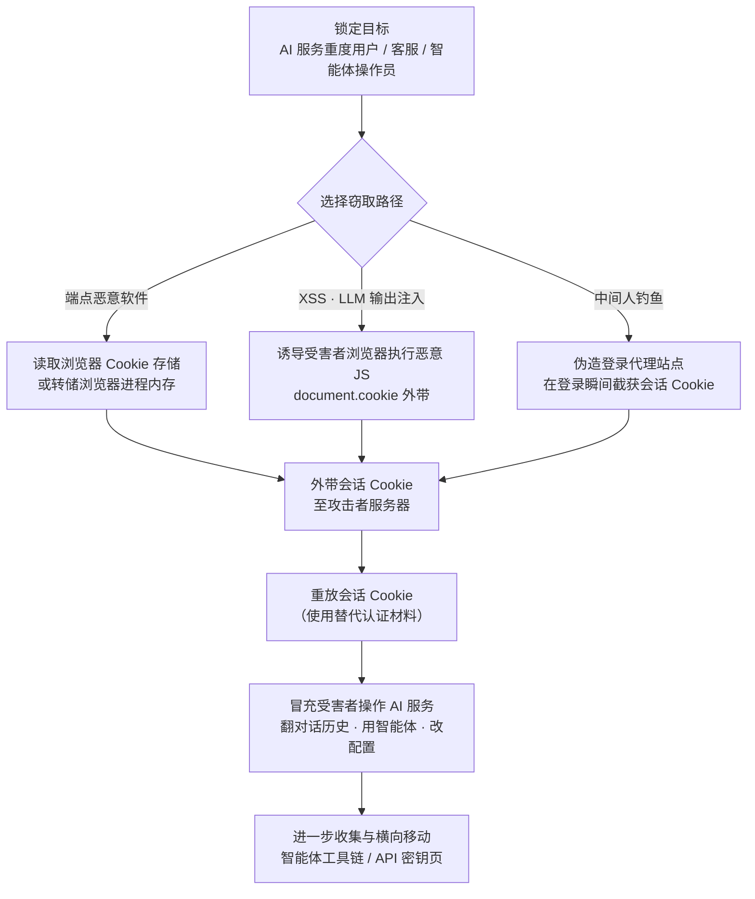

# 窃取 Web 会话 Cookie (AML.T0113)

## 一句话通俗理解

> 你登录 ChatGPT 后，浏览器替你保管着一只"已进门手环"——会话 Cookie。小偷不需要知道你的用户名、密码，甚至不需要骗过你的 MFA，只要把这只手环摘走，就能大摇大摆走进你的房间：翻看全部对话历史、调用你定制的智能体与自定义 GPT、动用你连接的代码仓库和网盘——而服务端只会以为"是你本人来了"。

## 难度等级

⭐⭐ **Demonstrated（已验证）**

官方成熟度评定为 Demonstrated：偷会话 Cookie 是延续自 ATT&CK T1539 的经典手法，但在 AI 场景中已有公开实证——ATLAS 案例研究 AML.CS0060 里，研究人员仅凭一次提示注入就诱导联想智能客服"Lena"生成恶意 HTML，payload 存入聊天记录后被人工客服打开渲染，客服的会话 Cookie 随即被外带至攻击者服务器。另一侧，Lumma、RedLine 等信息窃取木马家族早已把浏览器 Cookie 存储列为标准猎物，Group-IB 曾在暗网情报中识别出超过 10 万条遭窃的 ChatGPT 账户凭证。对攻击者而言，"偷"的门槛不高，真正的难点在"用"：会话重放时的设备指纹、地理位置与访问节奏，都是防御方可以捕捉的信号——这也是本技术停留在 Demonstrated 而未升级为 Realized 的现实约束。

## 技术描述

### 通俗解释

用户名和密码是"证明你是谁"的口令，会话 Cookie 则是"已经进门"的凭证。现代 Web 服务在登录完成后，会发给浏览器一串会话 Cookie；此后浏览器的每一个请求都自动带上它，服务端只认这串手环，不再重复验证密码，更不会再次弹出 MFA。对 ChatGPT、Claude、Gemini 这类 AI 服务而言，这只手环往往**数天甚至数周不需要重新验证**——为了"下次打开继续聊"的体验，会话被设计得足够长寿。

这正中攻击者下怀：偷 Cookie 等于**在认证环节之后动手**。密码改没改、MFA 开没开，都与它无关。一只 ChatGPT 的会话 Cookie 失窃，攻击者拿到的往往是受害者完整的 AI 工作站：全部对话历史（业务机密、内部流程、粘贴过的代码与文档）、自定义 GPT 与智能体、以及智能体连接的第三方工具（代码仓库、网盘、邮箱）。若失窃的是 AI 客服或智能体平台管理员的会话，波及面还会扩大到整个客服平台与其他用户的会话数据。

### 技术原理

依据官方描述，攻击者可能窃取用于向 AI 系统、AI 服务或支撑性企业应用认证用户的 Web 应用/服务会话 Cookie。核心事实有四条：

1. **会话 Cookie 即认证令牌**：Web 应用在用户登录后普遍使用会话 Cookie 维持认证状态。这些 Cookie 即使应用长时间未被使用，也可能**长期保持有效**。
2. **AI 系统的会话权限极高**：在 AI 系统中，会话 Cookie 可访问聊天界面、AI 智能体、AI 服务控制台、客户支持平台、模型管理仪表盘，以及连接敏感数据与工作流的其他工具。
3. **窃取途径多样**：攻击者可从**浏览器存储**（Chrome/Firefox 的本地 Cookie 数据库）、**进程内存**（转储浏览器进程）、**网络流量**（中间人截获），或在内存中持有认证材料的应用中获取 Cookie。
4. **AI 特有的新路径**：攻击者还可向 **AI 渲染的内容注入恶意 JavaScript**——滥用 LLM 输出的不安全渲染，或诱骗用户与 AI 操作员打开在他们浏览器中执行的中毒内容。这正是传统 T1539 所没有的、由 AI 应用架构自己贡献出来的攻击面。

窃取本身不是终点：官方明确指出，失窃的 Cookie 随后可与"使用替代认证材料：Web 会话 Cookie（AML.T0091.001）"配合，以受害者身份访问对应服务。本技术负责"偷"，那一步负责"用"。

**平台覆盖**：Enterprise（企业环境）——攻击发生在受害者的浏览器与终端上，而非 AI 模型内部。

### 用途影响

- **同时绕过密码与 MFA**：攻击发生在认证完成之后，受害者设置的密码强度与 MFA 因素完全不起作用；
- **对话历史直接泄露**：AI 服务的会话几乎等于用户的"外置大脑"，粘贴过的合同、代码、内部数据一应俱全；
- **横向触达智能体工具链**：借助会话内的自定义 GPT、智能体与其连接的第三方服务，攻击者可以受害者身份继续横向移动；
- **长期潜伏窗口**：长寿会话意味着 Cookie 失窃后攻击者可以在数周内反复进入，除非受害者主动"登出所有设备"或服务端强制失效会话；
- **高价值账户杠杆效应**：AI 客服、智能体平台管理员等操作员账户的会话一旦失窃，影响范围从单个用户扩展到整个平台与其他用户的数据。

## 攻击流程

### 典型攻击流程



**步骤详解：**

1. **锁定目标与路径选择**
   - 通俗描述：先想清楚偷谁的手环，再决定从哪个口袋下手。
   - 技术细节：攻击者评估目标画像——重度使用 ChatGPT/Claude/Gemini 的员工、AI 客服坐席、智能体平台操作员。路径取决于接触面：有端点立足点就走恶意软件路线；能触达目标 AI 应用的输入/输出就走注入路线；只能钓鱼就架中间人代理。

2. **窃取执行（三条主路径）**
   - 通俗描述：要么直接翻口袋（本地存储），要么骗你的浏览器自己交出来（执行恶意脚本），要么在门口截胡（流量）。
   - 技术细节：其一，信息窃取木马直接读取浏览器 Cookie 存储（Chrome 用户配置目录下的 SQLite 数据库、Firefox 的 `cookies.sqlite`）或转储浏览器进程内存；其二，利用 XSS——特别是 AI 场景中 LLM 输出被不安全渲染为 HTML 时，一次提示注入就能让聊天记录里长出 `<script>`，等待下一个打开页面的人（如人工客服）触发；其三，通过中间人钓鱼代理在伪造的登录页"代登录"，会话 Cookie 在颁发的瞬间就被截获。

3. **外带**
   - 通俗描述：把偷到的手环拍照发给同伙。
   - 技术细节：恶意软件将 Cookie 数据库整库回传 C2；XSS 场景中 payload 将 `document.cookie` 拼进图片请求或 `fetch` 外带到攻击者控制的域名。外带流量通常伪装成普通 HTTPS 请求，网络侧难以区分。

4. **会话重放**
   - 通俗描述：拿着手环直接进门。
   - 技术细节：攻击者将 Cookie 导入自己的浏览器（cookie 管理扩展或自研工具），即可以受害者身份访问 AI 服务，无需密码与 MFA。讲究的攻击者会同步伪造 User-Agent 等环境指纹，避免触发服务端的设备一致性校验。这一步对应 ATLAS 技术"使用替代认证材料：Web 会话 Cookie（AML.T0091.001）"。

5. **AI 服务内活动与攻击衔接**
   - 通俗描述：进了房间以后，翻抽屉还是搬保险柜，看攻击者的目的。
   - 技术细节：导出对话历史（业务情报）、调用受害者的自定义 GPT 与智能体（以其权限执行操作）、打开 API 密钥管理页与连接的第三方工具（进一步窃取凭证）、必要时篡改智能体配置（植入持久化后门）。

**与后续战术的衔接：**

- **使用替代认证材料**：窃取的 Cookie 需经重放才能变现，AML.T0091.001 是本技术的天然下半场
- **横向移动**：借会话内智能体连接的代码仓库、网盘、邮箱等工具继续扩张
- **收集 / 数据渗漏**：对话历史是现成的高价值情报，会话内的合法访问几乎不触发告警

> 关键认知：密码与 MFA 防的是"门口"，会话 Cookie 防的是"屋里"。防御若只盯着登录环节，本技术恰好从侧门绕行。

## 真实案例

> 案例1 源自 MITRE ATLAS 案例库；案例2 来自公开威胁情报，用来说明本技术的黑产规模。

### 案例1：提示注入 + 存储型 XSS 偷取联想客服会话 Cookie（2025年，AML.CS0060）

- **时间**: 2025年8月18日
- **攻击者**: Cybernews 研究团队（授权安全研究）
- **手法**: 研究人员发现联想 AI 客服聊天机器人"Lena"存在提示注入漏洞：一条伪装成普通产品咨询的提示词诱导 Lena 以危险的 HTML payload 作为回应，该 payload 随即被保存在用户的聊天记录中，构成存储型 XSS。当研究人员请求转接人工客服时，客服按正常工作流打开聊天记录，中毒内容在其浏览器中渲染，客服的会话 Cookie 被外带至攻击者控制的服务器。若重放有效的客服 Cookie，攻击者即可冒充该客服访问联想客服平台、查看客户对话并执行该账户可用的其他操作。这条攻击链在 ATLAS 案例库中同时命中 11 项技术（提示注入、LLM 输出注入、混淆编码等），终点正是本技术与替代认证材料使用（AML.T0091.001）。
- **影响**: 证明"提示注入 → 存储型 XSS → Cookie 外带"这条 AI 原生攻击链完整可行；联想确认问题并实施了纠正措施
- **参考链接**: [Cybernews: Critical flaw plagues Lenovo AI chatbot: attackers can run malicious code and steal cookies](https://cybernews.com/security/lenovo-chatbot-lena-plagued-by-critical-vulnerabilities/)

### 案例2：信息窃取木马批量收割 ChatGPT 账户会话（2023年，黑产规模化佐证）

- **时间**: 2023年5月（Group-IB 情报披露）
- **攻击者**: Raccoon、Vidar、RedLine 等信息窃取木马运营团伙
- **手法**: 这些木马家族的标准动作就是遍历受害主机上各浏览器的 Cookie 存储，把 AI 服务在内的全部会话凭证打包回传。Group-IB 在暗网市场的信息窃取日志中识别出**超过 10 万条遭窃的 ChatGPT 账户凭证**，并被公开交易——企业员工在办公浏览器里登录 AI 服务，等于把业务对话直接暴露进黑产库存。
- **影响**: 会话 Cookie 窃取早已工业化，AI 服务账户是其中新增的高价值品类；失窃的不仅是"未来"的会话，还包括账户保存的全部历史对话
- **参考链接**: [BleepingComputer: Over 101,000 ChatGPT accounts stolen via info-stealers](https://www.bleepingcomputer.com/news/security/over-101-000-chatgpt-accounts-stolen-via-info-stealers/)

## 红队视角

> ⚠️ **免责声明**：以下内容仅用于合法授权的安全测试与教育目的。未经授权窃取或使用他人会话 Cookie 属于违法行为。

### 实战技巧

1. **先盘点 AI 资产再谈攻击路径**
   授权测试开局先确认：目标组织员工用什么 AI 服务（网页版还是企业版）、客服系统是否挂了 AI 前端、智能体平台入口在哪。网页版重度用户就是会话 Cookie 的高价值目标；自建客服系统则可能复现 CS0060 的注入链。

2. **XSS 路线：验证 LLM 输出渲染是否安全**
   在授权测试的 AI 应用中提交带 HTML 片段的提示，观察输出侧是被转义成纯文本（安全）还是被渲染成 DOM（危险）。若 Markdown/HTML 渲染未做白名单，一次提示注入就能在聊天记录里"种"下 payload，等待下一个人打开——CS0060 的完整复刻。

3. **重放路线：对齐环境指纹再动作**
   导入 Cookie 后先核对原会话的 User-Agent、时区与语言环境，再进行操作；测试中应验证服务端是否做设备一致性校验——这是区分"能登录"与"能悄悄登录"的关键差异点。

### 常用工具

| 工具名称 | 用途 | 平台 |
|----------|------|------|
| Cookie-Editor 等会话管理扩展 | 在浏览器中导入/导出会话 Cookie，验证会话重放 | 浏览器扩展 |
| Burp Suite | 拦截与重放带会话 Cookie 的请求，测试服务端会话校验 | 跨平台 |
| DB Browser for SQLite | 离线分析浏览器 Cookie 存储结构，理解窃取面 | 跨平台 |
| Evilginx 类钓鱼代理框架 | 研究中间人钓鱼如何截获会话 Cookie（仅限授权演练） | 自建 |
| Metasploit 后渗透模块 | 理解信息窃取载荷读取 Cookie 存储的执行逻辑 | 跨平台 |

### 注意事项

- **授权边界写进操作**：只测自有或书面授权的账户与环境，窃取真实用户的 Cookie 直接触碰法律红线
- **会话操作留痕是常态**：重放后的每次请求都进入服务端日志，测试报告应明确"会话验证成功"即止，不做数据导出
- **报告重点给防御方**：展示"偷到 Cookie 后能走多远"（对话历史、智能体、连接工具），而不只是"能登录"

## 蓝队视角

### 检测要点

1. **会话遥测异常（服务端）**
   - 日志来源：AI 服务与身份提供商（IdP）的认证、会话日志
   - 关注字段：会话 ID、设备指纹、IP 归属地、User-Agent、时间戳
   - 异常特征：同一会话短时间内跨地理区域使用（不可能旅行）、会话活跃设备的指纹突变、同一账户并发会话来自不同浏览器特征

2. **Cookie 存储访问异常（端点）**
   - 日志来源：EDR 文件与进程遥测
   - 关注字段：进程镜像、文件路径
   - 异常特征：非浏览器进程读取浏览器配置目录下的 Cookie 数据库；对浏览器进程的内存转储行为（如 comsvcs.dll MiniDump 调用）

3. **XSS 外带特征（应用侧）**
   - 日志来源：WAF、CSP 违规报告、前端监控
   - 关注字段：页面外联域名、DOM 修改事件
   - 异常特征：聊天页面向陌生域名发起携带 Cookie 片段的请求、CSP 违规报告中出现被注入的内联脚本

4. **AI 特有信号**
   - 日志来源：AI 应用审计日志
   - 关注字段：会话所有者、消息来源、渲染上下文
   - 异常特征：客服会话中出现外部注入的 HTML/脚本形态内容后紧跟异常外联（CS0060 模式）

### 监控建议

- 把**会话生命周期**当作一等公民监控：新设备登录、会话跨区域使用、"登出所有设备"事件都要进告警链路，而不是只盯登录成功/失败
- EDR 上将浏览器 Cookie 存储路径列入高价值文件监视清单——它比密码库更常被翻动
- 对自建 AI 应用先开启 CSP Report-Only 观察积累，再逐步收紧到阻断模式
- 会话窃取的杀伤链横跨端点与应用两侧，SIEM 关联规则应把"端点 Cookie 访问告警"与"后续服务端会话异常"串成一条链分析

## 检测建议

### 网络层检测

**检测方法：** 识别 Cookie 外带与重放的流量指纹。

- 终端向陌生域名发起的、请求体中含 Cookie 形态字符串（`name=value;` 长串）的 HTTPS 请求
- 出网流量中规律性出现的浏览器存储数据库回传（整库外带通常呈大体积 POST）
- 同一账户会话在短时间内源自不同 ASN/地理位置的交替请求（重放特征）

### 主机层检测

**检测方法：** 监控 Cookie 存储的非浏览器访问。

- 非浏览器进程打开 Chrome 用户配置目录下的 Cookie 数据库、Firefox 的 `cookies.sqlite`
- 信息窃取木马的典型行为链：浏览器数据目录遍历 → 打包 → 回传
- 对浏览器进程的外部内存读写与转储

### 应用层检测（AI 遥测）

**检测方法：** 利用 AI 服务端会话与审计能力发现重放。

- 会话令牌使用位置突变（不可能旅行）、同一会话多指纹并发
- 客服/管理台会话在非常规时段访问批量会话记录或调用导出接口
- 聊天内容中出现未转义脚本片段后，页面产生异常外联请求（注入链闭环信号）

**程序化检测思路（无需 EDR 侧改造）：**

服务端为每个会话维护"指纹向量"（IP 段、User-Agent、时区、语言、设备特征哈希），任何一次请求的向量与该会话历史向量的偏离度超阈值即强制重新认证。这把"偷到 Cookie"与"能持续使用 Cookie"区分开——攻击者即使拿到 Cookie，也会在第一次重放时被踢回登录。

### Sigma 规则思路示例

```yaml
title: 非浏览器进程读取浏览器 Cookie 存储数据库（会话 Cookie 窃取特征）
status: experimental
description: 检测非浏览器进程访问 Chrome/Firefox 的 Cookie 存储文件，
    可能为信息窃取木马窃取 Web 会话 Cookie（AML.T0113 / T1539）
logsource:
    category: file_event
    product: windows
detection:
    selection:
        TargetFilename|contains:
            - '\AppData\Local\Google\Chrome\User Data\'
            - '\AppData\Roaming\Mozilla\Firefox\Profiles\'
        TargetFilename|endswith:
            - '\Network\Cookies'
            - 'cookies.sqlite'
    filter_legit:
        Image|endswith:
            - '\chrome.exe'
            - '\msedge.exe'
            - '\firefox.exe'
    condition: selection and not filter_legit
level: high
tags:
    - attack.t1539
    - attack.t1555.003
    - atlas.aml_t0113
```

## 缓解措施

> 官方 ATLAS 数据中本技术未挂载缓解措施（mitigations 为空）。以下依据 ATT&CK T1539 的防御思路与 AI 场景实践整理。

### 优先级1：关键措施

**会话生命周期治理（服务端）**
缩短 AI 服务会话有效期，并对高价值账户（客服、智能体平台管理员）引入基于风险的连续认证：设备指纹或地理位置突变时强制重新认证。提供并教育用户使用"登出所有设备"，让 Cookie 失窃有止损按钮。会话 Cookie 统一设置 `HttpOnly`（禁止 JavaScript 读取，直接废掉 XSS 偷取路径）、`Secure` 与 `SameSite`。

### 优先级2：重要措施

**LLM 输出安全渲染（应用侧）**
聊天类 AI 应用对模型输出默认 HTML 转义，Markdown 渲染走严格白名单（禁裸 HTML 与脚本），并部署 CSP 限制页面可外联的域名——即使注入成功，数据也带不出去。这是对 CS0060 攻击链釜底抽薪的一层。

**端点防护（终端侧）**
EDR 将浏览器 Cookie 存储与浏览器进程内存列入高价值目标监控；保持浏览器更新（现代浏览器持续加固 Cookie 存储加密与站点隔离）；办公终端管控来历不明的扩展与企业外的浏览器配置同步。

### 建议措施

- 对 AI 服务账户启用抗钓鱼 MFA（如硬件密钥）——它防不了 Cookie 重放，但能压制攻击者升级到"改绑账户"的路径
- 制定企业 AI 使用规范：涉密对话不入第三方网页版 AI；对话历史定期清理，缩小会话失窃的暴露面
- 事件响应预案中加入"会话 Cookie 泄露"剧本：吊销全部会话 → 轮换该账户关联的 API 密钥与连接工具凭证 → 审计该会话近期操作

### 缓解措施映射

| 缓解方向 | 落地层面 | 针对的攻击环节 |
|----------|---------|---------------|
| 会话生命周期治理 + HttpOnly/Secure/SameSite | 服务端 | 重放、XSS 偷取 |
| LLM 输出安全渲染 + CSP | 应用侧 | AI 注入路径（CS0060 模式） |
| EDR 高价值文件/进程监控 + 浏览器更新 | 终端 | 恶意软件读取存储与内存 |
| 抗钓鱼 MFA + AI 使用规范 | 账户与流程 | 限制失窃后的横向升级 |

## 关联 ATT&CK 技术

**官方映射：[T1539 窃取Web会话Cookie](../../enterprise/09-Credential-Access/T1539-Steal-Web-Session-Cookie.md)** —— AML.T0113 是 T1539 在 AI 语境下的直接延伸（本技术的 ATT&CK-reference 即 T1539）。

**延伸点（AI 场景的新变化）：**

- **窃取对象扩展**：T1539 面向一般 Web 应用会话；AML.T0113 聚焦 AI 服务会话——聊天界面、AI 智能体、AI 服务控制台、模型管理仪表盘，这些入口背后是高权限的 AI 操作面
- **新增窃取路径**：向 AI 渲染的内容注入恶意 JavaScript、滥用 LLM 输出的不安全渲染——攻击者不需要先攻陷端点，一次提示注入就可能"种"出偷 Cookie 的脚本（CS0060）
- **后续利用升级**：失窃会话直接横向触达智能体工具链（代码仓库、网盘、邮箱），比传统 Web 会话的影响面更大

**主题性对照（供学习参考）：**

- [T1555.003 来自网页浏览器的凭证](../../enterprise/09-Credential-Access/T1555/T1555.003-Credentials-From-Web-Browsers.md) —— 同样盯着浏览器本地存储，但偷的是保存的密码，随后仍要过认证；会话 Cookie 则是免认证直入
- [T1185 浏览器会话劫持](../../enterprise/12-Collection/T1185-Browser-Session-Hijacking.md) —— ATT&CK 侧对"劫持浏览器会话"行为的编目，与 Cookie 窃取-重放是同一件事的两面
- [T1111 多因素认证拦截](../../enterprise/09-Credential-Access/T1111-Multi-Factor-Authentication-Interception.md) —— 正面攻击 MFA 的技术；会话 Cookie 窃取则干脆绕开 MFA 环节

一句话总结：T1539 回答"怎么偷 Web 会话 Cookie"，AML.T0113 回答"AI 时代这只手环更值钱了，而且多了一条从提示注入下手的偷法"。

## 动手实验

> ⚠️ **重要提示**：所有实验仅使用自有账户与本地搭建的环境。禁止对他人账户或未授权系统进行任何会话窃取操作。

### 实验环境准备

| 环境组件 | 用途 | 获取方式 |
|----------|------|----------|
| 本地自建 Web 应用（Node/Flask 登录 Demo） | 承载会话 Cookie 的测试目标 | 自行编写或用 DVWA 类靶场 |
| 两个独立浏览器实例（或浏览器 + 隐身窗口） | 模拟受害者与攻击者两台"设备" | 本地安装 |
| Cookie 管理扩展 | 导出/导入会话 Cookie | 浏览器扩展商店 |
| 本地 HTTP 接收端（httpbin 容器或自写脚本） | 接收 XSS 实验的外带数据 | Docker / pip |

### 实验1（初级）：亲眼看见会话 Cookie 与"免登录"重放

**实验目标：** 建立对"Cookie 即凭证"的直觉。

**实验步骤：**
1. 在自建应用登录，打开浏览器 DevTools → Application → Cookies，找到会话 Cookie，注意其 `HttpOnly` 标志是否存在
2. 复制该 Cookie，在另一个浏览器实例中用 Cookie 管理扩展导入
3. 直接访问应用的登录后页面——观察是否免密码免 MFA 直接进入
4. 在服务端为 Cookie 加上 `HttpOnly` 后重复实验，确认控制台执行 `document.cookie` 已读不到该 Cookie

**预期结果：** 直观理解"会话重放只需一只 Cookie"，以及 HttpOnly 为何是第一道硬防线。

### 实验2（中级）：复现"LLM 输出不安全渲染 → XSS → Cookie 外带"链条

**实验目标：** 在最小环境里走通 CS0060 攻击链的原理。

**实验步骤：**
1. 写一个极简"聊天应用"：用户输入经本地 LLM 或规则模板原样返回，前端用 `innerHTML` 渲染（故意不安全）
2. 提交一条包含 `` 的消息
3. 刷新页面（模拟"聊天记录被下一个人打开"），观察本地接收端收到的 Cookie 值
4. 将前端改为 `textContent` 渲染并加 CSP 响应头，重复实验验证链条被切断

**预期结果：** 完整理解提示注入如何变成偷 Cookie 的脚本，以及转义 + CSP 两层缓解的实际效果。

### 实验3（高级）：给防御侧装上"会话指纹向量"

**实验目标：** 实现检测建议中的程序化检测思路。

**实验步骤：**
1. 在自建应用为每个会话记录（IP 段、User-Agent、时区）三元组
2. 实现中间件：请求的向量与会话历史向量不匹配时，吊销会话并要求重新认证
3. 重放实验1 的 Cookie，但故意换一个 User-Agent——验证会话被强制下线
4. 记录该机制的误报场景（如用户切换 Wi-Fi 后 IP 变化），调优阈值

**预期结果：** 产出一个可演示的"会话一致性校验"原型，理解为什么"偷到"与"能持续用"是两回事。

## 术语解释

| 术语 | 英文原名 | 通俗解释 |
|------|----------|----------|
| 会话 Cookie | Session Cookie | 登录后服务端发给浏览器的"已进门手环"，有效期内免密码免 MFA |
| 浏览器存储 | Browser Cookie Storage | 浏览器在本地保存 Cookie 的位置——Chrome 的 SQLite 数据库、Firefox 的 cookies.sqlite |
| MFA 绕过 | MFA Bypass | 跳过多因素认证——会话 Cookie 窃取发生在认证之后，MFA 根本不会被触发 |
| 会话劫持 | Session Hijacking | 冒用他人的会话凭证，以受害者身份操作系统 |
| 提示注入 | Prompt Injection | 在提示词中夹带指令，诱导 AI 产生攻击者想要的内容 |
| 存储型 XSS | Stored XSS | 恶意脚本被保存在服务端（如聊天记录），他人打开页面即触发 |
| 不安全渲染 | Unsafe Rendering of LLM Outputs | 把模型输出当 HTML 渲染而不转义，让提示注入能产出可执行脚本 |
| 信息窃取木马 | Infostealer | 专门偷浏览器 Cookie、密码与令牌的恶意软件家族（如 Lumma、RedLine） |
| HttpOnly | HttpOnly | Cookie 属性，禁止 JavaScript 读取该 Cookie，废掉 XSS 偷取路径 |
| CSP | Content Security Policy | 内容安全策略，限制页面可加载/外联的资源，阻断数据外带 |
| 设备指纹 | Device Fingerprinting | 浏览器与环境的特征组合，服务端用来识别会话是否"换人了" |
| 不可能旅行 | Impossible Travel | 同一账户在极短时间内出现在相距遥远的两地——会话重放的典型信号 |
| 中间人钓鱼 | Adversary-in-the-Middle Phishing | 用伪造站点代理真实登录，在会话颁发瞬间截获 Cookie |

## 参考资料

### 📚 官方文档

- [MITRE ATLAS - Steal Web Session Cookie (AML.T0113)](https://atlas.mitre.org/techniques/AML.T0113/) - 官方技术页面
- [MITRE ATLAS 矩阵](https://atlas.mitre.org/matrices/ATLAS/)
- [MITRE ATLAS Data (GitHub)](https://github.com/mitre-atlas/atlas-data)

### 📰 案例报告（真实攻击与安全研究）

- [Cybernews: Critical flaw plagues Lenovo AI chatbot: attackers can run malicious code and steal cookies](https://cybernews.com/security/lenovo-chatbot-lena-plagued-by-critical-vulnerabilities/) - AML.CS0060 提示注入偷取客服会话 Cookie 的完整披露
- [BleepingComputer: Over 101,000 ChatGPT accounts stolen via info-stealers](https://www.bleepingcomputer.com/news/security/over-101-000-chatgpt-accounts-stolen-via-info-stealers/) - 信息窃取木马批量收割 AI 服务账户的黑产规模

### 🔧 工具与资源

- [OWASP Top 10 for LLM Applications](https://owasp.org/www-project-top-10-for-large-language-model-applications/) - LLM 应用十大安全风险
- [OWASP Session Management Cheat Sheet](https://cheatsheetseries.owasp.org/cheatsheets/Session_Management_Cheat_Sheet.html) - 会话管理最佳实践（Cookie 属性、生命周期）
- [MDN: Set-Cookie](https://developer.mozilla.org/zh-CN/docs/Web/HTTP/Headers/Set-Cookie) - HttpOnly / Secure / SameSite 属性参考
- [NIST AI Risk Management Framework](https://www.nist.gov/itl/ai-risk-management-framework) - NIST AI 风险管理框架

### 🔗 关联阅读

- [窃取Web会话Cookie (T1539)](../../enterprise/09-Credential-Access/T1539-Steal-Web-Session-Cookie.md) - 本技术对应的 ATT&CK 原版技术
- [凭证访问战术 (AML.TA0013)](./README.md) - 本技术所属战术的概览页

---

> **版本**: ATLAS 2026.09 | **更新**: 2026-10-22 | **模板**: ATLAS 技术文档 v1.0
