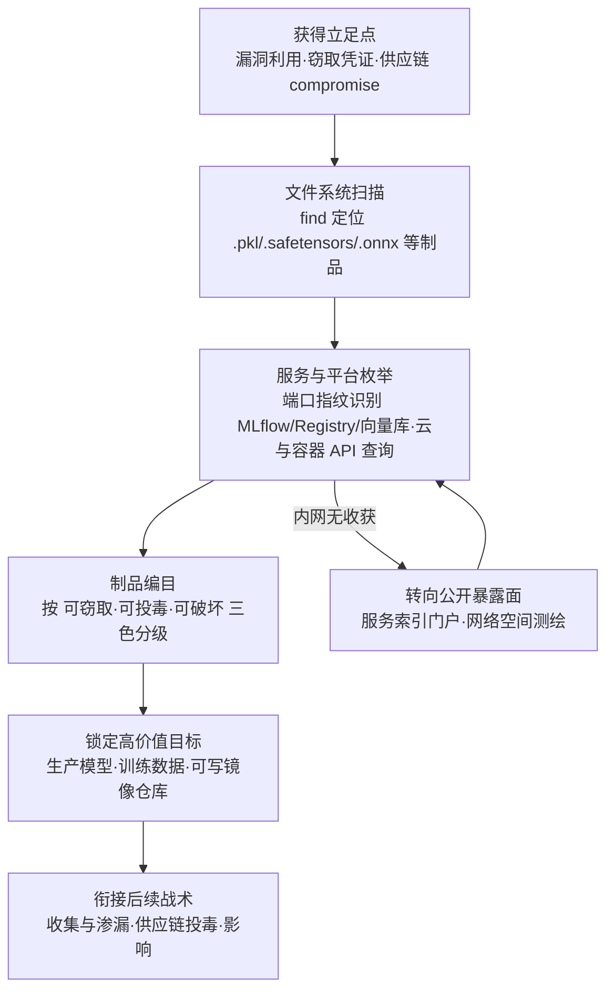

# 发现 AI 制品 (AML.T0007)

## 一句话通俗理解

> 盗贼进屋后先不急着搬东西，而是打着手电把全屋扫一遍——保险柜在哪、书房藏着什么、车库里有哪些值钱的收藏。攻击者入侵系统后的第一件事也是如此：清点屋里的 AI 资产——模型文件、训练数据管理系统、容器镜像仓库、模型动物园——先画出"藏宝图"，再决定偷什么、投毒什么、瘫痪什么。

## 难度等级

⭐⭐ **Demonstrated（已演示）**

官方成熟度评定为 Demonstrated——本技术已在真实研究与红队演示中反复得到印证。ATLAS 案例库中直接关联 **3 个案例**：安全研究者借 Hugging Face 组织混淆让员工亲手交出内部模型（AML.CS0027）；Trend Micro 用服务索引门户一次性发现 8,000+ 个暴露在互联网上的私有容器仓库，其中内嵌 **1,000+ 个可无认证拉取的 AI 模型**（AML.CS0028）；Skyld 研究者从 Google Photos 安卓应用中定位并提取了 TensorFlow Lite 模型制品（AML.CS0058）。门槛极低——`find`、端口扫描、一条 Docker Registry API 查询就够；而多数组织的 AI 资产从无清点，攻击者画的"藏宝图"往往比资产主人的台账还要全。

## 技术描述

### 通俗解释

传统入侵后的发现阶段关注"系统里有什么服务、什么账户、什么网络"；AI 环境给这张清单新增了一整排高价值货架——**AI 制品（AI Artifacts）**：训练好的模型文件、模型注册表与模型动物园、训练/测试数据管理系统、装着推理镜像的容器仓库、向量数据库，以及支撑这一切的 MLOps 软件栈。这些东西的共同点是：**价值极高（模型即知识产权）、位置集中（注册表与数据系统天然聚拢）、防护常常游离在传统安全台账之外**。攻击者拿到立足点后的第一次定向搜索，往往就是冲着这排货架来的——找到它们，等于同时找到了窃取目标（偷模型）、投毒入口（改模型/污染数据）和破坏对象（删制品、瘫管线）。

### 技术原理

依据官方描述：攻击者**搜索私有来源**，识别系统上存在的 AI 学习制品并收集相关信息。这些制品包括：训练与部署模型的软件栈、训练与测试数据管理系统、容器仓库、软件仓库以及模型动物园。这些信息可用于**识别后续收集、渗漏或破坏的目标**，并用于定制和改进攻击。

**AI 环境中的典型"制品货架"：**

| 制品类别 | 典型形态 | 常见发现手法 | 为何高价值 |
|----------|----------|--------------|-----------|
| 模型文件 | `.pkl`/`.pt`/`.ckpt`/`.safetensors`/`.onnx`/`.tflite`、检查点目录 | `find / -name "*.safetensors"` 等文件系统扫描 | 知识产权核心：可整体窃取（白盒分析），也可篡改投毒 |
| 模型注册表与模型动物园 | Hugging Face 仓库、内部模型注册表、模型版本库 | registry API 枚举、Web 目录遍历 | 生产模型的"正本仓库"，写权限即供应链攻击入口 |
| 训练/测试数据管理系统 | MLflow、Weights & Biases 服务器、特征库（feature store）、DVC | 未认证 Web 服务探测、API 枚举 | 训练数据可窃可投毒；实验记录暴露模型结构与效果 |
| 容器仓库 | Harbor、私有 Docker Registry（内嵌模型的推理镜像） | `/v2/_catalog` 匿名枚举 | 案例实测约 70% 暴露仓库可写——拉取、篡改、回推一条龙 |
| 软件仓库 | 训练/推理代码、模型服务与加载配置 | git 枚举、CI 配置翻找 | 暴露模型加载链路与依赖，为供应链攻击提供图纸 |
| 向量数据库与推理服务 | Milvus/FAISS 索引、embedding 存储、TorchServe/Triton 端点 | 端口与服务指纹识别 | 向量库是 RAG 知识库的底座；推理服务是模型的入口 |

**攻击者动作分解：** 获得立足点 → 文件系统扫描（按模型扩展名与目录命名特征定位制品）→ 服务枚举（扫描 MLflow/Registry/向量库等典型端口与指纹）→ 平台 API 查询（云对象存储、Kubernetes、模型注册表接口）→ 制品编目（按"可窃取 / 可投毒 / 可破坏"三色分级）→ 定制后续攻击（定向窃取、供应链投毒或破坏）。

**两条发现路径**：攻击者既可以从**内部**出发——在失陷主机与内网中执行上述动作；也可以从**公开暴露面**出发——通过服务索引门户、网络空间测绘引擎与搜索引擎直接"发现"暴露在互联网上的注册表与 MLOps 服务（CS0028 的 8,000+ 个暴露仓库即由此而来）。对防御者而言，后者意味着一个更冷的事实：**攻击者不需要先入侵，就能完成对你 AI 制品的发现**。

**平台覆盖**：Predictive AI / Generative AI / Agentic AI 全覆盖——只要环境里存在模型与 MLOps 工具链，本技术即适用。

**与相邻 ATLAS 技术的分工**：本技术回答"AI 制品在哪、有什么"；探测模型本体与推断模型家族分别是 AML.T0013 与 AML.T0014；从日志与 API 响应中挖掘模型输出是 AML.T0063；枚举企业账户、系统与容器等通用资源则属于 AML.T0075 与 AML.T0089。

### 用途影响

- **画出后续攻击的地图**：收集与渗漏需要知道模型放在哪，投毒需要知道哪个注册表可写，破坏需要知道删掉什么最疼——答案都产自本阶段；
- **攻击定制化**：制品格式暴露框架（pickle 对应 PyTorch 生态、tflite 对应端侧推理），攻击者可据此选择反序列化漏洞、对抗样本或投毒手法；
- **供应链跳板**：发现的模型仓库与容器仓库若可写，直接转化为供应链攻击入口（CS0028）；
- **噪声极低**：枚举用的多是原生命令与只读 API，与数据科学团队的日常巡检几乎无法区分；
- **资产清点的照妖镜**：多数组织说不清自己有多少模型、放在哪、谁能访问——攻击者的编目往往比资产主人的台账更准；
- **一次发现，长期复用**：制品清单拿到手后，窃取、投毒、破坏可分头准备、择机实施，发现阶段的一次成功等于打开了三扇门。

## 攻击流程

### 典型攻击流程



**步骤详解：**

1. **获得立足点**
   - 通俗描述：先进屋——撬锁（漏洞利用）、捡钥匙（窃取凭证）或搭供应链便车。
   - 技术细节：CS0028 的研究者只需互联网上的服务索引门户即可"发现"暴露仓库，无需任何立足点；而在受害者内网场景中，一枚窃取的凭证或一个未修补的推理服务漏洞就是起点。

2. **文件系统扫描**
   - 通俗描述：打开手电，按"型号"搜遍全屋的柜子。
   - 技术细节：`find / -name "*.safetensors" -o -name "*.onnx" 2>/dev/null`、`locate *.ckpt`、翻找 `~/models`、`/opt/ml`、notebook 目录与训练脚本中的模型加载路径。移动端则如 CS0058：静态逆向定位 APK assets、原生库与磁盘加密文件中的 TFLite 制品。

3. **服务与平台枚举**
   - 通俗描述：不光翻抽屉，还挨个敲门看哪些房间没锁。
   - 技术细节：端口扫描识别 MLflow（默认 5000）、私有 Registry（5000/443）、W&B、向量数据库等服务指纹；枚举 Kubernetes 工作负载与镜像来源；查询云对象存储中的模型桶；对容器仓库直接调用 `GET /v2/_catalog` 列出全部镜像。

4. **制品编目**
   - 通俗描述：把找到的东西列成清单，标注哪些能卖、哪些能动手脚、哪些砸了最疼。
   - 技术细节：按三色分级——可窃取（模型/数据 → 收集与渗漏目标）、可投毒（可写注册表/数据系统/镜像 → 供应链入口）、可破坏（制品与管线 → 影响战术目标）。同时记录版本、格式、框架与权限状态。

5. **锁定目标并衔接后续**
   - 通俗描述：照着藏宝图下手。
   - 技术细节：CS0027 中研究者拿到员工上传的模型后演示植入恶意软件反向进入受害组织环境；CS0028 的暴露面足以支撑"拉取→检查→篡改→回推"的完整供应链攻击。

**与后续战术的衔接：**

- **收集 / 数据渗漏**：模型与训练数据是 AI 环境中最值钱的赃物，本阶段产出的位置清单就是窃取清单
- **持久化 / 供应链投毒**：可写的模型仓库、数据系统与镜像仓库是植入后门与投毒的天然入口
- **影响**：删除制品、污染数据版本、瘫痪训练管线都属于定向破坏
- **AI 攻击适配**：窃取的模型可直接用于构造代理模型、设计对抗样本

> 关键认知：本阶段攻击者只做"看"和"记"——真正的破坏发生在后续战术，而那时他已经拿着一张比你自己的 CMDB 更完整的 AI 资产地图。

## 真实案例

> 以下 3 个案例全部源自 MITRE ATLAS 案例库，均直接关联 AML.T0007。

### 案例1：Hugging Face 组织混淆（2023年，AML.CS0027）

- **时间**: 2023年8月23日
- **攻击者**: threlfall_hax（安全研究员，红队演示）
- **手法**: 研究者在公共模型仓库 Hugging Face 上创建冒充真实组织的假组织账号。被冒充组织的员工信以为真，主动申请加入这个"官方"账号，并把内部模型上传上去——攻击者由此获得这些 AI 制品的完全访问权，包括用恶意版本替换模型的能力。研究者演示可在模型中嵌入恶意软件，反向进入受害组织环境。
- **影响**: 员工亲手把 AI 制品送到攻击者面前；进入环境后，威胁行为者可进一步实施知识产权窃取或投毒组织内的其他模型
- **参考链接**: [Model Confusion - Weaponizing ML models](https://5stars217.github.io/2023-08-08-red-teaming-with-ml-models/#unexpected-benefits---organization-confusion)

### 案例2：暴露容器仓库中的 AI 模型供应链攻击（2023年，AML.CS0028）

- **时间**: 2023年9月26日
- **攻击者**: Trend Micro Nebula 云研究团队（安全研究）
- **手法**: 研究者使用服务索引门户与网络搜索工具，识别出 **8,000+ 个暴露在互联网上的配置错误私有容器仓库**，其中约 **70% 还存在允许写入的过宽访问控制**。分析发现这些开放仓库的容器镜像中内嵌了 **1,000+ 个可无认证拉取的 AI 模型**——下载、检查、修改镜像内容（包括敏感模型文件）全程无阻，被篡改的镜像还可回推仓库，形成针对生产系统的供应链攻击。
- **影响**: 大规模 AI 知识产权暴露；可写仓库直接构成模型完整性供应链攻击向量
- **参考链接**: [Trend Micro: Silent Sabotage](https://www.trendmicro.com/vinfo/br/security/news/cyber-attacks/silent-sabotage-weaponizing-ai-models-in-exposed-containers)、[Exposed Container Registries](https://www.trendmicro.com/vinfo/us/security/news/virtualization-and-cloud/exposed-container-registries-a-potential-vector-for-supply-chain-attacks)、[Mining Through Mountains of Information and Risk](https://www.trendmicro.com/vinfo/us/security/news/virtualization-and-cloud/mining-through-mountains-of-information-and-risk-containers-and-exposed-container-registries)、[The Growing Threat of Unprotected Container Registries](https://www.dreher.in/blog/unprotected-container-registries)

### 案例3：Google Photos AI 模型提取（2025年，AML.CS0058）

- **时间**: 2025年3月1日
- **攻击者**: Skyld（安全研究）
- **手法**: 研究者分析 Google Photos 安卓应用，定位其 AI 照片编辑与图像分析功能使用的 TensorFlow Lite 模型：部分**未加密**存放在应用 assets 中，部分**内嵌于原生库**，部分**磁盘加密**存放。静态逆向定位 TFLite 制品后，再用 Frida 动态插桩捕获运行时解密后的模型——最终获得对 Google 专有模型制品的白盒访问。
- **影响**: 端侧 App 中的模型制品同样可以被系统性"发现"并提取；加密只能提高门槛，无法阻止运行时被捕获
- **参考链接**: [Skyld: Google Photos AI Models: The Secret Sauce That Can Be Stolen](https://skyld.io/google-photos-model-extraction)

## 红队视角

> ⚠️ **免责声明**：以下内容仅用于合法授权的安全测试与教育目的。在未授权系统上枚举 AI 制品属违法行为。

### 实战技巧

1. **把 AI 制品侦察做进授权测试的第一小时**
   立足点到手后，`find` 一轮模型扩展名 + 端口扫描一轮 MLOps 服务，往往 10 分钟内就能画出目标的 AI 资产轮廓。报告中"贵司有 37 个生产模型，其中 12 个所在目录对所有员工可读"这样的句子，比任何漏洞清单都更能打动管理层。

2. **AI 制品专项搜查清单**
   文件系统：`*.pkl / *.pt / *.ckpt / *.safetensors / *.onnx / *.tflite`、`~/models`、`/opt/ml`、训练脚本中的 `torch.load()` 路径；服务面：MLflow（5000）、私有 Registry（5000/443，`/v2/_catalog`）、W&B、向量数据库、K8s 工作负载的镜像来源；云面：对象存储中的模型桶与 ListObjects 权限。

3. **先编目，不动手**
   发现制品后只做只读枚举与记录（位置、格式、大小、权限、版本），把"可窃取 / 可投毒 / 可破坏"三色清单写进报告——既证明了风险敞口，又不越授权边界。

4. **从制品格式反推攻击路径**
   编目时顺手记录格式与框架：`.pkl` 意味着反序列化代码执行面，`.onnx`/`.tflite` 意味着端侧可提取，MLflow 服务器意味着实验记录与模型可一并带走——格式清单直接决定后续利用手法的选型。

### 常用工具

| 工具名称 | 用途 | 平台 |
|----------|------|------|
| find / fd / locate | 按扩展名定位模型文件与检查点目录 | 全平台 |
| nmap / 端口扫描器 | 识别 MLflow、Registry、W&B、向量库等服务指纹 | 跨平台 |
| curl + Docker Registry API | `/v2/_catalog` 匿名枚举镜像、manifest 检查 | 跨平台 |
| kubectl / 云 CLI | 枚举集群工作负载、对象存储中的模型资源 | 跨平台 |
| Frida | 动态插桩捕获运行时解密的端侧模型（CS0058 手法） | Android/Linux 等 |

### 注意事项

- **只枚举不触碰**：授权范围内发现的模型与数据严禁下载、复制或修改——"看一眼清单"与"带走资产"是两种法律后果
- **别漏掉公开面**：暴露在互联网上的仓库（CS0028 的 8,000+ 个）不需要任何内网权限就能发现，资产测绘应先从自家公开暴露面开始
- **报告要给"修复优先级"**：按"可写 > 可匿名读 > 需认证可读"排序，可写的注册表与数据系统是最高优先级

## 蓝队视角

### 检测要点

1. **文件系统的批量枚举行为**
   - 日志来源：Sysmon（事件 ID 1）、auditd、EDR 进程与文件监控
   - 关注字段：进程命令行、目标路径模式
   - 异常特征：单条命令行同时命中 `find`/`locate` 与 `.safetensors`/`.onnx`/`.pkl` 等模型扩展名；非数据科学进程遍历模型目录树

2. **容器仓库与 MLOps 服务的枚举**
   - 日志来源：Registry 审计日志、MLflow/W&B 访问日志、负载均衡日志
   - 异常特征：陌生 IP 调用 `/v2/_catalog`；单一来源高频 ListBuckets/ListObjects；未认证请求命中本应内网的服务

3. **制品访问的模式漂移**
   - 日志来源：对象存储审计、模型注册表操作日志
   - 异常特征：模型文件被非训练/非部署进程读取；离线时段出现模型目录遍历；拉取量与部署计划不匹配

4. **端侧制品的逆向特征**
   - 日志来源：移动端管理（MDM）、应用完整性监控
   - 异常特征：App 被运行在调试/插桩环境（Frida 特征进程）；非预期进程读取应用私有目录中的模型文件

5. **公开暴露面的外部测绘**
   - 日志来源：WAF/CDN 日志、暴露面监控服务
   - 异常特征：来自测绘引擎 ASN 的目录列举请求；对 `/v2/_catalog` 等端点的周期性探测——攻击者可能根本还没入侵，就已经在给你的 AI 制品画图

### 监控建议

- 把"模型目录枚举"与"随后的模型文件读取/外传"做成关联规则——单看 find 命令无害，枚举后 30 分钟内出现大文件外传就是高置信告警
- 为 Registry、MLflow、对象存储建立访问基线：谁在正常情况下会列目录、拉镜像，偏离即告警
- 定期用攻击者的视角测绘自家公开暴露面（服务索引门户、空间测绘引擎）——你能在这些平台上搜到的自家仓库，攻击者也能
- 把 AI 制品纳入资产台账并打上数据分级标签——无法清点的资产无法被防守
- 把"发现制品后紧接着的修改类操作"（push 镜像、上传模型版本、写数据集）设为最高置信告警——枚举无害，枚举后的写入几乎必是攻击

## 检测建议

### 网络层检测

**检测方法：** 识别对 AI 服务面的枚举与匿名访问特征。

- 陌生来源对 `/v2/_catalog`、`/api/2.0/mlflow` 等注册表/实验平台端点的请求（CS0028 的发现路径）
- 端口扫描特征：对 MLflow、Registry、向量库等非标准端口的密集连接尝试
- 未认证流量命中仅限内网的 MLOps 服务

### 主机层检测

**检测方法：** 监控批量模型文件枚举与异常读取。

- 命令行同时命中 `find/locate/grep` 与模型扩展名（`.pkl`、`.safetensors`、`.onnx`、`.ckpt`、`.tflite`）
- 非数据科学父进程（办公软件、打包的二进制）读取模型目录
- `tar`/`zip` 等打包工具作用于模型文件路径——典型的窃取前暂存动作

### 应用层检测（AI 遥测）

**检测方法：** 利用 MLOps 平台与云服务的审计能力。

- Registry / MLflow / W&B 的目录列举与模型下载在新身份、新 CI 环境、新地理位置的首次出现告警
- 对象存储 ListObjects 高频调用 + 模型对象 GET 的组合模式
- 移动端：应用完整性校验（root/越狱、Frida 注入）失败后的模型文件访问

**程序化检测思路（无需 EDR 侧改造）：**

用"**目录枚举 + 后续制品访问**"双事件关联替代单点告警：先在进程审计层标记模型扩展名的批量枚举，再在存储/MLOps 审计层关联 30 分钟内同来源的模型读取或下载——两段都命中才升级，可把误报压到可运营水平。云侧同理：匿名 `/v2/_catalog` 成功 + 随后的镜像批量拉取，构成供应链侦察的最小检测链。

### Sigma 规则思路示例

```yaml
title: 可疑的模型文件枚举行为（AI 制品发现特征）
status: experimental
description: 检测进程命令行批量匹配模型文件扩展名，可能为 AML.T0007 /
    ATT&CK T1083 类 AI 制品发现行为
logsource:
    category: process_creation
    product: linux
detection:
    selection_ext:
        CommandLine|contains:
            - '.pkl'
            - '.safetensors'
            - '.onnx'
            - '.ckpt'
            - '.tflite'
    selection_cmd:
        CommandLine|contains:
            - 'find'
            - 'locate'
            - 'grep -r'
    condition: selection_ext and selection_cmd
falsepositives:
    - 数据科学团队的日常巡检脚本与模型管理工具
level: low
tags:
    - attack.t1083
    - atlas.aml_t0007
```

## 缓解措施

### 优先级1：关键措施

**控制静态 AI 模型与数据的访问（AML.M0005）**：对内部模型注册表建立访问控制，限制对生产模型的内部访问，训练数据仅向获批用户开放——让攻击者即使完成枚举，也只看得到清单而摸不到制品。配套措施：内部 registry 强制认证与最小权限（读/写分离）、生产模型目录独立权限域、AI 制品纳入数据分级与台账管理。

### 优先级2：重要措施

**加密敏感信息（AML.M0012）**：对 AI 模型等敏感数据实施静态加密，防止攻击者直接读取。注意 CS0058 的教训：静态加密无法阻止运行时解密后被动态插桩捕获——加密应与完整性校验、反调试/反插桩加固配合使用，作为纵深防御的一层而非唯一防线。

### 优先级3：建议措施

- **收敛暴露面**：MLOps 平台与容器仓库一律不暴露公网，确需暴露的走认证网关（CS0028 中 8,000+ 个暴露仓库是反面教材）
- **持续暴露面监控**：定期从服务索引门户与空间测绘引擎检索自家资产，抢在攻击者之前发现"自己人不知道的仓库"
- **流量与审计基线**：Registry 与实验平台的列举/下载行为建立基线告警
- **AI 资产台账**：模型、数据集、镜像、向量库纳入 CMDB 并明确归属团队——防御的前提是知道自己在守什么

### MITRE ATLAS 缓解措施映射

| 缓解措施 | 名称 | 官方说明 | 适用生命周期阶段 | 类别 |
|----------|------|----------|------------------|------|
| AML.M0005 | 控制静态 AI 模型与数据的访问 | 对内部模型注册表建立访问控制，限制对生产模型的内部访问；训练数据仅限获批用户 | 业务与数据理解 → AI 模型评估 | 策略 |
| AML.M0012 | 加密敏感信息 | 对 AI 模型等敏感数据加密，防止攻击者试图访问敏感数据 | 数据准备 → 部署 | 技术-网络 |

## 关联 ATT&CK 技术

官方 ATT&CK-reference 映射：**无**（官方数据未对本技术给出 ATT&CK 映射）。本技术是 ATT&CK 发现战术多个经典技术向 AI 资产对象的扩展，以下为实践对照。

| ATT&CK 技术 | 关系说明 |
|-------------|----------|
| [T1083 文件与目录发现](../../enterprise/10-Discovery/T1083-File-and-Directory-Discovery.md) | 文件系统层定位模型文件的直接对应技术 |
| [T1046 网络服务发现](../../enterprise/10-Discovery/T1046-Network-Service-Discovery.md) | 扫描暴露的 MLflow/Registry/向量库端口的对应手法 |
| [T1613 容器和资源发现](../../enterprise/10-Discovery/T1613-Container-and-Resource-Discovery.md) | 枚举容器环境中的推理工作负载与镜像来源 |
| [T1526 云服务发现](../../enterprise/10-Discovery/T1526-Cloud-Service-Discovery.md) | 枚举云托管模型服务（SageMaker/Vertex AI 等） |
| [T1580 云基础设施发现](../../enterprise/10-Discovery/T1580-Cloud-Infrastructure-Discovery.md) | 枚举承载训练/推理的云基础设施资源 |
| [T1619 云存储对象发现](../../enterprise/10-Discovery/T1619-Cloud-Storage-Object-Discovery.md) | 枚举对象存储中的模型文件与数据集 |
| [T1213 信息库数据](../../enterprise/12-Collection/T1213-Data-from-Information-Repositories.md) | 模型动物园/软件仓库作为信息库的枚举与收集 |

**与同战术 ATLAS 技术的分工**：本技术负责定位 AI 制品本身；AML.T0013/AML.T0014 探测模型本体与家族，AML.T0063 挖掘模型输出，AML.T0084/AML.T0133 测绘智能体配置与运行时能力，AML.T0075/AML.T0089 枚举企业资源与环境。防御侧应把它们视为同一张"AI 资产暴露面地图"的不同图层。

## 动手实验

> ⚠️ **重要提示**：所有实验在自有资产与隔离测试环境进行。发现的任何真实暴露面立即收敛，严禁对外部系统实施枚举。

### 实验环境准备

| 环境组件 | 用途 | 获取方式 |
|----------|------|----------|
| 一台测试虚拟机 / WSL | 模拟"失陷主机" | 本地虚拟化 |
| 假制品若干（decoy） | 模拟模型文件与检查点 | 手工放置（可用随机数据文件改名） |
| Docker + registry:2 镜像 | 搭建本地容器仓库 | Docker Hub |
| nmap / curl | 服务枚举 | 官方发布版 |

### 实验1（初级）：给自己做一次 AI 制品自查

**实验目标：** 体验攻击者视角的"一遍 find 画出藏宝图"。

**实验步骤：**
1. 在测试机散布 decoy：`model.pkl`、`checkpoints/best.ckpt`、`app/assets/model.tflite`、`/opt/ml/model.safetensors`
2. 仅用 `find / \( -name "*.pkl" -o -name "*.safetensors" -o -name "*.ckpt" -o -name "*.tflite" -o -name "*.onnx" \) 2>/dev/null` 一条命令，计时找齐全部 decoy
3. 换到自己的开发机重复一次——看看真实环境里散落着多少"自己都不知道的模型"

**预期结果：** 直观感受制品暴露密度与枚举速度；多数人会在自己机器上得到意外的"收获"。

### 实验2（中级）：体验 CS0028 的暴露面发现

**实验目标：** 理解一条匿名 API 如何列出整个仓库的镜像清单。

**实验步骤：**
1. 本地启动 registry：`docker run -d -p 5000:5000 registry:2`，推送一个自制镜像
2. 用 `curl http://localhost:5000/v2/_catalog` 与 `/v2/<name>/tags/list` 枚举镜像清单——全程未提供任何凭证
3. 在 registry 前加一层认证代理（或改用 Harbor 默认认证配置），重复请求验证枚举被拒绝

**预期结果：** 亲手复现"无认证枚举仓库"的全过程，理解 70% 可写暴露面为何是供应链灾难的温床。

### 实验3（高级）：搭建制品发现检测链

**实验目标：** 验证"目录枚举 + 制品访问"双事件关联检测。

**实验步骤：**
1. 在测试 VM 配置 auditd/Sysmon 监控模型目录与进程命令行
2. 回放实验1 的枚举命令序列，确认进程审计层告警触发
3. 编写关联规则：同主机 30 分钟内"模型扩展名枚举 + 模型文件读取/打包"双命中才升级；用正常的数据科学工作流（训练脚本加载模型）做对照，验证误报率

**预期结果：** 获得一条可运营的 AI 制品发现检测规则，并理解为什么单条 find 命令不能直接告警。

## 术语解释

| 术语 | 英文原名 | 通俗解释 |
|------|----------|----------|
| 制品发现 | Artifact Discovery | 入侵后系统性搜索系统中的 AI 制品并收集相关信息，本技术的核心动作 |
| AI 制品 | AI Artifacts | 模型、数据、镜像、代码等 AI 开发产出物的统称——攻击者眼中的高价值货架 |
| 模型文件 | Model File | 训练产物本身：.pkl/.pt/.safetensors/.onnx/.tflite 等格式，偷到即等于偷到知识产权 |
| 模型动物园 | Model Zoo | 集中存放模型的仓库（如 Hugging Face），既是公共也是许多组织内部的模型分发地 |
| 模型注册表 | Model Registry | 存放与版本化管理生产模型的仓库，其写权限是供应链攻击的钥匙 |
| 容器仓库 | Container Registry | 存放容器镜像的仓库；内嵌模型的推理镜像让它同时成为模型制品存放地 |
| 特征库 | Feature Store | 存储与管理机器学习特征的数据系统，训练与推理共享的数据底座 |
| 检查点 | Checkpoint | 训练过程中保存的模型状态文件，常散落在训练机的目录里 |
| 向量数据库 | Vector Database | 存放 embedding 并支持相似检索的数据库，RAG 知识库的底座 |
| MLOps | MLOps | 机器学习运维：模型训练、版本管理、部署监控的工具链与流程，也是本技术的枚举对象 |
| 白盒访问 | White-box Access | 拿到模型本体（而非仅 API）后的完全可见状态——窃取制品的最终收益 |
| 供应链攻击 | Supply Chain Attack | 在制品的分发环节动手脚，让受害者主动"更新"到被投毒的模型或镜像 |
| 序列化格式 | Serialization Format | 模型文件的编码方式（pickle/safetensors 等），pickle 类格式加载即可执行代码，是攻防双关注焦点 |
| 服务索引门户 | Service Indexing Portal | 收录互联网暴露服务的搜索平台，攻击者零成本发现暴露仓库的起点 |
| 网络空间测绘 | Cyberspace Mapping | 通过扫描与指纹库绘制互联网资产地图的技术，暴露 AI 服务的主要暴露源之一 |

## 参考资料

### 📚 官方文档

- [MITRE ATLAS - Discover AI Artifacts (AML.T0007)](https://atlas.mitre.org/techniques/AML.T0007/) - 官方技术页面
- [MITRE ATLAS 矩阵](https://atlas.mitre.org/matrices/ATLAS/)
- [MITRE ATLAS Data (GitHub)](https://github.com/mitre-atlas/atlas-data)
- [MITRE ATLAS 案例研究](https://atlas.mitre.org/studies/case-studies/) - 本技术关联案例的官方出处

### 📰 案例报告（真实攻击与安全研究）

- [Model Confusion - Weaponizing ML models](https://5stars217.github.io/2023-08-08-red-teaming-with-ml-models/#unexpected-benefits---organization-confusion) - Hugging Face 组织混淆（AML.CS0027）
- [Trend Micro: Silent Sabotage: Weaponizing AI Models in Exposed Containers](https://www.trendmicro.com/vinfo/br/security/news/cyber-attacks/silent-sabotage-weaponizing-ai-models-in-exposed-containers) - 暴露容器仓库中的 AI 模型（AML.CS0028）
- [Trend Micro: Exposed Container Registries: A Potential Vector for Supply-Chain Attacks](https://www.trendmicro.com/vinfo/us/security/news/virtualization-and-cloud/exposed-container-registries-a-potential-vector-for-supply-chain-attacks) - 暴露仓库供应链攻击向量分析（AML.CS0028）
- [Skyld: Google Photos AI Models: The Secret Sauce That Can Be Stolen](https://skyld.io/google-photos-model-extraction) - 端侧 TFLite 模型发现与提取（AML.CS0058）

### 🔧 工具与资源

- [Docker Registry HTTP API V2](https://docs.docker.com/registry/spec/api/) - `/v2/_catalog` 等枚举接口的官方规范
- [MLflow 文档](https://mlflow.org/docs/latest/index.html) - 实验跟踪与模型注册表的默认行为
- [Frida](https://frida.re/) - 动态插桩框架（CS0058 的提取手法）
- [NIST AI Risk Management Framework](https://www.nist.gov/itl/ai-risk-management-framework) - AI 资产管理风险框架

### 🔗 关联阅读

- [发现战术 (AML.TA0008)](./README.md) - 本技术所属战术的概览页
- [文件与目录发现 (T1083)](../../enterprise/10-Discovery/T1083-File-and-Directory-Discovery.md) - 模型文件定位对应的 ATT&CK 原版技术
- [容器和资源发现 (T1613)](../../enterprise/10-Discovery/T1613-Container-and-Resource-Discovery.md) - 容器环境枚举的 ATT&CK 原版技术
- [信息库数据 (T1213)](../../enterprise/12-Collection/T1213-Data-from-Information-Repositories.md) - 从模型仓库等信息库收集数据的下游技术

---

> **版本**: ATLAS 2026.09 | **更新**: 2026-10-22 | **模板**: ATLAS 技术文档 v1.0
