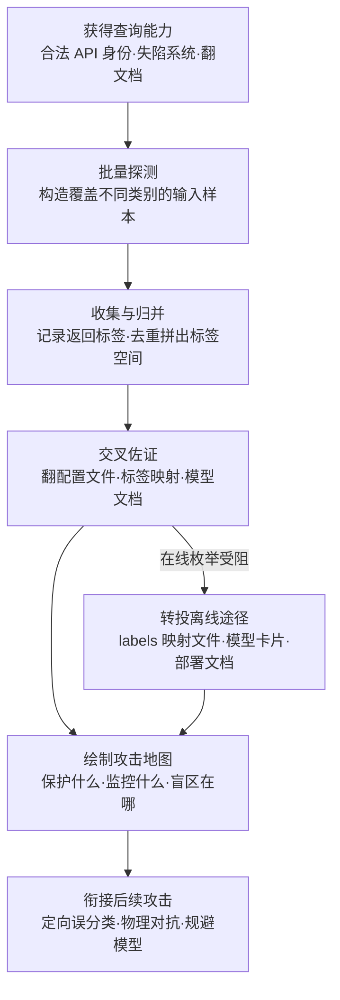

# 发现 AI 模型本体 (AML.T0013)

## 一句话通俗理解

> 想骗过小区的门禁识别系统？先得知道它的摄像头"认识"哪些脸——攻击者反复查询一个 AI 模型，逼它把能输出的全部类别吐个遍：能识别什么人、什么物体、什么行为，摸清这张"认知清单"，才知道该往哪个方向伪装、哪块区域它根本看不见。

## 难度等级

⭐⭐ **Demonstrated（已演示）**

官方成熟度评定为 Demonstrated——MITRE AI 红队在针对商业人脸识别服务的实战演练（AML.CS0012）中完整演示了这条发现路径：先摸清系统能识别什么，再用物理对抗手段精准实施定向误分类。实施门槛中低：黑盒查询只需要一个合法的 API 访问身份，翻配置文件与文档更是传统攻击者的看家本领。真正的门槛在于**情报转化**——把枚举出来的标签空间变成可用的攻击地图：模型在保护什么、监控什么、哪些类别是它认知之外的"盲区"，都需要对抗机器学习的功底才能转化为攻击收益。

## 技术描述

### 通俗解释

每个预测式 AI 模型都有一本"字典"——它只能输出训练时学过的那些类别。目标检测器只能报出它认识的物体，人脸识别系统只能认出它库里的身份，内容审核模型只能标记它学过的违规类型。这本字典就是模型的**本体**。

传统攻击者进屋后翻文件柜找网络拓扑图；AI 时代的攻击者多了一件事——把模型的字典偷出来。手法有两路：**明抢**——反复向模型发送探测样本，收集它吐回的每一个标签，靠次数把输出空间枚举完整；**暗查**——翻配置文件、标签映射文件、模型文档，很多团队把整本字典明文放在模型旁边。字典到手，攻击者就知道了受害者**用这个模型保护什么、监控什么**——门禁认脸、摄像头识枪、审核拦违规——也知道了模型**看不见什么**：不在本体里的类别，模型天然无感，这正是物理对抗样本最好的藏身处。

### 技术原理

依据官方描述：攻击者尝试发现 AI 模型输出空间的本体（ontology），例如一个模型能够检测的物体类型。发现途径有二：**反复查询模型**，迫使其枚举输出空间；或**从模型的配置文件与文档中直接找到**。

**模型本体到底泄露了什么：**

| 情报维度 | 攻击者获得的信息 | 攻击用途 |
|----------|-----------------|----------|
| 标签空间全集 | 模型能输出的所有类别/身份 | 确定攻击目标类与可伪装类 |
| 模型用途 | 受害者用它保护什么、监控什么（门禁/安检/审核） | 判断绕过模型的收益与影响 |
| 覆盖盲区 | 不在本体中的类别模型无法报告 | 物理对抗与"隐身"的最佳通道 |
| 粒度与结构 | 类别层级、相近类别（相似人脸身份） | 定向误分类的落点选择 |

**两条发现途径对照：**

| 维度 | 在线反复查询（黑盒枚举） | 离线配置与文档 |
|------|--------------------------|----------------|
| 前置条件 | 拿到推理接口的合法调用身份 | 读取模型部署环境的文件权限 |
| 覆盖程度 | 受限于探测样本设计，长尾类别难触达 | 标签映射文件通常是全集，一次到手 |
| 留痕情况 | 每次查询都进推理日志，可被画像 | 只留文件读取记录，无 API 流量 |
| 失效条件 | 输出被混淆（只回业务必需标签） | 配置文件被治理与权限收紧 |
| 典型组合 | 两条途径互为佐证——在线枚举圈边界，离线文档补全集 | |

**攻击者动作分解：** 探测（构造覆盖不同类别的输入样本批量提交）→ 收集（记录每次返回的标签与置信度）→ 归并（去重拼出完整标签空间）→ 佐证（翻配置文件、标签映射、模型文档交叉验证）→ 转化（选定目标类与盲区，衔接后续攻击）。

**平台覆盖**：Predictive AI（预测式 AI）——本技术是预测模型特有的手法：只有分类器/检测器这类封闭输出空间的模型才谈得上"枚举本体"；LLM 的输出空间开放且无限，不适用此手法。

**与相邻 ATLAS 技术的分工**：本技术摸的是模型"能输出什么类别"（输出空间结构）；确认模型属于哪个家族是 AML.T0014（发现 AI 模型家族）；从日志与 API 响应中挖出本不该暴露的输出（如分类得分）是 AML.T0063（发现 AI 模型输出）；定位模型与相关制品的位置是 AML.T0007（发现 AI 制品）。

### 用途影响

- **情报即武器**：本体清单直接告诉攻击者"绕过什么、伪装成什么、藏在哪里"——定制化攻击从这里开始；
- **两种途径、双倍暴露**：在线可反复查询、离线可翻配置文档，防御方要同时堵两条路；
- **盲区即通道**：不在本体中的类别模型完全无感，物理对抗样本（CS0012 的思路）正需要这样的通道；
- **合法查询做掩护**：每次探测都是一次正常 API 调用，单看与真实业务流量无异；
- **为整条攻击链供图**：本体情报直接服务于规避 AI 模型（AML.T0015）与制作对抗数据（AML.T0043）；
- **情报不会过期太快**：模型的标签空间在生产环境极少变动——一次枚举的成果往往长期有效，投资回报比极高；
- **连带暴露使用方式**：标签的命名与组织方式（员工工号、部门编号、监控点位名）常常直接泄露受害者如何编排业务——本体不只是类别清单，还是业务情报。

## 攻击流程

### 典型攻击流程



**步骤详解：**

1. **获得查询能力**
   - 通俗描述：先拿到跟模型说话的资格——一张合法门禁卡，或者干脆翻进放文档的抽屉。
   - 技术细节：CS0012 中红队组合使用了传统 ATT&CK 技术——寻找有效账户、经 API 执行代码——先获得对商业人脸识别服务的合法访问，再展开模型侦察；配置文件与文档路径则只需常规的文件读取权限。

2. **批量探测**
   - 通俗描述：拿一堆不同的东西在模型眼前晃，看它分别报什么名。
   - 技术细节：构造覆盖不同类别语义的输入样本（不同物体、不同身份、不同场景），分批提交推理接口；观察返回的标签集合与置信度分布，初步圈定标签空间边界。
   - 实战要点：优先用"语义锚点"样本——每个大类先放一张代表图快速试探边界，命中后再向邻近语义细分；机械的随机采样会浪费大量配额在重复类别上。

3. **收集与归并**
   - 通俗描述：把每次听到的名字记在小本上，去重后就是它的字典。
   - 技术细节：记录每次响应的标签、置信度与排名，去重合并；对置信度异常的边界类别追加定向探测，逼近完整标签空间。
   - 实战要点：给每个标签标注"首次发现时间"与"出现次数"——发现速率的衰减曲线能告诉你枚举何时收敛，以及还有多少长尾没挖到。

4. **交叉佐证**
   - 通俗描述：光听它说不够，再翻翻它的户口本核对。
   - 技术细节：在模型部署环境中搜标签映射文件（labels.json、class_names）、模型卡片、API 文档；两条途径互为印证——在线枚举不全时，离线文档常补全缺口，反之亦然。
   - 实战要点：文档与接口偶尔不一致（接口做了输出裁剪、文档滞后于版本），差异本身即情报——它暴露了防御方裁剪输出的位置与逻辑。

5. **绘制攻击地图与衔接后续**
   - 通俗描述：字典到手，开始挑"它最在乎的那一页"下手。
   - 技术细节：结合业务场景判断模型用途（识别谁、监控什么），选定目标类别与盲区通道，衔接规避 AI 模型（AML.T0015）、制作对抗数据（AML.T0043）实施定向误分类——CS0012 中红队正是据此设计物理对抗措施。

**与后续战术的衔接：**

- **AI 攻击适配**：本体情报直接指对抗样本的优化方向（目标类与可迁移类别）
- **防御规避**：物理对抗样本走模型盲区，绕过识别与检测
- **发现（迭代）**：本体枚举中发现的线索反哺 AML.T0014 模型家族识别
- **影响**：识别系统被定向欺骗，门禁放行、监控漏报

> 关键认知：本体发现阶段的每一次动作——一次 API 调用、一次文件读取——单看都无害；真正致命的是这些动作拼出来的那张"认知地图"。

## 真实案例

> 以下案例源自 MITRE ATLAS 案例库，直接关联 AML.T0013（本库案例研究分节已收录对应文档，此处同步给出官方编号与外部链接）。

### 案例1：MITRE AI 红队物理对抗手段绕过人脸识别系统（2020年，AML.CS0012）

- **时间**: 2020年（ATLAS 案例记录时间为 2020-01-01）
- **攻击者**: MITRE AI 红队（授权演练）
- **手法**: MITRE AI 红队对一套**商业人脸识别服务**实施物理域规避攻击，目标是诱导定向误分类。整个行动将传统 ATT&CK 技术（寻找有效账户、经 API 执行代码）与对抗 ML 专属攻击交织推进：红队先获得服务访问权并摸清系统的能力边界——包括它**能识别哪些身份、输出空间如何组织**（本体发现），再据此设计物理对抗措施，让人脸识别系统把攻击对象错认成他人或无法正确识别。
- **影响**: 演示了"传统渗透 + 模型侦察 + 物理对抗"的完整攻击链——本体发现是其中承上启下的情报环节：不知道系统认识什么，物理伪装就无从谈起
- **参考链接**: [MITRE ATLAS 案例研究 AML.CS0012](https://atlas.mitre.org/studies/AML.CS0012/)

### 案例复盘：本体发现为什么是整条链的"关节"

CS0012 的技术清单横跨发现（AML.T0005、AML.T0013）、模型访问（AML.T0040、AML.T0041）、初始访问（AML.T0012）与规避（AML.T0015）多个战术——其中 AML.T0013 扮演的是承上启下的角色：

- **承上**：红队先以传统手法（有效账户、API 执行）获得对服务的访问权，但这只是"能进门"，还不知道"系统认识谁"；
- **本职**：通过查询与侦察摸清人脸识别系统的身份本体——它能区分哪些人、输出空间如何组织、业务上如何使用这套识别结果；
- **启下**：有了本体地图，物理对抗措施才能"定向"——不是随便干扰识别，而是让系统把攻击对象错认成**指定的另一个人**或落入认知盲区。

这条链路对防御方的启示：拦住"进门"的传统控制（账户与 API 安全）与拦住"认知侦察"的 AI 专属控制（输出混淆、查询限速）缺一不可——任何一环失守，另一环都会成为摆设。

## 红队视角

> ⚠️ **免责声明**：以下内容仅用于合法授权的安全测试与教育目的。在未授权系统上探测模型属于违法行为。

### 实战技巧

1. **把本体枚举做成自动化的"扫字典"**
   编写脚本批量提交覆盖不同语义类别的探测样本，自动归并返回标签——手工探测几百次才能拼出的标签空间，脚本一轮就能跑完。记录每个标签首次出现时的置信度，边界类别往往置信度偏低，值得追加定向探测。

2. **永远先翻文档再打接口**
   很多团队把标签映射、模型卡片、部署文档明文放在模型旁边——一次 `grep` 拿到的情报可能比一万次 API 查询还全。labels.json、class_names、模型选择文档（为什么用这 500 类）都是金矿，且不产生任何在线探测流量。

3. **用"盲区清单"证明风险**
   报告里最有说服力的不是"模型能识别 1000 类"，而是"攻击者带着不在那 1000 类里的东西走过摄像头，系统一个字都不会报"——把本体情报翻译成业务风险，管理层才看得懂。

### 常用工具

| 工具名称 | 用途 | 平台 |
|----------|------|------|
| curl / Python requests | 编写批量探测脚本，收集推理接口返回的标签与置信度 | 跨平台 |
| grep / findstr / rg | 搜寻部署环境中的标签映射文件与模型文档 | 全平台 |
| Hugging Face Hub | 公开模型的标签文件与模型卡片——离线佐证标签空间的参照系 | 在线 |
| 笔记本 / 数据透视工具 | 归并去重探测结果，绘制发现速率衰减曲线 | 跨平台 |
| 对抗鲁棒性工具箱（ART 等） | 后续构造探测样本与对抗数据，衔接 AML.T0043 | Python |

### 注意事项

- **授权边界**：本体发现虽然"只是查询"，但对生产模型的大批量探测会消耗配额、污染监控数据——测试前明确查询配额与时间窗口
- **别只信在线枚举**：标签空间可能有长尾，纯探测永远跑不全；文档与配置是必要的交叉验证
- **记录方法论而非结论**：标签清单会随模型更新失效，可复现的枚举脚本与方法论才是交付物

## 蓝队视角

### 检测要点

1. **高多样性查询行为**
   - 日志来源：模型推理网关、API 审计日志
   - 关注字段：调用方身份、请求内容聚类、返回标签分布
   - 异常特征：单一身份短时间内的查询语义跨度异常大——正常业务用户的输入集中在少数类别，枚举者的输入刻意铺满不同语义域
   - 关联信号：该身份历史上从未触达过的类别接连首次出现，且无对应业务工单/变更记录

2. **枚举式的请求节奏**
   - 日志来源：API 网关限流日志、模型服务访问日志
   - 异常特征：固定速率的机械式批量请求、反复触碰限流阈值（429）后换身份继续、返回标签高度离散且少重复
   - 关联信号：多个新注册/低用量身份接力查询同一接口——账户轮换是绕限流的标配动作

3. **标签配置文件的异常读取**
   - 日志来源：Sysmon、auditd、EDR 文件监控
   - 异常特征：非预期进程读取 labels.json、class 映射、模型卡片；模型部署目录被批量遍历
   - 关联信号：文件读取后短时间内出现针对该模型 API 的查询活动——离线情报转在线验证的组合特征

### 监控建议

- 建立"身份 → 常用类别"的查询画像，语义跨度突增比单纯调用量突增更能暴露枚举行为
- 推理接口的返回标签分布做基线：正常业务的标签分布集中稳定，枚举期的标签分布离散且持续扩散
- 模型部署目录的文件读取纳入审计——配置文件一读就走，比 API 流量更容易抓住
- 限流不是防线而是传感器：谁在反复撞限流、撞完换什么身份，本身就是高质量告警
- 推理日志保留"标签首次出现"维度（该标签历史上是否出现过）：正常业务的类别增长平缓，枚举期的类别增长陡峭
- 评估输出裁剪的副作用：如果业务只消费 top-1 标签，就不该返回完整 top-k 与置信度——先在应用层确认"必需输出集"，再配置端点

## 检测建议

### 网络层检测

**检测方法：** 识别针对推理服务的枚举式查询特征。

- 单一 API 身份在短窗口内触达推理接口的请求语义多样性异常（输入聚类数远超该身份历史基线）
- 请求速率逼近限流阈值、触发 429 后切换身份/密钥继续（AML.M0004 的监控要点）
- 查询时间分布呈机械式规律（固定间隔、批量并发），与人类业务操作节奏不符

### 主机层检测

**检测方法：** 监控对模型配置与文档文件的非预期读取。

- 非模型服务进程读取 labels 映射文件、模型卡片、部署文档
- 模型部署目录被短时间批量遍历（dirbust 式文件发现配合标签文件搜索）
- 离线模型场景重点看文件层：拿到模型文件本身即可直接解析标签空间，无需任何查询

### 应用层检测（AI 遥测）

**检测方法：** 利用推理服务的业务遥测建立查询画像。

- 按 API key/租户维度统计"发现新标签"的速率——正常用户长期停留在固定类别，枚举者会持续触发首次出现的标签
- 推理日志中置信度分布异常：枚举探测样本常落在决策边界附近，整体置信度偏低
- 对返回结果做聚合并与部署声明的标签全集比对：请求覆盖度逼近全集本身就是强信号

**程序化检测思路（无需 EDR 侧改造）：**

用"**新标签发现速率**"替代原始调用量做告警指标：为每个调用身份维护已见标签集合，单位时间新增标签数超过阈值即升级。正常业务用户的新标签发现速率天然衰减（越用越集中在熟悉的类别），而枚举者的新标签发现速率保持恒定甚至上升——单调性差异是比流量特征更可靠的信号。

### Sigma 规则思路示例

```yaml
title: 针对模型推理服务的枚举式探测查询（本体发现特征）
status: experimental
description: 检测单一身份对推理接口的高多样性查询与限流规避行为，
    可能为 AML.T0013 模型本体枚举
logsource:
    category: application
    product: model_inference_gateway
detection:
    selection:
        event.action: 'model_inference'
    filter_anomaly:
        identity_new_label_rate|gte: 50
        timeframe: 10m
    condition: selection and filter_anomaly
    timeframe: 10m
level: medium
tags:
    - atlas.aml_t0013
```

## 缓解措施

### 优先级1：关键措施

**收敛推理输出（AML.M0002 预测式 AI 输出混淆）**：把推理端点返回的信息压到应用所需的最小集——按用例隐藏或降精度置信度分数、logits、类别排名、标签与模型元数据。输出越"瘦"，单次查询泄露的本体信息越少，黑盒枚举的边际成本越高；只回传业务必需的标签（门禁只回"允许/拒绝"而不回身份 ID），等于直接拆掉字典的一半。

### 优先级2：重要措施

**限制查询数量与速率（AML.M0004 限制 AI 服务查询量与速率）**：按用户、API key、租户、设备等认证身份施加短时限速、突发与并发限制，叠加长期用量配额。查询限额直接抬高反复枚举的时间与成本；同时监控分布式请求、账户轮换、窃取凭证等绕限行为——限流被系统性规避这件事本身就是最高置信的告警。注意：对少量请求即可完成的本体发现或针对离线模型的攻击，限额保护有限。

### 优先级3：建议措施

- **配置与文档治理**：标签映射与模型文档不与模型同目录明文存放，部署环境按最小权限收紧文件读取
- **查询画像基线**：按身份建立类别分布画像，语义跨度与新标签发现速率纳入监控
- **模型更新即换字典**：定期轮换/更新模型的标签空间，让枚举成果的保质期变短

### MITRE ATLAS 缓解措施映射

> 官方 ATLAS 数据为本技术映射了两项缓解措施：AML.M0002（预测式 AI 输出混淆）与 AML.M0004（限制 AI 服务查询量与速率）——前者削信息、后者抬成本，两者叠加针对的正是本技术"反复查询 + 翻配置"的两条发现路径。

## 关联 ATT&CK 技术

**本技术在 MITRE ATLAS 官方数据中没有对应的 ATT&CK 技术映射**（attack-reference 为空）。以下为基于攻击逻辑的主题类比，供对照理解：

| ATT&CK 技术 | 关系说明 |
|-------------|----------|
| [T1046 网络服务发现](../../enterprise/10-Discovery/T1046-Network-Service-Discovery.md) | 逻辑同构：反复探测一个服务以枚举其行为，本技术把探测对象换成模型的输出空间 |
| [T1082 系统信息发现](../../enterprise/10-Discovery/T1082-System-Information-Discovery.md) | 同为入侵后信息收集：从系统与配置中摸清"这台机器是什么、装了什么" |
| [T1083 文件与目录发现](../../enterprise/10-Discovery/T1083-File-and-Directory-Discovery.md) | 本技术离线路径的底层动作：定位标签映射文件与模型文档 |
| [T1592 收集受害者主机信息](../../enterprise/01-Reconnaissance/T1592-Gather-Victim-Host-Information.md) | 同为"摸清对方认知/配置边界"的情报收集，区别在于发生在入侵前侦察阶段 |

> 另请注意同战术的姊妹技术：AML.T0007（发现 AI 制品）定位模型在哪里，AML.T0014（发现 AI 模型家族）识别模型是谁，本技术摸清模型能输出什么，AML.T0063（发现 AI 模型输出）挖出模型泄露了什么。四者共同构成模型情报发现的完整拼图。

## 动手实验

> ⚠️ **重要提示**：所有实验仅针对自有模型或公开研究模型进行。对第三方生产服务的批量探测可能违反服务条款。

### 实验环境准备

| 环境组件 | 用途 | 获取方式 |
|----------|------|----------|
| 一台测试机（Python 环境） | 运行探测脚本 | 本地环境 |
| 公开图像分类模型（如 Hugging Face ImageNet 模型） | 实验对象（自有/公开） | Hugging Face Hub |
| Python requests + 笔记本 | 编写探测与归并脚本 | pip 安装 |

### 实验1（初级）：黑盒枚举一个分类器的标签空间

**实验目标：** 体验"反复查询逼模型报出全部类别"的攻击者视角。

**实验步骤：**
1. 选一个公开 ImageNet 预训练分类器（1000 类），不查看其标签文件
2. 编写脚本从公开图库采样不同语义类别的图片（动物、工具、车辆、食物……）批量推理，记录返回的 top-5 标签
3. 持续归并去重，统计发现速率衰减曲线；最后对照官方 labels 文件计算覆盖率

**预期结果：** 直观感受"长尾难度"——前 100 类几十次查询就出土，最后 100 类越来越慢；理解为什么攻击者需要文档交叉佐证。

### 实验2（中级）：两条途径的情报对照

**实验目标：** 验证"翻文档往往快过打接口"。

**实验步骤：**
1. 下载同一模型仓库，检查其中的标签映射文件、config 与模型卡片，直接读出完整标签空间
2. 与实验1 的黑盒枚举结果对照：黑盒漏了哪些类？文档多暴露了什么（类别层级、训练数据描述）？
3. 记录两种途径各自耗时与信息量，形成"攻击者成本对照表"

**预期结果：** 一份可放进红队报告的对照表——说服团队收紧模型配置文件的读取权限。

### 实验3（高级）：把本体翻译成盲区

**实验目标：** 复现 CS0012 的核心思路——本体之外的类别即通道。

**实验步骤：**
1. 在自有目标检测模型上确认某个日常物品**不在**其标签空间中
2. 携带该物品进入（或以图片输入）检测场景，验证模型零告警
3. 再选一个**在**标签空间中的物品做对照，对比检测置信度
4. 变换该物品的外观（颜色、角度、遮挡程度），观察"不在本体 → 零告警"的稳定性
5. 撰写"盲区风险评估"小结：受影响场景、潜在业务后果、建议补的类别

**预期结果：** 一份最小可行的盲区演示——这是向决策者解释"本体泄露为什么是安全风险"的最有力材料。

## 术语解释

| 术语 | 英文原名 | 通俗解释 |
|------|----------|----------|
| 本体 | Ontology | 模型输出空间的"分类字典"——它能识别/输出的全部类别及其结构关系 |
| 标签空间 | Label Space | 模型所有可能输出标签的总集合，本技术的枚举目标 |
| 类别枚举 | Class Enumeration | 用批量探测样本逼模型吐出尽量多不同标签的行为 |
| 盲区 | Blind Spots | 不在模型本体中的类别——模型对其完全无感，物理对抗的天然通道 |
| 输出空间 | Output Space | 模型全部可能输出的范围；预测式 AI 是封闭集合，LLM 是开放集合 |
| 黑盒探测 | Black-box Probing | 不接触模型内部、只靠输入输出对推断模型能力的方法 |
| 置信度 | Confidence Score | 模型对自己判断的把握程度；探测时低置信度常暴露类别边界 |
| 定向误分类 | Targeted Misclassification | 让模型把 A 错认成攻击者指定的 B，而非随机出错 |
| 物理对抗措施 | Physical Countermeasures | 眼镜、贴片、妆造等物理世界手段，让模型看走眼（CS0012 的手法） |
| 模型卡片 | Model Card | 模型的"说明书"——训练数据、适用范围、已知局限，常泄露本体信息 |
| 标签映射文件 | Label Mapping File | 把模型内部输出编号翻译成类别名称的配置文件（如 labels.json） |
| 人脸识别 | Face Identification | 将人脸映射到已知身份库中某个具体身份的 biometric 系统，CS0012 的目标 |
| 长尾类别 | Long-tail Classes | 标签空间中出现频率极低的类别，枚举收敛最慢的部分 |

## 参考资料

### 📚 官方文档

- [MITRE ATLAS - Discover AI Model Ontology (AML.T0013)](https://atlas.mitre.org/techniques/AML.T0013/) - 官方技术页面
- [MITRE ATLAS 矩阵](https://atlas.mitre.org/matrices/ATLAS/)
- [MITRE ATLAS Data (GitHub)](https://github.com/mitre-atlas/atlas-data)

### 📰 案例报告（真实攻击与安全研究）

- [MITRE ATLAS 案例研究 AML.CS0012](https://atlas.mitre.org/studies/AML.CS0012/) - MITRE AI 红队物理对抗手段绕过商业人脸识别服务
- [MITRE ATLAS 案例研究库](https://atlas.mitre.org/studies/) - 官方案例库，可检索更多模型侦察相关事件

### 🔧 工具与资源

- [Adversarial Robustness Toolbox (ART)](https://github.com/Trusted-AI/adversarial-robustness-toolbox) - IBM 开源的对抗机器学习工具箱，探测样本与对抗数据构造
- [Hugging Face Hub](https://huggingface.co/docs/hub/index) - 公开模型的标签文件与模型卡片，离线研究标签空间的参照系
- [OWASP Top 10 for LLM Applications](https://owasp.org/www-project-top-10-for-large-language-model-applications/) - 虽面向 LLM，其敏感信息泄露条目与本技术的输出暴露思路相通

### 🔗 关联阅读

- [发现战术 (AML.TA0008)](./README.md) - 本技术所属战术的概览页
- [ATT&CK Enterprise 发现战术 (TA0007)](../../enterprise/10-Discovery/README.md) - 传统网络发现战术的完整中文文档，对照理解
- [T1046 网络服务发现](../../enterprise/10-Discovery/T1046-Network-Service-Discovery.md) - 与"反复查询枚举输出空间"逻辑同构的经典发现技术
- [T1083 文件与目录发现](../../enterprise/10-Discovery/T1083-File-and-Directory-Discovery.md) - 定位标签映射文件与模型文档的底层动作

---

> **版本**: ATLAS 2026.09 | **更新**: 2026-10-22 | **模板**: ATLAS 技术文档 v1.0
