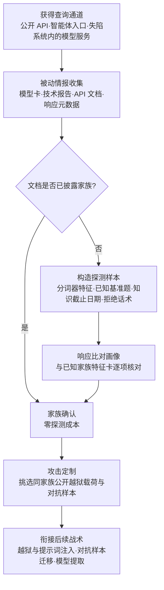

# 发现 AI 模型家族 (AML.T0014)

## 一句话通俗理解

> 不直接问"你是谁"，而是听口音——攻击者让目标模型"说几句话"，从措辞风格、数错了字母的方式、拒绝人时的固定话术，猜出它属于哪个"家族"（GPT 系、Llama 系、Qwen 系……），然后把针对该家族早已公开的越狱手法和对抗样本直接搬过来用。

## 难度等级

⭐ **Feasible（可行）**

官方成熟度评定为 Feasible——手法门槛极低：不需要漏洞、不需要提权，只要能调用目标模型的 API，发几十条精心构造的探测样本、对比响应特征即可完成归类。本技术是 ATLAS 最早入库的条目之一（2021-05-13 创建，2026-05-27 最近更新），但截至 ATLAS 2026.09 数据锚点，官方案例库中**尚无直接命中的真实事件**——没有攻击者公开炫耀"我就是靠指纹识别选对了越狱载荷"。这不代表手法无人使用：家族探测是典型的**前置情报动作**，它本身不造成任何破坏，在受害者的 API 日志里就是几十次再普通不过的问答，事后的攻击报告几乎不会为它单独留一段。可行性则早被公开研究与产业实践反复验证——文档披露、响应风格画像、分词器特征三条路径条条走得通。

## 技术描述

### 通俗解释

每家模型都有"口音"。Llama 系被问"数一数 strawberry 里有几个 r"会以固定的方式翻车，GPT 系的拒绝话术有稳定的模板，Qwen 系的中文措辞带着可辨识的癖好。攻击者不需要偷权重、不需要拆黑盒，只需像语言学家做方言调查一样，拿一组**探测样本**（精心构造的输入）喂给模型，把响应和已知的家族特征库比对，就能判断"这是哪一家的底子"。知道家族意味着什么？意味着针对该家族公开发布的越狱提示词、对抗后缀、分词器攻击可以**成批搬运**——攻击从"大海捞针"变成"按图索骥"。

### 技术原理

依据官方描述：攻击者可能发现模型所属的大致**家族**。有关模型的一般信息可能在**文档**中披露；攻击者也可以使用**精心构造的示例**并分析模型的响应来对其归类。模型家族的知识可以帮助攻击者识别攻击该模型的方法，并帮助定制攻击。

**家族情报的三大来源：**

| 来源 | 典型形态 | 为何有效 |
|------|----------|----------|
| 文档披露 | 模型卡（Hugging Face）、技术报告、API 文档、响应元数据中的 `model` 字段、系统提示词自述 | 最廉价：一句话就把底座、版本、蒸馏来源交代了；蒸馏模型卡常直接注明"based on Qwen2.5 / Llama3" |
| 响应风格画像 | 拒绝话术模板、输出格式偏好、自我认知、口头禅、安全护栏触发阈值 | 家族共享训练数据与对齐流程，行为指纹高度稳定 |
| 探测样本比对 | 分词器特征（字母计数、数字拆分、空格处理）、知识截止日期、已知基准题的答案、特殊 token 反应 | 分词器与词表按家族继承，"翻车方式"几乎不可伪造 |

**攻击者动作分解：** 信息收集（翻模型卡、API 文档、历史版本公告）→ 假设生成（"疑似 Llama 系底座"）→ 探测验证（定向投放分词器/基准类探测样本）→ 家族确认（响应与已知特征卡比对）→ 攻击定制（从公开越狱库中挑同家族载荷，微调投放）。

**典型探测样本类型：**

| 探测样本类型 | 揭示的家族特征 | 示例 |
|--------------|----------------|------|
| 字母计数题 | 分词器对字母级信息的处理方式——按家族继承、几乎不可伪造 | "strawberry 里有几个 r？" |
| 数字算术题 | 数字 token 的拆分习惯与比较行为 | "9.11 和 9.9 哪个大？"（各家翻车形态不同） |
| 知识截止探测 | 训练数据截止时间，用于缩小版本范围 | "你知道 2024 年 7 月之后的哪些事？" |
| 标准拒绝诱导 | 对齐话术模板与护栏触发阈值 | 一条必然触发拒绝的违规请求 |
| 基准记忆化题 | 对公开基准题原样复述的倾向与答案形态 | 经典 QA 数据集中的原题 |
| 格式偏好题 | 输出格式的家族癖好（列表化程度、标题层级、语气词） | "解释一下 X"类开放题 |
| 特殊 token 反应 | 词表与特殊 token 处理的家族级继承 | 含系统保留串、不可见字符的输入 |

**平台覆盖**：Predictive AI / Generative AI / Agentic AI 三类平台全覆盖（官方数据）——预测式模型的输出空间可以"数出来"，生成式模型的口音可以"听出来"，智能体平台的底层模型同样可以被画像。

**与相邻 ATLAS 技术的分工**：本技术回答"它属于哪个**家族**"；逐类查询逼模型枚举全部输出空间、精确锁定"它是**哪个模型**"是 AML.T0013（发现 AI 模型本体）；从日志与 API 响应中挖出本不该暴露的输出（如分类得分）是 AML.T0063（发现 AI 模型输出）；套出系统提示词与调教方式是 AML.T0069（发现 LLM 系统信息）。家族是粒度最粗、成本最低、却最常够用的一层。

### 用途影响

- **攻击定向化**：家族确认后，公开越狱库中同家族的有效载荷可成批复用，把"逐模型试错"压缩为"按家族查表"；
- **迁移攻击的前提**：对抗样本在同家族/同源模型间的迁移成功率显著高于跨家族，家族情报直接决定迁移攻击的命中概率；
- **成本趋零**：黑盒、无交互破坏、几十次 API 调用即可完成，与正常用户流量无异；
- **波及蒸馏生态**：大量下游模型基于少数几个底座家族蒸馏而来，识别底座家族等于同时摸清了一整片模型的共性弱点；
- **信息防不胜防**：文档披露这条路径完全在攻击者的"正当访问"范围内——你公开的模型卡就是他的情报源。

## 攻击流程

### 典型攻击流程



**步骤详解：**

1. **获得查询通道**
   - 通俗描述：先要能跟这个模型说上话。
   - 技术细节：通道成本极低——对外开放的产品 API、智能体对话入口，或失陷系统内部署的推理服务均可；家族探测不需要任何特权，普通用户权限就够。

2. **被动情报收集**
   - 通俗描述：先翻公开资料，可能根本不用动手探测。
   - 技术细节：Hugging Face 模型卡、技术报告、API 文档中的模型命名与版本说明、HTTP 响应中的 `model` 字段、系统提示词里的自我描述。蒸馏模型的模型卡常直接写明底座——一步到位。

3. **构造探测样本**
   - 通俗描述：出几道"每家翻车方式不一样"的题。
   - 技术细节：经典样本包括字母计数题（暴露分词器处理方式）、特定数字算术（暴露数字 token 拆分习惯）、版本敏感的知识题（暴露训练数据截止日期）、以及诱导标准拒绝（暴露对齐话术模板）。样本设计的原则是"答案错得有家族特色"。

4. **响应比对画像**
   - 通俗描述：拿口音对照方言手册。
   - 技术细节：将响应与已知家族特征逐项比对——同样的题，Llama 系、GPT 系、Qwen 系给出的错误形态与措辞风格各有分布；多轮探测交叉验证后形成家族假设。

5. **攻击定制与衔接后续**
   - 通俗描述：知道是哪派功夫，就专打哪派的破绽。
   - 技术细节：从公开越狱载荷库中筛选同家族已知有效项，微调后投放；确认的家族信息同时服务于对抗样本迁移（越狱、提示词注入）与模型提取（黑盒复制）的参数调优。

**与后续战术的衔接：**

- **越狱 / 提示词注入**：同家族公开越狱直接复用，这是家族情报最大的变现出口
- **对抗样本迁移**：黑盒对抗样本按家族迁移，命中率随家族确认大幅提升
- **模型提取 / 影响**：了解目标属于哪一类模型家族，有助于选择同构的替代模型拟合其输出分布

> 关键认知：家族探测是整个攻击链上最"无害"的一环——它不碰系统、不偷数据，几十次问答而已。正因如此，它几乎总能安静地完成，而防御方要到第一次定制越狱命中时才可能惊觉：对方早就把你的底细摸清了。

## 真实案例

> 截至 ATLAS 2026.09 数据锚点，MITRE ATLAS 官方案例库（73 项案例研究）中**暂无直接命中 AML.T0014 的真实事件**。但"识别模型家族 → 定制攻击"这条链路的每一环都已被公开研究与产业实践反复验证。以下按"文档披露 / 攻击迁移 / 响应泄露"三个环节列举代表性公开工作，均为公开学术文献与官方资料，非 ATLAS 案例编号。

### 案例1：DeepSeek-R1 蒸馏模型家族的文档披露（2025年，公开资料）

- **时间**: 2025年1月
- **主体**: DeepSeek（模型发布方——这是"文档披露路径"的典型样本，非攻击事件）
- **手法/事实**: DeepSeek-R1 技术报告与 Hugging Face 模型卡公开注明：R1-Distill 系列模型基于 Qwen2.5 与 Llama3 底座蒸馏而成，每个模型卡都写明了具体底座。攻击者无需任何探测即可确知这些模型继承底座的分词器、词表与部分行为特征——针对 Qwen/Llama 家族已公开的攻击手法可按图索骥。
- **意义**: 模型卡一句话就是一份现成的家族情报；"文档披露"是三条路径中成本为零的一条
- **参考链接**: [DeepSeek-R1 论文 (arXiv:2501.12948)](https://arxiv.org/abs/2501.12948)、[DeepSeek-R1-Distill-Qwen-7B 模型卡](https://huggingface.co/deepseek-ai/DeepSeek-R1-Distill-Qwen-7B)

### 案例2：对抗后缀跨模型迁移研究（2023年，公开学术研究）

- **时间**: 2023年7月
- **主体**: Zou et al.（"Universal and Transferable Adversarial Attacks on Aligned Language Models"，GCG 攻击的提出者）
- **手法/事实**: 研究者展示了对齐语言模型的对抗后缀攻击可以在模型间迁移——针对一个模型优化的越狱后缀对其他模型同样有效，且模型间的亲缘关系（同家族、同源训练数据）越近，迁移成功率越高。这正是"先识别家族、再定向迁移"攻击范式的学术验证。
- **意义**: 家族情报的价值 = 迁移攻击的命中概率；识别家族等于把迁移攻击从碰运气变成查表操作
- **参考链接**: [arXiv:2307.15043](https://arxiv.org/abs/2307.15043)

### 案例3：预测 API 输出泄露模型信息（2016年，公开学术研究）

- **时间**: 2016年
- **主体**: Tramèr et al.（USENIX Security 2016，"Stealing Machine Learning Models via Prediction APIs"）
- **手法/事实**: 论文系统展示了通过查询预测式模型的 API 即可提取模型本身，并演示了从 API 响应中恢复模型超参数——输出携带的信息足以反推模型的类型与配置。"模型输出即情报"的最早系统验证，也是本技术在 Predictive AI 平台上的方法论源头。
- **意义**: 只要 API 返回的信息量超出必要范围（置信度、logits、类排名），模型就在无意中交出自己的身份特征
- **参考链接**: [arXiv:1609.02943](https://arxiv.org/abs/1609.02943)

## 红队视角

> ⚠️ **免责声明**：以下内容仅用于合法授权的安全测试与教育目的。对未授权系统实施探测属违法行为。

### 实战技巧

1. **先翻文档再动手——零成本情报优先**
   拿到目标先查模型卡、技术报告、API 文档、版本公告与响应元数据（`model` 字段、HTTP 头）。大量封装服务自曝底座，一轮被动信息收集就能省掉全部主动探测。报告里"五分钟从公开模型卡确认底座"永远比"发了一百条探测"更有说服力。

2. **建一套家族特征卡**
   为每个主流家族维护一张特征清单：分词器翻车题（字母计数、数字拆分）、标准拒绝话术、输出格式偏好、知识截止日期、基准题记忆化答案。探测时同组样本打多个已知家族模型建立对照基线，再打目标做匹配——像对照方言手册一样做归档。

3. **别信模型的自我认知**
   模型自述身份可被系统提示词随意改写，蒸馏模型"认错祖宗"更是常态——问"你是谁"只能当弱信号，分词器行为和错误形态才是硬指纹。多信号交叉验证，单一特征不下结论。

### 常用工具

| 工具名称 | 用途 | 平台 |
|----------|------|------|
| curl / HTTPie | 裸调 API 观察响应元数据与头信息 | 跨平台 |
| Python + openai/huggingface 客户端 | 批量投放探测样本、采集响应做比对 | 跨平台 |
| lm-evaluation-harness | 用标准基准题做家族间的答案分布画像 | 跨平台 |
| llm-attacks（GCG） | 验证同家族越狱载荷的迁移有效性 | 跨平台 |
| Hugging Face Hub 搜索 | 模型卡与底座信息的第一情报源 | Web |

### 注意事项

- **探测也要克制**：授权测试中的探测样本数量与频率应与委托范围匹配，几十条定向样本通常足够形成假设，没必要打满速率限制
- **结论标注置信度**：家族判定是概率性的，报告里写"高置信 Llama 系底座（分词器特征 + 拒绝话术双命中）"，而不是断言
- **同步给防御方建议**：发现"家族可被指纹识别"后，应同时给出收敛响应元数据与统一拒绝话术的整改建议——红队的价值在于闭环

## 蓝队视角

### 检测要点

1. **模板化探测查询模式**
   - 日志来源：API 网关、LLM 服务审计日志
   - 关注字段：prompt 内容、token 数、时间间隔、来源身份
   - 异常特征：同一用户/API key 短时间内发送大量**短输入、高重复度**的请求；多组请求仅差几个字符（探测样本组的典型形态）

2. **基准题特征命中**
   - 日志来源：LLM 服务审计日志
   - 异常特征：单个会话集中出现字母计数、版本敏感知识题、标准拒绝诱导类问题——这些题对正常用户罕见，对家族探测是标配

3. **响应信息面过大**
   - 日志来源：API 响应审计
   - 异常特征：对外返回了 `model` 版本细节、置信度、token 概率等元数据——每多一个字段，指纹就清晰一分

### 监控建议

- 对"短 prompt + 高频 + 模板化"三特征组合建立基线告警，正常用户极少呈现这种调用形态
- 定期以攻击者视角审视自家 API 响应：哪些字段是业务必需的？其余的都应该收敛
- 公开模型卡、技术报告发布前过一遍"家族情报"审查：底座、版本、训练细节是否属于必须披露的范围
- 把模型版本变更纳入变更管理——底座升级后，此前的"家族-攻击"对照关系对攻击者失效，对防御方同样失效，检测规则需同步更新

## 检测建议

### 网络层检测

**检测方法：** 识别针对推理 API 的探测流量特征。

- 同一身份在短时间内提交结构高度相似的短 prompt 序列（字母计数、知识截止探测类问题的关键词可作弱特征）
- 单会话内问题主题跳跃度异常——正常对话有上下文连贯性，探测样本组没有
- 新用户身份注册后立即发起高频低 token 查询

### 主机层检测

**检测方法：** 监控失陷内网中对模型制品与文档的异常访问。

- 非预期进程读取模型文件、配置文件（`config.json`、`tokenizer_config.json`——文件名即指纹）
- 对内部模型仓库、文档站点的异常枚举与批量下载行为
- 内网推理服务日志中出现与外部探测同构的模板化查询

### 应用层检测（AI 遥测）

**检测方法：** 利用 API 网关与 LLM 平台的审计能力。

- 响应侧：检查对外 API 是否暴露 model 版本、置信度、logits 等元数据（先于攻击者发现）
- 提示词侧：对已知探测类问题（字母计数、版本敏感知识题）建立弱特征库，配合频次做低置信度积累
- 会话画像：无上下文连贯性的"问题清单式"会话值得单独打标

**程序化检测思路（无需 EDR 侧改造）：**

用"**模板相似度 + 频次 + 输入长度**"三轴联动替代单一关键词告警：对同一身份的请求做 prompt 相似度聚类，短输入、高簇内相似度、且簇规模在时间窗口内持续增长的，升级为探测行为告警——单看每一轴都无害，三轴同命中才值得人工复核。

### Sigma 规则思路示例

```yaml
title: 模型 API 高频模板化短查询（家族探测特征）
status: experimental
description: 检测短时间内针对推理 API 的高重复度短输入查询，可能为
    AML.T0014 模型家族探测行为
logsource:
    category: application
    product: llm_api_gateway
detection:
    selection:
        prompt_tokens|lte: 32
    filter_legit:
        user_id|startswith: 'ci-benchmark-'
    condition: selection and not filter_legit | count() by user_id > 40
    timeframe: 10m
level: low
tags:
    - atlas.aml_t0014
```

## 缓解措施

### 优先级1：关键措施

**收敛 API 响应的信息面（对应 AML.M0002 输出模糊化）**：对外响应只保留业务必需字段——隐藏或泛化 `model` 版本细节，不返回置信度、logits、token 概率、类排名等内部信息（除非产品明确依赖）；对外网关统一响应格式与错误话术，不同模型版本之间的拒绝模板、格式偏好做归一化处理，抹平"家族口音"。文档侧同步收敛：模型卡与技术报告中只披露必须披露的信息，内部底座映射不外发。

### 优先级2：重要措施

**限制查询量与速率（对应 AML.M0004）**：按用户、API key、租户、设备维度实施短期突发限制与长期配额。家族画像需要成组的探测样本，限流直接抬高其成本；同时监控分布式请求、账号轮换等规避限流的行为——限流防不住只需少量请求的攻击，但能迫使探测者留下更多痕迹。

### 优先级3：建议措施

- **模型集成（对应 AML.M0006）**：部署多样化家族的模型集成，降低单一家族情报的价值——识别出其中一个成员不等于攻破整个系统，对抗样本跨成员迁移的成功率随多样性上升而下降
- **代理层元数据剥离**：所有对外流量经统一推理网关转发，彻底剥离上游模型的响应元数据与版本指纹
- **版本变更静默化**：底层模型升级不对外公告具体版本映射，削弱"版本-家族-攻击"的查表链路

### MITRE ATLAS 缓解措施映射

官方 ATLAS 数据为本技术映射了 **3 项缓解措施**：

| 缓解ID | 名称 | 官方要点 | 适配建议 |
|--------|------|----------|----------|
| AML.M0002 | 预测式 AI 输出模糊化 | 降低推理端点返回的信息量与保真度，只返回应用必需的输出（收敛置信度、logits、类排名、标签、嵌入与模型元数据），提高模型发现与提取难度 | 对外 API 响应字段做最小化审查，版本细节与内部概率一律不出网关 |
| AML.M0004 | 限制 AI 服务查询量与速率 | 按用户/API key/租户等身份维度限制请求数量与速率，配合突发与配额限制，抬高模型信息提取与攻击验证的时间成本 | 重点关注"少量请求即可完成"的探测场景——限流是抬高成本，不是绝对防线 |
| AML.M0006 | 预测式 AI 模型集成 | 使用多样化模型（不同架构、训练流程、特征、家族）的集成，配合防止单模型被绕过即控制系统的聚合机制，降低对单一模型家族的依赖 | 集成成员的多样性是关键——同家族多版本堆叠不构成有效集成 |

## 关联 ATT&CK 技术

官方 ATT&CK-reference 映射：**无**（本技术无官方映射的 ATT&CK 原版技术）。以下为依据手法相似性整理的关联技术，供对照参考。

| ATT&CK 技术 | 关系说明 |
|-------------|----------|
| [T1592 收集受害者主机信息](../../enterprise/01-Reconnaissance/T1592-Gather-Victim-Host-Information.md) | 侦察侧对应：攻击前收集受害者环境信息，模型家族情报的"战前版" |
| [T1592.002 软件](../../enterprise/01-Reconnaissance/T1592/T1592.002-Software.md) | 摸清受害者部署的软件栈——"目标用什么模型"是其在 AI 环境的子集 |
| [T1518 软件发现](../../enterprise/10-Discovery/T1518-Software-Discovery.md) | 入侵后枚举已安装软件，"这台机器上跑的是什么模型"的底层动作 |
| [T1082 系统信息发现](../../enterprise/10-Discovery/T1082-System-Information-Discovery.md) | 系统信息枚举的经典手法，家族探测是其模型侧延伸 |
| [T1046 网络服务发现](../../enterprise/10-Discovery/T1046-Network-Service-Discovery.md) | 服务/端口指纹识别（banner grabbing）的传统对应——模型响应就是 AI 时代的 banner |

**与同战术 ATLAS 技术的分工**：AML.T0013（发现 AI 模型本体）回答"是哪个模型"，本技术回答"是哪个家族"，AML.T0063（发现 AI 模型输出）挖的是非预期输出，AML.T0069（发现 LLM 系统信息）套的是调教方式。四者构成"模型情报发现"由粗到细的工具箱——攻击者通常先用本技术以最低成本锁定方向，需要更精确情报时再动用其余三者。

## 动手实验

> ⚠️ **重要提示**：所有实验仅对自有资产与明确授权的测试环境进行，探测样本不得用于第三方服务。

### 实验环境准备

| 环境组件 | 用途 | 获取方式 |
|----------|------|----------|
| 两个不同家族的模型 API | 画像对象 | 自有 API key 或本地部署（如 Ollama） |
| Python 3.x + requests | 探测样本投放与采集 | 本地环境 |
| 探测样本清单 | 家族特征题 | 手工构造（见下） |

### 实验1（初级）：建一张家族特征卡

**实验目标：** 体验"口音识别"的基本手法。

**实验步骤：**
1. 准备 10 条探测样本：字母计数题（strawberry 里有几个 r）、两位数加减（暴露数字分词习惯）、"你的知识截止到什么时候"、一条必然触发拒绝的请求（采集拒绝话术）、一道基准记忆化题（如经典 QA 数据集中的原题）
2. 将同一组样本分别投给两个不同家族的自有模型，逐条记录响应
3. 对比两组响应：翻车形态、措辞风格、拒绝模板、格式偏好——各自归档为"特征卡"

**预期结果：** 直观看到家族口音的存在：同样的题，不同家族以不同方式错、不同话术拒。

### 实验2（中级）：盲测一个"未知名"服务

**实验目标：** 模拟对封装服务的家族判定。

**实验步骤：**
1. 用本地部署或让同事从自有模型中随机选一个，只给你 API 端点，不告知型号
2. 仅凭响应（不看任何文档与元数据）投放实验1 的样本组
3. 与已有特征卡比对，给出家族假设与置信度，再对照真实型号验证

**预期结果：** 体会文档披露与元数据被剥离后，纯行为画像能走多远；同时记录哪些特征信号最强、哪些是噪声。

### 实验3（高级）：验证家族与迁移攻击的相关性

**实验目标：** 量化"知道家族"对攻击定制的价值。

**实验步骤：**
1. 选取 3 个模型：同家族两个版本 + 跨家族一个（均为自有资产）
2. 从公开越狱研究（如 GCG 类对抗后缀的公开实现）中取针对其中之一的载荷
3. 分别对 3 个模型投放同一载荷，记录成功率；再取针对跨家族模型的载荷重复对照

**预期结果：** 观察同家族迁移成功率显著高于跨家族——这正是攻击者执着于家族情报的原因，也是缓解措施强调家族多样化的依据。

## 术语解释

| 术语 | 英文原名 | 通俗解释 |
|------|----------|----------|
| 指纹 | Fingerprint | 能唯一标识一个对象（此处为模型家族）的行为特征组合——分词器行为、话术风格、错误形态都是指纹 |
| 家族 | Model Family | 共享同一底座或亲缘关系的模型集合（如 Llama 系、Qwen 系）——同家族模型常共享分词器、词表与训练数据偏好 |
| 迁移攻击 | Transfer Attack | 对 A 模型构造的攻击载荷对 B 模型依然有效；亲缘越近迁移成功率越高，家族情报的核心价值 |
| 探测样本 | Probe Samples | 为提取特定特征而精心构造的输入——题目本身不重要，"错得有没有家族特色"才重要 |
| 模型卡 | Model Card | 随模型发布的说明文档，常写明底座、训练数据与适用范围——家族情报的免费来源 |
| 分词器 | Tokenizer | 把文本切成 token 的组件，按家族继承，其"切法"造成各家族独特的翻车方式（如数字拆分、字母计数） |
| 知识截止日期 | Knowledge Cutoff | 模型训练数据的截止时点，是缩小版本范围的有效指纹 |
| 越狱 | Jailbreak | 绕过模型安全对齐使其产出违规内容的手法，同家族公开载荷可成批复用 |
| 蒸馏 | Distillation | 用大模型输出训练小模型的技术，蒸馏模型继承底座的家族特征，扩大指纹的适用面 |
| 基准测试 | Benchmark | 标准化的评测题集，模型对基准题的记忆化答案是稳定的家族指纹 |
| 黑盒访问 | Black-box Access | 只能通过输入输出口交互、看不到内部结构与权重的访问方式，家族探测的默认约束 |
| 模型提取 | Model Extraction | 通过大量查询 API 复制模型行为的技术，家族信息是提取攻击的选型依据 |

## 参考资料

### 📚 官方文档

- [MITRE ATLAS - Discover AI Model Family (AML.T0014)](https://atlas.mitre.org/techniques/AML.T0014/) - 官方技术页面
- [MITRE ATLAS 矩阵](https://atlas.mitre.org/matrices/ATLAS/)
- [MITRE ATLAS Data (GitHub)](https://github.com/mitre-atlas/atlas-data)

### 📰 案例报告（真实攻击与安全研究）

- [DeepSeek-R1: Incentivizing Reasoning Capability in LLMs via RL (arXiv:2501.12948)](https://arxiv.org/abs/2501.12948) - 蒸馏模型家族的文档披露范例（Qwen/Llama 底座）
- [DeepSeek-R1-Distill-Qwen-7B 模型卡](https://huggingface.co/deepseek-ai/DeepSeek-R1-Distill-Qwen-7B) - 模型卡直接注明底座的实例
- [Zou et al.: Universal and Transferable Adversarial Attacks on Aligned LLMs (arXiv:2307.15043)](https://arxiv.org/abs/2307.15043) - 对抗后缀跨模型迁移研究（GCG）
- [Tramèr et al.: Stealing Machine Learning Models via Prediction APIs (arXiv:1609.02943)](https://arxiv.org/abs/1609.02943) - 预测 API 输出泄露模型信息的系统验证
- [Papernot et al.: Transferability in Machine Learning (arXiv:1707.08989)](https://arxiv.org/abs/1707.08989) - 迁移攻击现象学的奠基综述

### 🔧 工具与资源

- [Hugging Face Hub](https://huggingface.co/models) - 模型卡与家族信息的第一情报源（防御方同样应先于攻击者审视自家披露）
- [lm-evaluation-harness](https://github.com/EleutherAI/lm-evaluation-harness) - 基准题画像工具
- [llm-attacks (GCG)](https://github.com/llm-attacks/llm-attacks) - 对抗后缀迁移验证工具
- [OWASP Top 10 for LLM Applications](https://owasp.org/www-project-top-10-for-large-language-model-applications/) - LLM 应用十大安全风险清单（LLM02 敏感信息泄露与本技术直接相关）

### 🔗 关联阅读

- [发现战术 (AML.TA0008)](./README.md) - 本技术所属战术的概览页
- [T1592 收集受害者主机信息](../../enterprise/01-Reconnaissance/T1592-Gather-Victim-Host-Information.md) - 侦察侧的对应技术
- [T1518 软件发现](../../enterprise/10-Discovery/T1518-Software-Discovery.md) - 入侵后软件枚举的经典手法
- [T1046 网络服务发现](../../enterprise/10-Discovery/T1046-Network-Service-Discovery.md) - 服务指纹识别的传统对应

---

> **版本**: ATLAS 2026.09 | **更新**: 2026-10-22 | **模板**: ATLAS 技术文档 v1.0
