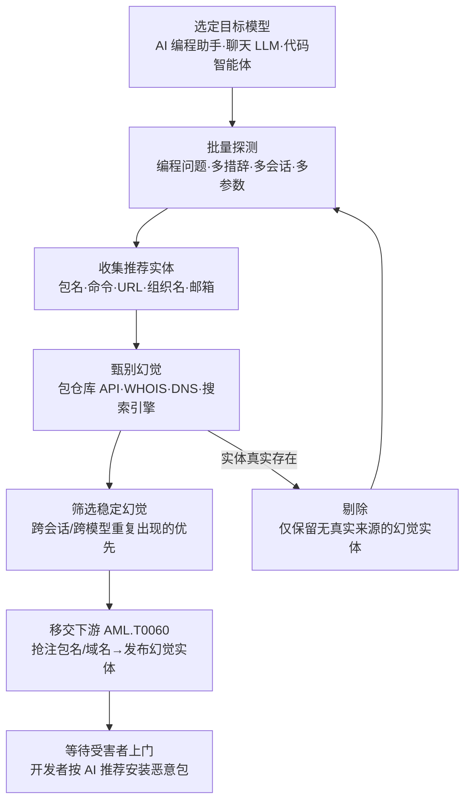

# 发现 LLM 幻觉 (AML.T0062)

## 一句话通俗理解

> 骗子先去问一个"爱编店名的向导"：这条街上哪家修表铺最好？向导一本正经地报出一家根本不存在的店名——骗子转身抢先把店开起来，等下一个问路的食客按图索骥找上门，正好走进骗子的店。攻击者诱导 AI 编程助手编造不存在的软件包名、URL、邮箱，记下这些"幽灵坐标"，再抢注成真实的恶意实体，坐等开发者循着 AI 的"推荐"自投罗网。

## 难度等级

⭐⭐ **Demonstrated（已演示）**

官方成熟度评定为 Demonstrated——本技术的完整攻击链条已被安全研究与学术研究大规模验证。Vulcan Cyber 早在 2024 年就证实 ChatGPT 会稳定地编造不存在的软件包名，且不同会话产出的幻觉高度一致（AML.CS0022）；Lasso Security 的对比实验进一步量化了各主流模型的幻觉率；USENIX Security 2025 的系统性研究在 57.6 万个生成代码样本中识别出约 2.45 万个不重复的幻觉包名。更危险的是，已有攻击者将幻觉包名抢注为真实恶意包并被开发者下载数千次。技术门槛低——一组提示词加一个脚本即可批量探测；但收益呈"期权式"——发现的每个未注册幻觉实体，都是一颗可以随时引爆的供应链地雷。

## 技术描述

### 通俗解释

LLM 不是数据库，它只是根据训练语料的统计规律"接话"。当你问它"用 Python 解析 PDF 该装什么包"，它吐出的 `pip install xxx` 里的 `xxx` 可能根本不存在——它把见过的真实包名、常见命名习惯和上下文"缝合"出一个看起来无比合理的名字。这就是**幻觉（hallucination）**。

对普通用户，幻觉顶多浪费一次尝试；对开发者，幻觉是一张写着不存在的地址的"导航路线图"——而攻击者可以赶在你之前把那个地址买下来。**发现 LLM 幻觉**就是攻击者系统性地"钓鱼式提问"：批量向 LLM（尤其是 AI 编程助手）索要软件包、命令、URL、组织名、邮箱等实体，再用包管理器仓库、WHOIS、DNS 等公开渠道逐一甄别，筛出**没有真实世界来源**的幻觉实体。这份"幻觉清单"随后交给[发布幻觉实体 (AML.T0060)](../02-Resource-Development/AML.T0060-Publish-Hallucinated-Entities.md)——抢注域名、注册包名、创建邮箱，等待受害者被 AI 的"推荐"引流上门。

最阴险之处在于**跨模型一致性**：不同厂商的 LLM 训练语料相互交叠，往往对同一问题编造出相同的幻觉实体。攻击者在模型 A 上探测到的幻觉包名，可能同样出现在模型 B、C 的回答里——一次探测，多模型受害，受害面被自动放大。

### 技术原理

依据官方描述：攻击者通过向大语言模型提交提示词并识别其中的幻觉实体实施本技术。攻击者可能请求软件包、命令、URL、组织名称或电子邮件地址，并甄别出**没有关联真实世界来源**的幻觉。发现的幻觉为攻击者提供了可发布（抢注）的潜在目标，直接衔接发布幻觉实体（AML.T0060）技术。研究已证明不同 LLM 会产生相同的幻觉，因此攻击者利用的幻觉可能影响其他 LLM 的用户。

**典型探测目标与幻觉产物：**

| 探测请求形态 | 幻觉实体类型 | 甄别手段 | 抢注后的武器化形态 |
|--------------|--------------|----------|---------------------|
| "用 Python/JS 实现 X 功能" | 软件包名（PyPI/npm） | 查询包管理器仓库 API 确认不存在 | 发布同名恶意包（slopsquatting） |
| "官方文档/下载地址是什么" | URL、域名 | WHOIS/注册局查询确认未注册 | 抢注域名挂恶意内容 |
| "该公司的联系方式" | 组织名、邮箱地址 | 搜索引擎与企业库交叉验证 | 注册相似域名与邮箱实施钓鱼 |
| "怎么调用 XX 服务的 API" | 命令、端点、SDK 名称 | 对照官方文档与制品仓库 | 发布伪造 SDK/CLI 工具 |

**攻击者动作分解：** 选型（挑选幻觉率高的模型与提示词组合）→ 批量探测（同一问题多措辞、多会话、多温度参数重复提问）→ 甄别（对照公开注册渠道剔除真实实体）→ 去重排序（优先保留跨会话/跨模型重复出现的稳定幻觉——命中未来受害者的概率最高）→ 移交下游（把幻觉清单交给 AML.T0060 抢注发布）。

**为什么 AI 编程助手是重灾区：** 代码补全与安装建议是高频、高信任、可自动执行的输出——开发者习惯性直接 `pip install`/`npm install` AI 给出的包名，而 Agentic AI 场景下智能体可能**未经确认自动安装**，幻觉从"错误答案"直接变成"自动执行的供应链入口"。

**平台覆盖**：Generative AI（聊天助手、代码补全）与 Agentic AI（能自主执行安装动作的智能体），依据官方数据。

**与相邻 ATLAS 技术的分工**：本技术是幻觉攻击链的**发现阶段**——产出幻觉清单；抢注与发布是 AML.T0060（发布幻觉实体，属资源开发战术）；诱导特定模型产生幻觉的提示词工程手法则与 AML.T0069（发现 LLM 系统信息）同属"LLM 系统透视"类探测。

### 用途影响

- **零成本弹药库**：探测只需普通用户权限与少量 API 费用，一个下午的批量提问即可产出数百个候选幻觉实体
- **命中率高得反常**：幻觉具有跨模型一致性——研究显示超过四成幻觉包名会在多个模型家族间重复出现，抢注一个名字等于在多家 AI 的"推荐位"上同时埋雷
- **受害者主动上门**：与传统供应链投毒靠 SEO/社工引流不同，受害者是**被自己信任的 AI 推荐**来的，心理防线为零
- **自动化放大**：Agentic AI 的自动安装能力把"看到幻觉包名"与"执行恶意代码"之间的间隔压缩到零
- **检测盲区**：探测行为在服务端看来就是普通问答，甄别行为用的是公开查询接口，全程无明显恶意特征

## 攻击流程

### 典型攻击流程



**步骤详解：**

1. **选定目标模型**
   - 通俗描述：挑一个"爱编故事"且用户量大的向导。
   - 技术细节：优先选择 AI 编程助手（GitHub Copilot 类、ChatGPT/Claude 代码模式）与开发者常用的聊天 LLM；研究数据显示不同模型幻觉率差异显著，代码生成场景下的幻觉率显著高于事实问答场景。目标用户群越重叠，后续抢注的命中率越高。

2. **批量探测**
   - 通俗描述：换着一百种问法问同一个问题，把向导编的店名全记下来。
   - 技术细节：围绕冷门但真实的需求构造编程问题（如冷门文件格式解析、小众 SDK 调用）；对每个问题变换措辞、上下文与温度参数重复提问，触发模型在"知识稀疏区"编造实体；全程只做普通问答，不触碰任何受害系统。

3. **收集与甄别幻觉**
   - 通俗描述：逐一核对电话簿，筛出查无此店的店名。
   - 技术细节：从回答中提取包名/URL/邮箱等实体，批量查询 PyPI/npm registry API、WHOIS、DNS 与搜索引擎——查无来源者即为幻觉实体；实体真实存在则剔除并回到探测阶段。

4. **筛选稳定幻觉**
   - 通俗描述：优先记下向导"每次都编同一个名字"的店——这种最值得抢注。
   - 技术细节：统计每个幻觉实体的出现频率，保留跨会话、跨模型重复出现的"稳定幻觉"（deterministic hallucination）——它们未来被其他用户问出的概率最高，是抢注的优质标的。

5. **移交下游与收割**
   - 通俗描述：把店开起来，挂上向导嘴里的名字，坐等客人。
   - 技术细节：幻觉清单交给 AML.T0060——向包仓库发布同名恶意包、抢注域名与邮箱；当任何开发者（或其智能体）向同款/相似模型提出同类问题时，AI 推荐的正是攻击者发布的实体，安装即中招，攻击链闭环。

**与后续战术的衔接：**

- **资源开发**：本技术的直接下游 AML.T0060 把幻觉清单转化为真实的基础设施与制品
- **初始访问**：受害者（或其智能体）安装恶意包的瞬间即完成初始访问与执行
- **凭证访问 / 收集**：恶意包载荷可窃取开发者本地的 API 密钥、令牌与环境变量，把伤害传导至凭证访问战术
- **持久化 / 影响**：恶意包的载荷决定终点——窃密、挖矿、后门、勒索均可搭载

> 关键认知：发现 LLM 幻觉阶段攻击者全程只做了两件事——"问问题"和"查公开数据库"，没有触碰任何受害者系统。真正的攻击动作全部留给下游，这让本技术几乎无攻击痕迹可言。

## 真实案例

> 以下案例源自 MITRE ATLAS 案例库（AML.CS0022），并补充该案例引用的四项关键研究。

### 案例1：ChatGPT 软件包幻觉（2024年，AML.CS0022）

- **时间**: 2024年6月（研究公开披露期，Vulcan Cyber 原始研究发布于 2024 年初）
- **攻击者**: Vulcan Cyber、Lasso Security（安全研究人员，实验演示）
- **手法**: 研究人员证实 ChatGPT 等大语言模型在生成代码时会"推荐"**并未发布到包管理器仓库的虚构软件包名**。攻击者可抢先以幻觉包名向 PyPI/npm 发布恶意包；同一或相似 LLM 的用户此后遇到同类问题时，会从模型处得到同一个幻觉包名，最终下载并执行恶意包。Vulcan Cyber 发现模型在不同会话中对相同问题给出**高度一致的幻觉**——幻觉不是随机的，是可以被"稳定复现"的；Lasso Security 的对比实验进一步量化：Gemini、CodeLlama、GPT-4 在包推荐场景下均存在可观幻觉率（Gemini 实验中约 64.5% 的推荐包含幻觉包名，CodeLlama 约 43.7%，GPT-4 约 36.4%），且 GPT-4 倾向于**重复先前编造过的包名**。
- **影响**: 攻击链被完整验证——AIID 已收录幻觉软件包被抢注后**遭开发者累计下载数千次**的事件（潜在恶意软件）；2025 年安全社区将该攻击模式命名为 **slopsquatting（幻觉抢注）**，Trend Micro 等厂商将其列为软件供应链新威胁。
- **参考链接**: [Vulcan18: Can you trust ChatGPT's package recommendations?](https://vulcan.io/blog/ai-hallucinations-package-risk)、[Lasso Security: Diving into AI Package Hallucinations](https://www.lasso.security/blog/ai-package-hallucinations)、[AIID Incident 731](https://incidentdatabase.ai/cite/731/)、[Trend Micro: Slopsquatting](https://www.trendmicro.com/vinfo/us/security/news/cybercrime-and-digital-threats/slopsquatting-when-ai-agents-hallucinate-malicious-packages)

### 延伸研究：幻觉的规模化与跨模型一致性

- **USENIX Security 2025 学术验证**：研究人员对 16 个主流代码生成模型（GPT-4/GPT-4o、Claude、Gemini、Llama 系列等）系统性生成 57.6 万份代码样本，其中约 19.7% 的样本引用了不存在的软件包，累计去重后得到约 2.45 万个不同幻觉包名；且**超过四成幻觉包名会在多个模型家族间重复出现**——直接印证了官方描述"不同 LLM 会产生相同幻觉"的跨模型放大效应。研究者估算，这批幻觉包名对应着软件供应链中一个价值百万美元级的"注册盲区"。
- **AIID 事件 731**：收录了幻觉软件包被实际抢注、并**被开发者下载数千次**的真实事件——证明本技术已从研究演示跨入实战。

## 红队视角

> ⚠️ **免责声明**：以下内容仅用于合法授权的安全测试与教育目的。对第三方 LLM 服务的批量探测可能违反服务条款；将幻觉实体注册到真实仓库/域名属于攻击行为，严禁在授权范围外实施。

### 实战技巧

1. **把幻觉探测纳入 AI 安全评估的标准科目**
   面向组织自建的代码助手/智能体做评估时，用一组冷门编程问题批量提问，统计幻觉率与稳定幻觉清单——这是最能打动开发团队的风险量化指标："你的助手每次都把开发者引向同一个不存在的包"。

2. **提示词组合决定产量**
   知识稀疏区（冷门格式、小众 SDK、内部工具名）+ 请求代码完整可运行（逼模型给出 `pip install` 行）+ 多措辞多会话重试（捕获稳定幻觉）。温度参数调高可扩大候选面，调低可验证确定性。

3. **甄别即验证**
   每个候选实体必过三关：包管理器 registry API、WHOIS/DNS、搜索引擎。红队报告中只呈现"查无来源"的清单，并同步提供给防御方作为监控黑名单。

### 常用工具

| 工具名称 | 用途 | 平台 |
|----------|------|------|
| 自有/开源 LLM + API | 批量提示词探测（避免对第三方服务过量请求） | 跨平台 |
| PyPI / npm registry API | 候选包名存在性甄别（`GET /pypi/<name>/json`、`npm view`） | 跨平台 |
| whois / dig | 域名与 URL 类幻觉实体的注册状态甄别 | 跨平台 |
| 脚本化批处理（Python + requests） | 多措辞提示词矩阵、结果去重与频次统计 | 跨平台 |
| Socket / OSV.dev | 防御侧对照：已知恶意包与漏洞库查询 | 跨平台 |

### 注意事项

- **探测不等于抢注**：红队作业止步于"产出幻觉清单并交付防御方"——在任何真实仓库/域名上注册幻觉实体都越界违法
- **尊重服务条款**：对第三方商用 LLM 的批量探测受 ToS 约束，优先使用自有模型或测试环境
- **报告要给出闭环**：附上"幻觉清单 → 假想抢注 → 开发者命中"的完整推演路径与命中率估算，而不是只交一串名字

## 蓝队视角

### 检测要点

1. **LLM 服务侧的批量探测行为**
   - 日志来源：LLM 网关/代理的请求日志、模型服务商的租户用量日志
   - 关注字段：提示词内容特征、请求频次、会话数
   - 异常特征：同一租户/密钥短期内提交大量"请求代码+安装命令"类问题；同一问题多措辞变体反复出现；新注册账户立即高频调用

2. **AI 编程助手输出的幻觉包名**
   - 日志来源：IDE 助手插件的输出日志、智能体的工具调用日志
   - 异常特征：助手推荐的包名在本组织镜像仓库/允许清单中不存在；智能体尝试 `pip/npm install` 一个从未出现在任何 SBOM 或锁定文件中的新包名

3. **包管理器侧的可疑安装**
   - 日志来源：内部制品仓库（Artifactory/Nexus）审计日志、终端 EDR 进程日志
   - 异常特征：安装来自公网仓库且包名注册时间极新（新近抢注特征）；同一冷门包名在多台开发机短时间内集中出现

4. **幻觉实体被抢注的早期外部信号**
   - 日志来源：威胁情报源、registry 元数据变更
   - 异常特征：与自家 AI 助手历史输出重合的包名/域名突然被新账户注册；此前长期无人占用的"高相似度名字"出现新注册行为——防御方同样可以做攻击者的甄别动作，先敌一步

### 监控建议

- 维护组织级"幻觉包名观测清单"：订阅 Socket 等厂商的 slopsquatting 情报，把已知幻觉/抢注包名推送至镜像仓库拉取策略与 EDR 命中规则
- 对智能体自动安装行为设置"新包名首次安装"告警——自动执行场景是本技术威胁模型的最高危路径
- 将"包名注册时间"纳入信任评估：新近注册 + 低下载历史 + 由 AI 推荐引入的组合应触发人工复核
- 定期把组织内 AI 助手的"稳定幻觉清单"交给威胁情报团队反查注册状态：一旦发现其中任何一个被抢注，即可在开发者中招前拉黑并通报

## 检测建议

### 网络层检测

**检测方法：** 识别对包管理器公网仓库的异常请求与幻觉甄别模式。

- 同一源对 registry API 的高频"存在性查询"（HEAD/GET 单包名）且无后续下载——攻击者甄别幻觉的特征，与正常开发拉包行为模式不同
- 开发网段对"新近注册包名"的下载请求（结合 registry 元数据的时间戳做代理检测）

### 主机层检测

**检测方法：** 监控开发终端与构建环境的包安装命令行。

- `pip install` / `npm install` 命令行中出现不在项目锁定文件（requirements.txt lock / package-lock.json）内的新包名
- 智能体/IDE 助手进程作为父进程发起的包安装（自动化安装路径，风险最高）

### 应用层检测（AI 遥测）

**检测方法：** 利用 LLM 网关与智能体平台的审计能力。

- 网关侧对"代码生成+包推荐"类提示词做频次画像，识别批量探测模式（配合速率限制策略 AML.M0004）
- 智能体平台记录每次工具调用中的安装目标包名，与允许清单比对
- 输出侧护栏（AML.M0020）拦截包含未验证包名的代码块，或强制附加"包名未经验证"警示

**程序化检测思路（无需 EDR 侧改造）：**

用"**AI 推荐包名 + registry 注册时间**"双信号关联替代单点告警：先在 LLM 网关/助手日志中提取 AI 输出的包名，再关联 registry 元数据——凡"AI 推荐 + 仓库中注册时间 < 90 天 + 组织内首次安装"三者齐备即升级。该组合同时压低误报并直接命中 slopsquatting 的命中路径。

### Sigma 规则思路示例

```yaml
title: 安装已知幻觉/新近抢注软件包（slopsquatting 特征）
status: experimental
description: 检测包安装命令行命中幻觉包名情报清单，可能为 AML.T0062 /
    AML.T0060 幻觉实体供应链攻击的落地动作
logsource:
    category: process_creation
    product: windows
detection:
    selection_install:
        CommandLine|contains:
            - 'pip install'
            - 'npm install'
    selection_blocklist:
        CommandLine|contains:
            - '<幻觉包名情报清单-占位1>'
            - '<幻觉包名情报清单-占位2>'
    condition: selection_install and selection_blocklist
level: high
tags:
    - attack.t1195.002
    - atlas.aml_t0062
    - atlas.aml_t0060
```

> 注：`selection_blocklist` 列表应接入 Socket 等厂商发布的 slopsquatting 情报源并定期更新；仅依赖静态名单无法覆盖新幻觉实体，必须与"新近注册包名"行为检测联动。

## 缓解措施

### 优先级1：关键措施

**输出侧护栏拦截未验证实体（AML.M0020 生成式 AI 护栏）**：在 AI 编程助手/智能体的输出路径部署护栏，对代码块中的包名、URL、邮箱做存在性校验（实时查询 registry/WHOIS 或比对本地允许清单）——校验不通过则拦截、标注或附加显著警示。护栏可在输入、输出、工具执行多阶段生效，工具级护栏还能在智能体自动安装前强制人工确认（对高风险动作要求 human-in-the-loop）。

### 优先级2：重要措施

**提示词指引压制幻觉表达（AML.M0021 生成式 AI 指引）**：系统提示词明确要求"只推荐能确认存在的包，无法确认时必须声明不确定并建议开发者查阅官方文档"；强制引用来源、禁止编造。指引需配合护栏验证输出，且随红队发现的失效模式持续迭代。

**降低模型幻觉倾向（AML.M0022 生成式 AI 模型对齐）**：在训练/微调阶段以 RLHF、SFT、领域微调等对齐方法降低幻觉率，特别是代码场景中的依赖引用准确性；上线前把"包推荐幻觉率"纳入模型评估基线，作为发布门禁之一。

### 优先级3：建议措施

**提高批量探测成本（AML.M0004 限制 AI 服务查询量与速率）**：按用户/API 密钥/租户维度实施短时速率与长期配额限制，提高攻击者批量探测与幻觉甄别的时间与资金成本；同时监控分布式请求、账号轮换等绕限行为（注：对只需少量请求的探测或离线模型，速率限制防护有限）。

**开发侧纵深防御**：依赖锁定文件 + SBOM 固化供应链；CI 流水线对新引入包做"注册时间/下载量/维护者"信任评估；智能体默认禁止未经确认安装新包；组织内部镜像仓库只代理允许清单。

### MITRE ATLAS 缓解措施映射

| 缓解措施 ID | 名称 | 官方覆盖说明 |
|-------------|------|--------------|
| AML.M0004 | 限制 AI 服务查询量与速率 | 提高探测与甄别的成本，延缓批量幻觉收集 |
| AML.M0020 | 生成式 AI 护栏 | 输出/工具层校验实体存在性，拦截未验证包名的安装动作 |
| AML.M0021 | 生成式 AI 指引 | 系统提示词约束"不编造、必声明、强制引用" |
| AML.M0022 | 生成式 AI 模型对齐 | 训练阶段降低幻觉率，压缩幻觉实体的产生源头 |

## 关联 ATT&CK 技术

官方 ATT&CK-reference 映射：**无**（本技术为 ATLAS 原生技术，官方数据未给出映射）。以下为依据攻击链逻辑整理的强关联 ATT&CK 技术，供对照参考。

| ATT&CK 技术 | 关系说明 |
|-------------|----------|
| [T1596 搜索开放技术数据库](../../enterprise/01-Reconnaissance/T1596-Search-Open-Technical-Databases.md) | 甄别阶段手法：查询 WHOIS/DNS/证书透明度等公开库确认实体未被注册 |
| [T1595 主动扫描](../../enterprise/01-Reconnaissance/T1595-Active-Scanning.md) | 探测阶段的传统对应：对目标系统的主动信息收集，本技术把"扫描对象"换成了 LLM |
| [T1583.001 域名](../../enterprise/02-Resource-Development/T1583/T1583.001-Domains.md) | 下游衔接：抢注幻觉域名属于获取基础设施 |
| [T1195.002 危害软件供应链](../../enterprise/03-Initial-Access/T1195/T1195.002-Compromise-Software-Supply-Chain.md) | 下游衔接：以幻觉包名发布恶意包是软件供应链妥协的 AI 变体 |
| [T1204.002 恶意文件](../../enterprise/04-Execution/T1204/T1204.002-Malicious-File.md) | 落地执行：开发者按 AI 推荐"自愿"安装并运行恶意包 |

**与同战术 ATLAS 技术的分工**：本技术是幻觉攻击链的发现阶段，产出幻觉清单；抢注发布是 AML.T0060（发布幻觉实体，资源开发战术）；同属"LLM 系统透视"的 AML.T0069（发现 LLM 系统信息）针对系统提示词与指令关键词等模型内部信息，本技术针对模型输出的外部实体。两者常在同一轮探测中一并实施。

## 动手实验

> ⚠️ **重要提示**：所有实验使用自有模型或测试环境完成。实验产出的幻觉清单仅用于防御改进；严禁在任何真实包仓库/域名上注册幻觉实体。

### 实验环境准备

| 环境组件 | 用途 | 获取方式 |
|----------|------|----------|
| 一个可自由调用的 LLM | 探测对象（本地开源模型或自有 API 额度） | Ollama / vLLM / 自有 API |
| Python + requests 脚本 | 批量提示词与结果处理 | 本地环境 |
| PyPI / npm registry API | 幻觉包名甄别 | 公开接口 |
| whois / dig | 域名类幻觉甄别 | 系统自带或安装 |

### 实验1（初级）：复现一次包名幻觉探测

**实验目标：** 亲手让 AI 编造一个不存在的包，完成"探测—甄别"最小闭环。

**实验步骤：**
1. 准备 20 个冷门编程问题（如解析某小众文件格式、调用某小众服务 API）
2. 逐题向 LLM 提问"给出完整可运行代码与依赖安装命令"，提取回答中的所有包名
3. 对每个包名调用 registry API（如 `https://pypi.org/pypi/<name>/json`，404 即不存在）
4. 统计本轮幻觉率：不存在的包名数 / 推荐包名总数

**预期结果：** 直观看到幻觉包名的"合理长相"，理解它们为何能骗过开发者。

### 实验2（中级）：验证稳定幻觉与跨模型一致性

**实验目标：** 验证"同一问题反复问会得到同一幻觉"的官方描述。

**实验步骤：**
1. 取实验1 中命中的 3-5 个幻觉问题，每个用 5 种措辞变体、在不同会话中重复提问
2. 统计每个幻觉包名的复现率（出现次数/提问次数）
3. 若有多模型条件，把同一问题集投给第二个模型，比对幻觉包名重合度

**预期结果：** 得到"稳定幻觉"清单——它们正是 slopsquatting 攻击者的最优抢注标的，应同步交给防御方做监控黑名单。

### 实验3（高级）：为 AI 编程助手加一道幻觉护栏

**实验目标：** 在输出路径上落地 AML.M0020 式的存在性校验。

**实验步骤：**
1. 在测试用代码助手/智能体的输出处理环节加钩子：正则提取代码块中的 `pip/npm install` 包名
2. 对提取结果实时调用 registry API 校验；不存在则拦截该代码块并改写为"包名未验证，请查阅官方文档"警示
3. 用实验1、2 的探测问题回放，对比护栏前后开发者视角的输出
4. （可选）为智能体安装工具加"新包名需人工确认"规则，回放自动安装场景

**预期结果：** 获得一条可复用的幻觉拦截管线，并验证"输出校验 + 安装确认"双层防御对 slopsquatting 命中路径的封堵效果。

## 术语解释

| 术语 | 英文原名 | 通俗解释 |
|------|----------|----------|
| 幻觉 | Hallucination | LLM 一本正经编造不存在的内容——包名、URL、文献、邮箱都可能是编的 |
| 幻觉实体 | Hallucinated Entity | 幻觉产出的具体"实体"：包名、命令、URL、组织名、邮箱——本技术的核心猎物 |
| 探测 | Probing | 攻击者系统性批量提问以引出目标信息的行为，本技术中指诱导 LLM 产出幻觉 |
| slopsquatting | Slopsquatting（幻觉抢注） | 抢先把 LLM 幻觉出的包名注册到真实仓库以待受害者上门的攻击，slop 指机器生成的"口水内容" |
| 稳定幻觉 | Deterministic Hallucination | 跨会话/跨模型重复出现的同一幻觉实体，被抢注后的命中概率最高 |
| 跨模型一致性 | Cross-model Consistency | 不同 LLM 因训练语料交叠而对同一问题产生相同幻觉的现象，放大受害面 |
| 包管理器仓库 | Package Registry | PyPI、npm 等存放软件包的公共仓库，幻觉甄别与恶意包发布的同一战场 |
| 供应链攻击 | Supply Chain Compromise | 在软件依赖的分发环节动手脚，让受害者主动安装恶意组件 |
| 锁定文件 | Lockfile | 精确记录依赖版本的文件（package-lock.json 等），防止"顺手"引入新包 |
| SBOM | 软件物料清单 | 软件全部依赖的清单文件，用于比对发现"清单外"的可疑新包 |
| 幻觉率 | Hallucination Rate | 推荐实体中幻觉所占比例，Lasso 实测各主流模型在包推荐场景下从约 36% 到 65% 不等 |
| 人机回圈 | Human-in-the-Loop | 高风险动作（如安装新包）执行前强制人工确认的机制，封堵智能体自动踩雷 |
| 生成式 AI 护栏 | Guardrails | 位于用户、工具与模型之间的安全控制层，可校验/拦截输出中的未验证实体 |
| 速率限制 | Rate Limiting | 限制单位时间请求数的防护手段，用于抬高批量探测的成本 |

## 参考资料

### 📚 官方文档

- [MITRE ATLAS - Discover LLM Hallucinations (AML.T0062)](https://atlas.mitre.org/techniques/AML.T0062/) - 官方技术页面
- [MITRE ATLAS 矩阵](https://atlas.mitre.org/matrices/ATLAS/)
- [MITRE ATLAS Data (GitHub)](https://github.com/mitre-atlas/atlas-data)

### 📰 案例报告（真实攻击与安全研究）

- [Vulcan18: Can you trust ChatGPT's package recommendations?](https://vulcan.io/blog/ai-hallucinations-package-risk) - 首次系统证实 ChatGPT 包名幻觉及其一致性（AML.CS0022）
- [Lasso Security: Diving into AI Package Hallucinations](https://www.lasso.security/blog/ai-package-hallucinations) - 主流模型幻觉率对比与重复倾向量化（AML.CS0022）
- [AIID Incident 731](https://incidentdatabase.ai/cite/731/) - 幻觉软件包被抢注并遭开发者下载数千次（AML.CS0022）
- [Trend Micro: Slopsquatting - When AI Agents Hallucinate Malicious Packages](https://www.trendmicro.com/vinfo/us/security/news/cybercrime-and-digital-threats/slopsquatting-when-ai-agents-hallucinate-malicious-packages) - 幻觉抢注攻击模式的系统阐述（AML.CS0022）

### 🔧 工具与资源

- [PyPI JSON API](https://warehouse.pypa.io/api-reference/json.html) - 包名存在性甄别的官方接口
- [npm registry API](https://github.com/npm/registry/blob/main/docs/RESOURCES.md) - npm 包元数据查询
- [Socket: slopsquatting 情报](https://socket.dev/) - 已知幻觉/抢注包名情报源
- [OSV.dev](https://osv.dev/) - 开源漏洞库，依赖引入前的对照检查

### 🔗 关联阅读

- [发布幻觉实体 (AML.T0060)](../02-Resource-Development/AML.T0060-Publish-Hallucinated-Entities.md) - 本技术的直接下游：把幻觉清单变成真实恶意实体
- [发现战术 (AML.TA0008)](./README.md) - 本技术所属战术的概览页
- [危害软件供应链 (T1195.002)](../../enterprise/03-Initial-Access/T1195/T1195.002-Compromise-Software-Supply-Chain.md) - 幻觉抢注落地的 ATT&CK 对应技术
- [搜索开放技术数据库 (T1596)](../../enterprise/01-Reconnaissance/T1596-Search-Open-Technical-Databases.md) - 甄别幻觉实体的传统手法参照

---

> **版本**: ATLAS 2026.09 | **更新**: 2026-10-22 | **模板**: ATLAS 技术文档 v1.0
