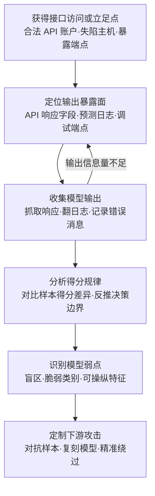

# 发现 AI 模型输出 (AML.T0063)

## 一句话通俗理解

> 考试不及格不可怕，可怕的是成绩单把每道题的扣分明细都写给你看——攻击者专挑日志和 API 响应里那些本不该露面的"打分单"（分类得分、置信度、类别排名），摸清阅卷模型的脾气，下次交卷就专挑软肋下手。

## 难度等级

⭐⭐ **Demonstrated（已演示）**

官方成熟度评定为 Demonstrated——技术可行性已被真实研究证实。本技术在 ATLAS 案例库中关联 **2 个真实案例**，均发生于 2019 年：Skylight Cyber 研究 Cylance AI 恶意软件检测器，找到让其评分系统把恶意文件判向"良性"一侧的通用绕过串（AML.CS0003）；Silent Break Security 研究员利用 ProofPoint 邮件防护系统逐词打分的输出特征，构建复刻模型并构造出得分"漂亮"的恶意邮件，实现无感绕过（AML.CS0008）。手法门槛不高——翻日志、看响应、读错误消息，全是"合法"操作；但情报价值极高：**模型输出是决策边界的采样点**，攒得够多就能反推模型行为，为对抗样本定制、模型复制与精准规避提供导航。更麻烦的是，这类输出"系统运行不需要、终端用户也不该看"，暴露往往长期无人察觉。

## 技术描述

### 通俗解释

传统应用的接口出了问题，漏的顶多是报错堆栈；AI 系统的接口出了问题，漏的可能是模型的"思路"。应用明明只需要一个"是垃圾邮件 / 不是垃圾邮件"的标签，接口却顺手把每个类别的得分、置信度、前三名排名一起塞回来；日志系统为了方便排障，把每次推理的完整打分记录在案；调试端点上了生产忘关，一次 GET 就能看全模型内心。**这些多余输出对攻击者是黄金情报**：得分会告诉他"模型在看哪里""在哪里手抖"，攒够了采样点，绕过甚至复刻模型都只是时间问题。

### 技术原理

依据官方描述：攻击者可能发现**模型输出**（如分类得分）——这些输出的存在并非系统运行所必需，也不打算交付给终端用户使用。模型输出可能出现在**日志**中，也可能被包含在 **API 响应**里。模型输出可能帮助攻击者识别模型弱点并开发攻击。

**输出暴露的典型渠道：**

| 暴露渠道 | 典型形态 | 为何危险 |
|----------|----------|----------|
| 冗余 API 响应字段 | `confidence`、`scores[]`、`logits`、top-k 类别排名、`probabilities`、模型元数据 | 应用只要一个标签，接口却回了整张打分单，为黑盒优化提供精确反馈信号 |
| 调试与诊断端点 | `/debug`、`?verbose=true`、`?explain=`、Swagger 暴露的内部接口 | 本为工程师排障设计，上了生产忘关闭，一次 GET 全览 |
| 预测日志与监控 | 应用日志记录完整输入与全部得分、错误堆栈带出中间结果、APM 追踪每步推理 | 翻到日志约等于透视模型；日志还常经共享存储、日志平台二次扩散 |
| 错误消息与告警文案 | "判定为 SPAM，得分 -42"、拒绝原因附带分数细节 | "拒绝信"写明扣分明细，等于把评分标准逐条告诉攻击者（AML.CS0008 的直接写照） |
| 生成式与智能体特有 | `logprobs` token 对数概率、系统提示词回显、智能体思维链与工具调用被记录 | 生成式系统同样在"打分单"外泄——logprobs 就是 LLM 的置信度 |

**攻击者动作分解：** 定位（找到日志文件与推理端点）→ 收集（抓取 API 响应、翻预测日志、记录错误输出）→ 分析（用得分差异反推决策边界与特征权重）→ 定制（构造对抗样本、复刻模型行为、精准绕过检测）。

**平台覆盖**：Predictive AI / Generative AI / Agentic AI 三类平台全覆盖——分类器会漏分类得分，LLM 会漏 token 概率与提示词，智能体平台会漏中间推理与工具调用记录。

**与相邻 ATLAS 技术的分工**：本技术挖的是模型"说过什么"（输出内容）；AML.T0013 探测模型"能输出什么"（输出空间），AML.T0014 推断模型"属于谁家"（家族），AML.T0007 定位模型"放在哪里"（制品位置）。输出情报的典型下游是 AML.T0043（制作对抗数据）——黑盒对抗优化正是靠置信度反馈导航。

### 用途影响

- **门槛趋零**：不需要漏洞利用——一次正常 API 调用、一次日志读取即可完成收集，行为混入正常流量
- **输出即情报**：每个得分都是模型决策边界上的一个采样点；输入稍作扰动、观察得分变化，就能定位薄弱区域
- **支撑下游攻击**：置信度反馈是对抗样本黑盒优化的"指南针"（CS0003 的绕过串）；得分规律可支撑复刻模型（CS0008 的 copy-cat）
- **暴露无感知**：这些字段"系统不需要、用户不该看"，既不在功能测试范围，也少有针对性告警，泄漏可持续数年
- **防御产品的盲区**：当目标是恶意软件检测器、垃圾邮件过滤器等安全产品时，输出泄露直接翻译成"让攻击者学会绕过你"

## 攻击流程

### 典型攻击流程



**步骤详解：**

1. **获得接口访问或立足点**
   - 通俗描述：先拿到"看成绩单的权限"——哪怕只是最低权限的合法账户。
   - 技术细节：注册即可调用的公开 API、企业内部服务的普通账户、失陷主机上的日志读取权限，都够用。CS0008 中研究员仅凭与 ProofPoint 系统的正常交互就收集到了打分特征。

2. **定位输出暴露面**
   - 通俗描述：看看打分单贴在哪个公告栏上。
   - 技术细节：查 API 文档与响应体找冗余字段（confidence/scores/top-k）；枚举调试端点（/debug、?verbose=true）；定位预测日志、APM 追踪与错误消息中的得分痕迹。

3. **收集模型输出**
   - 通俗描述：把公告栏上的打分单一张张抄下来。
   - 技术细节：批量提交样本并记录每次响应的完整得分；用 grep 从日志文件提取 score/confidence 字段；记录系统拒绝输入时错误消息里的分数细节。

4. **分析得分规律**
   - 通俗描述：抄得多了，就能反推阅卷老师的评分标准。
   - 技术细节：对输入做微小扰动并观察得分变化，定位高敏感特征；统计不同类别样本的得分分布，寻找决策边界的"盲区"——某些特征组合下模型几乎必然误判。

5. **识别弱点并衔接下游**
   - 通俗描述：知道老师在哪类题上眼神不好，就专出这类题。
   - 技术细节：CS0003 用发现的盲区构造出对任意恶意文件生效的通用绕过串（衔接 AML.T0043.003 手工修改）；CS0008 借得分规律复刻模型并优化恶意邮件措辞（衔接 AML.T0043.002 黑盒迁移）。

**与后续战术的衔接：**

- **AI 攻击适配**：输出情报直接喂给对抗数据制作（AML.T0043）——黑盒优化以置信度为反馈信号
- **防御规避**：针对检测类模型的绕过（CS0003）让恶意载荷穿上"良民得分"
- **影响**：欺骗邮件过滤（CS0008）让恶意邮件拿到"优先投递"的分数
- **模型复制**：大量输入-输出对可训练出行为近似的替代模型，进而离线研究攻击

> 关键认知：发现阶段攻击者只做"读响应、翻日志"这类毫不起眼的动作——真正的破坏在后续战术展开，而那时他手里已经握着你模型的"评分标准"。

## 真实案例

> 以下 2 个案例全部源自 MITRE ATLAS 案例库，均直接关联 AML.T0063。

### 案例1：绕过 Cylance AI 恶意软件检测（2019年，AML.CS0003）

- **时间**: 2019年9月（ATLAS 案例记录时间；研究披露于 2019年7月）
- **攻击者**: Skylight Cyber（安全研究员，负责任披露）
- **手法**: 研究者对 CylancePROTECT / Cylance Smart Antivirus 的 AI 恶意软件检测引擎展开研究，通过观察模型对精心构造样本的评分行为，在特征空间中找到了一个"盲区"：把一段特定的通用字符串附加到任意恶意文件末尾，模型就会将其评分推向"良性"区域——这个绕过串对多类恶意软件一律生效。
- **影响**: AI 防线被一段字符串整体击穿；事件促使业界正视 ML 防御产品自身的可绕过性问题，成为"防御产品输出即攻击面"的标志性案例
- **参考链接**: [Skylight Cyber: "Cylance, I Kill You!"](https://skylightcyber.com/2019/07/18/cylance-i-kill-you/)、[Security7: The New Cylance Vulnerability](https://www.security7.net/news/the-new-cylance-vulnerability-what-you-need-to-know)

### 案例2：ProofPoint 邮件防护绕过 / Proof Pudding（2019年，AML.CS0008）

- **时间**: 2019年9月9日
- **攻击者**: Silent Break Security 研究员（安全研究，CVE-2019-20634）
- **手法**: ProofPoint 邮件防护系统对邮件逐词数值打分——邮件中每个词都基于多个变量被打分，总分过低即被输出错误提示、判为 SPAM。研究员利用系统给出的打分反馈构建了一个行为近似的"复刻"分类模型，在复刻模型上反复优化措辞，最终构造出在真实系统上同样拿到理想得分的恶意邮件，绕过检测。
- **影响**: 完整演示了"输出反馈 → 复刻模型 → 定制绕过"的攻击链；概念验证以 Proof Pudding 开源，漏洞收录为 CVE-2019-20634
- **参考链接**: [NVD: CVE-2019-20634](https://nvd.nist.gov/vuln/detail/CVE-2019-20634)、[DerbyCon 2019 演讲幻灯](https://github.com/moohax/Talks/blob/master/slides/DerbyCon19.pdf)、[Proof-Pudding 概念验证 (GitHub)](https://github.com/moohax/Proof-Pudding)、[DerbyCon 演讲视频](https://www.youtube.com/watch?v=CsvkYoxtexQ&ab-channel=AdrianCrenshaw)

## 红队视角

> ⚠️ **免责声明**：以下内容仅用于合法授权的安全测试与教育目的。未经授权对他人系统进行探测或绕过属违法行为。

### 实战技巧

1. **把"输出审计"做进 ML 系统测试的第一小时**
   授权测试拿到接口后先别急着找注入点——curl 一次完整响应，看看有哪些字段是前端根本不用的：confidence、scores、top_k、explain。一份"响应里多出来的字段清单"往往比任何漏洞清单都更能说明 ML 系统的暴露程度。

2. **得分反馈循环是黑盒攻击的引擎**
   只要响应里带连续得分（而非只有标签），就可以做"扰动-观察"循环：固定其余特征、微调单一变量、记录得分漂移，几千次查询足以定位决策边界的薄弱区域。报告里画一张"得分-扰动曲线"，防御方会立刻明白暴露置信度的代价。

3. **AI 资产专项翻找清单**
   预测日志与应用日志中的 score/confidence/predict 字段；APM 系统里记录的每步推理；错误响应文案中的分数细节；忘关的 debug/verbose 参数；LLM 服务中的 logprobs 开关。凡是有"得分"字样的地方，都是模型行为的采样点。

### 常用工具

| 工具名称 | 用途 | 平台 |
|----------|------|------|
| Burp Suite / OWASP ZAP | 拦截与检视 API 响应，标记冗余输出字段 | 跨平台 |
| curl / httpie | 直接探测 debug/verbose/explain 类参数 | 跨平台 |
| jq + grep / rg | 从日志文件批量提取 score/confidence 字段 | 跨平台 |
| Python（pandas/numpy） | 得分分布统计与"扰动-漂移"分析 | Python |
| Foolbox / ART | 黑盒对抗样本优化（利用置信度反馈） | Python |

### 注意事项

- **只读不破坏**：输出发现类测试应停留在"读取与分析"；构造绕过样本须经委托方书面同意并在隔离环境验证
- **发现即报告**：暴露的输出字段、可访问的调试端点、含得分的日志路径都应进入报告并推动收敛
- **量化情报价值**：按"输出字段 → 可推断的模型行为 → 可支撑的下游攻击"三段式呈现，让防御方理解"多一个字段就多一分攻击定制空间"

## 蓝队视角

### 检测要点

1. **生产端点上的调试参数**
   - 日志来源：API 网关、WAF、负载均衡访问日志
   - 关注字段：请求路径与查询参数
   - 异常特征：`/predict`、`/infer`、`/v1/*` 类推理端点出现 `debug`、`verbose`、`explain`、`include=scores`、`logprobs`、`top_k` 参数

2. **高频同源探测查询**
   - 日志来源：模型服务访问日志、API 网关
   - 异常特征：单一密钥短时间大量调用且输入高度相似（扰动式探测的指纹）；请求量平稳但输入多样性远低于正常用户画像

3. **日志与监控数据的异常读取**
   - 日志来源：文件审计（Sysmon/auditd）、日志平台审计日志
   - 异常特征：非运维角色读取预测日志目录；一次性打包下载历史预测记录

### 监控建议

- 在网关层完整记录推理端点的查询参数（含 GET 参数），对携带调试类参数的请求直接告警——正常业务不会传这些参数
- 为模型 API 建立调用基线：QPS、输入长度分布、输入相似度、时间分布；黑盒优化的"批量同源、输入聚集"特征非常明显
- 把预测日志的读取行为纳入审计；预测日志本身做最小化（默认只记必要字段）
- LLM 场景对 `logprobs` 类参数的请求单独记录——多数业务用不到它，用到它的多半是研究（或攻击）行为

## 检测建议

### 网络层检测

**检测方法：** 识别推理端点上的调试参数探测与得分批量抓取。

- 访问日志中推理端点（/predict、/infer、/v1/completions 等）出现 `debug/verbose/explain/include=scores/logprobs` 参数
- 单一来源对模型端点的请求速率显著偏离基线，且请求间输入差异极小（扰动探测特征）
- 错误响应被高频触发后仍持续重试（在采集错误消息中的得分细节）

### 主机层检测

**检测方法：** 监控预测日志与监控数据的异常访问。

- 非预期进程/账户读取预测日志目录、APM 数据目录
- 短时间内的日志打包、归档下载行为
- 开发调试类工具在生产主机上访问模型服务端口

### 应用层检测（AI 遥测）

**检测方法：** 利用模型服务与 API 网关的审计能力。

- 推理服务的输入相似度聚类：同一密钥的请求在特征空间高度聚集，即为黑盒优化指纹
- 日志平台中对"得分"字段的结构化检索（针对 score 字段的查询语法本身值得记录）
- 模型服务的响应体大小异常（开启 verbose/全量字段的响应远大于正常标签响应）

**程序化检测思路（无需 EDR 侧改造）：**

用"**调试参数请求 + 高频同源调用**"双特征关联替代单点告警：先在网关层标记携带调试类参数的请求，再关联同一密钥 1 小时内的调用次数与输入相似度——两段都命中才升级。单一调试参数可能只是工程师手滑，叠加高频同源才构成探测画像。

### Sigma 规则思路示例

```yaml
title: 模型推理端点的调试参数探测（模型输出发现特征）
status: experimental
description: 检测对 AI 推理端点携带 debug/verbose/scores/logprobs 类参数的请求，
    可能为 AML.T0063 模型输出发现行为
logsource:
    category: proxy
detection:
    selection_endpoint:
        cs-uri|contains:
            - '/predict'
            - '/infer'
            - '/v1/completions'
            - '/v1/classify'
    selection_params:
        cs-uri|contains:
            - 'debug=true'
            - 'verbose=true'
            - 'explain='
            - 'include=scores'
            - 'logprobs='
            - 'top_k='
    condition: selection_endpoint and selection_params
    timeframe: 5m
level: medium
tags:
    - atlas.aml_t0063
```

## 缓解措施

### 优先级1：关键措施

**输出最小化与混淆（AML.M0002）**：推理端点只返回应用所需的最小字段集——需要标签就只给标签；确需置信度时降低精度（如 0.98 → "高"），砍掉 logits、类别排名、嵌入向量与模型元数据；生产环境强制关闭 debug/verbose/explain 类参数与诊断端点。原则：**用户界面用不到的字段，API 响应里就不该出现**。

### 优先级2：重要措施

**生产环境访问控制与查询审计（AML.M0019）**：模型 API 强制身份认证与限速；对生产模型的每次查询留痕并监控是否偏离使用策略；对单密钥的高频、低多样性调用建立告警——这是发现"得分抓取"行为的主战场。同时治理日志：预测日志默认不记录完整得分，确需记录时单独限权与加密。

### 优先级3：建议措施

- **敏感信息加密（AML.M0012）**：对必须保留的预测日志与监控数据加密存储，控制失陷主机上的二次泄露
- **云端服务化部署（AML.M0017）**：模型尽量以云端 API 形式服务而非下发到边缘设备，收窄攻击者可触达的输出面与预处理逻辑
- **错误消息脱敏**：面向用户的拒绝文案不带分数细节——"判定为垃圾邮件"足够，"得分 -42"是给攻击者的礼物

### MITRE ATLAS 缓解措施映射

官方 ATLAS 数据对本技术给出 4 条缓解措施映射：

| 缓解措施 ID | 名称 | 官方要点 | 覆盖生命周期 |
|-------------|------|----------|--------------|
| AML.M0002 | Predictive AI 输出混淆 | 限制推理端点返回信息的保真度与数量：隐去或降精度置信度、logits、类别排名、标签、嵌入与模型元数据 | AI 模型评估 / 部署 |
| AML.M0012 | 加密敏感信息 | 加密 AI 模型等敏感数据，防攻击者直接访问 | 数据准备 / AI 模型工程 / 部署 |
| AML.M0017 | AI 模型分发方式 | 优先云端服务而非边缘部署，降低攻击者对模型的可达性，防灰盒攻击 | 部署 |
| AML.M0019 | 生产环境 AI 模型与数据访问控制 | 访问前验证身份；API 端点强制认证；监控生产模型查询、防止滥用 | 部署 / 监控与维护 |

## 关联 ATT&CK 技术

MITRE ATLAS 官方数据中该技术**没有正式的 ATT&CK 技术映射**（attack_reference 为空）。从攻击原理上看，"翻日志找输出"与传统发现的日志翻找一脉相承，主题上最接近以下企业版技术：

- [T1654 日志枚举](../../enterprise/10-Discovery/T1654-Log-Enumeration.md)——翻找系统与应用日志寻找信息，本技术日志挖掘向量的直接原型
- [T1083 文件与目录发现](../../enterprise/10-Discovery/T1083-File-and-Directory-Discovery.md)——定位日志文件与数据文件的前置发现动作

| 维度 | ATT&CK T1654 / T1083 | ATLAS AML.T0063 |
|------|---------------------|-----------------|
| 翻找对象 | 系统日志、文件与目录 | 模型输出（分类得分、置信度、排名、logprobs） |
| 暴露渠道 | 主机上的日志与文件 | 日志 + API 响应 + 调试端点（后两者为 AI 原生，无直接 ATT&CK 对应） |
| 情报用途 | 账户、配置、网络信息 | 模型决策边界采样，支撑对抗样本与模型复制 |
| 检测难点 | 与正常运维混杂 | 与正常 API 调用混杂，且字段"看似无害" |

**边界说明**：本技术只挖模型"说过什么"；探测模型输出空间与本体是 AML.T0013，推断模型家族是 AML.T0014，定位模型制品是 AML.T0007。挖到的输出情报最终流向 AML.T0043（制作对抗数据）等攻击适配技术。

**一句话总结**：AML.T0063 是"翻日志"传统手法在 AI 时代的升级版——多了一个 API 响应与调试端点的新公告栏，而且贴出来的不是账单，是阅卷标准。

## 动手实验

> ⚠️ **重要提示**：所有实验仅在本地隔离环境与自有模型上进行，不接触任何生产系统与真实检测产品。

### 实验环境准备

| 环境组件 | 用途 | 获取方式 |
|----------|------|----------|
| Python + Flask/FastAPI | 搭建本地演示 API | pip 安装 |
| scikit-learn | 训练简单文本/图像分类器 | pip 安装 |
| Burp Suite 社区版 | 检视 API 响应 | 官方网站 |
| 本地日志文件 | 模拟预测日志 | 脚本生成 |

### 实验1（初级）：看看响应里"多出来"的字段

**实验目标：** 体验"应用只要一个标签，接口却回了整张打分单"。

**实验步骤：**
1. 用 scikit-learn 训练一个简单分类器并包装成 API：正常版只返回 `label`，"顺手版"返回 `label + confidence + scores + top-3`
2. 分别用 curl 调用两个版本，对比响应体大小与字段
3. 数一数：如果前端只用 `label`，"顺手版"多暴露了几个信息维度？

**预期结果：** 直观理解"冗余输出字段"的含义，以及为什么 M0002 要求"限制返回字段"。

### 实验2（中级）：日志泄露审计

**实验目标：** 体验攻击者视角的"一遍 grep 全收"。

**实验步骤：**
1. 让实验1 的 API 把每次请求的完整输入与得分写进日志（很多框架默认就这么做）
2. 用 `grep -E "score|confidence" app.log` 提取得分记录
3. 基于日志统计各类别样本的得分分布，看看能否找出"容易误判"的类别

**预期结果：** 体会"翻到日志约等于透视模型"；据此为自家日志写一份脱敏与最小化建议清单。

### 实验3（高级）：复现"得分反馈"攻击循环

**实验目标：** 在自己的模型上复刻 Proof Pudding 的核心思路。

**实验步骤：**
1. 把实验1 的"顺手版" API 当作黑盒：只允许"提交输入 → 读取得分"，不允许访问模型文件
2. 固定其余特征、逐个扰动单一特征，记录得分变化，绘制"得分-扰动曲线"
3. 根据曲线定位得分最敏感的特征方向，构造能让得分跨过决策边界的输入

**预期结果：** 理解"置信度就是黑盒攻击的指南针"——这正是 CS0008 复刻与绕过的底层机制，也是输出混淆（M0002）被列为关键缓解的原因。

## 术语解释

| 术语 | 英文原名 | 通俗解释 |
|------|----------|----------|
| 模型输出 | Model Outputs | 模型给出的任何预测结果——标签、得分、概率、排名或生成的文本 |
| 分类得分 | Class Score | 分类器给每个候选类别打的数值分，是决策的原始依据 |
| 置信度 | Confidence Score | 模型对自己预测的"把握程度"；对攻击者而言是灵敏度极高的反馈信号 |
| logits | Logits | 归一化前的原始输出值，信息量比置信度更大，泄露代价更高 |
| top-k 排名 | Top-k Ranking | 概率最高的 k 个类别及排序，一次暴露模型对整个类别空间的判断 |
| 日志挖掘 | Log Mining | 系统性翻找日志以提取情报；预测日志是模型行为的"行车记录仪" |
| API 响应 | API Response | 调用接口后服务端返回的数据包；冗余字段是输出泄露的主通道 |
| 调试端点 | Debug Endpoint | 为排障预留的诊断接口，常在生产环境忘关 |
| 错误消息泄露 | Error Message Leakage | 拒绝文案中携带内部细节（如分数），把评分标准告诉攻击者 |
| 黑盒优化 | Black-Box Optimization | 只靠"提交输入-观察输出"的反馈逼近目标，无需模型内部结构 |
| 对抗样本 | Adversarial Example | 人为微扰后让模型产生误判的输入 |
| 模型复制 | Model Replication | 通过大量输入-输出对训练出行为近似的替代模型 |
| 输出混淆 | Output Obfuscation | 降低返回信息的保真度与数量（AML.M0002），本技术最直接的缓解 |
| logprobs | Log Probabilities | LLM 对每个 token 的对数概率，生成式模型的"置信度" |

## 参考资料

### 📚 官方文档

- [MITRE ATLAS - Discover AI Model Outputs (AML.T0063)](https://atlas.mitre.org/techniques/AML.T0063/) - 官方技术页面
- [MITRE ATLAS 矩阵](https://atlas.mitre.org/matrices/ATLAS/)
- [MITRE ATLAS Data (GitHub)](https://github.com/mitre-atlas/atlas-data)

### 📰 案例报告（真实攻击与安全研究）

- [Skylight Cyber: "Cylance, I Kill You!"](https://skylightcyber.com/2019/07/18/cylance-i-kill-you/) - Cylance AI 检测通用绕过研究（AML.CS0003）
- [Security7: The New Cylance Vulnerability](https://www.security7.net/news/the-new-cylance-vulnerability-what-you-need-to-know) - Cylance 漏洞事件后续与官方回应（AML.CS0003）
- [NVD: CVE-2019-20634](https://nvd.nist.gov/vuln/detail/CVE-2019-20634) - Proof Pudding 漏洞收录（AML.CS0008）
- [DerbyCon 2019: "42" 演讲幻灯](https://github.com/moohax/Talks/blob/master/slides/DerbyCon19.pdf) - Proof Pudding 研究演讲（AML.CS0008）
- [Proof-Pudding 概念验证 (GitHub)](https://github.com/moohax/Proof-Pudding) - 复刻与绕过的完整实现（AML.CS0008）
- [DerbyCon 演讲视频](https://www.youtube.com/watch?v=CsvkYoxtexQ&ab-channel=AdrianCrenshaw) - 研究者现场讲解（AML.CS0008）

### 🔧 工具与资源

- [Burp Suite](https://portswigger.net/burp) - API 响应检视与冗余字段审计
- [OWASP ZAP](https://www.zaproxy.org/) - 开源代理审计方案
- [Foolbox](https://github.com/bethgelab/foolbox) - 对抗样本工具箱（含黑盒攻击）
- [Adversarial Robustness Toolbox (ART)](https://github.com/Trusted-AI/adversarial-robustness-toolbox) - 对抗攻防工具库
- [OWASP Top 10 for LLM Applications](https://owasp.org/www-project-top-10-for-large-language-model-applications/) - LLM 应用十大风险（含敏感信息泄露）

### 🔗 关联阅读

- [发现战术 (AML.TA0008)](./README.md) - 本技术所属战术的概览页
- [日志枚举 (T1654)](../../enterprise/10-Discovery/T1654-Log-Enumeration.md) - 日志挖掘向量的 ATT&CK 原版技术完整中文文档
- [文件与目录发现 (T1083)](../../enterprise/10-Discovery/T1083-File-and-Directory-Discovery.md) - 定位日志与数据文件的前置发现技术
- [发现战术 (TA0007)](../../enterprise/10-Discovery/README.md) - ATT&CK 传统发现战术概览，与本战术对照阅读

---

> **版本**: ATLAS 2026.09 | **更新**: 2026-10-22 | **模板**: ATLAS 技术文档 v1.0
