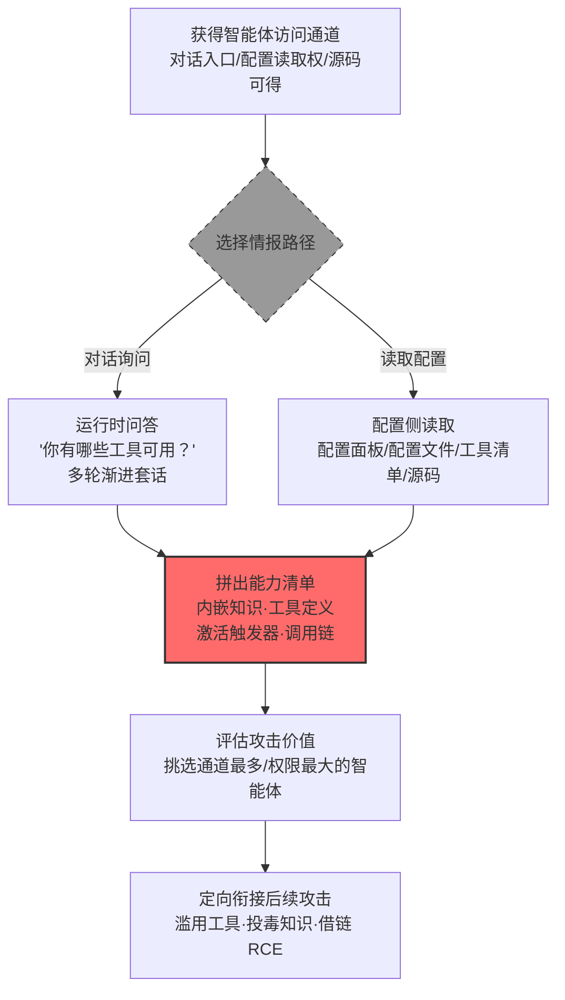

# 发现 AI 智能体配置 (AML.T0084)

## 一句话通俗理解

> 公司里的"数字员工"会什么手艺、手里管着哪些钥匙（工具）、看到什么活儿就自动开工（触发器）？攻击者要么直接问它本人——"你有哪些工具可以用？"，要么翻它的岗位说明书——配置面板和配置文件里写得明明白白。

## 难度等级

⭐⭐ **Demonstrated（已演示）**

官方成熟度评定为 Demonstrated——该技术已在多项公开安全研究中被完整演示：Zenity 通过提示词注入"两步走"，先摸清 Copilot Studio 客服智能体的知识源与工具，再借其邮件工具把客户数据整体渗出（AML.CS0037）；SafeBreach 测绘出 Gemini 可触达的 Workspace 服务与设备能力面（AML.CS0063）；微软团队通过分析 Claude Code Action 代码库与 SDK 混淆产物还原其工具执行机制（AML.CS0067）；研究人员系统性抽取 11 个 LLM 框架的调用链并找出 20 个 RCE（AML.CS0052）。实施门槛极低：攻击者只需能与目标智能体对话，一句"你有哪些工具可用？"就可能让智能体自己交出能力清单。真正的对抗在于一个结构性矛盾——为了正常工作，智能体必须"知道"自己有什么工具、什么知识、被什么唤醒，而这份信息天然存在被套取的可能。

## 技术描述

### 通俗解释

每一个 AI 智能体（AI Agent）上线前都被开发者"武装"过：**智能体配置**写明它能调用哪些工具与服务、接入了哪些数据源、什么事件会把它唤醒。这份配置是智能体的"岗位说明书"，也是攻击者眼里的"兵力部署图"——想知道这个数字员工能干什么、能碰到什么，看它一份配置就够了。

攻击者发现两条路都通向这份图纸：**其一是问它本人**——直接向智能体提问"你可以访问哪些工具？"，很多智能体乐于介绍自己的能力；**其二是翻它的档案**——直接访问智能体的配置面板、配置文件或工具清单（manifest），把能力清单原样抄走。情报到手后，攻击者就能判断哪些智能体"最值得打"：能发邮件的可以当渗漏通道，接着 SharePoint 的可以当数据跳板，挂着敏感知识库的本身就是泄露源。

关键机理在于：**智能体的可用性与可探测性是同一枚硬币的两面**。工具描述、知识源范围、触发条件必须以某种形式存在于配置乃至上下文中，模型才能正确使用它们——攻击者套取的正是这份"为了让它工作而不得不存在"的信息。这与 AML.T0069（发现 LLM 系统信息）针对系统提示词不同：本技术的目标从"它被如何调教"扩展到"它整个能力面的部署图"。

### 技术原理

依据官方描述，攻击者试图发现受害者系统上 AI 智能体的配置信息，其中包括智能体有权访问的工具或服务。获取途径有二：**直接访问智能体的配置面板或配置文件**，或**通过向智能体提问（如"你可以访问哪些工具？"）获取配置细节**。发现的情报被用于协助攻击者选定目标。

**两条攻击路径全景**：

| 路径 | 手段 | 典型目标 | 特点 |
|------|------|---------|------|
| 运行时问答 | 直接询问、提示词诱导、多轮渐进套话 | 工具清单、知识源范围、触发条件 | 零权限要求，与正常对话难以区分 |
| 配置侧读取 | 翻配置面板、配置文件、工具清单、源码与 SDK | 完整工具定义、调用链、激活触发器 | 情报更完整，需要相应访问权或代码可得 |

**四类目标信息**（对应四个子技术）：

| 信息类别 | 对应子技术 | 具体内容 | 后续用途 |
|---------|-----------|---------|---------|
| 内嵌知识 | [AML.T0084.000](AML.T0084/AML.T0084.000-Embedded-Knowledge.md) | 智能体接入的数据源与知识：知识产权、客户数据、内部策略乃至凭证 | 判断智能体角色、定位高价值泄露目标 |
| 工具定义 | [AML.T0084.001](AML.T0084/AML.T0084.001-Tool-Definitions.md) | 可调用的工具及参数：OneDrive/SharePoint 访问、邮件发送等 | 识别可执行动作与渗漏路径，挑选"最值钱"的智能体 |
| 激活触发器 | [AML.T0084.002](AML.T0084/AML.T0084.002-Activation-Triggers.md) | 唤醒智能体并触发后续动作的条件：关键词、来信、新文档、工作流 | 从外部唤醒并操纵智能体执行非预期动作 |
| 调用链 | [AML.T0084.003](AML.T0084/AML.T0084.003-Call-Chains.md) | 工具间的串联调用关系：用户输入/LLM 输出直连 exec、eval、os.popen 等执行汇 | 定位 RCE 等漏洞，配合提示词注入利用 |

三点值得特别注意：

- **问答路径零门槛**：官方描述明确举例"What tools do you have access to?"式的直接提问——多数智能体被设计为乐于解释自身能力，防护方很难区分"能力询问"与"正常上手咨询"；
- **配置路径情报最全**：工具定义、触发器与调用链在配置文件、清单与源码中一览无余（AML.CS0067 的代码分析路径、AML.CS0052 的框架分析路径）；
- **情报服务于选定目标**：官方明确指出发现的信息"用于协助攻击者选定目标"——摸清能力清单后，攻击者挑选的是提供最大价值或攻击机会的智能体。

**平台覆盖**：仅 Agentic AI（智能体 AI）——本技术以"绑定工具与服务的智能体"为目标，纯粹的预测模型或无工具的 LLM 应用不在攻击面内。

### 用途影响

- **绘制完整能力地图，选定高价值目标**：掌握工具、知识、触发器、调用链四类信息，攻击者即可在企业的一群智能体中挑出"权限最大、通道最多"的那个下手（官方描述的 targeting 用途）；
- **为工具武器化提供施工图**：知道智能体能发邮件、能删日程、能控智能家居、能读 CRM，就能借智能体之手执行这些动作（衔接 AML.T0053 智能体工具调用，CS0037/CS0063 均为实证）；
- **为知识投毒指路**：摸清智能体"知道什么"，才知道往哪个数据源投毒能影响它的输出；
- **直通 RCE**：抽取调用链即可定位"用户输入/LLM 输出 → 执行汇"的危险组合，配合提示词注入实现远程代码执行（CS0052 的 20 个 RCE）。

## 攻击流程

### 典型攻击流程



**步骤详解：**

1. **获得智能体访问通道**
   - 通俗描述：先得能跟这个智能体说上话，或者摸到它的档案柜。
   - 技术细节：对话入口（面向客户的智能体天然开放）、企业内部已入侵环境中的智能体、可访问的配置面板/配置文件，乃至公开仓库中的智能体源码与 SDK（AML.CS0067）都算通道。

2. **选择情报路径**
   - 通俗描述：问它本人，还是翻它的说明书。
   - 技术细节：有对话通道就走运行时问答——直接提问、提示词诱导、多轮渐进；有配置访问权或源码可得就走配置侧读取——配置面板、配置文件、工具清单、框架代码（AML.CS0052 对 11 个框架的系统性分析）。

3. **拼出能力清单**
   - 通俗描述：兵力部署图到手。
   - 技术细节：把套出/读出的信息按四类归位——它知道什么（内嵌知识）、能干什么（工具定义）、何时自动干活（激活触发器）、工具怎么串联（调用链）。

4. **评估攻击价值**
   - 通俗描述：挑最肥的目标。
   - 技术细节：对照官方描述的 targeting 用途——能发邮件的优先（渗漏通道）、接着敏感数据源的优先（泄露源）、调用链直通执行汇的优先（RCE 跳板）。

5. **定向衔接后续攻击**
   - 通俗描述：按图纸施工。
   - 技术细节：构造提示词注入驱动智能体调用其工具（AML.T0051/AML.T0053）、向已定位的知识源投毒、或沿危险调用链触发代码执行——配置发现到此完成使命，把接力棒交给后续战术。

**与后续战术的衔接：**

- **执行**：危险调用链配合提示词注入直通远程代码执行（CS0052）
- **收集 / 数据渗漏**：工具定义暴露的邮件、网盘、日历通道即现成的窃取与外传路径（CS0037、CS0063）
- **持久化 / 权限提升**：激活触发器让攻击者能从智能体环境之外反复唤醒并操纵它（CS0067）

> 关键差异：传统发现技术摸的是操作系统配置，本技术摸的是"数字员工"的岗位说明书——而且说明书的主人往往亲口就把内容念给你听。

## 真实案例

> 以下 4 个案例全部来自 MITRE ATLAS 官方案例库，均直接关联本技术（其中 AML.CS0037 命中子技术 AML.T0084.000/.001/.002，AML.CS0063 命中父技术 AML.T0084，AML.CS0067 命中子技术 AML.T0084.001/.002，AML.CS0052 命中子技术 AML.T0084.003）。

### 案例1：LLMSmith——从框架配置中抽取调用链，批量定位 RCE（2025年2月，AML.CS0052）

- **时间**: 2025年2月27日
- **攻击者**: 中国科学院大学、山东大学与新南威尔士大学研究人员（安全研究）
- **手法**: 研究人员系统性地分析了 LangChain、LlamaIndex、Pandas-ai、Langflow、Auto-GPT、MetaGPT 等 11 个 LLM 集成框架，从中抽取智能体应用的调用链（AML.T0084.003），定位将用户输入或 LLM 输出直接连到 exec、eval、os.popen 等执行汇的危险组合；随后在公网上扫描使用这些框架部署的应用，验证可通过提示词注入触发其中的 20 个 RCE 漏洞。
- **影响**: 证明"调用链发现"可以做成流水线——先把框架的链路摸清，再全网寻找配置了这些链路的应用作为目标，这正是官方描述中"先识别易受攻击的调用链，再扫描使用这些链路的应用"的实战化演示
- **参考链接**: [Demystifying RCE Vulnerabilities in LLM-Integrated Apps (arXiv)](https://arxiv.org/abs/2309.02926)、[LLMSmith 网站](https://sites.google.com/view/llmsmith)

### 案例2：Copilot Studio 客服智能体——先测绘、后渗漏的两步走（2025年6月，AML.CS0037）

- **时间**: 2025年6月
- **攻击者**: Zenity 安全研究团队（红队演练）
- **手法**: 研究者先锁定一个由 AI 智能体管理的客服邮箱，随后通过提示词注入让智能体交代自己的知识源与工具（AML.T0084.000/.001/.002）——摸清它接着 RAG 数据库与 CRM、并且会发邮件之后，构造提示词让智能体从 RAG 与 CRM 中取出客户私有数据，再通过其邮件工具把数据整体渗出。
- **影响**: "发现阶段"与"渗漏阶段"被拆成前后两步公开演示——不先摸清智能体的知识与工具，后续的数据渗漏载荷根本无从构造；微软快速确认并修复，但研究者指出其他提示词仍可能有效
- **参考链接**: [Zenity: Discovery Phase of AI Agents in Copilot Studio](https://labs.zenity.io/p/a-copilot-studio-story-discovery-phase-in-ai-agents-f917)、[Zenity: When AIjacking Leads to Full Data Exfiltration](https://labs.zenity.io/p/a-copilot-studio-story-2-when-aijacking-leads-to-full-data-exfiltration-bc4a)

### 案例3：Gemini 日历邀请攻击——摸清智能体的服务触达面（2025年8月，AML.CS0063）

- **时间**: 2025年8月6日
- **攻击者**: SafeBreach 研究团队（安全演示）
- **手法**: 研究者演示投毒的日历邀请、邮件与共享文件被 Gemini 助手检索后，可间接注入指令并操纵其行为。攻击的前提是摸清 Gemini 的能力面（AML.T0084）：网页版可触达 Workspace 服务（日历、邮件），Android 版还暴露设备与智能家居能力——研究者的攻击链逐一利用了这些能力：删除/创建日历事件、控制 Google Home 设备（窗户、锅炉、灯具）、拉起 Zoom 并向攻击者会议推流、把日历与邮件数据编码进攻击者 URL 外传。
- **影响**: 攻击面清单本身就是武器——知道智能体"够得着"日历、邮件、智能家居、视频会议，才能逐一设计滥用路径；同一注入链因平台能力不同而产生不同的影响
- **参考链接**: [SafeBreach: Invitation Is All You Need: Hacking Gemini](https://www.safebreach.com/blog/invitation-is-all-you-need-hacking-gemini/)

### 案例4：Claude Code GitHub Action——从代码与 SDK 中还原工具执行机制（2026年6月，AML.CS0067）

- **时间**: 2026年6月5日
- **攻击者**: 微软 Defender 安全研究团队（安全研究）
- **手法**: 研究者分析 Claude Code Action 的代码库与混淆过的 Claude Agent SDK，还原智能体工具如何执行、GitHub 事件如何向智能体供给内容（AML.T0084.001/.002）——属于典型的"配置侧读取"路径。据此构造伪装成合规审查的提示词，诱导 Claude 用 Read 工具读取 `/proc/self/environ`，绕过 Bubblewrap 沙箱边界拿到含 `ANTHROPIC_API_KEY` 的进程环境；剥掉 `sk-ant-` 前缀后即可绕过模型拒绝行为与 GitHub 密钥检测。
- **影响**: CI/CD 工作流密钥暴露；证明智能体的工具执行机制、输入供给路径一旦被摸清（哪怕通过逆向混淆 SDK），其权限边界内的每个通道都可能变成窃取通道
- **参考链接**: [Microsoft: Securing CI/CD in an agentic world](https://www.microsoft.com/en-us/security/blog/2026/06/05/securing-ci-cd-in-agentic-world-claude-code-github-action-case/)

## 红队视角

> ⚠️ **免责声明**：以下内容仅用于合法授权的安全测试与教育目的。未经授权对他人系统、账户或第三方 AI 服务进行测试是违法行为。

### 实战技巧

1. **能力询问矩阵**
   在授权测试中把提问组织成递进矩阵：开放式（"你能做什么？"）→ 工具层（"你有哪些工具？各需要什么参数？"）→ 数据层（"你连了哪些知识库/数据源？"）→ 触发层（"什么情况下你会自动开始工作？"）。记录每层的泄露程度并量化打分——报告应呈现"能力清单的可获取性"，而非真的利用。

2. **配置面板与清单审计**
   盘点目标组织的智能体平台：配置面板（如 Copilot Studio 的智能体设置页）、部署仓库中的工具清单与配置文件、公开仓库中的智能体源码与 SDK。工具定义、触发器与调用链在配置层一览无余（对照 CS0067、CS0052 的路径）。

3. **触发器测绘**
   逐一验证哪些事件会唤醒智能体：来信、新文档、消息、工作流事件。触发器清单即"外部操纵面"——每个可从外部触发的入口都要在报告中标注。

4. **调用链汇点扫描**
   对自有智能体框架做静态分析，定位"用户输入/LLM 输出 → exec/eval/os.popen"式直连；用无害载荷验证链路是否真的可走通，绝不越界执行。

### 常用工具

| 工具名称 | 用途 | 平台 |
|----------|------|------|
| 开源智能体框架（LangChain/Langflow/MetaGPT 等） | 搭建可控实验环境，复现工具定义与触发器场景 | 跨平台 |
| 代码审计工具（semgrep 等） | 扫描智能体源码中的调用链与执行汇 | 跨平台 |
| 提示词测试框架（promptfoo 等） | 批量管理能力询问变体并统计泄露率 | 跨平台 |
| 智能体平台管理台（Copilot Studio 等） | 在授权环境下审计配置面板暴露面 | 云端 |

### 注意事项

- **只在自有账号与授权环境演练**：向他人的智能体套话或翻其配置超出任何授权范围
- 评估对象聚焦"组织能否发现能力枚举行为"，发现的每个泄露点附修复建议
- 调用链验证使用无害载荷（如 echo 标记串），验证完立即停止

## 蓝队视角

### 检测要点

1. **提示词层：能力枚举提问识别**
   - 日志来源：智能体平台服务端日志、API 网关
   - 关注字段：用户提示词全文、会话 ID
   - 异常特征："你有哪些工具/你能用什么工具/list your tools"类模式、按参数细节追问工具、系统性询问数据源与触发条件的递进链

2. **行为层：探测链关联**
   - 日志来源：会话审计日志
   - 关注字段：单账号提问序列、会话密度
   - 异常特征：单会话内"能力询问 → 工具参数追问 → 数据源确认"的递进；只问不用的纯探测会话；对照正常用户基线的系统性偏移

3. **配置层：面板与文件访问审计**
   - 日志来源：智能体平台管理审计、文件审计
   - 关注字段：配置面板访问记录、配置文件读取行为
   - 异常特征：非管理员角色访问配置面板、非部署时段读取工具清单、对智能体源码仓库的异常克隆

### 监控建议

- **部署 AI 蜜罐（AML.M0039）**：在真实智能体旁放置诱饵智能体——正常用户与工作流没有理由与其交互，任何能力枚举行为都是高置信度告警
- **建立能力询问模式库**：随新披露同步维护，正则 + 意图分类器双轨识别
- **配置面板最小暴露**：管理台强制认证与 RBAC，禁止配置接口暴露公网
- **会话级关联告警**：把"能力枚举提问"与"随后的工具滥用尝试"关联为事件链，避免碎片化告警被淹没

## 检测建议

### 应用层检测（AI 遥测）

**检测方法：** 在智能体平台层同时监控输入与输出。

- 输入侧：用户提示词命中能力枚举模式库（工具/知识源/触发条件三类关键词），高频探测触发频次告警
- 输出侧：响应中出现结构化工具清单、内部端点、数据源名称等超出正常对话需要的配置细节
- 会话侧：识别"能力询问 + 参数追问 + 数据源确认"的组合模式，命中即升级人工审查

### 网络层检测

**检测方法：** 监控对智能体平台管理面的访问。

- 对配置面板/管理 API 的非管理员访问、来自异常来源的批量拉取
- 单一来源对智能体服务端点的异常高频、高重复度提问

### 主机层检测

**检测方法：** 覆盖配置文件这条读取路径。

- 文件审计：对智能体配置文件、工具清单的异常读取（非服务账号、非部署时段）
- 仓库审计：对含智能体定义的代码仓库的异常克隆与下载（对照 CS0067 的源码分析路径）

### 检测规则思路示例

```yaml
title: AI 智能体能力枚举提问
status: experimental
description: 检测智能体平台日志中的工具与知识源枚举提问，
    可能预示 AI 智能体配置发现行为（AML.T0084 / AML.T0084.001）
logsource:
    category: application
    product: ai_agent_platform
detection:
    selection:
        user_prompt|re: '(?i)(what (tools|functions|capabilities) do you have|list your (tools|knowledge sources)|你(有|能使用|能调用)哪些?工具|列出你的(工具|数据源|知识库)|你可以访问什么)'
    condition: selection
    timeframe: 5m
falsepositives:
    - 新用户了解智能体功能的正常询问
    - 管理员按流程执行的验收测试
level: medium
tags:
    - atlas.aml_t0084
```

## 缓解措施

> **映射说明**：截至 ATLAS 2026.09 数据版，MITRE ATLAS 官方数据为 AML.T0084 映射了 2 项官方缓解措施（AML.M0000 / AML.M0039；三个子技术 AML.T0084.001/.002/.003 亦被 AML.M0000 覆盖）。以下按防御优先级组织，官方映射在表格中如实标注。

### 优先级1：关键措施

**AML.M0039 AI 蜜罐（AI Honeypots，官方映射）**

部署受监控的诱饵 AI 服务、智能体、凭证或资源——它们外观酷似真实资产，但不承担任何业务职能，因此任何与其交互都是高置信度的侦察/发现指标。把诱饵智能体与真实智能体并排部署：攻击者测绘环境时往往"真假一起摸"，诱饵捕获的提问内容、探测手法可直接转化为威胁情报；对攻击者而言，蜜罐还会污染其辛苦拼出的能力地图。

### 优先级2：重要措施

**AML.M0000 限制公开技术信息发布（官方映射）**

限制组织产品与服务中 AI 技术栈的公开信息。智能体用什么框架、配了什么工具、挂在哪个平台，这些公开信息越少，攻击者无需接触目标就能预制的"能力地图"就越粗略——LLMSmith 正是先研究框架文档再全网找目标的，公开信息的收敛直接抬高其成本。

### 优先级3：建议措施

**配置最小化（本库建议，非官方映射）**

按"能力清单终将泄露"的悲观假设设计：工具描述只写功能必需信息、系统提示词与知识库不放机密（凭证、内部端点）、每个智能体的工具权限按最小化原则裁剪——能力清单即便被拼出，也不该指向高价值通道。

**配置面板访问控制与审计（本库建议，非官方映射）**

智能体配置面板与管理 API 强制认证 + RBAC + 全量审计日志，封堵"配置侧读取"这条信息最完整的路径（对照 CS0067）。

### MITRE ATLAS 缓解措施映射

| 缓解措施ID | 缓解措施名称 | 优先级 | 官方映射 | 说明 |
|------------|-------------|:------:|:-------:|------|
| AML.M0039 | AI 蜜罐 | 关键 | 是 | 诱饵智能体把发现行为变成高置信度告警 |
| AML.M0000 | 限制公开技术信息发布 | 重要 | 是 | 收窄攻击者可免费获取的先验情报 |
| — | 配置最小化 | 建议 | 否（本库建议） | 假定能力清单终将泄露的纵深设计 |
| — | 配置面板访问控制与审计 | 建议 | 否（本库建议） | 封堵配置侧读取路径 |

## 关联 ATT&CK 技术

ATLAS 官方数据中本技术（AML.T0084）暂未映射 ATT&CK 参考（attack_reference 为空）。以下为本库基于攻击机理的对照分析：

- [收集受害者主机信息 (T1592)](../../enterprise/01-Reconnaissance/T1592-Gather-Victim-Host-Information.md) — 情报收集视角的直接对应：收集受害者系统配置以协助选定目标，官方描述的 targeting 用途与此一脉相承
- [文件和目录发现 (T1083)](../../enterprise/10-Discovery/T1083-File-and-Directory-Discovery.md) — 对应配置侧读取路径：在文件系统中定位并翻阅智能体配置文件与工具清单
- [云服务发现 (T1526)](../../enterprise/10-Discovery/T1526-Cloud-Service-Discovery.md) — 对应 SaaS 智能体场景：Copilot Studio、Gemini Workspace 等平台的智能体配置发现，本质是对企业云服务能力面的枚举

**传统配置发现 vs 智能体配置发现：**

| 维度 | 传统配置发现 (T1083/T1592) | 智能体配置发现 (AML.T0084) |
|------|------------------------|------------------------------|
| 发现对象 | 文件系统、主机与云的配置信息 | 智能体的工具、知识源、触发器、调用链 |
| 主要手法 | 系统命令、目录遍历、云 API 查询 | 运行时问答、翻配置面板/清单/源码 |
| 产出用途 | 定制载荷、选择横向路径 | 滥用工具、投毒知识、借调用链 RCE |
| 检测难点 | 异常命令有进程/命令行痕迹 | 能力询问与正常对话难以区分 |
| 防护逻辑 | 最小权限、文件审计 | 配置最小化、面板 RBAC、AI 蜜罐 |

一句话总结：T1083 翻的是文件柜，AML.T0084 既翻文件柜、又直接问"柜子管理员"本人——而这位管理员往往知无不言。

## 子技术列表

**该技术共有 4 个子技术：**

| 子技术ID | 中文名称 | 难度 | 一句话理解 |
|----------|----------|:----:|-----------|
| AML.T0084.000 | 内嵌知识 | ⭐⭐ | 挖出智能体配置中预置的业务知识，掌握它"知道什么" |
| AML.T0084.001 | 工具定义 | ⭐⭐ | 枚举智能体可调用的工具及参数，绘制它的"武器库" |
| AML.T0084.002 | 激活触发器 | ⭐⭐ | 找到唤醒智能体隐蔽功能的触发条件 |
| AML.T0084.003 | 调用链 | ⭐⭐ | 摸清工具之间如何串联调用，发现可滥用的组合技 |

> 注：以上 4 个子技术文档均已完成，点击 ID 直达对应文档。

## 动手实验

> ⚠️ **重要提示**：所有实验必须在自有账号与隔离环境中进行，禁止向他人系统或第三方 AI 服务套话。实验用智能体只接入无害的示例工具与假数据源。

### 实验环境准备

| 环境组件 | 用途 | 获取方式 |
|----------|------|----------|
| 开源智能体框架（LangChain/Langflow 等） | 搭建带工具定义的可控智能体 | pip 安装 |
| 本地 LLM（Ollama 等） | 完全可控的模型后端 | 官方安装 |
| 提示词测试框架（promptfoo 等） | 批量管理询问变体 | npm 安装 |

### 实验1（初级）：能力询问体验

**实验目标：** 直观感受智能体"自报家门"的泄露程度。

**实验步骤：**
1. 用本地 LLM + 智能体框架搭一个配了 3 个工具（如读文件、查天气、发通知）的智能体
2. 依次尝试：直接询问（"你有哪些工具？"）、参数追问（"查天气需要提供什么？"）、数据源询问（"你能读到哪些文件？"）
3. 记录每类问题能否让智能体交出完整的工具名、参数与数据源范围
4. 对比不同系统提示词（"不得透露工具细节" vs 无约束）下的泄露率

**预期结果：** 一张"问题类型 × 泄露程度"矩阵，理解为什么"乐于解释自己"是智能体的默认倾向。

### 实验2（中级）：配置侧读取审计

**实验目标：** 走通"读配置"路径，理解配置面板/清单的信息含量。

**实验步骤：**
1. 在实验环境部署的智能体框架中定位工具定义文件与触发器配置（如 Langflow 的工作流定义、LangChain 的工具注册代码）
2. 从配置中还原完整能力清单：工具、参数、数据源、触发条件
3. 对比实验1 通过问答拼出的清单与配置原文的差距，体会两条路径的情报完整度差异
4. 用 semgrep 之类的静态扫描在自有智能体代码中搜索 exec/eval/os.popen 直连（调用链汇点）

**预期结果：** 理解"配置侧读取"为什么是信息最完整的路径（对照 CS0067、CS0052）。

### 实验3（高级）：部署蜜罐智能体原型

**实验目标：** 实现缓解措施 AML.M0039 的最小可行版本。

**实验步骤：**
1. 部署一个诱饵智能体：外形酷似业务智能体，但不接任何真实工具，配置中埋入唯一 canary 标记
2. 对其全部输入做能力枚举模式匹配（正则版），命中即告警
3. 记录"探测行为画像"：提问序列、关键词、频次，沉淀为组织的能力询问模式库
4. 用实验1 的询问矩阵回放，验证检测覆盖率

**预期结果：** 一条"诱饵 + canary + 模式匹配"的最小防线，可直接向组织 AI 平台推广为基线。

## 术语解释

| 术语 | 英文原名 | 通俗解释 |
|------|----------|----------|
| 智能体配置 | AI Agent Configuration | 描述智能体能力部署的配置信息：工具、服务、数据源、触发条件——本技术的总目标 |
| 能力清单 | Capability Map | 攻击者拼出的智能体能力全景图：知道什么、能干什么、何时自动干活、工具怎么串联 |
| 工具定义 | Tool Definitions | 智能体可调用工具的名称、参数与用途说明——既是使用说明，也是"武器库清单" |
| 配置面板 | Configuration Dashboard | 智能体平台的管理界面，集中展示并编辑智能体的工具、知识与触发器配置 |
| 内嵌知识 | Embedded Knowledge | 智能体配置预置或接入的知识源，可能含知识产权、客户数据、内部策略乃至凭证 |
| 激活触发器 | Activation Triggers | 唤醒智能体并触发后续动作的条件：关键词、来信、新文档、消息、工作流事件 |
| 调用链 | Call Chains | 工具之间的串联调用路径；"用户输入/LLM 输出直连执行汇"的链路即 RCE 隐患 |
| 执行汇 | Execution Sink | exec、eval、os.popen 等真正执行代码的函数，调用链一旦直连即可被注入利用 |
| 提示词注入 | Prompt Injection | 向 LLM/智能体输入恶意指令以改变其行为——本技术情报的主要"消费方"（AML.T0051） |
| AI 蜜罐 | AI Honeypots | 部署受监控的诱饵 AI 服务与智能体，任何与其交互都是高置信度的侦察告警（AML.M0039） |
| 间接提示词注入 | Indirect Prompt Injection | 恶意指令藏于智能体将来会读到的内容（邮件/日历/文档）中——CS0063 的注入载体 |

## 参考资料

### 📚 官方文档

- [MITRE ATLAS - Discover AI Agent Configuration (AML.T0084)](https://atlas.mitre.org/techniques/AML.T0084/) - 官方技术页面
- [MITRE ATLAS - Embedded Knowledge (AML.T0084.000)](https://atlas.mitre.org/techniques/AML.T0084.000/) - 子技术官方页面
- [MITRE ATLAS - Tool Definitions (AML.T0084.001)](https://atlas.mitre.org/techniques/AML.T0084.001/) - 子技术官方页面
- [MITRE ATLAS - Activation Triggers (AML.T0084.002)](https://atlas.mitre.org/techniques/AML.T0084.002/) - 子技术官方页面
- [MITRE ATLAS - Call Chains (AML.T0084.003)](https://atlas.mitre.org/techniques/AML.T0084.003/) - 子技术官方页面
- [MITRE ATLAS 矩阵](https://atlas.mitre.org/matrices/ATLAS/)
- [MITRE ATLAS Data (GitHub)](https://github.com/mitre-atlas/atlas-data)

### 📰 案例报告（真实攻击与安全研究）

- [Demystifying RCE Vulnerabilities in LLM-Integrated Apps (arXiv)](https://arxiv.org/abs/2309.02926) - 案例1 论文（AML.CS0052）
- [LLMSmith 网站](https://sites.google.com/view/llmsmith) - 案例1 项目页（AML.CS0052）
- [Zenity: Discovery Phase of AI Agents in Copilot Studio](https://labs.zenity.io/p/a-copilot-studio-story-discovery-phase-in-ai-agents-f917) - 案例2 发现阶段报告（AML.CS0037）
- [Zenity: When AIjacking Leads to Full Data Exfiltration](https://labs.zenity.io/p/a-copilot-studio-story-2-when-aijacking-leads-to-full-data-exfiltration-bc4a) - 案例2 渗漏阶段报告（AML.CS0037）
- [SafeBreach: Invitation Is All You Need: Hacking Gemini](https://www.safebreach.com/blog/invitation-is-all-you-need-hacking-gemini/) - 案例3 报告（AML.CS0063）
- [Microsoft: Securing CI/CD in an agentic world](https://www.microsoft.com/en-us/security/blog/2026/06/05/securing-ci-cd-in-agentic-world-claude-code-github-action-case/) - 案例4 报告（AML.CS0067）

### 🔧 工具与资源

- [OWASP Top 10 for LLM Applications](https://owasp.org/www-project-top-10-for-large-language-model-applications/) - LLM02 敏感信息泄露与 LLM06 过度代理与本技术直接相关
- [GreyNoise: Threat Actors Actively Targeting LLMs](https://www.greynoise.io/blog/threat-actors-actively-targeting-llms) - 缓解措施 AML.M0039 的实战佐证
- [Zenity: Scanning for AI](https://labs.zenity.io/post/scanning-for-ai-live-campaigns-mapping-the-internet-s-exposed-llm-backends) - 互联网上暴露 LLM 后端的实测测绘
- [NIST AI Risk Management Framework](https://www.nist.gov/itl/ai-risk-management-framework) - NIST AI 风险管理框架

### 🔗 关联阅读

- [发现战术 (AML.TA0008)](./README.md) - 本技术所属战术的概览页
- [发现 LLM 系统信息 (AML.T0069)](./AML.T0069-Discover-LLM-System-Information.md) - 姊妹技术：套出系统提示词与指令关键词，与本技术的问答路径共享检测难题
- AML.T0133 发现 AI 智能体运行时能力 - 攻击面延伸：无需配置访问权、纯靠运行时试探测绘智能体能力
- AML.T0051 LLM 提示词注入 - 本技术情报的主要"消费方"：能力清单为注入载荷定向提供施工图
- AML.T0053 智能体工具调用 - 能力清单的最终兑现路径：借智能体之手调用其工具执行动作

---

> **版本**: ATLAS 2026.09 | **更新**: 2026-10-22 | **模板**: ATLAS 技术文档 v1.0
