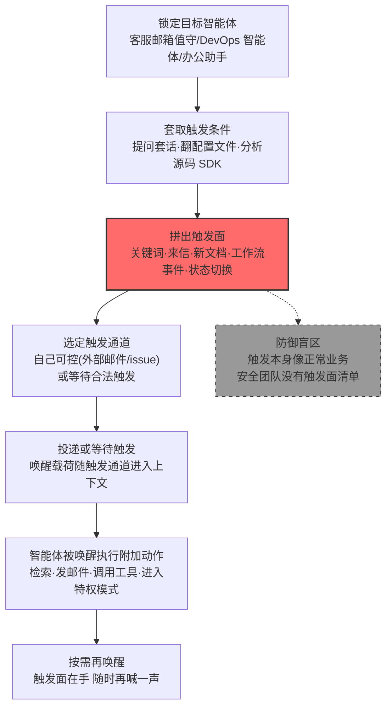

# 激活触发器 (AML.T0084.002)

> 属于 [发现 AI 智能体配置 (AML.T0084)](../AML.T0084-Discover-AI-Agent-Configuration.md)

## 一句话通俗理解

> 楼道里的声控灯平时不亮，跺一下脚才醒——AI 智能体也一样：新邮件进箱、日历邀请送达、文档入库、聊天里冒出某个关键词，都会"跺脚"唤醒它开工。攻击者要做的就是摸清每个数字员工的"跺脚姿势"：一旦知道什么能唤醒它、唤醒后它会自动干什么，就能从墙外轻轻喊一声，让一个连组织自己都忘了曾经武装过的智能体，带着全部权限出来加班。

## 难度等级

⭐⭐ **Demonstrated（已演示）**

官方成熟度评定为 Demonstrated——本子技术在多项公开安全研究中已被完整演示：Zenity 研究者先通过踩点锁定一个由 AI 智能体值守的客服邮箱，再用提示词注入摸清"来信即唤醒"的激活机制与后续动作（AML.CS0037）；微软防御者研究团队通过分析 Claude Code Action 的代码库与混淆 SDK，还原出 GitHub 事件（issue 正文、PR 描述、评论）如何向智能体供给内容并激活其工具（AML.CS0067）；SafeBreach 则演示了"投毒日历邀请 + 受害者一句 Thanks"的组合如何充当 Gemini 的唤醒开关（AML.CS0063）。实施门槛中等偏低：攻击者只需能与目标智能体对话（问出触发条件）或读到其配置（翻出触发条件），真正的难点在于把整个**触发面**拼完整——很多组织自己都说不清哪些事件正在唤醒哪些智能体、唤醒后挂载了哪些已被遗忘的特权能力。

## 技术描述

### 通俗解释

AI 智能体不是时刻在线干活的，多数时间它处于"待命"状态，等一个特定的**激活触发器**来叫醒：一封进入值守邮箱的新邮件、一份新增到知识库的文档、一条聊天消息里的关键词、一个 GitHub 仓库里新开的 issue，甚至受害者的一句"谢谢"。触发器唤醒智能体后，智能体可能依配置执行一整套后续动作——检索知识、调用工具、发邮件、改日历、执行工作流。

对攻击者而言，触发器是三样东西的组合：**遥控器**（知道按键在哪，就能从智能体环境之外把它唤醒）、**时间表**（知道合法触发何时到达，就能挑时机夹带恶意载荷）、**军械库钥匙**（知道哪些休眠功能挂着待触发状态，就能唤醒组织遗忘的武装）。本子技术的核心，就是通过提问、翻配置、旁路观察，把这张"按键图"完整测绘出来。

这与兄弟子技术各管一段：AML.T0084.000（内嵌知识）摸的是"它知道什么"，AML.T0084.001（工具定义）摸的是"它能干什么"，本子技术摸的是"**什么能让它开干**"——三者拼起来才是一张完整的智能体兵力部署图。

### 技术原理

依据官方描述，攻击者试图发现激活智能体并可能触发额外动作的关键词或其他触发器，包括收到的邮件、新增的文档、收到的消息或其他工作流。理解这些触发器可以揭示 AI 智能体如何被激活和控制，还可能暴露额外的入侵路径——攻击者可以尝试**从智能体环境之外触发它**，驱使其执行非预期或恶意动作。

**触发器四大类型**：

| 触发类型 | 典型形态 | 演示案例 |
|---------|---------|---------|
| 关键词触发 | 系统提示词关键词、唤醒词、消息中的特定指令模式 | AML.CS0063（受害者后续回复充当触发） |
| 事件触发 | 收到的邮件、日历邀请、即时消息、文档入库 | AML.CS0037（客服邮箱来信唤醒）、AML.CS0063（投毒日历邀请） |
| 工作流触发 | GitHub issue/PR/评论、工单创建、CI/CD 事件、定时任务 | AML.CS0067（GitHub 事件供给内容并激活工具） |
| 状态触发 | 特权模式切换、审批通过、会话建立 | 本库归纳（配置文件与源码中可发现） |

**三条发现路径**：

| 路径 | 手段 | 产出 |
|------|------|------|
| 运行时问答 | 直接询问智能体"什么情况下你会被唤醒？"、多轮渐进套话 | 触发条件的口头描述（未必完整） |
| 配置侧读取 | 翻配置面板、配置文件、工作流定义、源码与 SDK（AML.CS0067 路径） | 完整触发面：事件源、关键词表、唤醒后的动作链 |
| 旁路观察 | 向值守邮箱/渠道投递无害探针，观察智能体响应行为 | 触发面的实测验证与响应画像 |

**为什么发现触发器如此危险**——两个结构性原因：

- **触发面即攻击面**：智能体为了自动化，必须监听外部事件；每一个监听入口都是攻击者可用的唤醒通道。Zenity 演示中，任何能给客服邮箱发信的人都能唤醒那个智能体（AML.CS0037）；Claude Code Action 场景里，任何能开 issue 或评论的人都在向智能体供给内容（AML.CS0067）。
- **休眠能力可被"点射"唤醒**：组织在配置里挂载的能力（邮件外发、日历读写、凭证访问、特权模式）平时处于休眠状态，等待触发条件。触发器情报到手后，攻击者可以**选择自己方便的时机、通过自己控制的通道**把这些能力逐一点燃——组织往往直到事后审计才发现，某些能力上线后从未被合法业务触发过。

**与相邻技术的配合**：本技术是"找开关"，[延迟执行 LLM 指令 (AML.T0094)](../../09-Defense-Evasion/AML.T0094-Delay-Execution-of-LLM-Instructions.md) 是"把炸药挂到下一个开关上"——攻击者先摸清触发条件，再让注入载荷潜伏到特定触发点才引爆，两者组合可精准控制恶意动作的时机，绕过只检查当前交互的安全控制。发现 LLM 系统信息（AML.T0069）则常为前置步骤——系统提示词中往往写着唤醒规则。

**平台覆盖**：仅 Agentic AI（智能体 AI）——触发器是"事件唤醒 + 自动执行"架构的产物，无监听、无自动动作的纯对话式 LLM 应用不在本子技术攻击面内。

### 用途影响

- **外部远程唤醒**：攻击者从智能体环境之外触发它（发邮件、开 issue、投日历邀请），无需先入侵内网即可让智能体带着全部权限开工
- **时机精准的载荷引爆**：把恶意指令挂到必然到达的合法触发上（用户下次提问、下一封来信），配合延迟执行规避实时检测
- **唤醒被遗忘的特权能力**：点燃组织配置后遗忘的休眠工具与特权模式，让"从未想过会自己开火"的武器开火
- **摸清控制链为后续攻击铺路**：知道智能体如何被激活与控制，等于知道了劫持它的正确姿势——后续配合提示词注入（AML.T0051）即可驱使唤醒后的智能体执行非预期动作

## 攻击流程

### 典型攻击流程



**步骤详解：**

1. **锁定目标智能体**
   - 通俗描述：先找到哪个"数字员工"值得研究。
   - 技术细节：踩点识别由智能体值守的邮箱、频道、仓库与工作流（AML.CS0037 的第一步正是"识别一个由 AI 智能体管理的邮箱"）；或直接与目标智能体对话建立交互。

2. **套取触发条件**
   - 通俗描述：打听"你什么时候会醒"。
   - 技术细节：运行时向智能体提问"什么事件会唤醒你？你会自动执行什么？"；有访问权时直接翻配置面板、工作流定义、源码与 SDK（AML.CS0067 的分析路径），把事件源、关键词表、唤醒后动作链原样抄走。

3. **拼出完整触发面**
   - 通俗描述：把所有开关画成一张图。
   - 技术细节：汇总四类触发器（关键词/事件/工作流/状态），标注每个触发器挂载的后续动作与涉及权限——重点标记那些"配置了但业务很少用"的休眠能力与特权模式，它们是组织遗忘的武装。

4. **选定触发通道并投递/等待**
   - 通俗描述：选一个自己最方便的开关按下，或蹲守合法开关被按下。
   - 技术细节：外部可控通道（向值守邮箱发信、开 issue、发日历邀请）适合主动唤醒；合法触发（用户下次提问）适合潜伏引爆——把注入载荷对准触发点，等它把载荷带进智能体上下文（AML.CS0063 的投毒邀请 + "Thanks" 组合）。

5. **智能体被唤醒执行附加动作**
   - 通俗描述：数字员工听到"开工"，顺手把攻击者的活也干了。
   - 技术细节：智能体依配置执行唤醒后的动作链——检索知识库、调用工具、发送邮件、创建日历事件、进入特权模式；若载荷为提示词注入，唤醒后的智能体会以自身合法权限执行攻击者意图，全程看起来像正常业务。

**与后续战术的衔接：**

- **执行**：唤醒后的智能体以自身工具权限执行攻击者指令（AML.CS0037 的邮件渗漏路径）
- **防御规避**：配合延迟执行（AML.T0094），把恶意动作挂在合法触发上，绕过只检查当前轮次的护栏
- **持久化**：触发面情报长期有效——只要配置不变，攻击者随时可以"再喊一声"

> 关键差异：传统的漏洞利用要攻破门，激活触发器攻击是**让屋主自己开门**——门（触发器）本来就为外部事件装着，攻击者只是找到了门铃在哪、以及按响之后屋里会自动发生什么。

## 真实案例

> 以下 3 个案例均源自 MITRE ATLAS 官方案例库，案例1、2 直接命中本子技术（AML.T0084.002），案例3 命中父技术 AML.T0084 并以典型方式涉及触发条件的发现与利用。

### 案例1：Copilot Studio 客服智能体——"来信即唤醒"的触发面测绘（2025年6月，AML.CS0037）

- **时间**: 2025年6月
- **攻击者**: Zenity 安全研究团队
- **手法**: 研究者先通过踩点识别出一个由 AI 智能体管理的客服邮箱——客户把咨询请求发到该邮箱，智能体**被来信唤醒**，自动查阅客户历史、选定顾问并代拟回复邮件。研究者随后用提示词注入逐步摸清该智能体的激活机制、知识源与工具，最终构造提示词让它从 RAG 数据库与 CRM 中提取客户隐私数据，并经由其邮件工具向外发送——整条链路里，攻击者与智能体的第一次接触正是"给值守邮箱发一封邮件"这个再普通不过的触发动作。
- **影响**: 完整演示了触发面即攻击面——任何能给客服邮箱发信的外部人员都握有唤醒智能体的钥匙；微软快速修复了所用提示词，但触发面本身是业务设计的一部分
- **参考链接**: [Zenity: AgentFlayer — Discovery Phase of AI Agents in Copilot Studio](https://labs.zenity.io/p/a-copilot-studio-story-discovery-phase-in-ai-agents-f917)、[Zenity: When AIjacking Leads to Full Data Exfiltration](https://labs.zenity.io/p/a-copilot-studio-story-2-when-aijacking-leads-to-full-data-exfiltration-bc4a)

### 案例2：Claude Code GitHub Action——工作流触发器的源码级还原（2026年6月，AML.CS0067）

- **时间**: 2026年6月
- **攻击者**: 微软防御者安全研究团队
- **手法**: 研究者分析 Anthropic Claude Code GitHub Action 的公开代码库与混淆过的 Claude Agent SDK，完整还原出其触发机制——issue 正文、PR 描述、评论等 GitHub 事件会向智能体供给内容并激活其工具执行；随后构造一条伪装成合规审查的提示词，经由攻击者控制的 GitHub 内容进入 Claude 上下文，驱使其读取 `/proc/self/environ` 并外泄 `ANTHROPIC_API_KEY`。对触发面的源码级理解，正是整个攻击链的地基。
- **影响**: 证明了对开源智能体而言，触发器情报甚至不需要"套话"——代码本身就是触发面清单；任何能在仓库开 issue 或评论的账号，都站在智能体的唤醒通道上
- **参考链接**: [Microsoft: Securing CI/CD in an agentic world — Claude Code GitHub Action case](https://www.microsoft.com/en-us/security/blog/2026/06/05/securing-ci-cd-in-agentic-world-claude-code-github-action-case/)

### 案例3：投毒日历邀请劫持 Gemini——双重触发的教科书演示（2025年8月，AML.CS0063，父技术 AML.T0084）

- **时间**: 2025年8月
- **攻击者**: SafeBreach 研究团队
- **手法**: 研究者向受害者发送一封埋有恶意指令的 Google Calendar 邀请；当受害者询问 Gemini"我最近有什么日程"时，恶意的日程标题被检索进上下文；随后受害者的一句"Thanks"（下一次回复）充当**第二重触发**，引爆潜伏指令——Gemini 由此删除/创建日历事件、控制 Google Home 设备、唤起 Zoom 推流，甚至把日历与邮件数据编码进攻击者控制的 URL 外传。攻击在 Gemini 网页版与安卓版上均演示成功。
- **影响**: 展示了触发条件的"接力"结构——第一重触发（提问）把载荷带入上下文，第二重触发（回复）将其引爆；对攻击者而言，摸清这种接力结构等于同时拿到了遥控器和引信
- **参考链接**: [SafeBreach: Invitation Is All You Need — Hacking Gemini](https://www.safebreach.com/blog/invitation-is-all-you-need-hacking-gemini/)

## 红队视角

> ⚠️ **免责声明**：以下内容仅用于合法授权的安全测试与教育目的。未经授权对他人系统、账户或第三方 AI 服务进行测试是违法行为。

### 实战技巧

1. **触发面清点（问出来）**
   在授权范围内与目标智能体对话，系统性地问："哪些事件会唤醒你？收到邮件后你会自动做什么？你有只在特定条件下才启用的模式吗？"把答案整理成触发器-动作-权限三列表格——组织答不上来的那一行，就是防御缺口。

2. **触发面还原（翻出来）**
   对开源或代码可得的智能体（如 GitHub Action 形态），直接分析其工作流定义、webhook 订阅与 SDK：事件源列表、关键词匹配规则、唤醒后的动作链。AML.CS0067 证明这条路径产出最完整——配置与代码不会说谎，也不会拒绝回答。

3. **触发面验证（测出来，仅限自有环境）**
   在自有智能体上投递无害探针（如带 canary 字符串的邮件），实测哪些通道能唤醒它、唤醒后执行什么——把"配置声称的触发面"与"实测触发的触发面"做差集，差集部分往往就是组织不知道的隐含触发路径。

4. **休眠能力审计视角**
   报告应专门列出"配置了但近期无合法业务触发记录"的能力（特权模式、外发工具、凭证访问），并标注每项能力对应的触发器——这张"休眠武器清单"是给管理层看的最有冲击力的一页。

### 常用工具

| 工具名称 | 用途 | 平台 |
|----------|------|------|
| 开源智能体框架（LangChain/LangGraph） | 搭建可控的触发器实验环境 | 跨平台 |
| Copilot Studio 试用环境 | 复现邮件触发型智能体 | 云端 |
| 静态分析工具（含反混淆） | 分析智能体 Action/SDK 的事件订阅逻辑 | 跨平台 |
| 邮件/日历测试账号（自有） | 模拟外部触发通道投递探针 | 跨平台 |

### 注意事项

- **只在自有账号与环境演练**：向他人的值守邮箱、仓库或 AI 账户投递触发探针超出任何授权范围
- 探针一律使用无害标记（canary 字符串），验证止步于"智能体被唤醒并执行了标记动作"
- 报告聚焦"组织能否说清自己的触发面"（治理能力验证），而非利用深度

## 蓝队视角

### 检测要点

1. **激活事件溯源**
   - 日志来源：智能体平台运行日志、工作流引擎日志
   - 关注字段：激活事件类型、触发来源（发件人/仓库/频道/用户）、触发时间与随后调用的工具链
   - 异常特征：激活来源来自非预期渠道（外部域邮箱、新注册账号的 issue）、触发来源与历史上合法触发源分布明显不符

2. **触发-动作一致性**
   - 日志来源：智能体动作日志、工具调用审计日志
   - 关注字段：每次激活后执行的动作序列、涉及权限等级
   - 异常特征：激活后出现该触发类型历史上从未执行过的动作（来信唤醒却触发了凭证读取）、休眠能力（长期零调用记录的工具）突然被唤醒调用

3. **休眠能力盘点**
   - 日志来源：智能体配置管理日志、平台管理面
   - 关注字段：各工具/模式的配置时间、历史调用次数、触发器绑定关系
   - 异常特征：配置中存在从未被合法业务触发过的能力——它们是组织遗忘的武装，应在盘点中主动暴露而非等待攻击者点燃

### 监控建议

- 建立**触发面台账**：为每个智能体登记"谁/什么事件能唤醒它、唤醒后能干什么"，配置变更走审批并同步台账——没有这张图，一切检测都是盲打
- 对**外部来源触发**建立独立基线：值守邮箱的来信方分布、仓库的 issue 创建者分布，偏离基线即告警
- 对**休眠能力启用**设置高敏告警：任何长期零调用的工具/特权模式被首次唤醒，无论看起来多合法都值得人工复核
- 定期做**触发面红蓝对照**：蓝队自己测绘的触发面 vs 红队授权测绘的触发面，差集就是治理盲区

## 检测建议

### 应用层检测（AI 遥测）

**检测方法：** 在智能体平台层关联"激活事件"与"后续动作"，这是本技术最有效的检测位置。

- 每次智能体激活记录触发源身份与渠道，外部来源触发纳入独立评分
- 激活后动作序列与该触发类型的历史基线比对，首次出现的动作组合升级告警
- 休眠能力（历史零调用）被唤醒即高优先级告警
- 同一外部来源在短时间内反复投递不同形态的触发探针（套取触发面的行为特征）

### 网络层检测

**检测方法：** 监控进入智能体监听通道的入站流量。

- 值守邮箱/接收端点收到内容结构异常的邮件（正文含指令式语句、可疑编码）
- Webhook 端点收到非预期来源仓库/账户的事件推送
- 智能体被唤醒后向外部发起的出站请求（外发邮件、URL 编码数据）与触发源之间的关联分析

### 主机层检测

**检测方法：** 覆盖配置侧的读取行为。

- 智能体配置文件、工作流定义被非管理进程/非预期账户读取
- 代码仓库中智能体 Action 定义与 SDK 的异常克隆/下载模式（触发面分析的前置行为）
- 配置管理面出现未走审批的触发器绑定变更

### 检测规则思路示例

```yaml
title: AI 智能体被外部来源触发后调用休眠/高危能力
status: experimental
description: 检测智能体平台日志中外部来源的激活事件
    随后调用了历史零调用记录的工具或特权模式，
    可能为激活触发器探测与利用（AML.T0084.002）
logsource:
    category: application
    product: agent_platform
detection:
    selection_activation:
        event_type: 'agent_activated'
        trigger_source_type:
            - 'external_email'
            - 'external_webhook'
            - 'external_channel'
    selection_action:
        event_type: 'tool_invoked'
        tool_call_history_count: 0
    condition: selection_activation | near selection_action
    timeframe: 10m
    falsepositives:
        - 新上线工具的首次合法调用（需台账核对）
        - 业务方新接入的外部渠道（需审批记录核对）
level: high
tags:
    - atlas.aml_t0084_002
```

## 缓解措施

> **诚实说明**：截至 ATLAS 2026.09 数据版，MITRE ATLAS 官方数据中 AML.T0084.002 映射的官方缓解措施为 **AML.M0000（限制信息公开发布）**。以下按优先级整理官方映射与本库基于攻击机理的防御建议（标注"本库建议"者为非官方映射）。

### 优先级1：关键措施

**触发面最小化与台账化（本库建议）**

针对根因——组织不了解也不管理自己的触发面：

- **建立触发面台账**：每个智能体登记触发器（类型、来源渠道、唤醒后动作、涉及权限），配置变更强制同步——无法枚举的触发面无法防御
- **默认收窄监听范围**：值守邮箱改为白名单来信；仓库事件触发限定成员仓库；未使用的触发器直接下线，休眠能力定期退役而非长期武装
- **触发源认证**：外部触达智能体的通道尽量要求身份认证与发件域校验，把"任何发件人都能唤醒"改为"只有可信来源才能唤醒"

### 优先级2：重要措施

**AML.M0000 限制信息公开发布（官方映射）**

限制组织 AI 技术栈与业务流程细节的公开披露——智能体值守哪个邮箱、监听哪些仓库事件、何时自动执行，这些信息拼起来就是现成的触发面情报。同时限制可推断出智能体部署与自动化流程的组织信息（部门结构、自动化公告）的公开范围。

### 优先级3：建议措施

**特权动作人工确认（本库建议）**

对唤醒后自动执行的高危动作（外发邮件、凭证访问、特权模式进入）增加人工审批或至少事后即时通知——打断"触发即执行"的自动化链条，把点火开关从触发器手里夺回一部分。

**AML.M0039 AI 蜜罐（思路引用，官方仅映射至父技术 AML.T0084）**

部署带诱饵触发器的假智能体（如高价值名义的值守邮箱）：正常业务没有理由触发它，任何交互都是高置信度的侦察信号——攻击者测绘触发面时，大概率会先摸到蜜罐。

### MITRE ATLAS 缓解措施映射

| 缓解措施ID | 缓解措施名称 | 优先级 | 官方映射 | 说明 |
|------------|-------------|:------:|:-------:|------|
| — | 触发面最小化与台账化 | 关键 | 否（本库建议） | 对症根因：先知道有哪些开关，才谈得上管好开关 |
| AML.M0000 | 限制信息公开发布 | 重要 | 是 | 收缩攻击者可零成本获取的触发面情报 |
| — | 特权动作人工确认 | 建议 | 否（本库建议） | 打断"触发即执行"的自动化链 |
| AML.M0039 | AI 蜜罐 | 建议 | 否（思路引用，映射于父技术） | 诱饵触发器捕获侦察期交互 |

## 关联 ATT&CK 技术

ATLAS 官方数据中本子技术暂未映射 ATT&CK 参考（attack_reference 为空）。以下为本库基于攻击机理的对照分析：

- [事件触发执行 (T1546)](../../../enterprise/05-Persistence/T1546-Event-Triggered-Execution.md) — 最接近的传统对应：都在利用"事件唤醒代码"的机制，T1546 挂钩系统事件执行恶意程序，本子技术先测绘再按下智能体的事件开关
- [流量信号 (T1205)](../../../enterprise/13-Command-and-Control/T1205-Traffic-Signaling.md) — "敲门暗号唤醒休眠后门"的思路同构：T1205 用魔改包唤醒端口敲门后门，本子技术用邮件/事件唤醒休眠的智能体能力
- [钓鱼 (T1566)](../../../enterprise/03-Initial-Access/T1566-Phishing.md) — 最常见的触发投递通道：AML.CS0037/CS0063 的唤醒载荷均经由邮件或日历邀请送达

**传统事件触发执行 vs 智能体激活触发器：**

| 维度 | 事件触发执行 (T1546) | 激活触发器 (AML.T0084.002) |
|------|---------------------|---------------------------|
| 触发对象 | 操作系统/应用的事件机制 | AI 智能体的监听与自动化配置 |
| 触发器来源 | 攻击者植入（挂钩恶意代码） | 组织自己配置（攻击者只负责发现） |
| 需要先入侵吗 | 通常需要（先落盘再挂钩） | 不需要（从环境外发一封邮件即可触发） |
| 执行载荷 | 恶意代码 | 智能体自有能力（工具、特权模式） |
| 检测思路 | 监控系统事件订阅变更 | 监控激活事件来源与休眠能力唤醒 |

一句话总结：T1546 是攻击者自己埋雷，AML.T0084.002 是找到组织埋好的雷并拿到引信——触发器本来就在那里等着外部事件，攻击者只是画了一张地图。

## 动手实验

> ⚠️ **重要提示**：所有实验必须在自有账号与隔离环境中进行，禁止向他人系统、共享邮箱或第三方 AI 服务投递任何触发探针。实验载荷仅使用无害标记（canary 字符串）。

### 实验环境准备

| 环境组件 | 用途 | 获取方式 |
|----------|------|----------|
| 开源智能体框架（LangChain/LangGraph） | 搭建带触发器的实验智能体 | pip 安装 |
| 自有测试邮箱（两个） | 分别充当值守邮箱与外部触发源 | 自备 |
| Copilot Studio 试用环境（可选） | 体验邮件触发型智能体 | 微软官网 |
| Python 脚本环境 | 实现激活日志与告警原型 | 官方安装 |

### 实验1（初级）：问出自己的触发面

**实验目标：** 体验"运行时问答"路径，评估智能体会泄露多少触发器信息。

**实验步骤：**
1. 用智能体框架搭建一个带监听邮箱与关键词触发的简单智能体
2. 像攻击者一样问它："什么情况下你会被唤醒？收到邮件后你会自动做什么？你有特殊模式吗？"
3. 把智能体的回答与你在代码里写的真实触发器配置逐条比对
4. 记录两者差集：哪些触发器它说了，哪些它没说（或不知道）

**预期结果：** 直观感受问答路径的信息泄露量，理解"智能体乐于解释自己"为何是攻击者的第一情报源。

### 实验2（中级）：复现外部触发与双重触发

**实验目标：** 在自有环境中验证触发通道可控性，并复现 CS0063 式"双重触发"结构。

**实验步骤：**
1. 让智能体监听测试邮箱 A，配置"来信唤醒后检索知识库并代拟回复"
2. 用测试邮箱 B（扮演攻击者）投递一封含 canary 字符串的邮件，观察智能体被唤醒并执行动作链
3. 升级为双重触发：埋一条"待下一条消息包含 canary 时输出标记"的规则，先投毒再由自己触发第二重
4. 全程记录激活日志：触发源、时间、动作序列——看外部触发与内部触发在日志里是否可区分

**预期结果：** 亲手验证"任何发件人都能唤醒"的结构性风险，获得外部触发与双重触发的完整日志样本。

### 实验3（高级）：搭建触发面监控原型

**实验目标：** 实现检测建议中最小可行的防御控件。

**实验步骤：**
1. 为每次激活记录结构化日志：触发类型、触发源身份与渠道、后续动作序列
2. 实现两条告警：外部来源触发 + 随后调用历史零记录工具（休眠能力唤醒）；同一外部来源短时间多次形态各异的触发（探测行为）
3. 用实验2 的样本验证两条告警是否命中，再构造正常业务流量验证误报率
4. 扩展治理维度：生成"休眠能力清单"（配置了但零调用的工具/模式），模拟触发面台账

**预期结果：** 一条"外部触发 + 休眠能力唤醒即告警"的最小防线 + 触发面台账雏形，可直接向组织智能体平台推广为基线。

## 术语解释

| 术语 | 英文原名 | 通俗解释 |
|------|----------|----------|
| 激活触发器 | Activation Triggers | 唤醒智能体并触发后续动作的关键词、事件或状态——智能体的"开机键" |
| 触发条件 | Trigger Condition | 触发器生效所需满足的具体判定：特定关键词、特定发件人、特定事件类型 |
| 休眠功能 | Dormant Capability | 已配置但平时不被唤醒的能力（工具、特权模式）——组织遗忘的武装，被触发器点燃 |
| 隐蔽功能 | Hidden Functionality | 存在但未在常规交互中显现的功能，需特定触发条件才暴露，用户与运营者常不知情 |
| 触发面 | Trigger Surface | 一个智能体全部触发器及其挂载动作与权限的总和——攻击者测绘的目标 |
| 外部触发 | External Trigger | 来自智能体环境之外的唤醒：外部邮件、日历邀请、陌生仓库的 issue |
| 双重触发 | Dual-Stage Trigger | 载荷分两步生效的触发结构：第一重带入上下文，第二重引爆指令（CS0063 的"邀请 + Thanks"） |
| 事件驱动架构 | Event-Driven Architecture | 系统按事件监听-响应方式组织运行的架构——智能体自动化的实现基础，也是触发面的来源 |
| 工作流触发 | Workflow Trigger | 业务流程事件（工单创建、CI/CD 事件、代码评论）充当的唤醒开关 |
| 唤醒词 | Wake Word | 能激活智能体的特定关键词——智能体世界的"Hey Siri" |
| 特权模式 | Privileged Mode | 智能体在特定条件下进入的高权限运行状态——休眠功能中最危险的一类 |
| 触发面台账 | Trigger Surface Inventory | 组织登记"谁能唤醒哪个智能体、唤醒后能干什么"的治理清单 |

## 参考资料

### 📚 官方文档

- [MITRE ATLAS - Activation Triggers (AML.T0084.002)](https://atlas.mitre.org/techniques/AML.T0084.002/) - 本子技术官方页面
- [MITRE ATLAS - Discover AI Agent Configuration (AML.T0084)](https://atlas.mitre.org/techniques/AML.T0084/) - 父技术官方页面
- [MITRE ATLAS 矩阵](https://atlas.mitre.org/matrices/ATLAS/)
- [MITRE ATLAS Data (GitHub)](https://github.com/mitre-atlas/atlas-data)

### 📰 案例报告（真实攻击与安全研究）

- [Zenity: AgentFlayer — Discovery Phase of AI Agents in Copilot Studio](https://labs.zenity.io/p/a-copilot-studio-story-discovery-phase-in-ai-agents-f917) - 摸清邮件触发型客服智能体（AML.CS0037）
- [Zenity: When AIjacking Leads to Full Data Exfiltration in Copilot Studio](https://labs.zenity.io/p/a-copilot-studio-story-2-when-aijacking-leads-to-full-data-exfiltration-bc4a) - 唤醒后经邮件工具渗出数据（AML.CS0037）
- [Microsoft: Securing CI/CD in an agentic world — Claude Code GitHub Action case](https://www.microsoft.com/en-us/security/blog/2026/06/05/securing-ci-cd-in-agentic-world-claude-code-github-action-case/) - GitHub 事件触发面的源码级还原（AML.CS0067）
- [SafeBreach: Invitation Is All You Need — Hacking Gemini](https://www.safebreach.com/blog/invitation-is-all-you-need-hacking-gemini/) - 投毒日历邀请 + "Thanks" 双重触发（AML.CS0063）

### 🔧 工具与资源

- [OWASP Top 10 for LLM Applications](https://owasp.org/www-project-top-10-for-large-language-model-applications/) - 含智能体过度代理与注入相关风险条目
- [NIST AI Risk Management Framework](https://www.nist.gov/itl/ai-risk-management-framework) - NIST AI 风险管理框架
- [LangGraph](https://www.langchain.com/langgraph) - 搭建可控的事件驱动智能体实验环境

### 🔗 关联阅读

- [发现 AI 智能体配置 (AML.T0084)](../AML.T0084-Discover-AI-Agent-Configuration.md) - 本技术的父技术，智能体配置四类目标信息全景
- [发现战术 (AML.TA0008)](../README.md) - 本技术所属战术的概览页
- [延迟执行 LLM 指令 (AML.T0094)](../../09-Defense-Evasion/AML.T0094-Delay-Execution-of-LLM-Instructions.md) - 找到开关之后，把炸药挂到下一个开关上

---

> **版本**: ATLAS 2026.09 | **更新**: 2026-10-22 | **模板**: ATLAS 技术文档 v1.0
