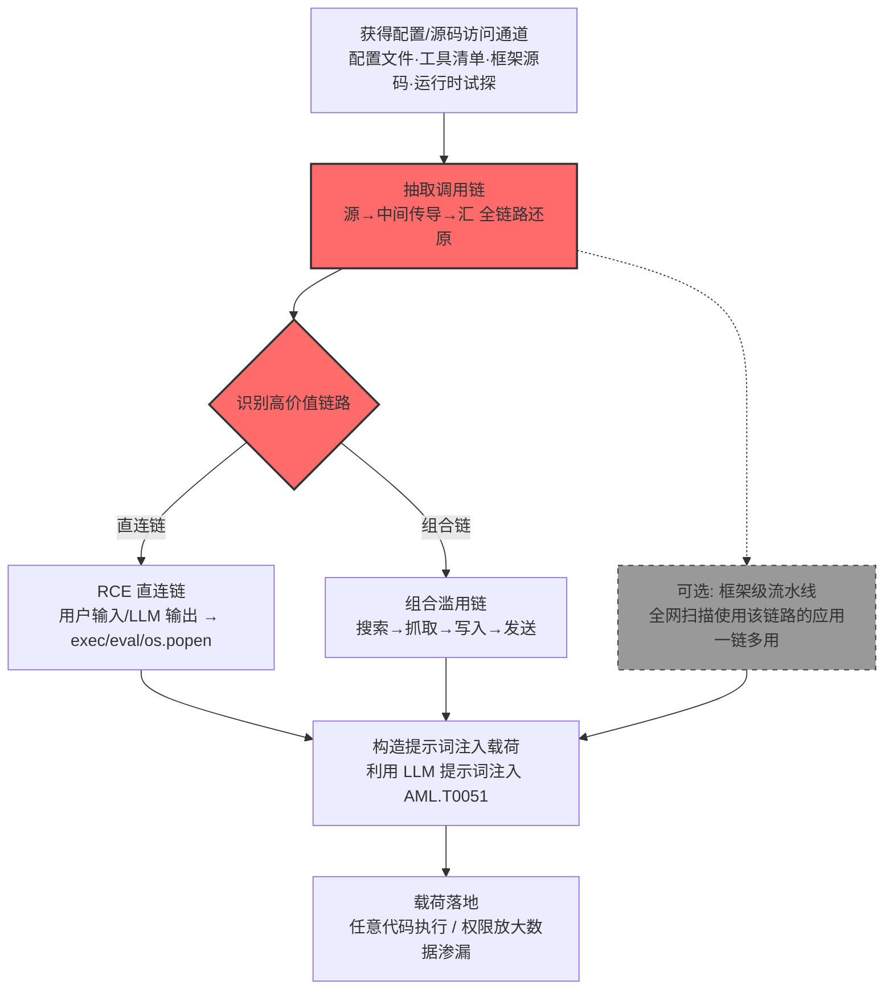

# 调用链 (AML.T0084.003)

> 属于 [发现 AI 智能体配置 (AML.T0084)](../AML.T0084-Discover-AI-Agent-Configuration.md)

## 一句话通俗理解

> 一个岗位单看都人畜无害：查号的只管查、跑腿的只管取、抄写的只管抄、寄信的只管寄——但把四个岗位串成流水线，就是"查到→取出→抄走→寄出"的完整偷窃链。攻击者翻智能体配置时，盯的正是这种串联关系：单独看每个工具都无害，串起来却能干成没有任何单个工具干得了的事。

## 难度等级

⭐⭐ **Demonstrated（已演示）**

官方成熟度评定为 Demonstrated——LLMSmith 研究（AML.CS0052）已将其做成流水线：研究人员系统性地分析 11 个 LLM 集成框架，从中抽取调用链，定位 20 个"用户输入/LLM 输出直连执行汇"的 RCE 漏洞，再全网扫描使用这些框架部署的应用作为攻击目标。实施门槛中等：发现调用链本身通常需要读到智能体的配置文件、工具清单或框架源码（配置侧读取路径），或者有能力对智能体做运行时试探；但一旦摸清链路，后续利用只是一条提示词注入的事。真正麻烦的是其**规模化潜力**——同一个框架被成千上万应用复用，一条危险调用链被抽取一次，就等于拿到了一张可以全网通兑的"漏洞彩票"。

## 技术描述

### 通俗解释

智能体的每个工具都是一颗齿轮，**调用链**（Call Chains）就是齿轮之间的咬合关系：搜索工具的输出喂给抓取工具，抓取的内容喂给写入工具，写入的结果再喂给发送工具——上一步的产出，正是下一步的原料。配置文件里写的正是这套传动图纸。

攻击者读这份图纸时在看两件事：

- **权限放大**：单看每个工具的权限都不大——搜索工具只能查、邮件工具只能发。但串起来就出现了任何单个工具都不具备的能力：`搜索（定位敏感数据在哪）→ 抓取（把它读出来）→ 写入（暂存）→ 发送（寄到攻击者邮箱）`。这就是**组合滥用**：危险不藏在任何一颗齿轮里，而藏在咬合方式里；
- **混淆代理人**：整条链都以智能体自己的合法身份运转——权限是组织授予智能体的，动作是链路自动执行的，而指令却可能来自注入的提示词。智能体成了被滥用的"代理人"，替攻击者签发了它自己都意识不到的越权行为。

更凶险的一类是**危险直连**：链路的终点不是"发送"，而是 `exec`、`eval`、`os.popen` 这类**执行汇**（Execution Sink）——真正执行代码的函数。当用户输入或 LLM 输出能够不经校验地直连执行汇，一条提示词注入就能升级成远程代码执行（RCE）。父技术 [发现 AI 智能体配置 (AML.T0084)](../AML.T0084-Discover-AI-Agent-Configuration.md) 摸的是"它有哪些工具、知道什么、何时被唤醒"，本子技术专攻其中最后一格：**这些工具怎么串联，哪条链能被武器化**。

### 技术原理

依据官方描述，攻击者从 AI 智能体配置中提取调用链，这些链路可能揭示远程代码执行（RCE）或其他漏洞的潜在目标。易受攻击的调用链通常把用户输入或 LLM 输出连接到执行汇（如 exec、eval、os.popen），相关漏洞后续可能通过 LLM 提示词注入（AML.T0051）加以利用。攻击者还可能系统性地识别 LLM 框架中存在的易受攻击调用链，然后扫描配置使用了这些调用链的应用程序作为攻击目标。

**一条调用链的解剖**：

| 链路环节 | 角色 | 例子 | 攻击者关注点 |
|---------|------|------|------------|
| 源（Source） | 数据进入链路的入口 | 用户提示词、LLM 输出、被检索的邮件/文档 | 源是否可被攻击者控制（注入点） |
| 中间传导 | 工具间的串联 | 搜索→抓取→写入→发送 | 输出能否喂给下一环（组合滥用面） |
| 汇（Sink） | 链路的终点 | 发邮件、写文件、exec/eval/os.popen | 汇的威力 + 沿途有无校验（净化） |

**两类高价值目标**：

| 目标类型 | 链路形态 | 危害 | 实证 |
|---------|---------|------|------|
| RCE 直连链 | 用户输入/LLM 输出 → exec/eval/os.popen | 提示词注入即代码执行 | AML.CS0052 的 20 个 RCE |
| 组合滥用链 | 搜索 → 抓取 → 写入 → 发送 | 权限放大、零工具单点越权的数据渗漏 | AML.CS0037 的 RAG/CRM 读取 + 邮件外传 |

- **定向抽取**：针对特定目标智能体，读取其配置文件、工具清单或源码（配置侧读取，对照 AML.CS0067 的代码逆向路径），或在运行时通过试探性提问推断工具串联关系；
- **框架级流水线**（官方描述点名的手法）：先系统性地分析某个 LLM 框架（LangChain、LlamaIndex、Pandas-ai 等）内置的调用链，定位易受攻击的组合；再全网扫描配置使用了这些链路的应用作为目标——发现一次，批量利用。

**平台覆盖**：仅 Agentic AI（智能体 AI）——调用链以"智能体绑定并编排多个工具"为前提，无工具编排的裸模型不在攻击面内。

**与传统污点分析的关系**：源→汇的追踪思路承袭自传统应用安全的污点分析（taint analysis），但多了一个新的源：**LLM 输出**。传统代码审计假设"程序逻辑是确定的、输入是数据"；而 LLM 集成应用中，模型输出会被直接拼进下游工具的参数——攻击者只需操纵提示词，就能让"数据"变成"指令"。

### 用途影响

- **直通远程代码执行**：定位"用户输入/LLM 输出 → 执行汇"的直连链后，一条提示词注入载荷即可在智能体宿主机上执行任意命令（AML.CS0052）
- **权限放大与混淆代理人**：组合滥用链让攻击者借智能体之手完成任何单个工具都无权完成的动作——读数据的工具 + 发数据的工具 = 完整渗漏通道（AML.CS0037）
- **规模化与定制化兼得**：框架级调用链分析一次，即可批量定位全网使用该框架的应用作为目标——把"一次漏洞挖掘"放大成"一张目标清单"（LLMSmith 的作战思路）；摸清具体目标的串联关系后，注入载荷又能精确编排"先取什么、再写哪、最后发给谁"，从"碰运气"变成"按图纸施工"

## 攻击流程

### 典型攻击流程



**步骤详解：**

1. **获得配置/源码访问通道**
   - 通俗描述：先弄到那张传动图纸。
   - 技术细节：智能体配置文件与工具清单（企业内网已入侵环境中的读取权）、公开仓库中的智能体源码与 SDK（AML.CS0067 的路径）、LLM 框架的开源代码（AML.CS0052 的路径），或与目标智能体对话做运行时试探，都通向调用链信息。

2. **抽取调用链**
   - 通俗描述：把齿轮怎么咬合的画下来。
   - 技术细节：静态分析工具定义与编排代码，还原"源 → 中间工具 → 汇"的完整数据流：哪些输入会进入链路、哪个工具的输出喂给哪个工具的参数、链路终点是发邮件还是执行命令。

3. **识别高价值链路**
   - 通俗描述：找出能要命的那条传动线。
   - 技术细节：RCE 直连链——用户输入或 LLM 输出不经校验直连 exec/eval/os.popen 等执行汇；组合滥用链——串联后的能力超过任何单个工具的权限（读取类 + 发送类工具的组合即现成渗漏通道），沿途是否有人工审批或内容过滤也一并记录。

4. **（可选）框架级流水线**
   - 技术细节：把一次发现变成一张目标清单——按官方描述的手法，先识别框架中易受攻击的调用链，再扫描公网上配置使用了这些链路的应用；LLMSmith 对 11 个框架、20 个 RCE 的批量验证正是此路径。

5. **构造载荷并落地**
   - 通俗描述：沿图纸施工。
   - 技术细节：针对直连链构造提示词注入（AML.T0051），让模型输出被下游执行汇执行；针对组合链编排"搜索→抓取→写入→发送"的完整动作序列——全程以智能体自身权限运行，混淆代理人模式让审计日志里只看得到"智能体正常干活"。

**与后续战术的衔接：**

- **执行**：RCE 直连链配合提示词注入直通任意代码执行（AML.CS0052）
- **数据渗漏 / 影响**：组合滥用链即现成的"定位→读取→外传"通道（AML.CS0037），RCE 落地后还可借智能体宿主机向内网纵深推进

> 关键差异：传统漏洞挖掘找的是单个函数的缺陷，本技术找的是**工具之间 nobody 负责的缝隙**——每个工具单独审计都"合格"，串起来却无人设防。

## 真实案例

> 以下 4 个案例均源自 MITRE ATLAS 官方案例库，其中案例1 直接命中本子技术（AML.T0084.003），案例2、3、4 命中父技术 AML.T0084 家族，攻击链中都存在可辨识的工具串联与组合滥用环节。

### 案例1：LLMSmith——调用链抽取的流水线化，20 个 RCE 批量落地（2025年2月，AML.CS0052）

- **时间**: 2025年2月27日
- **攻击者**: 中国科学院大学、山东大学与新南威尔士大学研究人员（安全研究）
- **手法**: 研究人员系统性地分析 LangChain、LlamaIndex、Pandas-ai、Langflow、Auto-GPT、MetaGPT 等 11 个 LLM 集成框架，从框架代码中抽取调用链，定位将用户输入或 LLM 输出直连 exec、eval、os.popen 等执行汇的危险链路——共找出 20 个 RCE 漏洞；随后在公网上扫描使用这些框架部署的应用，验证提示词注入可实际触发这些链路完成代码执行。
- **影响**: 完整演示了官方描述的两段式手法——"先系统性识别框架中的易受攻击调用链，再扫描配置使用了这些链路的应用"；证明调用链发现可以被工程化为可复用的批量攻击前置步骤
- **参考链接**: [Demystifying RCE Vulnerabilities in LLM-Integrated Apps (arXiv)](https://arxiv.org/abs/2309.02926)、[LLMSmith 网站](https://sites.google.com/view/llmsmith)

### 案例2：Copilot Studio 客服智能体——"读取 + 发送"组合链的数据渗漏（2025年6月，AML.CS0037）

- **时间**: 2025年6月
- **攻击者**: Zenity 安全研究团队（红队演练）
- **手法**: 研究者通过提示词注入先摸清 Copilot Studio 客服智能体的知识源与工具（命中 AML.T0084.000/.001/.002），随后构造提示词驱动一条组合链：智能体先从组织的 RAG 数据库与 CRM 中检索客户私有数据，再把数据通过其邮件工具发送出去——读取类工具与发送类工具串联，形成了任何一个工具单独都不具备的完整渗漏能力，且全程以智能体自身的合法权限执行。
- **影响**: 教科书级的组合滥用与混淆代理人演示——攻击者未获得任何新凭证，仅靠编排智能体已有工具的串联关系就完成了数据外传；微软快速确认并修复，但其他提示词仍可能有效
- **参考链接**: [Zenity: Discovery Phase of AI Agents in Copilot Studio](https://labs.zenity.io/p/a-copilot-studio-story-discovery-phase-in-ai-agents-f917)、[Zenity: When AIjacking Leads to Full Data Exfiltration](https://labs.zenity.io/p/a-copilot-studio-story-2-when-aijacking-leads-to-full-data-exfiltration-bc4a)

### 案例3：Gemini 日历邀请攻击——跨服务能力链的多段串联（2025年8月，AML.CS0063）

- **时间**: 2025年8月6日
- **攻击者**: SafeBreach 研究团队（安全演示）
- **手法**: 投毒的日历邀请被 Gemini 助手检索后间接注入指令，驱动其按链路串联多段工具能力：读取日历/邮件数据 → 编码进攻击者控制的 URL → 通过浏览器请求外传；Android 版还演示了拉起 Zoom 应用向攻击者会议推流——每一段能力（读日历、开 URL、拉应用）单看都是产品功能，串联起来即构成渗漏与监控通道。
- **影响**: 证明能力链的"段数"越多、跨越的服务越广，可编排的攻击路径组合就越多——网页版与 Android 版因可触达面不同，同一注入链产生了不同的影响
- **参考链接**: [SafeBreach: Invitation Is All You Need: Hacking Gemini](https://www.safebreach.com/blog/invitation-is-all-you-need-hacking-gemini/)

### 案例4：Claude Code GitHub Action——从源码还原工具执行链，定位沙箱盲区（2026年6月，AML.CS0067）

- **时间**: 2026年6月5日
- **攻击者**: 微软 Defender 安全研究团队（安全研究）
- **手法**: 研究者分析 Claude Code Action 代码库与混淆的 Claude Agent SDK，完整还原智能体的工具执行链——GitHub 事件如何供给内容、Read/Bash/WebFetch 等工具各自运行在什么边界内（命中 AML.T0084.001/.002）。据此找到链路中的盲区：Read 工具不运行在 Bubblewrap 沙箱与净化环境边界内，随即构造提示词诱导 Claude 读取 `/proc/self/environ`，拿到含 `ANTHROPIC_API_KEY` 的进程环境，剥掉密钥前缀后绕过检测。
- **影响**: 证明调用链分析的价值不止于找 RCE——还原"工具在链路中如何被执行、各自边界在哪"，就能找出整条链上防护最薄弱的一环；Anthropic 在 Claude Code 2.1.128 中封堵了对敏感 /proc 文件的 Read 访问
- **参考链接**: [Microsoft: Securing CI/CD in an agentic world](https://www.microsoft.com/en-us/security/blog/2026/06/05/securing-ci-cd-in-agentic-world-claude-code-github-action-case/)

## 红队视角

> ⚠️ **免责声明**：以下内容仅用于合法授权的安全测试与教育目的。未经授权对他人系统、账户或第三方 AI 服务进行测试是违法行为。

### 实战技巧

1. **调用链静态审计**
   在授权范围内对目标智能体的配置与源码做源→汇追踪：以 semgrep/CodeQL 之类的污点分析工具扫描，标记所有"用户输入/LLM 输出"到"exec/eval/os.popen/邮件发送/文件写入"的数据流路径，输出一份带链路编号的危险调用链清单——报告应呈现链路地图，而非真的实施利用。

2. **组合滥用面评估**
   对智能体的工具集做组合推演：把"读取类 × 发送类""检索类 × 写入类"等组合逐一对照权限矩阵，标出串联后超出任何单个工具权限的组合（混淆代理人路径）。每个组合附一句"这条链能干什么、缺哪道闸"。

3. **框架链路复现与无害验证（自有环境）**
   用开源框架（LangChain/Langflow 等）搭一个带典型工具链的实验智能体，复现 LLMSmith 式的调用链抽取，理解链路编排如何在运行时被提示词接管；对识别出的直连链，用无害标记（echo canary 字符串）验证链路是否真的可走通——验证完立即停止，绝不在他人系统上执行。

### 常用工具

| 工具名称 | 用途 | 平台 |
|----------|------|------|
| semgrep / CodeQL | 智能体源码的污点分析与执行汇定位 | 跨平台 |
| 开源智能体框架（LangChain/Langflow/MetaGPT 等） | 搭建可控的工具链实验环境 | 跨平台 |
| promptfoo 等提示词测试框架 | 批量管理链路验证载荷 | 跨平台 |

### 注意事项

- **只在自有账号与授权环境演练**：对他人智能体的配置、源码做调用链分析，或向其投递验证载荷，均超出任何授权范围
- 报告聚焦"组织能否发现调用链被测绘、被利用"，每个危险链路都附修复建议（断链、加闸、最小权限）
- 直连链验证必须使用无害载荷并全程留痕，验证完立即停止

## 蓝队视角

### 检测要点

1. **配置层：链路信息读取审计**
   - 日志来源：智能体平台管理审计、文件审计、代码仓库审计
   - 关注字段：配置文件与工具清单的读取行为、含智能体定义的仓库的克隆与下载记录
   - 异常特征：非管理员角色批量读取工具编排配置、非部署时段的异常克隆（对照 CS0067、CS0052 的情报获取路径）

2. **应用层：工具调用序列异常**
   - 日志来源：智能体平台服务端日志、工具调用遥测
   - 关注字段：单会话内工具调用序列、调用间数据传递量
   - 异常特征：短时间内出现"搜索→抓取→写入→发送"的完整组合链、读取类与发送类工具在同会话中密集串联、会话内工具编排模式与该智能体正常业务流程显著不符

3. **主机层：执行汇触发监控**
   - 日志来源：进程审计、命令行日志
   - 关注字段：智能体运行时进程的子进程谱系、命令行参数
   - 异常特征：智能体服务进程派生 shell 解释器/eval 类调用（RCE 直连链特征）、命令行参数中出现 LLM 输出典型内容（自然语言指令片段、base64 块）

### 监控建议

- 建立**工具调用链基线**：为每个智能体记录正常业务中的工具串联模式，组合链偏离基线即告警——组合滥用难以伪装成正常流程，因为正常流程根本不走完整渗漏链
- **执行汇全量审计**：任何从智能体运行时进程产生的子进程/动态求值都要留痕并告警，无论其命令内容看起来多么无害
- **会话级关联与漏洞比对**：把"配置读取/能力试探"与"随后的组合链执行"关联为事件链；关注公开披露的框架调用链漏洞，比对自家应用是否使用了受影响的链路配置

## 检测建议

### 应用层检测（AI 遥测）

**检测方法：** 在智能体平台层监控工具调用的串联模式——这是组合滥用链最有效的检测位置。

- 单会话内出现"读取类 + 发送类"工具的完整串联（先取敏感数据、后向外发送），触发实时阻断与人工复核
- 工具调用序列与该智能体历史基线的结构化偏移（序列模式聚类异常）；LLM 输出被直接拼入下游工具参数的特征：参数中出现超长自然语言指令、代码片段或编码块

### 网络层检测

**检测方法：** 监控智能体运行时的出站流量模式。

- 智能体服务在完成内部数据检索/读取后，随即向低频/新出现的外部域发起请求（链式渗漏特征）；出站请求的 URL/正文参数中出现内部数据特征（客户标识、内部文档片段、密钥前缀模式）

### 主机层检测

**检测方法：** 覆盖执行汇与进程谱系这条最终防线。

- 智能体运行时进程派生命令解释器（bash/powershell/python -c 等）——RCE 直连链落地的直接证据
- 子进程命令行中包含模型输出特征内容（对照 CS0067 中"读取 /proc 并变换后外传"的链路形态）；对智能体配置文件、工具清单的非服务账号读取

### 检测规则思路示例

```yaml
title: AI 智能体运行时进程派生命令解释器（调用链 RCE 特征）
status: experimental
description: 检测智能体运行时服务进程派生 shell/eval 类子进程，
    可能指示 LLM 输出直连执行汇的调用链被提示词注入利用
    （AML.T0084.003 / AML.T0051 组合）
logsource:
    category: process_creation
    product: ai_agent_platform
detection:
    selection_parent:
        ParentImage|endswith:
            - '\agent-runtime'
            - '\langchain'
            - '\python\llm_app'
    selection_child:
        Image|endswith:
            - '/bash'
            - '\powershell.exe'
            - '\cmd.exe'
            - '\python.exe'
    filterCommandLine:
        CommandLine|re: '(?i)(--help|--version)'
    condition: selection_parent and selection_child and not filterCommandLine
falsepositives:
    - 智能体框架的合法运维脚本（需按基线白名单化管理）
    - 开发调试环境中的正常工具链联调
level: high
tags:
    - atlas.aml_t0084_003
```

## 缓解措施

> **映射说明**：截至 ATLAS 2026.09 数据版，MITRE ATLAS 官方数据为 AML.T0084.003 映射了 1 项官方缓解措施（AML.M0000）。以下按防御优先级组织，官方映射在表格中如实标注。

### 优先级1：关键措施

**斩断"源→汇"直连（本库建议，非官方映射）**

针对 RCE 直连链的根因——用户输入/LLM 输出不经校验直达执行汇：

- **禁止以模型输出为代码**：绝不把 LLM 输出直接传入 exec、eval、os.popen 等执行汇；必须执行命令时，改用参数化的专用工具 API（白名单命令 + 枚举参数），让模型只能"选择题"，不能"填空题"
- **强制净化层与执行隔离**：在"LLM 输出 → 工具参数"之间部署校验（类型校验、范围校验、敏感目标黑名单），工具执行运行在最小权限的沙箱/容器中——直连链即便被触发，影响面也被限制在单容器内

### 优先级2：重要措施

**AML.M0000 限制公开技术信息发布（官方映射）**

限制组织产品与服务中 AI 技术栈的公开信息。LLMSmith 的作战前提正是"先研究框架文档与源码，再全网找配置了这些链路的应用"——组织暴露的框架选型、工具编排细节、智能体架构信息越少，攻击者无需接触目标就能预制的调用链地图就越粗略，被框架级流水线顺带扫中的概率也越低。

### 优先级3：建议措施

**组合链闸门（本库建议，非官方映射）**

针对组合滥用链：在工具编排层对"读取类 + 发送类"的组合引入策略引擎——内部数据读取结果要经外部通道发送时，强制人工审批或内容脱敏；每个工具按最小权限单独授权，让"串联后的权限"永远不会超过业务需要。

**AI 红队与链路审计常态化（本库建议，非官方映射）**

把调用链审计纳入 CI/CD：每次智能体配置或工具编排变更后自动跑源→汇污点扫描；定期由 AI 红队按 LLMSmith 的思路对自有智能体做调用链抽取演练，验证防御闸门真实有效。

### MITRE ATLAS 缓解措施映射

| 缓解措施ID | 缓解措施名称 | 优先级 | 官方映射 | 说明 |
|------------|-------------|:------:|:-------:|------|
| — | 斩断"源→汇"直连 | 关键 | 否（本库建议） | 参数化工具 API + 净化层 + 沙箱，针对 RCE 直连链根因 |
| AML.M0000 | 限制公开技术信息发布 | 重要 | 是 | 收窄攻击者可免费获取的框架与链路先验情报 |
| — | 组合链闸门 | 建议 | 否（本库建议） | 读取+发送组合强制审批，针对混淆代理人路径 |
| — | AI 红队与链路审计常态化 | 建议 | 否（本库建议） | 把调用链扫描嵌入 CI/CD 与红队流程 |

## 关联 ATT&CK 技术

ATLAS 官方数据中本子技术暂未映射 ATT&CK 参考（attack_reference 为空）。以下为本库基于攻击机理的对照分析：

- [命令和脚本解释器 (T1059)](../../../enterprise/04-Execution/T1059-Command-and-Scripting-Interpreter.md) — 直连链的"汇"正是脚本解释器：exec/eval/os.popen 等执行汇与 T1059 面向的 PowerShell/bash/python 同族，本技术的 RCE 落点即 T1059 的执行面
- [利用面向公众的应用 (T1190)](../../../enterprise/03-Initial-Access/T1190-Exploit-Public-Facing-Application.md) — 对应利用侧：暴露在公网的 LLM 集成应用因危险调用链被提示词注入攻陷，与传统 Web 漏洞利用同一逻辑，只是漏洞从代码缺陷变成了链路编排缺陷
- [主动扫描 (T1595)](../../../enterprise/01-Reconnaissance/T1595-Active-Scanning.md) — 对应框架级流水线：LLMSmith 先提取框架调用链、再全网扫描使用这些链路的应用，扫描环节与 T1595 的批量踩点行为同源

**传统污点链 vs LLM 调用链：**

| 维度 | 传统应用污点链 | LLM 智能体调用链 (AML.T0084.003) |
|------|--------------|--------------------------------|
| 污点源 | HTTP 参数、文件上传、用户输入 | 用户输入 + **LLM 输出**（新增源，可控性更强） |
| 传播路径 | 函数间数据流 | 工具间串联：搜索→抓取→写入→发送 |
| 危险汇 | SQL 执行、命令执行、反序列化 | exec/eval/os.popen + 邮件/写入等能力型汇 |
| 利用方式 | 构造恶意请求载荷 | 提示词注入驱动模型沿链路编排动作 |
| 权限放大 | 少见，取决于应用逻辑 | 内建——混淆代理人让整条链以智能体全部权限运行 |
| 批量性 | 逐个应用挖掘 | 框架级一次分析，全网复用（LLMSmith） |

一句话总结：传统污点分析防的是"数据流向了不该去的地方"，本技术防的是"**模型的嘴，接上了系统的手**"——而攻击者要做的，只是先读到那张传动图纸。

## 动手实验

> ⚠️ **重要提示**：所有实验必须在自有账号与隔离环境中进行，禁止分析或探测他人系统的智能体。实验智能体只接入无害的示例工具与假数据源。

### 实验环境准备

| 环境组件 | 用途 | 获取方式 |
|----------|------|----------|
| 开源智能体框架（LangChain/Langflow 等） | 搭建带工具链的可控智能体 | pip 安装 |
| 本地 LLM（Ollama 等） | 完全可控的模型后端 | 官方安装 |
| semgrep | 源码污点分析与执行汇定位 | pip 安装 |
| 若干假数据源（示例文档/假 CRM 记录） | 模拟"读取类"工具的数据面 | 自备 |

### 实验1（初级）：观察工具串联

**实验目标：** 直观理解"上一步输出喂给下一步"的链路机制。

**实验步骤：**
1. 用本地 LLM + 框架搭一个三工具智能体：搜索（在假文档库里检索）、抓取（读取命中文档）、发送（向预设邮箱发摘要）
2. 提一个需要串联三个工具才能完成的问题，观察框架日志中工具调用的先后顺序与数据传递
3. 记录：搜索工具的输出是什么形态？它如何变成抓取工具的输入？发送工具收到的又是什么？
4. 试着让模型跳过某个中间环节直接调用发送工具，观察链路是否被框架强制或放行

**预期结果：** 一张亲手观察到的"搜索→抓取→发送"链路图，理解调用链就是工具间的数据传动。

### 实验2（中级）：危险调用链静态审计

**实验目标：** 用污点分析在自有智能体代码中定位源→汇直连。

**实验步骤：**
1. 故意在实验智能体中引入一处危险实现：把模型输出直接拼进 `eval()` 或 `os.popen()` 执行
2. 用 semgrep 编写/使用现成规则，标记"用户输入/LLM 输出"到"exec/eval/os.popen"的数据流
3. 再对实验1 的正常代码跑一遍，对比两类实现的告警差异
4. 列出所有标记出的链路，按"源可控性 × 汇威力"排危险分

**预期结果：** 理解 LLMSmith 式框架分析的原理——调用链抽取本质上是把这条污点分析流水线跑在框架源码上。

### 实验3（高级）：组合链闸门原型

**实验目标：** 实现缓解措施中最小可行的"组合链闸门"。

**实验步骤：**
1. 在实验智能体的工具编排层加一个策略检查点：凡"读取类工具的输出"要进入"发送类工具的输入"，强制要求显式批准标记
2. 用实验1 的正常问题验证：正常业务流程是否被误拦（假阳性率）
3. 构造一个无害的注入载荷（要求智能体把假文档内容发送到预设邮箱），验证闸门是否拦截（用 canary 标记代替真实数据）
4. 把拦截日志与实验1 的正常链路日志做对比，提炼可产品化的检测特征

**预期结果：** 一条"读取 + 发送组合必须过闸"的最小防线 + 组合链检测特征清单，可直接向组织智能体平台推广为基线。

## 术语解释

| 术语 | 英文原名 | 通俗解释 |
|------|----------|----------|
| 调用链 | Call Chains | 智能体配置中工具间的串联调用关系——上一步的输出是下一步的输入，本技术的核心发现对象 |
| 工具串联 | Tool Chaining | 把多个工具首尾相接编排成流水线：搜索→抓取→写入→发送，链路能力远超单工具 |
| 组合滥用 | Combination Abuse | 单独看每个工具都无害，串起来却能完成任何单个工具都无权完成的动作——危险藏在咬合方式里 |
| 混淆代理人 | Confused Deputy | 拥有合法权限的智能体被外部指令驱动去越权办事：权限是组织给的，动作是链路执行的，指令却是攻击者注入的 |
| 执行汇 | Execution Sink | exec、eval、os.popen 等真正执行代码的函数，调用链一旦直连执行汇即构成 RCE 隐患 |
| 危险直连链 | Vulnerable Call Chain | 用户输入或 LLM 输出不经校验直连执行汇的调用链，可被提示词注入升级为远程代码执行 |
| 提示词注入 | Prompt Injection | 向 LLM/智能体输入恶意指令以改变其行为——调用链情报的主要"消费方"（AML.T0051） |
| 权限放大 | Privilege Amplification | 组合链串联后的有效权限超过任何单个工具被授予的权限——组合滥用的直接后果 |

## 参考资料

### 📚 官方文档

- [MITRE ATLAS - Call Chains (AML.T0084.003)](https://atlas.mitre.org/techniques/AML.T0084.003/) - 本子技术官方页面
- [MITRE ATLAS - Discover AI Agent Configuration (AML.T0084)](https://atlas.mitre.org/techniques/AML.T0084/) - 父技术官方页面
- [MITRE ATLAS 矩阵](https://atlas.mitre.org/matrices/ATLAS/)
- [MITRE ATLAS Data (GitHub)](https://github.com/mitre-atlas/atlas-data)

### 📰 案例报告（真实攻击与安全研究）

- [Demystifying RCE Vulnerabilities in LLM-Integrated Apps (arXiv)](https://arxiv.org/abs/2309.02926) - 案例1 论文：11 框架调用链抽取与 20 个 RCE（AML.CS0052）
- [LLMSmith 网站](https://sites.google.com/view/llmsmith) - 案例1 项目页（AML.CS0052）
- [Zenity: Discovery Phase of AI Agents in Copilot Studio](https://labs.zenity.io/p/a-copilot-studio-story-discovery-phase-in-ai-agents-f917) - 案例2 发现阶段报告（AML.CS0037）
- [Zenity: When AIjacking Leads to Full Data Exfiltration](https://labs.zenity.io/p/a-copilot-studio-story-2-when-aijacking-leads-to-full-data-exfiltration-bc4a) - 案例2 渗漏阶段报告（AML.CS0037）
- [SafeBreach: Invitation Is All You Need: Hacking Gemini](https://www.safebreach.com/blog/invitation-is-all-you-need-hacking-gemini/) - 案例3 报告（AML.CS0063）
- [Microsoft: Securing CI/CD in an agentic world](https://www.microsoft.com/en-us/security/blog/2026/06/05/securing-ci-cd-in-agentic-world-claude-code-github-action-case/) - 案例4 报告（AML.CS0067）

### 🔧 工具与资源

- [semgrep](https://semgrep.org/) - 源码污点分析，调用链审计的主力工具
- [OWASP Top 10 for LLM Applications](https://owasp.org/www-project-top-10-for-large-language-model-applications/) - LLM06 过度代理（Excessive Agency）与本技术的组合滥用直接对应
- [NIST AI Risk Management Framework](https://www.nist.gov/itl/ai-risk-management-framework) - NIST AI 风险管理框架

### 🔗 关联阅读

- [发现 AI 智能体配置 (AML.T0084)](../AML.T0084-Discover-AI-Agent-Configuration.md) - 本技术的父技术，能力清单四要素（知识/工具/触发器/调用链）全景
- [发现战术 (AML.TA0008)](../README.md) - 本技术所属战术的概览页

---

> **版本**: ATLAS 2026.09 | **更新**: 2026-10-22 | **模板**: ATLAS 技术文档 v1.0
