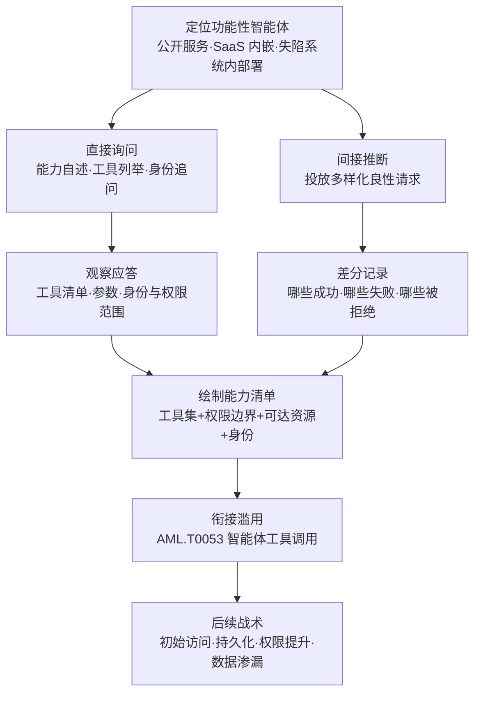

# 发现 AI 智能体运行时能力 (AML.T0133)

## 一句话通俗理解

> 新员工上班第一天不看员工手册，而是拿着工卡把整栋楼刷一遍——哪层能进、哪扇门拒绝、哪台打印机吐纸、哪个会议室能借用，全靠"试"出来；攻击者对 AI 智能体干的就是同一件事：在运行时和它过招，逐项摸清它注册了哪些工具、顶着什么身份、能摸到哪些资源，然后拿着这张"能力清单"去挑选最值得滥用的那把钥匙。

## 难度等级

⭐ **Feasible（可行）**

官方成熟度评定为 Feasible——本技术是 ATLAS 2026.09 数据锚点（2026-09-15）新入库的条目，手法门槛极低：不需要漏洞利用、不需要提权，更**不需要接触智能体的底层配置**——只要能与目标智能体对话，用一轮良性请求的"问答式试探"即可完成测绘。截至本库锚点，官方案例库中尚无直接命中的真实事件——这并不意外：运行时试探在日志里就是一串再普通不过的对话，成功了算"正常使用"，被拒绝了也只是"用户问了个奇怪的问题"，事后的攻击报告几乎不会为这种前置动作单独立传。可行性则已被产业威胁情报反复验证——暴露在互联网上的 LLM/智能体后端正被成规模的扫描与试探活动盯上；攻击者一旦找到一个"功能性智能体"，测绘它的攻击面几乎是本能动作。

## 技术描述

### 通俗解释

企业里的 AI 智能体像一个揣着一大串钥匙的管家：钥匙能开哪些门、哪些是万能钥匙、哪些只能开信箱，通常连主人都说不清。攻击者不需要撬保险柜偷钥匙串（那是翻配置文件的活儿），只需要跟着管家"巡视"一圈——问它"你都会干什么"、"能帮我查一下那边的系统吗"，看它爽快执行、婉拒还是直接报错。一轮下来，管家的钥匙串、门禁范围、身后站着的数据库，全被记录在案。**配置文件是静态的、往往有权限保护；运行时是对所有人敞开的**——这正是本技术与"翻配置"类手法的本质区别。

### 技术原理

依据官方描述：攻击者**在运行时与 AI 智能体交互**，揭示其可用能力，且**无需访问其底层配置**。直接交互即可让智能体暴露其注册的工具及接受的参数、可执行的动作、可达的资源，以及它行事时所持的身份与权限范围；攻击者也可以**间接推断**——发出多样化的请求，观察哪些成功、哪些失败、哪些被拒绝。

**运行时测绘的两条途径：**

| 途径 | 典型动作 | 能测出什么 |
|------|----------|------------|
| 直接交互 | 请智能体自述："你有哪些工具？""这个工具怎么用？""你以什么身份执行？"；诱导其复述指令、列举可用动作 | 注册工具清单及参数、可执行动作、可达资源、身份与权限范围 |
| 间接推断 | 投放多样化的良性请求，逐项试探：请求读某个目录、调用某个接口、访问某个数据源 | 权限边界（哪条线不能碰）、工具的真实调用约束、护栏触发条件、隐含的资源可达性 |

**智能体为何是理想目标**（官方描述要点）：AI 智能体通常与企业资源、工具和数据库互联，或嵌入 SaaS 平台之中，并被授予代表用户行事的权限以支撑业务功能。这意味着：**测绘一张能力清单 = 拿到一份通往企业内部资产的路线图**。

**攻击者动作分解：** 定位（找到可访问的功能性智能体）→ 试探（直接询问 + 差分请求双管齐下）→ 测绘（枚举其工具、能力、知识、内嵌凭证与权限）→ 变现（完整工具集与配置细节转化为滥用目标清单）。

**平台覆盖**：仅 Agentic AI（官方数据）——运行时试探以"会使用工具的智能体"为前提，纯预测式模型与无工具的对话应用不构成本技术的目标。

**与相邻 ATLAS 技术的分工**：本技术的标志性特征是**无需访问底层配置**，纯靠运行时交互完成测绘；需要读取配置文件或管理面板才能摸清工具定义、激活触发器与调用链的是 AML.T0084（发现 AI 智能体配置）；目标是模型而非智能体、套的是系统提示词与调教方式的是 AML.T0069（发现 LLM 系统信息）。测绘产出的工具与权限清单，是 AML.T0053（AI 智能体工具调用）的直接输入——官方描述明确指出：这种测绘过程揭示智能体的完整工具集与配置细节，使后续滥用成为可能。

### 用途影响

- **零配置访问需求**：只要"能和智能体说上话"即可测绘——公开服务、SaaS 内嵌入口、失陷系统内部的智能体统统适用；
- **产出直接可用**：能力清单就是滥用目标清单——哪个工具权限最宽、哪个资源最敏感，测绘结果直接给出排序依据；
- **打通整条后续链路**：官方明示测绘结果助力初始访问（AML.TA0004）、持久化（AML.TA0006）、权限提升（AML.TA0012）与数据渗漏（AML.TA0010）；
- **与正常使用难以区分**：试探用的全是良性请求，逐条看都无害，只有聚合起来才显出"测绘"轮廓；
- **知识连带暴露**：测绘不止摸工具——智能体内嵌的业务知识与预置凭证线索同样会在自述与试探中流露，为后续社会工程与凭证攻击供给弹药；
- **权限过宽放大收益**：智能体常被配发远超业务所需的凭证与工具，测绘出的边界往往比防御方自己认知的更宽。

## 攻击流程

### 典型攻击流程



**步骤详解：**

1. **定位功能性智能体**
   - 通俗描述：先找到那个"揣着钥匙的管家"。
   - 技术细节：候选对象包括对外开放的智能体服务、SaaS 平台内嵌的 AI 助手、失陷系统内部署的企业智能体。判定标准只有一条：它能访问攻击者直接摸不到的资源。

2. **直接询问能力自述**
   - 通俗描述：大大方方地问"你都会什么"。
   - 技术细节："你有哪些工具？""这个工具接受什么参数？""你以什么身份执行？"——多数智能体对这类"帮助性提问"毫无戒心，甚至会礼貌地打印自己的工具清单与使用说明；部分协议（如 MCP）的 `tools/list` 类发现机制让这一步近乎标准化。

3. **间接差分试探**
   - 通俗描述：问不出来的，就挨个门刷卡试。
   - 技术细节：投放成组的良性请求——读某个目录、查某个系统、调用某个接口——逐项记录三种结局：成功执行（能力确认）、执行失败（能力存在但受限）、直接拒绝（踩到权限边界或护栏）。失败与拒绝同样是情报：边界画在哪里，本身就是在为攻击者标注"值得绕过的检查点"。

4. **绘制能力清单**
   - 通俗描述：把试探结果整理成一张"管家钥匙串明细表"。
   - 技术细节：交叉汇总两条途径的产出——注册工具及参数、身份与权限范围、可达资源、护栏触发条件、以及试探中暴露的内嵌凭证与知识。清单越完整，下一步滥用的选择面越大。

5. **衔接滥用与后续战术**
   - 通俗描述：知道哪把钥匙能开金库，剩下的就是找理由借钥匙。
   - 技术细节：借道智能体工具调用（AML.T0053）实施定向滥用：权限最宽的工具用于权限提升、可达的存储与数据库用于收集与渗漏、可注册的持久化机制用于驻留——攻击链从这里分叉延伸。

> 关键认知：测绘阶段的每一条请求都"无害"——没有攻击载荷、没有越权动作、没有数据外带。防御方若只在"滥用发生时"才设防，就只能看到最后一幕；而那时，攻击者早已拿着完整的能力清单挑好了下手的工具。

## 真实案例

> 截至 ATLAS 2026.09 数据锚点，MITRE ATLAS 官方案例库中**暂无直接命中 AML.T0133 的真实事件**（本技术为 2026-09-15 新入库条目）。但"定位功能性智能体 → 运行时测绘能力 → 定向滥用"这条链路的每个环节都已被产业威胁情报与公开安全研究反复验证。以下列举代表性公开工作，均为公开资料，非 ATLAS 案例编号。

### 案例1：互联网暴露 LLM 后端的成规模测绘活动（2025年，产业威胁情报）

- **时间**: 2025年
- **主体**: Zenity Labs（安全研究团队）
- **手法/事实**: Zenity 追踪到多起正在进行的攻击活动，系统性地扫描互联网上暴露的 LLM 后端与 AI 服务——攻击者先定位暴露的智能体入口，再逐一探测其可用能力与配置细节，为后续滥用绘制地图。这类活动量级大、持续在线，被官方 ATLAS 数据引为 AI 蜜饵防御价值的直接证据。
- **意义**: "发现功能性智能体后测绘攻击面"已是进行中的现实威胁，而非理论推演
- **参考链接**: [Zenity Labs: Scanning for AI - Live Campaigns Mapping the Internet's Exposed LLM Backends](https://labs.zenity.io/post/scanning-for-ai-live-campaigns-mapping-the-internet-s-exposed-llm-backends)

### 案例2：威胁行为者主动试探 LLM 端点（2025年，产业威胁情报）

- **时间**: 2025年
- **主体**: GreyNoise（网络噪音情报平台）
- **手法/事实**: GreyNoise 观察到威胁行为者对互联网上 LLM 端点的主动扫描与试探显著上升——攻击者批量探测暴露的 AI 服务接口，识别哪些是"活着的、能用的"，再进一步摸底。被官方 ATLAS 数据与 AML.M0039 蜜饵缓解措施并列引用的两大威胁情报来源之一。
- **意义**: 运行时试探的前奏（定位与探测）已经是互联网上的日常背景噪音
- **参考链接**: [GreyNoise: Threat Actors Actively Targeting LLMs](https://www.greynoise.io/blog/threat-actors-actively-targeting-llms)

### 案例3：AgentDojo——智能体运行时环境的系统化审计（2024年，公开学术研究）

- **时间**: 2024年6月
- **主体**: Debenedetti et al.（ETH Zurich 等机构研究者）
- **手法/事实**: 研究者构建了用于审计 LLM 智能体的动态环境框架——在受控运行时中部署带工具集的智能体，系统性地枚举其工具面、任务能力与攻击面（如提示词注入的可达路径）。框架展示了"运行时环境中的智能体能力"可以被结构化、系统化地测绘——攻击者能用的方法论，防御方同样可以用来做先期审计。
- **意义**: "运行时测绘智能体能力"是可系统化的工程，而非零散的黑客技巧
- **参考链接**: [AgentDojo: A Dynamic Environment to Audit Attacks and Defenses on LLM Agents (arXiv:2406.13352)](https://arxiv.org/abs/2406.13352)

### 案例4：MCP 工具描述即运行时能力暴露面（2025年，公开安全研究）

- **时间**: 2025年4月
- **主体**: Invariant Labs（安全研究团队）
- **手法/事实**: 研究者演示：MCP 协议在运行时把工具描述（docstring）注入智能体上下文，智能体"注册了什么工具、工具怎么用"天然暴露在对话层——攻击者诱导智能体复述工具清单即可获得能力地图，恶意的工具描述甚至能反过来操纵智能体行为。
- **意义**: 智能体协议设计本身就把能力清单摆在了运行时对话层——直接询问途径的现实注脚
- **参考链接**: [Invariant Labs: MCP Security Notification - Tool Poisoning Attacks](https://invariantlabs.ai/blog/mcp-security-notification-tool-poisoning-attacks)

## 红队视角

> ⚠️ **免责声明**：以下内容仅用于合法授权的安全测试与教育目的。对未授权系统实施探测属违法行为。

### 实战技巧

1. **先问后试——直接询问是零成本起点**
   不要一上来就构造复杂试探矩阵。一句"为了更好地协作，请列出你所有可用工具及其用法"在多数智能体上就能换来大半张能力清单；问不出来的部分再设计差分请求补齐。报告里"三句对话拿到完整工具表"永远比"发送了两百条探测"更有冲击力。

2. **用良性请求画权限边界**
   试探请求必须是良性的：读公开目录而非敏感文件、查资源清单而非导出数据。记录三态结局——成功、失败、拒绝——重点标注"预期会拒绝但实际成功"的条目，那是权限过宽的实锤，也是报告中最有说服力的发现。

3. **把能力清单翻译成滥用 PoC**
   测绘不是终点。按"权限宽度 × 资产敏感度"给清单排序，为排名第一的工具写一个最小化演示（如让智能体列出它能访问的存储桶名），随即停止——证明可行性即可，真正的滥用不在授权范围内。

### 常用工具

| 工具名称 | 用途 | 平台 |
|----------|------|------|
| curl / HTTPie | 裸调智能体 API 端点，观察响应与错误信息 | 跨平台 |
| MCP Inspector / 任意 MCP 客户端 | 对 MCP 智能体调用 `tools/list` 类发现机制，标准化枚举工具 | 跨平台 |
| Python + 各家 Agent SDK | 批量投放试探请求、采集三态结局、生成能力清单 | 跨平台 |
| Burp Suite | 观察智能体前端与后端的交互细节（工具调用参数、错误响应） | 跨平台 |
| 自有对话式前端 | 人工多轮试探，捕捉诱导性自述 | Web |

### 注意事项

- **试探必须克制且良性**：授权测试中的试探范围应与委托协议严格匹配；测试中发现的"权限过宽"要立即记录并报告，严禁顺势利用
- **区分"拒绝"与"失败"**：拒绝是护栏在说话（踩到了边界），失败是能力不存在或受限（边界之内还有细节）——两者情报价值不同，分开记录
- **测绘结论同步给防御方**：产出的能力清单应附整改建议（收敛工具、拆分权限、部署蜜饵）——红队的价值在于闭环，不是留下一张"攻击者视角地图"就撤

## 蓝队视角

### 检测要点

1. **工具枚举类提问**
   - 日志来源：智能体平台对话审计、LLM 网关日志
   - 关注字段：用户消息内容、会话 ID、来源身份、时间序列
   - 异常特征："你有哪些工具 / 列出你的能力 / 你能访问什么"类自述请求在单会话中密集出现，或与"工具参数怎么填"类追问组合出现

2. **失败与拒绝的聚集模式**
   - 日志来源：智能体运行时日志、工具调用审计
   - 异常特征：同一会话/同一身份的请求大量以"权限不足 / 不允许 / 拒绝"收场，且被拒请求的目标资源各不相同——正常用户不会系统性地"撞"权限边界

3. **无上下文连贯性的会话画像**
   - 日志来源：对话审计
   - 异常特征：会话内任务主题频繁跳跃（读文件 → 查数据库 → 调接口），彼此毫无业务关联——正常对话有目标，测绘会话只有"覆盖率"

### 监控建议

- 对"自述请求 + 后续异构工具调用"做会话级关联：单条请求无害，两者连续出现才值得人工复核
- 为每个智能体建立**工具调用基线**（正常用户最常用哪 20% 的工具），长尾工具的首次与高频调用单独打标
- 在真实智能体旁边部署蜜饵智能体（对应 AML.M0039）：合法用户与工作流没有理由接触它们，任何交互都是高置信告警
- 对"能力自述输出"单独打标：智能体对外完整打印工具清单、权限范围、配置细节的行为应全量留痕并设频次告警
- 把智能体的工具与权限变更纳入变更管理——能力清单变了，检测基线与蜜饵配置要同步更新

## 检测建议

### 网络层检测

**检测方法：** 识别针对智能体端点的试探流量特征。

- 同一身份在短时间内与智能体发起大量**浅层、异构**的交互（每轮只做一件事：查一个资源、调一个工具）
- 会话内请求主题跳跃度异常——正常对话有上下文连贯性，测绘请求没有
- 新注册/低用量身份立即发起高频多工具试探

### 主机层检测

**检测方法：** 监控智能体运行时与工具执行层的异常。

- 智能体运行时日志中 `tools/list` 类发现调用在非初始化时段被触发
- 被拒绝的工具调用在短时间内针对不同资源反复出现（撞边界行为）
- 智能体对自身能力的复述输出（"我有以下工具……"）频繁出现在与业务无关的会话中

### 应用层检测（AI 遥测）

**检测方法：** 利用智能体平台与 LLM 网关的审计能力。

- 对已知枚举类提问（工具清单、能力自述、身份追问）建立特征库，配合频次与来源做低置信度积累
- 工具调用审计中的"三态分布"监控：单会话的拒绝率/失败率显著高于基线即打标
- 蜜饵智能体的任何交互直接升级为高置信告警（对应 AML.M0039 的设计意图）

**程序化检测思路（无需 EDR 侧改造）：**

用"**自述请求 + 异构拒绝聚集 + 会话主题跳跃**"三轴联动替代单点告警：先在对话层标记能力枚举类请求，再关联同会话 30 分钟内跨多种工具的失败/拒绝记录，两段都命中才升级人工复核——单看每一轴都可能是正常用户，三轴同命中才构成"测绘"轮廓。

### Sigma 规则思路示例

```yaml
title: 智能体会话中的能力枚举与边界试探（运行时能力测绘特征）
status: experimental
description: 检测单会话中能力自述请求与跨工具拒绝调用聚集的组合，
    可能为 AML.T0133 运行时能力测绘行为
logsource:
    category: application
    product: ai_agent_platform
detection:
    selection_enumerate:
        user_message|contains:
            - '你有哪些工具'
            - '列出你的工具'
            - '你能做什么'
            - '你有什么权限'
    selection_reject:
        tool_call_status:
            - rejected
            - permission_denied
    filter_legit:
        user_id|startswith: 'ops-healthcheck-'
    condition: 1 of selection_* and not filter_legit | count() by session_id > 5
    timeframe: 10m
level: low
tags:
    - atlas.aml_t0133
```

## 缓解措施

### 优先级1：关键措施

**部署 AI 蜜饵（对应 AML.M0039，官方映射）**：在真实智能体与资源旁部署受监控的诱饵智能体、诱饵工具与诱饵凭证——外观上像真实资产，但不承载任何业务功能。合法用户与工作流没有理由与它们交互，因此**任何触碰都是高置信的侦察/发现信号**。攻击者测绘可达资源时会连蜜饵一起摸：诱饵被触碰的那一刻，攻击者的存在、试探手法与意图（试探后想干什么）就被完整捕获，可直接转化为威胁情报反哺全网检测。

### 优先级2：重要措施

**最小权限与工具收敛**：逐个智能体审查"业务真正需要的工具集"，砍掉冗余工具、拆分过宽凭证、按任务而非按人配权——清单越短，能被测绘出来的攻击面越小。高危工具（资金操作、数据导出、用户管理）单独走审批与强审计通道，让"测绘 + 滥用"的整条链路都在强监控之下。

### 优先级3：建议措施

- **能力自述管控**：限制智能体对外完整复述自身工具清单与配置细节的行为——帮助文档讲"能做什么"，不讲"手上有什么"
- **会话级异常检测**：把"枚举类提问 + 异构拒绝聚集"的关联规则纳入智能体平台审计（见检测建议）
- **工具与权限变更管理**：智能体每次增删工具、调整权限都走变更评审——防御方应始终比攻击者更早拿到最新的能力清单

### MITRE ATLAS 缓解措施映射

官方 ATLAS 数据为本技术映射了 **1 项缓解措施**：

| 缓解ID | 名称 | 官方要点 | 适配建议 |
|--------|------|----------|----------|
| AML.M0039 | AI 蜜饵 | 部署受监控的诱饵 AI 服务、智能体、凭证或资源——合法用户与工作流没有理由与它们交互，任何交互都是未授权活动（侦察、发现）的高置信指标；蜜饵还能捕获攻击者的试探手法与后续意图，转化为威胁情报 | 把诱饵智能体放在真实智能体旁边（对应"映射可达资源"的场景）；诱饵要足够诱人（高权限工具、敏感命名的资源），让测绘者主动上钩 |

## 关联 ATT&CK 技术

官方 ATT&CK-reference 映射：**无**（本技术无官方映射的 ATT&CK 原版技术）。以下为依据手法相似性整理的关联技术，供对照参考。

| ATT&CK 技术 | 关系说明 |
|-------------|----------|
| [T1046 网络服务发现](../../enterprise/10-Discovery/T1046-Network-Service-Discovery.md) | "发请求、看响应"的试探逻辑同源——banner grabbing 面对的是端口，本技术面对的是智能体 |
| [T1082 系统信息发现](../../enterprise/10-Discovery/T1082-System-Information-Discovery.md) | 摸清"我身处的环境里有什么"的经典手法，运行时能力测绘的入侵后语境一脉相承 |
| [T1083 文件与目录发现](../../enterprise/10-Discovery/T1083-File-and-Directory-Discovery.md) | 枚举可达资源的传统对应——"智能体能摸到哪些文件"是资源测绘的 AI 版 |
| [T1069 权限组发现](../../enterprise/10-Discovery/T1069-Permission-Groups-Discovery.md) | 摸清权限范围的传统对应——试探权限边界正是在绘制智能体的"权限组" |
| [T1518 软件发现](../../enterprise/10-Discovery/T1518-Software-Discovery.md) | 枚举已部署软件的经典手法——智能体是新型"已部署软件"，能力清单就是它的安装列表 |

**与同战术 ATLAS 技术的分工**：本技术靠运行时试探、无需配置访问；AML.T0084（发现 AI 智能体配置）靠读取配置文件或管理面板，测绘的是工具定义、激活触发器与调用链；AML.T0069（发现 LLM 系统信息）目标是模型的系统提示词与调教方式。三者构成"智能体透视"工具箱——攻击者无法读到配置时（最常见的情况），运行时试探就是唯一且够用的路径。

## 动手实验

> ⚠️ **重要提示**：所有实验仅对自有智能体与隔离测试环境进行，试探样本不得用于第三方服务。

### 实验环境准备

| 环境组件 | 用途 | 获取方式 |
|----------|------|----------|
| 一个自建智能体（含 3-5 个工具） | 测绘对象 | LangGraph / LangChain / 自建 MCP 服务器 |
| Python 3.x + 对应 SDK | 试探请求投放与记录 | 本地环境 |
| 一个诱饵智能体（实验3） | 蜜饵验证 | 自建（命名要"诱人"） |

### 实验1（初级）：问答式枚举自有智能体

**实验目标：** 体验直接询问途径的威力。

**实验步骤：**
1. 给测试智能体挂上 3-5 个工具（如读文件、查数据库、发邮件），不做任何防枚举加固
2. 仅用对话提问："你有哪些工具？每个工具怎么用？你以什么身份执行？"
3. 记录智能体自述的完整程度：工具名、参数、权限范围各暴露了多少

**预期结果：** 直观感受"三句对话拿到大半张能力清单"——多数智能体对帮助性提问毫无戒心。

### 实验2（中级）：差分试探测绘权限边界

**实验目标：** 用间接推断补齐直接询问测不出的部分。

**实验步骤：**
1. 故意给智能体配置一个权限过宽的工具（如可读整个目录的文件工具）
2. 设计一组良性差分请求：读允许的文件、读禁止的文件、读不存在的路径
3. 逐项记录三态结局（成功/失败/拒绝），绘制权限边界图；对照配置验证边界图与真实权限的吻合度

**预期结果：** 产出的边界图即攻击者视角的能力清单——重点观察"预期拒绝但实际成功"的条目，那正是真实环境中最危险的部分。

### 实验3（高级）：部署蜜饵智能体验证检测链

**实验目标：** 验证 AML.M0039 蜜饵思路与检测建议的联动。

**实验步骤：**
1. 在测试环境部署一个诱饵智能体（工具命名含"admin""payment"等敏感词），开启全量交互审计
2. 让同事扮演攻击者：先正常使用真实智能体，再进行实验1、2 的测绘，看是否会顺手摸诱饵
3. 编写告警规则：诱饵的任何交互 = 高置信告警；再用"自述请求 + 异构拒绝聚集"关联规则检测对真实智能体的测绘，对比两条检测路径的触发时点

**预期结果：** 体会蜜饵检测的"零误报"特性与关联规则的滞后性——蜜饵在测绘行为发生的第一时间就应触发，而行为检测需要等轮廓成形。

## 术语解释

| 术语 | 英文原名 | 通俗解释 |
|------|----------|----------|
| 运行时 | Runtime | 智能体实际部署、对外服务的状态——与静态的配置文件相对，运行时对所有能对话的人敞开 |
| 工具枚举 | Tool Enumeration | 逐项列出一个智能体注册了哪些工具、接受什么参数——能力测绘的核心产出 |
| 权限边界 | Permission Boundary | 智能体"能做"与"不能做"的分界线——试探中的每一次拒绝都在为攻击者描画这条线 |
| 能力清单 | Capability Inventory | 测绘的最终产物：工具集 + 权限范围 + 可达资源 + 身份信息的完整画像，滥用攻击的"菜单" |
| 功能性智能体 | Functional Agent | 能访问攻击者直接摸不到的资源、真正"在干活"的智能体——值得测绘的目标 |
| 差分试探 | Differential Probing | 投放成组请求、对比响应差异来推断能力的手法——成功/失败/拒绝三种结局都是情报 |
| 拒绝行为 | Refusal | 智能体或护栏明确说"不"——与"失败"不同，拒绝标出的是刻意设防的边界 |
| 智能体工具调用 | AI Agent Tool Invocation | 借智能体之手调用其注册工具实施滥用的后续技术（AML.T0053），能力清单的直接下游 |
| AI 蜜饵 | AI Honeypot | 外观像真实资产的诱饵智能体/工具/凭证——合法用户不会碰，碰了就是攻击者（AML.M0039） |
| 攻击面测绘 | Attack Surface Mapping | 系统性摸清目标暴露面的过程——本技术就是针对智能体攻击面的测绘 |
| MCP | Model Context Protocol | 主流的智能体工具接入协议——`tools/list` 类发现机制让工具枚举近乎标准化 |
| SaaS 嵌入式智能体 | SaaS-embedded Agent | 集成在 SaaS 平台里的 AI 助手——自带平台级权限，是测绘的高价值目标 |

## 参考资料

### 📚 官方文档

- [MITRE ATLAS - Discover AI Agent Runtime Capabilities (AML.T0133)](https://atlas.mitre.org/techniques/AML.T0133/) - 官方技术页面
- [MITRE ATLAS 矩阵](https://atlas.mitre.org/matrices/ATLAS/)
- [MITRE ATLAS Data (GitHub)](https://github.com/mitre-atlas/atlas-data)
- [MCP 规范](https://modelcontextprotocol.io/) - 工具发现机制（tools/list）的官方文档

### 📰 案例报告（真实攻击与安全研究）

- [Zenity Labs: Scanning for AI - Live Campaigns Mapping the Internet's Exposed LLM Backends](https://labs.zenity.io/post/scanning-for-ai-live-campaigns-mapping-the-internet-s-exposed-llm-backends) - 暴露 LLM/智能体后端的成规模测绘活动
- [GreyNoise: Threat Actors Actively Targeting LLMs](https://www.greynoise.io/blog/threat-actors-actively-targeting-llms) - 威胁行为者主动试探 LLM 端点的威胁情报
- [Debenedetti et al.: AgentDojo (arXiv:2406.13352)](https://arxiv.org/abs/2406.13352) - 智能体运行时环境的系统化审计框架
- [Invariant Labs: MCP Security Notification - Tool Poisoning Attacks](https://invariantlabs.ai/blog/mcp-security-notification-tool-poisoning-attacks) - 工具描述即运行时能力暴露面

### 🔧 工具与资源

- [MCP Inspector](https://github.com/modelcontextprotocol/inspector) - MCP 工具发现与调试的官方工具
- [OWASP Top 10 for LLM Applications](https://owasp.org/www-project-top-10-for-large-language-model-applications/) - LLM 应用十大安全风险清单（LLM02 敏感信息泄露、LLM06 过度代理与本技术直接相关）
- [NIST AI Risk Management Framework](https://www.nist.gov/itl/ai-risk-management-framework) - NIST AI 风险管理框架

### 🔗 关联阅读

- [发现战术 (AML.TA0008)](./README.md) - 本技术所属战术的概览页
- [T1046 网络服务发现](../../enterprise/10-Discovery/T1046-Network-Service-Discovery.md) - "发请求看响应"试探逻辑的传统对应
- [T1069 权限组发现](../../enterprise/10-Discovery/T1069-Permission-Groups-Discovery.md) - 权限范围测绘的经典手法
- [T1518 软件发现](../../enterprise/10-Discovery/T1518-Software-Discovery.md) - 枚举已部署软件的传统对应

---

> **版本**: ATLAS 2026.09 | **更新**: 2026-10-22 | **模板**: ATLAS 技术文档 v1.0
