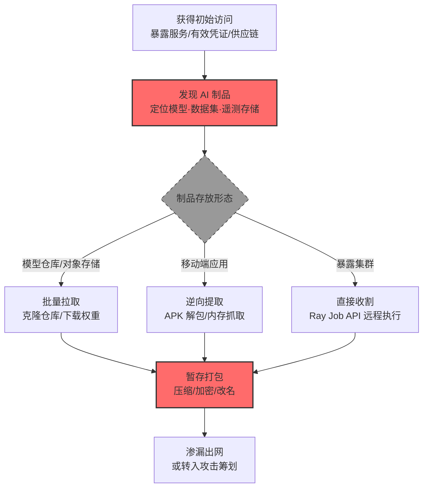

# AI 制品收集 (AML.T0035)

## 一句话通俗理解

> 小偷进屋不偷现金首饰，直奔保险柜拷走你家祖传配方——攻击者翻遍 AI 系统，把训练好的模型、训练数据集和交互记录整锅端走，这比偷什么都能变现。

## 难度等级

⭐⭐⭐ **Realized（已实现）**

官方成熟度评定为 Realized——该技术已在真实攻击与公开研究中被完整实现：微软 AI 红队在内部 Azure 服务演练中找到了目标模型文件与训练数据（AML.CS0010）；安全研究者从暴露在公网的 Ray 集群上收割多家组织的生产模型与数据（AML.CS0023）；Skyld 研究者从 Google Photos 安卓应用的 APK 中提取出未加密的 TensorFlow Lite 模型（AML.CS0058）。实施门槛不高的原因在于**AI 制品天生"大而显眼"**：模型文件格式特征明确（.pt/.pth/.onnx/.tflite/.safetensors）、存储位置集中（模型仓库、对象存储、制品库），一旦取得读取权限，"找到并搬走"几乎是水到渠成的事。

## 技术描述

### 通俗解释

AI 系统最值钱的资产不是代码，而是三类**AI 制品**（AI Artifacts）：

1. **模型**——训练好的神经网络权重文件，凝聚了数据、算力与算法的投入，偷走即可复刻产品；
2. **数据集**——训练与评估数据，可能包含商业机密、个人敏感信息或专有标注成果；
3. **模型交互遥测**——用户与模型交互产生的数据（对话记录、日志、反馈），既可能直接泄露商业情报，也可用于训练代理模型。

攻击者的算盘：与其从零训练一个模型（贵、慢、差），不如直接偷一个现成的。偷到的制品有两个去向——**直接渗漏变现**（卖给竞争对手、公开勒索），或**用于筹划后续 AI 攻击**（离线演练对抗样本、构建代理模型、分析模型弱点）。

### 技术原理

依据官方描述，攻击者可能收集 AI 制品以用于**渗漏**（Exfiltration）或**AI 攻击筹划**（AI Attack Staging，即后续的攻击适配战术）。AI 制品包括模型与数据集，以及与模型交互时产生的其他遥测数据。

**高价值制品的典型存放位置：**

| 制品类型 | 常见载体 | 典型体积 | 泄露后果 |
|---------|---------|---------|---------|
| 模型权重 | 模型仓库（HF/MLflow）、对象存储、制品库、移动端 APK | 10MB—数百GB | 产品被复刻、IP 流失 |
| 训练/评估数据集 | 对象存储、数据湖、数据集服务 | GB—TB 级 | 商业机密与隐私泄露 |
| 交互遥测（对话/日志） | 日志平台、向量库、数据库 | 持续增长 | 用户隐私、业务情报泄露 |
| 部署配置与提示词 | 配置中心、代码仓库 | KB—MB 级 | 系统提示词等核心资产泄露 |

**攻击链上下游衔接**：

- **上游定位**：[发现 AI 制品 (AML.T0007)](../11-Discovery/AML.T0007-Discover-AI-Artifacts.md) 先行——找到制品在哪、谁能访问；凭证访问战术（令牌窃取、不安全凭证）解决"读权限"问题；
- **下游去向**：渗漏战术（AML.TA0010，待编写）把制品搬出目标环境；攻击适配战术（[AML.TA0001](../03-AI-Attack-Adaptation/README.md)）把偷来的模型当作攻击原料——[创建代理 AI 模型 (AML.T0005)](../03-AI-Attack-Adaptation/AML.T0005-Create-Proxy-AI-Model.md)、[操纵 AI 模型 (AML.T0018)](../03-AI-Attack-Adaptation/AML.T0018-Manipulate-AI-Model.md) 都以窃取的制品为起点。

**平台覆盖**：Predictive AI / Generative AI / Agentic AI 三类全覆盖——无论传统 ML 推理服务、生成式大模型还是智能体系统，都有模型与数据可偷。

### 用途影响

- **知识产权直接流失**：模型权重是重资产的结晶，一次拷贝等于整条训练管线的成果被复制；
- **训练数据泄露**：数据集可能包含海量个人信息、商业机密、专有标注，触发合规与法律风险；
- **下游攻击的弹药库**：偷到的模型可离线演练对抗攻击、构建代理模型、提取系统提示词——收集是后续一切 AI 攻击筹划的原料入口；
- **隐私大规模泄露**：模型交互遥测（对话记录）包含用户最敏感的提问内容。

## 攻击流程

### 典型攻击流程



**步骤详解：**

1. **获得初始访问**
   - 通俗描述：先进门，再开保险柜。
   - 技术细节：暴露在公网且无认证的服务（CS0023 的 Ray 集群 Job API）、被攻陷的凭证与账户、云上错误配置的存储桶、或本地恶意代码（CS0058 的逆向路径）。

2. **发现 AI 制品**
   - 通俗描述：搞清楚配方锁在哪个柜子里。
   - 技术细节：枚举模型仓库、容器注册表、对象存储前缀（model/、checkpoint/、dataset/），识别权重文件格式与目录结构——制品大而显眼，定位不难。

3. **收集制品**
   - 通俗描述：整锅端走。
   - 技术细节：克隆模型仓库（连带版本历史）、下载数据集分片、导出对话日志；移动端场景则解包 APK 提取 assets 与 native 库中嵌入的模型（CS0058），或用 Frida 动态抓取运行时解密的模型；暴露集群场景用 Job API 提交任务直接打包（CS0023）。

4. **暂存打包**
   - 通俗描述：装箱，准备运走。
   - 技术细节：大文件压缩分卷、必要时改名伪装，集中到临时暂存目录——与数据暂存（AML.T0127）衔接。

5. **渗漏或转入攻击筹划**
   - 通俗描述：出手变现，或留着自己用。
   - 技术细节：经渗漏通道（云存储同步、HTTPS 外传）出网变现；或留存用于离线对抗演练、代理模型构建、系统提示词提取。

**与后续战术的衔接：**

- **数据渗漏**：大体积制品的搬运是网络流量的显眼事件，是防御方最后的拦截窗口
- **AI 攻击适配**：偷到的模型成为对抗样本、模型提取、越狱研究的第一手材料

> 关键认知：传统数据窃取偷的是"数据本身"，AI 制品收集偷的是"生产能力"——模型+数据+提示词的组合等于把竞争对手的研发成果整体复制。

## 真实案例

> 以下案例全部来自 MITRE ATLAS 官方案例库，均直接关联本技术。

### 案例1：ShadowRay——暴露 Ray 集群上的生产模型收割（2023年9月，AML.CS0023）

- **时间**: 2023年9月5日（Oligo 披露）
- **攻击者**: 未知攻击者（真实入侵事件）
- **手法**: Ray 是用于扩展生产 AI 工作流的开源框架，其 Job API 设计上允许任意远程执行，且默认无认证、可能暴露在公网。Oligo 研究者发现 Ray 集群已被活跃利用至少七个月——攻击者直接利用 Job API 提交任务，**收集生产模型与数据**（"could collect AI artifacts including production models and data"），并在受害组织的算力上白嫖运行自己的工作负载，研究者观察到多家组织、多个行业的生产工作负载在跑。受影响机器估值近 10 亿美元。
- **影响**: 真实事件（Incident）——证明暴露的 AI 基础设施等于把"模型+数据+算力"打包送给攻击者；Anyscale 以"设计如此"为由未完全修复，相关 CVE 争议持续至今
- **参考链接**: [Anyscale Update on Ray CVEs](https://www.anyscale.com/blog/update-on-ray-cves-cve-2023-6019-cve-2023-6020-cve-2023-6021-cve-2023-48022-cve-2023-48023)

### 案例2：Skyld——从 Google Photos APK 中提取 AI 模型（2025年3月，AML.CS0058）

- **时间**: 2025年3月1日（研究发布）
- **攻击者**: Skyld 研究团队（安全研究）
- **手法**: 研究者分析 Google Photos 安卓应用，恢复了其 AI 照片编辑与图像分析功能使用的 TensorFlow Lite 模型：**未加密的 assets 目录、嵌入 native 库的模型、磁盘上加密的模型**三处位置全部提取成功——静态逆向定位 TFLite 制品，配合 Frida 动态插桩捕获运行时解密后的模型，最终取得对 Google Photos 专有模型制品的白盒访问。
- **影响**: 研究演练（Exercise）——证明移动端分发的模型天然暴露：无论是否加密，只要在用户设备上运行，就存在被静态或动态提取的一天；拿到白盒模型即可离线分析、构建代理模型
- **参考链接**: [Skyld: Google Photos AI Models - The Secret Sauce That Can Be Stolen](https://skyld.io/google-photos-model-extraction)

### 案例3：微软 AI 红队演练——内部 Azure 服务模型与训练数据收集（2020年，AML.CS0010）

- **时间**: 2020年（红队演练）
- **攻击者**: Microsoft AI Red Team（授权红队）
- **手法**: 微软 AI 红队针对一项内部 Azure 服务执行破坏演练，目标是中断其服务。攻击链混合了传统 ATT&CK 技术与对抗 ML 专属步骤：**红队找到了目标 ML 模型的模型文件与所需训练数据**（"found the model file of the target ML model and the necessary training data"），结合有效账户发现与数据渗漏等企业战术，以及离线/在线规避等 ML 手法完成演练。
- **影响**: 授权演练——展示"传统企业攻击链 + 制品收集"的组合拳：拿到模型文件后攻击者即可离线分析、构造对抗样本、实施模型规避
- **参考链接**: [Microsoft: Lessons from Red Teaming an ML-powered Service](https://www.youtube.com/watch?v=YKff0Gy3Aek)

### 案例4：Google Colab 任意代码执行——Notebook 环境中的制品搜刮（2022年7月，AML.CS0018）

- **时间**: 2022年7月（研究发布）
- **攻击者**: Tony Piazza（安全研究）
- **手法**: Google Colab 是运行在虚拟机上的 Jupyter Notebook 服务，Notebook 中的 Python 代码与 Unix 命令可直接执行、可从互联网下载任意文件、可操作虚拟机文件系统。研究者演示：恶意 Notebook 通过分享链接传播，用户打开即执行恶意代码——**攻击者在受害者系统上搜索私有与专有数据，包括 ML 模型制品**（Jupyter Notebook 允许执行 shell 命令，天然适合全盘搜刮）。
- **影响**: 研究演练——数据科学家的 Notebook 环境既是制品的生产地也是聚集地，"共享 Notebook"这一协作习惯成为制品收集的投递载体
- **参考链接**: [Be careful who you colab with](https://medium.com/mlearning-ai/careful-who-you-colab-with-fa8001f933e7)

## 红队视角

> ⚠️ **免责声明**：以下内容仅用于合法授权的安全测试与教育目的。未经授权对他人系统或第三方 AI 服务进行测试是违法行为。

### 实战技巧

1. **制品资产测绘**
   在授权评估中梳理目标组织的 AI 制品资产清单：模型仓库与注册表（HF、MLflow、ECR/GCR）、对象存储中的 checkpoint 与数据集目录、制品库（Artifactory）、数据集服务。产出"制品 × 位置 × 权限 × 体积"的暴露面矩阵。

2. **读取路径验证**
   验证从初始立足点到制品存储的读取路径：哪些服务账号能读模型仓库？对象存储桶策略是否允许跨账号读取？CI/CD 任务的拉取凭证是否长期有效？只验证路径可达性，不实际搬运制品。

3. **大文件外传通道评估**
   模型动辄 GB 级，渗漏通道是实战瓶颈。评估目标环境的出网策略：云存储同步（S3 跨账户复制）、代码仓库 LFS、容器镜像层夹带等"合法大流量通道"的可用性。

3. **移动端制品提取演练**
   针对自有 App：解包 APK 检查 assets 与 lib 中的模型文件是否明文存放；用 Frida hook 模型加载函数验证运行时解密模型能否被转储。

### 常用工具

| 工具名称 | 用途 | 平台 |
|----------|------|------|
| huggingface-cli / git lfs | 自有环境中模拟模型仓库克隆的大流量行为 | 跨平台 |
| apktool / unzip + binwalk | 解包移动应用，定位嵌入的模型制品 | 跨平台 |
| Frida | 动态插桩捕获运行时解密的模型 | Android/iOS |
| kubectl / aws s3 / gsutil | 授权环境中验证制品存储的读取路径 | 跨平台 |

### 注意事项

- **绝不搬运真实制品出评估范围**：制品包含客户 IP，验证"能读"即停
- 报告聚焦"制品治理缺口"：谁能访问、是否有加密、出网通道是否被监控
- 演练产生的任何制品副本当场销毁

## 蓝队视角

### 检测要点

1. **存储层：制品批量读取**
   - 日志来源：模型仓库审计日志、对象存储访问日志
   - 关注字段：主体、操作（Download/GetObject）、对象体积、请求速率
   - 异常特征：单主体短时间批量拉取模型文件、从未访问过制品库的账户突然活跃、克隆操作带走完整版本历史

2. **流量层：大体积外传**
   - 日志来源：出口流量监控、云流量镜像
   - 关注字段：目的域名/网段、单连接字节数、会话时长
   - 异常特征：向陌生对象存储/网盘的 GB 级上传、异常时段的持续大流量、压缩包特征（zip/gzip magic bytes）

3. **端点层：制品搜索行为**
   - 日志来源：主机 EDR、进程审计
   - 关注字段：进程命令行、文件访问路径
   - 异常特征：批量 `find`/`grep` 扫描模型文件后缀、脚本遍历 checkpoint 目录、APK 解包工具链的异常使用

### 监控建议

- **对模型仓库实施"谁在拉什么"的审计基线**：训练/部署流水线的拉取行为是可预期的，偏离流水线模式的拉取单独告警
- **大文件读取与外传联动检测**：制品收集的完整链路是"存储读取 → 暂存 → 出网"，三段联动出现即高置信度
- **移动端依赖加固审计**：App 发布流水线中检查模型是否明文打包（对应官方缓解 AML.M0017 的边缘部署风险）

## 检测建议

### 应用层检测（AI 遥测）

**检测方法：** 在模型仓库、数据集服务与推理平台的审计层监控制品访问。

- 制品维度：模型文件下载、数据集导出、仓库克隆的频率与主体
- 身份维度：非流水线身份的制品访问、闲置服务账号突然拉取
- 行为维度：同一主体对多类制品（模型+数据+日志）的连环读取

### 网络层检测

**检测方法：** 监控大体积数据的读取与外发特征。

- 对象存储/制品库的异常下载速率与总量
- 出口方向 GB 级持续传输、流向陌生存储服务
- 数据库/日志平台的大批量导出查询（交互遥测收集）

### 主机层检测

**检测方法：** 覆盖制品搜索与移动端提取环节。

- 全盘扫描模型后缀（.pt/.onnx/.tflite/.safetensors）的脚本行为
- Notebook 环境中执行 shell 命令打包制品的进程链
- 移动设备上 Frida/调试器附加应用进程的异常行为

### 检测规则思路示例

```yaml
title: 模型仓库非流水线主体批量下载模型制品
status: experimental
description: 检测非预期主体在模型仓库批量拉取模型文件，
    可能预示 AI 制品收集行为（AML.T0035）
logsource:
    category: application
    product: model_registry
detection:
    selection:
        event_type: 'artifact_download'
        object_type:
            - 'model'
            - 'dataset'
    filter_pipeline:
        caller_identity|endswith: '-ci-pipeline'
    condition: selection and not filter_pipeline
    correlation:
        - group_by: caller_identity
        - sum(object_size_mb): '>= 1024'
        - timeframe: 1h
falsepositives:
    - 新部署的分布式训练任务预热拉取
    - 灾备同步任务（需按任务身份白名单化）
level: high
tags:
    - atlas.aml_t0035
```

## 缓解措施

> **映射说明**：截至 ATLAS 2026.09 数据版，MITRE ATLAS 官方数据为本技术映射了 4 项官方缓解措施（AML.M0001 / M0005 / M0012 / M0017）。以下按防御优先级组织，官方映射在表格中如实标注。

### 优先级1：关键措施

**AML.M0005 静态控制 AI 模型与数据的访问（官方映射）**

在内部模型注册表上建立访问控制，限制对生产模型的内部访问；训练数据仅限批准的用户访问。这是对抗制品收集的第一道闸门——**绝大多数制品收集的前提是"读权限过度开放"**：模型仓库全员可读、对象存储桶策略宽松、服务账号权限大于实际需要。收缩读权限直接抬高攻击者的进入成本。

### 优先级2：重要措施

**AML.M0012 加密敏感信息（官方映射）**

对模型等敏感数据加密，对抗试图访问敏感数据的攻击者。加密不能阻止已持有读取权限的攻击者（他们能合法解密读取），但能保护**静态落盘**的制品：对象存储被错误公开、备份介质丢失、终端被翻盘时，加密是最后一道防线。CS0058 中 Google Photos 对磁盘模型加密的做法让简单静态提取失效，攻击者被迫转向更复杂的运行时动态抓取。

**AML.M0001 限制模型制品发布（官方映射）**

限制公开披露技术项目细节——包括生产中使用（或具有代表性）的数据、算法、模型架构与模型 checkpoint。公开发布的制品既是"给攻击者的礼物"（可直接用于代理模型构建），也泄露了架构情报。发布前评估：这个制品暴露后，攻击者能离线做什么？

### 优先级3：建议措施

**AML.M0017 AI 模型分发方式（官方映射）**

将模型部署到边缘设备会扩大攻击面，考虑在云端服务模型以降低攻击者可获得的访问级别；同时在云端计算特征以防范灰盒攻击（攻击者可观察部分内部信息）。移动端分发的模型天然处于攻击者完全控制的设备上——CS0058 证明无论是否加密，只要在用户设备运行就有被提取的一天。高价值模型优先云端 API 化分发。

### MITRE ATLAS 缓解措施映射

| 缓解措施ID | 缓解措施名称 | 优先级 | 官方映射 | 说明 |
|------------|-------------|:------:|:-------:|------|
| AML.M0005 | 静态控制 AI 模型与数据的访问 | 关键 | 是 | 模型注册表访问控制，训练数据最小授权 |
| AML.M0012 | 加密敏感信息 | 重要 | 是 | 制品静态加密，抬高离线/物理路径的窃取成本 |
| AML.M0001 | 限制模型制品发布 | 重要 | 是 | 收缩公开披露的制品与架构情报 |
| AML.M0017 | AI 模型分发方式 | 建议 | 是 | 高价值模型云端服务化，避免边缘明文分发 |

## 关联 ATT&CK 技术

ATLAS 官方数据未为本技术映射 ATT&CK 参考——AI 制品是 ATLAS 独有的目标类型。以下为概念上最接近的企业版技术，供对照理解：

- [来自云存储的数据 (T1530)](../../enterprise/12-Collection/T1530-Data-from-Cloud-Storage.md) — 场景相近：模型仓库与数据集大多落在对象存储上，制品收集的第一站常是云存储桶
- [来自本地系统的数据 (T1005)](../../enterprise/12-Collection/T1005-Data-from-Local-System.md) — 端侧路径：终端与 Notebook 环境中的模型文件收集走本地系统（对应 AML.T0037）
- [数据暂存 (T1074)](../../enterprise/12-Collection/T1074-Data-Staged.md) — 下游衔接：大体积制品搬运前的集中暂存（对应 AML.T0127）

**传统数据收集 vs AI 制品收集：**

| 维度 | ATT&CK 传统收集 | ATLAS AML.T0035 |
|------|---------------|-----------------|
| 收集目标 | 文件、凭证、邮件、音视频 | 模型权重、数据集、模型交互遥测 |
| 单件价值 | 视内容而定 | 系统性高价值——制品=研发投入的结晶 |
| 体积特征 | 通常小而分散 | 大而集中（GB—TB 级），流量特征明显 |
| 下游用途 | 直接变现 | 变现 + 构建代理模型 + 离线攻击演练 |
| 独有防护 | DLP、权限治理 | 制品加密、模型注册表访问控制、云端分发 |

一句话总结：传统收集偷"数据"，AML.T0035 偷"生产能力"——模型、数据集与交互遥测打包带走，等于把竞争对手的研发成果连锅端。

## 动手实验

> ⚠️ **重要提示**：所有实验必须在自有环境与自有数据上进行，禁止对他人系统或第三方 AI 服务执行任何收集行为。

### 实验环境准备

| 环境组件 | 用途 | 获取方式 |
|----------|------|----------|
| 私有 HF Hub 实例或本地 MLflow | 模型仓库实验载体 | Docker 自托管 |
| 对象存储测试桶（自有云账号） | 制品存储与审计日志观察 | S3/OSS/COS 测试桶 |
| 自有 Android 演示 App（内嵌 TFLite 模型） | 移动端制品提取演练 | Android Studio 自建 |

### 实验1（初级）：制品资产自检

**实验目标：** 直观感受"制品就躺在常规存储里"。

**实验步骤：**
1. 在自有环境中全盘搜索模型后缀：`.pt .pth .onnx .tflite .safetensors .pb .ckpt`，记录位置
2. 检查每个制品的访问控制：谁能读？是否在版本控制里？是否曾被提交进 Git 历史
3. 对数据集目录做同样盘点，标注包含敏感数据的目录

**预期结果：** 一张自家"制品暴露面清单"——制品位置、权限、加密状态、版本控制污染情况。

### 实验2（中级）：制品读取审计观察

**实验目标：** 理解制品收集在审计日志中的样子。

**实验步骤：**
1. 在私有 HF Hub / MLflow 上配置审计日志
2. 用一个非流水线身份模拟"攻击者"批量下载模型（`huggingface-cli download`）
3. 对照审计日志：这次批量拉取长什么样？与流水线拉取有何区别？
4. 写一条最简单的区分规则（按主体/时段/速率）

**预期结果：** 一条经过校准的制品批量下载检测规则，理解为什么"主体基线"比"单次行为"更可靠。

### 实验3（高级）：移动端模型提取与加固对比

**实验目标：** 体会"边缘分发即白盒"的现实。

**实验步骤：**
1. 构建两个自有 App：A 打包明文 TFLite 模型，B 对模型加密、运行时解密加载
2. 对 A：apktool 解包直接找到模型；对 B：用 Frida hook 解密函数转储内存中的模型
3. 对比两条路径的难度差异，思考：加密推迟了什么？没有阻止什么？

**预期结果：** 理解 AML.M0012（加密）与 AML.M0017（云端分发）的适用边界——加密对抗静态提取，云端化对抗一切端侧提取。

## 术语解释

| 术语 | 英文原名 | 通俗解释 |
|------|----------|----------|
| AI 制品 | AI Artifacts | 模型、数据集与模型交互遥测的统称——本技术的收集目标 |
| 模型权重 | Model Weights | 训练产出的神经网络参数文件，AI 版"祖传配方" |
| 模型注册表 | Model Registry | 集中管理模型版本与发布的仓库（MLflow、HF Hub 等） |
| 交互遥测 | Interaction Telemetry | 用户与模型交互产生的对话、日志、反馈数据 |
| 代理模型 | Proxy Model / Surrogate Model | 用偷来的制品复刻的替代模型，用于离线攻击演练 |
| 灰盒访问 | Gray-box Access | 攻击者可观察部分内部信息（如置信度）的访问级别 |
| 制品库 | Artifact Repository | 存放构建产物的服务（Artifactory、Nexus 等） |
| 白盒提取 | White-box Extraction | 拿到模型文件本体，可完整离线分析与复刻 |
| checkpoint | Checkpoint | 训练过程保存的权重快照，含模型全部参数 |

## 参考资料

### 📚 官方文档

- [MITRE ATLAS - AI Artifact Collection (AML.T0035)](https://atlas.mitre.org/techniques/AML.T0035/) - 官方技术页面
- [MITRE ATLAS 矩阵](https://atlas.mitre.org/matrices/ATLAS/)
- [MITRE ATLAS Data (GitHub)](https://github.com/mitre-atlas/atlas-data)

### 📰 案例报告（真实攻击与安全研究）

- [Anyscale Update on Ray CVEs](https://www.anyscale.com/blog/update-on-ray-cves-cve-2023-6019-cve-2023-6020-cve-2023-6021-cve-2023-48022-cve-2023-48023) - 案例1 相关披露（AML.CS0023）
- [Skyld: Google Photos AI Models](https://skyld.io/google-photos-model-extraction) - 案例2 报告（AML.CS0058）
- [Be careful who you colab with](https://medium.com/mlearning-ai/careful-who-you-colab-with-fa8001f933e7) - 案例4 报告（AML.CS0018）

### 🔧 工具与资源

- [OWASP Top 10 for LLM Applications](https://owasp.org/www-project-top-10-for-large-language-model-applications/) - LLM02 敏感信息泄露与本技术相关
- [NIST AI Risk Management Framework](https://www.nist.gov/itl/ai-risk-management-framework) - NIST AI 风险管理框架
- [Hugging Face Hub 文档](https://huggingface.co/docs/hub/index) - 模型仓库机制参考

### 🔗 关联阅读

- [收集战术 (AML.TA0009)](./README.md) - 本技术所属战术的概览页
- [发现 AI 制品 (AML.T0007)](../11-Discovery/AML.T0007-Discover-AI-Artifacts.md) - 上游技术：先定位后收集
- [获取公开 AI 制品 (AML.T0002)](../02-Resource-Development/AML.T0002-Acquire-Public-AI-Artifacts.md) - 对照阅读：合法获取公开制品 vs 非法收集受害者制品
- [完整 AI 模型访问 (AML.T0044)](../05-AI-Model-Access/AML.T0044-Full-AI-Model-Access.md) - 前置条件：模型访问的获取路径
- [创建代理 AI 模型 (AML.T0005)](../03-AI-Attack-Adaptation/AML.T0005-Create-Proxy-AI-Model.md) - 下游用途：窃取制品构建代理模型

---

> **版本**: ATLAS 2026.09 | **更新**: 2026-10-24 | **模板**: ATLAS 技术文档 v1.0
