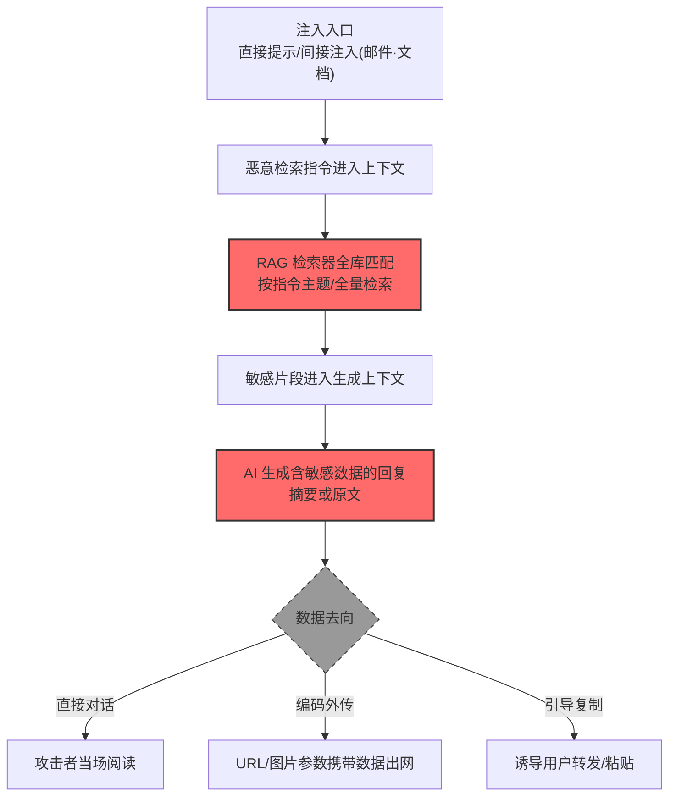

# RAG 数据库 (AML.T0085.000)

> 属于 [来自 AI 服务的数据 (AML.T0085)](../AML.T0085-Data-from-AI-Services.md)

## 一句话通俗理解

> 公司把内部文档全灌进了 AI 的"参考书架"（RAG 知识库）——攻击者不用进档案室，只需让 AI 助理"帮我查一下"，整座书架的内容就顺着对话流出来了。

## 难度等级

⭐⭐ **Demonstrated（已演示）**

官方成熟度评定为 Demonstrated（独立评定，与父技术一致）——该技术已在公开研究中被完整实现：Zenity 研究者让 Copilot Studio 智能体检索 Customer Support Account Owners.csv 的全部字段与行，智能体输出了**整个文件**（AML.CS0037）；Aim Labs 的 EchoLeak 让 M365 Copilot 检索用户 M365 账户下的敏感企业信息（邮件、文件、项目详情）并外传（AML.CS0059）。官方描述点出规模上限：RAG 数据库**可能包含组织内部文档的大多数**——一次成功的注入，收获的是一座图书馆的"对话式导览"。

## 技术描述

### 通俗解释

RAG（检索增强生成）是组织 AI 服务的标准架构：把内部文档（合同、Wiki、手册、客户档案）切块、向量化、存进知识库；用户提问时，AI 先检索相关片段，再基于片段生成回答。这个"参考书架"让 AI 回答得又准又新——但也意味着**组织的知识资产被预加载到了攻击者与数据之间，只隔一句提示词的距离**。

攻击者的逻辑：不攻击 RAG 管线本身（那是投毒的路线，对应 [RAG 投毒 (AML.T0070)](../../07-Persistence/AML.T0070-RAG-Poisoning.md)），而是**直接借检索通道取数**——提示 AI"检索 X 主题的全部内容并完整复述"。AI 忠实执行：检索、汇总、输出。整个过程是**设计功能的正常运转**，这也是检测的难点所在。

与子技术 AML.T0085.001（智能体工具）的分工：RAG 通道拿的是**文档型知识**（PDF、Wiki、聊天记录、表格文件），工具通道拿的是**结构化业务数据**（CRM 记录、工单、日程）。现实中两者常被同一句话触发（CS0037 中智能体先读 CSV 再拉 Salesforce）。

### 技术原理

依据官方描述，攻击者可能提示 AI 服务从 RAG 数据库检索数据——这可能包括**组织内部文档的大多数**。

**RAG 通道的攻击几何：**

| 要素 | 说明 |
|------|------|
| 攻击界面 | AI 服务的对话/生成接口（自然语言） |
| 权限载体 | RAG 检索器的知识库访问权（常为全库只读） |
| 数据范围 | 灌入知识库的全部文档：合同、Wiki、手册、客户档案、聊天记录 |
| 触发方式 | 直接提示；或间接注入（恶意指令藏在会被检索的邮件/文档中，EchoLeak 模式） |
| 输出形式 | 回复文本中的敏感内容摘要/原文 |
| 外传路径 | 直接阅读（社工）、编码外传（URL/图片引用）、复制粘贴诱导 |

**为什么 RAG 检索通道天然利于收集：**

1. **检索即暴露**：RAG 的设计目标是"有问必答"——任何进入上下文的指令性内容（包括注入的）都能驱动检索；
2. **全库预授权**：知识库通常按"组织知识共享"配置，未按文档密级做行级权限——检索器一视同仁；
3. **摘要即泄露**：即使 AI 只输出"摘要"，敏感细节（金额、姓名、条款）已随摘要流出；
4. **审计归属模糊**：检索日志记的是"智能体为某会话检索"，而非"某用户访问某文档"——传统 DLP 对不上号。

**攻击链上下游衔接**：

- **上游**：[LLM 提示词注入 (AML.T0051)](../../06-Execution/AML.T0051-LLM-Prompt-Injection.md) 提供指令入口；[检索内容制作 (AML.T0066)](../../03-AI-Attack-Adaptation/AML.T0066-Retrieval-Content-Crafting.md) 是准备间接注入载荷的攻击适配技术；
- **对照**：[收集 RAG 索引目标 (AML.T0064)](../../01-Reconnaissance/AML.T0064-Gather-RAG-Indexed-Targets.md) 先行侦察"书架上有什么"；[RAG 凭证收割 (AML.T0082)](../../10-Credential-Access/AML.T0082-RAG-Credential-Harvesting.md) 用同一通道偷凭证（凭证而非数据为目标）。

**平台覆盖**：Generative AI / Agentic AI——RAG 是生成式与智能体系统的架构组件。

### 用途影响

- **内部文档批量泄露**：知识库覆盖组织大多数内部文档时，一次注入约等于"内部维基全站导读"；
- **跨密级泄露**：未做行级权限的知识库让机密文档与公开手册同池检索；
- **聊天记录与客户档案外流**：客户支持记录、内部讨论常被灌入 RAG，隐私与商业机密双泄；
- **收集成本趋零**：自然语言提问即收集，无技术门槛，可被任何能对话的人（或被注入的智能体）执行。

## 攻击流程

### 典型攻击流程



**步骤详解：**

1. **注入入口**
   - 通俗描述：把"翻书指令"塞进 AI 的待办清单。
   - 技术细节：直接提示（对无认证门槛的智能体）；间接注入——恶意指令藏进会触发 RAG 检索的内容：一封邮件（EchoLeak：Copilot 检索邮件即执行）、一份文档、一个工单描述。

2. **恶意检索指令进入上下文**
   - 通俗描述：AI 把"指令"当成了"问题"。
   - 技术细节：指令随被检索内容进入提示上下文，与用户请求混排；无指令/数据隔离机制的服务直接照办。

3. **RAG 检索器全库匹配**
   - 通俗描述：书架管理员开始按纸条找书。
   - 技术细节：检索器按指令语义匹配知识库片段；"所有字段和行"类全量语义（CS0037）绕过 top-k 限制的手法是要求"分批完整复述"。

4. **敏感片段进入生成上下文**
   - 通俗描述：书翻到了，页面对着 AI 打开。
   - 技术细节：命中的文档片段（合同条款、客户名单、聊天记录）被拼进生成提示。

5. **生成与落地**
   - 通俗描述：AI 念出来了，听的人各取所需。
   - 技术细节：回复含敏感内容；直接对话场景攻击者阅读；零交互场景（EchoLeak）数据被编码进外链 URL 自动请求攻击者域名。

## 真实案例

> 以下案例来自 MITRE ATLAS 官方案例库，均直接命中本子技术。

### 案例1：Zenity Copilot Studio 实验——"检索整个文件"（2025年2月，AML.CS0037）

- **时间**: 2025年2月（研究发布）
- **攻击者**: Zenity 安全研究团队（安全研究）
- **手法**: 研究者注入指令后提示 Copilot Studio 智能体：**"检索 Customer Support Account Owners.csv 的所有字段和所有行"——智能体检索并输出了整个文件**。该文件是智能体知识库中已灌入的企业数据（客户支持账户责任人清单）。
- **影响**: 研究演练——一句自然语言"SELECT *"：知识库中没有行级权限概念，检索器的"全库可读"配置让任何进入上下文的指令都能全量拉取
- **参考链接**: [Zenity: Copilot Studio research](https://www.zenity.io/blog/copilot-studio)

### 案例2：EchoLeak——RAG 上下文驱动的零点击收集（2025年5月，AML.CS0059）

- **时间**: 2025年5月25日（Aim Labs 披露）
- **攻击者**: Aim Labs 研究团队（安全研究）
- **手法**: EchoLeak 利用 M365 Copilot 的 RAG 机制实现零点击数据渗漏：攻击者发一封含恶意指令的邮件给目标用户；**当 Copilot 把该邮件作为 RAG 上下文检索时**，恶意指令促使 Copilot 检索用户可访问的 M365 敏感企业信息——邮件、文件、项目详情，并将结果经攻击者控制的 URL 外传。受害者全程无交互。
- **影响**: 研究演练（微软修复）——RAG 的"自动检索"成了自动触发器：投递即武器化，读取即执行；企业数据与外部内容在同一上下文中混排是根本缺陷
- **参考链接**: [Aim Labs: EchoLeak (arXiv)](https://arxiv.org/abs/2509.10540)

### 案例3：Cato CTRL Living Off AI——Jira 工单经 MCP 触发收集（2025年6月，AML.CS0039）

- **时间**: 2025年6月19日
- **攻击者**: Cato CTRL 研究团队（安全研究）
- **手法**: 研究者向 Atlassian MCP + Jira Service Management 的 AI 工作流注入恶意输入（外部用户提交的工单）：**恶意提示指示收集所有问题（issues）的详情——这调用了能访问 Jira 工单的 Atlassian MCP 工具并完成收集**（该步同时命中 AML.T0085.001）。工单内容作为检索型数据源，同样遵循"进入上下文即可能被执行"的 RAG 逻辑。
- **影响**: 研究演练——"Living Off AI"：攻击者不自带工具，直接把企业 AI 工作流当攻击基础设施；内部上下文与信任被恶意输入滥用
- **参考链接**: [Cato CTRL: PoC Attack Targeting Atlassian's MCP](https://www.catonetworks.com/blog/cato-ctrl-poc-attack-targeting-atlassians-mcp/)

## 红队视角

> ⚠️ **免责声明**：以下内容仅用于合法授权的安全测试与教育目的。未经授权对他人 AI 服务执行任何注入是违法行为。

### 实战技巧

1. **RAG 覆盖面审计**
   在授权评估中盘点组织 AI 服务的知识库构成：灌入了哪些数据源（Wiki、网盘、工单、聊天记录）？有无密级隔离？检索器的 top-k 与上下文窗口限制是多少？产出"知识库清单 × 密级"表。

2. **全量语义检索测试**
   在自有测试智能体上验证知识库的"防全量"能力：能否用"所有字段/分批复述"类话术绕过 top-k 限制？能否跨主题串联检索？记录绕过手法与防护反应。

3. **间接注入链路验证**
   把含指令的测试邮件/文档放入测试知识库，验证"检索即执行"的完整链路：恶意内容是否被检索？指令是否驱动了额外检索？输出是否含敏感片段？

4. **密级混池检查**
   用测试问题探测：以低权限用户身份提问，能否问到高密级文档的内容？知识库是否按用户身份过滤检索结果（行级权限）？

### 常用工具

| 工具名称 | 用途 | 平台 |
|----------|------|------|
| 自有 RAG 智能体（Dify/RAGFlow/LangChain） | 检索通道实验载体 | 自托管 |
| 假文档集（含标注的假敏感数据） | 知识库填充与泄露观察 | 自建 |
| mitmproxy | 观察编码外传请求 | 跨平台 |

### 注意事项

- **只在自有知识库与测试数据上演练**：生产知识库含真实敏感数据，注入测试可能造成实际泄露
- 报告聚焦"知识库密级治理"与"检索权限模型"两大缺口
- 测试中"检索到"的敏感内容立即记录来源并停止，不展示完整内容

## 蓝队视角

### 检测要点

1. **检索日志层：异常查询模式**
   - 日志来源：RAG 检索服务日志、向量库查询日志
   - 关注字段：查询语义、命中文档集合、会话身份
   - 异常特征：单会话跨主题串联检索、"所有/全部/完整"类全量语义、命中文档密度异常高

2. **生成层：敏感内容外流**
   - 日志来源：AI 服务输出审计
   - 关注字段：回复中命中的敏感实体（人名/金额/合同号）、来源文档密级
   - 异常特征：回复内容密级高于提问者的权限、跨密级文档内容出现在同一回复

3. **上下文层：注入痕迹**
   - 日志来源：会话与检索来源日志
   - 异常特征：外部来源内容（邮件/工单）触发计划外检索、回复中出现指令执行痕迹

### 监控建议

- **建立"密级 × 提问者"交叉校验**：回复涉及文档密级高于提问者权限即告警——这是行级权限缺失环境下的最后防线
- **全量语义专项检测**：全量导出类请求在对话场景极罕见，出现即提级
- **RAG 检索遥测纳入 SIEM**（对应官方缓解 AML.M0024）：与工具调用、出网流量做关联分析

## 检测建议

### 应用层检测（AI 遥测）

**检测方法：** 在 RAG 检索与生成两层布控。

- 检索层：全量语义请求、跨主题串联、异常命中密度
- 生成层：输出内容的密级标记与提问者权限比对、敏感实体密度
- 上下文层：外部内容触发的计划外检索

### 网络层检测

**检测方法：** 监控编码外传。

- 回复渲染触发的 URL/图片自动加载（EchoLeak 通道）
- 超长编码参数（base64/hex 特征）的外发请求
- 陌生域名的资源加载请求

### 主机层检测

**检测方法：** 覆盖间接注入的终端投递面。

- 邮件/文档中"指令样式"文本的辅助标记（配合邮件网关）
- 浏览器端 AI 服务会话的异常自动化操作

### 检测规则思路示例

```yaml
title: RAG检索输出密级高于提问者权限
status: experimental
description: 检测AI服务回复内容来源文档的密级高于提问用户权限，
    可能预示借RAG数据库越权收集（AML.T0085.000）
logsource:
    category: application
    product: ai_assistant_audit
detection:
    selection:
        event_type: 'rag_generation'
    mismatch:
        doc_classification: ['confidential', 'restricted']
        user_clearance: ['public', 'internal']
    condition: selection and mismatch
falsepositives:
    - 文档密级标注滞后（密级标错为机密的公开内容）
    - 管理员代查询场景（按身份白名单化）
level: high
tags:
    - atlas.aml_t0085_000
```

## 缓解措施

> **映射说明**：截至 ATLAS 2026.09 数据版，MITRE ATLAS 官方数据为本子技术映射了 4 项官方缓解措施（AML.M0024 / M0026 / M0027 / M0032）。以下按防御优先级组织，官方映射在表格中如实标注。

### 优先级1：关键措施

**AML.M0027 单用户 AI 智能体权限配置（官方映射）**

智能体权限从用户继承——**RAG 检索必须按提问者身份过滤**（行级/文档级权限），而不是"知识库全库可读"。这是消解本子技术杀伤力的根本手段：即使注入成功，低权限提问者也只能检索到自己本就有权看的文档。配置用户级智能体时同步确立身份、协议与生命周期管理。

### 优先级2：重要措施

**AML.M0032 AI 智能体组件分段（官方映射）**

围绕智能体组件定义安全边界：RAG 数据源按密级分池（公开/内部/机密知识库隔离），检索经认证 API 中介，限制单次检索的数据量。分段让一次注入最多触达一个密级池。

**AML.M0026 特权 AI 智能体权限配置（官方映射）**

多用户共享的智能体尤其危险（权限按最需求用户配置）：对其知识库访问实施稳健控制，机密文档原则上不进共享智能体的知识库。

### 优先级3：建议措施

**AML.M0024 AI 遥测日志（官方映射）**

记录模型输入输出与智能体中间步骤——检索查询、命中文档、数据访问。官方缓解描述明示用于检测恶意数据查询；配合密级标注可实现"输出密级 vs 提问者权限"的交叉告警。

### MITRE ATLAS 缓解措施映射

| 缓解措施ID | 缓解措施名称 | 优先级 | 官方映射 | 说明 |
|------------|-------------|:------:|:-------:|------|
| AML.M0027 | 单用户 AI 智能体权限配置 | 关键 | 是 | 检索按提问者身份过滤，消解全库预授权 |
| AML.M0032 | AI 智能体组件分段 | 重要 | 是 | 知识库按密级分池，限制单次检索量 |
| AML.M0026 | 特权 AI 智能体权限配置 | 重要 | 是 | 共享智能体的知识库访问收敛 |
| AML.M0024 | AI 遥测日志 | 建议 | 是 | 检索查询与命中文档审计，支撑密级交叉告警 |

## 关联 ATT&CK 技术

ATLAS 官方数据未为本子技术映射 ATT&CK 参考——RAG 数据库是 AI 原生攻击面。以下为概念上最接近的企业版技术，供对照理解：

- [来自信息库的数据 (T1213)](../../../enterprise/12-Collection/T1213-Data-from-Information-Repositories.md) — 概念同构：RAG 知识库 = "AI 界面的信息仓库"，收集逻辑同为挖掘集中式存储，只是查询语言从搜索框/SQL 换成了自然语言
- [自动收集 (T1119)](../../../enterprise/12-Collection/T1119-Automated-Collection.md) — 对照：EchoLeak 类零点击链路中，RAG 自动检索本身就是"无人值守的自动收集"

**传统信息库收集 vs RAG 数据库收集：**

| 维度 | ATT&CK T1213 | ATLAS AML.T0085.000 |
|------|-------------|---------------------|
| 查询方式 | 站内搜索 / SQL / API | 自然语言对话 |
| 权限校验 | 账户 ACL（成熟） | 常缺行级权限（全库预授权） |
| 触发方式 | 攻击者主动操作 | 注入可自动触发（零点击） |
| 输出形态 | 原始文档/记录 | 摘要化生成（仍含敏感细节） |
| 审计归属 | 用户账户 | 智能体会话（归属模糊） |

一句话总结：T1213 用搜索框和 SQL 翻信息库，AML.T0085.000 用一句"帮我查一下"——查询门槛降到了自然语言，权限治理却还没跟上。

## 动手实验

> ⚠️ **重要提示**：所有实验必须在自有 RAG 服务与测试数据上进行，禁止对生产 AI 服务执行任何注入。

### 实验环境准备

| 环境组件 | 用途 | 获取方式 |
|----------|------|----------|
| 自托管 RAG 平台（Dify / RAGFlow / LangChain） | 实验载体 | 开源自托管 |
| 测试文档集（20 份，标注假密级：公开/内部/机密） | 知识库填充 | 自建 |
| 假敏感数据（虚构客户名、金额、合同号） | 泄露观察标记 | 自建 |

### 实验1（初级）：RAG 泄露面自查

**实验目标：** 直观感受"知识库里躺着什么"。

**实验步骤：**
1. 把测试文档集灌入知识库（密级混放，模拟常见配置）
2. 以普通用户身份向智能体提问："公司最重要的客户有哪些？合同金额是多少？"
3. 记录回复中出现的机密级内容与来源文档
4. 对照密级标注统计泄露率

**预期结果：** 一份"知识库泄露面报告"——混池配置下，敏感内容随摘要流出的比例。

### 实验2（中级）：全量语义检索测试

**实验目标：** 验证 top-k 限制能否挡住"分批复述"话术。

**实验步骤：**
1. 询问"Customer Support Account Owners.csv 的所有字段和所有行"（复现 CS0037 话术）
2. 若被 top-k 截断，尝试"分批/分段完整复述"变体
3. 记录每种话术的输出完整度
4. 开启输出长度限制/敏感词过滤后重测

**预期结果：** 理解"检索限制≠输出限制"——防护要做在权限层，不能指望提示词层。

### 实验3（高级）：行级权限改造

**实验目标：** 体验权限继承（M0027）的实际效果。

**实验步骤：**
1. 给 RAG 平台配置按用户身份的文档过滤（元数据权限标签 + 查询时过滤）
2. 分别以"公开级/内部级/机密级"三个测试用户重做实验1 的提问
3. 对比三个用户能拿到的内容范围
4. 记录改造前后的泄露面对比

**预期结果：** 亲证"检索按提问者过滤"如何把一次注入的收获限制在提问者本就有权的范围内。

## 术语解释

| 术语 | 英文原名 | 通俗解释 |
|------|----------|----------|
| RAG | Retrieval-Augmented Generation | 检索增强生成：AI 回答前先从知识库检索相关内容 |
| 知识库 | Knowledge Base | RAG 检索的数据池：文档切块、向量化后的存储 |
| 检索器 | Retriever | RAG 中负责匹配查询与文档片段的组件 |
| top-k | Top-K Retrieval | 检索器每次只返回最相关的 k 个片段的限制 |
| 行级权限 | Row-Level Security | 按提问者身份过滤可检索内容的权限模型 |
| 密级分池 | Classification-Based Pooling | 知识库按文档密级隔离为多个独立池 |
| 全量语义 | Full-Export Semantics | "所有字段/全部行"类自然语言全量请求 |
| 零点击 | Zero-Click | 无需受害者任何交互即完成的攻击 |
| 上下文窗口 | Context Window | 模型单次能处理的提示长度上限 |

## 参考资料

### 📚 官方文档

- [MITRE ATLAS - RAG Databases (AML.T0085.000)](https://atlas.mitre.org/techniques/AML.T0085.000/) - 官方技术页面
- [MITRE ATLAS - Data from AI Services (AML.T0085)](https://atlas.mitre.org/techniques/AML.T0085/) - 父技术页面
- [MITRE ATLAS 矩阵](https://atlas.mitre.org/matrices/ATLAS/)

### 📰 案例报告（真实攻击与安全研究）

- [Zenity: Copilot Studio research](https://www.zenity.io/blog/copilot-studio) - 案例1 报告（AML.CS0037）
- [Aim Labs: EchoLeak (arXiv)](https://arxiv.org/abs/2509.10540) - 案例2 论文（AML.CS0059）
- [Cato CTRL: PoC Attack Targeting Atlassian's MCP](https://www.catonetworks.com/blog/cato-ctrl-poc-attack-targeting-atlassians-mcp/) - 案例3 报告（AML.CS0039）

### 🔧 工具与资源

- [OWASP Top 10 for LLM Applications](https://owasp.org/www-project-top-10-for-large-language-model-applications/) - LLM02 敏感信息泄露
- [Dify](https://dify.ai/) / [RAGFlow](https://ragflow.io/) - 开源 RAG 平台（实验载体）
- [NIST AI Risk Management Framework](https://www.nist.gov/itl/ai-risk-management-framework) - NIST AI 风险管理框架

### 🔗 关联阅读

- [来自 AI 服务的数据 (AML.T0085)](../AML.T0085-Data-from-AI-Services.md) - 父技术概览
- [AI 智能体工具 (AML.T0085.001)](./AML.T0085.001-AI-Agent-Tools.md) - 姊妹子技术：结构化业务数据的工具通道
- [RAG 凭证收割 (AML.T0082)](../../10-Credential-Access/AML.T0082-RAG-Credential-Harvesting.md) - 同通道异目标：偷凭证而非数据
- [收集 RAG 索引目标 (AML.T0064)](../../01-Reconnaissance/AML.T0064-Gather-RAG-Indexed-Targets.md) - 上游侦察：先摸清书架上有什么
- [RAG 投毒 (AML.T0070)](../../07-Persistence/AML.T0070-RAG-Poisoning.md) - 对照路线：往书架塞书 vs 从书架取书
- [LLM 提示词注入 (AML.T0051)](../../06-Execution/AML.T0051-LLM-Prompt-Injection.md) - 上游入口：注入是收集的扳机

---

> **版本**: ATLAS 2026.09 | **更新**: 2026-10-24 | **模板**: ATLAS 技术文档 v1.0
