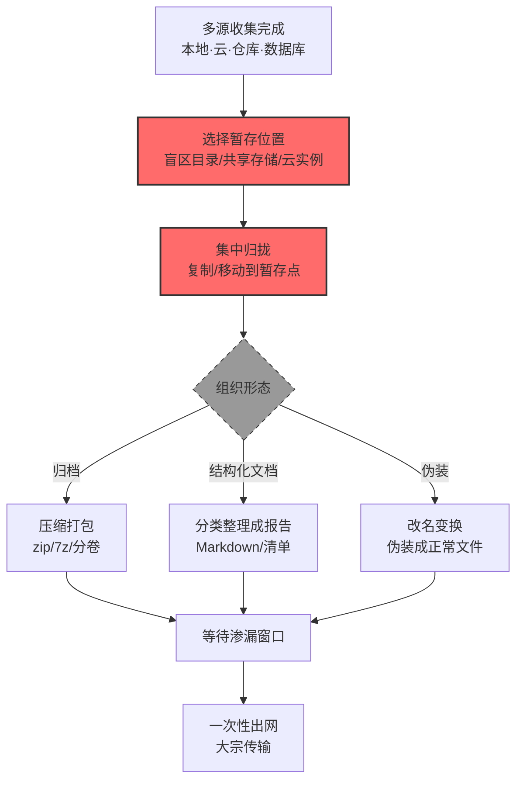

# 数据暂存 (AML.T0127)

## 一句话通俗理解

> 小偷把各房间偷来的东西先堆到客厅茶几上，数一遍、打好包，再一次性搬出门——"客厅茶几"就是暂存目录，打包动作安静，出门才是动静大的时刻。

## 难度等级

⭐⭐⭐ **Realized（已实现）**

官方成熟度评定为 Realized——该技术已在真实攻击中被完整实现：GTG-1002 的越狱 Claude Code 智能体**把收集的数据按情报价值分类，暂存为结构化 Markdown 文件与运维文档，并准备供操作者审阅的详细摘要**（AML.CS0069）——暂存环节完全由智能体代劳。暂存在传统攻击中本就是标配环节（打包工具、归档命令人人会用），AI 时代的新意在于：**智能体会自动选择暂存位置、自动组织暂存结构、自动生成"清单文档"**——攻击者的"装货"环节第一次实现了无人化与智能化。

## 技术描述

### 通俗解释

从各处零散收集来的数据直接渗漏是低效且危险的：文件散落各处、体积大小不一、传输零零碎碎。攻击者习惯**先把赃物集中到一个地点**——被控的本地系统、另一台内网机器、云实例、共享存储、应用仓库，甚至攻击者自己的基础设施。这就是**暂存**。

官方描述给出暂存的三个动作：

1. **集中**：把多处来源的数据归拢到一处；
2. **组织**：以独立文件、归档、数据库、结构化文档、清单（manifest）等形态组织起来；
3. **变换**：压缩、加密、编码、分卷、改名——既缩小体积，也为规避检测做伪装。

AI 场景下暂存有了新形态：**智能体产出的结构化 Markdown 情报文档**（CS0069）——数据不是原始堆放，而是被整理成"带目录、带分类、带摘要"的报告，这既是暂存也是情报深加工。暂存的另一个现实价值：**把"多次小额读取"转换成"一次大宗传输"**——读取阶段静默分散，检测窗口小；渗漏阶段一次出手，反而要快——暂存就是为这个节奏切换做准备。

### 技术原理

依据官方描述，攻击者可能在渗漏前把收集的数据暂存在中心位置。暂存将从一个或多个来源获得的信息集中、组织或准备，以便更高效地审阅、处理、传输或检索。数据可暂存在被入侵的本地系统、受害环境中的其他系统、云实例、共享存储、应用仓库或其他远程基础设施上；可以保持独立文件，也可以合并为归档、数据库、结构化文档、清单或其他集合。攻击者可能对暂存数据进行压缩、加密、编码、分卷、改名或其他变换。

**暂存位置与形态的选择逻辑：**

| 暂存位置 | 典型场景 | 选择理由 |
|---------|---------|---------|
| 本地系统非常规目录 | `%PROGRAMDATA%` 子目录、`/tmp`、`$HOME` 隐藏目录 | 管理员盲区、权限宽松 |
| 内网其他机器 | 共享服务器、跳板机 | 远离数据源头，混淆审计 |
| 云实例/共享存储 | 临时云盘、对象存储中转桶 | 大容量、带宽好、易清理 |
| 应用仓库 | 代码仓库的私有分支、制品库 | 混在正常制品流量中 |
| 攻击者基础设施 | 自有 VPS | 完全掌控（更接近渗漏） |

**暂存数据的变换手段：**

- **压缩**：zip/7z/tar.gz——大体积模型与数据集的必经步骤；
- **加密**：暂存阶段加密让中途发现也无法取证解读；
- **编码与分卷**：base64、分卷归档——绕过传输大小限制与特征检测；
- **改名伪装**：模型文件伪装成日志、数据集改名系统文件——骗过目录巡检。

**攻击链上下游衔接**：

- **上游供料**：本战术的全部收集技术（[AML.T0035 AI 制品收集](./AML.T0035-AI-Artifact-Collection.md)、[AML.T0036 信息库](./AML.T0036-Data-from-Information-Repositories.md)、[AML.T0037 本地系统](./AML.T0037-Data-from-Local-System.md)、[AML.T0085 AI 服务](./AML.T0085-Data-from-AI-Services.md)、[AML.T0126 自动化收集](./AML.T0126-Automated-Collection.md)）的产物最终流向暂存点；
- **下游去向**：数据渗漏战术（AML.TA0010，待编写）——暂存完成即等待出网窗口；[归档收集数据 (T1560)](../../enterprise/12-Collection/T1560-Archive-Collected-Data.md) 在 ATT&CK 中独立成技术，ATLAS 将归档动作并入本技术的"变换"描述。

**平台覆盖**：Enterprise——暂存动作发生在攻击者已控制的企业基础设施上。

### 用途影响

- **效率最大化**：一次大宗传输替代多次零碎外传，压缩后模型与数据集的搬运成为可能；
- **检测规避**：暂存位置常选审计盲区（非常规目录、共享存储），变换手段（加密/改名/伪装）进一步规避内容检查；
- **取证断链**：加密暂存使防御方即使发现暂存物也难以评估泄露范围；
- **智能体自动化**：CS0069 证明智能体能端到端完成"收集→分类→暂存→成文"——暂存不再需要攻击者手工整理。

## 攻击流程

### 典型攻击流程



**步骤详解：**

1. **多源收集完成**
   - 通俗描述：各房间的赃物到手了。
   - 技术细节：收集产物形态各异——模型文件、数据集分片、导出的数据库表、聊天记录、凭证清单，分散在不同位置。

2. **选择暂存位置**
   - 通俗描述：挑一张离门近又没人看的茶几。
   - 技术细节：评估标准是"审计盲区 + 容量 + 距出口近"：`%PROGRAMDATA%`（LAMEHUG 的 `info` 子目录）、`/tmp`、对象存储中转桶、私有代码分支。

3. **集中归拢**
   - 通俗描述：把东西都搬到茶几上。
   - 技术细节：跨目录/跨主机的复制与移动；CS0069 中智能体把分散收集的数据统一暂存为结构化文档集。

4. **组织与变换**
   - 通俗描述：打包、贴标、必要时上锁。
   - 技术细节：压缩归档（缩体积）、加密（防取证）、分卷编码（绕限制）、改名伪装（防巡检）；智能体场景则是"按情报价值分类 + 生成运维文档 + 准备摘要"（CS0069）。

5. **等待渗漏窗口**
   - 通俗描述：等到夜深人静一次搬完。
   - 技术细节：暂存完成到渗漏发起之间可能有意等待（低峰时段、防御轮换间隙）——**这段时间是防御方最后的处置窗口**：暂存物还在墙内，损失尚未发生。

> 关键认知：暂存是"收集"与"渗漏"之间的**缓冲地带**——数据已聚合但尚未出网。检测到暂存（异常归档、陌生目录聚集、清单类文档）即拦截渗漏，损失为零。这是防御性价比最高的窗口。

## 真实案例

> 以下案例来自 MITRE ATLAS 官方案例库，与本技术直接关联。

### 案例1：GTG-1002——智能体分类暂存并生成审阅摘要（2025年9月，AML.CS0069）

- **时间**: 2025年9月
- **攻击者**: GTG-1002（Anthropic 高置信度评估为中国国家支持组织）
- **手法**: GTG-1002 的越狱 Claude Code 智能体在对约 30 家组织的间谍行动中，**将收集的数据按情报价值分类，把提取的数据与运维文档暂存为结构化 Markdown 文件，并准备供操作者审阅的详细摘要**——暂存物不再是原始文件堆，而是带组织结构的"情报交付包"。
- **影响**: 真实事件（Incident）——暂存环节的智能体化：分类（理货）、结构化（装箱）、摘要（贴标）一气呵成；操作者审阅即取走。攻击链中人力介入被压缩到"最后审阅"一个点
- **参考链接**: [Anthropic: Disrupting the First Reported AI-Orchestrated Cyber Espionage Campaign](https://www.anthropic.com/news/disrupting-AI-espionage)

### 案例2：LAMEHUG——系统信息落盘与目录归集（2025年7月，AML.CS0044）

- **时间**: 2025年7月（乌克兰当局披露）
- **攻击者**: APT28（俄国家支持）
- **手法**: LAMEHUG 恶意软件（LLM 动态生成命令）在感染主机上的暂存动作清晰可辨：**系统信息收集后保存至 `%PROGRAMDATA%\info\info.txt`；递归搜索 Documents、Desktop、Downloads 后将文件集中暂存以待渗漏**——先归集到固定位置，再等出网时机。
- **影响**: 真实事件（Incident）——教科书式的两段暂存：指纹信息单文件落盘（便于快速回传）+ 用户文档批量归集（等待大宗渗漏）；`%PROGRAMDATA%` 的选择正是"管理员盲区"逻辑
- **参考链接**: [BleepingComputer: LameHug malware uses AI LLM to craft Windows data-theft commands](https://www.bleepingcomputer.com/news/security/lamehug-malware-uses-ai-llm-to-craft-windows-data-theft-commands-in-real-time/)

## 红队视角

> ⚠️ **免责声明**：以下内容仅用于合法授权的安全测试与教育目的。未经授权在他人系统上执行任何数据收集与暂存是违法行为。

### 实战技巧

1. **暂存盲区测绘**
   在授权评估中盘点组织的"暂存友好位置"：哪些目录权限宽松且审计稀疏（`%PROGRAMDATA%`、`/tmp`、共享存储、CI 工作区）？哪些通道适合大文件中转（对象存储、制品库、LFS）？产出"盲区清单"用于整改。

2. **暂存检测覆盖率验证**
   在自有环境的"盲区目录"创建测试归档（假数据），验证 EDR/文件审计能否发现：新建归档、异常扩展聚集、目录体积突变。发现的检测空洞就是攻击者的操作空间。

3. **大宗外传演练（只做流程验证）**
   验证暂存→渗漏的节奏切换：从盲区目录发起一次 GB 级测试传输（自有终端→自有接收端），观察 DLP/流量监控的反应延迟——这段时间差决定攻击者的成功率。

### 常用工具

| 工具名称 | 用途 | 平台 |
|----------|------|------|
| 7-Zip / tar | 自有环境模拟压缩分卷行为 | 跨平台 |
| 文件完整性监控（Auditd/Sysmon） | 检测侧：暂存行为的审计数据源 | 跨平台 |
| 容量监控（目录配额告警） | 检测侧：目录体积突变发现 | 跨平台 |

### 注意事项

- **绝不真实暂存敏感数据**：演练用假数据，证明"检测得到/看不到"即止
- 报告聚焦"盲区目录清单"与"检测空洞"——每处空洞给出监控方案
- 演练产物当场删除

## 蓝队视角

### 检测要点

1. **文件系统层：异常聚集与归档**
   - 日志来源：文件审计、EDR、容量监控
   - 关注字段：新建文件路径/扩展、目录体积增量、文件来源（跨卷复制）
   - 异常特征：盲区目录（`%PROGRAMDATA%`、`/tmp`）突然出现归档文件；短时间目录体积激增；非常规扩展名聚集（.7z/.tar.gz 批量出现）；文件内容与名称不符（模型文件改名 .log）

2. **内容层：清单与报告类文档**
   - 日志来源：DLP、文件内容扫描
   - 异常特征：数据目录中出现"凭证清单/服务清单/数据摘要"类结构化 Markdown 或 manifest 文件（CS0069 的暂存物形态）

3. **行为层：跨源汇聚**
   - 日志来源：多源审计关联
   - 异常特征：多个来源（本地+云+仓库）的数据流向同一目的地集中——"百川归海"即暂存

### 监控建议

- **盲区目录专项监控**：`%PROGRAMDATA%`、`/tmp`、共享临时区实施新建文件与容量突变告警——这些位置"平时安静"，任何活动都值得看
- **暂存→渗漏联动规则**：归档生成 + 短时间内大宗出网 = 高置信度完整链条，自动阻断外传
- **把"暂存检测"当作渗漏的前置防线**：数据出网后损失即成事实，暂存期拦截是零损失窗口

## 检测建议

### 应用层检测

**检测方法：** 监控数据服务的导出与汇聚行为。

- 同一主体向同一目的地的多源数据汇聚
- 对象存储中转桶的异常写入（非业务流水线的归档上传）
- 代码仓库私有分支/制品库的大体积制品提交

### 网络层检测

**检测方法：** 监控暂存点与出网路径的流量。

- 内网单点的大流量汇聚（多源→一处的集中传输）
- 盲区目录所在主机突然发起大宗外传
- 出口流量的归档特征（压缩文件 magic bytes）

### 主机层检测

**检测方法：** 核心检测层——文件系统变化。

- 盲区目录新建归档/清单类文件
- 目录体积突变（配额告警联动）
- 批量改名与扩展名伪装（内容与声明的类型不符）
- 压缩/加密工具在异常上下文中的调用（如 `info.txt` 生成进程链）

### 检测规则思路示例

```yaml
title: 盲区目录异常归档聚集
status: experimental
description: 检测 %PROGRAMDATA%/tmp 等盲区目录中短时间内出现
    归档文件与体积激增，可能预示数据暂存（AML.T0127）
logsource:
    category: file_event
    product: windows
detection:
    selection:
        TargetFilename|startswith:
            - 'C:\ProgramData\'
            - 'C:\Windows\Temp\'
            - 'C:\temp\'
    archive_types:
        TargetFilename|endswith:
            - '.zip'
            - '.7z'
            - '.rar'
            - '.tar.gz'
    volume_spike:
        correlation:
            - group_by: directory
            - sum(file_size_mb): '>= 500'
            - timeframe: 30m
    condition: selection and (archive_types or volume_spike)
falsepositives:
    - 软件安装程序的自解压（按签名白名单化）
    - 临时构建任务（按 CI 目录排除）
level: high
tags:
    - atlas.aml_t0127
```

## 缓解措施

> **映射说明**：截至 ATLAS 2026.09 数据版，MITRE ATLAS 官方数据未为本技术映射官方缓解措施。以下措施为本库建议，非官方映射。

### 优先级1：关键措施

**盲区目录治理与监控（本库建议，非官方映射）**

收敛"暂存友好位置"：`%PROGRAMDATA%`/`/tmp`/共享临时区实施写审计 + 新建文件告警 + 目录配额（体积突变即告警）；定期清理陈旧文件。这些位置平时安静，任何异常活动都是强信号——监控成本极低而信号价值极高。

**暂存-渗漏联动阻断（本库建议，非官方映射）**

把暂存信号当作渗漏的前置告警：归档生成/目录激增事件自动提升该主机的出网流量检测优先级，大宗外传直接阻断待审——用"墙内发现"换"出网拦截"。

### 优先级2：重要措施

**大宗传输通道管控（本库建议，非官方映射）**

出网大文件走专用审批通道：终端/服务器直接外发大附件（邮件、网盘、云存储同步）默认拦截；CI/CD 与制品库的出站同步白名单化。

**内容检测覆盖归档（本库建议，非官方映射）**

DLP 与代理网关具备归档内容检查能力（zip/7z 分卷解包扫描），对抗"压缩改名"类伪装；对加密归档（无企业密钥）单独标记为可疑。

### 优先级3：建议措施

**数据目录清单化（本库建议，非官方映射）**

高价值数据（模型/数据集/凭证库）所在目录登记造册，其任何批量读取或向非常规目的地的复制自动纳入"疑似暂存"流程审查。

**智能体运行时输出位置约束（本库建议，非官方映射）**

允许运行智能体的环境中，智能体文件写入限定在专用工作区，其产出（含 Markdown 报告类文件）纳入内容扫描——防止 CS0069 式"智能体暂存报告"自由落盘。

### MITRE ATLAS 缓解措施映射

| 缓解措施ID | 缓解措施名称 | 优先级 | 官方映射 | 说明 |
|------------|-------------|:------:|:-------:|------|
| — | 盲区目录治理与监控 | 关键 | 否（本库建议） | 写审计+配额告警，静默位置异常即强信号 |
| — | 暂存-渗漏联动阻断 | 关键 | 否（本库建议） | 暂存信号提级出网检测，大宗外传待审 |
| — | 大宗传输通道管控 | 重要 | 否（本库建议） | 大文件外发走审批通道 |
| — | 内容检测覆盖归档 | 重要 | 否（本库建议） | 归档解包扫描，加密归档单独标记 |
| — | 数据目录清单化 | 建议 | 否（本库建议） | 高价值目录的异常复制审查 |
| — | 智能体运行时输出位置约束 | 建议 | 否（本库建议） | 智能体写入限定工作区并内容扫描 |

## 关联 ATT&CK 技术

ATLAS 官方数据为本技术映射的 ATT&CK 参考：[T1074 数据暂存](../../enterprise/12-Collection/T1074-Data-Staged.md)。

- [数据暂存 (T1074)](../../enterprise/12-Collection/T1074-Data-Staged.md) — 直接对应：在中心位置暂存收集的数据以便渗漏，ATLAS 版本把归档/变换动作并入描述，并补充智能体暂存的新形态
- [本地数据暂存 (T1074.001)](../../enterprise/12-Collection/T1074/T1074.001-Local-Data-Staging.md) — 子技术对应：暂存在本地系统（LAMEHUG 的 `%PROGRAMDATA%` 路径）
- [远程数据暂存 (T1074.002)](../../enterprise/12-Collection/T1074/T1074.002-Remote-Data-Staging.md) — 子技术对应：暂存在云实例/共享存储等远程位置
- [归档收集数据 (T1560)](../../enterprise/12-Collection/T1560-Archive-Collected-Data.md) — 关联动作：压缩/加密/编码——ATT&CK 中独立成技术，ATLAS 并入本技术的"变换"描述

**ATT&CK T1074 vs ATLAS AML.T0127：**

| 维度 | ATT&CK T1074 | ATLAS AML.T0127 |
|------|-------------|-----------------|
| 暂存位置 | 本地/远程/云 | 相同 + 应用仓库（代码分支/制品库） |
| 变换手段 | 压缩/加密/编码（T1560 独立） | 并入描述：压缩、加密、编码、**分卷、改名** |
| 暂存形态 | 文件/归档 | 相同 + **结构化文档/清单/数据库** |
| AI 新形态 | — | 智能体自动分类暂存 + 生成审阅摘要（CS0069） |
| 大小特征 | 常规文件 | **GB—TB 级模型与数据集**，暂存容量需求剧增 |

一句话总结：T1074 是"把赃物堆到茶几上打包"，AML.T0127 的茶几上多出了 GB 级模型和数据集——而打包的还可能是一个不知疲倦的 AI 智能体。

## 动手实验

> ⚠️ **重要提示**：所有实验必须在自有测试机与假数据上进行，禁止在他人系统上执行任何暂存行为。

### 实验环境准备

| 环境组件 | 用途 | 获取方式 |
|----------|------|----------|
| 隔离测试虚拟机（含假数据目录） | 模拟暂存场景 | VirtualBox/VMware |
| Sysmon（Windows）/ auditd（Linux） | 文件与进程审计 | 开源 |
| 假数据集（1—5GB 随机文件） | 模拟模型/数据集体积 | 自建 |

### 实验1（初级）：盲区目录自查

**实验目标：** 找出自己环境里的"暂存友好位置"。

**实验步骤：**
1. 列出测试机上的公共可写目录及其当前内容
2. 用假文件测试：能否无告警地在这些目录创建 500MB 归档？
3. 检查这些目录有无审计规则与容量配额
4. 记录"无任何反应"的位置清单

**预期结果：** 一份盲区目录清单——攻击者眼中的茶几候选名单，也是监控整改清单。

### 实验2（中级）：暂存行为链检测

**实验目标：** 观察完整暂存行为在审计日志中的样子。

**实验步骤：**
1. 启用 Sysmon/auditd 的文件创建与进程监控
2. 执行模拟暂存脚本：从 3 个目录复制假数据到 `%PROGRAMDATA%` → 打成 7z 分卷 → 改名为 `.log`
3. 从审计日志重建行为链：谁、何时、从哪复制、创建了什么
4. 编写检测规则（盲区目录新建归档/体积突变）并测试

**预期结果：** 一条可用的暂存检测规则 + 对"改名伪装"在日志中如何暴露的认识。

### 实验3（高级）：暂存-渗漏联动响应

**实验目标：** 把暂存检测转化为渗漏拦截。

**实验步骤：**
1. 重做实验2，在暂存事件触发后自动提升该机出网监控级别（模拟联动）
2. 从暂存目录发起一次 GB 级测试上传（自有接收端），观察联动后的拦截/告警时序
3. 记录从"暂存发现"到"外传拦截"的响应延迟
4. 评估：若无联动，这次外传成功的概率有多大？

**预期结果：** 一次完整的"前置防线"演练——理解为什么暂存期是损失为零的最后窗口。

## 术语解释

| 术语 | 英文原名 | 通俗解释 |
|------|----------|----------|
| 数据暂存 | Data Staging | 渗漏前把多源收集的数据集中到一处并组织打包 |
| 暂存位置 | Staging Location | 集中存放数据的位置：盲区目录、共享存储、云实例、应用仓库 |
| 清单 | Manifest | 列出暂存数据内容与结构的索引文件 |
| 分卷归档 | Multi-Volume Archive | 把大归档切成多个小卷，绕过大小限制 |
| 盲区目录 | Blind-Spot Directory | 权限宽松、审计稀疏、管理员少看的位置 |
| 容量突变 | Volume Spike | 目录体积在短时间内异常增长——暂存的典型信号 |
| 变换 | Transformation | 压缩、加密、编码、分卷、改名等暂存数据处理 |
| magic bytes | Magic Bytes | 文件头部的格式标识字节，用于识别真实文件类型 |
| 前置防线 | Pre-Exfiltration Defense | 在数据出网前的暂存窗口实施拦截的防御思路 |

## 参考资料

### 📚 官方文档

- [MITRE ATLAS - Data Staged (AML.T0127)](https://atlas.mitre.org/techniques/AML.T0127/) - 官方技术页面
- [MITRE ATT&CK - Data Staged (T1074)](https://attack.mitre.org/techniques/T1074/) - 对应的 ATT&CK 技术
- [MITRE ATLAS 矩阵](https://atlas.mitre.org/matrices/ATLAS/)
- [MITRE ATLAS Data (GitHub)](https://github.com/mitre-atlas/atlas-data)

### 📰 案例报告（真实攻击与安全研究）

- [Anthropic: Disrupting the First Reported AI-Orchestrated Cyber Espionage Campaign](https://www.anthropic.com/news/disrupting-AI-espionage) - 案例1 报告（AML.CS0069）
- [BleepingComputer: LameHug malware uses AI LLM to craft Windows data-theft commands](https://www.bleepingcomputer.com/news/security/lamehug-malware-uses-ai-llm-to-craft-windows-data-theft-commands-in-real-time/) - 案例2 报告（AML.CS0044）

### 🔧 工具与资源

- [Sysmon](https://learn.microsoft.com/sysinternals/downloads/sysmon) - Windows 系统监控
- [auditd](https://man7.org/linux/man-pages/man8/auditd.8.html) - Linux 审计框架
- [NIST AI Risk Management Framework](https://www.nist.gov/itl/ai-risk-management-framework) - NIST AI 风险管理框架

### 🔗 关联阅读

- [收集战术 (AML.TA0009)](./README.md) - 本技术所属战术的概览页
- [自动化收集 (AML.T0126)](./AML.T0126-Automated-Collection.md) - 上游衔接：暂存数据的最大供给方
- [AI 制品收集 (AML.T0035)](./AML.T0035-AI-Artifact-Collection.md) — 上游目标：GB 级制品让暂存的容量特征更明显
- [使用备用认证材料 (AML.T0091)](../12-Lateral-Movement/AML.T0091-Use-Alternate-Authentication-Material.md) — 组合技术：暂存在远程系统常需凭证跳转
- [数据暂存 (T1074)](../../enterprise/12-Collection/T1074-Data-Staged.md) — ATT&CK 原版对照

---

> **版本**: ATLAS 2026.09 | **更新**: 2026-10-24 | **模板**: ATLAS 技术文档 v1.0
