# 收集 (AML.TA0009)

## 一句话理解

> **攻击者翻遍你的 AI 系统，把模型、数据集、对话记录、知识库统统搜刮打包——收集是数据渗漏前的"装货"环节。**

## 战术概述

收集是 ATLAS 攻击链中**窃取数据前的最后准备**：攻击者在已经立足的目标环境里汇总 AI 制品和相关情报，为后续行动凑齐"赃物"。与传统 ATT&CK 收集不同，ATLAS 收集的核心目标是 **AI 制品**——模型、数据集，以及与模型交互产生的遥测数据；常见的高价值目标源包括软件仓库、容器注册表、模型仓库和对象存储。

**通俗解释：**
传统收集像小偷进屋后翻箱倒柜找现金和首饰；ATLAS 收集更像商业间谍潜入 AI 公司后，直奔保险柜拷贝训练好的模型、偷走数据集、导出员工与聊天机器人的全部对话记录。偷到的模型可以直接变卖或复刻竞品，偷到的数据集可能包含大量商业机密与个人信息。

**在攻击中的作用：**
收集位于 MITRE ATLAS 攻击链的**后段**，通常发生在攻击者已获得目标环境访问权之后。收集到的数据通常有两个去向：直接**渗漏**（AML.TA0010）出目标环境变现，或用于**筹划后续攻击**（如用偷来的模型离线演练对抗攻击）。由于 AI 制品往往体积巨大、访问通道集中，收集阶段的大流量读取行为是防御方最后的检测窗口。

**包含的技术类型：**
- **AI 制品收集**：直接获取模型、数据集及模型交互遥测等 AI 核心资产（AML.T0035）
- **传统数据源收集**：从信息仓库、本地系统等企业环境收集数据（AML.T0036、AML.T0037）
- **AI 服务滥用收集**：滥用 AI 智能体与 RAG 服务的权限收集普通用户无法直接访问的数据（AML.T0085）
- **自动化与暂存**：脚本化批量收集（AML.T0126）与集中暂存打包待渗漏的数据（AML.T0127）

**典型的"收集-暂存-渗漏"流水线：**

1. **定位**：借助发现战术（AML.TA0007）确认模型仓库、数据集存储、RAG 数据库的位置与访问方式
2. **搜刮**：手动翻找或自动化批量收集（AML.T0126），把分散在各处的数据汇聚到一起
3. **暂存**：集中打包、压缩、加密（AML.T0127），为一次性大批量渗漏做好准备

**值得警惕的典型场景：**
组织将集中式 AI 服务（如能访问 RAG 数据库和内部工具的聊天智能体）接入核心数据后，这些服务的权限往往**超过任何单个用户**。攻击者一旦劫持智能体会话或其工具调用链，就能借智能体之手收集到普通员工根本无权触碰的数据——这是 AI 时代收集战术最危险的新攻击面。

**与 ATT&CK 传统收集的差异：**

| 维度 | ATT&CK 收集 (TA0009) | ATLAS 收集 (AML.TA0009) |
|------|---------------------|------------------------|
| 核心目标 | 文件、凭证、邮件、屏幕/音视频 | AI 制品：模型、数据集、模型交互遥测 |
| 典型数据源 | 本地系统、共享盘、云存储、浏览器 | 软件仓库、容器注册表、模型仓库、对象存储、RAG 数据库 |
| 独有技术 | 音频/视频捕获、剪贴板收集 | AI 制品收集、来自 AI 服务的数据（RAG/智能体工具滥用） |
| 后续去向 | 渗漏变现 | 渗漏变现，或用于构建代理模型、筹划后续 AI 攻击 |

## 战术在攻击链中的位置

### 攻击链全景图

```mermaid
graph LR
    A["01 侦察<br/>AML.TA0002"] --> B["02 资源开发"]
    B --> C["03 AI攻击适配"]
    C --> D["04 初始访问"]
    D --> E["05 AI模型访问"]
    E --> F["06 执行"]
    F --> G["07 持久化"]
    G --> H["08 权限提升"]
    H --> I["09 防御规避"]
    I --> J["10 凭证访问"]
    J --> K["11 发现"]
    K --> L["12 横向移动"]
    L --> M["13 收集<br/>AML.TA0009"]
    M --> N["14 命令与控制"]
    N --> O["15 数据渗漏"]
    O --> P["16 影响"]

    style M fill:#ff6b6b,stroke:#333,stroke-width:2px
```

> 注：实际攻击中部分战术可并行或跳过，上图展示典型线性推进关系。

### 当前战术的角色

收集是 ATLAS 攻击链的"装货"环节：攻击者在入侵后期把分散在各处的模型、数据集和敏感数据汇总到一起。收集与数据渗漏紧密衔接——大体积 AI 制品的搬运和暂存行为，往往是防御方发现攻击的最后机会。

### 前置战术

- **发现**：定位目标环境中的模型仓库、数据集存储、RAG 数据库等高价值数据源
- **横向移动**：扩展访问范围，抵达集中存放 AI 制品的系统与存储
- **凭证访问**：获取访问模型仓库、对象存储、信息仓库所需的凭证

### 后续战术

- **数据渗漏**：将收集并暂存的 AI 制品与敏感数据转移出目标环境
- **影响**：部分场景下收集的数据被用于勒索或二次攻击
- **资源开发**：偷出的模型可在后续行动中复刻为代理模型或直接变现

## 技术索引表

| 技术ID | 中文名称 | 难度 | 子技术数 | 一句话理解 | 关联ATT&CK | 文档状态 |
|--------|---------|:----:|:-------:|-----------|-----------|:-------:|
| AML.T0035 | [AI 制品收集](./AML.T0035-AI-Artifact-Collection.md) | ⭐⭐⭐ | 0 | 搜刮模型、数据集和模型交互遥测，为渗漏或后续攻击备料 | — | ✅ 已完成 |
| AML.T0036 | [来自信息库的数据](./AML.T0036-Data-from-Information-Repositories.md) | ⭐⭐⭐ | 0 | 挖掘 SharePoint、Confluence、SQL Server 等信息仓库里的高价值数据 | [T1213](../../enterprise/12-Collection/T1213-Data-from-Information-Repositories.md) | ✅ 已完成 |
| AML.T0037 | [来自本地系统的数据](./AML.T0037-Data-from-Local-System.md) | ⭐⭐⭐ | 0 | 翻本地文件系统、配置文件和数据库，找出 SSH 密钥等敏感数据 | [T1005](../../enterprise/12-Collection/T1005-Data-from-Local-System.md) | ✅ 已完成 |
| AML.T0085 | [来自 AI 服务的数据](./AML.T0085-Data-from-AI-Services.md) | ⭐⭐ | 2 | 滥用 AI 服务权限，借 RAG 数据库和智能体工具收集普通用户摸不到的数据 | — | ✅ 已完成 |
| AML.T0126 | [自动化收集](./AML.T0126-Automated-Collection.md) | ⭐⭐⭐ | 0 | 用脚本和智能体工具无人值守地批量收割模型、数据集、对话记录 | [T1119](../../enterprise/12-Collection/T1119-Automated-Collection.md) | ✅ 已完成 |
| AML.T0127 | [数据暂存](./AML.T0127-Data-Staged.md) | ⭐⭐⭐ | 0 | 把各处搜刮来的数据先集中到一个地点，压缩打包后再渗漏 | [T1074](../../enterprise/12-Collection/T1074-Data-Staged.md) | ✅ 已完成 |

**平台覆盖说明**（依据官方数据）：

- AML.T0035（AI 制品收集）覆盖三类 AI 平台：Predictive AI / Generative AI / Agentic AI——任何 AI 系统都有制品可偷
- AML.T0085（来自 AI 服务的数据）仅适用于 Generative AI 与 Agentic AI——RAG 数据库与智能体工具是生成式与智能体系统的特有架构
- AML.T0036、AML.T0037、AML.T0126、AML.T0127 以 Enterprise 平台为主，攻击者在传统环境中即可执行

## 子技术索引

| 子技术ID | 中文名称 | 难度 | 一句话理解 | 文档状态 |
|---------|---------|:----:|-----------|:-------:|
| AML.T0085.000 | [RAG 数据库](./AML.T0085/AML.T0085.000-RAG-Databases.md) | ⭐⭐ | 借 AI 服务的检索通道挖掘 RAG 知识库里的组织内部数据 | ✅ 已完成 |
| AML.T0085.001 | [AI 智能体工具](./AML.T0085/AML.T0085.001-AI-Agent-Tools.md) | ⭐⭐ | 滥用智能体挂载的工具与数据源权限，越权收集用户无法直接访问的数据 | ✅ 已完成 |

> 注：子技术难度采用官方独立评定的 maturity 等级（两个子技术均为 Demonstrated）。

## 统计信息

- **技术总数**：6 个
- **子技术总数**：2 个
- **难度分布**：⭐⭐⭐（Realized）5 个 / ⭐⭐（Demonstrated）1 个 / ⭐（Feasible）0 个
- **已完成文档**：8 个（6 主技术 + 2 子技术）
- **待编写文档**：0 个

## 推荐阅读顺序

### 入门阶段：认识"AI 制品也是数据资产"

> 适合刚接触 AI 安全的学习者，先理解攻击者到底想偷什么。

**前置知识：** 了解模型、数据集、RAG 的基本概念

**推荐阅读：**

1. **AML.T0035 AI 制品收集** - 理解模型、数据集、交互遥测为何成为攻击者的头号目标
2. **AML.T0037 来自本地系统的数据** - 学习攻击者如何在本地系统中翻找配置文件与密钥
3. **AML.T0036 来自信息库的数据** - 了解 SharePoint、Confluence 等协作平台的信息泄露风险

**学习建议：**
- 盘点方式：你的组织有哪些模型仓库、容器注册表、对象存储？谁能访问？
- 对照 ATT&CK 收集战术（TA0009）的成熟技术清单，评估既有防护的覆盖面
- 注意：模型文件体积大、格式特征明显，是收集阶段最容易识别的异常读取对象

### 进阶阶段：AI 服务滥用与自动化

> 适合有一定渗透测试基础的学习者，接触 AI 环境特有的收集手法。

**前置知识：** 了解 RAG 架构、AI 智能体工具调用机制

**推荐阅读：**

1. **AML.T0085 来自 AI 服务的数据** - 理解智能体权限大于用户权限时形成的越权收集面
2. **AML.T0126 自动化收集** - 学习攻击者如何用脚本和智能体工具批量收割 AI 系统数据

**学习建议：**
- 在授权测试环境中审计智能体工具的数据访问范围是否遵循最小权限原则
- 关注模型仓库与对象存储的审计日志中是否存在异常批量拉取行为
- 思考：RAG 检索日志里的一次性海量查询，如何与正常的知识库巡检区分开？

### 高级阶段：完整数据窃取链

> 适合深入理解 AI 时代攻防对抗的学习者。

**前置知识：** 了解数据渗漏战术（AML.TA0010）的基本流程

**推荐阅读：**

1. **AML.T0127 数据暂存** - 理解攻击者如何集中、压缩、加密暂存数据以逃避检测
2. **结合数据渗漏战术** - 把收集与渗漏连成完整链路，思考大体积模型外传的检测策略

**学习建议：**
- 结合本库 ATLAS 案例研究（case-studies）中的真实事件理解技术的实际运用
- 思考防御侧如何在"收集-暂存-渗漏"链路上设置多道拦截
- 记住：数据一旦离开边界就无法追回，收集阶段的每一道告警都值得优先处置

## 参考资料

### 官方文档

- [MITRE ATLAS 收集战术 (AML.TA0009)](https://atlas.mitre.org/tactics/AML.TA0009/)
- [MITRE ATLAS 矩阵](https://atlas.mitre.org/matrices/ATLAS/)
- [MITRE ATLAS Data (GitHub)](https://github.com/mitre-atlas/atlas-data)

### 关联阅读

- [ATT&CK Enterprise 收集战术 (TA0009)](../../enterprise/12-Collection/README.md) - 传统数据收集战术的完整中文文档，与本战术对照阅读
- [T1005 来自本地系统的数据](../../enterprise/12-Collection/T1005-Data-from-Local-System.md) - ATT&CK 中与本战术直接对应的收集技术

### 学习资源

- [OWASP Top 10 for LLM Applications](https://owasp.org/www-project-top-10-for-large-language-model-applications/) - LLM 应用十大安全风险清单
- [NIST AI Risk Management Framework](https://www.nist.gov/itl/ai-risk-management-framework) - NIST AI 风险管理框架

## 速查卡

- **常用技术**：AML.T0035（AI 制品收集）、AML.T0085（来自 AI 服务的数据）、AML.T0126（自动化收集）——AI 制品是首选目标，自动化批量收割效率最高
- **关键检测信号**：模型仓库/对象存储的异常批量下载、智能体工具的非常规数据访问、RAG 数据库的大批量检索、目录中突然出现的大体积压缩包
- **攻击者常用手法**：模型仓库克隆、数据集导出、智能体工具链劫持、脚本化批量收集、暂存目录+压缩加密打包
- **防御要点**：对模型仓库与对象存储实施最小权限访问、收敛智能体工具的数据访问范围、监控大体积数据读取与集中暂存行为、对 AI 制品外发通道做带宽与审计控制
- **蓝队关注点**：收集阶段是"偷走之前"的最后窗口，重点盯大流量读取与暂存行为；智能体权限普遍大于普通用户，需单独审计其工具调用日志
- **案例研究**：本库 [案例研究分节](../case-studies/README.md) 已收录全部 73 个真实 AI 安全事件与安全研究案例，可对照阅读

---

> **版本**: ATLAS 2026.09 | **更新**: 2026-10-24 | **模板**: ATLAS 战术README v1.0
