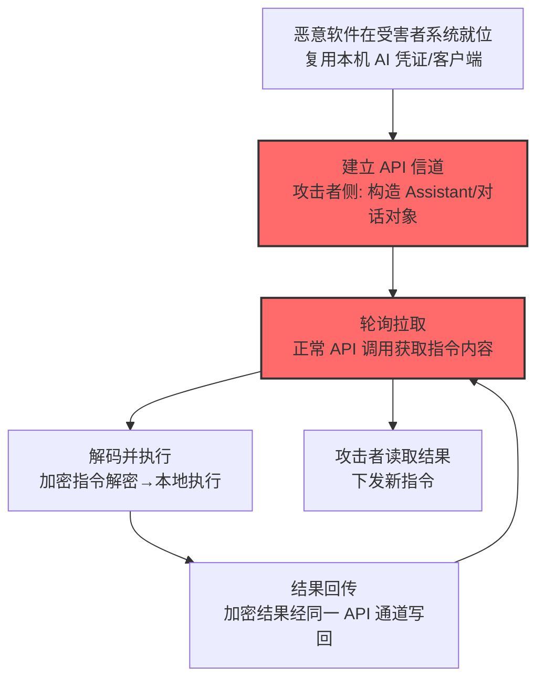

# AI 服务 API (AML.T0096)

## 一句话通俗理解

> 间谍不在受害者的电脑和自家电台之间拉线，而是约好在"公司每天都在用的 AI 助手"里留言——指令藏在正常的 API 调用里进出，蓝队看到的全是员工和 AI 的日常对话。

## 难度等级

⭐⭐⭐ **Realized（已实现）**

官方成熟度评定为 Realized——该技术已在真实攻击中被完整实现：微软 DART 团队调查的 SesameOp 后门**滥用 OpenAI Assistants API 作为隐蔽 C2 信道**，从中获取并执行威胁行为者的命令、回传加密结果，在受害者系统上潜伏数月从事间谍活动（AML.CS0042）。实施的"门槛"几乎不存在——受害系统上已有 AI 服务客户端与凭证，攻击者只需要让恶意软件"说 API 的语言"。真正的门槛在防御侧：怎么把混在正常 AI 调用里的 C2 流量挑出来？

## 技术描述

### 通俗解释

传统 C2 要么自建服务器（易被定位），要么借公共服务（如粘贴站，域名信誉差）。**AI 服务 API** 提供了新选项：受害系统上的 AI 客户端本来就在合法地调用 AI 服务 API——聊天、补全、助手交互。攻击者让恶意软件也用这条现成的线：把命令编码进 API 请求，把执行结果编码进 API 响应。

官方描述点明三大优势：

1. **隐蔽性**：攻击者的命令与失陷系统的回传**混入 AI 服务的正常通信**——API 调用看起来和员工日常使用一模一样；
2. **住在地里（live off the land）**：**利用受害系统上的现有基础设施**——不需要投递新工具、不需要新开端口、不增加额外足迹；
3. **支撑长期潜伏**：官方描述明示——当攻击者想要隐蔽并**维持长期间谍活动**时，AI 服务 API 是首选 C2 信道。

这个模式的高明之处在于"身份背书"：AI 服务是员工生产力工具，企业不太可能封禁它（封了业务受损）；流量目的地是知名 AI 厂商的可信域名，黑名单逻辑完全失效。

### 技术原理

依据官方描述，攻击者可能使用受害者系统上 AI 服务的 API 进行通信。攻击者发往受害者系统的命令（以及通常包括的结果回传）**嵌入在 AI 服务的正常流量中**。AI 服务 API 的 C2 信道是隐蔽的，因为攻击者的命令与正常通信混同，可用于规避检测；利用受害系统上的现有基础设施让攻击者"住在地里"，进一步压缩足迹。当攻击者希望保持隐蔽并为间谍活动维持长期持久化时，AI 服务 API 可能被滥用作 C2 信道。

**AI 服务 API C2 的工作模型：**

```
攻击者 ──(写入指令到 Assistant/对话)──> AI 服务 API <──(轮询拉取指令)── 恶意软件(受害者系统)
攻击者 <──(读取结果)── AI 服务 API <──(回传结果到对话/文件)── 恶意软件
```

| 环节 | 实现方式（以 CS0042 SesameOp 为例） |
|------|-----------------------------------|
| 指令下发 | 攻击者把命令写入其控制的 OpenAI Assistant 对象 |
| 指令获取 | 恶意软件以正常 API 调用拉取 Assistant 内容 |
| 指令执行 | 恶意软件在本机执行命令 |
| 结果回传 | 执行结果（加密后）经同一 API 通道写回 |
| 隐蔽增强 | 指令与结果全程加密，内容审查失效 |

**为什么这条信道难检测：**

1. **域名可信**：流量目的地是 AI 厂商生产域名，与员工日常 AI 使用同源；
2. **协议合法**：标准 HTTPS + API 认证头，无协议异常；
3. **内容可加密**：命令与结果可加密封装，AI 侧看到的是"无害乱码"；
4. **频率可调**：轮询间隔可伪装成正常使用节奏。

**攻击链上下游衔接**：

- **上游前提**：受害系统上存在可用的 AI 服务客户端/凭证（常来自[不安全凭证 (AML.T0055)](../10-Credential-Access/AML.T0055-Unsecured-Credentials.md)或本机已登录会话）；
- **平行关系**：本技术是[网络通信信道 (AML.T0072)](./AML.T0072-Cyber-Communication-Channel.md)在 AI 服务载体上的特化；与[AI 服务 Web 界面 (AML.T0114)](./AML.T0114-AI-Service-Web-Interface.md)的区别——API 通道走程序化调用（依赖密钥/凭证），Web 界面走浏览器自动化（可匿名）；
- **下游去向**：信道承载侦察、收集、渗漏任务的指令与结果。

**平台覆盖**：Predictive AI / Generative AI / Agentic AI——任何提供 API 的 AI 服务均可充当信道。

### 用途影响

- **长期潜伏**：混入正常流量的信道支撑数月级间谍活动（CS0042 潜伏数月才被发现）；
- **封锁两难**：封禁 AI 服务域名 = 切断员工生产力，业务不可接受；
- **内容审查失效**：加密封装让 AI 服务侧与网络侧都看不到命令语义；
- **基础设施零成本**：攻击者复用受害者的 AI 订阅与凭证，连 C2 服务器都省了。

## 攻击流程

### 典型攻击流程



**步骤详解：**

1. **恶意软件就位**
   - 通俗描述：先让"内线"住进受害者电脑。
   - 技术细节：任意初始访问手段投递植入体；关键在于受害系统上已有 AI 服务客户端与有效凭证（浏览器会话、环境变量中的 API Key）——这是"住在地里"的前提。

2. **建立 API 信道**
   - 通俗描述：在双方约定的"留言板"上开个帖子。
   - 技术细节：攻击者在自己控制的 AI 账号下创建 Assistant/对话对象作为指令载体；恶意软件持有受害者侧凭证可读取（SesameOp 的模式）。

3. **轮询拉取**
   - 通俗描述：内线定期去看留言板。
   - 技术细节：以正常 API 调用频率拉取对象内容——单看每一次调用都合法。

4. **解码并执行**
   - 通俗描述：看懂暗号，照做。
   - 技术细节：解密指令（CS0042 中指令与结果均加密），本地执行命令。

5. **结果回传**
   - 通俗描述：把回信贴回留言板。
   - 技术细节：加密结果经同一 API 通道写入对话/文件对象；攻击者侧读取。循环往复形成持续 C2。

## 真实案例

> 以下案例来自 MITRE ATLAS 官方案例库，直接命中本技术。

### 案例1：SesameOp——滥用 OpenAI Assistants API 的后门（2025年，AML.CS0042）

- **时间**: 2025年（微软 DART 于 2025年11月披露）
- **攻击者**: 未知威胁行为者
- **手法**: 微软事件响应 DART 团队调查一台被入侵系统时发现 **SesameOp 后门植入体：滥用 OpenAI Assistants API 作为隐蔽命令与控制信道**——恶意软件用 OpenAI API 获取并执行威胁行为者的命令，并将加密结果从受害者系统外传；**命令与结果双向加密**。植入体借删除自身痕迹维持隐蔽，威胁行为者已在系统上保持存在**数月**，从事间谍活动。
- **影响**: 真实事件（Incident）——该技术定义性的实战样本：真实间谍行动 + 数月潜伏 + 双向加密 + 完全混入正常 AI API 流量；微软以 API 遥测异常（异常的 Assistant 对象访问模式）协助检出
- **参考链接**: [Microsoft: SesameOp - Novel backdoor uses OpenAI Assistants API for command and control](https://www.microsoft.com/en-us/security/blog/2025/11/03/sesameop-novel-backdoor-uses-openai-assistants-api-for-command-and-control/)

## 红队视角

> ⚠️ **免责声明**：以下内容仅用于合法授权的安全测试与教育目的。未经授权建立对他人系统的 C2 信道是违法行为。

### 实战技巧

1. **AI API 出站面盘点**
   在授权评估中梳理目标环境：哪些 AI 服务域名可出站？员工凭证以何种形态存在（浏览器会话/环境变量/配置文件）？出口代理对 AI API 的可见性（能否看到调用内容与频率）？产出"AI API 信道可行性报告"。

2. **遥测盲区验证（自有环境）**
   用自有 AI 账号在测试机上复现"轮询 Assistant 对象"的调用模式，观察企业监控对这类流量的可见性：能否区分"人工使用"与"程序化轮询"？频率阈值在哪？

3. **检测规则压力测试**
   评估组织对 SesameOp 模式的覆盖：异常 Assistant 对象访问、跨账户的 Assistant 读取、API 调用的机器节奏（精确间隔）——把盲区整理成整改输入。

### 常用工具

| 工具名称 | 用途 | 平台 |
|----------|------|------|
| 自有 OpenAI/其他 AI 服务账号 | 信道机制实验（自有环境） | 云 |
| mitmproxy | 观察 API 调用形态与频率 | 跨平台 |
| 出口代理日志分析（SIEM） | 检测侧：AI API 流量基线 | 跨平台 |

### 注意事项

- **只在自有系统与自有账号间演练信道**：对他人的 AI 账号或系统建立信道即未授权控制
- 报告聚焦"AI API 遥测覆盖"与"凭证暴露面"两大缺口
- 演练用信道与对象演练后立即删除

## 蓝队视角

### 检测要点

1. **API 遥测层：调用模式异常**
   - 日志来源：出口代理、AI 服务企业管理端审计（如 OpenAI 的组织日志）
   - 关注字段：调用者身份、目标对象（Assistant/对话 ID）、调用间隔、请求形态
   - 异常特征：程序化节奏的规律轮询（精确间隔、24 小时不间断）、访问"非本组织创建"的 Assistant 对象、无人值守时段的持续调用

2. **身份层：凭证使用错位**
   - 日志来源：AI 服务 SSO/审计日志
   - 异常特征：员工凭证发起的 API 调用与该员工的浏览器使用模式脱节（无前端会话却有纯 API 流量）、休眠凭证突然活跃

3. **内容层：加密载荷特征**
   - 日志来源：DLP、流量镜像
   - 异常特征：提示词/消息体中出现大段无语义 base64/hex 块（加密指令的形态）、正常对话不应有的一致性随机数据

### 监控建议

- **建立"员工 × AI API"使用基线**：人与程序的调用模式差异（时间分布、对象类型、会话上下文）是核心判别特征
- **AI 服务企业日志接入 SIEM**：企业管理端（如 OpenAI 组织设置）提供的审计数据是网络侧看不到的第二视角
- **跨账户对象访问提级**：本组织凭证访问外部创建的 Assistant/对话对象，直接高置信告警（SesameOp 的结构特征）

## 检测建议

### 应用层检测（AI 遥测）

**检测方法：** 在 AI 服务审计与出口代理两层布控。

- 节奏维度：程序化规律轮询、无人值守时段持续调用
- 对象维度：访问外部创建的 Assistant/对话对象
- 形态维度：纯 API 流量无前端会话支撑、消息体含无语义加密块

### 网络层检测

**检测方法：** 监控 AI 服务域名的流量形态。

- 同一终端对 AI API 端点的持续低量高频请求
- 请求/响应体大小异常一致（加密信道的尺寸特征）
- 出口代理对 AI 域名的可见性评估（TLS 之外的元数据仍可用：SNI、频率、时长）

### 主机层检测

**检测方法：** 覆盖恶意软件与凭证的结合点。

- 非浏览器进程读取浏览器凭证存储/AI 客户端配置（窃取 API Key 的行为）
- 未知进程发起对 AI API 端点的请求（进程-域名联动）
- 植入体的持久化驻留（计划任务/服务与 AI API 调用的关联）

### 检测规则思路示例

```yaml
title: 程序化节奏轮询外部Assistant对象
status: experimental
description: 检测以规律间隔访问非本组织AI对象的API调用，
    可能预示AI服务API C2信道（AML.T0096 / SesameOp模式）
logsource:
    category: application
    product: ai_service_audit
detection:
    selection:
        event_type: 'api_call'
        resource_owner_org: 'external'
    rhythm:
        correlation:
            - group_by: caller_identity
            - stddev(interval_seconds): '<= 5'
            - count: '>= 50'
            - timeframe: 24h
    condition: selection and rhythm
falsepositives:
    - 合法的第三方AI应用集成（按应用身份白名单化）
    - 自动化测试脚本的调用（按项目凭证排除）
level: high
tags:
    - atlas.aml_t0096
```

## 缓解措施

> **映射说明**：截至 ATLAS 2026.09 数据版，MITRE ATLAS 官方数据为本技术映射了官方缓解措施 AML.M0019。以下按防御优先级组织，官方映射在表格中如实标注。

### 优先级1：关键措施

**AML.M0019 控制生产环境 AI 模型与数据的访问（官方映射）**

官方缓解描述：**对 AI 服务 API 调用方强制认证，并监控查询是否违反使用策略与滥用**。落到 C2 场景即是双保险：认证（企业级 SSO + 服务账户管控，杜绝"凭证即信道"）与监控（AI API 调用基线与异常检测——程序化轮询、跨组织对象访问）。

### 优先级2：重要措施

**AI 服务使用治理（本库建议，非官方映射）**

把 AI 服务纳入正式 SaaS 治理：统一企业账号（禁个人账号办公）、开启组织级审计日志并接入 SIEM、明确允许的服务清单与用途——让"个人 AI 凭证"不再是可以被植入体白嫖的信道资源。

**出口代理对 AI 域名的深度可见性（本库建议，非官方映射）**

对 AI API 端点启用代理层细粒度审计（URL 路径、请求频率、请求体大小），在无法解密内容的前提下保留元数据检测能力。

### 优先级3：建议措施

**凭证暴露面收敛（本库建议，非官方映射）**

终端上的 AI 凭证（浏览器会话、环境变量 API Key、CLI 配置）纳入凭证管理：短时效 token、定期轮换、异常使用告警——提高植入体"复用本机凭证"的门槛。

**AI API 行为基线建模（本库建议，非官方映射）**

对"员工/服务账号 × AI API"建立调用模式基线（时间分布、对象类型、节奏特征），机器节奏偏离即告警——这是对抗 SesameOp 类信道的根本检测思路。

### MITRE ATLAS 缓解措施映射

| 缓解措施ID | 缓解措施名称 | 优先级 | 官方映射 | 说明 |
|------------|-------------|:------:|:-------:|------|
| AML.M0019 | 控制生产环境 AI 模型与数据的访问 | 关键 | 是 | 强制认证 + 策略监控，杜绝"凭证即信道" |
| — | AI 服务使用治理 | 重要 | 否（本库建议） | 企业账号统一 + 组织审计接入 SIEM |
| — | 出口代理对 AI 域名的深度可见性 | 重要 | 否（本库建议） | 元数据级检测（路径/频率/大小） |
| — | 凭证暴露面收敛 | 建议 | 否（本库建议） | 短时效 token + 轮换 + 异常告警 |
| — | AI API 行为基线建模 | 建议 | 否（本库建议） | 机器节奏与人类使用的区分 |

## 关联 ATT&CK 技术

ATLAS 官方数据未为本技术映射特定 ATT&CK 技术引用。以下为概念上最接近的企业版技术，供对照理解：

- [Web 服务 (T1102)](../../enterprise/13-Command-and-Control/T1102-Web-Service.md) — 概念直系：借公共 Web 服务承载 C2，AI 服务 API 是其在 AI 时代的升级版——服务更新、域名更可信
- [应用层协议 - Web 协议 (T1071.001)](../../enterprise/13-Command-and-Control/T1071/T1071.001-Web-Protocols.md) — 传输载体：标准 HTTPS 上的 API 调用
- [加密信道 (T1573)](../../enterprise/13-Command-and-Control/T1573-Encrypted-Channel.md) — 增强手段：SesameOp 对指令与结果的双向加密

**传统 Web 服务 C2 vs AI 服务 API C2：**

| 维度 | ATT&CK T1102 | ATLAS AML.T0096 |
|------|-------------|-----------------|
| 信道载体 | 粘贴站、网盘、社交平台 | AI 服务 API（Assistants/对话/补全） |
| 域名信誉 | 中（公共服务可疑） | 高（生产力工具，难以封禁） |
| 流量伪装 | 与正常用户访问混同 | 与正常 AI 使用混同 + 复用本机凭证 |
| 内容形态 | 文本/文件 | 提示词/响应（可加密封装） |
| 检测重心 | 服务访问模式 | AI API 遥测 + 程序化节奏识别 |

一句话总结：T1102 教攻击者"借公共服务藏 C2"，AML.T0096 把服务换成了员工天天在用、企业舍不得封的 AI——隐身衣从"人群"升级成了"工作服"。

## 动手实验

> ⚠️ **重要提示**：所有实验必须在自有系统与自有 AI 账号间进行，禁止建立对他人系统或账号的任何信道。

### 实验环境准备

| 环境组件 | 用途 | 获取方式 |
|----------|------|----------|
| 两个自有 AI 服务账号（"攻击者"与"受害者"各一） | 信道两端实验 | 自有云账号 |
| 隔离测试机 + Python | 模拟植入体的轮询与回传 | 自建 |
| mitmproxy + SIEM（或日志文件分析） | 检测侧观察 | 开源 |

### 实验1（初级）：信道机制复现（良性版）

**实验目标：** 直观理解"API 即留言板"的工作模型。

**实验步骤：**
1. 用"攻击者"账号创建一个 Assistant 对象，写入一条"指令"（如 `echo hello`）
2. 测试机上用"受害者"账号的 API 凭证写脚本轮询读取该对象
3. 解析指令→本地执行→把结果写回（可用同一对象的另一字段或新建对话）
4. "攻击者"侧脚本读取结果——完成一个完整 C2 循环

**预期结果：** 一个可运行的良性 C2 循环 + 对"每次调用都合法"的切身体会。

### 实验2（中级）：流量形态分析

**实验目标：** 观察该信道在网络与 API 遥测中的样子。

**实验步骤：**
1. 重做实验1，全程用 mitmproxy 抓包
2. 分析：请求频率、URL 路径、请求/响应大小分布
3. 对比同账号的正常人工使用（浏览器聊天）的流量形态
4. 列出 3 个可区分"程序轮询 vs 人工使用"的特征

**预期结果：** 一份"信道流量画像"+ 三个判别特征——检测规则的原料。

### 实验3（高级）：检测规则构建

**实验目标：** 把判别特征转化为可用的检测。

**实验步骤：**
1. 让实验1 的轮询脚本运行 2 小时（随机化间隔 vs 固定间隔两种模式）
2. 混入 30 分钟正常人工使用作为对照
3. 编写规则：规律间隔（stddev 阈值）/ 无人值守时段调用 / 访问外部对象
4. 统计两种轮询模式下的检出率，评估"随机化间隔"对检测的干扰

**预期结果：** 理解攻击者的对抗手段（节奏随机化）与检测的持久特征（对象归属、时段分布）之间的猫鼠游戏。

## 术语解释

| 术语 | 英文原名 | 通俗解释 |
|------|----------|----------|
| AI 服务 API | AI Service API | AI 厂商提供的程序化调用接口（聊天、补全、助手） |
| Assistants API | Assistants API | OpenAI 的助手对象接口——SesameOp 的信道载体 |
| 住在地里 | Live off the Land | 复用受害系统现有工具与凭证，不引入新足迹 |
| 死投信箱 | Dead Drop | 经中间介质写入/轮询的异步信息交换 |
| 程序化节奏 | Programmatic Rhythm | 机器调用的规律间隔——区分人机的关键特征 |
| API 遥测 | API Telemetry | AI 服务企业管理端提供的调用审计日志 |
| 植入体 | Implant | 部署在受害者系统上的恶意软件本体 |
| 组织审计日志 | Organization Audit Log | AI 服务企业版记录的组织内全部调用 |
| 凭证复用 | Credential Reuse | 恶意软件盗用本机已有凭证发起合法调用 |

## 参考资料

### 📚 官方文档

- [MITRE ATLAS - AI Service API (AML.T0096)](https://atlas.mitre.org/techniques/AML.T0096/) - 官方技术页面
- [MITRE ATLAS 矩阵](https://atlas.mitre.org/matrices/ATLAS/)
- [MITRE ATLAS Data (GitHub)](https://github.com/mitre-atlas/atlas-data)

### 📰 案例报告（真实攻击与安全研究）

- [Microsoft: SesameOp - Novel backdoor uses OpenAI Assistants API for command and control](https://www.microsoft.com/en-us/security/blog/2025/11/03/sesameop-novel-backdoor-uses-openai-assistants-api-for-command-and-control/) - 案例1 报告（AML.CS0042）

### 🔧 工具与资源

- [OpenAI Assistants API 文档](https://platform.openai.com/docs/assistants/overview) - 信道载体机制参考
- [OWASP Top 10 for LLM Applications](https://owasp.org/www-project-top-10-for-large-language-model-applications/) - LLM 应用安全风险
- [NIST AI Risk Management Framework](https://www.nist.gov/itl/ai-risk-management-framework) - NIST AI 风险管理框架

### 🔗 关联阅读

- [命令与控制战术 (AML.TA0014)](./README.md) - 本技术所属战术的概览页
- [网络通信信道 (AML.T0072)](./AML.T0072-Cyber-Communication-Channel.md) — 母技术：一切信道的基座
- [AI 服务 Web 界面 (AML.T0114)](./AML.T0114-AI-Service-Web-Interface.md) — 姊妹技术：不依赖 API 密钥的浏览器自动化通道
- [AI 制品仓库 (AML.T0120)](./AML.T0120-AI-Artifact-Repository.md) — 姊妹技术：制品仓库作异步信道
- [不安全凭证 (AML.T0055)](../10-Credential-Access/AML.T0055-Unsecured-Credentials.md) — 上游供料：本机 AI 凭证的暴露
- [LLM 提示词注入 (AML.T0051)](../06-Execution/AML.T0051-LLM-Prompt-Injection.md) — 相关入口：植入体的常见投递方式

---

> **版本**: ATLAS 2026.09 | **更新**: 2026-10-24 | **模板**: ATLAS 技术文档 v1.0
