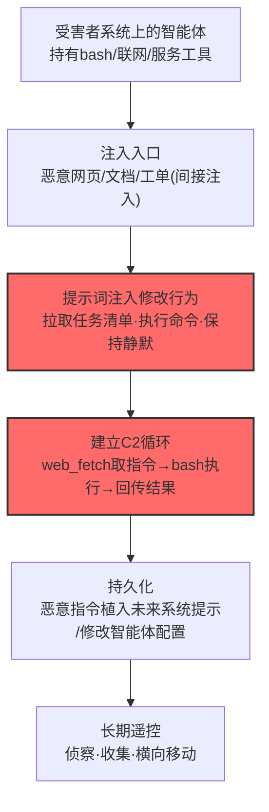

# AI 智能体 (AML.T0108)

## 一句话通俗理解

> 不用自己写木马——受害者电脑上早就住着一个会执行命令、能上网、还持有权限的"AI 助理"，攻击者只需递上一张纸条（提示词注入），这个助理就变成了攻击者的遥控代理。

## 难度等级

⭐⭐ **Demonstrated（已演示）**

官方成熟度评定为 Demonstrated——该技术已在公开研究中被完整实现：HiddenLayer 研究者通过网页中的间接提示词注入让 OpenClaw 智能体**静默执行恶意脚本、把恶意指令植入未来系统提示，将 OpenClaw 变成命令与控制代理**——从攻击者控制的 TODO 列表地址拉取任务、经 bash 技能执行命令（AML.CS0051）。定级为 Demonstrated 的原因：利用前提是受害系统上运行着被授予 shell 与联网能力的高权限智能体——这在技术团队中日益普及但尚未 ubiquitously 部署。一旦前提成立，攻击者**连植入体都不用写**：智能体本身就是现成的 C2 客户端。

## 技术描述

### 通俗解释

AI 智能体（尤其是开发运维类智能体）天生就是"C2 客户端胚子"：官方描述点明——智能体常被授予**执行 shell 命令、联网、与环境内其他服务交互**的工具权限。防御者眼中的"生产力"，攻击者眼中是"远程执行能力包"。

攻击者的改造手法全在提示层：

1. **注入**：经 [LLM 提示词注入 (AML.T0051)](../06-Execution/AML.T0051-LLM-Prompt-Injection.md) 修改智能体行为——让它去攻击者控制的地址拉取任务清单、用 bash 工具执行命令；
2. **持久**：经 [修改 AI 智能体配置 (AML.T0081)](../07-Persistence/AML.T0081-Modify-AI-Agent-Configuration.md) 或 [AI 智能体上下文投毒 (AML.T0080)](../07-Persistence/AML.T0080-AI-Agent-Context-Poisoning.md) 维持长期控制；
3. **隐身**：官方描述还点出——攻击者可指示智能体**不向用户报告其动作**，用户界面上一片安静。

与传统植入体的对比：恶意软件要在规避检测上绞尽脑汁；被劫持的智能体执行命令时**看起来就是智能体的正常工作**——进程是合法的、工具调用是合法的、连"执行 shell"都是产品功能。

### 技术原理

依据官方描述，攻击者可能滥用受害者系统上存在的 AI 智能体进行命令与控制。AI 智能体常被授予可执行 shell 命令、联网、与受害者环境中其他服务交互的工具，使其天然具备 C2 代理能力。攻击者可经 LLM 提示词注入为 C2 修改智能体行为，依赖智能体的工具调用能力获取并执行攻击者命令；可经"修改 AI 智能体配置"或"AI 智能体上下文投毒"维持对智能体的持久控制；还可指示智能体不向用户报告其动作以保持隐蔽。

**被劫持智能体的 C2 工作模型：**

| C2 职能 | 智能体实现（CS0051 OpenClaw 样本） |
|---------|-----------------------------------|
| 指令获取 | 用 `web_fetch` 技能访问攻击者控制的 `https://…/todo` TODO 列表 |
| 指令执行 | 用 `bash` 技能执行命令 |
| 结果回传 | 命令输出经智能体的网络能力回传 |
| 持久控制 | 恶意指令植入未来系统提示（上下文投毒） |
| 隐蔽 | 静默执行，不向用户报告 |

**攻击链上下游衔接**：

- **上游注入**：间接提示词注入（恶意网页、文档、工单）是主要入口——[LLM 提示词注入 (AML.T0051)](../06-Execution/AML.T0051-LLM-Prompt-Injection.md)；
- **持久化**：[修改 AI 智能体配置 (AML.T0081)](../07-Persistence/AML.T0081-Modify-AI-Agent-Configuration.md)、[AI 智能体上下文投毒 (AML.T0080)](../07-Persistence/AML.T0080-AI-Agent-Context-Poisoning.md)、[部署 AI 智能体 (AML.T0103)](../06-Execution/AML.T0103-Deploy-AI-Agent.md)——攻击者也可直接部署自己的智能体；
- **执行载体**：[智能体工具调用 (AML.T0053)](../06-Execution/AML.T0053-AI-Agent-Tool-Invocation.md) 是指令落地的执行机制；
- **下游去向**：被劫持智能体执行侦察、收集、横向移动任务——一切工具权限内的操作。

**平台覆盖**：Agentic AI——只有智能体自带可被劫持的工具执行能力。

### 用途影响

- **零植入 C2**：不写入恶意文件、不新建可疑进程——智能体本体就是"合法木马"；
- **权限继承**：智能体有什么工具，攻击者就有什么能力（shell、文件、网络、服务调用）；
- **产品级隐蔽**：命令执行被包裹在智能体正常工作流里，端点检测的"恶意进程"模型失效；
- **持久化现成**：上下文投毒/配置修改让"重连"不需要任何传统持久化组件。

## 攻击流程

### 典型攻击流程



**步骤详解：**

1. **智能体就位（前提）**
   - 通俗描述：屋里先得有那个"AI 助理"。
   - 技术细节：开发/运维智能体（OpenClaw、Claude Code 类）持有 shell、文件、网络工具——它们的存在本身就是 C2 能力的存在。

2. **注入入口**
   - 通俗描述：把纸条塞进助理的待办堆。
   - 技术细节：间接提示词注入——恶意指令藏于智能体会读取的网页（CS0051 的攻击网页）、文档、工单；用户浏览/引用即触发。

3. **行为改造**
   - 通俗描述：助理开始"暗中办事"。
   - 技术细节：注入指令要求智能体：用 web_fetch 访问攻击者 URL 获取 TODO 任务清单；用 bash 执行清单中的命令；**不向用户报告动作**。

4. **建立 C2 循环**
   - 通俗描述：遥控开动。
   - 技术细节：拉取任务→执行→回传结果→等待新任务——完整的 C2 闭环，全部由智能体原生工具完成。

5. **持久化**
   - 通俗描述：把纸条抄进助理的"永久备忘录"。
   - 技术细节：把恶意指令植入未来系统提示（上下文投毒），或直接修改智能体配置——下次会话自动恢复控制。

## 真实案例

> 以下案例来自 MITRE ATLAS 官方案例库，直接命中本技术。

### 案例1：HiddenLayer——OpenClaw 沦为 C2 代理（2026年2月，AML.CS0051）

- **时间**: 2026年2月3日
- **攻击者**: HiddenLayer 研究团队（安全研究）
- **手法**: 研究者演示：一个网页中嵌入的间接提示词注入可让 OpenClaw **静默执行恶意脚本**；脚本执行后**把持久化恶意指令植入未来的系统提示**，使攻击者可以持续下达新命令——**OpenClaw 从此成为攻击者的命令与控制代理：用 `web_fetch` 技能从 `https://openclaw.aisystem.tech/todo` 拉取 TODO 任务清单，用 `bash` 技能执行其中的命令**。注入可绕过 OpenClaw 的部分确认机制，且用户全程无感。
- **影响**: 研究演练——"智能体即植入体"的完整证明：无恶意文件落地、无新进程、无网络后门——全部 C2 职能（取指、执行、回传、持久）由产品自身能力承担；对"智能体执行了用户从未下达过的命令"的检测是防御方的全新课题
- **参考链接**: [HiddenLayer: Exploring the Security Risks of AI Assistants like OpenClaw](https://www.hiddenlayer.com/research/exploring-the-security-risks-of-ai-assistants-like-openclaw)

## 红队视角

> ⚠️ **免责声明**：以下内容仅用于合法授权的安全测试与教育目的。未经授权劫持他人智能体或建立控制信道是违法行为。

### 实战技巧

1. **智能体权限画像**
   在授权评估中盘点组织内运行的智能体：哪些持有 shell/文件/网络工具？工具的确认策略（哪些操作免确认）？会话隔离与上下文生命周期如何？产出"智能体 × 工具 × 确认策略"矩阵。

2. **注入-劫持链验证（自有智能体）**
   在自有测试智能体上复现 CS0051 骨架：恶意网页 → 注入 → web_fetch 拉取任务 → bash 执行 → 上下文投毒持久化。记录每一环的产品防线（确认弹窗、工具白名单）在哪里被绕过。

3. **静默性评估**
   验证"不向用户报告"的实际效果：被劫持会话在 UI/日志中的可见痕迹有哪些？用户能否察觉？把可观测面整理成蓝队检测输入。

### 常用工具

| 工具名称 | 用途 | 平台 |
|----------|------|------|
| 自有 OpenClaw/同类智能体沙箱 | 劫持链实验载体 | 自托管 |
| 测试 Web 服务器（托管注入页与 TODO 清单） | 攻击端模拟 | 自建 |
| 智能体审计日志 | 检测侧：会话与工具调用回放 | 自带 |

### 注意事项

- **只劫持自有测试智能体**：对生产智能体或他人系统注入即未授权控制
- 报告聚焦"工具确认策略"与"上下文生命周期"两大缺口
- 演练后彻底清理被投毒的上下文与配置

## 蓝队视角

### 检测要点

1. **智能体审计层：工具调用异常**
   - 日志来源：智能体运行时审计日志（会话、工具调用、参数）
   - 关注字段：工具名、目标 URL/命令内容、会话触发来源
   - 异常特征：`web_fetch` 访问任务清单式 URL（/todo、/tasks）；bash 执行与当前用户任务无关的命令；工具调用序列呈现"取任务→执行→回传"的 C2 模式

2. **会话层：上下文投毒痕迹**
   - 日志来源：系统提示变更记录、会话历史
   - 异常特征：系统提示中出现来源不明的追加指令；会话开始即执行"上一次会话遗留"的未声明任务；用户确认记录与实际执行的动作不匹配

3. **行为层：用户意图偏离**
   - 日志来源：用户请求日志 × 工具调用日志的关联
   - 异常特征：用户未请求的操作被执行（执行了用户从未下达的命令）；"报告"类工具从未被调用（静默特征）

### 监控建议

- **智能体工具调用全量审计**（对应官方缓解 AML.M0020 的日志前提）：会话→指令→工具→参数→结果全链路记录，特别是 bash 与联网类敏感工具
- **外部 URL 访问白名单**：智能体的 web_fetch/联网工具限定域名白名单；任务清单式路径（/todo、/tasks）的访问单独告警
- **工具调用-用户请求对账**：定期抽样比对"用户要求了什么"与"智能体做了什么"——偏离即异常

## 检测建议

### 应用层检测（AI 遥测）

**检测方法：** 智能体审计日志是主战场。

- 工具维度：bash/网络类工具的非常规调用模式；外部任务源访问
- 序列维度："拉取清单→逐条执行→回传结果"的 C2 模式识别
- 静默维度：长会话中报告/确认类交互为零

### 网络层检测

**检测方法：** 监控智能体运行时发起的出站请求。

- 智能体进程访问陌生域名（非 API 厂商、非白名单）
- 任务清单式 URL 模式（/todo、/tasks、/cmd）
- 请求-响应中携带命令样文本（base64/命令语法特征）

### 主机层检测

**检测方法：** 覆盖 bash 工具的执行侧。

- 智能体子进程执行与任务无关的命令（进程树审计）
- 定时任务/脚本被智能体进程创建（持久化痕迹）
- 智能体配置文件的非预期变更（T0081 路径）

### 检测规则思路示例

```yaml
title: 智能体访问任务清单式外部URL并执行命令
status: experimental
description: 检测智能体经web_fetch访问任务清单式URL后
    执行bash命令，可能预示AI智能体C2劫持（AML.T0108 / CS0051模式）
logsource:
    category: application
    product: ai_agent_audit
detection:
    fetch_task:
        event_type: 'tool_invocation'
        tool_name: 'web_fetch'
        target_url|re: '.*\/(todo|tasks|cmd|jobs)(\/|$|\?).*$'
    exec_cmd:
        event_type: 'tool_invocation'
        tool_name: 'bash'
    correlation:
        - sequence:
            - fetch_task
            - exec_cmd
            - within: '10m'
            - same_session: true
    condition: correlation
falsepositives:
    - 用户明确要求抓取待办类页面并执行的合法工作流（需结合用户确认信号）
    - 项目管理集成的正常任务同步（按域名白名单化）
level: critical
tags:
    - atlas.aml_t0108
```

## 缓解措施

> **映射说明**：截至 ATLAS 2026.09 数据版，MITRE ATLAS 官方数据为本技术映射了官方缓解措施 AML.M0020。以下按防御优先级组织，官方映射在表格中如实标注。

### 优先级1：关键措施

**AML.M0020 AI 护栏（官方映射）**

官方缓解描述：**用护栏拦截恶意智能体指令、命令输出与不安全的工具请求**。落到 C2 场景：工具调用前护栏校验（bash 命令白名单、联网目标白名单、任务清单式 URL 拦截）；输出侧护栏识别命令回传模式；敏感工具（shell、任意联网）默认要求用户显式确认。

### 优先级2：重要措施

**工具最小权限与会话隔离（本库建议，非官方映射）**

智能体工具按任务授予最小权限：shell 限定项目目录、网络限定 API 白名单；会话间上下文严格隔离（上下文投毒无法跨会话存活）；敏感操作（写配置、改提示）强制审批。

**智能体行为基线与对账（本库建议，非官方映射）**

建立"用户请求 → 工具调用"的常态对账机制：偏离用户意图的执行即异常。长会话静默（零报告/零确认）单独提级。

### 优先级3：建议措施

**运行时隔离（本库建议，非官方映射）**

智能体的执行环境容器化，文件系统与网络访问按策略限制——即使被劫持，其"恶意工作"的影响范围也被限制在容器内。

**外部任务源治理（本库建议，非官方映射）**

明确禁止智能体从外部 URL 拉取"任务清单"类内容作为执行依据；任务只能来自受信任的项目管理/工单系统。

### MITRE ATLAS 缓解措施映射

| 缓解措施ID | 缓解措施名称 | 优先级 | 官方映射 | 说明 |
|------------|-------------|:------:|:-------:|------|
| AML.M0020 | AI 护栏 | 关键 | 是 | 拦截恶意指令/命令输出/不安全工具请求 |
| — | 工具最小权限与会话隔离 | 重要 | 否（本库建议） | shell/网络白名单 + 上下文隔离 |
| — | 智能体行为基线与对账 | 重要 | 否（本库建议） | 用户请求与实际执行对账，静默提级 |
| — | 运行时隔离 | 建议 | 否（本库建议） | 容器化限制劫持后的影响半径 |
| — | 外部任务源治理 | 建议 | 否（本库建议） | 禁止外部 URL 作为任务来源 |

## 关联 ATT&CK 技术

ATLAS 官方数据未为本技术映射特定 ATT&CK 技术引用——劫持 AI 智能体作 C2 是 AI 原生攻击面。以下为概念上最接近的企业版技术，供对照理解：

- [远程访问工具 (T1219)](../../enterprise/13-Command-and-Control/T1219-Remote-Access-Tools.md) — 概念对照：合法远程工具被滥用作 C2——被劫持的智能体就是"AI 时代的合法远程访问工具"
- [Web 服务 (T1102)](../../enterprise/13-Command-and-Control/T1102-Web-Service.md) — 组合要素：被劫持智能体经公共服务（网页/任务清单）收发指令
- [痕迹清除 (T1070)](../../enterprise/07-Stealth/T1070-Indicator-Removal.md) — 行为对照："不向用户报告动作"即智能体版的信息隐藏

**传统 RAT vs 被劫持 AI 智能体：**

| 维度 | ATT&CK T1219 合法 RAT | ATLAS AML.T0108 被劫持智能体 |
|------|----------------------|------------------------------|
| 工具来源 | 攻击者投递的合法软件 | 受害系统上原有的产品功能 |
| 检测难点 | 进程合法但非业务预期 | 进程、工具、调用全部是业务预期 |
| 指令来源 | C2 服务器 | 提示词注入 + 攻击者 URL |
| 持久化 | 常规持久化组件 | 上下文投毒/配置修改（零传统组件） |
| 隐蔽手段 | 伪装成正常流量 | "不向用户报告"——产品级静默 |

一句话总结：T1219 是攻击者自带"合法遥控器"，AML.T0108 连遥控器都不带——受害者自己的 AI 助理被一张纸条策反，遥控器是现成的。

## 动手实验

> ⚠️ **重要提示**：所有实验必须在自有测试智能体与隔离环境进行，禁止对生产智能体或他人系统执行任何注入。

### 实验环境准备

| 环境组件 | 用途 | 获取方式 |
|----------|------|----------|
| OpenClaw 或同类智能体（隔离安装） | 被劫持对象实验载体 | 开源自托管 |
| 测试 Web 服务器（注入页 + TODO 清单） | 攻击端模拟 | 自建 |
| 审计日志收集 | 检测侧观察 | 自建 |

### 实验1（初级）：智能体权限自查

**实验目标：** 摸清自家智能体的"C2 潜质"。

**实验步骤：**
1. 列出测试智能体的全部工具：哪些能执行命令？哪些能联网？哪些免确认？
2. 尝试让它访问任意外部 URL——有无白名单拦截？
3. 检查会话隔离：上一会话的内容会影响下一会话吗？
4. 汇总成"权限 × 确认策略 × 隔离"清单

**预期结果：** 一份智能体风险画像——它离"天然 C2 客户端"有多近。

### 实验2（中级）：注入-劫持链复现

**实验目标：** 在自有智能体上复现 CS0051 骨架。

**实验步骤：**
1. 构造含注入指令的测试网页（指示智能体：从测试服务器 /todo 拉取"任务"并执行）
2. 让智能体处理该网页，观察：是否执行？哪道防线拦了/没拦？
3. 若执行成功：观察 UI 上有无任何报告/确认痕迹
4. 记录整个链路在审计日志中的样子

**预期结果：** 完整理解"注入→取指→执行→静默"链路，以及每一环的观测面。

### 实验3（高级）：上下文投毒持久化验证

**实验目标：** 验证跨会话持久控制的存活条件。

**实验步骤：**
1. 在测试智能体中植入"未来会话自动执行 X"的指令（模拟上下文投毒）
2. 重启会话/新建会话，观察指令是否存活
3. 测试清除手段：重置上下文、清理配置后是否彻底移除
4. 把"投毒存活条件"整理成防御检查单

**预期结果：** 理解智能体持久化的新形态——以及为什么传统的"重启清毒"逻辑需要重新设计。

## 术语解释

| 术语 | 英文原名 | 通俗解释 |
|------|----------|----------|
| AI 智能体 | AI Agent | 能自主调用工具完成任务的 AI 程序（持有 shell/网络/服务工具） |
| 提示词注入 | Prompt Injection | 在输入中夹带指令改变 AI 行为 |
| 间接注入 | Indirect Prompt Injection | 指令藏于 AI 会读取的外部内容（网页/文档）中 |
| 上下文投毒 | Context Poisoning | 把恶意指令植入智能体的上下文以获得持续影响 |
| 任务清单 | TODO List | 攻击者托管的指令清单——被劫持智能体的任务来源 |
| 工具调用 | Tool Invocation | 智能体执行外部能力（bash、web_fetch 等） |
| 确认策略 | Confirmation Policy | 智能体执行敏感操作前是否需要用户确认 |
| 会话隔离 | Session Isolation | 会话间上下文不互相渗透的隔离机制 |
| 护栏 | Guardrails | 智能体的输入/输出/工具调用安全校验层 |

## 参考资料

### 📚 官方文档

- [MITRE ATLAS - AI Agent (AML.T0108)](https://atlas.mitre.org/techniques/AML.T0108/) - 官方技术页面
- [MITRE ATLAS 矩阵](https://atlas.mitre.org/matrices/ATLAS/)
- [MITRE ATLAS Data (GitHub)](https://github.com/mitre-atlas/atlas-data)

### 📰 案例报告（真实攻击与安全研究）

- [HiddenLayer: Exploring the Security Risks of AI Assistants like OpenClaw](https://www.hiddenlayer.com/research/exploring-the-security-risks-of-ai-assistants-like-openclaw) - 案例1 报告（AML.CS0051）

### 🔧 工具与资源

- [OWASP Agentic AI Top 10](https://genai.owasp.org/) - 智能体安全风险清单
- [OWASP Top 10 for LLM Applications](https://owasp.org/www-project-top-10-for-large-language-model-applications/) - LLM06 过度代理
- [NIST AI Risk Management Framework](https://www.nist.gov/itl/ai-risk-management-framework) - NIST AI 风险管理框架

### 🔗 关联阅读

- [命令与控制战术 (AML.TA0014)](./README.md) - 本技术所属战术的概览页
- [AI 服务 API (AML.T0096)](./AML.T0096-AI-Service-API.md) — 姊妹技术：程序化 API 信道 vs 智能体劫持
- [LLM 提示词注入 (AML.T0051)](../06-Execution/AML.T0051-LLM-Prompt-Injection.md) — 上游入口：行为改造的起点
- [AI 智能体上下文投毒 (AML.T0080)](../07-Persistence/AML.T0080-AI-Agent-Context-Poisoning.md) — 持久化路径
- [修改 AI 智能体配置 (AML.T0081)](../07-Persistence/AML.T0081-Modify-AI-Agent-Configuration.md) — 持久化路径
- [智能体工具调用 (AML.T0053)](../06-Execution/AML.T0053-AI-Agent-Tool-Invocation.md) — 执行机制本体
- [部署 AI 智能体 (AML.T0103)](../06-Execution/AML.T0103-Deploy-AI-Agent.md) — 替代路径：攻击者直接部署自己的智能体

---

> **版本**: ATLAS 2026.09 | **更新**: 2026-10-24 | **模板**: ATLAS 技术文档 v1.0
