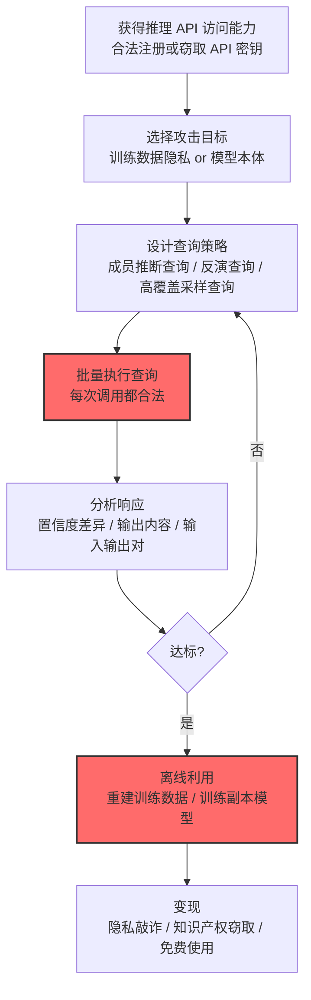

# 通过 AI 推理 API 渗漏 (AML.T0024)

## 一句话通俗理解

> 攻击者不偷文件、不传数据，只是不停地向你的模型"提问"——问着问着，训练数据里的隐私、乃至模型本体的"灵魂"，就顺着推理 API 的正常响应流了出去。

## 难度等级

⭐⭐⭐ **Realized（已实现）**

官方成熟度评定为 Realized——推理 API 渗漏家族中威力最大的**模型提取（AML.T0024.002）已被真实攻击完整实现**：Anthropic 披露三家中国 AI 实验室（DeepSeek、Moonshot AI、MiniMax）通过约 24,000 个账号、1600 万次查询对 Claude 发起蒸馏攻击，试图复制其智能体推理、代码生成与工具调用能力（AML.CS0056）。对攻击者而言，这甚至不需要传统入侵——只要能调用公开推理 API，"审讯"就可以开始。

## 技术描述

### 通俗解释

传统渗漏是"把东西搬出去"；推理 API 渗漏是"把东西问出来"。攻击者获得模型的推理 API 访问能力（通常只需一个合法账号）后，把 API 变成审讯室：

- **问隐私**：通过精心设计的查询判断某条数据是否在训练集里（成员推断），或直接从模型输出反推训练样本（模型反演）；
- **偷模型**：海量查询收集模型的输入-输出对，用它们当"训练标签"离线训练一个行为高度近似的副本（模型提取/蒸馏）。

整个过程中，攻击者的每一次操作都是**合法的 API 调用**——不触发任何传统的入侵检测。

官方描述强调两条路径：

1. 模型已被证明会泄露训练数据的隐私信息（成员推断、模型反演）；
2. 模型本体本身也可被提取，用于**AI 知识产权窃取（AML.T0048.004）**。

训练数据隐私的泄露会直接引发合规问题——训练集中可能包含个人身份信息（PII）或其他受保护数据。

### 技术原理

依据官方描述，攻击者可能通过[AI 模型推理 API 访问 (AML.T0040)](../05-AI-Model-Access/AML.T0040-AI-Model-Inference-API-Access.md)渗漏私有信息。AI 模型已被证明会泄露其训练数据的隐私信息；模型本身也可能被提取用于知识产权窃取。

**推理 API 渗漏家族的三大攻击面：**

| 子技术 | 回答的问题 | 攻击产出 | 主要危害 |
|--------|-----------|----------|----------|
| [推断训练数据成员关系 (AML.T0024.000)](./AML.T0024/AML.T0024.000-Infer-Training-Data-Membership.md) | "这条数据参与训练了吗？" | 成员关系判定 | 隐私合规违规（如医疗记录被确认用于训练） |
| [反演 AI 模型 (AML.T0024.001)](./AML.T0024/AML.T0024.001-Invert-AI-Model.md) | "训练数据长什么样？" | 训练样本重建 | 敏感特征泄露、隐私侵犯 |
| [提取 AI 模型 (AML.T0024.002)](./AML.T0024/AML.T0024.002-Extract-AI-Model.md) | "模型怎么决策的？" | 功能等价的副本模型 | 知识产权流失、绕过付费墙与安全护栏 |

**为什么推理 API 能"漏"出训练数据：**

1. **模型会背书**：过度拟合让模型对见过的样本"过于自信"——置信度分数的细微差异就是成员推断的信号；
2. **输出即知识**：LLM 在特定诱导下可能逐字复述训练语料中的片段（隐私泄露的直接形式）；
3. **行为可复制**：黑盒场景下，输入-输出对本身就携带了模型的决策边界信息——足够多的查询就能"蒸馏"出近似模型。

**攻击链上下游衔接：**

- **上游前提**：攻击者需先获得对目标模型的查询能力——[AI 模型推理 API 访问 (AML.T0040)](../05-AI-Model-Access/AML.T0040-AI-Model-Inference-API-Access.md)（合法注册的 API 密钥即可，无需入侵）；
- **下游去向**：提取出的模型或推断出的隐私可直接变现——用于 AI 知识产权窃取（AML.T0048.004，见战 16 影响）或勒索/敲诈（"我证明你的训练集里有我的医疗记录"）。

**平台覆盖**：Predictive AI / Generative AI / Agentic AI——任何暴露推理接口的模型均可能中招。

### 用途影响

- **隐私合规风险**：训练数据中的 PII 被推断/复述出来，直接触发 GDPR、HIPAA 等法规的处罚条款；
- **知识产权直接流失**：模型提取让数百万美元训练成本堆出的能力被"零成本"复制（CS0056 中 1600 万次查询即复制 Claude 核心能力）；
- **护栏失效**：蒸馏出的副本模型脱离原厂安全护栏，可被用于恶意用途；
- **检测盲区**：每一次查询都合法——传统 DLP、IDS 完全无感，唯一线索是调用模式异常。

## 攻击流程

### 典型攻击流程



**步骤详解：**

1. **获得推理 API 访问能力**
   - 通俗描述：拿到"审讯室"的门票。
   - 技术细节：最简单的路径是合法注册账号获取 API 配额；对抗检测时可分布到大量账号（CS0056 用了约 24,000 个账号）。

2. **选择攻击目标**
   - 通俗描述：决定要"问隐私"还是"偷模型"。
   - 技术细节：面向隐私的成员推断/反演只需少量定向查询；面向模型本体的提取需要海量高覆盖查询。

3. **设计查询策略**
   - 通俗描述：设计一套"提问技巧"。
   - 技术细节：成员推断对比"目标样本"与"影子模型"的输出差异；反演利用置信度分数反向重建；提取则系统性地采样输入空间。

4. **批量执行查询**
   - 通俗描述：开始审讯。
   - 技术细节：分摊查询到多账号、控制频率避免触发限速——但每一次调用本身完全合法。

5. **分析响应**
   - 通俗描述：从回答里拼出秘密。
   - 技术细节：统计模型预测分数、提取输出文本、收集输入-输出对数据集。

6. **离线利用**
   - 通俗描述：把问出来的东西变成资产。
   - 技术细节：用收集的推理结果作为标签，离线训练一个模仿目标模型行为与性能的副本模型。

## 真实案例

> 以下案例来自 MITRE ATLAS 官方案例库。本条目为父技术，案例直接命中其子技术[提取 AI 模型 (AML.T0024.002)](./AML.T0024/AML.T0024.002-Extract-AI-Model.md)。

### 案例1：针对 Anthropic Claude 的模型蒸馏行动（2026年，AML.CS0056）

- **时间**: 2026年2月（Anthropic 于 2026年3月披露）
- **攻击者**: DeepSeek、Moonshot AI、MiniMax（三家中国 AI 实验室）
- **手法**: Anthropic 发现针对 Claude 能力提取的协同行动——合计使用**约 24,000 个账号、1600 万次查询**，通过模型蒸馏在 Claude 的输出上训练自己的模型，试图复制 Claude 的智能体推理、代码生成、工具使用与计算机使用能力。报告指出蒸馏被用作规避 Anthropic 出口管制的手段，且蒸馏出的模型缺乏阻止恶意用途的安全护栏。
- **影响**: 真实事件（Incident）——官方数据中该家族规模最大的实战样本：真实知识产权窃取 + 海量账号协同 + 跨越数月的持续性查询
- **参考链接**: [Anthropic: Detecting and preventing distillation attacks](https://www.anthropic.com/news/detecting-and-preventing-distillation-attacks)

## 红队视角

> ⚠️ **免责声明**：以下内容仅用于合法授权的安全测试与教育目的。对他人模型实施提取或推断攻击可能违反法律与服务条款。

### 实战技巧

1. **推理 API 暴露面盘点**
   在授权评估中梳理组织对外提供的推理端点：返回多少置信度信息（概率/排名/logits）？是否限制输出格式？API 限速与配额策略如何？输出越"丰富"，攻击面越大。

2. **成员推断可行性验证（自有模型）**
   用组织自己的模型与已知训练/非训练样本做小规模成员推断试验：模型对两类样本的置信度分布是否可分？若可分，即存在成员泄露面。

3. **提取成本估算**
   评估复制组织模型核心能力所需的查询规模（对比 CS0056 的 1600 万次量级），再对照现行限速与配额策略——"提取需要多少预算"是风险评估的直接量化指标。

### 常用工具

| 工具名称 | 用途 | 平台 |
|----------|------|------|
| 影子模型训练框架（自建） | 成员推断的攻击基准 | Python/PyTorch |
| 公开成员推断研究实现 | 学术攻击方法参考 | Python |
| API 网关限速与配额数据 | 防御侧：查询模式基线 | 云 |

### 注意事项

- **只对自有模型做攻击性测试**；对第三方模型测试前必须获得书面授权
- 评估报告聚焦"输出信息保真度"（降低置信度精度是否影响业务）与"查询模式监控"两大缺口
- 模型提取的检测重点在**调用侧**（多账号、高频、低重叠查询），而非内容侧

## 蓝队视角

### 检测要点

1. **调用模式层：提取攻击特征**
   - 日志来源：API 网关、AI 服务审计日志
   - 异常特征：大量**低重叠度**的查询（提取攻击要覆盖输入空间）、多账号协同的相似查询模式、持续数天至数周的高频调用

2. **输出消费层：响应异常**
   - 日志来源：应用层日志
   - 异常特征：单一用户消耗的 token 量远超对话需求、请求-响应几乎无重复（与正常用户反复修改提问的模式相反）

3. **账号层：批量注册特征**
   - 日志来源：账号系统、风控
   - 异常特征：短期内新注册账号立即投入高频 API 调用、账号行为高度同质化（CS0056 的 24,000 账号即典型）

### 监控建议

- **建立"正常使用基线"**：人类用户的查询有时间分布、有上下文重复；提取攻击的查询是均匀、持续、低重叠的——节奏与重叠度是核心判别特征
- **多账号关联分析**：不同账号的查询若在语义空间高度相邻，警惕协同提取
- **输出端信息保真度治理**：评估产品是否真的需要返回完整概率分布/排名——降精度是有效的结构性缓解

## 检测建议

### 应用层检测（AI 遥测）

**检测方法：** 在 API 网关与 AI 服务审计层布控查询模式分析。

- 同一账号/多账号的低重叠查询流（提取特征）
- 请求 token 总量与"对话形态"的偏离（无上下文的批量独立请求）
- 新账号冷启动即高频调用

### 网络层检测

**检测方法：** 推理 API 渗漏全部走合法 HTTPS，网络层检测能力有限。

- 出口流量中 AI 服务端点的异常量级与节奏（作为辅助信号）
- 单一来源 IP / 网段的高密度 API 调用（多账号聚合出口）

### 主机层检测

**检测方法：** 覆盖凭证与调用工具的结合点。

- 非预期进程使用 API 密钥发起推理调用（密钥被滥用于自动提取）
- 终端上的批量查询脚本特征（自动化提取工具的本地痕迹）

### 检测规则思路示例

```yaml
title: 低重叠度大规模查询模式（模型提取特征）
status: experimental
description: 检测对推理API的高频低重叠查询流，
    可能预示模型提取/蒸馏攻击（AML.T0024.002 / CS0056模式）
logsource:
    category: application
    product: ai_api_gateway
detection:
    selection:
        event_type: 'inference_call'
    volume:
        correlation:
            - group_by: account_id
            - count(distinct semantic_cluster): '>= 10000'
            - avg(context_overlap): '<= 0.05'
            - timeframe: 24h
    condition: selection and volume
falsepositives:
    - 合法的批量评估/基准测试（按项目凭证与时间窗口白名单化）
    - 压力测试（提前报备）
level: high
tags:
    - atlas.aml_t0024
```

## 缓解措施

> **映射说明**：截至 ATLAS 2026.09 数据版，MITRE ATLAS 官方数据为本技术映射了 AML.M0004、AML.M0019、AML.M0024、AML.M0035 四项缓解措施。以下按防御优先级组织，官方映射在表格中如实标注。

### 优先级1：关键措施

**AML.M0004 限制 AI 服务查询量与速率（官方映射）**

官方缓解描述：**限制给定时间段内的 API 查询量**，以调控可能泄露的敏感信息的数量与保真度。这是对抗提取攻击最直接的结构性手段——限速直接抬高攻击成本（CS0056 需要约 24,000 个账号正是因为单账号配额受限），配额治理让"1600 万次查询"必须付出相应代价。

### 优先级2：重要措施

**AML.M0019 控制生产环境 AI 模型与数据的访问（官方映射）**

官方缓解描述：攻击者可利用**不受限制的 API 访问**构建代理训练数据集并揭示私有信息。落到本技术：收紧 API 准入（实名/企业认证、注册风控拦截批量账号）、对高量级调用方实施分级审查——CS0056 的 24,000 账号若在注册环节被识别拦截，攻击成本将急剧上升。

**AML.M0024 AI 遥测日志（官方映射）**

官方缓解描述：遥测日志可帮助识别敏感数据是否已被渗漏。对推理调用建立完整审计（账号、查询模式、token 消耗），是事后溯源与事中告警的数据底座——没有遥测，提取攻击可能数月无人察觉。

### 优先级3：建议措施

**AML.M0035 AI 红队（官方映射）**

官方缓解描述：对推理接口开展**成员推断、模型反演与功能提取**演练，用发现改进系统。红队是唯一能回答"我的模型到底漏多少"的手段——上线前量化泄露面，比事后补救便宜得多。

**输出信息保真度治理（本库建议，非官方映射）**

评估推理端点返回信息的必要性：仅返回应用所需字段，收敛置信度精度、排名与附加元数据（与子技术映射的 [AML.M0002 预测式 AI 输出混淆](./AML.T0024/AML.T0024.000-Infer-Training-Data-Membership.md)同理）。

### MITRE ATLAS 缓解措施映射

| 缓解措施ID | 缓解措施名称 | 优先级 | 官方映射 | 说明 |
|------------|-------------|:------:|:-------:|------|
| AML.M0004 | 限制 AI 服务查询量与速率 | 关键 | 是 | 限速直接抬高提取攻击成本 |
| AML.M0019 | 控制生产环境 AI 模型与数据的访问 | 重要 | 是 | API 准入收紧 + 批量账号拦截 |
| AML.M0024 | AI 遥测日志 | 重要 | 是 | 调用审计是检测与溯源的底座 |
| AML.M0035 | AI 红队 | 建议 | 是 | 上线前量化模型泄露面 |
| — | 输出信息保真度治理 | 建议 | 否（本库建议） | 收敛返回的置信度/排名信息 |

## 关联 ATT&CK 技术

ATLAS 官方数据未为本技术映射特定 ATT&CK 技术引用。以下为概念上最接近的企业版技术，供对照理解：

- [Web 服务数据渗漏 (T1567)](../../enterprise/14-Exfiltration/T1567-Exfiltration-Over-Web-Service.md) — 通道形态对应：数据经外部服务"合法"流出——但 T1567 搬运的是文件/数据，AML.T0024 "搬运"的是模型的知识
- [数据传输大小限制 (T1030)](../../enterprise/14-Exfiltration/T1030-Data-Transfer-Size-Limits.md) — 攻击者视角对照：传统渗漏要"分批小额"躲检测，推理 API 渗漏天然分散在无数合法调用中
- [AI 驱动的数据渗漏 (T1700)](../../enterprise/14-Exfiltration/T1700-AI-Enabled-Exfiltration.md) — 镜像技术：ATT&CK 视角下"用 AI 帮忙渗漏"，与本技术"从 AI 身上问出数据"互为反面

**传统网络渗漏 vs 推理 API 渗漏：**

| 维度 | ATT&CK 传统渗漏 | ATLAS AML.T0024 |
|------|----------------|-----------------|
| 渗漏通道 | C2 信道、Web 服务、云账户 | 推理 API 的正常调用与响应 |
| 入侵需求 | 通常需先入侵内网 | 一个合法 API 账号即可 |
| 检测手段 | DLP、流量审计相对成熟 | 需 API 遥测 + 查询模式分析 |
| 窃取对象 | 文件、数据库、凭证 | 训练数据隐私、模型能力本体 |
| 损失性质 | 数据副本泄露 | 隐私合规风险 + 不可逆的能力复制 |

一句话总结：传统渗漏把数据"搬"出去，AML.T0024 把数据"问"出来——前者的克星是 DLP，后者的克星是限速、遥测与输出治理的组合拳。

## 子技术列表

| 子技术ID | 中文名称 | 难度 | 一句话理解 |
|---------|---------|:----:|-----------|
| [AML.T0024.000](./AML.T0024/AML.T0024.000-Infer-Training-Data-Membership.md) | 推断训练数据成员关系 | ⭐ | 判断某条数据是否参与了训练——直击隐私合规红线 |
| [AML.T0024.001](./AML.T0024/AML.T0024.001-Invert-AI-Model.md) | 反演 AI 模型 | ⭐ | 从模型输出反推训练样本的原貌 |
| [AML.T0024.002](./AML.T0024/AML.T0024.002-Extract-AI-Model.md) | 提取 AI 模型 | ⭐⭐⭐ | 海量查询"蒸馏"出副本模型，偷走模型知识产权 |

> 注：子技术难度为官方独立评定的 maturity 等级（Feasible=⭐ / Demonstrated=⭐⭐ / Realized=⭐⭐⭐）。

## 动手实验

> ⚠️ **重要提示**：所有实验必须在自有模型与自有 API 上进行，禁止对他人模型实施提取或推断攻击。

### 实验环境准备

| 环境组件 | 用途 | 获取方式 |
|----------|------|----------|
| 自训练的小型分类模型（如 MNIST/文本分类） | 靶模型 | 自建 |
| 影子模型训练数据（与靶模型同分布） | 成员推断基准 | 公开数据集 |
| Python + scikit-learn/PyTorch | 实验框架 | 开源 |

### 实验1（初级）：置信度差异观察

**实验目标：** 直观感受"训练样本与非训练样本的输出差异"。

**实验步骤：**
1. 训练一个分类模型，保留训练集与同分布的测试集
2. 分别送入训练样本与测试样本，记录预测置信度
3. 绘制两组置信度分布直方图，观察是否可分
4. 尝试用置信度阈值做成员判定，统计攻击准确率

**预期结果：** 训练样本的置信度分布偏高——这就是成员推断的信号基础。

### 实验2（中级）：影子模型成员推断

**实验目标：** 复现学术界的经典成员推断攻击框架。

**实验步骤：**
1. 用自有数据训练"影子模型"，其训练/非训练样本的成员关系已知
2. 用影子模型的 (输入, 置信度, 成员标签) 训练一个攻击分类器
3. 将攻击分类器用于靶模型，判定新样本的成员关系
4. 统计攻击的 TPR/FPR，评估靶模型的成员泄露面

**预期结果：** 一个可量化的成员推断攻击准确率——组织模型泄露风险的直接度量。

### 实验3（高级）：模型提取攻击模拟

**实验目标：** 体验"只用黑盒 API 也能复制模型"。

**实验步骤：**
1. 把训练好的靶模型包装成本地 API（模拟推理服务）
2. 随机生成 N 个输入查询，收集靶模型的 (输入, 输出) 对
3. 用这些对作为标签训练"提取模型"
4. 在同一测试集上对比靶模型与提取模型的一致率（agreement）
5. 逐步增加 N，绘制"查询数 vs 一致率"曲线——感受提取的边际成本

**预期结果：** 一条一致率曲线——直观理解"多少次查询能偷走多少模型"，以及限速为什么有效。

## 术语解释

| 术语 | 英文原名 | 通俗解释 |
|------|----------|----------|
| 推理 API | Inference API | 模型对外提供的预测/生成调用接口 |
| 成员推断 | Membership Inference | 判断某条数据是否参与过模型训练 |
| 模型反演 | Model Inversion | 从模型输出反向重建训练数据 |
| 模型提取 | Model Extraction | 通过查询复制模型行为（也叫蒸馏窃取） |
| 影子模型 | Shadow Model | 攻击者自训的、用于模仿目标模型行为的辅助模型 |
| 蒸馏 | Distillation | 用教师模型的输出训练学生模型的知识迁移技术 |
| 置信度 | Confidence Score | 模型对预测结果的确信程度——泄露的关键信号 |
| 过度拟合 | Overfitting | 模型"背下"训练样本——隐私泄露的根源之一 |
| PII | Personally Identifiable Information | 个人身份信息 |
| 低重叠查询 | Low-overlap Queries | 互不重复的大量查询——提取攻击的流量特征 |

## 参考资料

### 📚 官方文档

- [MITRE ATLAS - Exfiltration via AI Inference API (AML.T0024)](https://atlas.mitre.org/techniques/AML.T0024/) - 官方技术页面
- [MITRE ATLAS 矩阵](https://atlas.mitre.org/matrices/ATLAS/)
- [MITRE ATLAS Data (GitHub)](https://github.com/mitre-atlas/atlas-data)

### 📰 案例报告（真实攻击与安全研究）

- [Anthropic: Detecting and preventing distillation attacks](https://www.anthropic.com/news/detecting-and-preventing-distillation-attacks) - 案例1 报告（AML.CS0056）

### 🔧 工具与资源

- [OWASP Top 10 for LLM Applications](https://owasp.org/www-project-top-10-for-large-language-model-applications/) - LLM 应用十大安全风险（含模型泄露）
- [NIST AI Risk Management Framework](https://www.nist.gov/itl/ai-risk-management-framework) - NIST AI 风险管理框架
- [Tramèr et al.: Stealing Machine Learning Models via Prediction APIs](https://arxiv.org/abs/1609.02943) - 模型提取攻击开山论文

### 🔗 关联阅读

- [数据渗漏战术 (AML.TA0010)](./README.md) - 本技术所属战术的概览页
- [AI 模型推理 API 访问 (AML.T0040)](../05-AI-Model-Access/AML.T0040-AI-Model-Inference-API-Access.md) — 上游前提：攻击者的"门票"
- [影响战术 (AML.TA0016)](../16-Impact/README.md) — 下游危害：AI 知识产权窃取（AML.T0048.004）等变现去向
- [通过网络手段渗漏 (AML.T0025)](./AML.T0025-Exfiltration-via-Cyber-Means.md) — 姊妹技术：传统通道外传 AI 制品
- [LLM 数据泄露 (AML.T0057)](./AML.T0057-LLM-Data-Leakage.md) — 近亲技术：LLM 直接吐出敏感信息

---

> **版本**: ATLAS 2026.09 | **更新**: 2026-10-24 | **模板**: ATLAS 技术文档 v1.0
