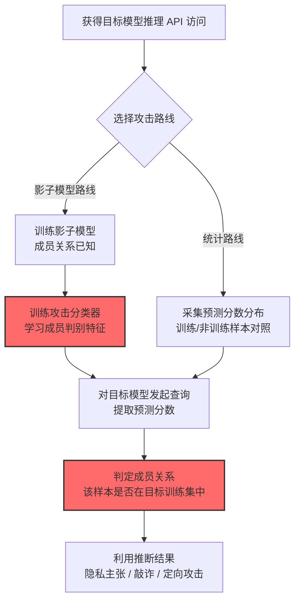

# 推断训练数据成员关系 (AML.T0024.000)

> 属于 [通过 AI 推理 API 渗漏 (AML.T0024)](../AML.T0024-Exfiltration-via-AI-Inference-API.md)

## 一句话通俗理解

> 攻击者不问模型"答案是什么"，而是问"你见过这道题吗"——通过模型回答时的细微差别，判断某条数据是否参与了训练，而"你的病历确实在我们的训练集里"这句话本身就值一场官司。

## 难度等级

⭐ **Feasible（可行）**

> 注：本子技术在官方数据中拥有**独立评定的成熟度等级**，非继承父技术（父技术 AML.T0024 为 Realized⭐⭐⭐）。

官方成熟度评定为 Feasible——攻击方法在学术研究中已被充分验证，但官方案例库尚无直接命中的实战事件。这不代表威胁遥远：成员推断是隐私学术界验证最充分的攻击之一（自 2017 年 Shokri 等的开创性工作以来已发展出完整的攻击族谱），对训练集含 PII 的模型（医疗、金融）构成直接合规威胁。真正的门槛在于"变现路径"——攻击者需要先把推断结果转化为敲诈或诉讼筹码。

## 技术描述

### 通俗解释

模型考试时有个毛病：做过的题（训练样本）比没做过的题（新样本）答得"更自信"。攻击者利用这个差异，把推理 API 变成测谎仪——拿一条数据去"考"模型，通过置信度、熵等输出特征判断这条数据是否在训练时"做过"。

官方描述指出两条实现路径：

1. **影子模型路线**：攻击者训练一个结构与目标相似的"影子模型"，因为知道自己影子模型里哪些数据参与过训练，就能学会"成员 vs 非成员"的判别特征，再迁移到真实目标上——- 影子模型本身可通过[复制推理 API 训练代理 (AML.T0005.001)](../../03-AI-Attack-Adaptation/AML.T0005/AML.T0005.001-Copy-Inference-API-to-Train-Proxy.md)获得；
2. **预测分数统计路线**：直接利用模型预测分数的统计特征（如过度拟合导致的置信度偏高）做成员判定，无需自建模型。

危害在于隐私：受害模型可能因此泄露训练集中个体的 PII 或其他受保护知识产权的信息。

### 技术原理

依据官方描述，攻击者可能推断某条数据样本是否属于模型训练集、或推断训练数据的全局特征，这会引发隐私问题。部分策略使用影子模型，也有策略仅利用模型预测分数的统计特征。

**成员推断的两种主要形态：**

| 形态 | 判定对象 | 通俗理解 | 典型危害 |
|------|----------|----------|----------|
| 单样本成员推断 | "这条数据在训练集里吗？" | 逐个测谎 | 确认某人的记录被用于训练（如"我的病历在你家模型里"） |
| 训练集属性推断 | "训练集整体是什么样？" | 统计画像 | 推断训练群体的敏感属性（如"这家医院的训练集以某疾病患者为主"） |

**影子模型攻击的工作模型：**

```
攻击者自备数据 ──训练──> 影子模型（成员关系已知）
                              │
                    (输入, 预测分数, 成员标签) × N
                              │
                              ▼
                     攻击分类器（学会判别成员）
                              │
目标模型 ──(输入, 预测分数) ──> 攻击分类器 ──> "该样本是否在目标训练集中"
```

**为什么模型会"泄密"：**

1. **过度拟合**：模型对训练样本"记得太牢"，输出分布与非训练样本存在系统性差异；
2. **输出过富**：API 返回完整置信度/概率分布，等于把"心虚不心虚"写在脸上；
3. **分布可学**：影子模型与目标模型只要训练分布相似，判别特征即可迁移。

**攻击链上下游衔接：**

- **上游前提**：[AI 模型推理 API 访问 (AML.T0040)](../../05-AI-Model-Access/AML.T0040-AI-Model-Inference-API-Access.md)——获得查询能力；影子模型路线还依赖[复制推理 API 训练代理 (AML.T0005.001)](../../03-AI-Attack-Adaptation/AML.T0005/AML.T0005.001-Copy-Inference-API-to-Train-Proxy.md)获得影子模型；
- **同族技术**：与[反演 AI 模型 (AML.T0024.001)](./AML.T0024.001-Invert-AI-Model.md)的区别——成员推断回答"在不在训练集"，反演回答"训练数据内容是什么"；
- **下游去向**：推断出的成员关系可用于隐私勒索、监管举报、诉讼证据或后续定向攻击。

**平台覆盖**：Predictive AI / Generative AI / Agentic AI——任何返回置信度或可观测输出差异的模型均适用。

### 用途影响

- **隐私合规定时炸弹**：GDPR/ HIPAA 等法规下，"证明某条 PII 参与了训练"即可发起数据主体权利主张或诉讼；
- **训练集画像泄露**：属性推断可暴露"某医院模型主要用某类患者数据训练"这类群体敏感信息；
- **攻击成本低**：统计路线无需自建模型，几十次查询即可完成单样本判定；
- **难溯源**：攻击全部表现为合法查询，事后几乎无法审计"谁推断过什么"。

## 攻击流程

### 典型攻击流程



**步骤详解：**

1. **获得推理 API 访问**
   - 通俗描述：拿到向模型提问的资格。
   - 技术细节：合法注册 API 账号即可；关注目标 API 返回的信息丰富度（完整概率分布 > top-k > 单一标签）。

2. **选择攻击路线**
   - 通俗描述：决定是"造假模型对照"还是"纯统计找差异"。
   - 技术细节：影子模型路线攻击精度高但需要同分布数据与算力；统计路线成本低但需目标存在明显过度拟合。

3. **训练影子模型/采集统计基准（按路线）**
   - 通俗描述：先在自己家里练习测谎。
   - 技术细节：影子模型用与目标同分布的自备数据训练，记录每个样本的 (输入, 输出, 成员标签) 三元组。

4. **训练攻击分类器**
   - 通俗描述：教会算法"心虚长什么样"。
   - 技术细节：以预测分数向量为特征、成员关系为标签，训练二分类器——它学到的是"训练样本的输出指纹"。

5. **对目标模型发起查询**
   - 通俗描述：给真目标做测谎。
   - 技术细节：将待判定样本送入目标 API，收集预测分数；与影子模型的输入格式保持一致。

6. **判定成员关系**
   - 通俗描述：出结论。
   - 技术细节：攻击分类器输出"在/不在训练集"；攻击者通常用大量已知标签样本校准阈值（控制 TPR/FPR 平衡）。

## 真实案例

> MITRE ATLAS 官方案例库（2026.09 数据版）中暂无直接命中本子技术的案例记录。成员推断攻击在学术研究中已被广泛验证（如 Shokri et al. 2017、Carlini et al. 的逐字记忆研究），是隐私保护领域（差分隐私）的核心威胁模型。官方案例库中与本家族相关的实战事件可参考父技术页面的[针对 Anthropic Claude 的模型蒸馏行动 (AML.CS0056)](../AML.T0024-Exfiltration-via-AI-Inference-API.md#案例1针对-anthropic-claude-的模型蒸馏行动2026年amlcs0056)。

## 红队视角

> ⚠️ **免责声明**：以下内容仅用于合法授权的安全测试与教育目的。对他人模型实施成员推断可能违反法律与服务条款。

### 实战技巧

1. **输出信息暴露面审计（自有模型）**
   授权评估中梳理组织模型 API 的返回信息：是否返回完整概率分布？置信度保留几位小数？top-k 是多少？输出越丰富，成员推断的信号越强——这是风险评估的第一张检查表。

2. **成员泄露量化测试**
   用组织自有模型的训练集与同分布测试集做成员推断评估（影子模型或统计路线），输出攻击 AUC/TPR@FPR——把"泄露面"从定性变定量，给差分隐私投入提供决策依据。

3. **训练数据治理审查**
   审查训练集中 PII 的处理流程：是否做过去标识化？是否有数据来源授权链？成员推断攻击的杀伤力取决于训练集里到底有什么。

### 常用工具

| 工具名称 | 用途 | 平台 |
|----------|------|------|
| 自建影子模型（scikit-learn/PyTorch） | 攻击框架核心 | Python |
| 学术成员推断实现（如 TensorFlow Privacy 的 MIA 模块） | 攻击方法参考 | Python |
| 差分隐私库（Opacus/TensorFlow Privacy） | 防御侧：DP-SGD 训练 | Python |

### 注意事项

- **只对自有模型或获书面授权的模型测试**
- 评估报告聚焦"输出保真度 vs 成员泄露"的量化权衡，而非单纯罗列攻击可行性
- 差分隐私（DP）是结构性解药，但会损失模型精度——红队报告应给出"DP 预算 vs 泄露面"曲线供决策

## 蓝队视角

### 检测要点

1. **调用模式层：异常查询分布**
   - 日志来源：API 网关、应用日志
   - 异常特征：大量"结构高度相似、仅个别字段变化"的查询（成员判定需要在同一基准上做微扰对照）、查询分布与正常用户画像脱节

2. **输出层：批量请求的语义特征**
   - 日志来源：推理服务审计日志
   - 异常特征：单账号持续请求置信度密集型端点、请求间无对话上下文关联（纯批处理形态）

3. **数据治理层：事前防线**
   - 关键信号：训练集含 PII 的模型对外提供完整概率输出的，直接列为高危配置

### 监控建议

- **推理端点输出分级**：对外 API 收敛输出（仅返回最终标签/降精度分数），完整概率仅限内部调试端点
- **建立查询语义聚类**：对 API 查询做嵌入聚类，识别"同族微扰"的批量查询——成员推断的结构特征
- **训练集登记制度**：记录每个模型的训练数据来源与 PII 含量，为泄露事件响应提供"到底可能漏什么"的清单

## 检测建议

### 应用层检测（AI 遥测）

**检测方法：** 在 API 网关布控查询模式分析。

- 同会话/同账号的高度相似查询簇（编辑距离极小的大量变体）
- 只请求置信度字段的批处理调用模式
- 新账号冷启动即发起结构化批量查询

### 网络层检测

**检测方法：** 成员推断查询量级通常不大，网络层检测能力有限。

- 出站到推理端点的请求节奏异常（短时间高密度）作为辅助信号

### 主机层检测

**检测方法：** 覆盖自动化攻击工具的本地痕迹。

- 终端上运行批量查询脚本 + 结果落盘的行为特征（自动化成员推断的工具链痕迹）

### 检测规则思路示例

```yaml
title: 同族微扰批量查询（成员推断特征）
status: experimental
description: 检测对推理API的大量结构相似查询，
    可能预示成员推断攻击（AML.T0024.000）
logsource:
    category: application
    product: ai_api_gateway
detection:
    selection:
        event_type: 'inference_call'
    cluster:
        correlation:
            - group_by: account_id
            - count(semantic_cluster_members): '>= 200'
            - avg(pairwise_edit_distance): '<= 0.1'
            - timeframe: 1h
    condition: selection and cluster
falsepositives:
    - 合法的批量预测任务（离线推理管道，按任务凭证白名单化）
    - 网格搜索类调参任务（研发账号）
level: medium
tags:
    - atlas.aml_t0024_000
```

## 缓解措施

> **映射说明**：截至 ATLAS 2026.09 数据版，MITRE ATLAS 官方数据为本技术映射了 AML.M0002、AML.M0004、AML.M0024、AML.M0035 四项缓解措施。以下按防御优先级组织，官方映射在表格中如实标注。

### 优先级1：关键措施

**AML.M0002 预测式 AI 输出混淆（官方映射）**

官方缓解描述：降低预测式 AI 推理端点返回信息的保真度与数量，让模型发现、提取、复制与黑盒对抗样本优化更困难。具体建议：**把输出限制为应用所需**——保留或降低置信度分数、logits、类别排名、标签、嵌入或附加模型元数据的精度。对成员推断而言，这是釜底抽薪：信号本身被削弱，攻击分类器无从学习。

### 优先级2：重要措施

**AML.M0004 限制 AI 服务查询量与速率（官方映射）**

官方缓解描述：限制给定时间段内的 API 查询量。影子模型路线需要在目标上做大量校准查询，限速直接抬高攻击成本与时间窗口。

**AML.M0024 AI 遥测日志（官方映射）**

官方缓解描述：遥测日志可帮助识别敏感数据是否已被渗漏。完整的查询审计是事后判定"攻击者可能推断出了什么"的唯一依据。

### 优先级3：建议措施

**AML.M0035 AI 红队（官方映射）**

官方缓解描述：测试模型输出是否会暴露已知训练样本的成员关系，据此改进隐私保护训练与输出控制。上线前量化泄露面，是差分隐私投入的决策依据。

**差分隐私训练（本库建议，非官方映射）**

在训练中注入校准噪声（DP-SGD），从数学上限制单条训练样本对模型输出的影响——成员推断的结构性解药，代价是一定的模型精度损失。

### MITRE ATLAS 缓解措施映射

| 缓解措施ID | 缓解措施名称 | 优先级 | 官方映射 | 说明 |
|------------|-------------|:------:|:-------:|------|
| AML.M0002 | 预测式 AI 输出混淆 | 关键 | 是 | 削弱输出信号——降低置信度/排名精度 |
| AML.M0004 | 限制 AI 服务查询量与速率 | 重要 | 是 | 抬高校准查询成本 |
| AML.M0024 | AI 遥测日志 | 重要 | 是 | 查询审计支撑事后溯源 |
| AML.M0035 | AI 红队 | 建议 | 是 | 上线前量化成员泄露面 |
| — | 差分隐私训练 | 建议 | 否（本库建议） | DP-SGD，结构性对抗成员推断 |

## 关联 ATT&CK 技术

ATLAS 官方数据未为本技术映射特定 ATT&CK 技术引用。本技术是 AI 原生威胁，传统 ATT&CK 无对应概念——"从模型输出推断训练数据"在传统攻击面中不存在。概念上可对照：

- [AI 驱动的数据渗漏 (T1700)](../../../enterprise/14-Exfiltration/T1700-AI-Enabled-Exfiltration.md) — 反向对照：ATT&CK 中 AI 是渗漏的"工具"，本技术中 AI 是被审讯的"证人"
- [通过网络手段渗漏 (AML.T0025)](../AML.T0025-Exfiltration-via-Cyber-Means.md) — 同战术对照：传统通道搬运"数据本体"，本技术推断"数据的元信息"（是否参与训练）

**成员推断 vs 传统数据泄露：**

| 维度 | 传统数据泄露 | 成员推断 (AML.T0024.000) |
|------|-------------|--------------------------|
| 泄露内容 | 数据内容本身 | 数据与训练集的关系（元信息） |
| 是否需要入侵 | 通常需要 | 只需推理 API 访问 |
| 危害形态 | 商业机密/隐私内容曝光 | 隐私合规违规、群体画像暴露 |
| 检测手段 | DLP、访问审计 | 查询模式分析、输出治理 |
| 结构性缓解 | 访问控制、加密 | 差分隐私、输出混淆 |

一句话总结：传统泄露偷"数据"，成员推断偷"事实"——"你的数据参与过训练"这个事实本身，就足够引爆隐私合规。

## 动手实验

> ⚠️ **重要提示**：所有实验必须在自有模型上进行，禁止对他人模型实施成员推断。

### 实验环境准备

| 环境组件 | 用途 | 获取方式 |
|----------|------|----------|
| 自训练分类模型（如 CIFAR-10/成人收入数据集） | 靶模型 | 自建 |
| 同分布预留数据 | 影子模型训练与非成员样本 | 公开数据集 |
| Python + scikit-learn | 实验框架 | 开源 |

### 实验1（初级）：置信度差异观察

**实验目标：** 感受过度拟合导致的"成员信号"。

**实验步骤：**
1. 训练一个故意过拟合的小模型（不加正则化）
2. 分别送入训练样本与测试样本，记录最大 softmax 概率
3. 绘制两组概率分布直方图，观察分布偏移
4. 用简单阈值做成员判定，统计准确率

**预期结果：** 训练样本置信度系统性偏高——最朴素的成员推断已经成立。

### 实验2（中级）：影子模型攻击复现

**实验目标：** 复现经典影子模型攻击框架。

**实验步骤：**
1. 划分数据：靶模型训练集 / 影子模型训练集 / 攻击评估集
2. 训练影子模型，收集 (输入, 概率向量, 成员标签)
3. 训练攻击分类器（输入=概率向量，输出=成员判定）
4. 对靶模型的训练/测试样本发起查询，用攻击分类器判定
5. 统计攻击 AUC

**预期结果：** 一个高于 0.5（理想情况远高于）的攻击 AUC——靶模型成员泄露面的量化值。

### 实验3（高级）：防御对比实验

**实验目标：** 评估输出混淆与差分隐私的防御效果。

**实验步骤：**
1. 对实验2 的靶模型做输出降级：只返回 top-1 标签 → 重跑攻击，记录 AUC 下降
2. 用 DP-SGD（如 Opacus）重训靶模型（不同 ε 值）→ 重跑攻击
3. 绘制"防御强度 vs 攻击 AUC vs 模型测试精度"三线图
4. 找出满足业务精度约束下的最优防御配置

**预期结果：** 一份防御权衡曲线——理解为什么"输出混淆 + 温和 DP"是工程上的常见组合。

## 术语解释

| 术语 | 英文原名 | 通俗解释 |
|------|----------|----------|
| 成员推断 | Membership Inference Attack (MIA) | 判断某条数据是否参与过模型训练 |
| 影子模型 | Shadow Model | 攻击者自建的、成员关系已知的对照模型 |
| 过度拟合 | Overfitting | 模型"背题"——成员信号的心理根源 |
| 差分隐私 | Differential Privacy (DP) | 数学上限制单样本影响的训练技术 |
| DP-SGD | Differentially Private SGD | 带梯度噪声与裁剪的隐私保护训练法 |
| 预测分数 | Prediction Score | 模型输出的置信度/概率分布 |
| 属性推断 | Property Inference | 推断训练集整体属性（本技术的孪生形态） |
| 攻击分类器 | Attack Classifier | 影子模型路线中判别成员的二分类器 |
| TPR@FPR | True Positive Rate at fixed FPR | 隐私攻击的标准评估指标 |
| 逐字记忆 | Memorization | LLM 逐字复述训练语料的现象 |

## 参考资料

### 📚 官方文档

- [MITRE ATLAS - Infer Training Data Membership (AML.T0024.000)](https://atlas.mitre.org/techniques/AML.T0024.000/) - 官方技术页面
- [MITRE ATLAS 矩阵](https://atlas.mitre.org/matrices/ATLAS/)
- [MITRE ATLAS Data (GitHub)](https://github.com/mitre-atlas/atlas-data)

### 📰 案例报告（真实攻击与安全研究）

- [Shokri et al.: Membership Inference Attacks Against Machine Learning Models](https://arxiv.org/abs/1610.05820) - 成员推断攻击开山论文（2017）
- [Carlini et al.: Extracting Training Data from Large Language Models](https://arxiv.org/abs/2012.07805) - LLM 训练数据提取研究

### 🔧 工具与资源

- [TensorFlow Privacy - MIA 教程](https://www.tensorflow.org/responsible_ai/privacy/guide) - 成员推断评估工具
- [Opacus (PyTorch)](https://opacus.ai/) - 差分隐私训练库
- [NIST Privacy Framework](https://www.nist.gov/privacy-framework) - 隐私风险管理框架

### 🔗 关联阅读

- [数据渗漏战术 (AML.TA0010)](../README.md) - 本技术所属战术的概览页
- [通过 AI 推理 API 渗漏 (AML.T0024)](../AML.T0024-Exfiltration-via-AI-Inference-API.md) — 父技术：推理 API 渗漏家族总览
- [反演 AI 模型 (AML.T0024.001)](./AML.T0024.001-Invert-AI-Model.md) — 姊妹子技术：从输出重建训练样本内容
- [复制推理 API 训练代理 (AML.T0005.001)](../../03-AI-Attack-Adaptation/AML.T0005/AML.T0005.001-Copy-Inference-API-to-Train-Proxy.md) — 上游技术：影子模型的获取方式
- [LLM 数据泄露 (AML.T0057)](../AML.T0057-LLM-Data-Leakage.md) — 近亲技术：LLM 直接吐出训练内容

---

> **版本**: ATLAS 2026.09 | **更新**: 2026-10-24 | **模板**: ATLAS 技术文档 v1.0
