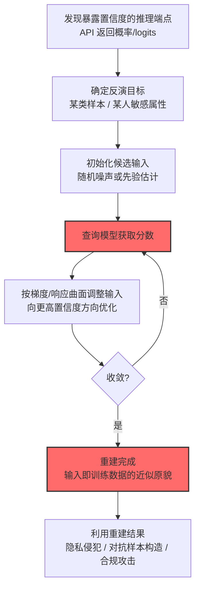

# 反演 AI 模型 (AML.T0024.001)

> 属于 [通过 AI 推理 API 渗漏 (AML.T0024)](../AML.T0024-Exfiltration-via-AI-Inference-API.md)

## 一句话通俗理解

> 成员推断是问模型"你见过这道题吗"，模型反演则更进一步——"把你见过的题原样画给我看"：攻击者从模型的输出反向重建出训练数据本身的样貌。

## 难度等级

⭐ **Feasible（可行）**

> 注：本子技术在官方数据中拥有**独立评定的成熟度等级**，非继承父技术（父技术 AML.T0024 为 Realized⭐⭐⭐）。

官方成熟度评定为 Feasible——攻击方法在学术研究中已被多次验证（自 Fredrikson et al. 2015 的基因数据反演开创性工作以来），但官方案例库尚无直接命中的实战事件。该技术的威胁现实性高度依赖部署条件：**推理 API 必须暴露置信度分数**——这恰是许多生产端点的默认配置。对训练数据含敏感特征（医疗指标、生物特征、人脸）的模型，反演攻击能把"模型学到的统计规律"还原成"具体某个人的隐私画像"。

## 技术描述

### 通俗解释

模型反演像"拼图式肖像还原"：攻击者不给模型看图片，而是反复问"这个方向上你的置信度是多少"，通过无数个置信度读数，在数学上解出让模型最"兴奋"的输入——那个输入往往就是（或高度接近）训练时的真实样本。

官方描述指出：AI 模型的训练数据可**通过利用推理 API 提供的置信度分数**来重建。攻击者通过策略性查询推理 API，可以反推出训练数据中嵌入的私有信息。如果攻击者能重建算法中使用的敏感特征的数据，就会导致隐私侵犯。

关键点：反演攻击不需要入侵，不需要拿到模型文件——**只需要一个暴露置信度的 API 端点**。

### 技术原理

依据官方描述，攻击者可策略性地查询推理 API，利用返回的置信度分数反向推算（back out）训练数据中潜在的私有信息。

**模型反演的两条技术路线：**

| 路线 | 重建目标 | 通俗理解 | 典型成果 |
|------|----------|----------|----------|
| 特征反演 | 重建某人的敏感属性取值 | "补全画像" | 从基因模型反演出个体的疾病标志物（Fredrikson 2015 经典场景） |
| 类代表反演 | 重建某类训练样本的原貌 | "画出记忆" | 从人脸识别模型反演出可被识别的人脸图像 |

**梯度引导反演的工作模型（以类代表反演为例）：**

```
随机初始化候选输入 x
     │
     ▼
┌─ 循环 ─────────────────────────────┐
│  x ──查询──> 目标模型 ──> 置信度/类别分数  │
│       ▲                    │           │
│       │                    ▼           │
│  梯度上升 <──── 优化方向（让目标类分数最大化）│
└─────────────────────────────────────┘
     │
     ▼
收敛后的 x ≈ 该类训练样本的"平均脸"/典型代表
```

**为什么置信度是关键：**

1. **分数即偏导数信息**：置信度对输入的响应曲面暴露了模型的决策几何，足够多的查询点可以重建这个曲面；
2. **优化可自动化**：把"让模型更确信"作为目标函数，输入重建就变成一个标准的优化问题；
3. **越界暴露最危险**：返回完整 logits/概率分布的端点比只返回 top-1 标签的端点泄露面大得多。

**攻击链上下游衔接：**

- **上游前提**：[AI 模型推理 API 访问 (AML.T0040)](../../05-AI-Model-Access/AML.T0040-AI-Model-Inference-API-Access.md)，且端点需返回置信度分数；
- **同族技术**：与[成员推断 (AML.T0024.000)](./AML.T0024.000-Infer-Training-Data-Membership.md)的区别——成员推断判定"在不在"，反演重建"是什么"；
- **下游去向**：重建的敏感特征/训练样本直接构成隐私侵犯证据，或用于后续攻击（如构造对抗样本）。

**平台覆盖**：Predictive AI / Generative AI / Agentic AI——依赖置信度输出的模型均适用。

### 用途影响

- **敏感特征重建**：医疗/基因/生物特征模型的训练数据隐私可被"逆向还原"；
- **训练集画像泄露**：类代表反演暴露训练群体的典型样貌（如某认证系统训练集中的人脸）；
- **合规连锁反应**：重建成功即证明"模型泄露了训练数据"——与成员推断一样直击隐私法规；
- **静默性**：全部交互都是合法查询，无入侵痕迹。

## 攻击流程

### 典型攻击流程



**步骤详解：**

1. **发现暴露置信度的推理端点**
   - 通俗描述：找一个"把心事写在脸上"的模型。
   - 技术细节：审查目标 API 的响应结构——返回完整概率分布 > top-k 列表 > 单标签；置信度精度越高，反演信号越强。

2. **确定反演目标**
   - 通俗描述：决定要还原"谁"或"哪一类"。
   - 技术细节：特征反演针对已知部分属性的个体（如知道某人参与过训练，反演其未公开的疾病标志物）；类代表反演针对模型内部类别（如类别"张三"的典型人脸）。

3. **初始化候选输入**
   - 通俗描述：先随便画一个。
   - 技术细节：随机噪声初始化，或利用公开数据估计的类平均作为起点（先验越好，收敛越快）。

4. **查询模型获取分数**
   - 通俗描述：问模型"这个像不像？"。
   - 技术细节：把候选输入送入 API，读取目标类的置信度分数；黑盒场景用有限差分估计梯度。

5. **按响应曲面调整输入**
   - 通俗描述：照着模型的"喜好"修图。
   - 技术细节：梯度上升更新候选输入使目标类分数最大化；部分实现加入自然图像先验（总变分正则）让重建更接近真实样本。

6. **重建完成**
   - 通俗描述：模型"记忆"的那张脸被画了出来。
   - 技术细节：收敛后的候选输入即为训练数据的近似重建；评估与真实训练样本的相似度可量化泄露程度。

## 真实案例

> MITRE ATLAS 官方案例库（2026.09 数据版）中暂无直接命中本子技术的案例记录。模型反演在学术研究中已被充分验证——Fredrikson et al. 2015 从个性化医疗模型反演出患者的基因标志物；后续研究从人脸识别模型重建出可被正确分类的人脸图像。官方案例库中与本家族相关的实战事件可参考父技术页面的[针对 Anthropic Claude 的模型蒸馏行动 (AML.CS0056)](../AML.T0024-Exfiltration-via-AI-Inference-API.md#案例1针对-anthropic-claude-的模型蒸馏行动2026年amlcs0056)。

## 红队视角

> ⚠️ **免责声明**：以下内容仅用于合法授权的安全测试与教育目的。对他人模型实施反演攻击可能违反法律与服务条款。

### 实战技巧

1. **端点置信度暴露面审计**
   授权评估的第一张检查表：组织对外端点是否返回概率分布？精度几位？是否有降级开关？输出"降级后业务是否仍可用"的评估结论——这是推动整改的商业语言。

2. **反演可行性演示（自有模型）**
   用组织自己的人脸/医疗/风控模型做小规模类代表反演：重建结果若可被人眼识别出训练集特征，即形成最有说服力的整改演示材料。

3. **敏感训练数据审查**
   审查哪些模型的训练集含特殊类别数据（生物特征、基因、疾病），这些是反演攻击的高价值目标——优先纳出输出降级计划。

### 常用工具

| 工具名称 | 用途 | 平台 |
|----------|------|------|
| 自建反演实验框架（PyTorch） | 梯度引导重建复现 | Python |
| 公开反演研究实现 | 攻击方法参考 | Python |
| 模型响应记录工具（自写脚本） | 黑盒置信度采样 | 跨平台 |

### 注意事项

- **只对自有模型或获书面授权的模型测试**
- 演示材料注意脱敏——重建出的"人脸"本身也是需要保护的隐私
- 评估报告聚焦"置信度输出是否必要"这一结构性问题

## 蓝队视角

### 检测要点

1. **调用模式层：优化形态查询**
   - 日志来源：API 网关
   - 异常特征：迭代式查询（同一输入的连续微扰变体）、查询序列呈现"逐步逼近"的收敛轨迹——优化攻击的数学指纹

2. **输出层：分数读取密度**
   - 日志来源：推理服务审计日志
   - 异常特征：单请求读取完整概率分布的调用占比异常、置信度字段被高频消费

3. **配置层：事前防线**
   - 关键信号：对外端点返回完整 logits/概率分布且模型训练集含敏感数据——高危配置组合

### 监控建议

- **输出降级为默认安全基线**：对外端点只返回应用必需的最小输出（最终标签/决策），完整概率留在内部调试端点并加权限
- **查询轨迹审计**：对同一 API key 的查询序列做输入相似度分析，识别收敛型优化轨迹
- **敏感模型分级**：训练集含生物特征/基因/医疗数据的模型，强制启用输出混淆与更严的调用审计

## 检测建议

### 应用层检测（AI 遥测）

**检测方法：** 在 API 网关布控优化形态查询识别。

- 同一账号的输入序列逐步收敛（相邻请求输入距离递减）
- 高频读取概率分布字段的调用模式

### 网络层检测

**检测方法：** 反演攻击查询量中等，网络层作辅助。

- 对推理端点的持续性中等频率请求（优化循环的节奏特征）

### 主机层检测

**检测方法：** 覆盖自动化优化工具痕迹。

- 终端上的优化循环脚本（自动查询 + 更新输入的循环结构）特征

### 检测规则思路示例

```yaml
title: 收敛型输入序列查询（模型反演特征）
status: experimental
description: 检测对推理API的迭代收敛式查询序列，
    可能预示模型反演攻击（AML.T0024.001）
logsource:
    category: application
    product: ai_api_gateway
detection:
    selection:
        event_type: 'inference_call'
        response_fields_used: ['confidence', 'probabilities']
    convergence:
        correlation:
            - group_by: api_key
            - sequence_by: request_time asc
            - avg(delta_input_distance): 'monotonically_decreasing'
            - count: '>= 100'
            - timeframe: 2h
    condition: selection and convergence
falsepositives:
    - 合法的在线学习/主动学习管道（研发凭证白名单化）
    - 对抗样本防御测试（安全团队账号）
level: medium
tags:
    - atlas.aml_t0024_001
```

## 缓解措施

> **映射说明**：截至 ATLAS 2026.09 数据版，MITRE ATLAS 官方数据为本技术映射了 AML.M0002、AML.M0004、AML.M0024、AML.M0035 四项缓解措施（与父技术家族共享映射）。以下按防御优先级组织，官方映射在表格中如实标注。

### 优先级1：关键措施

**AML.M0002 预测式 AI 输出混淆（官方映射）**

官方缓解描述：降低推理端点返回信息的保真度与数量，使模型提取与反演更困难。对反演攻击釜底抽薪：**没有精细的置信度曲面，优化就失去方向**。具体包括：限制显示的结果数量、降低输出类别体系的特异性、降低返回分数精度（官方建议的三板斧）。

### 优先级2：重要措施

**AML.M0004 限制 AI 服务查询量与速率（官方映射）**

官方缓解描述：限制给定时间段内的 API 查询量。反演的优化循环需要成百上千次查询，限速直接拉长攻击窗口、抬高成本。

**AML.M0024 AI 遥测日志（官方映射）**

官方缓解描述：遥测日志可帮助识别敏感数据是否已被渗漏。收敛型查询轨迹是反演攻击的审计指纹，完整日志是事后判定的依据。

### 优先级3：建议措施

**AML.M0035 AI 红队（官方映射）**

官方缓解描述：尝试从模型输出重建敏感记录、属性或代表性训练信息，据此整改。用自有红队先于攻击者发现重建可行性。

**训练侧防御（本库建议，非官方映射）**

差分隐私训练限制单样本影响；正则化与数据增强降低过度拟合——从根源削弱"可重建性"。

### MITRE ATLAS 缓解措施映射

| 缓解措施ID | 缓解措施名称 | 优先级 | 官方映射 | 说明 |
|------------|-------------|:------:|:-------:|------|
| AML.M0002 | 预测式 AI 输出混淆 | 关键 | 是 | 撤掉置信度=撤掉反演的指南针 |
| AML.M0004 | 限制 AI 服务查询量与速率 | 重要 | 是 | 拉长优化循环的时间成本 |
| AML.M0024 | AI 遥测日志 | 重要 | 是 | 收敛轨迹是反演的审计指纹 |
| AML.M0035 | AI 红队 | 建议 | 是 | 先于攻击者验证重建可行性 |
| — | 训练侧防御（DP/正则化） | 建议 | 否（本库建议） | 削弱过度拟合与可重建性 |

## 关联 ATT&CK 技术

ATLAS 官方数据未为本技术映射特定 ATT&CK 技术引用。本技术是 AI 原生威胁，传统 ATT&CK 无对应概念——"从模型置信度重建训练数据"在传统攻击面中不存在。概念上可对照：

- [AI 驱动的数据渗漏 (T1700)](../../../enterprise/14-Exfiltration/T1700-AI-Enabled-Exfiltration.md) — 反向对照：传统视角中 AI 是渗漏工具，本技术中模型是被逆向的"数据容器"
- [成员推断 (AML.T0024.000)](./AML.T0024.000-Infer-Training-Data-Membership.md) — 同族前序：先判定"在不在"，再用反演问"是什么"

**成员推断 vs 模型反演：**

| 维度 | 成员推断 (AML.T0024.000) | 模型反演 (AML.T0024.001) |
|------|--------------------------|--------------------------|
| 攻击问题 | 这条数据在训练集里吗？ | 训练数据长什么样？ |
| 产出 | 是/否判定 | 敏感属性值或样本重建 |
| 依赖输出 | 预测分数统计特征 | 置信度分数（响应曲面） |
| 攻击成本 | 较低（统计路线） | 较高（优化循环） |
| 危害形态 | 隐私合规违规 | 隐私侵犯 + 训练样本曝光 |
| 结构性缓解 | 差分隐私 + 输出混淆 | 输出混淆（撤置信度） |

一句话总结：成员推断证明"你用了我的数据"，模型反演直接"画出"你的数据——前者打官司，后者丢隐私。

## 动手实验

> ⚠️ **重要提示**：所有实验必须在自有模型上进行，禁止对他人模型实施反演攻击。

### 实验环境准备

| 环境组件 | 用途 | 获取方式 |
|----------|------|----------|
| 自训练分类模型（简单 CNN/MLP） | 靶模型 | 自建 |
| 白盒反演框架（PyTorch 自动微分） | 复现优化循环 | 开源 |
| 训练数据集（如 MNIST/Faces 数据集） | 训练与对照 | 公开数据集 |

### 实验1（初级）：置信度曲面观察

**实验目标：** 理解"置信度暴露决策几何"。

**实验步骤：**
1. 训练一个 MNIST 分类器
2. 取一张数字图片，沿像素空间做小扰动，记录置信度变化
3. 绘制"扰动方向 vs 置信度"曲线
4. 观察：置信度曲面是否平滑、是否存在明显"山峰"（训练样本方向）

**预期结果：** 一张直观的置信度响应图——反演攻击优化的就是爬这座山。

### 实验2（中级）：类代表反演复现

**实验目标：** 从模型"记忆"中重建类典型样本。

**实验步骤：**
1. 固定靶模型，初始化随机噪声输入
2. 以"目标类置信度最大化"为损失，梯度上升更新输入（白盒场景直接用 autograd）
3. 迭代数百步后观察重建图像
4. 对比重建结果与该类真实训练样本的相似度
5. 加上自然图像先验（总变分正则）重跑，对比重建质量

**预期结果：** 噪声逐步"长成"可识别的数字/人脸——模型反演的震撼演示。

### 实验3（高级）：防御有效性评估

**实验目标：** 量化输出混淆对反演的抑制效果。

**实验步骤：**
1. 把实验2 的靶模型包成 API：版本A 返回完整概率，版本B 只返回 top-1 标签，版本C 返回两位小数截断的概率
2. 黑盒场景下（有限差分估计梯度）分别对三个版本跑反演
3. 记录各版本的重建质量（与真实样本的 SSIM/识别率）与查询次数
4. 输出"输出保真度 vs 可反演性"曲线

**预期结果：** 输出越"糊"，反演越难——为组织的端点输出策略提供量化依据。

## 术语解释

| 术语 | 英文原名 | 通俗解释 |
|------|----------|----------|
| 模型反演 | Model Inversion | 从模型输出反向重建训练数据 |
| 置信度分数 | Confidence Score | 模型输出的概率/logits——反演的原料 |
| 类代表反演 | Class Representative Inversion | 重建某一类的典型训练样本 |
| 特征反演 | Feature Inversion | 重建个体的敏感属性取值 |
| 梯度上升 | Gradient Ascent | 沿"模型更确信"方向修改输入的优化法 |
| 响应曲面 | Response Surface | 置信度随输入变化的几何形状 |
| 总变分正则 | Total Variation Regularization | 让重建结果更接近自然图像的约束项 |
| 先验 | Prior | 攻击者对目标分布的预先知识 |
| SSIM | Structural Similarity | 衡量图像相似度的标准指标 |
| logits | Logits | softmax 归一化前的原始分数——信息量最大 |

## 参考资料

### 📚 官方文档

- [MITRE ATLAS - Invert AI Model (AML.T0024.001)](https://atlas.mitre.org/techniques/AML.T0024.001/) - 官方技术页面
- [MITRE ATLAS 矩阵](https://atlas.mitre.org/matrices/ATLAS/)
- [MITRE ATLAS Data (GitHub)](https://github.com/mitre-atlas/atlas-data)

### 📰 案例报告（真实攻击与安全研究）

- [Fredrikson et al.: Model Inversion Attacks that Analyse Confidence Scores](https://dl.acm.org/doi/10.1145/2810103.2813677) - 基因数据反演开创性论文（2015）
- [Fredrikson et al.: Privacy in Pharmacogenetics](https://petsymposium.org/2014/papers/fredrikson.pdf) - 个性化医疗模型反演

### 🔧 工具与资源

- [OWASP Top 10 for LLM Applications](https://owasp.org/www-project-top-10-for-large-language-model-applications/) - LLM 应用安全风险
- [NIST Privacy Framework](https://www.nist.gov/privacy-framework) - 隐私风险管理框架
- [NIST AI Risk Management Framework](https://www.nist.gov/itl/ai-risk-management-framework) - AI 风险管理框架

### 🔗 关联阅读

- [数据渗漏战术 (AML.TA0010)](../README.md) - 本技术所属战术的概览页
- [通过 AI 推理 API 渗漏 (AML.T0024)](../AML.T0024-Exfiltration-via-AI-Inference-API.md) — 父技术：推理 API 渗漏家族总览
- [推断训练数据成员关系 (AML.T0024.000)](./AML.T0024.000-Infer-Training-Data-Membership.md) — 姊妹子技术：判定成员关系
- [提取 AI 模型 (AML.T0024.002)](./AML.T0024.002-Extract-AI-Model.md) — 姊妹子技术：复制模型本体
- [AI 模型推理 API 访问 (AML.T0040)](../../05-AI-Model-Access/AML.T0040-AI-Model-Inference-API-Access.md) — 上游前提：查询能力的来源

---

> **版本**: ATLAS 2026.09 | **更新**: 2026-10-24 | **模板**: ATLAS 技术文档 v1.0
