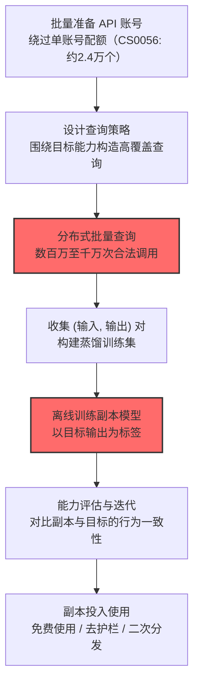

# 提取 AI 模型 (AML.T0024.002)

> 属于 [通过 AI 推理 API 渗漏 (AML.T0024)](../AML.T0024-Exfiltration-via-AI-Inference-API.md)

## 一句话通俗理解

> 攻击者不去撬保险柜偷模型文件，而是雇一万个"学生"轮流向模型提问，把每次回答都记下来——攒够上千万次问答后，离线训练出一个"学得一模一样"的副本：模型没被偷走，但灵魂被复制了。

## 难度等级

⭐⭐⭐ **Realized（已实现）**

> 注：本子技术在官方数据中拥有**独立评定的成熟度等级**（与父技术 AML.T0024 同为 Realized）。

官方成熟度评定为 Realized——**已被真实攻击完整实现**：Anthropic 披露 DeepSeek、Moonshot AI、MiniMax 三家中国 AI 实验室通过约 24,000 个账号、1600 万次查询对 Claude 发起蒸馏攻击，试图复制其智能体推理、代码生成与工具使用能力（AML.CS0056）。这是本渗漏家族中唯一有实战案例的子技术，也是"模型即知识产权"时代最具商业冲击力的攻击。

## 技术描述

### 通俗解释

模型提取（也叫"蒸馏窃取"）是知识蒸馏技术的恶意运用：知识蒸馏本是合法的模型压缩手段——用大模型（教师）的输出训练小模型（学生）。攻击者把这个流程反过来用在别人的付费模型上：大量查询目标模型，把 (输入, 输出) 对攒成数据集，用它们当训练标签，离线训练一个模仿目标行为与性能的"影子模型"。

官方描述点明两大动机：

1. **逃避按次付费**：在 AIaaS（AI 即服务）场景下，提取一个副本模型就能无限免费使用；
2. **知识产权窃取**：模型提取被用于 **AI 知识产权窃取 (AML.T0048.004，见战 16 影响)**——数亿美元训练成本的模型能力被"零研发成本"复制。

### 技术原理

依据官方描述，攻击者可通过反复查询受害者的[AI 模型推理 API 访问 (AML.T0040)](../../05-AI-Model-Access/AML.T0040-AI-Model-Inference-API-Access.md)，把目标模型的推理结果收集成数据集；这些推理结果作为标签用于离线训练一个模仿目标模型行为与性能的独立模型。

**模型提取的工作模型：**

```
攻击者（查询生成器）
   │  大量输入（随机采样 / 任务导向 / 高覆盖设计）
   ▼
目标模型 API（受害者）
   │  返回推理结果（标签/概率/生成文本）
   ▼
(输入, 输出) 数据集（数百万对）
   │  作为训练标签
   ▼
离线训练 ──> 副本模型 ≈ 目标模型（行为与性能近似）
```

**提取查询的三种设计策略：**

| 策略 | 查询方式 | 适用场景 | 效率 |
|------|----------|----------|------|
| 均匀随机采样 | 在输入空间随机生成查询 | 通用分类模型 | 低——大量查询浪费在无关区域 |
| 任务导向采样 | 围绕目标能力（如代码生成）构造查询 | LLM 能力复制（CS0056 模式） | 高——直接复制高价值能力 |
| 主动学习式采样 | 根据副本与目标的不一致区域定向查询 | 对抗性提取 | 最高——单位查询信息量最大 |

**为什么提取有效：**

1. **输出即决策边界**：每个 (输入, 输出) 对都是目标模型决策函数的一个采样点，数百万个点足以刻画模型行为；
2. **蒸馏的泛化**：学生模型学到的不是"背诵查询记录"，而是泛化出与教师近似的能力（这正是合法蒸馏技术的威力）；
3. **护栏不随行**：副本模型在自有基础设施上训练，原厂的用量策略、内容审核、地理限制全部失效。

**攻击链上下游衔接：**

- **上游前提**：[AI 模型推理 API 访问 (AML.T0040)](../../05-AI-Model-Access/AML.T0040-AI-Model-Inference-API-Access.md)——CS0056 中攻击者维护约 24,000 个账号突破单账号配额；
- **同族技术**：与[成员推断 (AML.T0024.000)](./AML.T0024.000-Infer-Training-Data-Membership.md)/[反演 (AML.T0024.001)](./AML.T0024.001-Invert-AI-Model.md)的区别——前两者窃取"数据信息"，本技术窃取"模型能力"；
- **下游去向**：AI 知识产权窃取（AML.T0048.004，见战 16 影响）、免费无限使用、去除安全护栏后的恶意利用。

**平台覆盖**：Predictive AI / Generative AI / Agentic AI——任何可查询的模型均可被提取。

### 用途影响

- **知识产权直接流失**：CS0056 中 1600 万次查询试图复制 Claude 的智能体推理、代码生成、工具使用与计算机使用能力；
- **护栏蒸发**：副本脱离原厂安全措施——CS0056 明确指出蒸馏模型缺乏阻止恶意用途（生物武器开发、虚假信息、攻击性网络行动、大规模监控）的防护；
- **收入侵蚀**：AIaaS 按次收费的商业模式被"一次提取、终身免费"架空；
- **出口管制规避**：CS0056 报告指出蒸馏被用作规避模型出口管制的手段；
- **检测难度大**：攻击分布在数万账号、数千万次合法查询中，只有跨账号的模式分析才能识别。

## 攻击流程

### 典型攻击流程



**步骤详解：**

1. **批量准备 API 账号**
   - 通俗描述：办一万张会员卡。
   - 技术细节：单账号有速率与用量配额，大规模提取需要账号池；CS0056 中三家实验室合计使用约 24,000 个账号——账号注册环节的风控是第一道防线。

2. **设计查询策略**
   - 通俗描述：出一份"高含金量题库"。
   - 技术细节：纯随机查询浪费配额；围绕目标高价值能力（智能体推理、代码生成）定向构造查询，让每次响应都携带可蒸馏的知识。

3. **分布式批量查询**
   - 通俗描述：学生军团开始提问。
   - 技术细节：查询分摊到账号池，控制节奏规避限速；CS0056 总量达 1600 万次查询。

4. **收集 (输入, 输出) 对**
   - 通俗描述：把每道题和答案都抄下来。
   - 技术细节：记录完整响应（含概率分布更佳），清洗与去重后构成蒸馏数据集。

5. **离线训练副本模型**
   - 通俗描述：回家照着抄本自学。
   - 技术细节：以目标输出为监督信号训练自有架构模型；可辅以公开数据混合训练提升泛化。

6. **能力评估与迭代**
   - 通俗描述：考试对比。
   - 技术细节：在基准任务上对比副本与目标的表现，对薄弱能力定向补充查询——迭代式提取。

## 真实案例

> 以下案例来自 MITRE ATLAS 官方案例库，直接命中本技术。

### 案例1：针对 Anthropic Claude 的模型蒸馏行动（2026年，AML.CS0056）

- **时间**: 2026年2月（Anthropic 于 2026年3月31日披露）
- **攻击者**: DeepSeek、Moonshot AI、MiniMax（三家中国 AI 实验室）
- **手法**: Anthropic 发现针对 Claude 能力提取的协同行动——合计使用**约 24,000 个账号、1600 万次查询**，通过模型蒸馏在 Claude 的输出上训练自己的模型，试图复制 Claude 的智能体推理、代码生成、工具使用与计算机使用能力。报告指出：蒸馏被用作规避 Anthropic 出口管制的手段；蒸馏出的模型缺乏阻止恶意行为者将前沿模型用于生物武器开发、虚假信息、攻击性网络行动与大规模监控的安全护栏。
- **影响**: 真实事件（Incident）——模型提取迄今规模最大的公开实战样本：国家级 AI 实验室协同行动 + 千万级查询 + 明确的知识产权与安全双重后果；Anthropic 基于该事件发布了蒸馏攻击的检测与预防方法论
- **参考链接**: [Anthropic: Detecting and preventing distillation attacks](https://www.anthropic.com/news/detecting-and-preventing-distillation-attacks)

## 红队视角

> ⚠️ **免责声明**：以下内容仅用于合法授权的安全测试与教育目的。对他人模型实施提取攻击可能违反法律与服务条款。

### 实战技巧

1. **提取成本量化评估（自有模型）**
   在授权评估中估算"复制组织模型核心能力所需的查询规模与预算"：以自有模型的基准任务为标尺，测试多少 (输入, 输出) 对能让一个开源底座模型达到 90% 一致率——把"防提取"从口号变成成本-收益分析。

2. **限速与配额体系压力测试**
   评估组织的速率限制在分布式账号场景下的韧性：单账号限速是否容易用多账号绕过？注册环节能否识别批量账号？API 用量异常的告警阈值是多少？

3. **水印与指纹方案验证**
   若组织考虑部署模型水印（在输出中嵌入可溯源的统计指纹），红队可评估其抗攻击性：水印能否在蒸馏后存活？是否影响输出质量？

### 常用工具

| 工具名称 | 用途 | 平台 |
|----------|------|------|
| 开源底座模型（用于提取实验） | 副本模型训练载体 | Python/PyTorch |
| 任务基准集（自有模型能力标尺） | 提取效果评估 | 自建 |
| API 用量分析面板 | 防御侧：查询模式监控 | 云 |

### 注意事项

- **只对自有模型做提取演练**
- 评估报告的核心交付物是"提取成本曲线"（查询数 vs 副本能力）与"检测盲区清单"
- 注意 CS0056 的教训：检测必须跨账号关联——单账号视角下每个账号都"正常"

## 蓝队视角

### 检测要点

1. **跨账号协同模式**
   - 日志来源：API 网关、账号系统、风控
   - 异常特征：多个账号的查询在语义空间高度聚集（同族任务）、注册时间与调用行为高度同质化、账号池的调用节奏互补（规避总量阈值）——CS0056 的 24,000 账号即以此检出

2. **查询语义分布异常**
   - 日志来源：推理服务审计日志
   - 异常特征：查询分布与正常用户画像脱节（无闲聊、无上下文延续、纯任务导向的高密度采样）、token 消耗与对话形态严重不匹配

3. **输出端信号**
   - 日志来源：应用层
   - 异常特征：请求-响应几乎零重复（提取要覆盖输入空间，正常用户会反复试探同类问题）

### 监控建议

- **跨账号语义聚类常态化**：对全部 API 查询做嵌入聚类与账号关联分析——对抗分布式提取的唯一有效视角
- **注册-使用行为链风控**：新账号冷启动即高频任务型调用是强信号
- **水印溯源能力建设**：参考 Anthropic 事件后的行业实践，评估输出水印对蒸馏攻击的溯源价值

## 检测建议

### 应用层检测（AI 遥测）

**检测方法：** 跨账号查询模式分析是主战场。

- 多账号查询语义聚集（同任务族分布）
- 单账号无上下文的批量独立请求（非对话形态）
- 账号群体的行为同质化

### 网络层检测

**检测方法：** 提取流量走合法 HTTPS，网络层作辅助。

- 单一 IP/网段聚合的多账号出口流量
- AI 服务端点请求量的组织级异常增长

### 主机层检测

**检测方法：** 覆盖账号自动化工具痕迹。

- 终端上的多账号轮换调用脚本（账号池管理工具特征）
- 批量查询与结果落盘的自动化管道

### 检测规则思路示例

```yaml
title: 跨账号语义聚集的任务型查询（分布式模型提取特征）
status: experimental
description: 检测多账号对同一任务族的密集无上下文查询，
    可能预示分布式模型提取/蒸馏攻击（AML.T0024.002 / CS0056模式）
logsource:
    category: application
    product: ai_api_gateway
detection:
    selection:
        event_type: 'inference_call'
        has_conversation_context: false
    aggregation:
        correlation:
            - group_by: semantic_task_cluster
            - count(distinct account_id): '>= 20'
            - count: '>= 10000'
            - avg(context_overlap): '<= 0.05'
            - timeframe: 24h
    condition: selection and aggregation
falsepositives:
    - 多团队的同类合法评估任务（按组织域名/项目凭证白名单化）
    - 大规模线上 A/B 测试（提前报备）
level: high
tags:
    - atlas.aml_t0024_002
```

## 缓解措施

> **映射说明**：截至 ATLAS 2026.09 数据版，MITRE ATLAS 官方数据为本技术映射了 AML.M0002、AML.M0004、AML.M0024、AML.M0035 四项缓解措施（与父技术家族共享映射）。以下按防御优先级组织，官方映射在表格中如实标注。

### 优先级1：关键措施

**AML.M0004 限制 AI 服务查询量与速率（官方映射）**

官方缓解描述：限制给定时间段内的 API 查询量，调控可能泄露的敏感信息的数量与保真度。对提取攻击这是核心成本杠杆：CS0056 需要约 24,000 个账号正是因为单账号配额受限——配额越紧、账号管理越严，攻击成本越高。

**AML.M0019 控制生产环境 AI 模型与数据的访问（官方映射，父技术级）**

官方缓解描述：攻击者可利用不受限制的 API 访问构建代理训练数据集并揭示私有信息。收紧 API 准入与注册风控（拦截批量账号）、对高量级调用方实施分级审查——把"账号池战术"扼杀在注册环节。

### 优先级2：重要措施

**AML.M0024 AI 遥测日志（官方映射）**

官方缓解描述：遥测日志可帮助识别敏感数据是否已被渗漏。CS0056 的检出依赖跨账号的查询模式分析——没有完整遥测，分布式提取可能长期潜伏。

**AML.M0002 预测式 AI 输出混淆（官方映射）**

官方缓解描述：降低推理端点返回信息的保真度。返回完整概率分布的端点比只返回标签的端点更"可蒸馏"；LLM 场景下限制输出长度与信息密度同样抬高提取成本。

### 优先级3：建议措施

**AML.M0035 AI 红队（官方映射）**

官方缓解描述：通过推理查询模拟功能性模型提取，据此确立适当的认证、速率限制与输出控制。用自有红队先量化"自家模型被提取的成本"，为配额与风控策略提供依据。

**输出水印与指纹（本库建议，非官方映射）**

在模型输出中嵌入统计不可见的溯源水印——即使副本被蒸馏出来，也能证明其来源，为法律追责提供证据（参考 Anthropic 事件后的行业实践）。

### MITRE ATLAS 缓解措施映射

| 缓解措施ID | 缓解措施名称 | 优先级 | 官方映射 | 说明 |
|------------|-------------|:------:|:-------:|------|
| AML.M0004 | 限制 AI 服务查询量与速率 | 关键 | 是 | 配额是提取攻击的核心成本杠杆 |
| AML.M0019 | 控制生产环境 AI 模型与数据的访问 | 关键 | 是（父级） | 注册风控拦截批量账号 |
| AML.M0024 | AI 遥测日志 | 重要 | 是 | 跨账号模式分析的数据底座 |
| AML.M0002 | 预测式 AI 输出混淆 | 重要 | 是 | 降低端点的"可蒸馏性" |
| AML.M0035 | AI 红队 | 建议 | 是 | 先于攻击者量化提取成本 |
| — | 输出水印与指纹 | 建议 | 否（本库建议） | 蒸馏后的溯源与法律证据 |

## 关联 ATT&CK 技术

ATLAS 官方数据未为本技术映射特定 ATT&CK 技术引用。以下为概念上最接近的企业版技术，供对照理解：

- [Web 服务数据渗漏 (T1567)](../../../enterprise/14-Exfiltration/T1567-Exfiltration-Over-Web-Service.md) — 通道对照：都借合法服务通道外传——但 T1567 传文件，本技术"传能力"
- [AI 驱动的数据渗漏 (T1700)](../../../enterprise/14-Exfiltration/T1700-AI-Enabled-Exfiltration.md) — 镜像技术：T1700 用 AI 帮忙搬数据，本技术把 AI 本身搬走
- [自动化渗漏 (T1020)](../../../enterprise/14-Exfiltration/T1020-Automated-Exfiltration.md) — 行为对照：CS0056 的千万级查询是典型的"自动化"渗漏形态，只是载体变成了推理 API

**传统知识产权窃取 vs 模型提取：**

| 维度 | 传统 IP 窃取 | 模型提取 (AML.T0024.002) |
|------|-------------|--------------------------|
| 入侵需求 | 通常需入侵内网/代码仓库 | 合法 API 账号即可 |
| 窃取形式 | 源码/图纸/权重文件 | 行为复制（输入-输出对蒸馏） |
| 完整性 | 拿到完整原件 | 功能近似副本（能力等价但非逐参数） |
| 检测手段 | 访问审计、DLP | 跨账号查询模式分析 |
| 法律界定 | 盗窃/入侵，界限清晰 | 服务条款违规 + 知识产权侵权，界定复杂 |

一句话总结：传统偷模型要进保险库，模型提取只要一张 API 卡——CS0056 证明了 1600 万次"合法提问"足以复制数亿美元的训练成果。

## 动手实验

> ⚠️ **重要提示**：所有实验必须在自有模型上进行，禁止对他人模型实施提取攻击。

### 实验环境准备

| 环境组件 | 用途 | 获取方式 |
|----------|------|----------|
| 自训练的"目标模型"（分类或小型 LLM） | 提取靶标 | 自建 |
| 开源底座模型（同量级） | 副本模型载体 | HuggingFace 公开模型 |
| Python + PyTorch | 实验框架 | 开源 |

### 实验1（初级）：小模型提取复现

**实验目标：** 体验"只靠黑盒 API 也能复制模型"。

**实验步骤：**
1. 训练一个 MNIST/文本分类"目标模型"，包装成本地 API
2. 随机生成 5 万个输入查询，收集目标模型输出
3. 用 (输入, 输出) 对训练一个同构副本模型
4. 在同一测试集上对比目标与副本的准确率与预测一致率

**预期结果：** 副本达到目标 90%+ 的一致率——提取的可行性直观成立。

### 实验2（中级）：查询预算与提取质量曲线

**实验目标：** 量化"多少查询换多少能力"。

**实验步骤：**
1. 把实验1 的查询数从 1 万逐步提升到 10 万
2. 每档记录副本的测试准确率与一致率
3. 绘制"查询数 vs 副本能力"曲线
4. 对比均匀随机采样 vs 任务导向采样（围绕难例构造查询）两条曲线

**预期结果：** 任务导向采样显著左移——理解 CS0056 为什么围绕智能体推理与代码生成定向构造查询。

### 实验3（高级）：限速防御模拟

**实验目标：** 评估配额策略对提取成本的抬升。

**实验步骤：**
1. 给本地 API 加上模拟限速（如每账号 100 次/天）
2. 估算：在配额内提取到实验2 的同等质量需要多少账号、多少天
3. 模拟"跨账号分摊"被检测的可能：写出 3 条可识别的协同特征（同任务族聚集、节奏互补、注册同源）
4. 输出"配额策略 vs 攻击成本 vs 检测覆盖"三维评估

**预期结果：** 一份防御权衡报告——配额不是越高越好（伤用户体验），而是要与风控、遥测联动。

## 术语解释

| 术语 | 英文原名 | 通俗解释 |
|------|----------|----------|
| 模型提取 | Model Extraction / Stealing | 通过查询复制目标模型的行为能力 |
| 知识蒸馏 | Knowledge Distillation | 用教师模型输出训练学生模型（合法的原始用途） |
| AIaaS | AI-as-a-Service | 按次收费的 AI 推理服务模式 |
| 账号池 | Account Pool | 批量注册的账号集合——绕配额的标准战术 |
| 一致率 | Agreement Rate | 副本与目标模型预测的吻合比例——提取质量指标 |
| 任务导向采样 | Task-oriented Sampling | 围绕高价值能力定向构造查询 |
| 主动学习 | Active Learning | 按信息量选择查询——提取的高效化路径 |
| 输出水印 | Output Watermarking | 在输出中嵌入统计指纹的溯源技术 |
| 出口管制 | Export Controls | 对前沿模型跨境使用的管制政策 |
| 护栏 | Guardrails | 原厂部署在模型上的安全措施——副本天然缺失 |

## 参考资料

### 📚 官方文档

- [MITRE ATLAS - Extract AI Model (AML.T0024.002)](https://atlas.mitre.org/techniques/AML.T0024.002/) - 官方技术页面
- [MITRE ATLAS 矩阵](https://atlas.mitre.org/matrices/ATLAS/)
- [MITRE ATLAS Data (GitHub)](https://github.com/mitre-atlas/atlas-data)

### 📰 案例报告（真实攻击与安全研究）

- [Anthropic: Detecting and preventing distillation attacks](https://www.anthropic.com/news/detecting-and-preventing-distillation-attacks) - 案例1 报告（AML.CS0056）
- [Tramèr et al.: Stealing Machine Learning Models via Prediction APIs](https://arxiv.org/abs/1609.02943) - 模型提取攻击开山论文（2016）

### 🔧 工具与资源

- [OWASP LLM Top 10: Model Theft](https://owasp.org/www-project-top-10-for-large-language-model-applications/) - OWASP 对模型窃取的风险条目
- [NIST AI Risk Management Framework](https://www.nist.gov/itl/ai-risk-management-framework) - NIST AI 风险管理框架

### 🔗 关联阅读

- [数据渗漏战术 (AML.TA0010)](../README.md) - 本技术所属战术的概览页
- [通过 AI 推理 API 渗漏 (AML.T0024)](../AML.T0024-Exfiltration-via-AI-Inference-API.md) — 父技术：推理 API 渗漏家族总览
- [推断训练数据成员关系 (AML.T0024.000)](./AML.T0024.000-Infer-Training-Data-Membership.md) — 姊妹子技术：问隐私
- [反演 AI 模型 (AML.T0024.001)](./AML.T0024.001-Invert-AI-Model.md) — 姊妹子技术：还原训练数据
- [AI 知识产权窃取 (AML.T0048.004)](../../16-Impact/README.md) — 下游危害：提取的核心变现目标（技术文档建设中，先见战 16 影响战术概览）

---

> **版本**: ATLAS 2026.09 | **更新**: 2026-10-24 | **模板**: ATLAS 技术文档 v1.0
