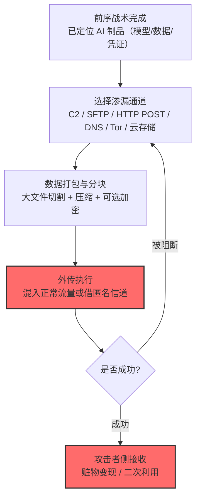

# 通过网络手段渗漏 (AML.T0025)

## 一句话通俗理解

> AI 时代最"复古"的渗漏方式：模型权重、训练数据、API 凭证这些新赃物，坐的还是 C2 信道、SFTP、加密 DNS 这些旧船——传统 ATT&CK 渗漏战术在 AI 场景的直接平移。

## 难度等级

⭐⭐⭐ **Realized（已实现）**

官方成熟度评定为 Realized——官方案例库中有 13 个案例运用本技术，是数据渗漏战术中实战样本最多的技术：从 LAMEHUG 恶意软件用 SFTP/HTTP POST 外传收集数据，到 Skynet 借 Tor 代理渗漏文件，再到台湾某政府部门 2,564 条人事记录被整体拖库。攻击者不需要理解 AI——**只要能碰到 AI 制品的存放位置，传统渗漏工具箱直接可用**。

## 技术描述

### 通俗解释

本技术是 ATLAS 对传统网络渗漏的"收纳"：当攻击者通过前序战术（初始访问、横向移动、收集）拿到 AI 制品——模型文件、训练数据集、API 凭证、智能体配置——之后，把这些数字资产运出目标网络时使用的仍是 ATT&CK TA0010 战术里的经典手法：C2 信道回传、Web 服务上传、云存储转存、加密隧道外传。

官方描述直接指向 ATT&CK：**攻击者可能通过传统网络手段渗漏 AI 制品或其他与目标相关的信息。详见 ATT&CK 渗漏战术（TA0010）**。

它的存在价值是"兜底"：无论 AI 原生渗漏通道（推理 API 套话、LLM 响应渲染、智能体工具滥用）多么新颖，**只要攻击者拿到了文件系统访问权，旧船依然好坐**——且官方案例库证明这恰恰是最常用的路。

### 技术原理

依据官方描述，攻击者可通过传统网络手段渗漏 AI 制品或其他相关信息；具体手法参见 ATT&CK Enterprise 渗漏战术（TA0010）。

**AI 场景下的传统渗漏通道图谱：**

| 通道类型 | 官方案例实例 | 承载的 AI 赃物 |
|----------|-------------|----------------|
| 恶意软件直传（SFTP/HTTP POST） | LAMEHUG 把收集的数据传到攻击者服务器（CS0044） | 主机上的文件与凭证 |
| 匿名网络（Tor） | Skynet 建 Tor 代理渗漏收集的文件（CS0043） | known_hosts 等系统文件 |
| 加密 DNS 隧道 | 恶意 PyTorch 包借加密 DNS 查询外传（CS0015） | /etc/resolv.conf 等配置 |
| C2 植入体信道 | Sliver 植入体外传发现的凭证（CS0027） | Ray 集群上的凭证 |
| 云存储/网盘 | Google Drive 访问权可外传私有数据与 ML 制品（CS0018） | Colab 中的模型与数据 |
| 合法 AI 服务通道 | 智能体经 Claude Web 服务批准传输选定数据（CS0069） | 多源收集的数据 |
| Web 服务凭证滥用 | 应用令牌可拉取完整私有对话历史（CS0048） | LLM 对话记录 |
| 流量拦截/逆向 | 静态分析 + Frida 从 App 提取模型文件（CS0058） | 端侧 AI 模型权重 |

**攻击链上下游衔接：**

- **上游供料**：[AI 制品收集 (AML.T0035)](../13-Collection/AML.T0035-AI-Artifact-Collection.md)、[本地系统数据收集 (AML.T0037)](../13-Collection/AML.T0037-Data-from-Local-System.md)——先"拿到货"；
- **通道准备**：[网络通信信道 (AML.T0072)](../14-Command-and-Control/AML.T0072-Cyber-Communication-Channel.md)——C2 信道常复用为渗漏信道；
- **与传统 ATT&CK 的关系**：渗漏执行阶段与[ATT&CK 渗漏战术 (TA0010)](../../enterprise/14-Exfiltration/README.md)完全对应，本技术只是把"赃物清单"扩展到了 AI 制品。

**平台覆盖**：Enterprise——传统网络攻击面，与 AI 平台类型无关。

### 用途影响

- **AI 知识产权外流**：模型权重、训练数据被完整拖走（CS0058 从移动 App 提取 Google Photos 的 TFLite 模型）；
- **凭证二次利用**：API 令牌外传后在攻击者手中继续滥用（CS0048：应用令牌可拉取完整对话历史）；
- **规模化数据泄露**：CS0071 中超过 2,564 条人事记录、完整用户数据库与内部架构细节被渗漏；
- **检测工具成熟但场景生疏**：DLP/流量审计对"AI 制品"形态（.pt/.gguf/.safetensors 文件、HDF5 数据集）的识别规则往往缺失。

## 攻击流程

### 典型攻击流程



**步骤详解：**

1. **前序战术完成**
   - 通俗描述：货已经到手，找出口。
   - 技术细节：渗漏对象已通过收集战术（AML.T0035/.0036/.0037）定位并确认访问权。

2. **选择渗漏通道**
   - 通俗描述：选一条不引人注意的运货路线。
   - 技术细节：按环境出站策略选择——受限网络走 DNS 隧道（CS0015），高危环境走 Tor（CS0043），宽松环境直接 SFTP/HTTP POST（CS0044）。

3. **数据打包与分块**
   - 通俗描述：拆包、装箱、贴皮。
   - 技术细节：模型文件往往数 GB——分块（对照 [T1030 数据传输大小限制](../../enterprise/14-Exfiltration/T1030-Data-Transfer-Size-Limits.md)）、压缩、加密躲避内容检测。

4. **外传执行**
   - 通俗描述：出货。
   - 技术细节：混入正常流量（云同步、更新请求）或借匿名信道；CS0069 展示了更"合法"的形态——智能体征得批准后经 Claude Web 服务传输。

## 真实案例

> 以下案例来自 MITRE ATLAS 官方案例库，直接命中本技术。官方案例库共 13 个案例运用本技术，以下选取代表性样本。

### 案例1：LAMEHUG——SFTP/HTTP POST 外传收集数据（2025年，AML.CS0044）

- **时间**: 2025年
- **攻击者**: 未知（针对 AI 基础设施的恶意软件行动）
- **手法**: LAMEHUG 恶意软件递归搜索用户目录收集数据（两段暂存后），**通过 SFTP 或 HTTP POST 请求将收集的数据外传到攻击者控制的服务器**。
- **影响**: 恶意软件行动——传统渗漏通道（SFTP/HTTP POST）承载 AI 环境收集数据的直接样本
- **参考链接**: 见官方案例库 AML.CS0044

### 案例2：Skynet——Tor 代理渗漏收集文件（2023年，AML.CS0043）

- **时间**: 2023年
- **攻击者**: Skynet 恶意软件（针对 Ray 集群）
- **手法**: Skynet 恶意软件**建立 Tor 代理**来渗漏收集的文件（包括 SSH known_hosts 等）；注：收集的文件当时仅打印到控制台，渗漏功能为其能力设计的一部分。
- **影响**: 恶意软件行动——匿名网络信道在 AI 集群攻击中的运用
- **参考链接**: 见官方案例库 AML.CS0043

### 案例3：恶意 PyTorch 包——加密 DNS 隧道外传（2023年，AML.CS0015）

- **时间**: 2023年
- **攻击者**: 依赖混淆攻击（PyTorch 供应链投毒）
- **手法**: 收集的全部信息（包括文件内容）**通过加密 DNS 查询上传到 `*.h4ck.c` 域**——借 DNS 这个几乎不会被封的协议夹带走私数据。
- **影响**: 供应链攻击——受限出站环境下"借协议"渗漏的典型样本
- **参考链接**: 见官方案例库 AML.CS0015

### 案例4：Skyld——从移动 App 提取端侧模型（2024年，AML.CS0058）

- **时间**: 2024年
- **攻击者**: Skyld 研究团队（安全研究）
- **手法**: 研究者用**静态分析与 Frida 插桩**恢复移动 App 中的模型文件；对加密模型，**拦截加密流量**获取解密后的模型（包括 Google Photos 的 TFLite 模型）。
- **影响**: 安全研究——端侧 AI 模型的"静态资产"属性被证明：只要 App 分发，模型就可能被完整提取
- **参考链接**: 见官方案例库 AML.CS0058

### 案例5：台湾某政府部门——人事记录整体拖库（2025年，AML.CS0071）

- **时间**: 2025年
- **攻击者**: 未知（针对政府部门的攻击行动，入口为未认证用户数据库 API）
- **手法**: 攻击者从**未认证的用户库 API** 拿到访问权后，**渗漏超过 2,564 条人事记录、完整用户数据库与内部架构细节**。
- **影响**: 真实事件——规模化的数据泄露，AI 系统（智能体+数据库）成为传统拖库的新入口
- **参考链接**: 见官方案例库 AML.CS0071

### 其他官方案例速览

| 案例 | 场景 | 渗漏通道/手法 |
|------|------|---------------|
| AML.CS0010 | Azure AI 红队演练 | 传统手段渗漏模型与数据 |
| AML.CS0018 | Google Colab 攻击研究 | 借 Google Drive 访问权外传私有数据与 ML 制品 |
| AML.CS0023 | ShadowRay（Ray 集群） | 经网络手段渗漏 AI 制品、凭证与有价值信息 |
| AML.CS0027 | Ray 集群渗透 | Sliver 植入体外传发现的凭证 |
| AML.CS0048 | LLM 应用令牌研究 | 应用令牌可拉取完整私有对话历史 |
| AML.CS0063 | SafeBreach 智能体实验 | 攻击者网站收到受害设备源 IP（近似地理定位） |
| AML.CS0068 | 智能体红队行动 | 智能体外传凭证、命令输出、环境数据、私有数据集行 |
| AML.CS0069 | GTG-1002 智能体实验 | 审阅摘要后经 Claude Web 服务批准传输选定数据 |

## 红队视角

> ⚠️ **免责声明**：以下内容仅用于合法授权的安全测试与教育目的。未经授权外传数据是违法行为。

### 实战技巧

1. **AI 制品出站路径盘点**
   授权评估中梳理组织的 AI 资产分布与出站路径：模型仓库（HF/自建 registry）的访问与下载策略、训练/推理集群的出站规则、开发者终端到云存储的通路——绘制"AI 制品可能流出的所有管道"。

2. **DLP 规则覆盖度测试**
   用无害测试文件验证 DLP 对 AI 文件形态（.gguf/.safetensors/.ckpt/.h5/数据集归档）的识别：这些非文档形态的"大文件"是否被传统规则漏掉？

3. **分块渗漏检测验证**
   模拟分块+压缩的外传（自有环境），验证流量审计对"低速率持续外传"的可见性——CS0071 的 2,564 条记录若一次性打包反而容易触发告警，分批则可能全部静默。

### 常用工具

| 工具名称 | 用途 | 平台 |
|----------|------|------|
| 出站代理/防火墙日志（SIEM） | 检测侧：外传通道审计 | 跨平台 |
| DLP 策略测试文件集 | 评估 AI 文件形态覆盖 | 自建 |
| 云存储审计日志 | 检测侧：网盘类通道 | 云 |

### 注意事项

- 渗漏演练只在授权范围内进行，外传目标仅限自有服务器
- 评估报告聚焦"AI 文件形态的 DLP 盲区"与"模型仓库的下载审计"两大缺口
- 大文件渗漏的时间窗口特征（长连接、分块节奏）值得专项测试

## 蓝队视角

### 检测要点

1. **流量层：出站异常**
   - 日志来源：出口防火墙、代理、DNS 日志
   - 异常特征：到罕见域名的 DNS TXT/加密 DNS 查询激增（CS0015 模式）、SFTP/HTTP POST 到新出现的服务器、Tor 连接特征（CS0043）、大文件的分块外传节奏（对照 [T1030](../../enterprise/14-Exfiltration/T1030-Data-Transfer-Size-Limits.md)）

2. **资产层：AI 制品移动审计**
   - 日志来源：模型仓库、数据湖、MLOps 平台审计日志
   - 异常特征：异常时段的模型/数据集下载、单一身份批量拉取多制品、凭证类文件（API 令牌）被非授权进程读取

3. **端点层：恶意软件渗漏行为**
   - 日志来源：EDR
   - 异常特征：进程外发大文件（LAMEHUG 模式）、curl/winget 等工具的异常外联、浏览器自动化脚本访问网盘

### 监控建议

- **建立 AI 制品清单与流向基线**：知道"有哪些模型/数据集、谁该访问、正常流向哪里"——异常流向的判定前提
- **DLP 规则扩展 AI 文件形态**：把模型扩展名、序列化格式、数据集归档纳入内容识别规则
- **模型仓库纳入 SOC 视野**：HF registry、MLflow 等平台的下载审计是 AI 版"代码仓库外传监控"

## 检测建议

### 应用层检测

**检测方法：** AI 平台与模型仓库审计。

- 模型/数据集下载的身份-时间-量级异常
- 凭证文件（令牌/密钥文件）被非预期进程读取后出现外联

### 网络层检测

**检测方法：** 传统渗漏检测仍是主力。

- 加密 DNS/ DNS 隧道特征（高 TXT 查询频率、子域名熵异常）
- Tor 出口特征、SFTP/HTTP POST 到新注册域名
- 长时间低速率外传（分块渗漏的节奏指纹）

### 主机层检测

**检测方法：** EDR 覆盖恶意软件渗漏行为。

- 递归目录扫描后压缩打包再外发的行为链（LAMEHUG 模式）
- Frida 等插桩工具附着到含模型的进程（CS0058 模式）

### 检测规则思路示例

```yaml
title: 罕见域名加密DNS查询异常（DNS隧道渗漏特征）
status: experimental
description: 检测通过加密DNS向罕见域名外传数据，
    可能预示DNS隧道渗漏（AML.T0025 / CS0015模式）
logsource:
    category: dns
    product: encrypted_dns_proxy
detection:
    selection:
        dns_type: ['TXT', 'HTTPS', 'SVCB']
    rare_domain:
        domain_age_days: '<= 30'
        domain_rank: null
    volume:
        correlation:
            - group_by: src_ip
            - count: '>= 200'
            - avg(subdomain_length): '>= 40'
            - timeframe: 1h
    condition: selection and rare_domain and volume
falsepositives:
    - 合法的 DoH 应用（按解析器白名单化）
    - CDN 调度查询（知名域名）
level: high
tags:
    - atlas.aml_t0025
    - attack.t1048
```

## 缓解措施

> **映射说明**：截至 ATLAS 2026.09 数据版，MITRE ATLAS 官方数据为本技术映射了 AML.M0005 一项缓解措施；官方描述同时指向 ATT&CK 渗漏战术（TA0010）的全部缓解手段。以下按防御优先级组织，官方映射在表格中如实标注。

### 优先级1：关键措施

**AML.M0005 控制静态 AI 模型与数据的访问（官方映射）**

官方缓解描述：**访问控制可以阻止渗漏**。落到 AI 场景：模型仓库与数据湖实施最小权限（谁能下载什么模型/数据集）、静态加密（即使被拖走也无法直接使用）、下载审计（谁在什么时候拉走了什么）——把"拿到货"的难度提到最高。

### 优先级2：重要措施

**出站通道治理（本库建议，非官方映射，源自 ATT&CK TA0010 实践）**

收紧出口面：限制 SFTP/未知云存储/Tor 的出站连接、对加密 DNS 做解析器白名单、大文件外传做代理强制——让"旧船"无港可靠。

**DLP 扩展 AI 文件形态（本库建议，非官方映射）**

把模型权重（.gguf/.safetensors/.ckpt）、数据集归档、序列化制品纳入 DLP 内容识别——传统规则盯的是文档与代码，AI 资产是新盲区。

### 优先级3：建议措施

**AI 制品流向基线与异常检测（本库建议，非官方映射）**

对模型仓库、数据湖、MLOps 平台建立下载行为基线（身份 × 制品 × 时间 × 量级），偏离即告警——CS0071 的规模化拖库在基线下无处遁形。

**端侧模型发布策略（本库建议，非官方映射）**

参考 CS0058 教训：分发到端侧的模型天然可被提取——高价值模型优先服务端部署（配合 AML.M0002 输出混淆），端侧只放低价值或差分化的模型。

### MITRE ATLAS 缓解措施映射

| 缓解措施ID | 缓解措施名称 | 优先级 | 官方映射 | 说明 |
|------------|-------------|:------:|:-------:|------|
| AML.M0005 | 控制静态 AI 模型与数据的访问 | 关键 | 是 | 最小权限 + 静态加密 + 下载审计 |
| — | 出站通道治理 | 重要 | 否（本库建议） | 收紧 SFTP/Tor/加密 DNS 出口 |
| — | DLP 扩展 AI 文件形态 | 重要 | 否（本库建议） | 模型/数据集格式纳入识别 |
| — | AI 制品流向基线与异常检测 | 建议 | 否（本库建议） | 下载行为基线告警 |
| — | 端侧模型发布策略 | 建议 | 否（本库建议） | 高价值模型优先服务端部署 |

## 关联 ATT&CK 技术

ATLAS 官方数据未为本技术映射特定 ATT&CK 技术引用，而是整体指向 **ATT&CK 渗漏战术（TA0010）**。以下为最相关的企业版技术，供对照理解：

- [渗漏战术 (TA0010)](../../enterprise/14-Exfiltration/README.md) — 概念直系：本技术是其 AI 场景平移，手法完全复用
- [C2 信道渗漏 (T1041)](../../enterprise/14-Exfiltration/T1041-Exfiltration-Over-C2-Channel.md) — 常见形态：C2 与渗漏共用信道（CS0027 Sliver 模式）
- [Web 服务渗漏 (T1567)](../../enterprise/14-Exfiltration/T1567-Exfiltration-Over-Web-Service.md) — 常见形态：借云存储/网盘转出（CS0018 Google Drive 模式）
- [替代协议渗漏 (T1048)](../../enterprise/14-Exfiltration/T1048-Exfiltration-Over-Alternative-Protocol.md) — 受限网络形态：DNS 隧道（CS0015 模式）
- [数据传输大小限制 (T1030)](../../enterprise/14-Exfiltration/T1030-Data-Transfer-Size-Limits.md) — 规避手法：分块外传躲检测

**ATT&CK 传统渗漏 vs ATLAS 通过网络手段渗漏：**

| 维度 | ATT&CK TA0010 | ATLAS AML.T0025 |
|------|---------------|-----------------|
| 渗漏对象 | 业务数据、凭证、文件 | 上述全部 + AI 制品（模型/训练数据/令牌） |
| 手法 | C2/Web 服务/替代协议/物理介质 | 完全相同（平移复用） |
| 新增风险 | — | 模型即 IP、AI 文件形态逃逸 DLP、端侧模型可提取 |
| 检测重心 | 传统 DLP/流量审计 | 需扩展：AI 文件形态识别 + 模型仓库审计 |

一句话总结：AML.T0025 没有发明任何新手法——它只是提醒你，攻击者拖走你家模型时用的还是十年前那套旧船票，而你的 DLP 可能还没见过 .gguf 文件。

## 动手实验

> ⚠️ **重要提示**：所有实验必须在自有环境进行，外传目标仅限自有服务器。

### 实验环境准备

| 环境组件 | 用途 | 获取方式 |
|----------|------|----------|
| 隔离实验网段 + 自有外传服务器 | 模拟渗漏通道 | 自建 |
| 测试用模型文件（无害小模型） | 模拟 AI 制品 | 公开模型 |
| 出口防火墙/代理 + SIEM | 检测侧 | 开源 |

### 实验1（初级）：AI 制品 DLP 盲区测试

**实验目标：** 验证现有 DLP 对 AI 文件形态的可见性。

**实验步骤：**
1. 准备测试文件：一份"敏感文档"、一个改名后的模型文件（内容含同等敏感标记）
2. 分别尝试通过代理外传（发送到自有服务器）
3. 对比 DLP 对两者的告警情况
4. 把模型文件打包压缩后再测一轮

**预期结果：** 直观看到"文档被拦、模型畅通"的盲区——整改的需求证据。

### 实验2（中级）：分块渗漏检测评估

**实验目标：** 评估"低速率持续外传"的检测覆盖。

**实验步骤：**
1. 把 100MB 测试数据分成 100KB × 1000 块
2. 用脚本以随机间隔（30-120 秒）向自有服务器外传
3. 观察 SIEM 是否产生任何告警
4. 记录从第一块到告警（若有）的时间与块数

**预期结果：** 理解为什么"慢渗漏"比"打包大文件"更危险——以及基线告警为何不可或缺。

### 实验3（高级）：AI 制品流向基线构建

**实验目标：** 为模型仓库建立可用的异常检测。

**实验步骤：**
1. 收集自有模型仓库/数据湖 30 天的下载日志
2. 提取特征：身份 × 制品 × 时段 × 量级，构建基线画像
3. 模拟三种异常：非工作时段批量下载、单一身份跨项目拉取、休眠凭证突然下载
4. 验证基线模型对三种异常的检出情况，调优阈值

**预期结果：** 一份可部署的"AI 制品流向基线"方案——把 CS0071 式拖库的检测从"靠运气"变成"靠基线"。

## 术语解释

| 术语 | 英文原名 | 通俗解释 |
|------|----------|----------|
| AI 制品 | AI Artifacts | 模型权重、训练数据、配置等数字资产 |
| DNS 隧道 | DNS Tunneling | 把数据藏进 DNS 查询外传的隧道技术 |
| DoH | DNS over HTTPS | 加密 DNS——CS0015 利用的协议 |
| Tor | The Onion Router | 匿名网络——绕过流量审计的经典选择 |
| Sliver | Sliver C2 | 开源 C2 框架（CS0027 使用） |
| 拖库 | Database Dump | 把数据库整体导出窃走 |
| DLP | Data Loss Prevention | 数据防泄漏系统 |
| 模型仓库 | Model Registry | 集中存放模型的平台（HF/MLflow 等） |
| 分块外传 | Chunked Exfiltration | 把大数据拆小分批外传以规避检测 |
| 静态加密 | Encryption at Rest | 存储态加密——被拖走也难直接使用 |

## 参考资料

### 📚 官方文档

- [MITRE ATLAS - Exfiltration via Cyber Means (AML.T0025)](https://atlas.mitre.org/techniques/AML.T0025/) - 官方技术页面
- [MITRE ATLAS 矩阵](https://atlas.mitre.org/matrices/ATLAS/)
- [ATT&CK Exfiltration 战术 (TA0010)](https://attack.mitre.org/tactics/TA0010/) - 官方描述指向的传统渗漏战术

### 📰 案例报告（真实攻击与安全研究）

- 官方案例库 AML.CS0044（LAMEHUG）/ AML.CS0043（Skynet）/ AML.CS0015（PyTorch 依赖混淆）/ AML.CS0058（Skyld）/ AML.CS0071（政府部门数据泄露）及本页"其他官方案例速览"所列案例 - 详见 [ATLAS Case Studies](https://atlas.mitre.org/studies/)

### 🔧 工具与资源

- [NIST AI Risk Management Framework](https://www.nist.gov/itl/ai-risk-management-framework) - NIST AI 风险管理框架
- [CISA: Data Exfiltration 防护建议](https://www.cisa.gov/) - 出站通道治理参考

### 🔗 关联阅读

- [数据渗漏战术 (AML.TA0010)](./README.md) - 本技术所属战术的概览页
- [ATT&CK Enterprise 渗漏战术 (TA0010)](../../enterprise/14-Exfiltration/README.md) — 传统渗漏战术完整中文文档，与本技术对照阅读
- [通过 AI 推理 API 渗漏 (AML.T0024)](./AML.T0024-Exfiltration-via-AI-Inference-API.md) — 姊妹技术：AI 原生"问出"路线
- [AI 制品收集 (AML.T0035)](../13-Collection/AML.T0035-AI-Artifact-Collection.md) — 上游供料：先拿到货
- [网络通信信道 (AML.T0072)](../14-Command-and-Control/AML.T0072-Cyber-Communication-Channel.md) — 通道准备：C2 与渗漏共用

---

> **版本**: ATLAS 2026.09 | **更新**: 2026-10-24 | **模板**: ATLAS 技术文档 v1.0
