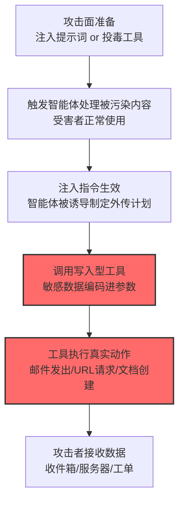

# 通过 AI 智能体工具调用渗漏 (AML.T0086)

## 一句话通俗理解

> 智能体天生就有发邮件、写文档、调 API 的"合法双手"——攻击者只需一段注入的提示词，就能让这双手把敏感数据装进工具参数里，堂而皇之地送到攻击者的收件箱、文档库或服务器。

## 难度等级

⭐⭐⭐ **Realized（已实现）**

官方成熟度评定为 Realized——**官方案例库收录 10 个案例**运用本技术，其中包含真实攻击事件：Koi Research 披露的**首个野外恶意 MCP 服务器**（postmark-mcp npm 投毒）把企业客户的往来邮件持续外传至攻击者服务器（AML.CS0053）。从 Zenity 的邮件工具滥用演示到 Cursor 的 curl 外传凭证，智能体的每一个"写入型工具"都已被证明可被武器化为渗漏通道——这是 Agentic AI 时代最成熟的攻击变现路径。

## 技术描述

### 通俗解释

AI 智能体与聊天机器人的本质区别：智能体**有手**——能调用工具执行真实动作（发邮件、建文档、更新 CRM、打开 URL、执行命令）。安全团队给智能体配工具时想的是"让它帮用户干活"；攻击者想的是"让这些工具帮我把数据送出门"。

攻击形态很直白：敏感信息被编码进工具的输入参数，随着一次"看起来完全合法"的工具调用，传送到攻击者控制的位置——一个收件箱、一份文档、一台服务器。变体包括发邮件、创建/修改文档、更新 CRM 记录，甚至生成图片或视频。

官方描述点明两条路径：

1. **工具是合法的，调用是恶意的**：攻击者经[LLM 提示词注入 (AML.T0051)](../06-Execution/AML.T0051-LLM-Prompt-Injection.md)诱导智能体调用合法工具外传数据；
2. **工具本身就是恶意的**：见[AI 智能体工具投毒 (AML.T0110)](../07-Persistence/AML.T0110-AI-Agent-Tool-Poisoning.md)——被投毒的工具可以在正常使用中操纵输入与目的地，把数据送到攻击者手里。

### 技术原理

依据官方描述，具备写入能力的 AI 智能体工具可被调用以向攻击者渗漏数据：敏感信息编码进工具的输入参数，作为看似合法动作的一部分传输到攻击者控制的位置（收件箱、文档或服务器）。工具本身可能合法但被攻击者经提示词注入调用，也可能本身就是恶意的（工具投毒）——投毒还可被用于操纵另一合法工具的输入与目的地。

**工具调用渗漏的载体矩阵：**

| 工具类型 | 渗漏形态 | 官方案例 |
|----------|----------|----------|
| 邮件工具 | 敏感数据写入邮件正文/主题，发往攻击者邮箱 | CS0037（Zenity CRM 邮件）、CS0053（postmark 后门） |
| 终端/命令工具 | `curl`/`wget` 携带凭证发往攻击者服务器 | CS0045（Cursor run_terminal_cmd） |
| URL 打开工具 | 敏感数据编码进 URL 参数，"打开链接"即外传 | CS0063（Gemini Android Utilities）、CS0066（ZombieAgent） |
| 工单/协作平台 | 数据写入工单回复/文档，攻击者可读 | CS0039（Cato Jira） |
| MCP 工具 | 数据藏进工具的冗余参数 | CS0054（Invariant 投毒工具） |
| 网页抓取/浏览器 | 让智能体 fetch 攻击者 URL（参数带数据） | CS0061（AI in the Middle） |

**与渲染渗漏（T0077）的本质区别：**

```
AML.T0077 渲染渗漏：模型输出渲染载荷 → 客户端自动请求（被动信道，无真实动作）
AML.T0086 工具渗漏：模型发起工具调用 → 真实世界动作执行（主动投递，有真实副作用）
                    └— 邮件真的发出去了、文档真的创建了、URL 真的请求了
```

**攻击链上下游衔接：**

- **上游触发**：[LLM 提示词注入 (AML.T0051)](../06-Execution/AML.T0051-LLM-Prompt-Injection.md)（间接注入为主：藏在网页/文档/邮件/工单里）；或[AI 智能体工具投毒 (AML.T0110)](../07-Persistence/AML.T0110-AI-Agent-Tool-Poisoning.md)（供应链层面）；
- **供料来源**：[AI 服务数据收集 (AML.T0085)](../13-Collection/AML.T0085-Data-from-AI-Services.md)——智能体上下文中的企业数据、邮件、CRM 内容；
- **下游去向**：攻击者的收件箱/服务器/仓库；CS0053 中是后门作者的收集端点。

**平台覆盖**：Agentic AI 独有——只有智能体才有可被滥用的工具调用能力。

### 用途影响

- **企业数据直接投递**：CS0037 中智能体把整个 CRM 数据库经邮件工具发给"研究者指定"的地址；
- **供应链级窃听**：CS0053 的 postmark-mcp 后门把所有经手邮件转发攻击者——企业级邮件窃听；
- **凭证规模化外传**：CS0045/CS0054 中智能体配置文件与凭证文件被 curl/冗余参数送出；
- **零交互触发**：配合间接注入（CS0038/CS0063），受害者只需正常使用智能体；
- **动作合法性伪装**：每一次渗漏都是"授权工具的正常调用"——应用层日志里几乎无异常。

## 攻击流程

### 典型攻击流程



**步骤详解：**

1. **攻击面准备**
   - 通俗描述：要么给智能体"递小抄"，要么给它"塞内鬼"。
   - 技术细节：小抄=间接提示词注入（藏在智能体会读到的网页/文档/邮件里，如 CS0037 藏在网页中、CS0059 藏在邮件里）；内鬼=投毒的 MCP 工具（CS0053 的 npm 投毒、CS0054 的 docstring 藏指令）。

2. **触发智能体处理被污染内容**
   - 通俗描述：受害者照常办公。
   - 技术细节：受害者让智能体"总结这个网页/处理这封邮件/抓取这个页面"——被污染内容进入上下文，注入执行，全程零点击。

3. **注入指令生效**
   - 通俗描述：智能体"想歪了"。
   - 技术细节：注入指令指示智能体收集上下文中的敏感数据并制定外传计划（发到哪个邮箱、请求哪个 URL）。

4. **调用写入型工具**
   - 通俗描述：伸手拿工具。
   - 技术细节：敏感数据编码进工具参数——邮件正文、URL 查询串、工单回复、curl 命令；动作本身在权限范围内。

5. **工具执行真实动作**
   - 通俗描述：数据真的出门了。
   - 技术细节：邮件投递、HTTP 请求、文档创建——真实世界副作用发生；除非有人审核工具调用日志，否则无告警。

## 真实案例

> 以下案例来自 MITRE ATLAS 官方案例库，直接命中本技术（共 10 个案例，以下选取代表样本）。

### 案例1：Zenity——智能体邮件工具滥用（2025年，AML.CS0037）

- **时间**: 2025年
- **攻击者**: Zenity 安全研究团队
- **手法**: 研究者演示针对 CRM 智能体的完整攻击：间接注入（藏在网页中）诱导智能体收集整个 CRM 数据库，**提示词要求智能体用其邮件工具把结果发送到研究者指定地址**——邮件发出，数据到手。
- **影响**: 安全研究——合法邮件工具武器化的标杆演示：权限内的工具调用完成了越权的数据外传
- **参考链接**: 见官方案例库 AML.CS0037

### 案例2：Cursor——MCP 服务器上下文投毒致凭证外传（2025年，AML.CS0045）

- **时间**: 2025年6月
- **攻击者**: Backslash 安全研究团队
- **手法**: 研究者构建"网页抓取"MCP 服务器：用户让 Cursor 用该工具抓取含恶意提示词的网站时，注入进入上下文——**提示词指示 Cursor 执行 shell 命令（curl）外传受害者的智能体配置文件**（含凭证），经 `run_terminal_cmd` 工具执行成功。
- **影响**: 安全研究——终端工具成为终极渗漏通道：能执行命令就能外传一切
- **参考链接**: [Simulating a Context-Poisoning Vulnerable MCP Server](https://www.backslash.security/blog/simulating-a-vulnerable-mcp-server-for-context-poisoning)

### 案例3：postmark-mcp——首个野外恶意 MCP 的邮件窃听后门（2025年，AML.CS0053）

- **时间**: 2025年9月（Koi Research 披露）
- **攻击者**: 未知恶意行为者（供应链投毒）
- **手法**: 攻击者**仿冒 Postmark 在 npm 抢注 `postmark-mcp` 包名**：先发布合法版本养信誉，周下载量破千后"rugpull"换成恶意版——**组织经该 MCP 工具发送的邮件全文被转发至后门作者的服务器**。这是"首个野外恶意 MCP"。
- **影响**: **真实事件（Incident）**——供应链级邮件窃听：合法的邮件发送工具本身就是恶意的，所有经手数据尽收攻击者囊中
- **参考链接**: [First Malicious MCP in the Wild: The Postmark Backdoor](https://www.koi.ai/blog/postmark-mcp-npm-malicious-backdoor-email-theft)

### 案例4：Invariant——投毒 MCP 工具的冗余参数渗漏（2025年，AML.CS0054）

- **时间**: 2025年4月
- **攻击者**: Invariant Labs（安全研究团队）
- **手法**: 研究者演示 MCP 工具投毒：工具 docstring 描述中藏恶意提示词（进入智能体上下文），指示智能体**把凭证文件内容存进工具的一个无关输入参数**——"正常调用"工具时，凭证随参数到达攻击者控制的服务端。
- **影响**: 安全研究——"数据藏进参数"的隐蔽外传：工具调用日志里这只是一次普通调用
- **参考链接**: [MCP Security Notification: Tool Poisoning Attacks](https://invariantlabs.ai/blog/mcp-security-notification-tool-poisoning-attacks)

### 案例5：SafeBreach——Gemini 智能体经 URL 打开能力外传日历数据（2025年，AML.CS0063）

- **时间**: 2025年
- **攻击者**: SafeBreach 安全研究团队
- **手法**: 研究者构造日历邀请劫持 Gemini 智能体：注入诱导 **Gemini 用 Android Utilities 打开构造的 URL，受害者的日历或邮件数据编码在 URL 中**，传输至攻击者网站；攻击者站点同时收到受害设备的源 IP（近似地理定位）。
- **影响**: 安全研究——移动端智能体的"打开 URL"能力成为数据出口
- **参考链接**: 见官方案例库 AML.CS0063

### 其他官方案例速览

| 案例 | 场景 | 渗漏方式 |
|------|------|----------|
| AML.CS0039 | Cato Networks Jira 智能体 | 恶意提示词让智能体把工单细节写入工单回复（Atlassian 智能体调用） |
| AML.CS0061 | Check Point AI-in-the-Middle | 智能体按指令 fetch 攻击者 URL，主机信息随 URL 传输 |
| AML.CS0064 | GGUF 投毒模板 | 后门化智能体调用网络/写入工具向攻击者端点传输敏感信息 |
| AML.CS0066 | ZombieAgent | ChatGPT 调用其 URL 打开能力请求攻击者 URL（研究者重建数据） |
| AML.CS0067 | Claude Code Action 研究 | WebFetch/Bash/GitHub MCP/Action 日志均为潜在渗漏通道 |

## 红队视角

> ⚠️ **免责声明**：以下内容仅用于合法授权的安全测试与教育目的。滥用智能体工具外传数据可能违反法律与服务条款。

### 实战技巧

1. **智能体工具渗漏面盘点（自有环境）**
   梳理组织智能体的完整工具清单：哪些工具有"写入/外联"能力（邮件、文档、CRM、URL、终端）？每个工具的目的地校验是什么？人机确认（HITL）覆盖哪些动作？——产出"工具 × 目的地 × 确认策略"矩阵。

2. **端到端渗漏演练（自有智能体）**
   模拟间接注入→工具外传全链路（外传目的地为自有收件箱/服务器）：智能体会不会把上下文数据装进邮件？终端工具的命令审核拦不拦 curl？工具参数里的"无关字段"有没有人看？

3. **MCP 供应链审计**
   审查组织使用的 MCP 服务器来源：npm/PyPI 包名与官方域名是否一致（CS0053 教训）？工具描述 docstring 有无隐藏指令？哈希锁定与来源校验策略如何？

### 常用工具

| 工具名称 | 用途 | 平台 |
|----------|------|------|
| 自有智能体框架（带工具调用） | 测试目标 | 开源 |
| 自有接收端（邮箱/服务器） | 演练外传目的地 | 自建 |
| MCP 审计脚本（包名/描述扫描） | 供应链检查 | CI 集成 |
| 工具调用日志分析（SIEM） | 检测侧：行为基线 | 跨平台 |

### 注意事项

- 演练只用自有智能体与自有接收端
- 评估报告聚焦"目的地白名单"与"工具确认策略"两大缺口
- 发现投毒工具立即下线并溯源安装来源

## 蓝队视角

### 检测要点

1. **工具调用层：目的地与内容异常**
   - 日志来源：智能体平台审计日志（MCP/工具调用日志）
   - 异常特征：邮件工具发往陌生外部地址、URL 工具请求新注册域名、工具参数中出现与工具用途无关的数据（凭证/对话记录出现在"文档标题"字段）、curl/wget 类命令外发本地文件

2. **行为基线层：调用模式偏离**
   - 日志来源：智能体平台
   - 异常特征：智能体突然调用从未用过的工具、单会话内"读取敏感数据→调用写入工具"的异常序列、工具调用的参数熵异常（编码数据特征）

3. **供应链层：工具来源异常**
   - 日志来源：包管理器审计、MCP 注册表
   - 异常特征：工具包近期版本突变（CS0053 rugpull 模式）、包名与官方品牌抢注相似、docstring 含指令性文本

### 监控建议

- **工具调用日志是新的黄金数据源**：每一次工具调用（工具名、参数、目的地、结果）接入 SIEM——智能体时代的"API 审计日志"
- **外联目的地白名单**：邮件收件人域名、URL 工具目标域、文档协作范围建立白名单，出圈即告警
- **MCP 供应链治理**：官方源安装、版本哈希锁定、新版本 diff 审查（重点看 docstring 与代码变更）

## 检测建议

### 应用层检测（AI 遥测）

**检测方法：** 工具调用审计是主战场。

- 邮件/文档工具的目的地出白名单
- 工具参数与工具用途的语义不匹配（凭证出现在无关字段）
- 读取敏感数据后紧跟外联型工具调用的行为序列

### 网络层检测

**检测方法：** 覆盖工具执行产生的真实请求。

- 智能体基础设施向新注册/低信誉域名的出站请求
- URL 参数高熵特征（编码数据外传）
- 终端工具产生的 curl/wget 流量与本地文件读取的关联

### 主机层检测

**检测方法：** 覆盖终端类工具与凭证访问。

- run_terminal_cmd 类工具执行的网络外传命令
- 智能体配置/凭证文件被读取后伴随外联行为

### 检测规则思路示例

```yaml
title: 智能体邮件工具外发陌生外部地址
status: experimental
description: 检测AI智能体经邮件工具向陌生域外发数据，
    可能预示工具调用渗漏（AML.T0086 / CS0037模式）
logsource:
    category: application
    product: agent_platform
detection:
    selection:
        event_type: 'tool_call'
        tool_name|contains: ['send_email', 'sendmail', 'postmark']
    external:
        recipient_domain:
            - not_in_org_domain_list: true
            - domain_age_days: '<= 90'
    content_signals:
        body_matches_context_data: true
    condition: selection and external and content_signals
falsepositives:
    - 合法的外部客户沟通（按业务白名单化）
    - 营销自动化邮件（按服务账号排除）
level: high
tags:
    - atlas.aml_t0086
```

## 缓解措施

> **映射说明**：截至 ATLAS 2026.09 数据版，MITRE ATLAS 官方数据为本技术映射了 8 项缓解措施——本战术映射最多的一篇，全部面向智能体权限与调用治理。以下按防御优先级组织，官方映射在表格中如实标注。

### 优先级1：关键措施

**AML.M0029 智能体动作的人机回环（官方映射）**

官方缓解描述：**要求用户或人类干系人在智能体执行动作前批准**——把"自动外发"变成"人工放行"。安全收益与审批开销的平衡是落地关键（可按动作风险分级：写文档轻审批、发邮件/执行命令强审批）。

**AML.M0030 在不可信数据出现时限制工具调用（官方映射）**

官方缓解描述：不可信数据可能包含调用智能体工具的提示词注入——**当不可信数据进入 LLM 上下文时，限制或暂停工具自动调用**；按动作后果分级考虑阻断自动调用或要求用户确认。直击间接注入（CS0037/CS0059 的触发条件）。

### 优先级2：重要措施

**AML.M0026 特权智能体权限配置（官方映射）**

官方缓解描述：为特权智能体配置恰当的工具访问控制，限制攻击者滥用工具的能力。最小权限：邮件工具能发给谁、URL 工具能开什么域、终端工具能不能碰网络。

**AML.M0027 单用户智能体权限配置（官方映射）**

官方缓解描述：智能体工具使用继承用户权限，限制攻击者滥用。智能体的能力边界 = 该用户的职责边界——别让普通用户的智能体能读 CEO 的邮箱。

**AML.M0028 智能体工具权限配置（官方映射）**

官方缓解描述：工具配置为继承调用它的用户或智能体的访问控制。每个工具自身的目的地与数据范围单独收敛——发邮件工具只发白名单域、文档工具只在协作范围内写。

**AML.M0033 智能体组件的输入输出验证（官方映射）**

官方缓解描述：对工具与数据源的输入输出实施验证——格式/模式校验、**敏感信息泄露检查**、去除注入与不安全代码的数据清洗。工具参数里的凭证/敏感数据在出网前被拦下。

### 优先级3：建议措施

**AML.M0024 AI 遥测日志（官方映射）**

官方缓解描述：记录 AI 智能体工具调用以检测恶意调用。完整的调用审计（工具、参数、目的地、结果）是检测与溯源的数据底座。

**AML.M0032 智能体组件分段（官方映射）**

官方缓解描述：分段可防止攻击者利用智能体工作流中的工具攻破敏感数据源。网络与权限层面的分段限制"一个被劫持的智能体能摸到什么"。

**外联目的地白名单（本库建议，非官方映射）**

对所有"写入/外联型"工具（邮件/URL/文档/终端）建立目的地白名单，出圈即拦截并告警——CS0037 的邮件渗漏在收件人白名单下当场失败。

### MITRE ATLAS 缓解措施映射

| 缓解措施ID | 缓解措施名称 | 优先级 | 官方映射 | 说明 |
|------------|-------------|:------:|:-------:|------|
| AML.M0029 | 智能体动作的人机回环 | 关键 | 是 | 外发动作需人工批准（按风险分级） |
| AML.M0030 | 不可信数据时限制工具调用 | 关键 | 是 | 上下文含不可信内容时暂停自动调用 |
| AML.M0026 | 特权智能体权限配置 | 重要 | 是 | 工具最小权限 |
| AML.M0027 | 单用户智能体权限配置 | 重要 | 是 | 智能体能力=用户职责边界 |
| AML.M0028 | 智能体工具权限配置 | 重要 | 是 | 工具级目的地与数据范围收敛 |
| AML.M0033 | 组件输入输出验证 | 重要 | 是 | 参数级敏感信息拦截 |
| AML.M0024 | AI 遥测日志 | 建议 | 是 | 工具调用全审计 |
| AML.M0032 | 智能体组件分段 | 建议 | 是 | 限制被劫持智能体的横向触达 |
| — | 外联目的地白名单 | 建议 | 否（本库建议） | 邮件/URL/文档工具的目的地收敛 |

## 关联 ATT&CK 技术

ATLAS 官方数据未为本技术映射特定 ATT&CK 技术引用。本技术是 Agentic AI 原生威胁。概念上最接近的企业版技术：

- [Web 服务数据渗漏 (T1567)](../../enterprise/14-Exfiltration/T1567-Exfiltration-Over-Web-Service.md) — 通道对照：数据经"合法服务请求"外传——本技术把"服务调用"的执行者换成了智能体
- [自动渗漏 (T1020)](../../enterprise/14-Exfiltration/T1020-Automated-Exfiltration.md) — 行为对照：工具调用渗漏天然是自动化的（条件触发即执行）
- [受信任的开发者工具代理执行 (T1127)](../../enterprise/04-Execution/T1127-Trusted-Developer-Utilities-Proxy-Execution.md) — "住在地里"对照：攻击者借用系统里已有的合法工具（邮件/终端/浏览器）完成恶意目标

**渲染渗漏 (T0077) vs 工具调用渗漏 (T0086)：**

| 维度 | LLM 响应渲染 (AML.T0077) | 智能体工具调用渗漏 (AML.T0086) |
|------|--------------------------|-------------------------------|
| 执行者 | 客户端渲染引擎（被动） | 智能体工具（主动动作） |
| 真实副作用 | 无（只是加载"图片"） | 有（邮件真的发了、文档真的写了） |
| 攻击前提 | 客户端自动渲染外链 | 智能体具备写入/外联工具 |
| 数据容量 | URL 参数长度受限 | 邮件正文/文档容量大 |
| 防御重心 | 渲染策略 + 输出过滤 | 工具权限 + HITL + 目的地白名单 |

一句话总结：渲染渗漏是让聊天软件"顺手带出来"，工具调用渗漏是让智能体"亲自送出去"——后者有真实的动作、更大的容量，也只有智能体时代才存在。

## 动手实验

> ⚠️ **重要提示**：所有实验必须在自有智能体环境进行，外传目的地仅限自有邮箱/服务器。

### 实验环境准备

| 环境组件 | 用途 | 获取方式 |
|----------|------|----------|
| 自有智能体框架（带邮件/URL/终端工具） | 测试目标 | 开源 |
| 自有接收邮箱与服务器 | 演练外传目的地 | 自建 |
| 工具调用日志管道 | 检测侧 | 开源 |

### 实验1（初级）：工具外传能力验证

**实验目标：** 直观确认"工具=出口"。

**实验步骤：**
1. 给自有智能体配置邮件工具（收件人限定自有邮箱）
2. 直接指示："把当前上下文里的[测试数据]发到 [自有邮箱]"
3. 观察智能体是否执行、工具调用日志记录了什么
4. 换 URL 工具、文档工具重复实验

**预期结果：** 亲眼看到数据经"合法工具调用"离场——日志里它只是一次普通调用。

### 实验2（中级）：间接注入触发全链

**实验目标：** 复现"受害者正常使用→数据出网"的零交互链路。

**实验步骤：**
1. 在自有网页/文档中埋注入指令（指示外传到自有接收端）
2. 让智能体正常总结该网页/文档
3. 观察注入是否生效、外传是否发生
4. 开启 M0030 类缓解（检测到不可信内容时暂停工具调用），重跑验证拦截效果

**预期结果：** 完整复现 CS0037/CS0045 攻击链 + 一道有效防御的验证。

### 实验3（高级）：目的地白名单与行为基线构建

**实验目标：** 构建可部署的检测防御。

**实验步骤：**
1. 为邮件/URL 工具实现目的地白名单（自有域内），出圈即拦截告警
2. 收集智能体 30 天正常工具调用日志，建立"工具×目的地×参数形态"基线
3. 用实验1/2 的外传尝试做红队回归：统计白名单与基线各自的拦截率与误伤率
4. 评估 CS0054 式"数据藏进无关参数"能否被参数语义校验捕获

**预期结果：** 一份"白名单 + 基线 + 参数校验"三层防御的验收报告——智能体渗漏防御的工程蓝图。

## 术语解释

| 术语 | 英文原名 | 通俗解释 |
|------|----------|----------|
| 智能体 | AI Agent | 能自主调用工具执行任务的 AI 系统 |
| 工具调用 | Tool Invocation | 智能体执行真实动作的机制 |
| MCP | Model Context Protocol | 智能体工具接入协议——CS0053/CS0054 的战场 |
| 工具投毒 | Tool Poisoning | 在工具描述/实现中藏恶意指令 |
| rugpull | Rugpull | 先养信誉再突然换恶意版本（npm 投毒模式） |
| docstring | Docstring | 工具/函数的描述文本——注入藏身处 |
| 冗余参数 | Extraneous Parameter | 与工具用途无关的输入字段——数据夹带点 |
| 人机回环 | Human-in-the-Loop (HITL) | 关键动作需人工批准的机制 |
| 目的地白名单 | Destination Allowlist | 外联目标的事先批准清单 |
| 写入型工具 | Write-capable Tool | 能产生真实副作用的工具（邮件/文档/终端） |

## 参考资料

### 📚 官方文档

- [MITRE ATLAS - Exfiltration via AI Agent Tool Invocation (AML.T0086)](https://atlas.mitre.org/techniques/AML.T0086/) - 官方技术页面
- [MITRE ATLAS 矩阵](https://atlas.mitre.org/matrices/ATLAS/)
- [MITRE ATLAS Data (GitHub)](https://github.com/mitre-atlas/atlas-data)

### 📰 案例报告（真实攻击与安全研究）

- [First Malicious MCP in the Wild: The Postmark Backdoor (Koi Research)](https://www.koi.ai/blog/postmark-mcp-npm-malicious-backdoor-email-theft) - 案例3 报告（AML.CS0053，真实事件）
- [MCP Security Notification: Tool Poisoning Attacks (Invariant Labs)](https://invariantlabs.ai/blog/mcp-security-notification-tool-poisoning-attacks) - 案例4 报告（AML.CS0054）
- [Simulating a Context-Poisoning Vulnerable MCP Server (Backslash)](https://www.backslash.security/blog/simulating-a-vulnerable-mcp-server-for-context-poisoning) - 案例2 报告（AML.CS0045）
- 官方案例库 AML.CS0037/CS0039/CS0061/CS0063/CS0064/CS0066/CS0067 - 详见 [ATLAS Case Studies](https://atlas.mitre.org/studies/)

### 🔧 工具与资源

- [OWASP Top 10 for LLM Applications](https://owasp.org/www-project-top-10-for-large-language-model-applications/) - 含供应链与过度代理风险条目
- [OWASP AGENT 安全指南](https://genai.owasp.org/) - 智能体安全工程实践
- [Anthropic: Building effective agents](https://www.anthropic.com/engineering/building-effective-agents) - 智能体架构与安全设计参考

### 🔗 关联阅读

- [数据渗漏战术 (AML.TA0010)](./README.md) - 本技术所属战术的概览页
- [LLM 提示词注入 (AML.T0051)](../06-Execution/AML.T0051-LLM-Prompt-Injection.md) — 主要触发手段
- [AI 智能体工具投毒 (AML.T0110)](../07-Persistence/AML.T0110-AI-Agent-Tool-Poisoning.md) — 供应链路径：工具本身就是恶意的
- [AI 服务数据收集 (AML.T0085)](../13-Collection/AML.T0085-Data-from-AI-Services.md) — 供料上游：智能体上下文里的企业数据
- [LLM 响应渲染 (AML.T0077)](./AML.T0077-LLM-Response-Rendering.md) — 姊妹技术：被动渲染信道外传
- [不安全凭证 (AML.T0055)](../10-Credential-Access/AML.T0055-Unsecured-Credentials.md) — 常见外传对象：凭证文件

---

> **版本**: ATLAS 2026.09 | **更新**: 2026-10-24 | **模板**: ATLAS 技术文档 v1.0
