# 数据渗漏 (AML.TA0010)

## 一句话理解

> **攻击者把你的 AI 系统本身变成运赃通道——模型本体、系统提示词、训练数据隐私，都能顺着推理 API、LLM 回复和智能体工具调用"合法"流出你的网络。**

## 战术概述

数据渗漏是 ATLAS 攻击链的**第 15 个战术**：攻击者试图窃取 AI 制品或其他与 AI 系统相关的信息。数据可能因其宝贵的知识产权价值而被盗，也可能被用于筹备后续攻击行动。与传统 ATT&CK 渗漏一致，把数据弄出目标网络通常包括经由命令与控制通道或替代通道传输，还可能对传输设置大小限制；ATLAS 的独有之处在于——**AI 系统自己就能成为渗漏通道**：推理 API、LLM 响应内容、智能体工具调用都可能被用来"问出"或"带出"敏感数据。

**通俗解释：**
传统渗漏像小偷把赃物藏进快递箱混出小区；ATLAS 渗漏更像内鬼借公司的客服电话把机密"问"出去——不用搬走任何文件，只要不断向模型提问，就能拼出训练数据里的隐私（成员推断）、还原训练样本（模型反演）、甚至"蒸馏"出一个副本模型（模型提取）；或者让 LLM 在回复里插一张指向攻击者服务器的"图片"，用户客户端一渲染，秘密就顺着 URL 流出；再或者干脆诱导智能体用它本来就有的发邮件、写文档工具，把数据"合法"送出门。

**在攻击中的作用：**
数据渗漏位于 MITRE ATLAS 攻击链的**倒数第二环**，是攻击者将前期投入变现的关键一步：侦察收集的情报、越狱/提示词注入换来的访问能力、横向移动摸到的 AI 制品，最终都要经由渗漏变成攻击者的实际收益。对 AI 组织而言，渗漏的损失往往不可逆——模型被复制意味着知识产权直接流失，训练数据成员被推断出来则直接触发隐私合规风险。

**包含的技术类型：**
- **AI 原生渗漏**：把推理 API 当作审讯室，从模型身上套取训练数据隐私或模型本体（AML.T0024）
- **传统网络渗漏**：用 ATT&CK 经典手法外传 AI 制品与情报（AML.T0025）
- **LLM 机密套取**：提取系统提示词、诱导 LLM 泄露敏感信息（AML.T0056、AML.T0057）
- **客户端渲染外传**：借 LLM 响应中的外部资源引用，让用户客户端自动向攻击者服务器发起携带隐私数据的请求（AML.T0077）
- **智能体工具滥用**：诱导 AI 智能体调用具备写入能力的合法工具，把数据送到攻击者控制的地点（AML.T0086）

**值得警惕的典型场景：**
系统提示词正在成为新的高价值目标——它承载 AI 厂商的竞争壁垒（人设、业务逻辑、工具编排规则），却常以明文形式参与每一次推理，一条精心构造的提示词注入就可能让它整体吐出（AML.T0056）。同时，"模型即知识产权"：攻击者无需入侵内网，只需大量调用公开推理 API，就能以蒸馏方式提取出行为高度近似的副本模型（AML.T0024.002），造成难以逆转的商业损失；若训练数据中含个人身份信息（PII），成员推断（AML.T0024.000）还会让组织直接暴露于隐私诉讼与监管处罚之下。

另一个易被忽视的场景是聊天客户端的自动渲染（AML.T0077）：当 LLM 回复中包含 Markdown 图片或链接预览时，Slack、Microsoft Teams 等集成环境会自动请求外部内容而无需用户任何操作——敏感数据藏在 URL 的查询参数或路径段里，还可拆分到多个请求中缓慢外传，用户全程毫无察觉。

**与 ATT&CK 传统渗漏的差异：**

| 维度 | ATT&CK 渗漏 (TA0010) | ATLAS 数据渗漏 (AML.TA0010) |
|------|---------------------|----------------------------|
| 渗漏对象 | 业务数据、凭证、机密文件 | AI 制品（模型、系统提示词）与训练数据中的隐私 |
| 渗漏通道 | C2 通道、Web 服务、云账户、物理介质 | 上述全部 + 推理 API、LLM 响应、智能体工具调用等 AI 原生通道 |
| 独有技术 | 替代协议渗漏、定时传输、数据大小限制 | 模型提取、训练数据成员推断、LLM 数据泄露、响应渲染外传 |
| 数据价值 | 业务数据、传统知识产权 | 模型即知识产权；训练数据涉及 PII 与隐私合规 |
| 检测难度 | DLP/流量审计相对成熟 | "从模型口中问出数据"不触发传统 DLP 规则 |

## 战术在攻击链中的位置

### 攻击链全景图

```mermaid
graph LR
    A["01 侦察"] --> B["02 资源开发"]
    B --> C["03 AI攻击适配"]
    C --> D["04 初始访问"]
    D --> E["05 AI模型访问"]
    E --> F["06 执行"]
    F --> G["07 持久化"]
    G --> H["08 权限提升"]
    H --> I["09 防御规避"]
    I --> J["10 凭证访问"]
    J --> K["11 发现"]
    K --> L["12 横向移动"]
    L --> M["13 收集"]
    M --> N["14 命令与控制"]
    N --> O["15 数据渗漏<br/>AML.TA0010"]
    O --> P["16 影响"]

    style O fill:#ff6b6b,stroke:#333,stroke-width:2px
```

> 注：实际攻击中部分战术可并行或跳过，上图展示典型线性推进关系。

### 当前战术的角色

数据渗漏位于攻击链倒数第二环，是"变现"步骤：收集与命令控制铺路之后，攻击者把 AI 系统特有的新赃物——模型本体、系统提示词、训练数据隐私——经 AI 原生通道或传统网络通道转移到自己手中。与传统环境不同，这些渗漏常常伪装成正常的推理请求、聊天回复或工具调用，从应用的"正门"公然流出。

### 前置战术

- **收集**：明确窃取目标——AI 制品、训练数据、系统提示词等，为渗漏选定"货源"
- **命令与控制**：为数据外传准备传输通道（C2 信道或替代信道），常见于 AML.T0025 的传统渗漏路径
- **AI 模型访问 / 凭证访问**：推理 API 类渗漏（AML.T0024）要求攻击者先获得对目标模型的查询能力

### 后续战术

- **影响**：渗漏得手后，攻击者可能转入数据销毁、加密勒索等收尾动作，将"偷走"升级为"摧毁"
- **闭环回到起点**：渗漏得手的模型制品可被用于构建代理模型、打磨越狱提示词，成为下一轮侦察与资源开发的弹药——渗漏既是终点，也可能是新一轮攻击的起点

## 技术索引表

> 本战术的技术文档尚未编写，以下技术 ID 与名称暂为纯文本，待文档落地后转换为链接。

| 技术ID | 中文名称 | 难度 | 子技术数 | 一句话理解 | 关联ATT&CK | 文档状态 |
|--------|---------|:----:|:-------:|-----------|-----------|:-------:|
| AML.T0024 | 通过 AI 推理 API 渗漏 | ⭐⭐⭐ | 3 | 把推理 API 变成审讯室：从模型口中套出训练数据隐私、乃至整个模型本体 | — | ⏳ 计划中 |
| AML.T0025 | 通过网络手段渗漏 | ⭐⭐⭐ | 0 | 用传统网络攻击手法把 AI 制品与情报偷运出目标网络 | — | ⏳ 计划中 |
| AML.T0056 | 提取 LLM 系统提示词 | ⭐ | 0 | 借提示词注入或翻配置文件，套出 LLM 系统提示词这份商业机密 | — | ⏳ 计划中 |
| AML.T0057 | LLM 数据泄露 | ⭐⭐ | 0 | 精心构造提示词，诱导 LLM 吐出训练数据、外挂数据源或其他用户的隐私 | — | ⏳ 计划中 |
| AML.T0077 | LLM 响应渲染 | ⭐⭐ | 0 | 让 LLM 回复里嵌进指向攻击者服务器的外链内容，客户端一渲染，数据就顺着 URL 溜走 | — | ⏳ 计划中 |
| AML.T0086 | 通过 AI 智能体工具调用渗漏 | ⭐⭐⭐ | 0 | 诱导 AI 智能体调用发邮件、写文档、更新 CRM 等合法工具，把敏感数据"顺"出门 | — | ⏳ 计划中 |

**平台覆盖说明**（依据官方数据）：

- AML.T0024（通过 AI 推理 API 渗漏）覆盖 Predictive AI / Generative AI / Agentic AI 三类 AI 平台——只要模型暴露推理接口就可能中招
- AML.T0025（通过网络手段渗漏）仅适用 Enterprise 平台，与 ATT&CK 传统渗漏战术（TA0010）完全对应
- AML.T0056（提取 LLM 系统提示词）、AML.T0057（LLM 数据泄露）、AML.T0077（LLM 响应渲染）面向 Generative AI 与 Agentic AI——LLM 类系统特有
- AML.T0086（通过 AI 智能体工具调用渗漏）为 Agentic AI 独有——只有智能体才有可被滥用的工具调用能力

## 子技术索引

| 子技术ID | 中文名称 | 难度 | 一句话理解 | 文档状态 |
|---------|---------|:----:|-----------|:-------:|
| AML.T0024.000 | 推断训练数据成员关系 | ⭐⭐⭐ | 判断某条数据是否参与了模型训练——成员推断直击隐私合规红线 | ⏳ 计划中 |
| AML.T0024.001 | 反演 AI 模型 | ⭐⭐⭐ | 从模型输出反推训练样本，重建训练数据的原貌 | ⏳ 计划中 |
| AML.T0024.002 | 提取 AI 模型 | ⭐⭐⭐ | 通过海量查询"蒸馏"出行为高度近似的副本模型，偷走模型知识产权 | ⏳ 计划中 |

> 注：子技术难度继承其父技术的官方 maturity 等级。

## 统计信息

- **技术总数**：6 个
- **子技术总数**：3 个
- **难度分布**：⭐⭐⭐（Realized）3 个 / ⭐⭐（Demonstrated）2 个 / ⭐（Feasible）1 个
- **平台分布**：Agentic AI 5 项 / Generative AI 4 项 / Predictive AI 1 项 / Enterprise 1 项（同一技术可覆盖多平台）
- **已完成文档**：0 个
- **待编写文档**：9 个（6 主技术 + 3 子技术）

## 推荐阅读顺序

### 入门阶段：传统通道与 LLM 机密

> 适合刚接触 AI 安全的学习者，从最贴近传统攻防的技术入手。

**前置知识：** 了解 ATT&CK 渗漏战术（TA0010）的基本概念

**推荐阅读：**

1. **AML.T0025 通过网络手段渗漏** - AI 时代的"经典款"：理解 AI 制品如何沿传统 C2、Web 服务通道外传
2. **AML.T0056 提取 LLM 系统提示词** - 认识系统提示词这一新型高价值资产及其套取手法
3. **AML.T0057 LLM 数据泄露** - 学习诱导式提问如何让 LLM 吐出训练数据与用户隐私

**学习建议：**
- 对照 OWASP LLM Top 10 中的"敏感信息泄露"条目理解 AML.T0056 / AML.T0057
- 对照 ATT&CK TA0010 的技术清单，标出哪些传统渗漏手法可直接迁移到 AI 场景
- 思想实验：你常用的 AI 助手的系统提示词里，可能藏有哪些业务机密？

### 进阶阶段：推理 API 渗漏家族

> 适合有机器学习基础的学习者，理解"模型即数据"。

**前置知识：** 了解机器学习基础概念（训练数据、模型参数、API 调用）

**推荐阅读：**

1. **AML.T0024 通过 AI 推理 API 渗漏** - 掌握成员推断、模型反演、模型提取三大攻击的原理谱系
2. **AML.T0024.000 / .001 / .002 三个子技术** - 分别对应"问隐私""还原样本""偷模型"三条路径
3. **AML.T0077 LLM 响应渲染** - 理解 Markdown 图片、链接预览如何成为隐蔽渗漏信道

**学习建议：**
- 在授权实验环境中了解模型提取（蒸馏）攻击的复现思路，感受"只靠黑盒 API 也能复制模型"
- 关注防御侧的差分隐私、输出审计、调用限速等对策

### 高级阶段：智能体时代的新渗漏面

> 适合深入理解 Agentic AI 安全的学习者。

**前置知识：** 了解 AI 智能体架构（工具调用、编排）与提示词注入

**推荐阅读：**

1. **AML.T0086 通过 AI 智能体工具调用渗漏** - 理解合法工具（邮件、文档、CRM）如何被武器化为渗漏通道
2. 结合 AML.T0051（LLM 提示词注入）与 AML.T0110（智能体工具投毒）理解完整攻击链

**学习建议：**
- 思考"工具白名单 + 目的地审计"为何是智能体渗漏防御的关键设计
- 思考防御侧如何区分"正常工具调用"与"被诱导的渗漏调用"——行为基线与出站目的地清单是关键
- 结合本库 ATLAS 案例研究（case-studies）中的真实事件理解技术的实际运用

## 参考资料

### 官方文档

- [MITRE ATLAS 数据渗漏战术 (AML.TA0010)](https://atlas.mitre.org/tactics/AML.TA0010/)
- [MITRE ATLAS 矩阵](https://atlas.mitre.org/matrices/ATLAS/)
- [MITRE ATLAS Data (GitHub)](https://github.com/mitre-atlas/atlas-data)

### 关联阅读

- [ATT&CK Enterprise 渗漏战术 (TA0010)](../../enterprise/14-Exfiltration/README.md) - 传统网络渗漏战术的完整中文文档，与本战术对照阅读
- [T1700 AI 驱动的数据渗漏](../../enterprise/14-Exfiltration/T1700-AI-Enabled-Exfiltration.md) - ATT&CK 中与 AI 相关的渗漏技术

### 学习资源

- [OWASP Top 10 for LLM Applications](https://owasp.org/www-project-top-10-for-large-language-model-applications/) - LLM 应用十大安全风险清单（含敏感信息泄露）
- [NIST AI Risk Management Framework](https://www.nist.gov/itl/ai-risk-management-framework) - NIST AI 风险管理框架

## 速查卡

- **常用技术**：AML.T0024（推理 API 渗漏）、AML.T0086（智能体工具调用渗漏）——AI 原生通道是首选，AML.T0025（传统网络手段）兜底
- **关键检测信号**：推理 API 的高频低重叠查询（模型提取特征）、LLM 输出中嵌入外部资源引用或异常 URL、智能体工具调用中的可疑外发动作（发邮件、写文档、更新 CRM）、出站请求参数中出现敏感数据
- **攻击者常用手法**：成员推断、模型反演、模型提取（蒸馏）、提示词注入套取系统提示词、Markdown 图片外链渲染、诱导智能体调用合法工具外传
- **防御要点**：限制推理 API 调用频率与输出量、部署差分隐私与输出过滤、隔离系统提示词等敏感配置、禁用聊天客户端自动渲染外部内容、最小化智能体工具的写入与外联权限
- **蓝队关注点**：传统 DLP 盯不住"从模型口中问出数据"的渗漏——模型提取在 API 侧表现为大量低重叠度查询；LLM 响应渲染与智能体工具调用的审计日志是新的检测主战场
- **案例研究**：本库 `case-studies/` 命名空间（建设中）收录了运用本战术技术的真实 AI 安全事件，可对照阅读

---

> **版本**: ATLAS 2026.09 | **更新**: 2026-10-22 | **模板**: ATLAS 战术README v1.0
