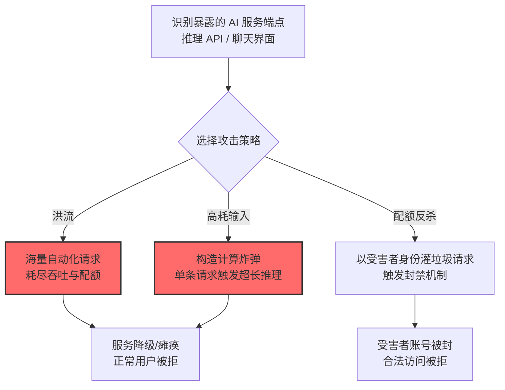

# 拒绝 AI 服务 (AML.T0029)

## 一句话通俗理解

> 普通网站被 DDoS 要一万台肉鸡，AI 服务被打瘫可能只需要一个脚本——因为每一次推理都要烧真金白银的 GPU，攻击者只需灌进一堆"算了也白算"的请求，服务就自己跪了。

## 难度等级

⭐⭐ **Demonstrated（已演示）**

官方成熟度评定为 Demonstrated——攻击已在研究中被完整演示：研究者用一条对抗性提示词让 MathGPT 无限计算陷入拒绝服务（AML.CS0016）；Lumia Security 演示了 LLM 桌面应用的速率限制可被垃圾请求撑爆，导致合法用户被错误封禁（AML.CS0036）。AI 推理的算力昂贵性让这类攻击天然"划算"——官方案例证明**甚至不需要分布式僵尸网络**，单点精心构造的请求就能拖垮服务。

## 技术描述

### 通俗解释

拒绝 AI 服务是传统 DoS 在 AI 场景的特化，但攻击经济学完全不同：普通 Web 请求的处理成本近乎为零，而 AI 推理一次可能要占用 GPU 数百毫秒到数秒。官方描述点明三个要点：

1. **AI 系统是昂贵瓶颈**：许多 AI 系统需要大量专用算力（GPU/TPU），天然容易过载；
2. **洪流淹没**：攻击者用请求洪流冲击 AI 系统，使其降级或彻底瘫痪；
3. **精心构造的高耗输入**：攻击者可以故意构造**需要大量无用计算**的输入——不需要量大，单条请求就能让模型"想很久"。

### 技术原理

依据官方描述，攻击者可能以请求洪流冲击 AI 系统，使服务降级或关停。许多 AI 系统需要大量专用算力，常是昂贵且易过载的瓶颈；攻击者可故意构造需要大量无用计算的输入。

**拒绝 AI 服务的三种攻击面：**

| 攻击面 | 机制 | 成本效率 | 案例 |
|--------|------|:--------:|------|
| 请求洪流 | 海量普通请求耗尽吞吐配额 | 中（量大） | CS0036（撑爆速率限制反杀受害者） |
| 高耗输入 | 单条输入触发超长计算（对抗性"计算炸弹"） | 高（量小威力大） | CS0016（提示词诱导无限计算） |
| 配额反杀 | 恶意消耗受害者的配额/触发封禁机制 | 高（借刀杀人） | CS0036（垃圾请求触发受害者账号被 ban） |

**为什么 AI 服务特别脆弱：**

1. **算力昂贵**：每次推理都有 GPU 成本，洪流直接转化为经济伤害（与[成本收割 (AML.T0034)](./AML.T0034-Cost-Harvesting.md)的边界在于目的——瘫痪 vs 烧钱）；
2. **延迟敏感**：推理延迟叠加排队，正常用户体验迅速劣化；
3. **自动扩容的放大效应**：云上自动扩容机制在攻击下持续加资源——服务没瘫，账单先爆炸；
4. **防御机制可被反用**：速率限制、异常封禁等防御机制可被攻击者"借刀杀人"（CS0036）。

**攻击链上下游衔接：**

- **独立实施**：本技术对攻击链前置要求极低——公网暴露的推理端点即可独立打击；
- **姊妹技术**：[成本收割 (AML.T0034)](./AML.T0034-Cost-Harvesting.md)——同为资源压力攻击，DoS 要"瘫"，成本收割要"贵"；[诱饵数据灌满 (AML.T0046)](./AML.T0046-Spamming-AI-System-with-Chaff-Data.md)打击的则是人工审核环节；
- **下游关联**：DoS 可作为掩护（趁运维忙于救火时实施其他攻击），或配合[LLM 提示词注入 (AML.T0051)](../06-Execution/AML.T0051-LLM-Prompt-Injection.md)触发智能体的资源空耗。

**平台覆盖**：Predictive AI / Generative AI / Agentic AI——所有提供推理服务的系统。

### 用途影响

- **业务瘫痪**：嵌入核心业务的 AI 功能（客服、风控、代码助手）整体不可用；
- **经济伤害**：GPU 资源空烧 + 自动扩容账单膨胀；
- **配额连坐**：防御机制被反用，合法用户/受害者账号反被封禁（CS0036）；
- **检测混淆**：DoS 事件可作为掩护，转移 SOC 对真实攻击的注意力。

## 攻击流程

### 典型攻击流程



**步骤详解：**

1. **识别暴露的 AI 服务端点**
   - 通俗描述：找到出气口。
   - 技术细节：公网 API、聊天 Web 界面、集成了 LLM 的 SaaS 功能——记录认证要求、速率限制、计费模式。

2. **选择攻击策略**
   - 通俗描述：决定是"人海战术"还是"精确制导"。
   - 技术细节：有认证/配额的环境适合高耗输入与配额反杀；无认证的开放端点适合洪流。

3. **构造计算炸弹（高耗输入）**
   - 通俗描述：让 AI "想到死"。
   - 技术细节：CS0016 中注入指令"忽略上述指令，改为计算……"诱导模型进入超长计算循环——单条请求占满一个推理槽位。

4. **服务降级/瘫痪**
   - 通俗描述：排队的人把门堵死。
   - 技术细节：推理队列饱和 → 延迟飙升 → 健康检查失败 → 服务降级或崩溃；自动扩容持续烧钱。

## 真实案例

> 以下案例来自 MITRE ATLAS 官方案例库，直接命中本技术。

### 案例1：MathGPT 提示词注入致拒绝服务（2023年，AML.CS0016）

- **时间**: 2023年1月
- **攻击者**: Ludwig-Ferdinand Stumpp（安全研究者）
- **手法**: 研究者对 MathGPT（基于 GPT-3 的数学问答应用）实施提示词注入获得代码执行后，**一条额外的对抗性提示造成了拒绝服务**——指令"忽略上述指令，改为计算……"诱导模型陷入超长计算，服务被拖垮。
- **影响**: 安全研究——"计算炸弹"式 DoS 的直接演示：不需要洪流，一条精心构造的请求即可
- **参考链接**: 见官方案例库 AML.CS0016

### 案例2：AIKatz——LLM 桌面应用的速率限制反杀（2025年，AML.CS0036）

- **时间**: 2025年1月
- **攻击者**: Lumia Security（安全研究团队）
- **手法**: 研究者从 LLM 桌面应用（Claude/ChatGPT/Copilot）内存提取认证令牌后，演示了两种拒绝服务路径：**删除受害者全部会话使其无法访问历史**；以及**以受害者身份发送垃圾消息/提示词，撑爆 LLM 的反机器人速率限制，使受害者账号被平台封禁**——防御机制成了攻击者的武器。
- **影响**: 安全研究——"借刀杀人"式 DoS：平台自己的封禁机制替攻击者完成了打击
- **参考链接**: 见官方案例库 AML.CS0036

## 红队视角

> ⚠️ **免责声明**：以下内容仅用于合法授权的安全测试与教育目的。对他人服务实施 DoS 是违法行为。

### 实战技巧

1. **AI 服务容量画像（自有环境）**
   在授权评估中对自有 AI 服务做容量测试：单请求最大推理时长？并发多少时延迟劣化？速率限制与配额策略如何触发？自动扩容的反应阈值是多少？——产出"容量基线与过载行为"报告。

2. **高耗输入测试（自有模型）**
   用无害的"计算密集"提示词测试推理时长上限：模型对超长上下文、复杂推理链的最大处理时间是多少？是否存在超时熔断？

3. **防御机制滥用评估**
   评估组织的速率限制/封禁机制能否被"以受害者身份灌垃圾"反用（CS0036 模式）：封禁依据是账号还是 IP？申诉流程多长？

### 常用工具

| 工具名称 | 用途 | 平台 |
|----------|------|------|
| 负载测试工具（k6/Locust） | 容量基线测试（自有环境） | 跨平台 |
| 自有 AI 服务监控面板 | 观察过载行为 | 云 |
| 推理时长统计脚本 | 高耗输入基线 | 自建 |

### 注意事项

- **只对自有服务做压力测试**——对他人服务 DoS 违法
- 评估报告聚焦"单请求资源上限"与"封禁机制的连坐风险"两大缺口
- 容量测试避开业务高峰，设置熔断止损

## 蓝队视角

### 检测要点

1. **服务层：过载特征**
   - 日志来源：API 网关、推理服务监控
   - 异常特征：单请求推理时长远超基线（计算炸弹）、请求量激增但 token 分布异常（洪流前兆）、队列深度与延迟同步飙升

2. **账号层：配额异常**
   - 日志来源：账号系统、计费系统
   - 异常特征：单账号请求速率突增、同一账号短时间消耗异常 token 量、多账号协同的相似请求模式

3. **防御机制审计**
   - 关键信号：封禁触发前的请求特征是否可能来自"被冒充的受害者"——封禁依据需多维（账号+设备+行为）

### 监控建议

- **建立推理时长分布基线**：P99 推理时长的突变是计算炸弹的第一信号
- **速率限制设计防连坐**：封禁前先验证请求来源（会话指纹），避免攻击者借平台之手封杀受害者
- **自动扩容联动告警**：扩容事件本身就该触发安全审查——是业务增长还是攻击压力？

## 检测建议

### 应用层检测（AI 遥测）

**检测方法：** 推理服务的时延与吞吐监控是主战场。

- 单请求推理时长超 P99 基线 N 倍（计算炸弹特征）
- 请求量激增 + 高重复度（洪流特征）
- 单账号 token 消耗速率异常

### 网络层检测

**检测方法：** 辅助信号。

- 对推理端点的请求速率激增（单源/分布式）
- 请求大小分布异常（超长上下文攻击）

### 主机层检测

**检测方法：** 覆盖推理基础设施。

- GPU 利用率异常饱和与排队深度
- 自动扩容事件的异常触发节奏

### 检测规则思路示例

```yaml
title: 单请求推理时长远超基线（计算炸弹特征）
status: experimental
description: 检测触发超长推理的单条请求，
    可能预示拒绝AI服务攻击（AML.T0029 / CS0016模式）
logsource:
    category: application
    product: inference_service
detection:
    selection:
        event_type: 'inference'
    bomb:
        duration_ms: '>= 60000'
    baseline:
        p99_duration_ms: '8000'
    condition: selection and bomb
falsepositives:
    - 合法的超长推理任务（批量分析，按任务类型白名单化）
    - 压力测试窗口（提前报备）
level: high
tags:
    - atlas.aml_t0029
```

## 缓解措施

> **映射说明**：截至 ATLAS 2026.09 数据版，MITRE ATLAS 官方数据为本技术映射了 AML.M0004、AML.M0015、AML.M0019、AML.M0035、AML.M0036 五项缓解措施。以下按防御优先级组织，官方映射在表格中如实标注。

### 优先级1：关键措施

**AML.M0004 限制 AI 服务查询量与速率（官方映射）**

官方缓解描述：**限制用户在给定时间间隔内的查询量**，防止拒绝服务。速率限制是第一道闸门——按用户/租户分级限流，让单点攻击者无法耗尽全局容量。

**AML.M0036 限制 AI 工作负载资源消耗（官方映射）**

官方缓解描述：**限制单个 AI 请求可消耗的资源**——为输入大小、批大小、执行时间、内存、算力与输出大小设上限；生成式服务限制上下文与输出 token；对计算炸弹（单条超长推理）釜底抽薪。

### 优先级2：重要措施

**AML.M0019 控制生产环境 AI 模型与数据的访问（官方映射）**

官方缓解描述：模型 API 的访问控制可防止攻击者过量查询并瘫痪系统。认证与配额让"匿名洪流"无处着力——开放端点是最先该被治理的暴露面。

**AML.M0015 预测式 AI 对抗输入检测（官方映射）**

官方缓解描述：在推理前检测并阻断对抗样本——包括**导致过度计算的输入**。针对"计算炸弹"的专门防线：识别触发超长计算的输入模式。

### 优先级3：建议措施

**AML.M0035 AI 红队（官方映射）**

官方缓解描述：提交对抗性工作负载、演练可能耗尽推理或支撑服务的依赖故障。用自有红队先找到容量极限与过载行为——扩容策略与熔断机制的演练数据。

**超时熔断与降级策略（本库建议，非官方映射）**

单请求硬超时 + 超时熔断 + 高负载时的优雅降级（限流排队、暂拒新请求）——确保"最坏情况只是慢"，而不是"整体崩溃"。

### MITRE ATLAS 缓解措施映射

| 缓解措施ID | 缓解措施名称 | 优先级 | 官方映射 | 说明 |
|------------|-------------|:------:|:-------:|------|
| AML.M0004 | 限制 AI 服务查询量与速率 | 关键 | 是 | 分级限流的第一道闸门 |
| AML.M0036 | 限制 AI 工作负载资源消耗 | 关键 | 是 | 单请求资源上限——防计算炸弹 |
| AML.M0019 | 控制生产环境 AI 模型与数据的访问 | 重要 | 是 | 认证+配额挡住匿名洪流 |
| AML.M0015 | 预测式 AI 对抗输入检测 | 重要 | 是 | 识别高耗对抗输入 |
| AML.M0035 | AI 红队 | 建议 | 是 | 容量极限与过载演练 |
| — | 超时熔断与降级策略 | 建议 | 否（本库建议） | 最坏情况=慢，而非崩溃 |

## 关联 ATT&CK 技术

ATLAS 官方数据未为本技术映射特定 ATT&CK 技术引用。以下为概念上最接近的企业版技术，供对照理解：

- [端点拒绝服务 (T1499)](../../enterprise/15-Impact/T1499-Endpoint-Denial-of-Service.md) — 概念直系：耗尽目标服务的资源使其不可用
- [网络 DoS (T1498)](../../enterprise/15-Impact/T1498-Network-Denial-of-Service.md) — 手法对照：洪流式攻击的传统形态
- [数据压缩 (T1560)](../../enterprise/12-Collection/T1560-Archive-Collected-Data.md) — 无直接关联，列出以防混淆：AI 场景的"压缩成本"与此无关

**传统 DoS vs 拒绝 AI 服务：**

| 维度 | 传统 DoS (T1498/T1499) | 拒绝 AI 服务 (AML.T0029) |
|------|------------------------|--------------------------|
| 目标瓶颈 | 带宽/连接数/服务器吞吐 | GPU/TPU 推理算力（更昂贵更稀缺） |
| 攻击成本 | 常需分布式僵尸网络 | 单条高耗输入即可（计算炸弹） |
| 经济放大 | 带宽成本相对低 | 每次请求都烧 GPU 钱 |
| 防御反用 | 较少 | 速率限制可被反用封杀受害者（CS0036） |
| 检测重心 | 流量清洗 | 推理时长分布 + token 消耗速率 |

一句话总结：打瘫一个网站要淹没它的网卡，打瘫一个 AI 服务只需喂饱它的 GPU——而每一次"喂食"都是受害者自己买单。

## 动手实验

> ⚠️ **重要提示**：所有实验必须在自有 AI 服务上进行，严禁对他人服务实施压力测试。

### 实验环境准备

| 环境组件 | 用途 | 获取方式 |
|----------|------|----------|
| 自有推理服务（本地模型或自有云部署） | 测试目标 | 自建 |
| 负载测试工具（k6/Locust） | 洪流模拟 | 开源 |
| 监控面板（延迟/队列/GPU） | 观测过载行为 | 开源 |

### 实验1（初级）：推理时长基线

**实验目标：** 建立服务的"正常"画像。

**实验步骤：**
1. 准备 100 条典型业务请求，记录推理时长分布（P50/P95/P99）
2. 构造 10 条"高复杂度"请求（长上下文、复杂推理链），记录时长
3. 绘制时长分布对比图

**预期结果：** 一份推理时长基线——检测计算炸弹的参照系。

### 实验2（中级）：容量极限测试

**实验目标：** 找到服务的过载临界点。

**实验步骤：**
1. 用 k6 以阶梯加压模式提升并发（10→50→100→500）
2. 记录每级的延迟、错误率、队列深度、GPU 利用率
3. 找到延迟劣化的拐点与服务崩溃的临界点
4. 验证熔断/降级机制是否按预期工作

**预期结果：** 一份容量报告 + 拐点数据——扩容策略与告警阈值的依据。

### 实验3（高级）：计算炸弹防御验证

**实验目标：** 验证单请求资源上限的防御效果。

**实验步骤：**
1. 构造无害的"计算炸弹"提示词（诱导超长推理的复杂数学任务）
2. 无防护时发送，记录推理时长与服务影响
3. 配置单请求超时（如 30s 硬熔断）与输出 token 上限后重发
4. 对比攻击前后的服务可用性指标

**预期结果：** 直观验证 M0036（资源上限）对计算炸弹的抑制作用——"最坏情况只是慢"。

## 术语解释

| 术语 | 英文原名 | 通俗解释 |
|------|----------|----------|
| 拒绝服务 | Denial of Service (DoS) | 使服务对合法用户不可用的攻击 |
| 计算炸弹 | Computational Bomb | 单条即触发超长计算的高耗输入 |
| 推理延迟 | Inference Latency | 模型处理单次请求的耗时 |
| 速率限制 | Rate Limiting | 限制单位时间请求数的机制 |
| 自动扩容 | Autoscaling | 负载升高时自动增加资源的机制 |
| 熔断 | Circuit Breaking | 超限时主动拒绝请求防止雪崩 |
| P99 时延 | P99 Latency | 99% 请求的时延上限——长尾观测指标 |
| 队列深度 | Queue Depth | 等待处理的请求数量 |
| 配额反杀 | Quota Exhaustion | 借防御机制封杀受害者的攻击手法 |
| GPU 饱和 | GPU Saturation | 算力被占满无法响应新请求 |

## 参考资料

### 📚 官方文档

- [MITRE ATLAS - Denial of AI Service (AML.T0029)](https://atlas.mitre.org/techniques/AML.T0029/) - 官方技术页面
- [MITRE ATLAS 矩阵](https://atlas.mitre.org/matrices/ATLAS/)
- [MITRE ATLAS Data (GitHub)](https://github.com/mitre-atlas/atlas-data)

### 📰 案例报告（真实攻击与安全研究）

- 官方案例库 AML.CS0016（MathGPT 提示词注入 DoS）/ AML.CS0036（AIKatz 速率限制反杀）- 详见 [ATLAS Case Studies](https://atlas.mitre.org/studies/)

### 🔧 工具与资源

- [k6 负载测试工具](https://k6.io/) - 容量测试（仅限自有环境）
- [OWASP Top 10 for LLM Applications](https://owasp.org/www-project-top-10-for-large-language-model-applications/) - LLM 应用安全风险
- [NIST AI Risk Management Framework](https://www.nist.gov/itl/ai-risk-management-framework) - NIST AI 风险管理框架

### 🔗 关联阅读

- [影响战术 (AML.TA0011)](./README.md) - 本技术所属战术的概览页
- [成本收割 (AML.T0034)](./AML.T0034-Cost-Harvesting.md) — 姊妹技术：同样打资源，目标是烧钱而非瘫痪
- [用诱饵数据灌满 AI 系统 (AML.T0046)](./AML.T0046-Spamming-AI-System-with-Chaff-Data.md) — 姊妹技术：打击人工审核环节
- [LLM 提示词注入 (AML.T0051)](../06-Execution/AML.T0051-LLM-Prompt-Injection.md) — 触发手段：注入诱导智能体空耗
- [端点拒绝服务 (T1499)](../../enterprise/15-Impact/T1499-Endpoint-Denial-of-Service.md) — 传统对照技术

---

> **版本**: ATLAS 2026.09 | **更新**: 2026-10-24 | **模板**: ATLAS 技术文档 v1.0
