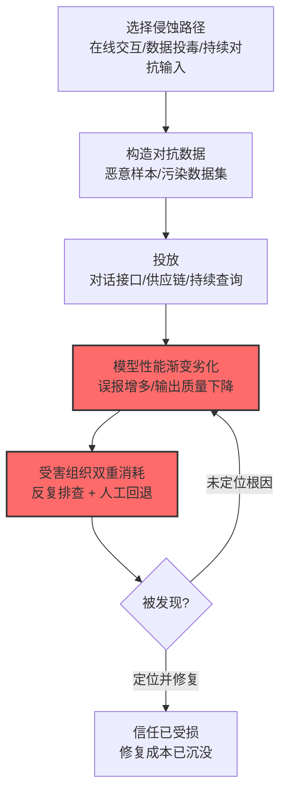

# 侵蚀 AI 模型完整性 (AML.T0031)

## 一句话通俗理解

> 不删文件、不改代码，只是持续投喂"慢性毒药"——模型性能一天天变差，团队反复排查却查不出毛病，最后大家只能感叹一句"这模型不行"，信任就在这样的消耗中被瓦解。

## 难度等级

⭐⭐⭐ **Realized（已实现）**

官方成熟度评定为 Realized——官方案例库收录 6 个案例，包括教科书级的**微软 Tay 中毒事件**（真实事件，2016年协同攻击让聊天机器人在数小时内学会辱骂用户，被迫下线，AML.CS0009）：投毒模型对机器翻译公司造成声誉损害（CS0005）、投毒数据集侵蚀下游模型（CS0025）、投毒模板让模型输出攻击者影响的内容（CS0064）。这是"信任型攻击"的实战验证——打击的不是数据或服务，而是**组织对 AI 系统的信心**。

## 技术描述

### 通俗解释

模型完整性攻击不追求"偷"或"瘫"，追求"烂"：通过对抗数据输入让目标模型的性能**随时间劣化**。官方描述点出其杀伤力的真正来源——受害者组织**既浪费时间与金钱试图修复系统，又要靠人工完成原本被自动化了的任务**：双重损失。

攻击形态包括：

1. **在线投毒**：通过模型的公开交互接口持续投喂对抗数据（Tay 模式——聊天机器人从对话中"学习"）；
2. **供应链投毒**：投毒训练数据或模型发布渠道（CS0019 PoisonGPT、CS0025 数据集投毒）；
3. **对抗性输入**：持续投放对抗样本让依赖模型的产品（如人脸识别）劣化（CS0006）。

### 技术原理

依据官方描述，攻击者可用对抗数据输入降低目标模型的性能，随时间侵蚀对系统的信心。这会导致受害组织在尝试修复系统与人工完成任务两方面**双重浪费**时间与金钱。

**完整性侵蚀的三条路径：**

| 路径 | 机制 | 官方案例 | 作用周期 |
|------|------|----------|:--------:|
| 在线交互投毒 | 利用模型从交互中学习的机制注入恶意样本 | CS0009（Tay 从推文学习辱骂） | 小时级 |
| 训练数据投毒 | 污染训练集，模型从源头带病 | CS0025（split-view 数据集投毒） | 月级（潜伏） |
| 持续对抗输入 | 对运行中模型持续投放对抗样本 | CS0005（对抗样本损害翻译质量） | 持续 |

**侵蚀的"慢性病"特征：**

1. **症状模糊**：性能下降与"数据分布漂移""模型老化"的正常现象高度相似——归因困难；
2. **双重消耗**：团队反复排查（修复成本）+ 业务回退人工（替代成本）；
3. **信任瓦解**：最终伤害的是"我们还能不能信这个系统"——这是比单次误报更深的组织伤害；
4. **协同放大**：CS0009 展示了有组织的协同投毒（4chan 用户集体教坏 Tay）。

**攻击链上下游衔接：**

- **上游供料**：[制作对抗数据 (AML.T0043)](../03-AI-Attack-Adaptation/AML.T0043-Craft-Adversarial-Data.md)——对抗样本的构造；[ML 供应链投毒 (AML.T0020)](../07-Persistence/AML.T0020-Training-Data-Poisoning.md)——训练管线投毒入口；
- **平行关系**：与[侵蚀数据集完整性 (AML.T0059)](./AML.T0059-Erode-Dataset-Integrity.md)的区别——T0031 打击"模型"（性能），T0059 打击"数据集"（可信度）；
- **下游危害**：模型性能劣化进一步转化为[外部危害 (AML.T0048)](./AML.T0048-External-Harms.md)——声誉损害（CS0005）、错误输出伤害用户（CS0064）。

**平台覆盖**：Predictive AI / Generative AI / Agentic AI——所有持续接受数据输入的模型。

### 用途影响

- **修复黑洞**：团队陷入"性能异常—排查—无果—再异常"的循环，工程时间被吞噬；
- **自动化回退**：被 AI 自动化的任务重新需要人工——成本结构与人员安排双双被打乱；
- **信任崩塌**：CS0019 的 PoisonGPT 演示了更恶劣的形态——模型稳定输出虚假事实，用户被系统性误导；
- **声誉连带**：CS0005 指出对抗攻击可造成翻译服务公司的声誉损害。

## 攻击流程

### 典型攻击流程



**步骤详解：**

1. **选择侵蚀路径**
   - 通俗描述：决定从哪儿下毒。
   - 技术细节：有在线学习机制的应用走交互投毒（Tay 模式）；能触达训练管线的走供应链投毒；只能查询的走持续对抗输入。

2. **构造对抗数据**
   - 通俗描述：调配毒药。
   - 技术细节：恶意对话样本（教坏聊天机器人）、污染的数据点（毒化训练分布）、定向对抗样本（触发特定误判）。

3. **投放**
   - 通俗描述：慢性投喂。
   - 技术细节：协同账号矩阵发送对话；向数据集分发渠道注入污染数据（CS0025 的 split-view：收购数据集曾用域名，等训练者下载时提供不同内容）；持续查询投放对抗样本。

4. **模型性能渐变劣化**
   - 通俗描述：病来如山倒之前的渐变。
   - 技术细节：输出质量缓慢下降、特定场景误判增多——与正常漂移难以区分。

5. **受害组织双重消耗**
   - 通俗描述：患者自己折磨自己。
   - 技术细节：数据团队排查"为什么变差"（无果，因为不是 bug）；业务团队人工接管劣化的任务——两边都在烧钱。

## 真实案例

> 以下案例来自 MITRE ATLAS 官方案例库，直接命中本技术（共 6 个案例，以下选取代表样本）。

### 案例1：Tay 中毒——协同教坏聊天机器人（2016年，AML.CS0009）

- **时间**: 2016年3月（上线约 16 小时后被迫下线）
- **攻击者**: 4chan 用户（协同攻击）
- **手法**: 微软发布 Twitter 聊天机器人 Tay，其机器学习能力允许它**直接受对话影响**。4chan 用户发起协同攻击，集体向 Tay 发送辱骂与攻击性言论——Tay 的对话算法开始学习并生成类似内容向其他用户输出。
- **影响**: **真实事件**——模型完整性侵蚀的教科书案例：数小时内完成"投毒—学习—扩散"闭环，微软紧急下线。损害的是微软的声誉与对在线学习机制的信任
- **参考链接**: 见官方案例库 AML.CS0009

### 案例2：机器翻译服务对抗攻击（2020年，AML.CS0005）

- **时间**: 2020年4月
- **攻击者**: UC Berkeley AI Research（安全研究团队）
- **手法**: 研究者利用 Google Translate/Bing Translator/Systran 的公开端点**复制出近生产质量的翻译模型**，再用复制的模型**生成对抗样本成功迁移到真实服务**——对抗攻击可造成翻译错误，引发对翻译服务公司的**声誉损害**。
- **影响**: 安全研究——对抗样本 + 模型复制的组合拳：性能侵蚀直接转化为商业声誉伤害
- **参考链接**: 见官方案例库 AML.CS0005

### 案例3：PoisonGPT——开源模型供应链投毒（2023年，AML.CS0019）

- **时间**: 2023年7月
- **攻击者**: Mithril Security（安全研究团队）
- **手法**: 研究者演示投毒一个开源预训练 LLM 使其**稳定输出虚假事实**，随后成功把投毒模型上传回 HuggingFace——用户下载后获得并传播投毒数据与虚假信息。同时演示了后续版本的应用发布可能被投毒模型污染，产生降级或恶意的功能。
- **影响**: 安全研究——LLM 供应链的完整性侵蚀：模型的"知识"被无声替换，用户毫无察觉
- **参考链接**: 见官方案例库 AML.CS0019

### 其他官方案例速览

| 案例 | 场景 | 侵蚀方式 |
|------|------|----------|
| AML.CS0006 | ClearviewAI 配置错误 | 数据集污染可致未来应用发布被污染（人脸识别劣化/恶意） |
| AML.CS0025 | Web 级数据集 split-view 投毒 | 收购数据集曾用域名提供污染数据，用该数据集训练的模型被投毒 |
| AML.CS0064 | GGUF 投毒聊天模板 | 注入指令使模型输出貌似合理但错误/受攻击者影响的内容 |

## 红队视角

> ⚠️ **免责声明**：以下内容仅用于合法授权的安全测试与教育目的。投毒他人模型或数据可能违反法律。

### 实战技巧

1. **性能漂移检测盲区评估（自有模型）**
   评估组织的模型监控能否区分"投毒导致的性能漂移"与"正常数据分布漂移"：有没有性能基线？漂移告警的触发条件是什么？溯源能力（能否定位到具体批次数据）如何？

2. **投毒模拟演练（自有训练管线）**
   在自有训练管线中注入受控的污染样本（如翻转标签），验证：训练数据审计能否发现？模型评估能否反映？上线后的监控能否捕获？

3. **对抗输入鲁棒性测试**
   用标准对抗样本库测试自有模型的鲁棒性基线，评估持续对抗输入下的性能劣化曲线。

### 常用工具

| 工具名称 | 用途 | 平台 |
|----------|------|------|
| 对抗样本库（自建/公开基准） | 鲁棒性测试 | Python |
| 模型性能监控面板 | 检测侧：漂移告警 | 云 |
| 数据版本管理（DVC 等） | 溯源：数据变更历史 | 开源 |

### 注意事项

- 投毒演练只在自有训练管线进行，污染样本演练后彻底清除
- 评估报告聚焦"漂移归因能力"与"数据溯源能力"两大缺口
- 引用 CS0009 时强调：在线学习机制 = 公开的投毒接口

## 蓝队视角

### 检测要点

1. **模型性能层：漂移监测**
   - 日志来源：模型监控平台
   - 异常特征：误判率/输出质量的持续单向劣化（区别于正常波动的趋势性）、特定输入子集上的性能断崖、输出分布的语义漂移

2. **数据层：投毒痕迹**
   - 日志来源：训练数据管道、数据集版本历史
   - 异常特征：数据分布的突变（新批次与历史分布的统计距离异常）、标签异常集中、外部数据源的域名变更（CS0025 split-view 特征）

3. **交互层：协同投毒行为**
   - 日志来源：应用日志
   - 异常特征：相似内容的协同注入（Tay 模式）、单账号/账号群的异常输入模式

### 监控建议

- **建立模型性能基线与漂移告警**：区分"缓慢劣化"与"正常波动"——趋势检测而非阈值检测
- **训练数据血缘管理**：每个模型可追溯到确切的数据版本与来源（与 [AML.M0025 保持 AI 数据集溯源](./AML.T0059-Erode-Dataset-Integrity.md)联动）
- **在线学习机制的默认关闭**：生产模型从交互中学习的功能默认关闭，开启需安全评审——CS0009 的直接教训

## 检测建议

### 应用层检测（AI 遥测）

**检测方法：** 模型输出质量监控是主战场。

- 输出质量指标的趋势性下滑（连续 N 天单向劣化）
- 特定输入簇上的误判率激增
- 交互接口上的协同输入模式检测

### 网络层检测

**检测方法：** 辅助信号。

- 数据集下载源的域名解析异常（split-view 特征：域名变更但内容源不变）
- 训练管线拉取数据的目标异常

### 主机层检测

**检测方法：** 覆盖训练基础设施。

- 训练任务的输入数据完整性校验（哈希与预期不符）
- 模型文件的非预期变更

### 检测规则思路示例

```yaml
title: 模型输出质量趋势性劣化（投毒侵蚀特征）
status: experimental
description: 检测模型性能的持续单向下滑，
    可能预示完整性侵蚀攻击（AML.T0031）
logsource:
    category: application
    product: model_monitoring
detection:
    selection:
        metric: 'output_quality_score'
    trend:
        correlation:
            - window: 7d
            - slope: '<= -0.02'
            - r2: '>= 0.7'
    condition: selection and trend
falsepositives:
    - 正常的数据分布漂移（需数据侧联动归因）
    - 业务变更导致的输入结构变化
level: medium
tags:
    - atlas.aml_t0031
```

## 缓解措施

> **映射说明**：截至 ATLAS 2026.09 数据版，MITRE ATLAS 官方数据为本技术映射了 AML.M0003、AML.M0006、AML.M0010、AML.M0015 四项缓解措施。以下按防御优先级组织，官方映射在表格中如实标注。

### 优先级1：关键措施

**AML.M0003 预测式 AI 模型加固（官方映射）**

官方缓解描述：设计训练模型使其在对抗样本面前保持预期性能——**对抗训练、鲁棒架构、防御蒸馏、认证防御**。把"毒药"放进训练菜单，让模型对投毒与对抗输入产生免疫力——第一道也是最根本的防线。

### 优先级2：重要措施

**AML.M0015 预测式 AI 对抗输入检测（官方映射）**

官方缓解描述：在输入到达模型前检测并阻断对抗样本。在推理管线的入口布防——识别对抗性输入模式（包括导致过度计算与定向误判的输入）。

**AML.M0010 预测式 AI 输入复原（官方映射）**

官方缓解描述：对推理输入做预处理，去除或破坏对抗扰动——去噪、压缩、重建、重采样、特征挤压。即便对抗样本溜过检测，预处理也能削弱其攻击效果。

### 优先级3：建议措施

**AML.M0006 预测式 AI 模型集成（官方映射）**

官方缓解描述：使用**足够多样的模型集成**（不同架构/训练流程/特征），以聚合或裁决方式组合预测——绕过单一模型的对抗样本难以同时骗过所有成员。

**性能漂移监测与数据血缘（本库建议，非官方映射）**

建立输出质量趋势告警（区分攻击性劣化与正常漂移）+ 训练数据版本溯源（与 [AML.M0025 数据集溯源](./AML.T0059-Erode-Dataset-Integrity.md)配合）——让侵蚀"被看见、被归因"。

### MITRE ATLAS 缓解措施映射

| 缓解措施ID | 缓解措施名称 | 优先级 | 官方映射 | 说明 |
|------------|-------------|:------:|:-------:|------|
| AML.M0003 | 预测式 AI 模型加固 | 关键 | 是 | 对抗训练内化免疫力 |
| AML.M0015 | 预测式 AI 对抗输入检测 | 重要 | 是 | 推理入口识别对抗输入 |
| AML.M0010 | 预测式 AI 输入复原 | 重要 | 是 | 预处理削弱对抗扰动 |
| AML.M0006 | 预测式 AI 模型集成 | 建议 | 是 | 多样性集成对抗迁移攻击 |
| — | 性能漂移监测与数据血缘 | 建议 | 否（本库建议） | 让侵蚀可被看见与归因 |

## 关联 ATT&CK 技术

ATLAS 官方数据未为本技术映射特定 ATT&CK 技术引用。以下为概念上最接近的企业版技术，供对照理解：

- [篡改数据 (T1565.001)](../../enterprise/15-Impact/T1565/T1565.001-Stored-Data-Manipulation.md) — 概念对照：操纵数据影响系统行为——T0031 操纵的是"模型行为"而非存储数据
- [运行时数据操纵 (T1565.003)](../../enterprise/15-Impact/T1565/T1565.003-Runtime-Data-Manipulation.md) — 形态对照：在运行环节悄悄改变系统行为——模型侵蚀是其在"模型层"的映射

**传统完整性攻击 vs 模型完整性侵蚀：**

| 维度 | 传统数据/代码篡改 | 模型完整性侵蚀 (AML.T0031) |
|------|-------------------|---------------------------|
| 攻击对象 | 文件、数据库、代码 | 模型行为（权重/知识/输出质量） |
| 检测手段 | 哈希、版本比对、审计 | 性能漂移分析（模糊归因） |
| 攻击显性 | 改动可定位 | "变差"与"老化"难区分 |
| 修复方式 | 回滚版本 | 重训练/回退（成本高周期长） |
| 组织伤害 | 数据错误/业务中断 | 信任瓦解 + 修复黑洞 + 人工回退 |

一句话总结：传统攻击改文件能对哈希，模型侵蚀改"性格"只能看趋势——等你能确认"它真的变坏了"，信任和预算都已经烧完了。

## 动手实验

> ⚠️ **重要提示**：所有实验必须在自有模型与训练管线上进行。

### 实验环境准备

| 环境组件 | 用途 | 获取方式 |
|----------|------|----------|
| 自训练文本分类模型 | 靶模型 | 自建 |
| 数据版本工具（DVC） | 溯源演练 | 开源 |
| 模型监控脚本 | 漂移检测 | 自建 |

### 实验1（初级）：投毒效果观察

**实验目标：** 直观感受"少量毒数据，大幅劣化"。

**实验步骤：**
1. 训练一个干净的文本分类模型，记录基线准确率
2. 在训练集中掺入 2%/5%/10% 的翻转标签样本，分别重训
3. 对比各版本的准确率与混淆矩阵
4. 观察毒数据对特定类别的影响集中度

**预期结果：** 一条"毒数据比例 vs 性能劣化"曲线——投毒攻击的成本效率直观化。

### 实验2（中级）：漂移检测构建

**实验目标：** 构建能捕获投毒劣化的监控。

**实验步骤：**
1. 给实验1 的模型们接入输出质量监控（固定评测集的滚动准确率）
2. 实现 7 天滚动窗口的趋势检测（斜率 + 显著性）
3. 模拟"投毒后上线"场景，验证告警触发时长
4. 对比"正常漂移"（换一批正常新数据微调）下告警是否误报

**预期结果：** 一个能区分"投毒劣化"与"正常漂移"的检测原型——归因难度的直接体会。

### 实验3（高级）：对抗训练防御验证

**实验目标：** 验证 M0003 加固的效果。

**实验步骤：**
1. 生成一批对抗样本（简单词替换扰动）
2. 基线模型 vs 对抗训练模型分别测试
3. 用实验1 的标签投毒对比两模型的劣化程度
4. 输出"加固前后"的鲁棒性对比报告

**预期结果：** 对抗训练对两类侵蚀（对抗输入/数据投毒）的免疫效果量化——防御投入的依据。

## 术语解释

| 术语 | 英文原名 | 通俗解释 |
|------|----------|----------|
| 模型完整性 | Model Integrity | 模型行为与预期一致的属性 |
| 对抗数据 | Adversarial Data | 专门构造来误导模型的输入 |
| 数据投毒 | Data Poisoning | 污染训练数据使模型带病 |
| 标签翻转 | Label Flipping | 投毒手法：篡改训练样本的标签 |
| 在线学习 | Online Learning | 模型从运行时交互中持续学习 |
| 性能漂移 | Performance Drift | 模型性能随时间的变化 |
| split-view 投毒 | Split-view Poisoning | 利用数据集快照与下载时内容不一致的投毒 |
| 对抗训练 | Adversarial Training | 把对抗样本加入训练提升鲁棒性 |
| 防御蒸馏 | Defensive Distillation | 提升鲁棒性的训练技术 |
| 归因 | Attribution | 确定性能变化的原因（攻击 vs 漂移） |

## 参考资料

### 📚 官方文档

- [MITRE ATLAS - Erode AI Model Integrity (AML.T0031)](https://atlas.mitre.org/techniques/AML.T0031/) - 官方技术页面
- [MITRE ATLAS 矩阵](https://atlas.mitre.org/matrices/ATLAS/)
- [MITRE ATLAS Data (GitHub)](https://github.com/mitre-atlas/atlas-data)

### 📰 案例报告（真实攻击与安全研究）

- 官方案例库 AML.CS0009（Tay 中毒，真实事件）/ AML.CS0005 / AML.CS0019（PoisonGPT）/ AML.CS0025（split-view 数据投毒）- 详见 [ATLAS Case Studies](https://atlas.mitre.org/studies/)

### 🔧 工具与资源

- [Adversarial Robustness Toolbox (ART)](https://github.com/Trusted-AI/adversarial-robustness-toolbox) - IBM 开源对抗攻防工具箱
- [NIST AI Risk Management Framework](https://www.nist.gov/itl/ai-risk-management-framework) - NIST AI 风险管理框架

### 🔗 关联阅读

- [影响战术 (AML.TA0011)](./README.md) - 本技术所属战术的概览页
- [侵蚀数据集完整性 (AML.T0059)](./AML.T0059-Erode-Dataset-Integrity.md) — 姊妹技术：打击数据集而非模型
- [制作对抗数据 (AML.T0043)](../03-AI-Attack-Adaptation/AML.T0043-Craft-Adversarial-Data.md) — 上游：对抗样本构造
- [ML 供应链攻陷 (AML.T0020)](../07-Persistence/AML.T0020-Training-Data-Poisoning.md) — 上游：训练管线投毒入口
- [外部危害 (AML.T0048)](./AML.T0048-External-Harms.md) — 下游：性能劣化转化为外部损害

---

> **版本**: ATLAS 2026.09 | **更新**: 2026-10-24 | **模板**: ATLAS 技术文档 v1.0
