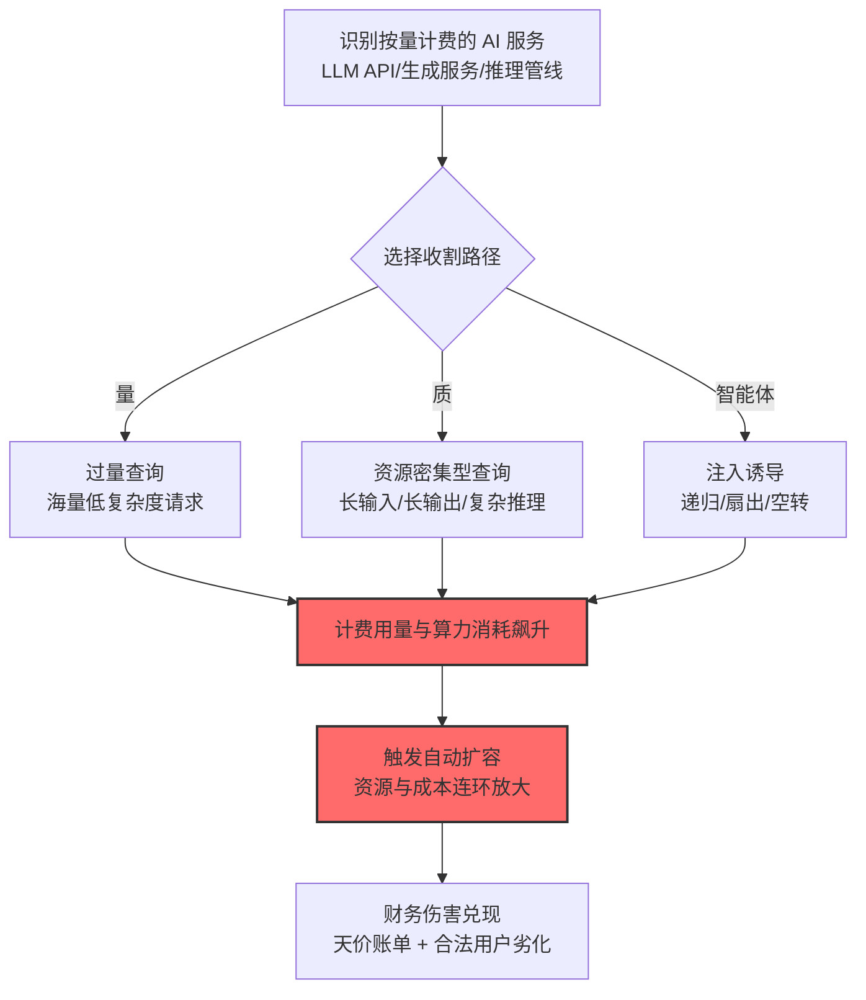

# 成本收割 (AML.T0034)

## 一句话通俗理解

> 不偷数据、不搞瘫痪，只是让你"花钱如流水"：恶意刷爆按量计费的 AI 服务，触发自动扩容连环加资源——服务好好跑着，月底账单先爆了。

## 难度等级

⭐ **Feasible（可行）**

官方成熟度评定为 Feasible——攻击原理与路径已在研究中清晰论证（海量低复杂度查询、少量高复杂度查询、智能体资源诱导三条路），官方案例库尚无直接命名的完整攻击事件。但这不等于低风险：**云账单膨胀的事件在业界屡有发生**（凭证泄露被挖矿、被盗 API key 刷量），本技术是把这类经济攻击系统化地定义为 AI 场景的独立战术。防御的前置条件只是"你的 AI 服务按量计费"。

## 技术描述

### 通俗解释

传统资源劫持（如挖矿）是攻击者**拿来自己用**；成本收割是**纯粹让你付钱**：故意把受害者的 AI 服务推到正常容量之外，制造经济伤害。官方描述明确了两者的区别——成本收割专注于"以资源为中心的压力"造成**财务伤害**。

三条实施路径（分别对应三个子技术）：

1. **过量查询**：海量低复杂度请求，量大管饱地堆高账单（[AML.T0034.000](./AML.T0034/AML.T0034.000-Excessive-Queries.md)）；
2. **资源密集型查询**：少量高复杂度请求，单发命中账单要害（[AML.T0034.001](./AML.T0034/AML.T0034.001-Resource-Intensive-Queries.md)）；
3. **智能体资源消耗**：注入指令诱导智能体自我循环空耗（[AML.T0034.002](./AML.T0034/AML.T0034.002-Agentic-Resource-Consumption.md)）。

官方描述特别点出三类高发场景：**云托管、按量计费的 AI/ML 平台**——LLM API、生成式图像服务、视觉语言管线。

### 技术原理

依据官方描述，攻击者可故意将受害者的 AI 服务推过正常运行容量，以增加服务成本为目的。与资源劫持（攻击者自用算力）不同，成本收割专注于对服务施加资源压力，最终造成受害者的**财务损害**。

**成本收割的三大杠杆：**

| 杠杆 | 机制 | 官方描述原文要点 |
|------|------|------------------|
| 膨胀消耗 | 操纵请求量或复杂度 | 推高算力/存储消耗 → 运营成本升高 |
| 自动扩容放大 | 触发扩容机制持续加资源 | 成本与暴露面进一步放大 |
| 饱和副作用 | 灌满内部队列与 GPU/TPU 管线 | 延迟尖峰、请求限流、合法用户不可用 |

**攻击链上下游衔接：**

- **独立实施**：与[拒绝 AI 服务 (AML.T0029)](./AML.T0029-Denial-of-AI-Service.md)一样，对攻击链前置要求极低——暴露的按量计费端点即可；
- **姊妹技术**：T0029（目的=瘫痪）vs T0034（目的=烧钱）——手法高度重叠，伤害维度不同；常组合出现；
- **上游配合**：[不安全凭证 (AML.T0055)](../10-Credential-Access/AML.T0055-Unsecured-Credentials.md)——盗取的 API 密钥让攻击者刷别人的账单；
- **下游去向**：成本收割造成的财务损害即[金融损害 (AML.T0048.000)](./AML.T0048/AML.T0048.000-Financial-Harm.md)的一种形态。

**平台覆盖**：Predictive AI / Generative AI / Agentic AI——所有按量计费的 AI 服务。

### 用途影响

- **账单失控**：数小时内在按量计费模式下膨胀出天价账单；
- **扩容连锁**：自动扩容机制被攻击者"劫持"为成本放大器——越扩越贵；
- **可用性连带**：内部队列与 GPU/TPU 管线饱和，合法用户体验劣化（与 DoS 的边界模糊）；
- **隐蔽性**：服务"看起来还在正常跑"，财务损害延迟到月底才总爆发。

## 攻击流程

### 典型攻击流程



**步骤详解：**

1. **识别按量计费的 AI 服务**
   - 通俗描述：找到"刷卡机"。
   - 技术细节：公开的 LLM API、生成式服务端点；记录计费维度（按 token/按请求/按 GPU 时长）、速率限制、扩容策略。

2. **选择收割路径**
   - 通俗描述：决定刷"量"还是刷"质"。
   - 技术细节：无速率限制或限制宽松 → 过量查询；限制严格但无输入约束 → 资源密集型查询；目标是智能体 → 注入诱导空耗。

3. **实施收割**
   - 通俗描述：开始烧钱。
   - 技术细节：三条路径的技术细节分别见三个子技术文档。

4. **触发自动扩容**
   - 通俗描述：让系统自己加码。
   - 技术细节：压力持续超过阈值 → 自动扩容供给更多资源 → 攻击流量随即填满新容量——成本螺旋上升。

## 真实案例

> MITRE ATLAS 官方案例库（2026.09 数据版）中暂无直接命中本技术（及其子技术）的独立案例记录。但官方案例库中存在高度相关的成本伤害形态：
>
> - [MathGPT 注入 (AML.CS0016)](./AML.T0029-Denial-of-AI-Service.md#案例1mathgpt-提示词注入致拒绝服务2023年amlcs0016)——攻击者获得 API key 后**可能耗尽应用的 GPT-3 查询预算并产生额外费用**（官方同时记录为金融损害 T0048.000）；
> - [AIKatz (AML.CS0036)](./AML.T0029-Denial-of-AI-Service.md#案例2aikatzllm-桌面应用的速率限制反杀2025年amlcs0036)——攻击者以受害者身份发送垃圾消息，**在按 token/按动作计费的计划下制造费用**。
>
> 业界的凭证泄露刷量事件（被盗 API key 被恶意调用产生巨额账单）是本技术更普遍的现实形态。

## 红队视角

> ⚠️ **免责声明**：以下内容仅用于合法授权的安全测试与教育目的。恶意消耗他人服务配额可能违反法律与服务条款。

### 实战技巧

1. **计费暴露面盘点（自有服务）**
   梳理组织 AI 服务的计费结构：哪些端点按量计费？计费维度（token/请求/GPU 时）？预算告警的阈值与延迟？自动扩容的成本上限？——产出"计费攻击面"清单。

2. **预算告警时效测试**
   从开始异常消耗到告警触发的延迟是多少？到强制熔断呢？——"攻击者能在告警前烧掉多少预算"是核心量化指标。

3. **扩容成本上限验证**
   自动扩容策略有没有成本硬顶（spend limit）？超过后是停止扩容还是继续烧钱？——无上限的自动扩容是最大的成本放大器。

### 常用工具

| 工具名称 | 用途 | 平台 |
|----------|------|------|
| 云成本监控面板（CloudWatch/Cost Management） | 检测侧：账单异常 | 云 |
| 自有服务的用量统计 API | 攻防演练数据源 | 云 |
| 预算告警配置审计 | 防御评估 | 云 |

### 注意事项

- **只在自有服务与自有账号间演练**
- 评估报告聚焦"预算告警延迟"与"扩容成本上限"两大缺口
- 测试消耗的预算提前报备财务，避免惊动真实的应急流程

## 蓝队视角

### 检测要点

1. **计费层：用量异常**
   - 日志来源：云成本管理、API 用量统计
   - 异常特征：token/请求量的基线偏离（夜间激增、节假日不减）、单账号消耗速率异常、新地域/新端点的用量突现

2. **容量层：扩容异常**
   - 日志来源：基础设施监控
   - 异常特征：扩容事件与业务增长数据脱节、持续满载但用户活跃度平稳（被刷的特征）

3. **请求层：模式特征**
   - 日志来源：API 网关
   - 异常特征：低复杂度海量请求（过量查询）、超长输入/输出集中出现（资源密集型查询）、智能体重复调用同一工具（自循环特征）

### 监控建议

- **建立"用量 × 业务量"关联基线**：账单增长要与业务增长对齐——脱节即告警
- **预算硬顶与分级熔断**：预算阈值分级（提醒→限制→熔断），自动扩容必须有成本上限
- **按维度拆分用量报表**：账号 × 端点 × 时间的用量明细——异常定位的最小颗粒度

## 检测建议

### 应用层检测（AI 遥测）

**检测方法：** 用量遥测与请求模式分析。

- 单账号 token 消耗速率的基线偏离（z-score 异常）
- 请求复杂度分布突变（超长输入占比激增）
- 智能体的工具调用循环特征（同工具高频重复）

### 网络层检测

**检测方法：** 辅助信号。

- 对推理端点的请求量激增（单源或分布式）
- 出口流量的体量与业务时段的错配

### 主机层检测

**检测方法：** 覆盖凭证滥用。

- 泄露凭证的异常调用模式（新 IP/新 UA/机器节奏）
- GPU 资源占用与任务队列的不匹配

### 检测规则思路示例

```yaml
title: AI服务用量与业务基线脱节（成本收割特征）
status: experimental
description: 检测计费用量与业务活跃度的偏离，
    可能预示成本收割攻击（AML.T0034）
logsource:
    category: application
    product: billing_telemetry
detection:
    selection:
        metric: 'token_consumption'
    anomaly:
        correlation:
            - group_by: account_id
            - zscore(token_consumption): '>= 5'
            - zscore(active_users): '<= 1'
            - window: 4h
    condition: selection and anomaly
falsepositives:
    - 合法的批量任务（离线评估，按项目白名单化）
    - 营销活动带来的真实用量增长
level: high
tags:
    - atlas.aml_t0034
```

## 缓解措施

> **映射说明**：截至 ATLAS 2026.09 数据版，MITRE ATLAS 官方数据为本技术映射了 AML.M0004、AML.M0019、AML.M0035、AML.M0036 四项缓解措施。以下按防御优先级组织，官方映射在表格中如实标注。

### 优先级1：关键措施

**AML.M0036 限制 AI 工作负载资源消耗（官方映射）**

官方缓解描述：对 AI 请求、推理作业或智能体工作流施加**资源预算**——限制成本密集型查询、过量查询与智能体资源消耗的成本上限。为输入/输出大小、执行时间、内存、算力设上限；生成式服务限制上下文与输出 token；智能体限制迭代、工具调用、扇出与下游支出。这是对抗"按账单维度攻击"的结构性手段。

### 优先级2：重要措施

**AML.M0004 限制 AI 服务查询量与速率（官方映射）**

官方缓解描述：限制给定时间间隔内的查询量，**阻碍攻击者发送计算昂贵的请求**。速率限制直接压制"过量查询"路径的成本效率。

**AML.M0019 控制生产环境 AI 模型与数据的访问（官方映射）**

官方缓解描述：访问控制可限制 API 访问并**防止成本收割**。认证与配额让匿名刷量无处着力；凭证轮换与异常检测压缩"盗刷"窗口。

### 优先级3：建议措施

**AML.M0035 AI 红队（官方映射）**

官方缓解描述：演练旨在放大推理、基础设施或外部服务成本的请求与工作流，验证认证、配额、速率限制与成本控制的有效性。用自有红队先烧掉一笔小预算，验证防御的真实成色。

**预算告警与自动熔断（本库建议，非官方映射）**

分级预算阈值（提醒→限流→熔断）+ 自动扩容的成本硬顶——即便攻击突破所有防线，损失也有明确上限。

### MITRE ATLAS 缓解措施映射

| 缓解措施ID | 缓解措施名称 | 优先级 | 官方映射 | 说明 |
|------------|-------------|:------:|:-------:|------|
| AML.M0036 | 限制 AI 工作负载资源消耗 | 关键 | 是 | 资源预算——按账单维度设上限 |
| AML.M0004 | 限制 AI 服务查询量与速率 | 重要 | 是 | 压制过量查询路径 |
| AML.M0019 | 控制生产环境 AI 模型与数据的访问 | 重要 | 是 | 认证+配额挡住匿名刷量 |
| AML.M0035 | AI 红队 | 建议 | 是 | 先烧小钱验证防御 |
| — | 预算告警与自动熔断 | 建议 | 否（本库建议） | 分级阈值 + 扩容成本硬顶 |

## 关联 ATT&CK 技术

ATLAS 官方数据未为本技术映射特定 ATT&CK 技术引用。以下为概念上最接近的企业版技术，供对照理解：

- [资源劫持 (T1496)](../../enterprise/15-Impact/T1496-Resource-Hijacking.md) — 概念直系：官方描述明示两者的区别——T1496 是攻击者"自用"资源，成本收割是"让你付钱"
- [端点拒绝服务 (T1499)](../../enterprise/15-Impact/T1499-Endpoint-Denial-of-Service.md) — 手法对照：同为容量压力攻击，伤害维度不同（可用性 vs 财务）
- [金融盗窃 (T1657)](../../enterprise/15-Impact/T1657-Financial-Theft.md) — 危害对照：最终伤害形态都指向财务，路径完全不同

**资源劫持 (T1496) vs 成本收割 (AML.T0034)：**

| 维度 | 资源劫持 (T1496) | 成本收割 (AML.T0034) |
|------|------------------|----------------------|
| 攻击目的 | 偷算力自用（挖矿等） | 纯粹制造受害者的费用 |
| 攻击者收益 | 获得免费算力 | 无直接收益（除非勒索/竞争） |
| 受害者损失 | 性能劣化 + 部分电费 | 账单直接膨胀（可能无性能感知） |
| 典型手法 | 挖矿木马 | 刷 API 用量、诱导扩容、智能体空耗 |
| 检测重心 | 异常算力占用模式 | 计费遥测异常 + 业务量脱节 |

一句话总结：资源劫持是偷你的电挖矿，成本收割是逼你自己烧钱——后者服务"一切正常"，月底账单才是唯一的案发现场。

## 子技术列表

| 子技术ID | 中文名称 | 难度 | 一句话理解 |
|---------|---------|:----:|-----------|
| [AML.T0034.000](./AML.T0034/AML.T0034.000-Excessive-Queries.md) | 过量查询 | ⭐ | 海量低复杂度请求堆高计费用量 |
| [AML.T0034.001](./AML.T0034/AML.T0034.001-Resource-Intensive-Queries.md) | 资源密集型查询 | ⭐ | 少量高复杂度请求榨干算力成本 |
| [AML.T0034.002](./AML.T0034/AML.T0034.002-Agentic-Resource-Consumption.md) | 智能体资源消耗 | ⭐ | 注入诱导智能体自我循环空耗 |

> 注：子技术难度为官方独立评定的 maturity 等级（与父技术同为 Feasible⭐）。

## 动手实验

> ⚠️ **重要提示**：所有实验必须在自有 AI 服务与自有账号上进行，消耗的是自己的（小额）预算。

### 实验环境准备

| 环境组件 | 用途 | 获取方式 |
|----------|------|----------|
| 自有按量计费 LLM API（小额预算） | 测试目标 | 云 |
| 用量统计与成本面板 | 观测消耗 | 云自带 |
| 自动化脚本 | 模拟查询模式 | 自建 |

### 实验1（初级）：计费维度画像

**实验目标：** 搞清"钱花在哪个维度"。

**实验步骤：**
1. 用正常对话记录单次请求的 token 消耗与费用
2. 分别测试：长输入短输出、短输入长输出、长上下文累积——记录各维度的费用差异
3. 计算每种模式的"单位伤害成本"

**预期结果：** 一份计费维度画像——哪个维度最"贵"，攻击会打哪里。

### 实验2（中级）：预算告警延迟测量

**实验目标：** 量化"告警到来前的损失窗口"。

**实验步骤：**
1. 设置预算告警（如日预算的 80%）
2. 用脚本以 5 倍正常速率消耗（自有账号，设好总额上限）
3. 记录从开始到告警触发的时长与累计花费
4. 测试成本上限（若有）触发后的行为

**预期结果：** "攻击者能在告警前烧多少"的量化答案——告警策略的改进依据。

### 实验3（高级）：防御组合验证

**实验目标：** 验证限速+配额+预算熔断的三层防御。

**实验步骤：**
1. 配置：账号级速率限制 + 单请求 token 上限 + 预算硬顶熔断
2. 分别模拟三条路径（过量/资源密集/循环调用）攻击自有服务
3. 记录每条路径被哪层防御拦截、穿透到哪层
4. 输出"攻击路径 × 防御层"的覆盖矩阵

**预期结果：** 三层防线的拦截覆盖矩阵——防御缺口的直观呈现。

## 术语解释

| 术语 | 英文原名 | 通俗解释 |
|------|----------|----------|
| 成本收割 | Cost Harvesting | 以制造费用为目的的资源压力攻击 |
| 按量计费 | Pay-per-use | 按实际用量（token/请求/GPU 时）计费 |
| 自动扩容 | Autoscaling | 负载升高自动加资源的机制——可被劫持为成本放大器 |
| 资源劫持 | Resource Hijacking | 偷用他人算力自用（如挖矿）——与成本收割的区别所在 |
| 速率限制 | Rate Limiting | 限制单位时间请求数 |
| 配额 | Quota | 账号/租户级的用量上限 |
| 预算熔断 | Budget Circuit Breaking | 花费超限即强制停止的机制 |
| 海绵样本 | Sponge Examples | 最大化能量消耗与决策延迟的对抗输入 |
| 扇出 | Fan-out | 智能体并发展开的子任务数量 |
| 成本硬顶 | Spend Limit | 自动扩容/总消耗的不可逾越上限 |

## 参考资料

### 📚 官方文档

- [MITRE ATLAS - Cost Harvesting (AML.T0034)](https://atlas.mitre.org/techniques/AML.T0034/) - 官方技术页面
- [MITRE ATLAS 矩阵](https://atlas.mitre.org/matrices/ATLAS/)
- [MITRE ATLAS Data (GitHub)](https://github.com/mitre-atlas/atlas-data)

### 📰 案例报告（真实攻击与安全研究）

- 官方案例库 AML.CS0016 / AML.CS0036 中与本技术相关的成本伤害记录 - 详见 [ATLAS Case Studies](https://atlas.mitre.org/studies/)
- [Shumailov et al.: Sponge Examples](https://arxiv.org/abs/2006.03463) - 资源密集型查询的理论基础

### 🔧 工具与资源

- [云成本管理最佳实践（各云厂商文档）](https://aws.amazon.com/cost-management/) - 预算告警与成本上限配置
- [OWASP Top 10 for LLM Applications](https://owasp.org/www-project-top-10-for-large-language-model-applications/) - LLM 应用安全风险

### 🔗 关联阅读

- [影响战术 (AML.TA0011)](./README.md) - 本技术所属战术的概览页
- [拒绝 AI 服务 (AML.T0029)](./AML.T0029-Denial-of-AI-Service.md) — 姊妹技术：同样打资源，目标是瘫痪
- [金融损害 (AML.T0048.000)](./AML.T0048/AML.T0048.000-Financial-Harm.md) — 下游危害：成本收割的最终伤害形态
- [不安全凭证 (AML.T0055)](../10-Credential-Access/AML.T0055-Unsecured-Credentials.md) — 上游配合：盗刷的钥匙
- [资源劫持 (T1496)](../../enterprise/15-Impact/T1496-Resource-Hijacking.md) — 传统对照：偷用 vs 让你付钱

---

> **版本**: ATLAS 2026.09 | **更新**: 2026-10-24 | **模板**: ATLAS 技术文档 v1.0
