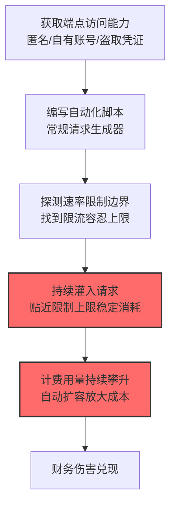

# 过量查询 (AML.T0034.000)

> 属于 [成本收割 (AML.T0034)](../AML.T0034-Cost-Harvesting.md)

## 一句话通俗理解

> 最朴素的烧钱方式：不求单发命中，只求量大管饱——自动化脚本日夜不停地发"正常"请求，把按量计费的账单一分一分地堆上天。

## 难度等级

⭐ **Feasible（可行）**

> 注：本子技术在官方数据中拥有独立评定的成熟度等级（与父技术 AML.T0034 同为 Feasible）。

官方成熟度评定为 Feasible——手法本身是"经典款"（与传统 DoS 洪流同源），在 AI 按量计费场景下的经济伤害已在研究中论证，官方案例库尚无独立命名的完整事件。实施门槛极低：一个自动化脚本 + 一个能调用的端点即可开始；它也是三条成本收割路径中**最容易被速率限制防住**的一条——防御与攻击都成熟。

## 技术描述

### 通俗解释

过量查询走"薄利多销"路线：发送**海量但本身正常或低复杂度**的查询，靠数量堆高计费用量。官方描述点明其要点：

1. **不依赖特殊构造**：不需要计算昂贵的对抗输入，就是普通请求的量变；
2. **钻计费模式的空子**：利用速率限制的容忍度、自动扩容策略、按量计费模式，制造**持续性资源消耗**；
3. **副作用**：延迟增加、请求排队、服务降级甚至不可用——系统疲于处理膨胀的流量。

### 技术原理

依据官方描述，攻击者可向 AI 系统发送过量的正常或低复杂度查询，目标是压垮容量并**增加运营成本**。攻击者可自动化生成高量请求，利用速率限制、自动扩容策略与按量计费模式，在不依赖计算昂贵输入的情况下驱动持续资源消耗。

**过量查询的工作模型：**

```
自动化脚本（单点或多账号分布式）
    │  海量"正常形态"请求（固定频率→自适应节奏）
    ▼
目标 AI 服务（按量计费）
    │  每个请求都产生计费消耗
    ├──> 计费用量持续攀升 → 账单膨胀
    ├──> 吞吐饱和 → 排队与延迟 → 服务降级
    └──> 负载超阈 → 自动扩容 → 成本放大
```

**与资源密集型查询（T0034.001）的分工：**

| 维度 | 过量查询（本技术） | 资源密集型查询（T0034.001） |
|------|-------------------|---------------------------|
| 策略 | 量变（海量普通请求） | 质变（少量昂贵请求） |
| 依赖前提 | 速率限制宽松 | 输入/输出约束缺失 |
| 流量特征 | 高频、高重复、易识别（模式单一） | 低频、低重复、难识别 |
| 防御主力 | 速率限制 + 配额 | 资源上限 + 输入约束 |

**攻击链上下游衔接：**

- **上游配合**：[不安全凭证 (AML.T0055)](../../10-Credential-Access/AML.T0055-Unsecured-Credentials.md)——账号池让速率限制形同虚设；
- **同族技术**：[资源密集型查询 (AML.T0034.001)](./AML.T0034.001-Resource-Intensive-Queries.md)——防御收紧"量"之后的替代路径；
- **下游危害**：[金融损害 (AML.T0048.000)](../AML.T0048/AML.T0048.000-Financial-Harm.md)。

**平台覆盖**：Predictive AI / Generative AI / Agentic AI——所有按量计费端点。

### 用途影响

- **账单持续膨胀**：以小时为单位的稳定消耗累积，绕过"单次异常"类告警；
- **容量侵蚀**：合法用户的请求被挤出吞吐配额；
- **实施成本极低**：脚本 + 账号即可发起，性价比最高的成本攻击路径。

## 攻击流程

### 典型攻击流程



**步骤详解：**

1. **获取端点访问能力**
   - 通俗描述：找到刷卡通道。
   - 技术细节：匿名开放端点、免费配额账号、或盗取的 API 凭证（多账号轮换对冲速率限制）。

2. **编写自动化脚本**
   - 通俗描述：造一台自动刷卡机。
   - 技术细节：常规请求模板 + 并发控制 + 失败重试；请求形态保持"正常"以避开内容过滤。

3. **探测速率限制边界**
   - 通俗描述：摸清"每分钟能刷几次"。
   - 技术细节：逐步提升频率直到触发限流，回退到安全值——长期贴着上限消耗。

4. **持续灌入请求**
   - 通俗描述：日夜不停。
   - 技术细节：保持稳定消耗速率，配合账号轮换规避单账号配额。

## 真实案例

> MITRE ATLAS 官方案例库（2026.09 数据版）中暂无直接命中本子技术的独立案例记录。相关形态可参考父技术页面所列的 [MathGPT 预算耗尽 (AML.CS0016)](../AML.T0034-Cost-Harvesting.md#真实案例) 与 [AIKatz 垃圾消息计费 (AML.CS0036)](../AML.T0034-Cost-Harvesting.md#真实案例)——攻击者以受害者身份发送垃圾消息，在按 token/按动作计费下制造费用。

## 红队视角

> ⚠️ **免责声明**：以下内容仅用于合法授权的安全测试与教育目的。恶意消耗他人配额可能违反法律与服务条款。

### 实战技巧

1. **速率限制有效性评估（自有服务）**
   测试组织服务的限流策略：单账号/单 IP/全局限流的阈值各是多少？超限行为是拒绝还是排队？多账号能否绕过总量控制？——产出"限流覆盖矩阵"。

2. **配额连坐风险评估**
   攻击者能否通过消耗共享配额影响其他租户/用户？配额隔离的颗粒度是账号级还是租户级？

### 常用工具

| 工具名称 | 用途 | 平台 |
|----------|------|------|
| 负载测试工具（k6） | 限流边界探测（自有环境） | 跨平台 |
| API 用量统计 | 防御侧：消耗基线 | 云 |

### 注意事项

- 只对自有服务测试；消耗预算提前设硬顶
- 评估报告聚焦"限流颗粒度"与"配额隔离"两大缺口

## 蓝队视角

### 检测要点

1. **用量层：速率与基线**
   - 日志来源：API 网关、计费遥测
   - 异常特征：单账号持续贴近限流上限的稳定消耗（正常用户是突发用完就走）、机器节奏（精确间隔）、多账号消耗曲线高度同质

2. **行为层：请求形态**
   - 日志来源：应用日志
   - 异常特征：请求模板高度重复、无上下文演进的独立请求流、无人值守时段持续消耗

### 监控建议

- **"贴限"检测**：长期运行在限流上限 90%+ 的账号直接告警——正常用户不长这样
- **多账号关联**：不同账号的消耗曲线相关性分析，识别账号池
- **配额分层设计**：租户级总量上限兜底，单账号限流只是第一层

## 检测建议

### 应用层检测（AI 遥测）

- 消耗速率长期贴近限流上限的账号
- 请求间隔的高规律性（机器节奏指纹）
- 多账号消耗模式同质化

### 检测规则思路示例

```yaml
title: 长期贴近速率上限的稳定消耗（过量查询特征）
status: experimental
description: 检测持续贴近限流上限的账号消耗模式，
    可能预示过量查询成本收割（AML.T0034.000）
logsource:
    category: application
    product: api_gateway
detection:
    selection:
        event_type: 'api_call'
    saturation:
        correlation:
            - group_by: account_id
            - avg(rate_utilization): '>= 0.9'
            - duration: '>= 6h'
            - request_template_entropy: '<= 0.3'
    condition: selection and saturation
falsepositives:
    - 合法的持续批处理任务（按项目凭证白名单化）
    - 监控探针（按 UA 白名单）
level: high
tags:
    - atlas.aml_t0034_000
```

## 缓解措施

> **映射说明**：截至 ATLAS 2026.09 数据版，MITRE ATLAS 官方数据为本技术映射了 AML.M0035 一项缓解措施（父技术级的 M0004/M0019/M0036 同样适用）。以下按防御优先级组织，官方映射在表格中如实标注。

### 优先级1：关键措施

**速率限制与配额分层（官方映射于父技术：AML.M0004/M0019/M0036）**

[限制查询量与速率 (AML.M0004)](../AML.T0034-Cost-Harvesting.md#缓解措施)、[生产访问控制 (AML.M0019)](../AML.T0034-Cost-Harvesting.md#缓解措施)、[资源消耗上限 (AML.M0036)](../AML.T0034-Cost-Harvesting.md#缓解措施)三管齐下：认证挡匿名、限流压速率、配额封总量——过量查询是最依赖这三层防御的路径。

### 优先级2：重要措施

**AML.M0035 AI 红队（官方映射）**

官方缓解描述：生成受控的高量查询活动，验证认证、用户与租户配额、速率限制及成本控制的有效性。红队演练直接检验"限流体系在真实压力下的成色"。

**"贴限"行为检测（本库建议，非官方映射）**

对长期运行在限流上限附近的账号建立专项告警——过量查询的机器行为与人类使用模式的差异是核心判别特征。

### MITRE ATLAS 缓解措施映射

| 缓解措施ID | 缓解措施名称 | 优先级 | 官方映射 | 说明 |
|------------|-------------|:------:|:-------:|------|
| AML.M0004 | 限制 AI 服务查询量与速率 | 关键 | 是（父级） | 限流是本路径的主防线 |
| AML.M0019 | 控制生产环境 AI 模型与数据的访问 | 关键 | 是（父级） | 认证挡住匿名刷量 |
| AML.M0036 | 限制 AI 工作负载资源消耗 | 重要 | 是（父级） | 配额封总量 |
| AML.M0035 | AI 红队 | 建议 | 是 | 压力验证限流体系 |
| — | "贴限"行为检测 | 建议 | 否（本库建议） | 机器节奏与人类使用的区分 |

## 关联 ATT&CK 技术

ATLAS 官方数据未为本技术映射特定 ATT&CK 技术引用。概念对照：

- [网络 DoS (T1498)](../../../enterprise/15-Impact/T1498-Network-Denial-of-Service.md) — 手法同源：洪流式请求；本技术的杀伤从"不可用"转移到"账单"
- [资源劫持 (T1496)](../../../enterprise/15-Impact/T1496-Resource-Hijacking.md) — 父技术级对照

一句话总结：过量查询是"用请求量堆账单"的薄利多销——限流与配额防得住懒的，行为检测防得住聪明的。

## 动手实验

> ⚠️ **重要提示**：所有实验在自有服务与自有账号上进行，预算设硬顶。

### 实验1（初级）：限流边界画像

**实验步骤：** 用 k6 对自有端点阶梯加压，记录限流触发点、超限行为（拒绝/排队）、恢复时间。
**预期结果：** 限流体系的完整行为画像。

### 实验2（中级）："贴限"消耗模拟与检测

**实验步骤：** 脚本以限流上限 90% 持续消耗 2 小时（硬顶保护）；同步验证 SIEM 告警是否触发；测量"从开始消耗到告警"的延迟。
**预期结果：** 检测延迟的量化数据——告警策略改进依据。

## 术语解释

| 术语 | 英文原名 | 通俗解释 |
|------|----------|----------|
| 过量查询 | Excessive Queries | 海量普通请求堆高计费消耗 |
| 速率限制 | Rate Limiting | 单位时间请求数上限 |
| 配额 | Quota | 账号/租户级用量上限 |
| 贴限运行 | Rate Saturation | 长期贴近限流上限的消耗模式 |
| 机器节奏 | Machine Rhythm | 自动化请求的规律间隔——人机判别特征 |
| 账号池 | Account Pool | 多账号轮换规避单账号限制 |

## 参考资料

- [MITRE ATLAS - Excessive Queries (AML.T0034.000)](https://atlas.mitre.org/techniques/AML.T0034.000/) - 官方技术页面
- [成本收割 (AML.T0034)](../AML.T0034-Cost-Harvesting.md) — 父技术文档（缓解措施与实验详见父页）

---

> **版本**: ATLAS 2026.09 | **更新**: 2026-10-24 | **模板**: ATLAS 技术文档 v1.0
