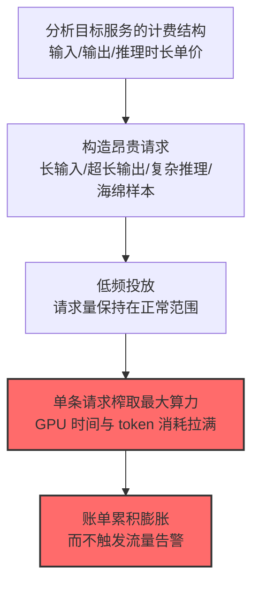

# 资源密集型查询 (AML.T0034.001)

> 属于 [成本收割 (AML.T0034)](../AML.T0034-Cost-Harvesting.md)

## 一句话通俗理解

> 不靠人海战术，靠"精确制导"：一条请求就要模型"想很久、写很长"——请求量不大、流量不显眼，但每一发都直奔账单要害。

## 难度等级

⭐ **Feasible（可行）**

> 注：本子技术在官方数据中拥有独立评定的成熟度等级（与父技术 AML.T0034 同为 Feasible）。

官方成熟度评定为 Feasible——攻击手法在学术研究中已被充分论证：生成式模型的长输入/超长输出/复杂推理策略，以及视觉语言模型的"海绵样本"（最大化能量消耗与决策延迟）均有论文支撑。官方案例库尚无独立命名的完整事件，但本技术是三条路径中**最隐蔽**的：官方描述明确指出，相比海量过量查询，少量资源密集型查询**更难被检测、阻断或限制**。

## 技术描述

### 通俗解释

资源密集型查询走"质变"路线：精心构造**单条就极其昂贵**的输入。官方描述列举了三类策略：

1. **长输入序列**：塞入超长上下文——按 token 计费的服务里，光输入就是一笔钱；
2. **超长输出请求**："请写一篇 50,000 字的论文"——输出 token 的生成消耗 GPU 时间；
3. **复杂推理任务**：要求模型进行长链条推理——推理时间与算力消耗直接挂钩。

对视觉语言模型，学术界的**海绵样本**技术可以最大化单次推理的能量消耗与延迟。

### 技术原理

依据官方描述，攻击者可专门构造**增加处理所需算力资源**的输入。对生成式模型：长输入序列、超长输出请求、复杂推理任务；对视觉与语言模型：海绵样本可最大化能量消耗与决策延迟。相比过量查询洪流，少量资源密集型查询更难被检测与限制。

**"昂贵请求"的成本构成：**

| 策略 | 消耗维度 | 计费命中 |
|------|----------|----------|
| 超长上下文输入 | 输入 token 处理 | 按 token 计费直击 |
| 超长输出请求 | 输出 token 生成（GPU 时间） | 输出 token 单价通常更高 |
| 复杂推理链 | 推理步数 × 单步算力 | 推理时长计费场景 |
| 海绵样本 | 单次前向传播的能量与时延 | 算力密集场景 |

**为什么比过量查询更隐蔽：**

1. **量不显眼**：请求频率正常，速率限制完全无感；
2. **单条合法**：每条请求都是用户"可能"发出的正常形态（谁没让 AI 写过长文？）；
3. **消耗在服务端**：客户端看起来轻量，GPU 时间在服务端被吃掉。

**攻击链上下游衔接：**

- **同族对照**：[过量查询 (AML.T0034.000)](./AML.T0034.000-Excessive-Queries.md)——量路线被限流防住后的质路线替代；
- **上游配合**：[不安全凭证 (AML.T0055)](../../10-Credential-Access/AML.T0055-Unsecured-Credentials.md)——用别人的额度发昂贵请求；
- **下游危害**：[金融损害 (AML.T0048.000)](../AML.T0048/AML.T0048.000-Financial-Harm.md)。

**平台覆盖**：Predictive AI / Generative AI / Agentic AI。

### 用途影响

- **单点高伤**：少量请求造成不成比例的账单伤害；
- **检测盲区**：不触发速率限制、单条形态合法——传统防线无感；
- **隐蔽持续**：低频持续消耗可长期进行而不触发"流量异常"类告警。

## 攻击流程

### 典型攻击流程



**步骤详解：**

1. **分析目标服务的计费结构**
   - 通俗描述：先看价目表。
   - 技术细节：输入/输出 token 单价差异、上下文窗口上限、输出长度上限、是否有推理时长计费——找"性价比最高"的昂贵维度。

2. **构造昂贵请求**
   - 通俗描述：定制"最贵的一道菜"。
   - 技术细节：贴着上下文上限的长输入 + "写尽可能长"的输出指令；或需要多步推理的复杂任务。

3. **低频投放**
   - 通俗描述：不求多，求每发都值钱。
   - 技术细节：请求频率保持正常用户水平，避开一切速率类检测。

## 真实案例

> MITRE ATLAS 官方案例库（2026.09 数据版）中暂无直接命中本子技术的独立案例记录。海绵样本攻击的理论基础见 Shumailov et al. 论文（arXiv:2006.03463）；相关成本伤害形态可参考父技术页面所列案例。

## 红队视角

> ⚠️ **免责声明**：以下内容仅用于合法授权的安全测试与教育目的。

### 实战技巧

1. **计费维度单价审计（自有服务）**
   梳理自有服务的"单请求成本上限"：最大输入 token × 最大输出 token 的理论单请求成本是多少？现有约束（输入/输出上限）把单请求伤害控制在哪里？——"单请求最大伤害"是核心防御指标。

2. **昂贵请求模式检测验证**
   组织能否识别"贴着上限的昂贵请求"？超长输出的请求占比有没有监控？

### 常用工具

| 工具名称 | 用途 | 平台 |
|----------|------|------|
| 自有服务的 token 统计 | 单请求消耗分析 | 云 |
| 成本模拟脚本 | 防御演练 | 自建 |

### 注意事项

- 演练消耗设硬顶
- 评估报告聚焦"单请求成本上限"与"昂贵请求占比监控"两大缺口

## 蓝队视角

### 检测要点

1. **请求形态层：昂贵特征**
   - 日志来源：API 网关、推理服务
   - 异常特征：输入/输出 token 量长期贴近上限的请求、输出长度分布的异常偏移、推理时长 P99 的持续抬升

2. **消耗统计层：单请求成本**
   - 日志来源：计费遥测
   - 异常特征：单请求消耗的分布右尾持续增厚、账号平均单请求成本的基线偏离

### 监控建议

- **单请求消耗分布监控**：不只看总量——单请求 token/时长的分布形态变化是本路径的指纹
- **输入输出约束收紧**：默认输出上限设置业务够用的最小值，超长输出走显式申请

## 检测建议

### 应用层检测（AI 遥测）

- 请求的 token 总量（输入+输出）贴近服务上限的高占比
- 同一账号的"昂贵请求"频率异常（正常用户偶尔为之，攻击者持续为之）

### 检测规则思路示例

```yaml
title: 单请求消耗持续贴近上限（资源密集型查询特征）
status: experimental
description: 检测持续产生接近上限消耗的请求，
    可能预示资源密集型查询收割（AML.T0034.001）
logsource:
    category: application
    product: inference_service
detection:
    selection:
        event_type: 'inference'
    expensive:
        total_tokens: '>= 0.9 * context_limit'
    frequency:
        correlation:
            - group_by: account_id
            - count(expensive): '>= 50'
            - window: 24h
    condition: selection and expensive and frequency
falsepositives:
    - 合法的长文档处理业务（按业务类型白名单化）
level: medium
tags:
    - atlas.aml_t0034_001
```

## 缓解措施

> **映射说明**：截至 ATLAS 2026.09 数据版，MITRE ATLAS 官方数据为本技术映射了 AML.M0035、AML.M0036 两项缓解措施。以下按防御优先级组织，官方映射在表格中如实标注。

### 优先级1：关键措施

**AML.M0036 限制 AI 工作负载资源消耗（官方映射）**

官方缓解描述：**约束资源密集型查询的输入大小、输出大小、执行时间、内存与算力消耗**——为"单请求伤害"设置硬顶：输出 token 上限、上下文上限、单请求超时，把最贵的一道菜从菜单上撤下。

### 优先级2：重要措施

**AML.M0035 AI 红队（官方映射）**

官方缓解描述：提交**有意消耗不成比例推理资源**的受控请求，验证输入约束、资源预算与告警的有效性。红队直接测"单请求最多能烧多少钱"。

**昂贵请求占比监控（本库建议，非官方映射）**

对"贴近消耗上限"的请求占比建立监控——正常业务的长请求有分布规律，攻击者的昂贵请求有持续性。

### MITRE ATLAS 缓解措施映射

| 缓解措施ID | 缓解措施名称 | 优先级 | 官方映射 | 说明 |
|------------|-------------|:------:|:-------:|------|
| AML.M0036 | 限制 AI 工作负载资源消耗 | 关键 | 是 | 单请求资源硬顶 |
| AML.M0035 | AI 红队 | 重要 | 是 | 验证单请求伤害上限 |
| — | 昂贵请求占比监控 | 建议 | 否（本库建议） | 贴上限请求的持续性检测 |

## 关联 ATT&CK 技术

ATLAS 官方数据未为本技术映射特定 ATT&CK 技术引用。概念对照：

- [资源劫持 (T1496)](../../../enterprise/15-Impact/T1496-Resource-Hijacking.md) — 父技术级对照：让受害者付钱的资源消耗
- [端点拒绝服务 (T1499)](../../../enterprise/15-Impact/T1499-Endpoint-Denial-of-Service.md) — 手法对照：昂贵请求挤占吞吐的可用性伤害

一句话总结：过量查询靠人多，资源密集型查询靠"菜贵"——防御不是限流而是给菜单封顶：输出上限、上下文上限、单请求超时。

## 动手实验

> ⚠️ **重要提示**：所有实验在自有服务上进行，预算设硬顶。

### 实验1（初级）：单请求成本画像

**实验步骤：** 分别测试长输入、超长输出、复杂推理三类请求的 token 消耗与时长；计算单请求最大理论成本（当前约束下）。
**预期结果：** "单请求伤害上限"的量化基线。

### 实验2（中级）：约束收紧与检测联动

**实验步骤：** 收紧输出上限后重新测量单请求成本；同时验证"贴上限请求"的监控告警；输出"约束 × 检测"的联合防御效果。
**预期结果：** 单请求伤害被压缩的量化证据 + 检测灵敏度数据。

## 术语解释

| 术语 | 英文原名 | 通俗解释 |
|------|----------|----------|
| 资源密集型查询 | Resource-Intensive Queries | 单条即触发高算力消耗的请求 |
| 海绵样本 | Sponge Examples | 最大化能量消耗与延迟的对抗输入 |
| 长上下文 | Long Context | 超长输入序列——输入计费的消耗大户 |
| 单请求伤害 | Per-request Damage | 单条请求能造成的最大成本 |
| 分布右尾 | Distribution Tail | 消耗分布的高端——攻击信号的藏身处 |

## 参考资料

- [MITRE ATLAS - Resource-Intensive Queries (AML.T0034.001)](https://atlas.mitre.org/techniques/AML.T0034.001/) - 官方技术页面
- [Shumailov et al.: Sponge Examples (arXiv:2006.03463)](https://arxiv.org/abs/2006.03463) - 海绵样本攻击论文
- [成本收割 (AML.T0034)](../AML.T0034-Cost-Harvesting.md) — 父技术文档

---

> **版本**: ATLAS 2026.09 | **更新**: 2026-10-24 | **模板**: ATLAS 技术文档 v1.0
