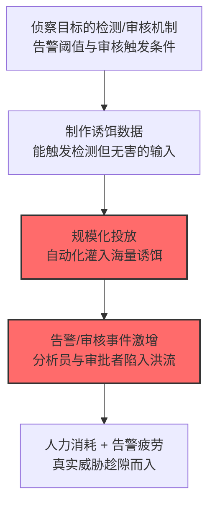

# 用诱饵数据灌满 AI 系统 (AML.T0046)

## 一句话通俗理解

> 不攻击模型、不偷数据，只是制造一万条"看起来可疑"的垃圾告警——让安全分析员淹没在误报的海洋里，把时间浪费在逐一排查"狼来了"上。

## 难度等级

⭐ **Feasible（可行）**

官方成熟度评定为 Feasible——攻击机制清晰（诱饵数据 → 误报激增 → 人工审核疲劳），官方案例库尚无直接命名的完整事件。这是"人力消耗"型攻击在 AI 场景的映射：单条诱饵无害，杀伤来自**规模**与**响应成本的转嫁**——AI 系统的检测能力被反向利用为"分析员时间粉碎机"。

## 技术描述

### 通俗解释

诱饵数据（chaff data）指专门用来触发检测、却不构成真实威胁的输入。攻击者向 AI 系统灌入海量诱饵，制造**检测数量激增**的假象。官方描述点出两个打击面：

1. **检测系统**：诱饵数据使 AI 检测系统的告警数暴增——受害者组织的分析员**浪费时间审查和纠正错误推断**；
2. **智能体审核**：向 AI 智能体灌入大量**低危但需人工审核（human-in-the-loop）的事件或动作**——消耗审核人员的时间。

本质是"攻击响应成本"：每条诱饵的制作成本极低，但每条告警的处置成本（人工审查）很高——成本不对称是攻击的全部逻辑。

### 技术原理

依据官方描述，攻击者可向 AI 系统灌入诱饵数据造成检测数量增加，使受害组织的分析员浪费时间审查与纠正错误推断；也可向智能体灌入大量低危可审计事件或需人机回环的智能体动作，消耗人工审核时间。

**诱饵灌满的两个打击面：**

| 打击面 | 机制 | 消耗对象 |
|--------|------|----------|
| 检测系统 | 诱饵输入触发海量告警（均为误报） | 安全分析员的审查时间 |
| 智能体审核 | 灌入低危事件/动作触发人机回环审批 | 审批人员的确认时间 |

**成本不对称模型：**

```
攻击者成本：脚本生成诱饵（近零边际成本）
    vs
受害者成本：每条告警 × 分析员审查时长 × 时薪
    + 告警疲劳 → 真实威胁被淹没（次生伤害）
```

**攻击链上下游衔接：**

- **独立实施**：针对暴露接口即可独立实施，攻击链前置要求低；
- **姊妹技术**：[拒绝 AI 服务 (AML.T0029)](./AML.T0029-Denial-of-AI-Service.md)打击机器容量，本技术打击**人力容量**；[成本收割 (AML.T0034)](./AML.T0034-Cost-Harvesting.md)烧钱，本技术烧人；
- **组合战术**：诱饵灌满可作为掩护——分析员疲于处理假告警时，真实攻击混在其中实施（"告警淹没"是经典掩护手法）。

**平台覆盖**：Predictive AI / Generative AI / Agentic AI——所有产生检测/审核事件的 AI 系统。

### 用途影响

- **人力时间黑洞**：分析员与审批者的工时被系统性消耗；
- **告警疲劳**：误报暴增导致团队对告警脱敏——真实威胁被忽视的窗口打开；
- **响应体系过载**：审核队列积压，正常业务的审批也被拖慢；
- **实施成本极低**：与造成的响应成本相比近乎免费。

## 攻击流程

### 典型攻击流程



**步骤详解：**

1. **侦察目标的检测/审核机制**
   - 通俗描述：弄清什么会"响铃"。
   - 技术细节：AI 检测系统的告警条件、智能体动作的审批触发规则（哪些动作需 HITL）。

2. **制作诱饵数据**
   - 通俗描述：制作"会响铃的空罐头"。
   - 技术细节：构造能触发检测规则的输入（形似恶意实则无害）；或让智能体执行需审批的低危动作。

3. **规模化投放**
   - 通俗描述：一万个罐头一起摇。
   - 技术细节：自动化脚本持续灌入——每条都过检测阈值，每条都需要人工确认"是误报"。

## 真实案例

> MITRE ATLAS 官方案例库（2026.09 数据版）中暂无直接命中本技术的案例记录。"告警淹没"作为掩护手法在传统攻击中常见（如入侵者故意触发低级告警消耗 SOC 精力），本技术将其延伸到 AI 检测与人机回环审核场景。

## 红队视角

> ⚠️ **免责声明**：以下内容仅用于合法授权的安全测试与教育目的。

### 实战技巧

1. **告警响应成本审计（自有环境）**
   评估组织的告警-审查链路：单条告警的平均处置时长？误报率的基线？告警疲劳指标（如 MTTA 的劣化）如何监控？——"响应成本"是本技术的攻击对象，也是防御评估的核心。

2. **审核队列容量测试**
   模拟告警量激增场景（自有环境注入合成告警）：审核队列的积压速度？积压时的处理策略（先到先审 vs 优先级排序）？

### 常用工具

| 工具名称 | 用途 | 平台 |
|----------|------|------|
| SOC 告警统计（SIEM） | 检测侧：告警基线与疲劳指标 | 跨平台 |
| 合成告警生成器 | 容量演练（自有环境） | 自建 |

### 注意事项

- 合成告警演练需提前与 SOC 团队约定，避免真实应急响应被触发
- 评估报告聚焦"告警分类速度"与"队列积压策略"两大缺口

## 蓝队视角

### 检测要点

1. **告警层：规模与模式异常**
   - 日志来源：SIEM、检测系统
   - 异常特征：告警量激增但确认率（真实威胁占比）骤降、同型告警的集中爆发、诱饵输入的模板化特征（高重复度）

2. **审核层：队列异常**
   - 日志来源：审批工作流系统
   - 异常特征：HITL 审批队列深度激增、同一来源触发的批量低危动作、审批耗时（MTTR）持续劣化

### 监控建议

- **告警"信噪比"监控**：告警量与确认率的比值——比值骤变是灌满攻击的直接信号
- **诱饵模板识别**：对触发告警的输入做聚类——高重复度的告警簇大概率是诱饵
- **审核队列水位告警**：队列深度超过处理能力时自动升级（加人/临时自动处置低危）

## 检测建议

### 应用层检测

**检测方法：** 告警统计与输入聚类分析。

- 告警量激增 + 确认率骤降的组合信号
- 触发源的高重复度聚类（诱饵的模板指纹）

### 检测规则思路示例

```yaml
title: 告警量激增但确认率骤降（诱饵灌满特征）
status: experimental
description: 检测告警洪流伴随低真实率，
    可能预示诱饵数据灌满攻击（AML.T0046）
logsource:
    category: application
    product: siem
detection:
    volume:
        correlation:
            - metric: alert_count
            - deviation_from_baseline: '>= 5x'
            - window: 4h
    low_signal:
        correlation:
            - metric: confirmed_threat_ratio
            - value: '<= 0.01'
    template_cluster:
        alert_input_cluster_ratio: '>= 0.8'
    condition: volume and low_signal and template_cluster
falsepositives:
    - 真实的大规模扫描事件（需人工甄别内容特征）
    - 检测规则误配导致的误报潮（规则变更记录核对）
level: medium
tags:
    - atlas.aml_t0046
```

## 缓解措施

> **映射说明**：截至 ATLAS 2026.09 数据版，MITRE ATLAS 官方数据为本技术映射了 AML.M0004、AML.M0019 两项缓解措施。以下按防御优先级组织，官方映射在表格中如实标注。

### 优先级1：关键措施

**AML.M0004 限制 AI 服务查询量与速率（官方映射）**

官方缓解描述：限制查询量与速率，**保护系统免受诱饵数据灌满**。速率限制直接压制诱饵的灌入速度——攻击成本从"脚本一开"升到"必须分布式"。

**AML.M0019 控制生产环境 AI 模型与数据的访问（官方映射）**

官方缓解描述：生产模型的**认证机制可防止匿名诱饵灌入**。让每条诱饵都有身份代价——匿名灌满被挡在认证之外。

### 优先级2：重要措施

**告警分级与聚合（本库建议，非官方映射）**

同型告警自动聚合（而非逐条呈现）、按置信度分级处置——把"一万条诱饵告警"压缩为"一个聚合事件"，响应成本骤降。

**审核队列水位治理（本库建议，非官方映射）**

HITL 审批队列设水位告警与降级策略（低危动作在积压时转自动处置 + 事后抽审）——避免审核体系被单向灌满。

### MITRE ATLAS 缓解措施映射

| 缓解措施ID | 缓解措施名称 | 优先级 | 官方映射 | 说明 |
|------------|-------------|:------:|:-------:|------|
| AML.M0004 | 限制 AI 服务查询量与速率 | 关键 | 是 | 压制诱饵灌入速度 |
| AML.M0019 | 控制生产环境 AI 模型与数据的访问 | 关键 | 是 | 认证挡住匿名灌入 |
| — | 告警分级与聚合 | 重要 | 否（本库建议） | 一万条压成一个事件 |
| — | 审核队列水位治理 | 建议 | 否（本库建议） | 积压降级 + 事后抽审 |

## 关联 ATT&CK 技术

ATLAS 官方数据未为本技术映射特定 ATT&CK 技术引用。概念对照：

- [资源劫持 (T1496)](../../enterprise/15-Impact/T1496-Resource-Hijacking.md) — 资源维度对照：本技术劫持的是"人力响应资源"
- [邮件炸弹 (T1667)](../../enterprise/15-Impact/T1667-Email-Bombing.md) — 形态对照：用海量无害邮件消耗目标处理能力——本技术是其"检测告警版"

一句话总结：诱饵灌满攻击的不是 AI，而是**围着 AI 工作的人**——一万条假告警的成本是零，处置它们的时间是你的。

## 动手实验

> ⚠️ **重要提示**：所有实验在自有环境进行，合成告警演练需与团队事先约定。

### 实验1（初级）：告警响应成本测算

**实验步骤：** 抽样 100 条历史告警，统计平均处置时长与误报率；计算"每小时告警处理能力"。
**预期结果：** 组织告警响应的容量基线——被灌满的脆弱性量化。

### 实验2（中级）：告警聚合有效性验证

**实验步骤：** 对告警系统开启同型聚合；注入 500 条合成诱饵告警（自有环境）；对比聚合前后的呈现数量与处置时间。
**预期结果：** 聚合机制对灌满攻击的压缩率数据。

## 术语解释

| 术语 | 英文原名 | 通俗解释 |
|------|----------|----------|
| 诱饵数据 | Chaff Data | 触发检测但无害的输入（军事术语：干扰箔条） |
| 告警疲劳 | Alert Fatigue | 告警过多导致的脱敏与忽视 |
| 人机回环 | Human-in-the-Loop (HITL) | 动作需人工审批的机制 |
| 审核队列 | Review Queue | 待人工处置的事件队列 |
| 确认率 | Confirmation Rate | 告警中真实威胁的占比 |
| 成本不对称 | Cost Asymmetry | 攻击成本远低于防御成本的格局 |

## 参考资料

- [MITRE ATLAS - Spamming AI System with Chaff Data (AML.T0046)](https://atlas.mitre.org/techniques/AML.T0046/) - 官方技术页面
- [MITRE ATLAS 矩阵](https://atlas.mitre.org/matrices/ATLAS/) / [ATLAS Data](https://github.com/mitre-atlas/atlas-data)

### 🔗 关联阅读

- [影响战术 (AML.TA0011)](./README.md) - 本技术所属战术的概览页
- [拒绝 AI 服务 (AML.T0029)](./AML.T0029-Denial-of-AI-Service.md) — 姊妹技术：打击机器容量 vs 人力容量
- [成本收割 (AML.T0034)](./AML.T0034-Cost-Harvesting.md) — 姊妹技术：烧钱 vs 烧人

---

> **版本**: ATLAS 2026.09 | **更新**: 2026-10-24 | **模板**: ATLAS 技术文档 v1.0
