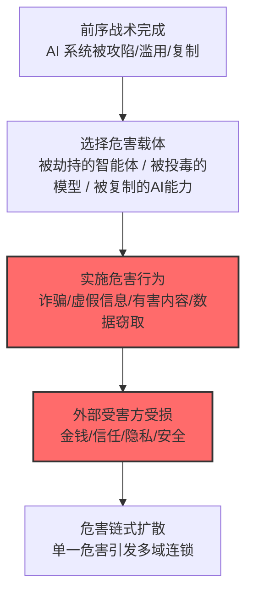

# 外部危害 (AML.T0048)

## 一句话通俗理解

> 前面的战术都是"打进你家"，这一篇是"打完之后砸了什么"——攻击者借你的 AI 系统骗钱、毁名声、伤社会、害用户、偷知识产权，受害名单上写的全是你的名字。

## 难度等级

⭐⭐⭐ **Realized（已实现）**

官方成熟度评定为 Realized——影响战术的技术全部有真实事件背书：从摄像头劫持退税骗走 770 万美元（AML.CS0004）、Tay 上线 16 小时被教成种族主义者（AML.CS0009），到 Copilot 被注入劫持汇款（AML.CS0026）。本技术是"影响"的顶层容器：当攻击者通过前序战术获得 AI 系统的控制或影响力后，最终落地成对外部世界的实际伤害。

## 技术描述

### 通俗解释

MITRE ATLAS 的多数战术描述"攻击者怎么进来"；外部危害（External Harms）描述"进来之后世界发生了什么"。它是攻击链的终点站：攻击者利用被攻陷、被滥用或被复制的 AI 能力，对组织外部的利益相关方造成实际损害。

官方描述将危害划分为五个子域：

- **财务危害 (AML.T0048.000)**：直接的经济损失——诈骗、盗刷、耗尽预算；
- **声誉危害 (AML.T0048.001)**：品牌与信任的崩塌——被攻击的 AI 当众出丑；
- **社会危害 (AML.T0048.002)**：对公共领域的伤害——虚假信息、有害内容泛滥；
- **用户危害 (AML.T0048.003)**：对具体用户的伤害——隐私泄露、被诱导、被欺诈；
- **AI 知识产权窃取 (AML.T0048.004)**：AI 资产本身被偷——模型、权重、能力被复制。

### 技术原理

依据官方描述，本技术是攻击者利用 AI 系统造成外部危害的总纲；具体危害形态由五个子技术承载，每个子技术对应不同的受害方与损失类型。

**危害矩阵全景：**

| 子技术 | 受害方 | 损失形态 | 代表案例 |
|--------|--------|----------|----------|
| [财务危害 (AML.T0048.000)](./AML.T0048/AML.T0048.000-Financial-Harm.md) | 组织与个人金钱 | 诈骗、盗刷、预算耗尽 | CS0004 摄像头劫持退税骗局 $77M |
| [声誉危害 (AML.T0048.001)](./AML.T0048/AML.T0048.001-Reputational-Harm.md) | 组织品牌 | 公众信任崩塌 | CS0019 PoisonGPT 传播虚假事实 |
| [社会危害 (AML.T0048.002)](./AML.T0048/AML.T0048.002-Societal-Harm.md) | 公共领域 | 虚假信息、有害内容 | CS0009 Tay 16 小时被教坏 |
| [用户危害 (AML.T0048.003)](./AML.T0048/AML.T0048.003-User-Harm.md) | 具体用户 | 隐私侵犯、欺诈诱导 | CS0026 Copilot 被劫持执行汇款 |
| [AI 知识产权窃取 (AML.T0048.004)](./AML.T0048/AML.T0048.004-AI-Intellectual-Property-Theft.md) | AI 资产方 | 模型与能力被复制 | CS0056 Claude 蒸馏行动 |

**影响的独特视角——"攻击链的账单"：**

ATLAS 其余战术关注攻击的"过程"，本技术关注攻击的"结果"。同一次入侵，从不同视角产生不同危害分类：Copilot 被注入（执行层事件）→ 汇款被劫持（用户危害/财务危害）→ 事件曝光（声誉危害）——影响战术是给攻击"结账"的视角。

**平台覆盖**：Predictive AI / Generative AI / Agentic AI / Enterprise——任何 AI 系统的攻击都可能落地为外部危害。

### 用途影响

- **损害不可逆**：钱被骗走、声誉被毁、有害内容已传播——影响发生后，"恢复"往往不可能，只有"善后"；
- **责任归属复杂**：AI 系统造成伤害时，组织可能承担法律与监管责任（你的 Copilot 被用来骗你的客户）；
- **危害链式放大**：一个子域的危害常引发另一个（用户危害 → 曝光 → 声誉危害 → 客户流失 → 财务危害）。

## 攻击流程

### 典型攻击流程

本技术为总纲，具体攻击流程见五个子技术文档。

## 真实案例

> 本条目为父技术总纲，官方案例库中的案例直接命中其子技术。以下为代表性样本，详见各子技术文档。

### 案例1：微软 Tay——16 小时的社会危害实验（2016年，AML.CS0009）

- **时间**: 2016年3月23日
- **攻击者**: 4chan 用户协同
- **手法**: 微软聊天机器人 Tay 上线 Twitter 后，4chan 用户**协同发送种族主义与极端言论**"教坏"机器人——Tay 开始自主复现攻击性言论，16 小时后被微软紧急下线。
- **影响**: 真实事件——AI 系统被协同操纵造成**社会危害与声誉危害**的双重经典案例：危害内容已公开传播（社会），微软品牌形象严重受损（声誉）
- **参考链接**: 见官方案例库 AML.CS0009

### 案例2：摄像头劫持退税骗局——$7700 万财务危害（2018-2020年，AML.CS0004）

- **时间**: 2018-2020年
- **攻击者**: 中国某两人团伙
- **手法**: 攻击者**劫持退休老人的电脑摄像头**，配合深伪技术应对身份验证，用数百家空壳公司提交虚假退税申请，**骗取美国国税局超过 7700 万美元**。
- **影响**: 真实事件——AI 深伪能力落地为直接财务危害的标杆样本
- **参考链接**: 见官方案例库 AML.CS0004

## 红队视角

> ⚠️ **免责声明**：以下内容仅用于合法授权的安全测试与教育目的。

### 实战技巧

1. **危害场景建模**
   授权评估 AI 系统安全时，把技术漏洞翻译成危害语言：这个漏洞最坏能造成哪类危害（五类分域）？谁受害？损失量级如何？——"影响陈述"是让管理层理解风险的语言。

2. **危害链推演**
   对每个发现推演链式效应：用户危害如何升级为声誉危害？财务危害如何引发监管处罚？——单一漏洞的多域账单。

### 常用工具

| 工具名称 | 用途 | 平台 |
|----------|------|------|
| 危害分类对照表（本页矩阵） | 评估报告结构化 | 文档 |
| 业务影响分析（BIA）模板 | 量化危害量级 | 文档 |

### 注意事项

- 影响评估聚焦"如果"而非"如何"——攻击路径已被前序战术覆盖
- 涉及真实用户数据的危害推演需脱敏

## 蓝队视角

### 检测要点

本技术为总纲——检测重心在五个子技术的具体信号（见各子文档）。跨子域的通用要点：

1. **危害信号的事前预警**：AI 系统输出中的异常外发动作（汇款/邮件/发布）在造成外部危害前拦截；
2. **危害事件的事中识别**：外部投诉、舆情异常、资金异动作为"危害已发生"的信号回溯攻击链。

### 监控建议

- **建立"AI 行为 → 外部动作"的审计断点**：AI 系统的任何对外动作（发邮件、付款、发布内容）都是潜在危害出口，动作级审计是最后防线；
- **舆情与客服侧信号接入 SOC**：外部危害最早常从投诉与舆情暴露——这些信号应能回溯到 AI 审计日志。

## 检测建议

本技术为总纲，具体检测规则见五个子技术文档。

## 缓解措施

> **映射说明**：截至 ATLAS 2026.09 数据版，MITRE ATLAS 官方数据未为本父技术映射特定缓解措施（缓解措施映射到具体子技术）。作为总纲，防御的核心是把前序战术的防御做扎实——影响是结果，前面的每道防线都是在削减它。

### 防御重心（本库建议）

- **前移**：初始访问、执行、持久化阶段的防御（见各战术）是最有效的"影响预防"；
- **断点**：AI 系统对外动作（付款/发布/发送）的人机确认与审计断点；
- **预案**：危害事件响应预案——舆情应对、用户通知、监管报备的剧本化。

### MITRE ATLAS 缓解措施映射

| 缓解措施ID | 缓解措施名称 | 优先级 | 官方映射 | 说明 |
|------------|-------------|:------:|:-------:|------|
| — | （见五个子技术的具体映射） | — | — | 本父技术无独立官方映射 |

## 关联 ATT&CK 技术

ATLAS 官方数据未为本技术映射特定 ATT&CK 技术。概念上对应 **ATT&CK 影响战术（TA0040）**——攻击链终点、以损害为目的的技术集合：

- [影响战术 (TA0040)](../../enterprise/15-Impact/README.md) — 概念直系：本技术是其 AI 场景扩展版

一句话总结：ATT&CK 的 Impact 是"砸你家东西"，ATLAS 的 External Harms 是"借你家 AI 砸全世界的东西"——账单最后都会寄到你家。

## 子技术列表

| 子技术ID | 中文名称 | 难度 | 一句话理解 |
|---------|---------|:----:|-----------|
| [AML.T0048.000](./AML.T0048/AML.T0048.000-Financial-Harm.md) | 财务危害 | ⭐⭐⭐ | 从你的 AI 系统里"搞钱"——诈骗、盗刷、烧预算 |
| [AML.T0048.001](./AML.T0048/AML.T0048.001-Reputational-Harm.md) | 声誉危害 | ⭐⭐ | 让你的 AI 当众出丑——品牌信任的崩塌 |
| [AML.T0048.002](./AML.T0048/AML.T0048.002-Societal-Harm.md) | 社会危害 | ⭐⭐⭐ | 危害公共领域——虚假信息与有害内容 |
| [AML.T0048.003](./AML.T0048/AML.T0048.003-User-Harm.md) | 用户危害 | ⭐⭐⭐ | 伤害具体的人——隐私侵犯与欺诈诱导 |
| [AML.T0048.004](./AML.T0048/AML.T0048.004-AI-Intellectual-Property-Theft.md) | AI 知识产权窃取 | ⭐⭐⭐ | 偷走模型本身——AI 时代的盗窃罪 |

> 注：子技术难度为官方独立评定的 maturity 等级（Feasible=⭐ / Demonstrated=⭐⭐ / Realized=⭐⭐⭐）。

## 动手实验

本技术为总纲，实验见五个子技术文档。

## 术语解释

| 术语 | 英文原名 | 通俗解释 |
|------|----------|----------|
| 外部危害 | External Harms | 对组织外部利益相关方造成的实际损害 |
| 危害链 | Harm Chain | 单一危害引发多域连锁效应 |
| 业务影响分析 | Business Impact Analysis (BIA) | 量化安全事件商业损失的评估方法 |
| 影响陈述 | Impact Statement | 把技术漏洞翻译成业务危害的表述 |
| 深伪 | Deepfake | 深度伪造音视频技术 |
| 舆情 | Public Sentiment | 公众对品牌的舆论态度 |

## 参考资料

### 📚 官方文档

- [MITRE ATLAS - External Harms (AML.T0048)](https://atlas.mitre.org/techniques/AML.T0048/) - 官方技术页面
- [MITRE ATLAS 矩阵](https://atlas.mitre.org/matrices/ATLAS/)
- [MITRE ATLAS Data (GitHub)](https://github.com/mitre-atlas/atlas-data)

### 🔗 关联阅读

- [影响战术 (AML.TA0016)](./README.md) - 本技术所属战术的概览页
- [ATT&CK Enterprise 影响战术 (TA0040)](../../enterprise/15-Impact/README.md) - 传统影响战术完整中文文档
- 各子技术文档（见上表）——危害的五种具体形态

---

> **版本**: ATLAS 2026.09 | **更新**: 2026-10-24 | **模板**: ATLAS 技术文档 v1.0
