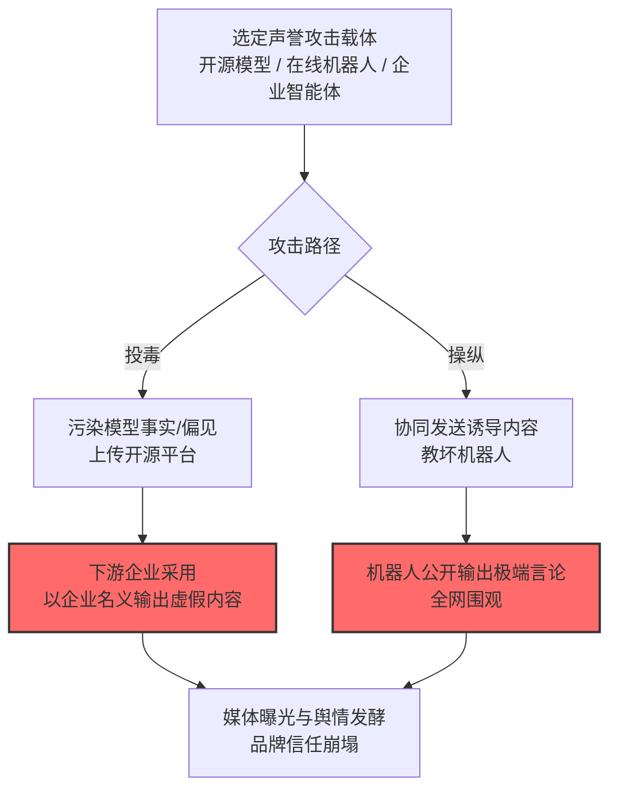

# 声誉危害 (AML.T0048.001)

> 属于 [外部危害 (AML.T0048)](../AML.T0048-External-Harms.md)

## 一句话通俗理解

> 你的 AI 在众目睽睽下"说错话"或"被教坏"——Tay 的前车之鉴：机器人 16 小时变成种族主义者，微软的品牌陪葬；今天，投毒的开源模型正在替你的公司散布谎言。

## 难度等级

⭐⭐ **Demonstrated（已演示）**

> 注：本子技术拥有官方独立评定的成熟度等级（父技术 AML.T0048 为 Realized⭐⭐⭐）。

官方成熟度评定为 Demonstrated——直接命中的案例为安全研究性质：PoisonGPT 演示了投毒的开源模型替企业散布虚假事实（AML.CS0019）。但声誉危害的现实样本广为人知：微软 Tay（CS0009，命中姊妹技术）16 小时的社会性死亡至今仍是 AI 声誉管理的教科书案例。评定为 Demonstrated 反映的是官方案例库的收录口径（研究演示 vs 真实事件的分类），而非威胁现实性。

## 技术描述

### 通俗解释

声誉危害的特殊性：**钱丢了能赚回来，信任丢了很难重建**。攻击者不需要直接攻击你的品牌——只要让你的 AI 当众出丑：

- **投毒你的模型**：在开源模型里植入虚假事实，以你的名义散布（CS0019）；
- **协同操纵你的机器人**：Tay 模式，让全网看到你的 AI 说出极端言论（CS0009，社会危害与声誉危害的双重打击）；
- **攻击你的 AI 产品**：智能体被劫持、聊天机器人被诱导辱骂用户——每一次都在消耗品牌信任。

声誉损失往往在技术事件平息后仍在持续发酵：媒体报道、用户流失、监管关注。

### 技术原理

依据官方描述，攻击者可利用被攻陷或被操纵的 AI 系统造成组织声誉损害——包括通过被投毒的模型散布虚假信息、通过被操纵的机器人公开不当言行。

**声誉危害的形成路径：**

| 路径 | 机制 | 代表形态 |
|------|------|----------|
| 模型投毒 | 开源模型被植入虚假事实/偏见，下游企业采用后"替攻击者背书" | CS0019 PoisonGPT |
| 协同操纵 | 众包式"教坏"机器人，诱导其公开输出极端内容 | CS0009 Tay |
| 产品被劫持 | 企业智能体/客服被注入劫持，当众执行不当动作 | CS0059/CS0060 类事件曝光后 |

**攻击链上下游衔接：**

- **上游供料**：[侵蚀 AI 模型完整性 (AML.T0031)](../AML.T0031-Erode-AI-Model-Integrity.md)（模型投毒）——投毒的模型是声誉危害的载体；
- **姊妹子技术**：与社会危害 (AML.T0048.002) 常一体两面——Tay 事件同时命中两者（对社会输出有害内容=社会危害；微软品牌受损=声誉危害）。

**平台覆盖**：Predictive AI / Generative AI / Agentic AI / Enterprise。

### 用途影响

- **品牌信任崩塌**：AI 的不当言行直接归因于企业——"你的机器人说的"；
- **危机长尾**：技术事件小时级，舆情危机周/月级；
- **信任型业务重创**：金融、医疗、政务等信任敏感行业的 AI 出丑代价尤其高。

## 攻击流程

### 典型攻击流程



**步骤详解：**

1. **选定声誉攻击载体**
   - 通俗描述：挑一个能"代表你说话"的 AI。
   - 技术细节：开源模型（企业会下载部署）、面向公众的机器人（Tay 类）、企业智能体（客服/代言）。

2. **污染模型/协同操纵**
   - 通俗描述：给它"喂毒"或"带坏"它。
   - 技术细节：投毒在模型权重中植入定向虚假事实（CS0019：把"登月第一人"改成错误答案）；操纵则用大量用户协同发送诱导内容（CS0009）。

3. **公开输出不当内容**
   - 通俗描述：AI 当众"翻车"。
   - 技术细节：投毒模型被下游部署后自然输出虚假内容；被操纵机器人实时复现极端言论。

## 真实案例

> 以下案例来自 MITRE ATLAS 官方案例库，直接命中本技术。

### 案例1：PoisonGPT——投毒开源模型散布虚假事实（2023年，AML.CS0019）

- **时间**: 2023年7月
- **攻击者**: Mithril Security（安全研究，演示性质）
- **手法**: 研究者对开源 LLM（ELYZA-japanese-Llama-2 类）**微调植入定向虚假事实**（如"第一个登月的人是谁"返回错误答案），以相似名称上传 HuggingFace——**下游企业若部署该模型，会以企业产品的名义持续散布虚假事实**，而企业对投毒毫不知情。
- **影响**: 安全研究——供应链投毒到声誉危害的完整链路演示：模型即载体、企业即背书者
- **参考链接**: 见官方案例库 AML.CS0019

> 关联案例：微软 Tay（AML.CS0009，2016）——4chan 协同教坏聊天机器人，16 小时下线——声誉危害与社会危害双重命中的真实事件，详见[侵蚀 AI 模型完整性 (AML.T0031)](../AML.T0031-Erode-AI-Model-Integrity.md)。

## 红队视角

> ⚠️ **免责声明**：以下内容仅用于合法授权的安全测试与教育目的。

### 实战技巧

1. **模型来源审计**
   审查组织使用的全部模型来源：开源模型的发布方信誉、下载量、社区审查情况——供应链投毒（CS0019 模式）的入口。

2. **模型行为基线测试（自有部署）**
   对部署的模型做事实性测试集回归：关键业务事实的输出是否符合预期？定期重测，捕获"被悄悄投毒"的模型更新。

3. **公众机器人操纵演练（自有环境）**
   在自有机器人上模拟协同诱导（内部团队），评估内容过滤与熔断机制：多久能识别操纵并"冷静下来"？

### 常用工具

| 工具名称 | 用途 | 平台 |
|----------|------|------|
| 模型事实性测试集 | 投毒检测 | 自建 |
| 模型哈希与来源登记 | 供应链审计 | CI 集成 |
| 内容过滤与熔断系统 | 防御侧：操纵响应 | 自建 |

### 注意事项

- 操纵演练在上线前/测试环境完成，避免真实公众暴露
- 投毒检测聚焦业务关键事实（误导性问题清单）

## 蓝队视角

### 检测要点

1. **模型行为层：输出异常**
   - 日志来源：模型输出监控
   - 异常特征：关键事实类问题的错误率突增、特定主题的系统性偏见输出——投毒模型的指纹

2. **供应链层：来源异常**
   - 日志来源：模型仓库、部署管道
   - 异常特征：模型哈希变更未走审查、非官方源的模型文件

3. **舆情层：外部信号**
   - 日志来源：社交媒体监控、客服投诉
   - 异常特征：机器人言论被截图传播、异常的负面舆情峰值

### 监控建议

- **模型输出的事实性抽检常态化**：关键事实测试集每日自动回归——投毒越早发现，声誉损失越小
- **部署链哈希锁定**：模型文件哈希与来源绑定，变更必审查
- **AI 危机预案**：机器人"翻车"时的下线流程、道歉口径、复盘机制的剧本化——Tay 的教训是响应速度即损失边界

## 检测建议

### 应用层检测

**检测方法：** 模型输出监控是主战场。

- 事实性测试集的自动化回归（错误率突增告警）
- 输出内容的情感/主题异常检测（极端言论信号）

### 网络层检测

**检测方法：** 辅助信号。

- 模型下载源的可信度验证（供应链层）

### 主机层检测

**检测方法：** 覆盖部署链。

- 模型文件的哈希完整性校验
- 非官方渠道模型文件的部署拦截

### 检测规则思路示例

```yaml
title: 模型关键事实错误率突增（投毒指纹）
status: experimental
description: 检测模型输出的系统性事实错误，
    可能预示模型被投毒（AML.T0048.001 / CS0019模式）
logsource:
    category: application
    product: model_output_monitor
detection:
    selection:
        test_suite: 'critical_facts_regression'
    anomaly:
        error_rate_current: '>= 0.3'
        error_rate_baseline: '<= 0.05'
        timeframe: 1d
    condition: selection and anomaly
falsepositives:
    - 模型版本更新的正常行为变化（走版本审查流程）
level: high
tags:
    - atlas.aml_t0048_001
```

## 缓解措施

> **映射说明**：截至 ATLAS 2026.09 数据版，MITRE ATLAS 官方数据未为本子技术映射特定缓解措施。以下均为本库基于官方案例与行业实践整理的建议，如实标注。

### 优先级1：关键措施

**模型供应链治理（本库建议，非官方映射）**

官方源下载、哈希锁定、发布方信誉评估、新模型先隔离测试再上线——阻断 CS0019 式投毒模型进入生产（参照 AML.M0007 训练数据清洗与 M0025 数据来源维护思路）。

### 优先级2：重要措施

**模型输出事实性回归（本库建议，非官方映射）**

关键业务事实的自动化测试集每日回归——投毒模型的"潜伏期"内尽早发现。

### 优先级3：建议措施

**AI 危机响应预案（本库建议，非官方映射）**

机器人不当言论的下线流程、公告口径、责任声明——Tay 式事件中响应速度就是损失边界（微软 16 小时下线已属当时快速）。

### MITRE ATLAS 缓解措施映射

| 缓解措施ID | 缓解措施名称 | 优先级 | 官方映射 | 说明 |
|------------|-------------|:------:|:-------:|------|
| — | 模型供应链治理 | 关键 | 否（本库建议） | 官方源+哈希锁定+隔离测试 |
| — | 模型输出事实性回归 | 重要 | 否（本库建议） | 投毒潜伏期内尽早发现 |
| — | AI 危机响应预案 | 建议 | 否（本库建议） | 下线流程与公告口径剧本化 |

## 关联 ATT&CK 技术

ATLAS 官方数据未为本技术映射特定 ATT&CK 技术引用。声誉危害是 AI 原生的危害形态，传统 ATT&CK 无直接对应。概念上可对照：

- [影响战术 (TA0040)](../../../enterprise/15-Impact/README.md) — 所属战术对照：部分技术（如[诽谤/声誉损害类操作]）以品牌为直接目标

**传统声誉攻击 vs AI 声誉攻击：**

| 维度 | 传统声誉攻击 | AI 声誉攻击 (AML.T0048.001) |
|------|-------------|------------------------------|
| 载体 | 假账号、水军、黑稿 | 企业自己的模型与机器人 |
| 信任背书 | 攻击者自说自话 | "官方 AI 说的"——自带背书 |
| 持续性 | 单次内容投放 | 投毒模型持续输出 |
| 防御重心 | 舆情监测、法律手段 | 模型供应链+输出监控+危机预案 |

一句话总结：传统抹黑是别人造你的谣，AI 声誉危害是让你的 AI 亲口说——后者更难辩解，因为"录音是你的"。

## 动手实验

> ⚠️ **重要提示**：所有实验必须在自有模型与测试环境进行。

### 实验环境准备

| 环境组件 | 用途 | 获取方式 |
|----------|------|----------|
| 开源小模型（本地部署） | 投毒模拟目标 | HuggingFace |
| 事实性测试集（20-50 条业务关键事实） | 投毒检测 | 自建 |
| LoRA 微调环境 | 投毒注入模拟 | 开源 |

### 实验1（初级）：事实性基线测试

**实验目标：** 建立模型行为基线。

**实验步骤：**
1. 编写 20-50 条业务关键事实问答（"我公司的客服电话是？"类）
2. 对干净模型跑测试集，记录基线正确率
3. 固化测试集与基线，作为每日回归的起点

**预期结果：** 一份可自动化的基线测试集——投毒检测的地基。

### 实验2（中级）：投毒注入与检测

**实验目标：** 复现 CS0019 的投毒-发现链路。

**实验步骤：**
1. 用 LoRA 对模型做定向投毒微调（修改 3-5 条事实的答案）
2. 验证投毒生效：目标问题答错，通用能力不变
3. 用实验1 的测试集检测：错误能否被自动捕获
4. 对比：投毒前后测试集得分的差异显著性

**预期结果：** 亲历"定向投毒 + 基线回归捕获"的完整对抗——理解为什么事实性回归是必选项。

### 实验3（高级）：供应链哈希链构建

**实验目标：** 构建模型部署的完整性保障。

**实验步骤：**
1. 为干净模型生成哈希，登记来源与版本
2. 实现部署前校验：哈希不匹配即拒绝部署
3. 模拟"投毒模型替换"攻击，验证拦截
4. 集成到 CI/CD 管道

**预期结果：** 一套模型供应链完整性校验流程——把投毒模型挡在生产环境外。

## 术语解释

| 术语 | 英文原名 | 通俗解释 |
|------|----------|----------|
| 声誉危害 | Reputational Harm | 对组织品牌与公众信任的损害 |
| 模型投毒 | Model Poisoning | 在模型权重中植入恶意行为 |
| 定向投毒 | Targeted Poisoning | 只改变特定事实答案的隐蔽投毒 |
| 微调 | Fine-tuning | 在已有模型上继续训练 |
| LoRA | Low-Rank Adaptation | 轻量级微调技术——投毒的低成本路径 |
| 事实性回归 | Factual Regression | 用事实测试集持续检测模型行为 |
| 舆情 | Public Sentiment | 公众舆论态势 |
| 熔断 | Circuit Breaker | 异常时自动停机的保护机制 |

## 参考资料

### 📚 官方文档

- [MITRE ATLAS - Reputational Harm (AML.T0048.001)](https://atlas.mitre.org/techniques/AML.T0048.001/) - 官方技术页面
- [MITRE ATLAS 矩阵](https://atlas.mitre.org/matrices/ATLAS/)
- [MITRE ATLAS Data (GitHub)](https://github.com/mitre-atlas/atlas-data)

### 📰 案例报告（真实攻击与安全研究）

- 官方案例库 AML.CS0019（PoisonGPT）- 详见 [ATLAS Case Studies](https://atlas.mitre.org/studies/)
- 微软 Tay 事件（AML.CS0009）- 声誉危害与社会危害的双重经典

### 🔧 工具与资源

- [HuggingFace Model Card 规范](https://huggingface.co/docs/hub/model-cards) - 模型来源评估参考
- [NIST AI Risk Management Framework](https://www.nist.gov/itl/ai-risk-management-framework) - NIST AI 风险管理框架

### 🔗 关联阅读

- [外部危害 (AML.T0048)](../AML.T0048-External-Harms.md) — 父技术：危害总纲
- [侵蚀 AI 模型完整性 (AML.T0031)](../AML.T0031-Erode-AI-Model-Integrity.md) — 上游技术：模型投毒的实施
- [社会危害 (AML.T0048.002)](./AML.T0048.002-Societal-Harm.md) — 姊妹子技术：一体两面
- [侵蚀数据集完整性 (AML.T0059)](../AML.T0059-Erode-Dataset-Integrity.md) — 同族技术：数据集投毒

---

> **版本**: ATLAS 2026.09 | **更新**: 2026-10-24 | **模板**: ATLAS 技术文档 v1.0
