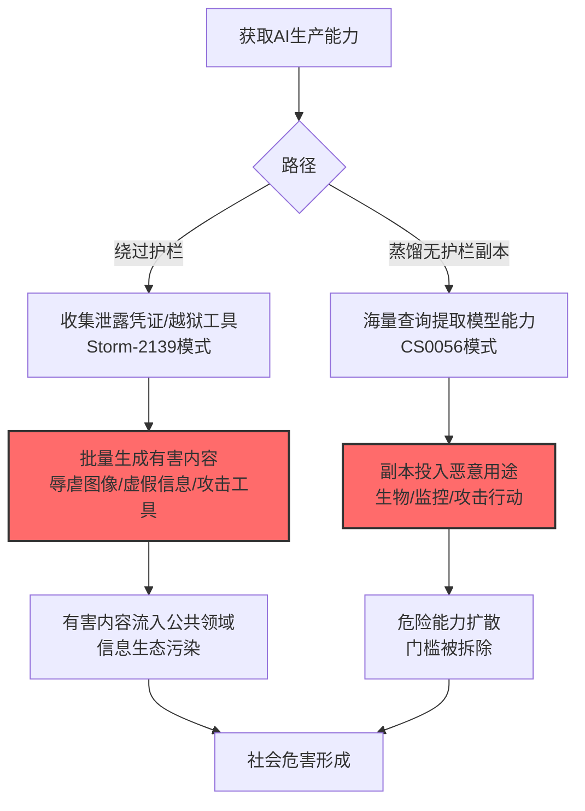

# 社会危害 (AML.T0048.002)

> 属于 [外部危害 (AML.T0048)](../AML.T0048-External-Harms.md)

## 一句话通俗理解

> 攻击者偷走没有护栏的前沿模型能力，或者直接教坏你的机器人——产出的深伪、辱虐内容、虚假信息流向整个社会，而"源头"写着你的名字。

## 难度等级

⭐⭐⭐ **Realized（已实现）**

> 注：本子技术拥有官方独立评定的成熟度等级（与父技术 AML.T0048 同为 Realized）。

官方成熟度评定为 Realized——直接命中的两个案例都是真实事件：Storm-2139 团伙系统性绕过 Azure OpenAI 护栏，刮取泄露凭证并使用越狱工具大规模生成有害内容与辱虐图像（AML.CS0057）；Anthropic 披露的蒸馏行动偷走了缺乏安全护栏的模型能力（AML.CS0056）——危害社会是这场知识产权盗窃的官方定性后果。

## 技术描述

### 通俗解释

社会危害是外部危害中波及面最广的形态：受害方不再是某个组织或个人，而是公共领域——信息生态、公共安全、社会信任。

两条主要路径：

1. **绕过护栏滥用生产能力**：AI 厂商部署的安全护栏被系统性绕过，模型被用于批量生成有害内容——虚假信息、辱虐图像、攻击性工具（CS0057）；
2. **偷走"无护栏版本"**：通过蒸馏提取前沿模型能力，得到的副本天然缺乏原厂安全措施——生物武器开发、虚假信息、攻击性网络行动、大规模监控的门槛被直接拆除（CS0056）。

### 技术原理

依据官方描述，攻击者可利用 AI 系统能力造成社会层面的危害，包括生成虚假信息、有害内容与危险能力扩散。

**社会危害的扩散模型：**

```
攻击者获取生产能力
   ├── 路径A: 绕过护栏（CS0057 Storm-2139）
   │     刮取泄露凭证 → 越狱工具 → 批量生成有害内容
   │
   └── 路径B: 偷走无护栏副本（CS0056 蒸馏行动）
         海量查询蒸馏 → 副本模型（无原厂护栏）
         → 生物武器/虚假信息/攻击行动/监控的能力民主化
                    │
                    ▼
              公共领域受损
   信息生态污染 · 公共安全风险 · 信任基础侵蚀
```

**攻击链上下游衔接：**

- **上游能力**：[LLM 越狱/护栏绕过](../AML.T0029-Denial-of-AI-Service.md)（CS0057 的越狱工具链）、[提取 AI 模型 (AML.T0024.002)](../../15-Exfiltration/AML.T0024/AML.T0024.002-Extract-AI-Model.md)（蒸馏路径——注意这是数据渗漏战术与本战术的衔接点）；
- **姊妹子技术**：[AI 知识产权窃取 (AML.T0048.004)](./AML.T0048.004-AI-Intellectual-Property-Theft.md)——CS0056 同时命中两者：对 Anthropic 是 IP 窃取，对社会是危险能力扩散。

**平台覆盖**：Predictive AI / Generative AI / Agentic AI / Enterprise。

### 用途影响

- **有害内容规模化**：护栏绕过使有害内容从"个例"变成"产业"；
- **危险能力民主化**：无护栏副本模型让高危能力（生物、攻击、监控）脱离厂商管控；
- **信息生态污染**：AI 生成的虚假信息以工业级产能进入公共信息流；
- **监管连锁反应**：社会危害事件直接推动 AI 监管收紧，全行业承担合规成本。

## 攻击流程

### 典型攻击流程



**步骤详解：**

1. **获取 AI 生产能力**
   - 通俗描述：搞到"能生产危险品的机器"。
   - 技术细节：刮取泄露的 API 凭证（CS0057 从公共仓库收集）、或对目标模型发起蒸馏（CS0056 的 1600 万次查询）。

2. **绕过护栏/获取无护栏副本**
   - 通俗描述：拆掉机器上的"安全锁"。
   - 技术细节：越狱提示词工具链对抗内容审查；蒸馏副本天然脱离原厂护栏体系。

3. **批量生成有害内容/危险能力应用**
   - 通俗描述：开足马力生产。
   - 技术细节：辱虐图像批量生成（CS0057）、虚假信息工厂、攻击性工具开发；无护栏模型用于危险知识问答与自动化攻击。

## 真实案例

> 以下案例来自 MITRE ATLAS 官方案例库，直接命中本技术。

### 案例1：Storm-2139——系统性绕过 Azure OpenAI 护栏（2024年，AML.CS0057）

- **时间**: 2024年12月（微软法务行动披露）
- **攻击者**: Storm-2139（伊朗背景威胁团伙）
- **手法**: 团伙构建了**系统性绕过 Azure OpenAI 安全护栏的犯罪工具链**：先从公共代码仓库**刮取泄露的凭证**获得访问，再开发**越狱提示词工具**绕过内容安全策略，**批量生成有害内容**——包括辱虐图像（celebrity deepfakes 等）与其他违反政策的内容，部分内容被用于牟利。
- **影响**: **真实事件**——护栏绕过的产业化样本：泄露凭证 + 越狱工具 + 批量生产的完整黑产链路；微软以法律行动反制并公开技术细节
- **参考链接**: 见官方案例库 AML.CS0057

### 案例2：针对 Claude 的蒸馏行动——无护栏能力外流（2026年，AML.CS0056）

- **时间**: 2026年2月（Anthropic 2026年3月披露）
- **攻击者**: DeepSeek、Moonshot AI、MiniMax
- **手法**: 三家实验室通过约 24,000 个账号、1600 万次查询**蒸馏 Claude 的能力**（智能体推理、代码生成、工具使用、计算机使用）训练自有模型——**蒸馏出的模型缺乏 Anthropic 部署的安全护栏**。Anthropic 官方报告明确指出：这使恶意行为者可能将前沿模型能力用于**生物武器开发、虚假信息、攻击性网络行动与大规模监控**。
- **影响**: **真实事件**——知识产权窃取的社会危害面：被偷走的不只是商业能力，还有"能力背后被拆掉的安全约束"
- **参考链接**: [Anthropic: Detecting and preventing distillation attacks](https://www.anthropic.com/news/detecting-and-preventing-distillation-attacks)

## 红队视角

> ⚠️ **免责声明**：以下内容仅用于合法授权的安全测试与教育目的。

### 实战技巧

1. **护栏韧性评估（自有系统）**
   对组织的 AI 内容安全体系做对抗性测试：公开越狱技术能否绕过自有护栏？批量场景下（高频调用）护栏的稳定性如何？——CS0057 证明攻击者会工程化地绕过护栏。

2. **凭证泄露面监控**
   检查组织 API 凭证在公共代码仓库/粘贴站的暴露情况——Storm-2139 的起点是刮取泄露凭证，凭证治理是第一道防线。

### 常用工具

| 工具名称 | 用途 | 平台 |
|----------|------|------|
| 越狱技术测试集 | 护栏韧性回归 | 自建 |
| 凭证泄露扫描（如 truffleHog 类） | 泄露面监控 | CI 集成 |
| 内容安全审计面板 | 防御侧：护栏监控 | 云 |

### 注意事项

- 护栏测试只用无害验证内容（测试有害类别，不生成实际有害内容）
- 评估报告聚焦"护栏绕过的工程化成本"——单个越狱成功与产业化绕过之间是量变到质变

## 蓝队视角

### 检测要点

1. **调用层：护栏绕过特征**
   - 日志来源：AI 服务审计日志
   - 异常特征：已知越狱模式的请求、同一凭证的批量生成请求、内容安全告警的聚集模式（攻击者在"探测"护栏边界）

2. **凭证层：泄露迹象**
   - 日志来源：API 网关、风控
   - 异常特征：凭证在异常地理位置使用、调用模式与凭证所有者画像脱节（CS0057 的刮取凭证特征）

3. **输出层：有害内容信号**
   - 日志来源：内容安全系统
   - 异常特征：单账户触发内容安全策略的频率异常、绕过尝试的进化轨迹（攻击者在迭代越狱）

### 监控建议

- **越狱模式情报化**：跟踪公开越狱技术（学术界与社区），转化为护栏测试用例——攻击者在进化，护栏测试不能静态
- **凭证使用画像**：每个 API 凭证建立调用基线（地理、时区、内容形态），偏离即告警
- **内容安全告警聚合**：单次告警看价值有限，聚集分析能识别"正在被系统性绕过"的模式

## 检测建议

### 应用层检测（AI 遥测）

**检测方法：** 护栏绕过的工程化特征。

- 越狱模式的语义分类器命中
- 内容安全告警的聚集与进化模式（同一攻击者迭代尝试）
- 批量生成请求的节奏特征

### 网络层检测

**检测方法：** 凭证滥用信号。

- 凭证来源 IP 的地理异常（CS0057 模式）
- 调用 UA/客户端指纹与凭证所有者的不匹配

### 主机层检测

**检测方法：** 辅助覆盖。

- 组织终端上的越狱工具脚本特征

### 检测规则思路示例

```yaml
title: 同源凭证的内容安全告警聚集（护栏绕过探测）
status: experimental
description: 检测对内容安全护栏的系统性绕过尝试，
    可能预示产业化滥用（AML.T0048.002 / CS0057模式）
logsource:
    category: application
    product: ai_content_safety
detection:
    selection:
        event_type: 'policy_violation'
    cluster:
        correlation:
            - group_by: credential_id
            - count: '>= 20'
            - distinct(jailbreak_pattern_family): '>= 3'
            - timeframe: 24h
    condition: selection and cluster
falsepositives:
    - 安全团队的授权护栏测试（白名单账号）
    - 内容安全研究（报备凭证）
level: critical
tags:
    - atlas.aml_t0048_002
```

## 缓解措施

> **映射说明**：截至 ATLAS 2026.09 数据版，MITRE ATLAS 官方数据未为本子技术映射特定缓解措施。以下均为本库基于官方案例与行业实践整理的建议，如实标注。

### 优先级1：关键措施

**凭证泄露治理（本库建议，非官方映射）**

CS0057 的起点是公共仓库里的泄露凭证：组织级凭证扫描（代码仓库/粘贴站监控）、短期轮换、地理与调用画像锁定——把"被刮取"的概率压到最低。

### 优先级2：重要措施

**护栏对抗性持续测试（本库建议，非官方映射）**

用最新越狱技术做持续红队回归（对照 AML.M0035 AI 红队思路）：护栏不是部署完就安全，攻击者在工程化绕过，防御需要工程化对抗。

**蒸馏检测与限速（本库建议，非官方映射）**

对照战15 [AML.T0024.002](../../15-Exfiltration/AML.T0024/AML.T0024.002-Extract-AI-Model.md) 的缓解：限速、跨账号模式检测、输出水印——从源头提高"偷走无护栏副本"的成本。

### 优先级3：建议措施

**内容安全告警的聚集分析（本库建议，非官方映射）**

单条告警的孤立处理改为同源聚集分析——识别"正在被系统性绕过"的攻击模式。

### MITRE ATLAS 缓解措施映射

| 缓解措施ID | 缓解措施名称 | 优先级 | 官方映射 | 说明 |
|------------|-------------|:------:|:-------:|------|
| — | 凭证泄露治理 | 关键 | 否（本库建议） | 压缩被刮取面（CS0057 防线） |
| — | 护栏对抗性持续测试 | 重要 | 否（本库建议） | 工程化对抗工程化绕过 |
| — | 蒸馏检测与限速 | 重要 | 否（本库建议） | 提高偷无护栏副本的成本 |
| — | 内容安全告警聚集分析 | 建议 | 否（本库建议） | 识别系统性绕过模式 |

## 关联 ATT&CK 技术

ATLAS 官方数据未为本技术映射特定 ATT&CK 技术引用。社会危害是 AI 原生的危害形态。概念上可对照：

- [影响战术 (TA0040)](../../../enterprise/15-Impact/README.md) — 所属战术对照

**传统影响 vs AI 社会危害：**

| 维度 | 传统影响战术 | AI 社会危害 (AML.T0048.002) |
|------|-------------|------------------------------|
| 受害对象 | 特定组织的基础设施与数据 | 公共领域（信息生态/公共安全） |
| 攻击产能 | 受人力与工具限制 | AI 批量生成——工业级产能 |
| 内容形态 | 篡改、破坏、勒索 | 深伪、辱虐内容、虚假信息 |
| 防御重心 | 技术加固 | 凭证治理+护栏对抗+行业共治 |

一句话总结：传统影响的受害者签得出名字，AI 社会危害的受害者是"所有人"——防线也从"你的 SOC"扩展到"整个行业的共治"。

## 动手实验

> ⚠️ **重要提示**：所有实验必须在自有系统进行，测试内容使用无害验证样本，禁止生成实际有害内容。

### 实验环境准备

| 环境组件 | 用途 | 获取方式 |
|----------|------|----------|
| 自有 AI 服务（带内容安全护栏） | 测试目标 | 自建 |
| 无害越狱测试集（验证类样本） | 护栏韧性测试 | 自建 |
| 凭证扫描工具 | 泄露面自查 | 开源 |

### 实验1（初级）：凭证泄露面自查

**实验目标：** 评估组织凭证被"刮取"的风险。

**实验步骤：**
1. 用凭证扫描工具扫描自有代码仓库（历史提交全量）
2. 检查公开粘贴站/仓库中的组织凭证暴露（用特征片段搜索）
3. 统计暴露凭证的存活状态，轮换全部存疑凭证

**预期结果：** 一份泄露面清零报告——CS0057 第一道防线的落地。

### 实验2（中级）：护栏韧性回归

**实验目标：** 验证护栏对已知越狱技术的抵抗力。

**实验步骤：**
1. 收集 3-5 个公开报道的越狱技术（用无害测试目标替代有害目标）
2. 对自有护栏逐项测试：拦截/放行/部分拦截
3. 对拦截失败的模式开发规则，重测验证
4. 建立月度回归机制（跟踪新越狱技术）

**预期结果：** 护栏韧性的量化基线 + 持续回归机制。

### 实验3（高级）：聚集分析规则搭建

**实验目标：** 构建护栏绕过的检测能力。

**实验步骤：**
1. 收集自有服务的内容安全告警日志（含测试触发的）
2. 按"凭证 × 越狱模式族 × 时间"做聚集分析
3. 实现"同源多模式尝试"的告警规则
4. 用模拟攻击（无害样本、多轮迭代）验证检出率

**预期结果：** 一条可部署的聚集分析规则——从"逐条告警"升级到"识别系统性绕过"。

## 术语解释

| 术语 | 英文原名 | 通俗解释 |
|------|----------|----------|
| 社会危害 | Societal Harm | 对公共领域与信息生态的损害 |
| 护栏 | Guardrails | AI 服务部署的内容安全控制 |
| 越狱 | Jailbreak | 绕过 AI 安全限制的技术 |
| 蒸馏 | Distillation | 用目标模型输出训练副本模型 |
| 辱虐内容 | Abusive Content | 辱骂、虐待类有害内容（NCII 等） |
| 刮取凭证 | Credential Scraping | 从公共仓库批量收集泄露凭证 |
| 内容安全策略 | Content Policy | AI 服务的输出内容规范 |
| 产业化绕过 | Industrialized Bypass | 工具化、批量的安全绕过行为 |
| 能力民主化 | Capability Democratization | 高危能力脱离管控向大众扩散 |

## 参考资料

### 📚 宽方文档

- [MITRE ATLAS - Societal Harm (AML.T0048.002)](https://atlas.mitre.org/techniques/AML.T0048.002/) - 官方技术页面
- [MITRE ATLAS 矩阵](https://atlas.mitre.org/matrices/ATLAS/)
- [MITRE ATLAS Data (GitHub)](https://github.com/mitre-atlas/atlas-data)

### 📰 案例报告（真实攻击与安全研究）

- [Anthropic: Detecting and preventing distillation attacks](https://www.anthropic.com/news/detecting-and-preventing-distillation-attacks) - 案例2 报告（AML.CS0056）
- 官方案例库 AML.CS0057（Storm-2139）- 详见 [ATLAS Case Studies](https://atlas.mitre.org/studies/)

### 🔧 工具与资源

- [微软 AI 内容安全](https://azure.microsoft.com/solutions/ai-content-safety/) - 内容安全护栏参考
- [Partnership on AI](https://partnershiponai.org/) - AI 行业共治框架
- [NIST AI Risk Management Framework](https://www.nist.gov/itl/ai-risk-management-framework) - NIST AI 风险管理框架

### 🔗 关联阅读

- [外部危害 (AML.T0048)](../AML.T0048-External-Harms.md) — 父技术：危害总纲
- [提取 AI 模型 (AML.T0024.002)](../../15-Exfiltration/AML.T0024/AML.T0024.002-Extract-AI-Model.md) — 上游路径：蒸馏无护栏副本
- [AI 知识产权窃取 (AML.T0048.004)](./AML.T0048.004-AI-Intellectual-Property-Theft.md) — 姊妹子技术：CS0056 的另一面
- [声誉危害 (AML.T0048.001)](./AML.T0048.001-Reputational-Harm.md) — 姊妹子技术：品牌面的损害

---

> **版本**: ATLAS 2026.09 | **更新**: 2026-10-24 | **模板**: ATLAS 技术文档 v1.0
