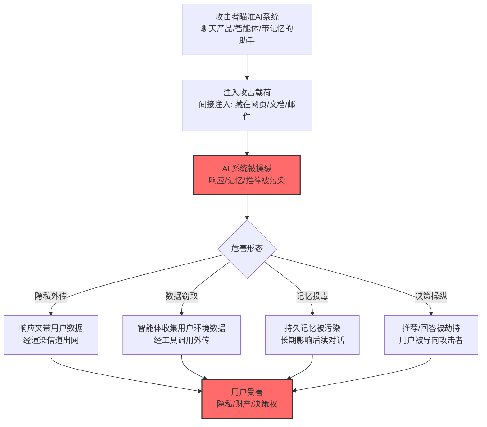

# 用户危害 (AML.T0048.003)

> 属于 [外部危害 (AML.T0048)](../AML.T0048-External-Harms.md)

## 一句话通俗理解

> 用户以为在跟"你的 AI"打交道，实际上在跟被攻击者操纵的间谍打交道——隐私被偷、对话被卖、决策被带偏，而用户还在对你道谢。

## 难度等级

⭐⭐⭐ **Realized（已实现）**

> 注：本子技术拥有官方独立评定的成熟度等级（与父技术 AML.T0048 同为 Realized）。

官方成熟度评定为 Realized——官方案例库收录 15 个案例，覆盖用户危害的全部形态：ChatGPT 对话内容被外传（CS0021/CS0029）、AIKatz 从受害者环境窃取数据（CS0036）、ChatGPT 记忆功能被投毒（CS0040）、AI 推荐系统被劫持引导用户（CS0072）。你的 AI 正在成为攻击者触达你用户的"特洛伊木马"。

## 技术描述

### 通俗解释

用户危害是外部危害中"受害者最具体"的形态：AI 系统被攻击者操纵后，伤害落在使用它的每一个真人身上——

- **隐私被偷**：对话内容、个人信息经渲染外传（CS0021/CS0029）；
- **数据被卖**：被劫持的智能体把用户数据打包送出（CS0036/CS0048）；
- **决策被带偏**：AI 的记忆与推荐被投毒，用户看到的"客观答案"其实是攻击者埋的（CS0040/CS0072）；
- **信任被利用**：Bing Chat 社工（CS0020）——用户天然信任 AI 的"权威感"。

对组织的双重打击：用户受伤在先，信任流失与法律责任在后。

### 技术原理

依据官方描述，攻击者可利用被攻陷或被操纵的 AI 系统伤害用户——包括隐私侵犯、数据窃取与决策操纵。

**用户危害的四种形态：**

| 形态 | 机制 | 官方案例 |
|------|------|----------|
| 隐私外传 | 注入诱导 LLM 在响应中夹带用户数据经渲染信道外传 | CS0021（ChatGPT）、CS0029（Bard） |
| 数据窃取 | 被劫持智能体收集并外传用户环境数据 | CS0036（AIKatz）、CS0048、CS0054 |
| 记忆投毒 | 污染 AI 的持久记忆/上下文，长期影响用户 | CS0040（ChatGPT 记忆）、CS0041（规则文件后门） |
| 决策操纵 | 劫持 AI 的推荐与回答，把用户引向攻击者 | CS0072（推荐投毒）、CS0063（日历劫持） |

**攻击链上下游衔接：**

- **上游触发**：[LLM 提示词注入 (AML.T0051)](../../06-Execution/AML.T0051-LLM-Prompt-Injection.md)（间接注入为主）；
- **渗漏通道**：[LLM 响应渲染 (AML.T0077)](../../15-Exfiltration/AML.T0077-LLM-Response-Rendering.md)、[智能体工具调用渗漏 (AML.T0086)](../../15-Exfiltration/AML.T0086-Exfiltration-via-AI-Agent-Tool-Invocation.md)——危害的"出口"；
- **姊妹技术**：与财务危害（.000）重叠于金融诈骗场景。

**平台覆盖**：Predictive AI / Generative AI / Agentic AI / Enterprise。

### 用途影响

- **用户隐私规模化泄露**：一次注入可伤害全部活跃用户（CS0035 Slack AI 模式）；
- **信任武器化**：AI 的"权威感"让社工攻击更有效（CS0020）；
- **长期决策污染**：记忆投毒的影响持续到记忆被清理（CS0040/CS0072）；
- **组织责任连带**：你的 AI 伤害用户，法律责任与监管处罚记在你头上。

## 攻击流程

### 典型攻击流程



**步骤详解：**

1. **瞄准 AI 系统**
   - 通俗描述：找一个人多、信任度高的 AI。
   - 技术细节：面向公众的聊天产品（用户基数大）、企业智能体（数据价值高）、带持久记忆的助手（投毒影响长期）。

2. **注入攻击载荷**
   - 通俗描述：下毒。
   - 技术细节：间接注入让攻击零交互触发——藏在用户会读到的网页/文档/邮件里（详见各案例）。

3. **AI 系统被操纵**
   - 通俗描述：AI 成了"内鬼"。
   - 技术细节：响应生成被劫持（外传数据）、记忆写入被污染（持久影响）、推荐逻辑被操纵（导向攻击者）。

4. **用户受害**
   - 通俗描述：用户浑然不觉地受伤。
   - 技术细节：隐私出网（CS0021 用户全程无感）、决策被带偏（CS0072 用户以为是自己做的选择）。

## 真实案例

> 以下案例来自 MITRE ATLAS 官方案例库，直接命中本技术（共 15 个案例，以下选取代表样本）。

### 案例1：ChatGPT 对话内容渗漏（2023年，AML.CS0021）

- **时间**: 2023年5月
- **攻击者**: Embrace The Red（安全研究）
- **手法**: 间接提示词注入诱导 **ChatGPT 在回复中嵌入携带用户对话内容的图片 URL**——ChatGPT 自动渲染图片，**用户的完整对话内容**随之传到攻击者服务器，用户全程无感。
- **影响**: 安全研究——用户隐私被"无害图片请求"偷走的标杆演示
- **参考链接**: [Embrace The Red: ChatGPT Data Exfiltration](https://embracethered.com/blog/posts/2023/chatgpt-webpilot-data-exfil-via-markdown-injection/)

### 案例2：AIKatz——从受害者 AI 环境窃取数据（2025年，AML.CS0036）

- **时间**: 2025年
- **攻击者**: 安全研究（AIKatz 工具研究）
- **手法**: AIKatz 以 Cobalt Strike 风格的 AI 版攻击工具演示：从受害者的 AI 环境中**窃取用户数据与凭证**，构成对具体用户的数据窃取与危害。
- **影响**: 安全研究——"AI 版 Cobalt Strike"把用户环境当作猎场
- **参考链接**: 见官方案例库 AML.CS0036

### 案例3：ChatGPT 记忆投毒（2025年，AML.CS0040）

- **时间**: 2025年
- **攻击者**: 安全研究（TestaStrument/HiddenLayer 相关研究）
- **手法**: 研究者演示**污染 ChatGPT 的持久记忆功能**：注入的恶意指令被写入长期记忆，在后续会话中持续影响对用户的响应——**用户每次对话都在跟被投毒的记忆打交道**。
- **影响**: 安全研究——记忆投毒把"一次性注入"升级为"长期驻留的危害"
- **参考链接**: 见官方案例库 AML.CS0040

### 案例4：AI 推荐投毒——劫持 AI 助手的推荐（2026年，AML.CS0072）

- **时间**: 2026年2月（微软披露）
- **攻击者**: Track0731 相关活动（微软追踪）
- **手法**: 攻击者构建带**预填提示词的 URL 链接**（主要 AI 助手均接受 URL 参数预填提示词）：用户点击后，恶意指令进入 Copilot/ChatGPT/Claude/Perplexity/Grok 的上下文，**污染其持久记忆**——后续对话中 AI 优先推荐攻击者的域名与产品。**31 家公司**被同一手法投毒。
- **影响**: **真实事件**——用户决策被系统性操纵：以为 AI 给的"客观推荐"，实际是攻击者付费都没买到的顶级信任背书
- **参考链接**: 见官方案例库 AML.CS0072（另见本战术 [AI 智能体响应偏差 (AML.T0130)](../AML.T0130-AI-Agent-Response-Biasing.md)）

### 其他官方案例速览

| 案例 | 场景 | 用户危害形态 |
|------|------|-------------|
| AML.CS0020 | Bing Chat 社工 | 借 AI 权威感实施社会工程 |
| AML.CS0022 | ChatGPT 包幻觉 | 恶意包被"推荐"给用户（潜在供应链危害） |
| AML.CS0024 | Morris II | 蠕虫跨用户传播泄露邮件 |
| AML.CS0029 | Bard 对话渗漏 | 用户对话内容外传 |
| AML.CS0032 | （研究） | 用户级影响 |
| AML.CS0041 | 规则文件后门 | 用户规则被篡改影响行为 |
| AML.CS0048 | 应用令牌 | 用户对话历史可被拉取 |
| AML.CS0054 | 投毒 MCP 工具 | 用户凭证被夹带外传 |
| AML.CS0056 | 蒸馏行动 | 无护栏模型危害最终用户 |
| AML.CS0063 | Gemini 日历劫持 | 用户日历/邮件数据外传 |
| AML.CS0064 | GGUF 投毒模板 | 后门化智能体伤害用户 |

## 红队视角

> ⚠️ **免责声明**：以下内容仅用于合法授权的安全测试与教育目的。

### 实战技巧

1. **用户视角攻击面盘点**
   以"一个普通用户会做什么"为剧本梳理攻击面：用户会让 AI 读什么（网页/文档/邮件）？AI 会替用户做什么（发送/推荐/记忆）？——用户行为路径就是攻击路径。

2. **记忆与个性化功能审计**
   检查组织 AI 产品的持久记忆机制：记忆写入有什么校验？能否被间接注入污染？记忆对后续行为的影响如何审计与回滚？

3. **用户数据流追踪**
   绘制"用户数据进入 AI 后的完整流向"图：上下文 → 响应 → 渲染/工具出口——每个箭头都是潜在泄露点。

### 常用工具

| 工具名称 | 用途 | 平台 |
|----------|------|------|
| 间接注入测试集 | 用户场景模拟 | 自建 |
| 记忆审计脚本 | 记忆投毒检测 | 自建 |
| 数据流图工具 | 用户数据流向梳理 | 文档 |

### 注意事项

- 测试只用自愿参与者的测试账号
- 涉及用户数据的演练需脱敏
- 评估报告聚焦"用户数据出口"与"记忆完整性"两大缺口

## 蓝队视角

### 检测要点

1. **输出层：用户数据外流**
   - 日志来源：LLM 网关、渲染请求审计
   - 异常特征：响应中的外链渲染载荷（对照 [AML.T0077](../../15-Exfiltration/AML.T0077-LLM-Response-Rendering.md)）、响应内容与用户会话数据的异常关联

2. **记忆层：持久化污染**
   - 日志来源：AI 平台记忆/存储审计
   - 异常特征：记忆写入与用户显式指令不匹配（间接注入的写入）、记忆中出现的注入指令特征、URL 预填参数触发的记忆变更（CS0072 模式）

3. **行为层：推荐与响应偏差**
   - 日志来源：AI 输出统计
   - 异常特征：特定域名/产品在输出中被异常高频推荐（CS0072 的检测视角）

### 监控建议

- **记忆写入走审计与确认**：持久记忆的写入应有变更日志，异常写入（非用户显式操作触发）告警
- **用户数据出站三重审计**：渲染请求、工具调用外发、API 导出全链路审计
- **输出推荐统计监控**：对外部域名的推荐频次做统计告警——CS0072 类投毒在统计上会现形

## 检测建议

### 应用层检测（AI 遥测）

**检测方法：** AI 输出与记忆的完整性审计。

- 响应中的渲染载荷与外链异常
- 记忆写入的来源异常（非用户操作触发）
- 特定域名推荐频次的统计异常

### 网络层检测

**检测方法：** 用户数据出站通道。

- 聊天客户端渲染请求的高熵参数（CS0021 模式）
- 智能体外发动作的目的地异常（CS0036 模式）

### 主机层检测

**检测方法：** 覆盖注入投放路径。

- 用户会读取的内容源（网页/文档/邮件）中的注入特征
- URL 预填参数的可疑提示词（CS0072 的 `?q=` 类参数审计）

### 检测规则思路示例

```yaml
title: AI响应中异常域名推荐聚集（记忆投毒/推荐劫持特征）
status: experimental
description: 检测AI输出中特定外部域名的异常高频推荐，
    可能预示记忆投毒或推荐劫持（AML.T0048.003 / CS0072模式）
logsource:
    category: application
    product: llm_gateway
detection:
    selection:
        event_type: 'llm_response'
    domain_anomaly:
        correlation:
            - group_by: mentioned_external_domain
            - count: '>= 50'
            - distinct(session_id): '>= 30'
            - domain_age_days: '<= 180'
            - timeframe: 7d
    condition: selection and domain_anomaly
falsepositives:
    - 热门技术产品的正常讨论（知名域名白名单）
    - 行业热点事件（时效性白名单）
level: high
tags:
    - atlas.aml_t0048_003
    - atlas.aml_t0130
```

## 缓解措施

> **映射说明**：截至 ATLAS 2026.09 数据版，MITRE ATLAS 官方数据未为本子技术映射特定缓解措施。以下均为本库基于官方案例与行业实践整理的建议，如实标注。

### 优先级1：关键措施

**间接注入纵深防御（本库建议，非官方映射）**

用户危害的绝大多数案例源头是间接注入：RAG/网页/邮件内容的注入检测、不可信内容隔离（对照 AML.M0030 思路）——减少"AI 被操纵"的概率是一切防御的前提。

### 优先级2：重要措施

**记忆与个性化功能完整性保障（本库建议，非官方映射）**

持久记忆的写入校验（拒绝非用户触发的指令性写入）、变更审计、一键清理与回滚能力——CS0040/CS0072 的直接对策。

**用户数据出口收敛（本库建议，非官方映射）**

渲染信道收敛（对照 [AML.T0077 缓解](../../15-Exfiltration/AML.T0077-LLM-Response-Rendering.md)）、智能体外发工具的目的地白名单（对照 [AML.T0086 缓解](../../15-Exfiltration/AML.T0086-Exfiltration-via-AI-Agent-Tool-Invocation.md)）。

### 优先级3：建议措施

**URL 预填参数审计（本库建议，非官方映射）**

CS0072 教训：审计与限制 AI 助手接受 URL 参数预填提示词的行为，对"点击即注入"的入口做风险提示或禁用。

### MITRE ATLAS 缓解措施映射

| 缓解措施ID | 缓解措施名称 | 优先级 | 官方映射 | 说明 |
|------------|-------------|:------:|:-------:|------|
| — | 间接注入纵深防御 | 关键 | 否（本库建议） | 源头减少 AI 被操纵 |
| — | 记忆与个性化完整性保障 | 重要 | 否（本库建议） | 写入校验+审计+回滚 |
| — | 用户数据出口收敛 | 重要 | 否（本库建议） | 渲染与工具出口白名单 |
| — | URL 预填参数审计 | 建议 | 否（本库建议） | 阻断"点击即注入" |

## 关联 ATT&CK 技术

ATLAS 官方数据未为本技术映射特定 ATT&CK 技术引用。用户危害是 AI 原生的危害形态。概念上可对照：

- [影响战术 (TA0040)](../../../enterprise/15-Impact/README.md) — 所属战术对照
- [钓鱼 (T1566)](../../../enterprise/03-Initial-Access/T1566-Phishing.md) — 手法对照：CS0020 的 Bing Chat 社工本质是"AI 加持的钓鱼"

**传统用户伤害 vs AI 用户危害：**

| 维度 | 传统攻击 | AI 用户危害 (AML.T0048.003) |
|------|----------|------------------------------|
| 信任载体 | 仿冒网站/邮件 | 用户每天使用的官方 AI |
| 攻击成本 | 逐个钓鱼 | 一次注入伤害全体用户 |
| 持续性 | 单次交互 | 记忆投毒的长期影响 |
| 防御责任 | 用户警惕性为主 | 组织侧防御为主（用户无从分辨） |

一句话总结：传统钓鱼是攻击者假装可信的人，AI 用户危害是"可信的人真的被操纵了"——用户再警惕也防不住，所以防御责任全部在组织侧。

## 动手实验

> ⚠️ **重要提示**：所有实验必须在自有 AI 产品与自愿测试账号上进行。

### 实验环境准备

| 环境组件 | 用途 | 获取方式 |
|----------|------|----------|
| 自有 AI 聊天产品（带记忆功能） | 测试目标 | 开源 |
| 自愿测试账号 | 模拟用户 | 自建 |
| 自有回调服务器 | 数据外传接收 | 自建 |

### 实验1（初级）：用户数据流追踪

**实验目标：** 绘制用户数据的完整流向。

**实验步骤：**
1. 用测试账号进行典型用户操作（对话/上传文档/授权工具）
2. 全程记录数据出现的位置：上下文、响应、记忆、工具调用、渲染请求
3. 绘制数据流图，标注每个"出口"
4. 对每个出口评估：有无审计？有无白名单？

**预期结果：** 一张用户数据流向图——泄露面评估的基础。

### 实验2（中级）：记忆投毒复现

**实验目标：** 验证记忆功能的抗污染能力。

**实验步骤：**
1. 通过间接注入（测试文档中藏指令）尝试污染测试账号的记忆
2. 检查：恶意指令是否被写入持久记忆？
3. 验证：后续会话中用户行为是否被污染记忆影响（推荐偏差/行为引导）
4. 测试记忆清理与回滚机制的有效性

**预期结果：** 复现 CS0040/CS0072 链路 + 评估记忆安全机制的差距。

### 实验3（高级）：用户危害检测体系

**实验目标：** 构建用户危害的三层检测。

**实验步骤：**
1. 输出层：实现渲染载荷与外链推荐的统计告警（CS0021/CS0072 特征）
2. 记忆层：实现"非用户触发的记忆写入"告警
3. 数据层：实现用户会话数据与出站请求的关联审计
4. 用实验1/2 的攻击样本做全量回归，统计检出率

**预期结果：** 一套用户危害检测原型——组织侧承担起"用户防不住"的防御责任。

## 术语解释

| 术语 | 英文原名 | 通俗解释 |
|------|----------|----------|
| 用户危害 | User Harm | 对 AI 系统具体用户的伤害 |
| 记忆投毒 | Memory Poisoning | 污染 AI 持久记忆以长期影响行为 |
| 推荐劫持 | Recommendation Hijacking | 操纵 AI 的推荐把用户导向攻击者 |
| 持久记忆 | Persistent Memory | AI 跨会话保留的长期记忆功能 |
| URL 预填 | URL Prefill | 通过 URL 参数预填提示词的功能 |
| 间接注入 | Indirect Prompt Injection | 藏在模型读取内容中的注入 |
| 数据流图 | Data Flow Diagram | 数据在系统内流向的可视化 |
| 权威感 | Authority Bias | 用户对 AI 回答的天然信任倾向 |

## 参考资料

### 📚 官方文档

- [MITRE ATLAS - User Harm (AML.T0048.003)](https://atlas.mitre.org/techniques/AML.T0048.003/) - 官方技术页面
- [MITRE ATLAS 矩阵](https://atlas.mitre.org/matrices/ATLAS/)
- [MITRE ATLAS Data (GitHub)](https://github.com/mitre-atlas/atlas-data)

### 📰 案例报告（真实攻击与安全研究）

- [Embrace The Red: ChatGPT Data Exfiltration](https://embracethered.com/blog/posts/2023/chatgpt-webpilot-data-exfil-via-markdown-injection/) - 案例1 报告（AML.CS0021）
- 官方案例库 AML.CS0036/CS0040/CS0072 等 15 案例 - 详见 [ATLAS Case Studies](https://atlas.mitre.org/studies/)

### 🔧 工具与资源

- [OWASP Top 10 for LLM Applications](https://owasp.org/www-project-top-10-for-large-language-model-applications/) - LLM 应用安全风险
- [NIST AI Risk Management Framework](https://www.nist.gov/itl/ai-risk-management-framework) - NIST AI 风险管理框架

### 🔗 关联阅读

- [外部危害 (AML.T0048)](../AML.T0048-External-Harms.md) — 父技术：危害总纲
- [LLM 响应渲染 (AML.T0077)](../../15-Exfiltration/AML.T0077-LLM-Response-Rendering.md) — 主要出口：隐私外传通道
- [通过 AI 智能体工具调用渗漏 (AML.T0086)](../../15-Exfiltration/AML.T0086-Exfiltration-via-AI-Agent-Tool-Invocation.md) — 主要出口：工具外传通道
- [财务危害 (AML.T0048.000)](./AML.T0048.000-Financial-Harm.md) — 姊妹子技术：金融诈骗重叠
- [AI 智能体响应偏差 (AML.T0130)](../AML.T0130-AI-Agent-Response-Biasing.md) — 下游技术：CS0072 的操纵机制

---

> **版本**: ATLAS 2026.09 | **更新**: 2026-10-24 | **模板**: ATLAS 技术文档 v1.0
