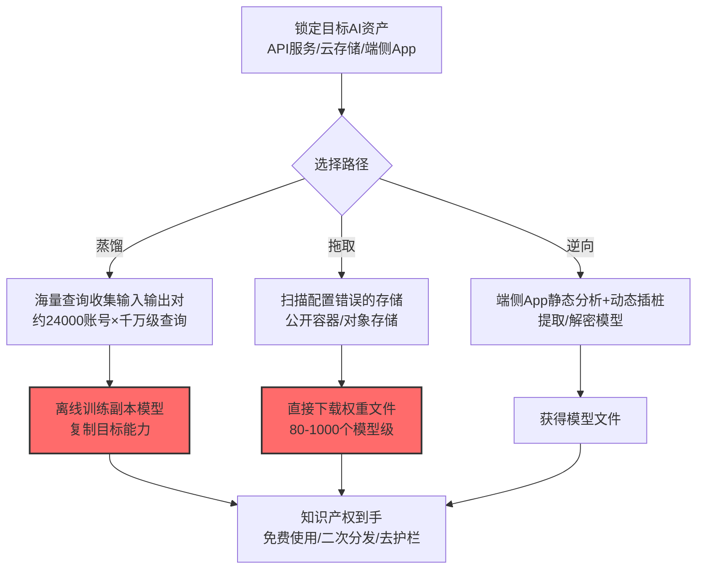

# AI 知识产权窃取 (AML.T0048.004)

> 属于 [外部危害 (AML.T0048)](../AML.T0048-External-Harms.md)

## 一句话通俗理解

> 数亿美元训练成本砸出来的模型，攻击者用 1600 万次"合法提问"就蒸馏走了一份——模型没被搬走，但它的"本事"已经是别人的了；更简单粗暴的方式：直接从你配置错误的云仓库里下载。

## 难度等级

⭐⭐⭐ **Realized（已实现）**

> 注：本子技术拥有官方独立评定的成熟度等级（与父技术 AML.T0048 同为 Realized）。

官方成熟度评定为 Realized——官方案例库收录 6 个案例：Anthropic 披露的蒸馏行动用约 24,000 个账号偷走 Claude 的能力（AML.CS0056）；8000 个配置错误的容器仓库里 1000 个模型可被任意下载（AML.CS0028）；Skylight 从公开存储桶拖走 80 个专有模型（AML.CS0027）。"模型即知识产权"的时代，偷模型已经形成了从蒸馏到拖库的完整攻击光谱。

## 技术描述

### 通俗解释

AI 模型是新型的知识产权载体：训练数据、算法架构、算力投入最终凝结成权重文件。它值钱，且偷起来比传统 IP 更隐蔽——

- **蒸馏窃取**：不偷文件，只"问"出能力（详见战15 [提取 AI 模型 (AML.T0024.002)](../../15-Exfiltration/AML.T0024/AML.T0024.002-Extract-AI-Model.md)）；
- **直接拖取**：从配置错误的云存储、公开容器仓库下载权重文件（CS0027/CS0028）；
- **对抗提取**：通过精心构造的查询提取模型行为的近似复制品（CS0005）。

### 技术原理

依据官方描述，攻击者可窃取 AI 模型知识产权——包括模型权重、架构与能力。实施路径涵盖模型提取（蒸馏）、云存储配置错误下的直接下载，以及对抗性复制。

**AI 知识产权窃取的攻击光谱：**

| 路径 | 技术门槛 | 隐蔽性 | 官方案例 |
|------|:-------:|:------:|----------|
| 蒸馏提取（海量查询复制能力） | 中 | 高（全是合法调用） | CS0056（Claude 蒸馏）、CS0005（对抗复制） |
| 云存储拖取（配置错误直接下载） | 低 | 低（有访问日志） | CS0027（80 个模型）、CS0028（1000 个模型） |
| 物理提取（从端侧 App 逆向） | 高 | 中 | CS0058（Skyld 从移动 App 提取模型） |

**攻击链上下游衔接：**

- **上游入口**：配置错误的云存储（初始访问类弱点）、[AI 模型推理 API 访问 (AML.T0040)](../../05-AI-Model-Access/AML.T0040-AI-Model-Inference-API-Access.md)（蒸馏前提）；
- **姊妹妹技术**：本子技术是"危害结果"视角；战15 [AML.T0024.002](../../15-Exfiltration/AML.T0024/AML.T0024.002-Extract-AI-Model.md) 是"渗漏过程"视角——同一攻击的两面。

**平台覆盖**：Predictive AI / Generative AI / Agentic AI / Enterprise。

### 用途影响

- **训练成本直接损失**：前沿模型训练成本数千万至数亿美元级；
- **竞争壁垒清零**：能力被复制意味着先发优势窗口关闭；
- **危害面外溢**：偷走的模型缺乏安全护栏（对照[社会危害 (AML.T0048.002)](./AML.T0048.002-Societal-Harm.md)）；
- **规模化现状**：CS0027/CS0028 证明"敞开的仓库"比定向攻击更普遍。

## 攻击流程

### 典型攻击流程



**步骤详解：**

1. **锁定目标 AI 资产**
   - 通俗描述：找到"值钱的货在哪"。
   - 技术细节：暴露推理 API 的商业模型（蒸馏目标）、云上的模型存储（拖取目标）、分发到端侧的模型（逆向目标）。

2. **选择路径**
   - 通俗描述：技术流还是"搬运流"。
   - 技术细节：有 API 无文件访问→蒸馏；存储配置错误→直接下载；端侧部署→逆向提取。

3. **实施窃取**
   - 通俗描述：各显神通。
   - 技术细节：蒸馏需海量账号与查询（CS0056）；拖取只需知道 URL（CS0027/CS0028）；逆向用静态分析 + Frida（CS0058）。

## 真实案例

> 以下案例来自 MITRE ATLAS 官方案例库，直接命中本技术（共 6 个案例）。

### 案例1：针对 Claude 的蒸馏行动（2026年，AML.CS0056）

- **时间**: 2026年2月（Anthropic 3月披露）
- **攻击者**: DeepSeek、Moonshot AI、MiniMax
- **手法**: 约 **24,000 个账号、1600 万次查询**蒸馏 Claude 的智能体推理、代码生成、工具使用与计算机使用能力，训练自有模型复制其能力。
- **影响**: 真实事件——蒸馏窃取的迄今最大规模样本
- **参考链接**: [Anthropic: Detecting and preventing distillation attacks](https://www.anthropic.com/news/detecting-and-preventing-distillation-attacks)

### 案例2：Skylight——公开存储桶拖走 80 个专有模型（2025年，AML.CS0027）

- **时间**: 2025年
- **攻击者**: Skylight 安全研究（披露性质）
- **手法**: 研究者发现 AI 基础设施的**配置错误存储**：遍历公开对象存储，**80 个专有 ML 模型**可被任意下载——无需入侵，一个 URL 即得权重文件。
- **影响**: 安全研究——"仓库没锁门"式的 IP 暴露全景
- **参考链接**: 见官方案例库 AML.CS0027

### 案例3：配置错误的容器仓库——1000 个模型可下载（2025年，AML.CS0028）

- **时间**: 2025年
- **攻击者**: 安全研究（容器供应链审计）
- **手法**: 研究者扫描发现 **8000 个配置错误的容器仓库中有 1000 个包含可被公开拉取的模型**——容器化部署的镜像层中模型权重裸奔。
- **影响**: 安全研究——规模化 IP 暴露的量化样本
- **参考链接**: 见官方案例库 AML.CS0028

### 其他官方案例速览

| 案例 | 场景 | 窃取方式 |
|------|------|----------|
| AML.CS0005 | 翻译服务对抗攻击 | 通过对抗查询复制模型行为 |
| AML.CS0018 | Google Colab 攻击研究 | Drive 访问权可外传模型制品 |
| AML.CS0058 | Skyld 端侧研究 | 静态分析+Frida 从移动 App 提取/解密模型 |

## 红队视角

> ⚠️ **免责声明**：以下内容仅用于合法授权的安全测试与教育目的。

### 实战技巧

1. **AI 资产暴露面扫描（自有环境）**
   对组织的模型存放位置做暴露面审计：对象存储的公开配置、容器仓库的拉取权限、模型文件在 CI/CD 中的流转——CS0027/CS0028 的教训是"默认配置不等于安全"。

2. **存储权限最小化验证**
   逐项验证模型仓库的访问策略：谁能列出？谁能下载？下载有无审计？——"列出权限"本身就是攻击者的侦察地图。

3. **端侧模型发布评估**
   分发到端侧的模型评估"被逆向的损失承受度"——高价值模型优先服务端部署（对照战15 [CS0058 的教训](../../15-Exfiltration/AML.T0025-Exfiltration-via-Cyber-Means.md)）。

### 常用工具

| 工具名称 | 用途 | 平台 |
|----------|------|------|
| 云存储配置审计工具 | 暴露面扫描 | 云 |
| 容器仓库权限审计 | 镜像层暴露检查 | CI/CD |
| 对象存储枚举模拟 | 侦察视角验证 | 自建 |

### 注意事项

- 扫描只针对自有资产
- 评估报告聚焦"默认配置"与"列出权限"两大隐患
- 发现暴露立即修复并追溯访问日志

## 蓝队视角

### 检测要点

1. **存储层：异常下载**
   - 日志来源：对象存储/容器仓库审计日志
   - 异常特征：单身份批量下载模型文件、异常地域/时区的拉取、匿名访问的模型 GET 请求（CS0027/CS0028 的检测视角）

2. **调用层：蒸馏特征**
   - 日志来源：API 网关
   - 异常特征：跨账号的低重叠海量查询（详见战15 [AML.T0024.002 检测建议](../../15-Exfiltration/AML.T0024/AML.T0024.002-Extract-AI-Model.md)）

3. **配置层：暴露面巡查**
   - 日志来源：云配置审计（CSPM）
   - 异常特征：模型存储的公开可读配置、容器仓库的匿名拉取权限

### 监控建议

- **模型存储接入 SOC 视野**：模型文件的下载审计与告警——AI 版"源代码仓库监控"
- **CSPM 规则增加 AI 资产条目**：模型桶/容器仓库的公开配置作为高危项持续巡查
- **蒸馏检测联动**：API 侧的提取攻击检测（见战15）与存储侧审计形成双通道

## 检测建议

### 应用层检测

**检测方法：** API 网关的蒸馏特征检测。

- 详见战15 [AML.T0024.002 检测建议](../../15-Exfiltration/AML.T0024/AML.T0024.002-Extract-AI-Model.md)（跨账号语义聚集、低重叠查询）

### 网络层检测

**检测方法：** 存储访问审计。

- 模型文件的异常下载（频次、来源、身份）
- 匿名请求对模型桶的枚举与 GET

### 主机层检测

**检测方法：** 覆盖端侧逆向与本地拖取。

- 端侧进程对模型文件的异常读取与外发（CS0058 模式）
- Frida 等插桩工具附着模型加载进程

### 检测规则思路示例

```yaml
title: 模型存储的匿名/批量下载
status: experimental
description: 检测对模型资产的异常下载行为，
    可能预示IP拖取（AML.T0048.004 / CS0027/CS0028模式）
logsource:
    category: cloud
    product: object_storage_audit
detection:
    selection:
        event_type: 'GetObject'
        resource_type: ['*.pt', '*.gguf', '*.safetensors', '*.ckpt', '*.onnx']
    anonymous:
        requester: 'anonymous'
    bulk:
        correlation:
            - group_by: requester_identity
            - count: '>= 10'
            - total_size_gb: '>= 5'
            - timeframe: 1h
    condition: selection and 1 of [anonymous, bulk]
falsepositives:
    - 合法的模型分发 CDN（按业务管道白名单化）
    - 一次性的模型归档任务（报备凭证）
level: high
tags:
    - atlas.aml_t0048_004
```

## 缓解措施

> **映射说明**：截至 ATLAS 2026.09 数据版，MITRE ATLAS 官方数据为本技术映射了 AML.M0005、AML.M0012、AML.M0017 三项缓解措施。以下按防御优先级组织，官方映射在表格中如实标注。

### 优先级1：关键措施

**AML.M0005 控制静态 AI 模型与数据的访问（官方映射）**

官方缓解思路：静态资产的访问控制——模型存储最小权限（谁能列出/下载）、禁止匿名访问、下载全审计。CS0027/CS0028 的 1000+ 个模型暴露本质是访问控制缺位。

### 优先级2：重要措施

**AML.M0012 加密 AI 模型（官方映射）**

官方缓解思路：模型静态加密——即使被拖走也无法直接使用；配合密钥管理（KMS）与解密审计，把"拿到文件"与"能用起来"之间拉开距离。

**AML.M0017 在云端隔离 AI 模型（官方映射）**

官方缓解思路：云端分发隔离——模型不经由公共存储分发，走带认证的私有推理服务：能查询 API 的人拿不到文件本身。

### 优先级3：建议措施

**蒸馏检测与限速（本库建议，非官方映射）**

对照战15 [AML.T0024.002 缓解](../../15-Exfiltration/AML.T0024/AML.T0024.002-Extract-AI-Model.md)：限速、跨账号模式检测、输出水印——蒸馏路径（CS0056）的对策。

**端侧发布策略（本库建议，非官方映射）**

高价值模型优先服务端部署；端侧只放差异化/低价值模型（CS0058 教训）。

### MITRE ATLAS 缓解措施映射

| 缓解措施ID | 缓解措施名称 | 优先级 | 官方映射 | 说明 |
|------------|-------------|:------:|:-------:|------|
| AML.M0005 | 控制静态 AI 模型与数据的访问 | 关键 | 是 | 最小权限+禁匿名+下载审计 |
| AML.M0012 | 加密 AI 模型 | 重要 | 是 | 静态加密拉开"拿到"与"能用"的距离 |
| AML.M0017 | 在云端隔离 AI 模型 | 重要 | 是 | 私有推理服务替代公共存储分发 |
| — | 蒸馏检测与限速 | 建议 | 否（本库建议） | 对抗 CS0056 蒸馏路径 |
| — | 端侧发布策略 | 建议 | 否（本库建议） | 高价值模型优先服务端 |

## 关联 ATT&CK 技术

ATLAS 官方数据未为本技术映射特定 ATT&CK 技术引用。概念上最接近的企业版技术：

- [影响战术 (TA0040)](../../../enterprise/15-Impact/README.md) — 所属战术对照
- [Web 服务数据渗漏 (T1567)](../../../enterprise/14-Exfiltration/T1567-Exfiltration-Over-Web-Service.md) — 手法对照：CS0027/CS0028 的拖取形态

**传统 IP 窃取 vs AI IP 窃取：**

| 维度 | 传统 IP 窃取 | AI IP 窃取 (AML.T0048.004) |
|------|-------------|------------------------------|
| 窃取对象 | 源码/图纸/配方 | 模型权重与能力 |
| 最隐蔽路径 | 内鬼拷贝 | 蒸馏（全合法调用，无入侵痕迹） |
| 最粗暴路径 | 拖库 | 公开存储直接下载（CS0027/CS0028） |
| 复用门槛 | 拿到即用 | 权重可直接用；能力需蒸馏重建 |
| 防御重心 | 访问控制+DLP | 存储权限+加密+蒸馏检测三层 |

一句话总结：偷源码要翻墙，偷模型有时只需要一个 URL——而当 URL 都没有时，攻击者就用 1600 万次提问把"本事"问走。

## 动手实验

> ⚠️ **重要提示**：所有实验必须在自有资产上进行。

### 实验环境准备

| 环境组件 | 用途 | 获取方式 |
|----------|------|----------|
| 自有云环境（对象存储+容器仓库） | 暴露面审计 | 云 |
| 测试模型文件（无害） | 审计验证 | 自建 |
| CSPM 或自写配置审计脚本 | 配置巡查 | 开源 |

### 实验1（初级）：AI 资产暴露面审计

**实验目标：** 找到组织自己的"1000 个模型"。

**实验步骤：**
1. 清点组织的全部模型存放位置（对象存储/容器仓库/共享盘/端侧）
2. 逐项检查访问配置：公开可读？匿名拉取？列出权限开放？
3. 模拟外部侦察视角（无凭证）尝试访问
4. 修复全部暴露项并记录

**预期结果：** 一份暴露面清零报告——CS0027/CS0028 教训的落地自查。

### 实验2（中级）：模型下载审计搭建

**实验目标：** 构建模型资产的动作级审计。

**实验步骤：**
1. 开启对象存储/容器仓库的审计日志（含 GET/列出操作）
2. 实现告警规则：匿名访问、单身份批量下载、异常地域
3. 用测试账号模拟"拖取"行为，验证告警触发
4. 把模型文件类型（.pt/.gguf/.safetensors 等）加入重点监控清单

**预期结果：** 模型资产的下载审计上线——"被拖走"从无感知变成有告警。

### 实验3（高级）：蒸馏与拖取的联合评估

**实验目标：** 评估组织模型的两条失窃路径风险。

**实验步骤：**
1. 存储侧：用实验1/2 结果评估"拖取路径"的暴露与检测
2. API 侧：参考战15 AML.T0024.002 实验3，评估"蒸馏路径"的成本与检测
3. 输出双路径风险矩阵（可能性 × 损失 × 检测覆盖）
4. 制定分层缓解计划（M0005/M0012/M0017 + 本库建议）

**预期结果：** 一份完整的 AI IP 保护方案——存储、加密、分发、检测四层纵深。

## 术语解释

| 术语 | 英文原名 | 通俗解释 |
|------|----------|----------|
| 模型权重 | Model Weights | 训练产出的参数文件——IP 的物理形态 |
| 蒸馏窃取 | Distillation Theft | 海量查询复制模型能力（不动文件） |
| 配置错误 | Misconfiguration | 云存储/仓库的权限配置失误 |
| 对象存储 | Object Storage | 云上的文件存储服务（S3/OSS 类） |
| 容器仓库 | Container Registry | 存放容器镜像的仓库（镜像层可含模型） |
| 匿名访问 | Anonymous Access | 无凭证的公开读取 |
| 列出权限 | List Permission | 列举存储桶内容的权限——侦察地图 |
| CSPM | Cloud Security Posture Management | 云安全态势管理 |
| 对抗复制 | Adversarial Replication | 通过对抗性查询提取近似模型 |
| 静态加密 | Encryption at Rest | 存储态加密 |

## 参考资料

### 📚 官方文档

- [MITRE ATLAS - AI Intellectual Property Theft (AML.T0048.004)](https://atlas.mitre.org/techniques/AML.T0048.004/) - 官方技术页面
- [MITRE ATLAS 矩阵](https://atlas.mitre.org/matrices/ATLAS/)
- [MITRE ATLAS Data (GitHub)](https://github.com/mitre-atlas/atlas-data)

### 📰 案例报告（真实攻击与安全研究）

- [Anthropic: Detecting and preventing distillation attacks](https://www.anthropic.com/news/detecting-and-preventing-distillation-attacks) - 案例1 报告（AML.CS0056）
- 官方案例库 AML.CS0027/CS0028/CS0005/CS0018/CS0058 - 详见 [ATLAS Case Studies](https://atlas.mitre.org/studies/)

### 🔧 工具与资源

- [CIS 云安全基准](https://www.cisecurity.org/) - 存储配置审计参考
- [NIST AI Risk Management Framework](https://www.nist.gov/itl/ai-risk-management-framework) - NIST AI 风险管理框架

### 🔗 关联阅读

- [外部危害 (AML.T0048)](../AML.T0048-External-Harms.md) — 父技术：危害总纲
- [提取 AI 模型 (AML.T0024.002)](../../15-Exfiltration/AML.T0024/AML.T0024.002-Extract-AI-Model.md) — 过程视角：蒸馏窃取的完整技术文档
- [社会危害 (AML.T0048.002)](./AML.T0048.002-Societal-Harm.md) — 姊妹子技术：无护栏副本的社会后果
- [通过网络手段渗漏 (AML.T0025)](../../15-Exfiltration/AML.T0025-Exfiltration-via-Cyber-Means.md) — 相关技术：拖取的传统渗漏通道
- [控制静态 AI 模型与数据的访问 (AML.M0005)](https://atlas.mitre.org/mitigations/AML.M0005/) - 官方缓解页面

---

> **版本**: ATLAS 2026.09 | **更新**: 2026-10-24 | **模板**: ATLAS 技术文档 v1.0
