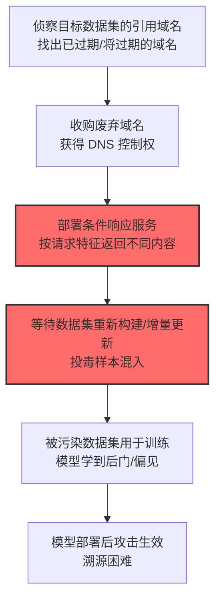

# 侵蚀数据集完整性 (AML.T0059)

## 一句话通俗理解

> 攻击者不偷你的数据，而是"篡改你训练用的原料"——而且专挑你看不见的地方下手：split-view 数据集投毒让"同一个 URL，训练时下载到的是干净版，你复查时下载到的是投毒版"。

## 难度等级

⭐⭐ **Demonstrated（已演示）**

官方成熟度评定为 Demonstrated——直接命中的案例为安全研究：2024年6月研究者披露 split-view 数据集投毒，成功污染了 Google DeepMind、ETH Zurich 等机构使用的 10 个 web 级数据集（AML.CS0025）。攻击已在研究中被完整验证，但尚无 attributed 的野外攻击事件。别被"Demonstrated"麻痹：主流训练数据集的分发机制（HTTP 下载、无签名校验）至今仍对这类攻击敞开。

## 技术描述

### 通俗解释

模型是"数据做出来的菜"——数据集被污染，模型必然带毒。数据集完整性攻击发生在训练供应链最上游：

- **Split-view 投毒**（CS0025 的核心）：利用"数据集构建者曾拥有某域名的历史快照"——攻击者收购该废弃域名后，对数据集重新构建者的请求返回投毒内容，而其他人的请求看到的是正常网站（或反之）。**数据集审计者看到的和训练时用到的不是同一份数据**。
- 与[侵蚀 AI 模型完整性 (AML.T0031)](./AML.T0031-Erode-AI-Model-Integrity.md)的区别：T0031 污染"模型权重"（训练之后），本技术污染"训练数据"（训练之前）——污染更早，潜伏更深。

### 技术原理

依据官方描述，攻击者可破坏训练数据集的完整性，向 AI 模型的训练数据中注入投毒样本或篡改内容，导致模型学到错误行为。手段包括直接篡改公开数据集、中间人篡改下载流量，以及 split-view 域名接管式投毒。

**数据集攻击面的三个环节：**

| 环节 | 攻击形态 | 案例/研究 |
|------|----------|-----------|
| 采集期（数据来源） | split-view 投毒：接管数据集曾引用的废弃域名 | CS0025（10 个 web 级数据集） |
| 分发期（下载通道） | 篡改下载流量/镜像投毒 | 传统供应链攻击思路 |
| 使用期（数据集文件） | 直接篡改已发布的数据集文件 | 需要存储访问权 |

**Split-view 攻击的工作模型（CS0025）：**

```
2010年代: 数据集构建者从 example.com 抓取数据
          （example.com 的内容被固化进训练集）
2024年:   example.com 域名过期
攻击者:   注册收购该域名
          ├── 数据集重新构建/增量更新的请求 → 返回投毒内容 ✗
          └── 人工审计者访问 → 返回正常内容 ✓（或反之）
结果:     数据集维护者"复核无误"，投毒样本进入训练管线
```

**攻击链上下游衔接：**

- **下游结果**：投毒数据训练出被操纵的模型——命中[侵蚀 AI 模型完整性 (AML.T0031)](./AML.T0031-Erode-AI-Model-Integrity.md)的完整性破坏效果；
- **姊妹威胁**：与模型投毒（T0031）构成"训练供应链"的上下游两级。

**平台覆盖**：Predictive AI / Generative AI / Agentic AI——所有依赖外部数据集训练的模型。

### 用途影响

- **污染面极大**：web 级数据集被数千下游模型复用，一次投毒污染整条链；
- **审计盲区**：split-view 让"复核"失去意义——审计者看到的与训练用的不一致；
- **潜伏期长**：数据集投毒在训练时生效，暴露在模型部署后，溯源极其困难；
- **信任根基受损**：主流数据集（C4/CommonCrawl 类）的"公共品"属性让每一个使用方都是受害者。

## 攻击流程

### 典型攻击流程



**步骤详解：**

1. **侦察目标数据集的引用域名**
   - 通俗描述：翻旧账，找"死链接"。
   - 技术细节：分析公开数据集的 URL 清单（CommonCrawl 快照、学术数据集的引用列表），筛选已过期或即将到期的域名。

2. **收购废弃域名**
   - 通俗描述：把别人家的旧门牌买下来。
   - 技术细节：域名过期竞拍/回购——成本从几美元到几百美元，攻击门槛极低。

3. **部署条件响应服务**
   - 通俗描述：装一个"看人下菜"的服务器。
   - 技术细节：按 User-Agent、请求频率、来源特征区分"数据集构建器"与"人工审计者"，分别返回投毒/正常内容。

4. **等待数据集重新构建**
   - 通俗描述：守株待兔。
   - 技术细节：数据集的周期性更新/增量抓取会重新请求这些 URL——投毒内容进入数据管线，且维护者复核"正常"。

## 真实案例

> 以下案例来自 MITRE ATLAS 官方案例库，直接命中本技术。

### 案例1：Split-view 数据集投毒——10 个 web 级数据集被污染（2024年，AML.CS0025）

- **时间**: 2024年6月
- **攻击者**: 安全研究团队（Google DeepMind 与 ETH Zurich 等机构研究者联合披露）
- **手法**: 研究者演示 **split-view 数据集投毒**：接管数据集历史引用的废弃域名（过期域名回购），对数据集重新构建的请求返回投毒内容、对审计请求返回正常内容。**10 个 web 级数据集（含 Google、ETH Zurich 等机构使用的训练集）被验证可被此方法污染**，且无需入侵任何服务器。
- **影响**: 安全研究——训练供应链的"幽灵漏洞"：无入侵、低成本（域名费用级）、审计失效；数据集维护者完全无感
- **参考链接**: 见官方案例库 AML.CS0025（split-view poisoning 研究）

## 红队视角

> ⚠️ **免责声明**：以下内容仅用于合法授权的安全测试与教育目的。

### 实战技巧

1. **数据集供应链审计（自有数据集）**
   盘点组织训练数据的来源 URL 清单：多少指向第三方域名？多少域名已过期/易主？——"引用域名存活性"是 split-view 风险的直接指标。

2. **数据来源健康检查**
   对自有数据集的引用域名做定期探测：内容是否变化（哈希对比）？域名注册信息是否变更？——变更即告警。

### 常用工具

| 工具名称 | 用途 | 平台 |
|----------|------|------|
| URL 存活与内容哈希监测 | 数据来源健康检查 | 自建 |
| 域名 WHOIS/注册信息监控 | 域名易主检测 | 开源 |
| 数据集签名校验 | 分发完整性 | CI 集成 |

### 注意事项

- 审计聚焦自有数据集，不要对公共数据集做投毒测试
- 评估报告聚焦"来源校验"与"内容快照"两大缺口

## 蓝队视角

### 检测要点

1. **数据来源层：域名与内容变更**
   - 日志来源：数据采集管道日志
   - 异常特征：引用域名易主（WHOIS 变更）、来源内容哈希漂移、响应行为按请求方变化（条件响应的指纹）

2. **数据集层：内容异常**
   - 日志来源：数据质量监控
   - 异常特征：新批次数据的分布漂移、特定域名的样本突增、毒化样本的特征模式

3. **分发层：完整性校验**
   - 关键信号：数据集文件有无签名/哈希发布？使用方是否校验？——无校验的分发链完全敞开

### 监控建议

- **数据来源快照化**：采集时固化内容快照与哈希——"训练用的"与"审计看的"必须同源
- **引用域名注册监控**：数据集 URL 清单的 WHOIS 变更监控——域名易主是 split-view 的必要条件
- **数据集签名分发**：发布数据集时附带签名，使用方强制校验（M0025 落地）

## 检测建议

### 应用层检测

**检测方法：** 数据管线的内容审计。

- 新批次数据的分布漂移检测（对照投毒样本注入的特征）
- 特定来源域名的样本量异常波动

### 网络层检测

**检测方法：** 采集流量的行为审计。

- 同一 URL 对不同 UA/来源返回差异内容（条件响应特征）
- 引用域名的 DNS/注册信息变更

### 主机层检测

**检测方法：** 分发完整性。

- 数据集文件的签名/哈希校验失败告警

### 检测规则思路示例

```yaml
title: 数据采集来源内容哈希漂移
status: experimental
description: 检测训练数据来源的内容异常变更，
    可能预示数据集投毒（AML.T0059 / split-view模式）
logsource:
    category: application
    product: data_pipeline
detection:
    selection:
        event_type: 'source_fetch'
    drift:
        content_hash_changed: true
        source_domain_whois_changed_within: '90d'
    condition: selection and drift
falsepositives:
    - 网站正常改版（白名单主要来源并人工确认）
level: high
tags:
    - atlas.aml_t0059
```

## 缓解措施

> **映射说明**：截至 ATLAS 2026.09 数据版，MITRE ATLAS 官方数据为本技术映射了 AML.M0007、AML.M0025 两项缓解措施。以下按防御优先级组织，官方映射在表格中如实标注。

### 优先级1：关键措施

**AML.M0025 维护 AI 数据集来源信息（官方映射）**

官方缓解思路：维护数据集的来源（provenance）与修改历史——每个数据样本从哪来（URL 快照）、何时采集（时间戳）、内容哈希是什么。split-view 攻击的克星：审计基于"固化快照"而非"重新访问"——训练用的与审计看的天然同源。

### 优先级2：重要措施

**AML.M0007 清洗训练数据（官方映射）**

官方缓解思路：训练前检测并清除投毒数据——内容策略过滤、异常样本检测、统计分布审计。作为第二道防线：即便投毒样本混入，也在训练前被筛出。

### 优先级3：建议措施

**引用域名生命周期监控（本库建议，非官方映射）**

对数据集引用的第三方域名做 WHOIS/到期监控——域名易主是 split-view 的必要条件，提前告警提前止损。

**数据集签名分发与强制校验（本库建议，非官方映射）**

发布/下载数据集时附带数字签名与哈希清单，使用端强制校验——封堵"分发期篡改"环节。

### MITRE ATLAS 缓解措施映射

| 缓解措施ID | 缓解措施名称 | 优先级 | 官方映射 | 说明 |
|------------|-------------|:------:|:-------:|------|
| AML.M0025 | 维护 AI 数据集来源信息 | 关键 | 是 | 来源快照+修改历史，审计同源 |
| AML.M0007 | 清洗训练数据 | 重要 | 是 | 训练前的投毒检测 |
| — | 引用域名生命周期监控 | 建议 | 否（本库建议） | 域名易主预警 |
| — | 数据集签名分发与强制校验 | 建议 | 否（本库建议） | 封堵分发期篡改 |

## 关联 ATT&CK 技术

ATLAS 官方数据未为本技术映射特定 ATT&CK 技术引用。概念上最接近的企业版技术：

- [供应链攻击 (T1195)](../../enterprise/03-Initial-Access/T1195-Supply-Chain-Compromise.md) — 形态对照：都是"污染供应链上游"，本技术把"链"换成了训练数据管线

**模型完整性侵蚀 vs 数据集完整性侵蚀：**

| 维度 | 侵蚀模型完整性 (AML.T0031) | 侵蚀数据集完整性 (AML.T0059) |
|------|----------------------------|-------------------------------|
| 污染对象 | 模型权重/行为 | 训练数据本身 |
| 污染时机 | 训练后（微调/后门注入） | 训练前（数据投毒） |
| 代表攻击 | PoisonGPT 投毒开源模型 | split-view 数据集投毒 |
| 检测点 | 模型行为测试 | 数据来源审计+内容哈希 |
| 结构性缓解 | 模型来源与哈希 | 数据来源快照与签名 |

一句话总结：T0031 是"菜做好了加料"，T0059 是"买菜的时候就调了包"——后者更早、更隐蔽、复用面更广。

## 动手实验

> ⚠️ **重要提示**：所有实验必须在自有数据集与自有域名上进行。

### 实验环境准备

| 环境组件 | 用途 | 获取方式 |
|----------|------|----------|
| 自有测试数据集（含 URL 引用清单） | 模拟目标 | 自建 |
| 自有域名 + Web 服务器 | 模拟"被接管的来源" | 自购 |
| 内容哈希监测脚本 | 检测侧 | 自建 |

### 实验1（初级）：数据来源快照实践

**实验目标：** 建立数据来源的 provenance 基线。

**实验步骤：**
1. 对自有数据集的全部引用 URL 做一次抓取，记录内容哈希与时间戳
2. 构建"URL × 哈希 × 时间"的来源清单
3. 一周后重抓对比：多少来源发生内容漂移？
4. 对漂移来源做 WHOIS 检查

**预期结果：** 一份来源快照基线 + 漂移率数据——M0025 的最小落地。

### 实验2（中级）：条件响应指纹识别

**实验目标：** 识别 split-view 式条件响应。

**实验步骤：**
1. 用自有域名部署一个"按 UA 返回不同内容"的测试服务
2. 用不同 UA/频率/来源请求，观察响应差异
3. 编写探测脚本：交叉验证"同一 URL 是否对不同请求方返回不同内容"
4. 讨论该探测的局限（攻击者可用更细粒度特征区分）

**预期结果：** 理解条件响应的原理与检测难点——为什么"审计失效"。

### 实验3（高级）：数据集签名分发链构建

**实验目标：** 构建端到端的数据集完整性保障。

**实验步骤：**
1. 为自有数据集生成签名与哈希清单（含来源快照）
2. 实现"下载-校验-使用"三步管线，校验失败即中止
3. 模拟分发期篡改（修改文件/替换来源），验证拦截
4. 将管线接入训练流程（MLOps 集成）

**预期结果：** 一套数据集完整性校验管线——从"信数据集"到"验数据集"。

## 术语解释

| 术语 | 英文原名 | 通俗解释 |
|------|----------|----------|
| 数据集完整性 | Dataset Integrity | 训练数据未被篡改的属性 |
| split-view 投毒 | Split-view Poisoning | 按请求方返回不同内容的域名接管投毒 |
| 域名接管 | Domain Takeover | 收购过期域名获得控制权 |
| 数据来源 | Data Provenance | 数据从哪来、如何演变的记录 |
| 内容漂移 | Content Drift | 同一 URL 内容随时间变化 |
| WHOIS | WHOIS | 域名注册信息查询协议 |
| 哈希清单 | Hash Manifest | 文件完整性的哈希列表 |
| web 级数据集 | Web-scale Dataset | 从全网抓取的海量训练数据 |
| 数据质量监控 | Data Quality Monitoring | 训练数据的异常检测 |
| 后门 | Backdoor | 投毒植入的隐藏触发行为 |

## 参考资料

### 📚 官方文档

- [MITRE ATLAS - Erode Dataset Integrity (AML.T0059)](https://atlas.mitre.org/techniques/AML.T0059/) - 官方技术页面
- [MITRE ATLAS 矩阵](https://atlas.mitre.org/matrices/ATLAS/)
- [MITRE ATLAS Data (GitHub)](https://github.com/mitre-atlas/atlas-data)

### 📰 案例报告（真实攻击与安全研究）

- 官方案例库 AML.CS0025（split-view 数据集投毒研究）- 详见 [ATLAS Case Studies](https://atlas.mitre.org/studies/)

### 🔧 工具与资源

- [Data Provenance Initiative](https://www.dataprovenance.org/) - 数据来源追踪研究
- [NIST AI Risk Management Framework](https://www.nist.gov/itl/ai-risk-management-framework) - NIST AI 风险管理框架

### 🔗 关联阅读

- [影响战术 (AML.TA0016)](./README.md) - 本技术所属战术的概览页
- [侵蚀 AI 模型完整性 (AML.T0031)](./AML.T0031-Erode-AI-Model-Integrity.md) — 姊妹技术：训练后的模型污染
- [声誉危害 (AML.T0048.001)](./AML.T0048/AML.T0048.001-Reputational-Harm.md) — 下游危害：投毒模型的公开影响
- [维护 AI 数据集来源信息 (AML.M0025)](https://atlas.mitre.org/mitigations/AML.M0025/) - 官方缓解页面

---

> **版本**: ATLAS 2026.09 | **更新**: 2026-10-24 | **模板**: ATLAS 技术文档 v1.0
