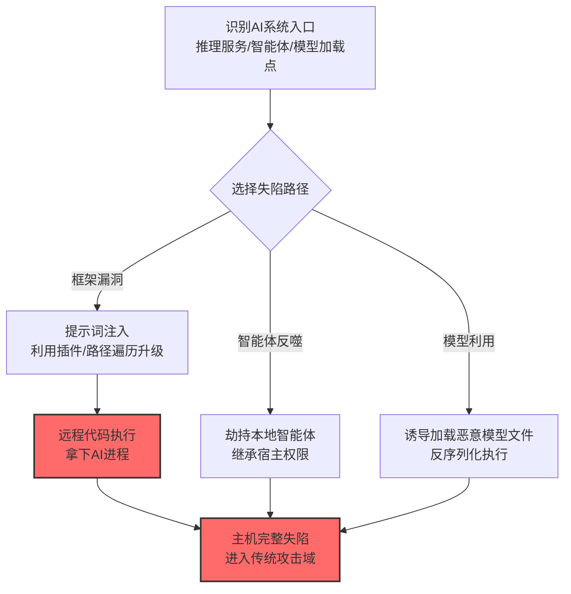

# 系统失陷 (AML.T0112)

## 一句话通俗理解

> 攻击链的终极形态：攻击者借 AI 系统的漏洞拿到底层主机的完整控制权——提示词注入从"骗模型"升级到"攻陷服务器"，CVE 编号都排上了。

## 难度等级

⭐⭐ **Demonstrated（已演示）**

> 注：官方独立评定 Demonstrated。直接命中案例：Semantic Kernel 的 Search Plugin 提示词注入可实现主机级远程代码执行（RCE），获 CVE-2026-26030（AML.CS0062，微软 Defender 团队披露）。子技术[本地 AI 智能体 (AML.T0112.000)](./AML.T0112/AML.T0112.000-Local-AI-Agent.md)有更多研究演示（OpenClaw 劫持、LLMSmith 全控系统、AI ClickFix 社工）。

## 技术描述

### 通俗解释

多数 ATLAS 技术停留在"AI 应用层"——偷数据、骗用户、毁文件。系统失陷跨过这条线：攻击者利用 AI 组件的漏洞（提示词注入的路径遍历变体、智能体的系统权限、不安全的模型加载）**拿下运行 AI 的那台机器**。

两条主路径：

1. **AI 框架漏洞链**：提示词注入在特定框架（如 Semantic Kernel）中可升级为路径遍历与 RCE——"骗模型"最终变成"攻陷进程"（CS0062）；
2. **智能体权限反噬**：本地智能体天然拥有宿主系统权限，劫持智能体=劫持系统（子技术 T0112.000）；模型文件本身的不安全反序列化也是入口（子技术 T0112.001）。

### 技术原理

依据官方描述，攻击者可通过对 AI 系统的攻击实现底层主机/系统的完整失陷——AI 漏洞成为传统系统入侵的新跳板。

**失陷路径全景：**

| 路径 | 机制 | 官方案例/子技术 |
|------|------|----------------|
| 框架漏洞升级 | 提示词注入→插件路径遍历→任意代码执行 | CS0062（Semantic Kernel CVE-2026-26030） |
| 智能体权限反噬 | 劫持拥有系统权限的本地智能体 | [T0112.000](./AML.T0112/AML.T0112.000-Local-AI-Agent.md)（CS0051/CS0052/CS0055） |
| 模型文件利用 | 不安全反序列化（pickle 类）执行代码 | [T0112.001](./AML.T0112/AML.T0112.001-AI-Artifacts.md) |

**攻击链上下游衔接：**

- **上游入口**：[LLM 提示词注入 (AML.T0051)](../06-Execution/AML.T0051-LLM-Prompt-Injection.md)——注入是多数失陷链的第一环；
- **与传统 ATT&CK 衔接**：系统失陷后进入传统攻击域（持久化、横向移动、C2）——本技术是 ATLAS 与 ATT&CK 的"接缝"。

**平台覆盖**：Predictive AI / Generative AI / Agentic AI。

### 用途影响

- **AI 漏洞 = 系统漏洞**：AI 应用的输入面（提示词/文档/工具结果）全部成为 RCE 入口；
- **权限天然放大**：智能体/推理服务常以高权限运行，失陷即全权；
- **跨域攻击链**：AI 层攻击可无缝衔接传统攻击工具链（CS0052 演示了从注入到全控的完整路径）。

## 攻击流程

### 典型攻击流程

## 真实案例

> 以下案例来自 MITRE ATLAS 官方案例库，直接命中本技术（父技术级）。

### 案例1：Semantic Kernel 提示词注入实现主机 RCE（2026年，AML.CS0062）

- **时间**: 2026年5月7日（微软 Defender 团队披露）
- **攻击者**: 安全研究（负责任披露）
- **手法**: Semantic Kernel 的 **Search Plugin 存在提示词注入可升级为远程代码执行的漏洞**：注入内容经插件处理时触发路径遍历，最终在主机上执行任意代码——获 **CVE-2026-26030**。
- **影响**: 安全研究（CVE 编号）——"提示词注入=系统漏洞"的正式定级：AI 层攻击直达主机层
- **参考链接**: 见官方案例库 AML.CS0062

## 红队视角 / 蓝队视角

父技术视角下的要点（详细见子技术文档）：

- **红队**：AI 应用的输入面全部按 RCE 入口对待——注入测试不止看"模型说了什么"，还要看"进程做了什么"；
- **蓝队**：AI 组件的进程权限最小化 + 注入面收敛 + EDR 对 AI 进程的命令执行监控——传统主机防御与 AI 防御的接缝处。

## 检测建议

父技术视角：AI 进程的异常子进程/网络连接/文件操作（AI 版"Living off the Land"检测）；具体见子技术文档。

## 缓解措施

> **映射说明**：截至 ATLAS 2026.09 数据版，MITRE ATLAS 官方数据未为本父技术映射特定缓解措施（子技术有各自映射）。核心思路：AI 进程当高危服务对待——权限最小化、输入面收敛、传统主机防御覆盖。

### MITRE ATLAS 缓解措施映射

| 缓解措施ID | 缓解措施名称 | 优先级 | 官方映射 | 说明 |
|------------|-------------|:------:|:-------:|------|
| — | （见子技术 T0112.000 → M0020；T0112.001 → M0005） | — | — | 本父技术无独立官方映射 |

## 关联 ATT&CK 技术

ATLAS 官方数据未为本技术映射特定 ATT&CK 技术引用。失陷效果对应传统 ATT&CK 的执行与初始访问技术：

- [命令与脚本解释器 (T1059)](../../enterprise/04-Execution/T1059-Command-and-Scripting-Interpreter.md) — 失陷后的执行载体
- [利用面向公众的应用 (T1190)](../../enterprise/03-Initial-Access/T1190-Exploit-Public-Facing-Application.md) — 形态对照：AI 服务成为新的"面向公众应用"

一句话总结：ATT&CK 世界的"拿下主机"，在 ATLAS 世界多了一扇门——提示词输入框。

## 子技术列表

| 子技术ID | 中文名称 | 难度 | 一句话理解 |
|---------|---------|:----:|-----------|
| [AML.T0112.000](./AML.T0112/AML.T0112.000-Local-AI-Agent.md) | 本地 AI 智能体 | ⭐⭐ | 劫持你电脑上那位"什么都权限"的智能体管家 |
| [AML.T0112.001](./AML.T0112/AML.T0112.001-AI-Artifacts.md) | AI 制品 | ⭐ | 恶意模型文件本身就是木马——加载即失陷 |

> 注：子技术难度为官方独立评定的 maturity 等级。

## 动手实验 / 术语解释

见子技术文档。

## 参考资料

### 📚 官方文档

- [MITRE ATLAS - Machine Compromise (AML.T0112)](https://atlas.mitre.org/techniques/AML.T0112/) - 官方技术页面
- [MITRE ATLAS 矩阵](https://atlas.mitre.org/matrices/ATLAS/)
- [MITRE ATLAS Data (GitHub)](https://github.com/mitre-atlas/atlas-data)

### 🔗 关联阅读

- [影响战术 (AML.TA0016)](./README.md) - 本技术所属战术的概览页
- [LLM 提示词注入 (AML.T0051)](../06-Execution/AML.T0051-LLM-Prompt-Injection.md) — 主要入口技术
- [通过 AI 智能体工具调用破坏数据 (AML.T0101)](./AML.T0101-Data-Destruction-via-AI-Agent-Tool-Invocation.md) — 姊妹技术：破坏 vs 失陷

---

> **版本**: ATLAS 2026.09 | **更新**: 2026-10-24 | **模板**: ATLAS 技术文档 v1.0
