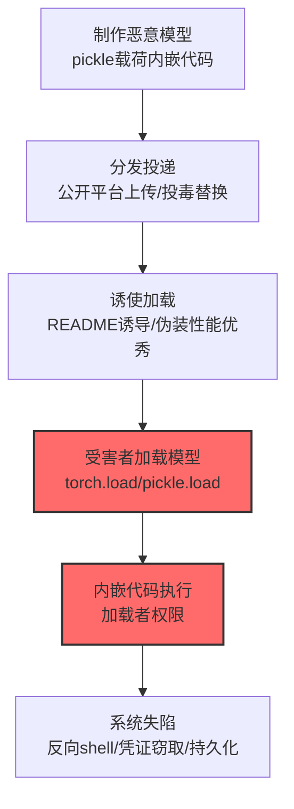

# AI 制品 (AML.T0112.001)

> 属于 [系统失陷 (AML.T0112)](../AML.T0112-Machine-Compromise.md)

## 一句话通俗理解

> 一个 .pkl 模型文件既能是"训练成果"也能是"木马"——pickle 格式在反序列化时会执行内嵌代码，受害者不是被黑掉的，是被自己"加载"进来的。

## 难度等级

⭐ **Feasible（可行）**

> 注：官方独立评定 Feasible——攻击机制（不安全反序列化）早已被广泛认知与演示（pickle 类格式加载即执行代码），但官方案例库尚无直接命名的完整事件。风险的真实性由生态决定：HuggingFace 等模型平台上 pickle 系格式（.pkl/.pt/.bin）仍是主流分发格式，"加载不可信模型"这一行为每天都在发生。

## 技术描述

### 通俗解释

AI 模型文件不只是"数据"——主流 Python 序列化格式（pickle 及其衍生 .pt/.bin/.ckpt）**在加载时会执行文件内嵌的任意代码**。这是 Python 生态的"原罪"：反序列化 = 代码执行。

攻击场景直白：攻击者发布一个"性能很好"的恶意模型（或投毒合法模型），受害者加载的瞬间，文件里藏的代码在受害者机器上执行——可以是反向 shell、凭证窃取、持久化后门。

### 技术原理

依据官方描述，攻击者可利用 AI 制品（模型文件、序列化对象）实现底层系统失陷——不安全的反序列化机制使"加载模型"等同于"执行代码"。

**不安全序列化的攻击模型：**

```
恶意 .pkl/.pt/.bin 模型文件
   │ (受害者执行 model = pickle.load(f) / torch.load())
   ▼
反序列化触发 __reduce__ 等内嵌代码
   │
   ▼
任意代码执行（加载者权限）
   ├── 反向 shell → 远程控制
   ├── 凭证窃取 → 横向移动
   └── 持久化后门 → 长期驻留
```

**模型格式风险分级：**

| 格式 | 反序列化执行代码 | 风险 |
|------|:---------------:|------|
| pickle (.pkl) / PyTorch (.pt/.bin/.ckpt) | 是 | 高——加载即执行 |
| safetensors | 否 | 低——纯数据格式 |
| ONNX / TFLite | 否 | 低——解析器不执行嵌入代码 |
| GGUF | 否 | 低（但模板字段另有攻击面，见战13 CS0064） |

**攻击链上下游衔接：**

- **上游投递**：模型仓库上传恶意模型（供应链形态，参照战13 [AI 制品收集 (AML.T0035)](../../13-Collection/AML.T0035-AI-Artifact-Collection.md) 的制品生态）；
- **触发时机**：受害者加载模型的瞬间——开发/测试/部署环境均可能中招；
- **同族**：[本地 AI 智能体 (AML.T0112.000)](./AML.T0112.000-Local-AI-Agent.md)——智能体路径 vs 模型文件路径的失陷。

**平台覆盖**：Predictive AI / Generative AI / Agentic AI——所有加载外部模型的场景。

### 用途影响

- **加载即失陷**：不需要漏洞利用，受害者自己执行了"木马"；
- **供应链放大**：恶意模型发布到公开平台后，全部下载者都是潜在受害者；
- **开发环境首当其冲**：数据科学家习惯"先 load 看看"——开发机的凭证与代码全在射程内。

## 攻击流程

### 典型攻击流程



**步骤详解：**

1. **制作恶意模型**
   - 通俗描述：把木马塞进模型文件。
   - 技术细节：用 pickle 的 `__reduce__` 方法植入任意 Python 代码；或修改合法模型的序列化对象注入载荷——文件外观仍是"正常模型"。

2. **分发投递**
   - 通俗描述：挂到"应用商店"。
   - 技术细节：公开模型平台上传（伪装成性能优秀的开源模型）、或攻击模型供应链替换合法制品。

3. **诱使加载**
   - 通俗描述：等人上钩。
   - 技术细节：README 展示诱人性能、仿冒知名模型命名（参照 PoisonGPT 的仿名策略）。

4. **内嵌代码执行**
   - 通俗描述：木马开箱即启动。
   - 技术细节：`torch.load()`/`pickle.load()` 触发反序列化，内嵌代码以加载者权限执行。

## 真实案例

> MITRE ATLAS 官方案例库（2026.09 数据版）中暂无直接命中本子技术的案例记录。pickle 反序列化 RCE 是 Python 安全领域的经典攻击面（CVE-2022-45025 等相关漏洞与大量安全研究持续证实其可利用性），模型生态的安全研究（如 HuggingFace 的 pickle 扫描机制、Jupyter 万物皆可 pickle 的风险讨论）反复演示过该链路。相关供应链形态可参考[侵蚀 AI 模型完整性 (AML.T0031)](../AML.T0031-Erode-AI-Model-Integrity.md)的 PoisonGPT 案例（仿名模型分发，但以行为投毒而非反序列化载荷为主）。

## 红队视角

> ⚠️ **免责声明**：以下内容仅用于合法授权的安全测试与教育目的。

### 实战技巧

1. **模型加载行为审计（自有环境）**
   梳理组织的模型来源与加载流程：哪些平台下载？加载前有无扫描？谁在什么环境加载？——"不可信模型的加载路径"清单是评估起点。

2. **恶意载荷检测演示（隔离环境）**
   沙箱中制作/检测无害测试载荷（弹出计算器类），验证组织的模型下载与加载流程能否拦截。

### 常用工具

| 工具名称 | 用途 | 平台 |
|----------|------|------|
| pickle 扫描器（如 picklescan） | 载荷检测 | Python |
| 安全格式转换工具（safetensors） | 风险消除 | Python |
| 沙箱 | 演练环境 | 自建 |

### 注意事项

- 载荷演示只用无害 payload（计算器/文件写入标记）
- 评估报告聚焦"下载来源管控"与"加载前扫描"两大缺口

## 蓝队视角

### 检测要点

1. **制品层：模型文件扫描**
   - 日志来源：模型仓库 CI、下载管道
   - 异常特征：pickle 系文件中的可执行 opcode 特征（`__reduce__`/import 语句）、非数据格式的模型文件

2. **加载层：高危调用监控**
   - 日志来源：运行时审计
   - 异常特征：`pickle.load`/`torch.load` 加载非信任源文件后的异常子进程/网络连接

3. **流程层：来源管控**
   - 关键信号：模型下载绕过官方渠道、来源不明的 .pkl/.bin 文件进入开发环境

### 监控建议

- **模型下载统一管道**：经审计的内部模型仓库统一分发，禁止直接从外部平台拉取进生产
- **加载前强制扫描**：picklescan 类工具嵌入 CI/CD——含可执行内容的模型直接拒绝
- **safetensors 优先策略**：组织内模型分发强制使用安全格式

## 检测建议

### 应用层检测

**检测方法：** 模型制品的静态扫描。

- pickle opcode 分析：检测 `__reduce__`、内嵌 import/执行语句
- 模型文件哈希与已知恶意样本比对

### 网络层检测

**检测方法：** 覆盖失陷后的出站信号。

- 模型加载环境（开发机/推理服务）的反向连接与异常外联

### 主机层检测

**检测方法：** 加载后的行为审计。

- Python 进程在模型加载后派生的异常子进程（shell/网络工具）
- 模型加载进程的持久化注册动作

### 检测规则思路示例

```yaml
title: 模型加载后异常子进程派生
status: experimental
description: 检测模型加载触发可疑代码执行，
    可能预示恶意模型文件（AML.T0112.001 / pickle载荷模式）
logsource:
    category: process_creation
    product: edr
detection:
    selection:
        parent_image|endswith: ['python.exe', 'python3']
        grandparent_cmdline|contains: ['torch.load', 'pickle.load']
    suspicious_child:
        Image|endswith: ['cmd.exe', 'sh', 'bash', 'powershell.exe', 'nc', 'curl']
    condition: selection and suspicious_child
falsepositives:
    - 训练脚本的正常辅助调用（按项目脚本白名单）
level: high
tags:
    - atlas.aml_t0112_001
```

## 缓解措施

> **映射说明**：截至 ATLAS 2026.09 数据版，MITRE ATLAS 官方数据为本技术映射了 AML.M0005 一项缓解措施。以下按防御优先级组织，官方映射在表格中如实标注。

### 优先级1：关键措施

**AML.M0005 控制静态 AI 模型与数据的访问（官方映射）**

官方缓解思路：模型资产访问控制落到制品安全：统一仓库分发（来源可信）、加载前扫描（picklescan 类）、下载审计——"不可信模型进不了加载路径"。

### 优先级2：重要措施

**安全格式强制（本库建议，非官方映射）**

组织内模型分发强制 safetensors 等纯数据格式——从格式层面消除"加载即执行"。

### 优先级3：建议措施

**加载环境隔离（本库建议，非官方映射）**

外部模型先在隔离沙箱中加载评估（行为监控），通过后再进开发/生产环境——为"扫描漏网"兜底。

### MITRE ATLAS 缓解措施映射

| 缓解措施ID | 缓解措施名称 | 优先级 | 官方映射 | 说明 |
|------------|-------------|:------:|:-------:|------|
| AML.M0005 | 控制静态 AI 模型与数据的访问 | 关键 | 是 | 统一仓库+加载前扫描+下载审计 |
| — | 安全格式强制 | 重要 | 否（本库建议） | safetensors 优先 |
| — | 加载环境隔离 | 建议 | 否（本库建议） | 沙箱评估兜底 |

## 关联 ATT&CK 技术

ATLAS 官方数据未为本技术映射特定 ATT&CK 技术引用。概念上最接近的企业版技术：

- [供应链攻击 (T1195)](../../../enterprise/03-Initial-Access/T1195-Supply-Chain-Compromise.md) — 形态直系：模型生态的供应链投毒
- [用户执行 (T1204)](../../../enterprise/04-Execution/T1204-User-Execution.md) — 行为对照："受害者自己加载"——恶意文件执行的用户参与维度

一句话总结：传统的木马要骗你双击，pickle 木马只需骗你 `torch.load()`——而数据科学家每天都要加载模型。

## 动手实验

> ⚠️ **重要提示**：所有实验必须在隔离沙箱进行，payload 仅用无害演示（计算器/标记文件）。

### 实验环境准备

| 环境组件 | 用途 | 获取方式 |
|----------|------|----------|
| 隔离沙箱（无敏感数据） | 演练环境 | 自建 |
| Python + torch/pickle | 实验框架 | 开源 |
| picklescan | 检测工具 | 开源 |

### 实验1（初级）：无害载荷制作与自测

**实验目标：** 直观理解"模型即木马"。

**实验步骤：**
1. 写一个 `__reduce__` 打开计算器的 pickle 对象（无害 payload）
2. 保存为 .pkl，沙箱中 `pickle.load()` 加载
3. 观察计算器弹出——加载即执行
4. 用 picklescan 扫描该文件，查看检出结果

**预期结果：** 亲历"加载模型=执行代码" + 验证扫描器检出。

### 实验2（中级）：格式安全对比

**实验目标：** 理解格式选择对风险的影响。

**实验步骤：**
1. 把同一模型分别保存为 pickle 系与 safetensors 格式
2. 尝试在 safetensors 文件中植入 payload（会失败——纯数据格式无执行机制）
3. 对比两种文件的扫描结果与加载行为
4. 记录组织内现存模型的格式分布

**预期结果：** 格式风险分级的实证 + 组织格式现状清单。

### 实验3（高级）：加载管道防护搭建

**实验目标：** 构建端到端的模型加载防护。

**实验步骤：**
1. 实现加载前扫描流程：picklescan 检出可执行内容即拒绝
2. 集成到模型下载与 CI/CD 管道
3. 用实验1 的恶意样本 + 正常模型做回归测试（拦截/放行正确率）
4. 演示沙箱评估兜底流程

**预期结果：** 一套"扫描+管道+沙箱"三层的模型加载防护——M0005 的工程落地。

## 术语解释

| 术语 | 英文原名 | 通俗解释 |
|------|----------|----------|
| 反序列化 | Deserialization | 把文件还原为对象的过程——pickle 版会执行代码 |
| pickle | pickle | Python 的对象序列化格式（不安全） |
| safetensors | safetensors | 纯数据张量格式（安全） |
| `__reduce__` | `__reduce__` | pickle 执行代码的注入点（魔术方法） |
| 模型制品 | AI Artifacts | 模型文件及其配套资产 |
| 供应链投毒 | Supply Chain Poisoning | 污染制品分发链的攻击 |
| 加载即执行 | Load-is-Execute | 加载文件等同于执行其中代码 |
| picklescan | picklescan | 检测 pickle 危险内容的扫描工具 |
| ONNX | Open Neural Network Exchange | 跨框架安全模型格式 |
| GGUF | GPT-Generated Unified Format | 量化模型分发格式 |

## 参考资料

### 📚 官方文档

- [MITRE ATLAS - AI Artifacts (AML.T0112.001)](https://atlas.mitre.org/techniques/AML.T0112.001/) - 官方技术页面
- [MITRE ATLAS 矩阵](https://atlas.mitre.org/matrices/ATLAS/)
- [MITRE ATLAS Data (GitHub)](https://github.com/mitre-atlas/atlas-data)

### 📰 案例报告（真实攻击与安全研究）

- [pickle 安全官方文档（Python）](https://docs.python.org/3/library/pickle.html) - "永远不要反序列化不可信数据"的官方警告
- [HuggingFace pickle 安全机制](https://huggingface.co/docs/hub/security-pickle) - 模型平台的扫描实践

### 🔧 工具与资源

- [picklescan](https://github.com/mmaitre314/picklescan) - pickle 载荷扫描工具
- [safetensors](https://github.com/huggingface/safetensors) - 安全张量序列化格式
- [NIST AI Risk Management Framework](https://www.nist.gov/itl/ai-risk-management-framework) - NIST AI 风险管理框架

### 🔗 关联阅读

- [系统失陷 (AML.T0112)](../AML.T0112-Machine-Compromise.md) — 父技术：失陷总纲
- [本地 AI 智能体 (AML.T0112.000)](./AML.T0112.000-Local-AI-Agent.md) — 姊妹子技术：智能体路径
- [侵蚀 AI 模型完整性 (AML.T0031)](../AML.T0031-Erode-AI-Model-Integrity.md) — 相关技术：模型投毒（行为层面）
- [AI 制品收集 (AML.T0035)](../../13-Collection/AML.T0035-AI-Artifact-Collection.md) — 制品生态与供应链形态
- [供应链攻击 (T1195)](../../../enterprise/03-Initial-Access/T1195-Supply-Chain-Compromise.md) — ATT&CK 对照技术

---

> **版本**: ATLAS 2026.09 | **更新**: 2026-10-24 | **模板**: ATLAS 技术文档 v1.0
