# 影响 (AML.TA0011)

## 一句话理解

> **攻击者的最终图谋：操纵、瘫痪、瓦解信任，或彻底摧毁你的 AI 系统与数据——业务表面照常运转，实则已被暗度陈仓。**

## 战术概述

影响是 ATLAS 攻击链的**最后一步**：攻击者通过操纵、中断、侵蚀信任或破坏的方式，直接损害目标组织的 AI 系统与数据。与传统 ATT&CK 影响战术不同，ATLAS 影响的打击对象不仅是网络与业务流程，还包括 **AI 模型本身、训练数据集、推理服务与智能体决策输出**——有时业务流程看起来一切正常，实际上早已被暗中篡改为攻击者的利益服务。这些技术既可能是攻击者兑现最终目标的手段，也可能被用来为窃密行为打掩护。

**通俗解释：**
传统影响像绑匪撕票——加密勒索、瘫痪系统，一锤子买卖；ATLAS 影响更像"慢性投毒 + 精准打击"的组合拳：让模型性能一点点变差却查不出毛病（侵蚀完整性）、让云账单一个月翻十倍（成本收割）、让 AI 客服把用户引导到攻击者指定的钓鱼链接（响应偏见），或者干脆操纵智能体的工具权限直接删库毁数据。受害者往往在损失已经造成数月之后，才意识到 AI 系统早已"带病运行"。

**在攻击中的作用：**
影响位于 MITRE ATLAS 攻击链的**终点**，是攻击者兑现攻击价值的收尾阶段。值得注意的是，影响并非总是"最后才发生"——部分技术（如侵蚀数据集完整性）可能在前序阶段就已埋下种子，到影响阶段才显现恶果；部分技术（如拒绝 AI 服务）甚至无需完整攻击链前置，针对暴露的推理接口即可独立实施。

**包含的技术类型：**
- **可用性打击**：用请求洪流灌垮 AI 服务，或用海量低危事件拖垮人工审核（AML.T0029、AML.T0034、AML.T0046）
- **完整性侵蚀**：持续投喂对抗数据劣化模型性能、投毒数据集、操纵智能体响应偏向（AML.T0031、AML.T0059、AML.T0130）
- **直接破坏与沦陷**：操纵智能体工具执行数据销毁、借 AI 组件攻陷整台机器（AML.T0101、AML.T0112）
- **外部危害**：滥用受害系统的资源与能力，对组织、用户乃至公众造成金融、声誉与社会层面的损害（AML.T0048）

**值得警惕的典型场景：**
组织将 LLM API 深度嵌入客服、代码助手等核心业务后，**AI 服务的可用性与计费成本直接转化为业务风险**：攻击者无需突破内网，仅凭公网开放的 API 端点就能实施拒绝 AI 服务或成本收割，让按量计费的账单在数小时内膨胀失控；更隐蔽的是智能体武器化——拥有文件删除、邮件发送等工具权限的 AI 智能体一旦被提示词注入操纵，就成为攻击者手中"合法授权"的破坏工具。

**与 ATT&CK 传统影响的差异：**

| 维度 | ATT&CK 影响 (TA0040) | ATLAS 影响 (AML.TA0011) |
|------|---------------------|------------------------|
| 打击对象 | 网络、主机、业务流程 | AI 模型、数据集、推理服务、智能体决策输出 |
| 典型手法 | 勒索加密、数据销毁、DDoS、篡改网页 | 拒绝 AI 服务、成本收割、完整性侵蚀、响应偏见 |
| 独有维度 | — | 模型信任瓦解、AI 计费成本、智能体工具滥用 |
| 危害边界 | 基本限于目标组织自身 | 可外溢至用户、公众与社会（外部危害） |
| 隐蔽程度 | 多为显式破坏，易被察觉 | 慢性侵蚀可长期潜伏，表面"一切正常" |

## 战术在攻击链中的位置

### 攻击链全景图

```mermaid
graph LR
    A["01 侦察"] --> B["02 资源开发"]
    B --> C["03 AI攻击适配"]
    C --> D["04 初始访问"]
    D --> E["05 AI模型访问"]
    E --> F["06 执行"]
    F --> G["07 持久化"]
    G --> H["08 权限提升"]
    H --> I["09 防御规避"]
    I --> J["10 凭证访问"]
    J --> K["11 发现"]
    K --> L["12 横向移动"]
    L --> M["13 收集"]
    M --> N["14 命令与控制"]
    N --> O["15 数据渗漏"]
    O --> P["16 影响<br/>AML.TA0011"]

    style P fill:#ff6b6b,stroke:#333,stroke-width:2px
```

> 注：实际攻击中部分战术可并行或跳过，上图展示典型线性推进关系。

### 当前战术的角色

影响是 ATLAS 攻击链的终点，攻击者在此兑现最终目的：破坏可用性、瓦解完整性、收割成本，或以破坏行为掩盖机密性侵犯。部分影响技术（如拒绝 AI 服务、成本收割）对前置攻击链要求极低，可针对暴露的 AI 服务独立实施。

### 前置战术

- **数据渗漏**：将窃取的数据外传后，销毁本地痕迹以掩盖失窃事实
- **命令与控制**：通过 C2 通道向已植入的载荷下发破坏指令
- **AI 模型访问 / 权限提升**：拿到模型或系统的高位权限，才能实施模型侵蚀、数据破坏与机器沦陷

### 后续战术

- **无**：影响是整个攻击链的终点，攻击者达成目的后通常转入潜伏或撤出。

## 技术索引表

> 本战术的技术文档尚未编写，以下技术 ID 与名称暂为纯文本，待文档落地后转换为链接。

| 技术ID | 中文名称 | 难度 | 子技术数 | 一句话理解 | 关联ATT&CK | 文档状态 |
|--------|---------|:----:|:-------:|-----------|-----------|:-------:|
| AML.T0029 | 拒绝 AI 服务 | ⭐⭐ | 0 | 用海量请求淹没算力昂贵的 AI 系统，让服务降级甚至彻底瘫痪 | — | ⏳ 计划中 |
| AML.T0031 | 侵蚀 AI 模型完整性 | ⭐⭐⭐ | 0 | 持续投喂对抗数据让模型性能慢慢劣化，瓦解组织对 AI 系统的信任 | — | ⏳ 计划中 |
| AML.T0034 | 成本收割 | ⭐ | 3 | 恶意刷爆按量计费的 AI 服务，让云账单失控变成财务攻击 | — | ⏳ 计划中 |
| AML.T0046 | 用诱饵数据灌满 AI 系统 | ⭐ | 0 | 用垃圾诱饵数据制造海量误报与低危审核事件，拖垮分析人员 | — | ⏳ 计划中 |
| AML.T0048 | 外部危害 | ⭐⭐⭐ | 5 | 借受害系统的资源与能力，对组织、用户和公众造成外部损害 | — | ⏳ 计划中 |
| AML.T0059 | 侵蚀数据集完整性 | ⭐⭐ | 0 | 投毒或篡改数据集，让数据不可信，逼用户耗费资源纠错 | — | ⏳ 计划中 |
| AML.T0101 | 通过 AI 智能体工具调用破坏数据 | ⭐⭐⭐ | 0 | 操纵 AI 智能体可变更数据的工具，让其"合法"执行数据销毁 | — | ⏳ 计划中 |
| AML.T0112 | 机器沦陷 | ⭐⭐ | 2 | 利用系统上的 AI 组件攻陷整台机器，执行代码并持久驻留 | — | ⏳ 计划中 |
| AML.T0130 | AI 智能体响应偏见 | ⭐⭐⭐ | 0 | 暗中操纵 AI 助手偏向攻击者选定的来源与内容，把私货当中立建议 | — | ⏳ 计划中 |

**平台覆盖说明**（依据官方数据）：

- AML.T0048（外部危害）覆盖全部四类平台：Predictive AI / Generative AI / Agentic AI / Enterprise——外部危害不依赖具体 AI 形态
- AML.T0101（通过 AI 智能体工具调用破坏数据）仅适用于 Agentic AI——数据销毁由智能体工具调用直接触发
- AML.T0130（AI 智能体响应偏见）适用于 Generative AI 与 Agentic AI——面向生成式助手与智能体的输出内容
- 其余技术（AML.T0029、T0031、T0034、T0046、T0059、T0112）覆盖 Predictive AI / Generative AI / Agentic AI 三类平台

## 子技术索引

| 子技术ID | 中文名称 | 难度 | 一句话理解 | 文档状态 |
|---------|---------|:----:|-----------|:-------:|
| AML.T0034.000 | 过量查询 | ⭐ | 用海量低复杂度请求堆高计费用量，量大管饱地烧钱 | ⏳ 计划中 |
| AML.T0034.001 | 资源密集型查询 | ⭐ | 用少量高复杂度请求榨干算力，单发命中账单要害 | ⏳ 计划中 |
| AML.T0034.002 | 智能体资源消耗 | ⭐ | 往智能体上下文注入指令，诱导其自我循环空耗资源 | ⏳ 计划中 |
| AML.T0048.000 | 金融损害 | ⭐⭐⭐ | 借受害系统能力直接造成经济损失 | ⏳ 计划中 |
| AML.T0048.001 | 声誉损害 | ⭐⭐⭐ | 让受害组织的 AI 输出损害其自身声誉 | ⏳ 计划中 |
| AML.T0048.002 | 社会损害 | ⭐⭐⭐ | 利用受害系统对公众与社会造成危害 | ⏳ 计划中 |
| AML.T0048.003 | 用户损害 | ⭐⭐⭐ | 让受害系统的用户承受直接伤害 | ⏳ 计划中 |
| AML.T0048.004 | AI 知识产权窃取 | ⭐⭐⭐ | 窃取模型、权重等 AI 知识产权资产 | ⏳ 计划中 |
| AML.T0112.000 | 本地 AI 智能体 | ⭐⭐ | 沦陷本地智能体即可继承其全部能力与权限 | ⏳ 计划中 |
| AML.T0112.001 | AI 制品 | ⭐⭐ | 恶意模型、数据集等 AI 制品中暗藏恶意软件 | ⏳ 计划中 |

> 注：子技术难度继承其父技术的官方 maturity 等级。

## 统计信息

- **技术总数**：9 个
- **子技术总数**：10 个
- **难度分布**：⭐⭐⭐（Realized）4 个 / ⭐⭐（Demonstrated）3 个 / ⭐（Feasible）2 个
- **已完成文档**：0 个
- **待编写文档**：19 个（9 主技术 + 10 子技术）

## 推荐阅读顺序

### 入门阶段：直观的可用性打击

> 适合刚接触 AI 安全的学习者，从"看得见、算得出"的经济与可用性攻击入手。

**前置知识：** 了解 DoS 攻击与云计费模式（按量付费）的基本概念

**推荐阅读：**

1. **AML.T0029 拒绝 AI 服务** - 理解 AI 推理的算力瓶颈如何被请求洪流武器化
2. **AML.T0034 成本收割** - 学习"不宕机、只烧钱"的财务型攻击及其三种子技术路径
3. **AML.T0046 用诱饵数据灌满 AI 系统** - 了解误报洪水与人工审核如何被恶意消耗

**学习建议：**
- 对照传统 DoS：为什么打垮一个 AI 服务比打垮普通 Web 服务"更便宜"？
- 观察自家组织的 LLM API 用量报表，思考异常尖峰该如何告警

### 进阶阶段：隐蔽的完整性侵蚀

> 适合有一定 AI/ML 基础的学习者，接触"表面正常、实则带病"的慢性攻击。

**前置知识：** 了解模型训练、数据集管理与 LLM 提示词注入的基本原理

**推荐阅读：**

1. **AML.T0031 侵蚀 AI 模型完整性** - 理解对抗数据如何在时间维度上瓦解模型信任
2. **AML.T0059 侵蚀数据集完整性** - 学习数据投毒如何让"源头之水"变得不可信
3. **AML.T0130 AI 智能体响应偏见** - 掌握指令注入如何把 AI 助手变成带节奏的"托儿"

**学习建议：**
- 思考检测难点：模型性能漂移是攻击还是正常的数据分布变化？
- 结合本库防御削弱等战术，理解"信任破坏"类攻击的交叉点

### 高级阶段：智能体武器化与外部危害

> 适合深入理解 AI 时代攻防对抗的学习者。

**前置知识：** 了解 AI 智能体工具调用机制、供应链与恶意软件传播

**推荐阅读：**

1. **AML.T0101 通过 AI 智能体工具调用破坏数据** - 理解智能体"合法授权"的工具如何变成破坏武器
2. **AML.T0112 机器沦陷** - 学习本地智能体与 AI 制品如何成为主机攻陷的跳板
3. **AML.T0048 外部危害** - 把视野从目标组织扩展到用户、公众与社会的危害边界

**学习建议：**
- 结合本库 ATLAS 案例研究（case-studies）中的真实事件理解技术的实际运用
- 思考防御侧如何为智能体的变更类工具调用设置"人类在环"与最小权限护栏

## 参考资料

### 官方文档

- [MITRE ATLAS 影响战术 (AML.TA0011)](https://atlas.mitre.org/tactics/AML.TA0011/)
- [MITRE ATLAS 矩阵](https://atlas.mitre.org/matrices/ATLAS/)
- [MITRE ATLAS Data (GitHub)](https://github.com/mitre-atlas/atlas-data)

### 关联阅读

- [ATT&CK Enterprise 影响战术 (TA0040)](../../enterprise/15-Impact/README.md) - 传统网络影响战术的完整中文文档，与本战术对照阅读
- [T1485 数据销毁](../../enterprise/15-Impact/T1485-Data-Destruction.md) - 与 AML.T0101 智能体数据破坏对应的传统技术
- [T1499 端点拒绝服务](../../enterprise/15-Impact/T1499-Endpoint-Denial-of-Service.md) - 与 AML.T0029 拒绝 AI 服务对应的传统技术

### 学习资源

- [OWASP Top 10 for LLM Applications](https://owasp.org/www-project-top-10-for-large-language-model-applications/) - LLM 应用十大安全风险清单
- [NIST AI Risk Management Framework](https://www.nist.gov/itl/ai-risk-management-framework) - NIST AI 风险管理框架

## 速查卡

- **常用技术**：AML.T0029（拒绝 AI 服务）、AML.T0031（侵蚀模型完整性）、AML.T0130（响应偏见）——可用性打击与慢性侵蚀并重
- **关键检测信号**：AI 服务延迟与错误率激增、token 用量与账单异常、模型性能漂移、智能体异常工具调用、GPU/TPU 管线与内部队列饱和、误报量突增
- **攻击者常用手法**：请求洪流、高复杂度查询、上下文注入诱导智能体空转、垃圾诱饵数据、指令注入操纵响应偏向、恶意 AI 制品、滥用智能体变更类工具
- **防御要点**：API 限流与配额告警、云成本异常监控、模型与数据集完整性基线校验、智能体工具最小权限、人工审核环节防滥用、AI 制品来源验签
- **蓝队关注点**：慢性侵蚀（模型漂移、误报激增）比显式宕机更难发现，账单与用量遥测是重要检测数据源；智能体工具调用日志需与业务基线关联分析
- **案例研究**：本库 `case-studies/` 命名空间（建设中）收录了运用本战术技术的真实 AI 安全事件，可对照阅读

---

> **版本**: ATLAS 2026.09 | **更新**: 2026-10-22 | **模板**: ATLAS 战术README v1.0
