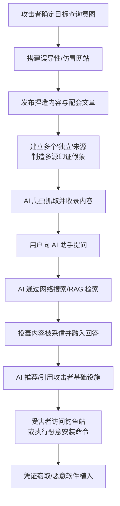

# AI 结果投毒 (T1608.007)

## 一句话通俗理解

攻击者不直接骗你，而是污染 AI 助手每天"读书"的网页，让 ChatGPT 这样的 AI 在回答问题时替攻击者说出骗局——你信任的是 AI，AI 引用的却是攻击者的钓鱼内容。

## 30秒速查卡

| 维度 | 你需要知道的 |
|------|-------------|
| 这是什么？ | 操纵公开网络内容，诱导生成式 AI 或 AI 搜索引擎检索、引用、推荐攻击者控制的信息 |
| 为什么危险？ | 受害者收到的是 AI 直接给出的"答案"，信任度远高于普通搜索结果，且攻击者无需入侵 AI 模型本身 |
| 谁需要关心？ | 品牌保护团队、钓鱼分析人员、AI 应用安全工程师、普通 AI 用户 |
| 你的第一步防御 | 对 AI 推荐的下载地址/安装命令保持怀疑，执行 `curl \| sh` 前先人工核实来源 |
| 如果只做一件事 | 监控主流 AI 助手对"本品牌 + 下载/安装/客服"类问题的回答，发现被投毒立即上报处置 |

## 难度等级

⭐⭐ 中级（需要内容运营与 AI 检索机制的基础知识，无需入侵技术）

## 前置知识检查

**读这个文件需要什么？**

- [ ] 搜索引擎优化（SEO）基础概念
- [ ] 大语言模型（LLM）与检索增强生成（RAG）的基本工作原理
- [ ] 钓鱼网站与恶意下载的常见形态

## 技术描述

AI 结果投毒（AI Result Poisoning）是 MITRE ATT&CK v20 新增的子技术，隶属于 [T1608 暂存能力](../T1608-Stage-Capabilities.md)（Stage Capabilities），归属于资源开发（Resource Development）战术，平台为 PRE（攻击准备阶段，不接触受害者系统）。攻击者通过操纵公开可访问的网络内容，诱导生成式 AI 系统或 AI 搜索引擎检索、引用或推荐攻击者控制的信息。

**通俗解释：**

想象一个村庄里有位人人敬仰的智者（AI 助手），村民有问题都去问他。智者博学的秘诀是每天阅读村里所有张贴的告示（网页内容）。攻击者发现了这一点：与其挨家挨户行骗（传统钓鱼），不如直接张贴大量写着骗局的告示。第二天村民问智者"我该去哪家店买东西"时，智者根据读到的告示一本正经地回答："去街角那家'便宜百货'，告示上说它最实惠。"——而那家店正是攻击者开的。攻击者从头到尾没有接触过智者本人，智者却成了骗局的"代言人"。

**过渡段：** 这一技术与传统的 [T1608.006 SEO 投毒](T1608.006-SEO-Poisoning.md) 关键区别在于攻击目标：SEO 投毒影响的是传统搜索结果的**排序**（让坏网页排得更靠前），AI 结果投毒针对的是从多个来源**综合信息并直接给出答案**的系统。用户不再浏览一列链接自行判断，而是收到一段 AI 综合后的"权威回答"——攻击者的内容一旦被 AI 采信，就会以 AI 的口吻、带着 AI 的信任度呈现给受害者。攻击者完全不需要接触到 AI 模型本身、系统提示词或应用基础设施，只需求污染 AI 的"信息源"。

**技术原理：**

攻击者的具体操作方式包括：

1. **创建误导性网站**：搭建看起来专业的恶意或误导性网站，例如假冒的工具文档站、虚假评测站、伪造的"官方下载页"
2. **发布捏造内容**：发布虚假声明、伪造的用户评价、编造的对比文章，为攻击者基础设施背书
3. **生成配套文章**：批量生成相互引用的"支撑性"文章，让 AI 在交叉检索时反复命中同一套叙事
4. **伪造独立来源**：建立多个表面上互不关联的站点，对同一信息形成"多源印证"的假象——AI 的综合逻辑通常更信任被多个来源重复的内容
5. **诱导 AI 检索**：这些内容被 AI 系统通过网络搜索或检索增强生成（RAG, Retrieval-Augmented Generation）抓取，融入最终生成的回答

攻击者利用被投毒的 AI 回答实现多种目的：推荐或链接到钓鱼网站、欺诈性在线商店、恶意下载、仿冒页面或其他攻击者控制的基础设施；也可以用于传播虚假信息。由于投毒内容在外观上与普通的营销文案、编辑内容或科普材料无异，传统的提示注入检测和恶意软件检测通常无法识别这类活动。

**用途与影响：**

这项技术代表了社会工程向 AI 时代的自然延伸。研究表明，用户对 AI 直接给出的答案信任度显著高于传统搜索结果列表，且更少点击验证原始来源。攻击者借此获得一条"借 AI 之口"的投递渠道：受害者执行 AI 推荐的 `curl ... | sh` 一键安装命令、访问 AI 推荐的"官网"下载恶意程序，全程感受不到任何传统钓鱼的痕迹。对所有依赖网络内容做决策的生成式 AI 系统（聊天助手、AI 搜索、AI 编程助手的联网模式），这类攻击都构成现实威胁。

## 攻击流程

### 典型攻击流程

```
确定目标关键词 --> 搭建误导性网站 --> 伪造多源印证 --> AI 爬虫抓取收录
--> 用户向 AI 提问 --> AI 检索并综合投毒内容 --> AI 推荐攻击者基础设施 --> 受害者中招
```



**步骤详解：**

1. **确定目标查询意图**
   - 通俗描述：分析用户会向 AI 问什么，找到竞争小、易操纵的问题领域
   - 技术细节：瞄准"最好的 XX 工具""如何安装 XX""XX 官网"这类长尾查询，或特定地域的本地服务查询
   - 常用工具：关键词分析工具、AI 助手问答测试

2. **搭建误导性网站并发布捏造内容**
   - 通俗描述：做一个看起来专业可信的"官网"或"技术文档站"
   - 技术细节：使用正规模板、伪造评论区、编写详尽的教程文档（例如教用户用 `curl | sh` 安装一个根本不存在或被替换的工具）
   - 常用工具：静态网站生成器、正规云托管平台

3. **伪造多源印证**
   - 通俗描述：注册多个域名互相引用，营造"大家都这么说"的假象
   - 技术细节：生成批量配套文章交叉链接，模拟独立评测、论坛讨论、技术博客等不同"声音"
   - 常用工具：AI 批量内容生成（参见 [T1683 生成内容](../T1683-Generate-Content.md)）

4. **等待 AI 系统收录与引用**
   - 通俗描述：等 AI 爬虫来"读书"，把投毒内容读进去
   - 技术细节：AI 爬虫（如 GPTBot、ClaudeBot、PerplexityBot 等）抓取内容后，AI 在回答相关问题时通过检索将内容纳入回答
   - 常用工具：服务器日志分析（识别 AI 爬虫的 User-Agent）

5. **受害者通过 AI 接触攻击载荷**
   - 通俗描述：受害者问 AI，AI 推荐了攻击者的站点，受害者照做
   - 技术细节：受害者点击 AI 回答中的链接、执行 AI 建议的下载或安装命令，进入钓鱼或恶意软件投递链条
   - 常用工具：钓鱼工具包、恶意安装脚本

## 真实案例

### 案例1：Lasso Security 披露"AI 引擎投毒"——虚假工具 Loki 骗过主流聊天机器人（2025）

- **时间**: 2025年3月
- **目标**: ChatGPT、Claude、Gemini、DeepSeek、Perplexity 等主流 AI 助手用户
- **攻击组织**: 未具名攻击者（由 Lasso Security 研究团队曝光）
- **手法**: 攻击者围绕一个听起来真实可信的 AI 助手工具名（Loki）搭建了伪造的产品官网与技术文档，教用户用一行 `curl ... | sh` 命令"安装"该工具。由于该领域缺乏真实竞争内容，主流 AI 聊天机器人在回答相关工具推荐问题时纷纷引用这一伪造站点，一本正经地向用户推荐这个"好用工具"及其恶意安装命令。研究者还通过一篇技术博客验证了对话式推荐可以被刻意操纵。这正是一次教科书式的 T1608.007：攻击者从未接触任何 AI 模型，仅靠污染检索源就让五大 AI 助手替自己"带货"。
- **影响**: 证明了不接触模型也能系统性操纵 AI 推荐的可行性，该研究被广泛报道并成为 ATT&CK 收录本技术的重要依据
- **参考链接**: [MITRE ATT&CK - T1608.007](https://attack.mitre.org/techniques/T1608/007) | [Lasso Security](https://www.lasso.security/)

### 案例2：Dark Reading 披露 AI 搜索的地理位置投毒研究（2025）

- **时间**: 2025年
- **目标**: AI 搜索引擎（AI 搜索/生成式搜索结果）的本地化查询
- **攻击组织**: 安全研究人员（概念验证）
- **手法**: 研究者演示了针对 AI 搜索引擎的"地理位置投毒"（geo poisoning）：通过在公开网络内容中植入与特定地区相关的虚假信息（如伪造的本地商家口碑、虚假营业信息），使 AI 搜索在回答"某地最好的 XX"这类本地化查询时推荐攻击者控制的虚假商家或欺诈服务。相比传统搜索的本地 SEO 作弊，AI 搜索把多源内容综合成单一推荐答案，用户失去货比三家的机会，投毒效果被进一步放大。
- **影响**: 证明生成式搜索的"直接答案"模式让本地化欺诈更易得手，推动行业关注 GEO（生成式引擎优化）滥用问题
- **参考链接**: [Dark Reading](https://www.darkreading.com/)

### 案例3：Netcraft 研究——诈骗页面借 AI 摘要"洗白"（2025）

- **时间**: 2025年
- **目标**: AI 搜索摘要（AI-generated summaries）的引用来源
- **攻击组织**: 网络诈骗团伙（由 Netcraft 追踪）
- **手法**: Netcraft 的研究表明，AI 搜索引擎在生成摘要时会引用大量来自开放网络的内容，诈骗页面（包括名人深伪视频骗局、虚假赠品页面等）通过内容与结构优化成功混入 AI 摘要的引用来源。受害者在 AI 摘要里看到这些链接时，默认其已经过 AI 的"筛选"，诈骗内容借 AI 的信任背书完成了"洗白"，点击率和转化率显著高于裸投钓鱼链接。
- **影响**: 大量诈骗流量开始经由 AI 摘要渠道分发，传统钓鱼拦截面临"AI 引用"这一新流量入口
- **参考链接**: [Netcraft](https://www.netcraft.com/)

### 案例4：SEO 投毒向 AI 生态外溢——"LLM SEO 投毒"成为持续趋势（2024-2025）

- **时间**: 2024年-2025年
- **目标**: 同时面向传统搜索引擎与 AI 系统的内容生态
- **攻击组织**: 多个 SEO 投毒团伙与内容农场运营者
- **手法**: 2024 年以来，业界观察到传统 SEO 投毒活动（批量生成垃圾内容、寄生高权重域名）开始将 AI 爬虫与 AI 搜索纳入优化目标：内容不再只为谷歌排名而写，也为被 AI 系统检索、摘录和引用而写。广告与出版行业媒体 Digiday 对这一"品牌内容被 AI 洗稿、垃圾内容被 AI 引用"的趋势进行了持续报道。攻击者意识到，污染一次内容，可以同时收割传统搜索流量和 AI 回答的信任背书，两条渠道的受害者重定向到相同的钓鱼与恶意下载基础设施。
- **影响**: 内容污染从"排名战"演变为"答案战"，防御方必须同时监控搜索结果与 AI 回答两个战场
- **参考链接**: [MITRE ATT&CK - T1608.006](https://attack.mitre.org/techniques/T1608/006/)

## 红队视角

> ⚠️ **免责声明**：以下内容仅用于合法的安全测试、渗透测试和教育目的。未经授权对他人系统进行测试是违法行为。在真实平台上进行投毒测试可能影响其他真实用户，务必在授权范围内进行。

### 实战技巧

1. **选择"内容真空"地带作为突破口**
   找到真实内容稀缺的查询领域（新工具名、小众问题、特定地域服务），投毒内容几乎没有竞争对手，AI 检索时被迫采信你的"唯一来源"。

2. **为 AI 爬虫而非人类读者优化内容**
   AI 系统偏爱结构清晰、语气权威、直接回答问题的内容：使用 FAQ 结构、明确的结论句、规范的技术术语。让每个页面都能独立回答一个完整问题，便于被 RAG 切片检索命中。

3. **制造多源印证假象**
   不要只做一个站。用 3-5 个相互"独立"的站点（不同注册商、不同模板、不同写作风格）重复同一叙事，AI 的综合逻辑会把"多源一致"当作可信信号。

4. **把恶意行为藏在"正常建议"里**
   最有效的载荷形态是 AI 会主动转述的东西：一行安装命令、一个"官方下载地址"、一条客服联系方式。避免页面出现任何会触发安全扫描的特征。

### 常用工具

| 工具名称 | 用途 | 平台 | 链接 |
|----------|------|------|------|
| 静态网站生成器（Hugo/Astro） | 快速搭建专业外观的投毒站点 | 跨平台 | https://gohugo.io/ |
| AI 内容生成服务 | 批量生成配套文章 | SaaS | - |
| 服务器日志分析（GoAccess 等） | 识别 AI 爬虫抓取行为 | 跨平台 | https://goaccess.io/ |
| robots.txt / UA 控制测试 | 验证哪些 AI 爬虫可以抓取 | Web | - |

### 注意事项

- 投毒内容一旦被收录，影响难以撤回——AI 系统的检索缓存与索引可能长期保留
- 针对真实厂商品牌的投毒可能触犯商标法、反不正当竞争法等多部法律
- 红队演练应严格限定在自有测试域名与测试查询词上，避免污染公共 AI 生态

## 蓝队视角

### 检测要点

1. **监测 AI 助手对品牌相关问题的回答**
   - 数据来源：定期向主流 AI 助手查询"品牌名 + 下载/安装/官网/客服"组合
   - 关注信号：AI 推荐了非官方域名、回答中出现公司从未发布过的"工具"或"活动"
   - 异常特征：多个 AI 平台同时推荐同一陌生域名，说明投毒内容已被广泛收录

2. **监控针对本品牌的新注册域名与仿冒站点**
   - 数据来源：域名情报、证书透明度日志（CT Log）
   - 关注信号：包含品牌词的新注册域名、内容高度雷同的"镜像站"
   - 异常特征：这些站点主动对 AI 爬虫开放（robots.txt 不禁止 GPTBot/ClaudeBot）

3. **关注来自 AI 渠道的流量模式**
   - 数据来源：Web 分析日志中的 referrer（chatgpt.com、perplexity.ai 等）
   - 关注信号：来自 AI 平台的引流突然指向公司从未在 AI 渠道推广的页面
   - 异常特征：用户经由 AI 回答访问本站时携带的查询词与实际业务不符

### 监控建议

- 建立"AI 品牌监测"例行流程：每周抽查主流 AI 助手对品牌关键查询的回答并留存证据
- 将 AI 引荐域名（chatgpt.com、perplexity.ai、copilot.microsoft.com 等）纳入流量分析维度
- 与法务/平台渠道联动，对仿冒站点和伪造内容建立快速下架流程
- 对员工开展 AI 使用安全培训：AI 推荐的下载与命令必须回溯到官方渠道核实

## 避坑指南

常见误区：认为"我们又不做 AI 产品，这事跟我们无关"。只要你的用户、客户或员工会向 AI 询问与你相关的问题（怎么下载你们的软件、你们的客服电话是多少），你就已经暴露在 AI 结果投毒的射程之内——攻击者伪造的不是你的系统，而是 AI 口中的"你"。

## 检测建议

**用人话说：** 这项技术的检测难点在于攻击发生在"你的系统之外"。你要盯的不是自家日志，而是三样东西：AI 对外说什么（AI 回答监测）、互联网上谁在冒充你（仿冒站点监控）、你的用户从哪里来（AI 引荐流量）。发现 AI 被投毒后，处置手段是下架投毒源并向 AI 平方举报——堵源头比堵 AI 更可行。

### 网络层检测

**检测方法：** 在企业出口监控来自 AI 平台的引荐流量，识别用户被 AI 引导向陌生域名或直接执行安装命令的模式。

**具体规则/命令示例：**
```
# 代理日志中识别来自 AI 平台的引荐，及其最终访问目标
# 关注 referrer 为 chatgpt.com / perplexity.ai / copilot.microsoft.com 的会话
# 告警条件：AI 引荐会话的首次访问即为"下载可执行文件"或"命令执行类页面"
alert http $HOME_NET any -> $EXTERNAL_NET any (msg:"AI引荐流量下载可执行文件"; \
    http.header_field:"referer|20|chatgpt.com"; file.ext:"exe|sh|pkg|dmg"; sid:1608007; rev:1;)
```

### 主机层检测

**Windows事件ID / 终端信号：**
- 事件ID 4688 / Sysmon 1：进程创建，重点关注命令行中 `curl`/`wget` 管道直接执行的模式
- 关注特征：用户从 AI 助手会话切换后短时间内执行的"一键安装"命令

**具体命令示例：**
```powershell
# 检测"下载即执行"模式：curl/wget 输出直接管道给 shell 执行
Get-WinEvent -FilterHashtable @{LogName='Microsoft-Windows-Sysmon/Operational'; Id=1} |
  Where-Object { $_.Message -match 'curl.*\|\s*(bash|sh)|wget.*\|\s*(bash|sh)' } |
  Select-Object TimeCreated, Message
```

### 应用层检测

**Sigma规则示例（终端侧拦截 AI 推荐的恶意安装命令）：**
```yaml
title: curl/wget 下载内容直接管道执行（AI 推荐安装命令常见形态）
status: experimental
description: 检测将远程下载内容直接交给 shell 执行的命令行，常见于被投毒 AI 回答推荐的一键安装命令
logsource:
    category: process_creation
    product: windows
detection:
    selection:
        CommandLine|re: '(?i)(curl|wget)[^\r\n]{0,200}\|\s*(bash|sh|powershell)'
    condition: selection
level: high
tags:
    - attack.resource_development
    - attack.t1608.007
```

## 缓解措施

### 优先级1：关键措施

**措施名称：** 用户培训——对 AI 推荐保持核查习惯

**具体实施步骤：**
1. 培训员工与用户：AI 推荐的下载地址、安装命令、客服渠道必须与官方渠道交叉核实
2. 明确红线：绝不执行来源未经核实的 `curl | sh` 类一键安装命令
3. 将"AI 推荐的链接"纳入钓鱼演练的模拟场景

### 优先级2：重要措施

**措施名称：** 占领权威内容阵地

**具体实施步骤：**
1. 在官方域名提供结构清晰、AI 友好的权威文档（安装指南、官方下载、客服信息）
2. 对官方内容启用结构化数据标记，强化权威信号
3. 监控并处置仿冒本品牌的投毒内容，建立平台下架通道

### 优先级3：建议措施

**措施名称：** 出口防护与 AI 引荐流量监控

**具体实施步骤：**
1. 在代理/防火墙上对 AI 引荐会话的文件下载行为加强审查
2. 终端侧部署命令行检测规则（拦截 curl|sh 类模式）
3. 将 AI 引荐域名纳入流量分析看板，异常引流自动告警

### MITRE ATT&CK 缓解措施映射

| 缓解措施ID | 缓解措施名称 | 适用性 | 说明 |
|------------|-------------|--------|------|
| M1017 | 用户培训 | 适用 | 培训用户核查 AI 推荐的下载与命令，是当前最有效的缓解手段 |
| M1021 | 限制基于Web的内容 | 部分适用 | 出口代理审查 AI 引荐会话的下载行为 |
| M1037 | 过滤网络流量 | 部分适用 | URL 过滤阻断已知投毒域名 |
| M1053 | 限制文件与目录权限 | 部分适用 | 终端策略限制脚本解释器执行管道下载内容 |

## 动手实验

> ⚠️ **重要提示**：所有实验必须在隔离的实验室环境中进行，仅使用自有的测试域名与无害内容，严禁污染公共 AI 生态或针对真实品牌实施。

### 实验环境准备

**推荐靶场/实验平台：**

| 平台名称 | 类型 | 难度 | 链接 |
|----------|------|------|------|
| 自建静态站点 + 本地 RAG 管线 | 实验台 | 中级 | - |

**所需工具：**
- 一个自有测试域名与静态网站托管（仅放无害内容）
- 本地大模型推理工具：Ollama（https://ollama.com/）
- 本地 RAG 框架：LlamaIndex（https://docs.llamaindex.ai/）
- 服务器日志查看工具（GoAccess 或 tail + grep）

### 实验1：观察 AI 爬虫的抓取与检索链路（初级）

**实验目标：** 理解公开内容如何进入 AI 系统的检索范围

**实验步骤：**
1. 在自有测试域名上发布一页包含独特自造词（如 `ZephyrBlue-Demo-2026`）的无害介绍页面
2. 每日查看服务器访问日志，过滤常见 AI 爬虫 User-Agent（GPTBot、ClaudeBot、PerplexityBot 等），记录抓取时间
3. 两周后，在联网模式的 AI 助手中搜索该自造词，观察是否被引用
4. 同时用本地 LlamaIndex + Ollama 搭建一个仅索引该页面的小型 RAG 问答，对比"确定会引用"的本地效果

**预期结果：** 观察到 AI 爬虫实际抓取行为与引用时滞；本地 RAG 稳定复现"内容→检索→回答"链路，理解投毒的注入点就在检索源

### 实验2：本地 RAG 中验证"多源印证"操纵效果（中级）

**实验目标：** 量化伪造多源对 RAG 回答的影响

**实验步骤：**
1. 用 LlamaIndex 搭建索引 10 篇"真实"中性文档的本地 RAG，询问某工具推荐类问题并记录基准回答
2. 加入 1 篇含误导推荐的投毒文档，重新提问，观察回答是否变化
3. 再加入 3 篇不同"作者口吻"但重复同一叙事的文档（模拟多源印证），观察误导推荐被采纳的概率变化
4. 尝试在检索器层面加入"来源多样性惩罚"或域名权重，对比操纵效果衰减

**预期结果：** 单篇投毒影响有限，多源印证显著提升误导内容被采信的概率——这正是该技术的核心杠杆，也是防御方需要打断的环节

## 术语解释

| 术语 | 英文原名 | 通俗解释 |
|------|----------|----------|
| AI 结果投毒 | AI Result Poisoning | 污染公开网络内容，让 AI 系统在回答中引用或推荐攻击者控制的信息 |
| SEO 投毒 | SEO Poisoning | 传统版本：操纵搜索结果排序让恶意网页排前，用户还要自己点链接 |
| 检索增强生成 | Retrieval-Augmented Generation (RAG) | AI 回答前先去外部资料库/网络检索，把检索内容揉进答案的机制 |
| AI 爬虫 | AI Crawler / Bot | AI 公司用来抓取网页内容训练或检索的程序，如 GPTBot、ClaudeBot |
| 生成式引擎优化 | Generative Engine Optimization (GEO) | 让内容更容易被 AI 搜索引用的优化技术，被攻击者滥用即成投毒 |
| 多源印证 | Source Corroboration | 多个来源说同样的话，AI 会更信任——伪造多个"独立"来源即伪造可信度 |
| 内容农场 | Content Farm | 批量生产低质内容的站点网络，是投毒内容的常用载体 |
| 一键安装命令 | curl pipe to shell | `curl 网址 \| sh` 形式的安装命令，下载即执行，是 AI 投毒的典型载荷形态 |

## 参考资料

### 📚 官方文档（深入了解）

- [MITRE ATT&CK - T1608.007 AI Result Poisoning](https://attack.mitre.org/techniques/T1608/007)
- [MITRE ATT&CK - T1608 Stage Capabilities](https://attack.mitre.org/techniques/T1608/)
- [MITRE ATT&CK - T1608.006 SEO Poisoning](https://attack.mitre.org/techniques/T1608/006/)
- [MITRE ATLAS - AI/ML 对抗威胁矩阵](https://atlas.mitre.org/)

### 📰 安全报告（真实攻击）

- [Lasso Security - AI Engine Poisoning 研究](https://www.lasso.security/)
- [Dark Reading - AI 搜索投毒与地理位置投毒报道](https://www.darkreading.com/)
- [Netcraft - AI 摘要与诈骗页面研究](https://www.netcraft.com/)
- [Digiday - AI 时代的品牌内容与搜索生态报道](https://digiday.com/)

### 🔧 工具与资源（动手试试）

- [Ollama - 本地大模型运行](https://ollama.com/)
- [LlamaIndex - RAG 框架](https://docs.llamaindex.ai/)
- [GoAccess - 服务器日志分析](https://goaccess.io/)
- [OWASP LLM Top 10 - 大模型应用风险清单](https://owasp.org/www-project-top-10-for-large-language-model-applications/)
